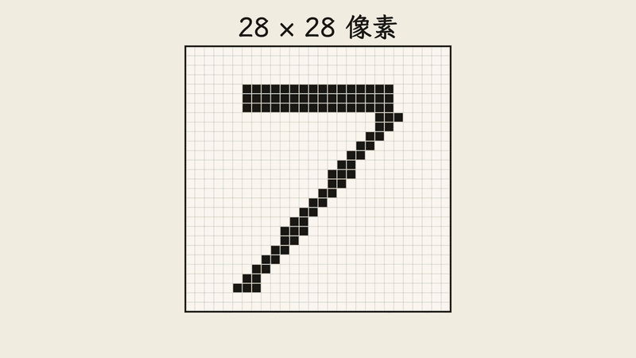
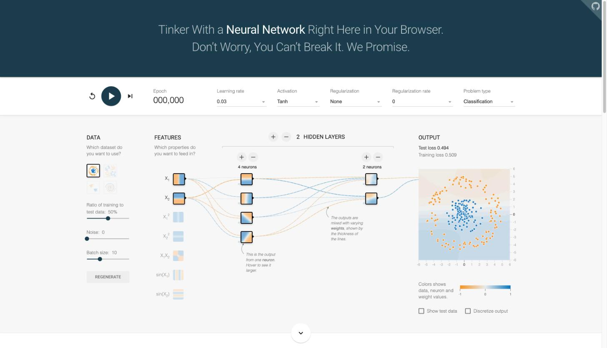
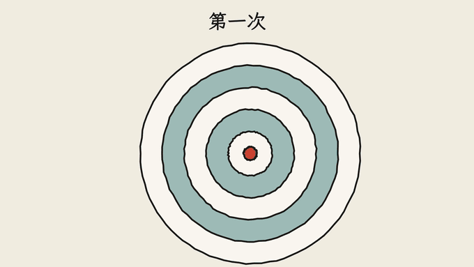
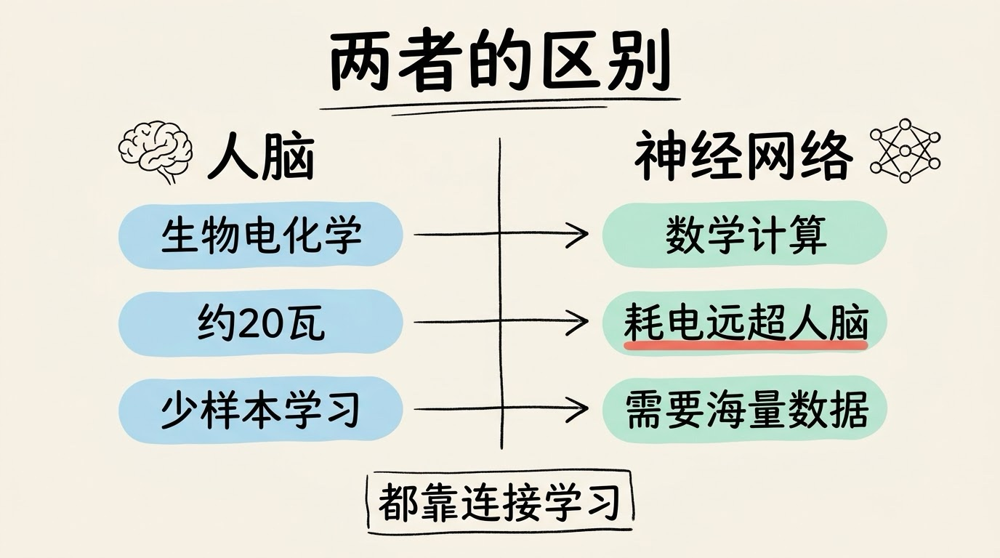
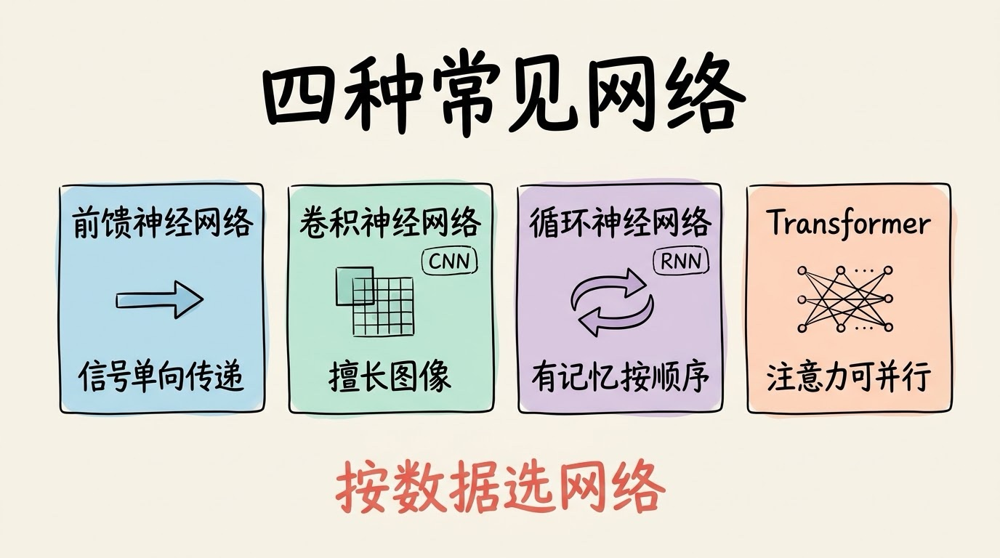
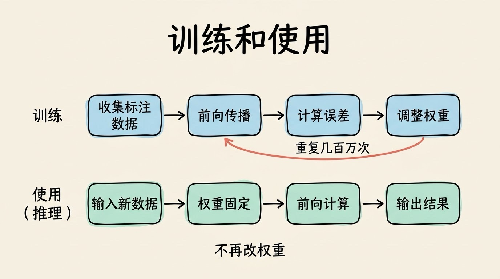

# 3分钟搞懂神经网络

> ⭐⭐需要一些基础 · 阅读时间 3分钟 · 更新于 2026-10-26
>
> 神经网络是由大量节点分层连接的计算模型，靠不断调整连接权重，从数据里自己学会规律。本文讲清它的三层结构、学习过程、层数为什么不是越多越好，以及它和人脑的真实差别，并更新了大模型时代的架构变化。

## 一句话定义

**神经网络** = 由大量节点分层连接而成的计算模型，通过不断调整节点之间的连接权重，从大量数据里自动学会规律。

举个例子：手机相册能把猫和狗的照片分到不同的文件夹，但没有人事先写过「猫的耳朵是尖的」这样的规则。系统是看了成千上万张标注过的照片，自己把区别学出来的。这种从数据里自己学规律的计算方法，就是神经网络要做的事。

## 信息一层一层加工，最后给出结果

神经网络通常分成三层：

- **输入层**：接收原始数据，比如图片的每个像素、一段文字拆出来的每个词
- **隐藏层**：一层层加工，前面的层找简单特征（边缘、线条），后面的层把这些特征组合成更复杂的概念（眼睛、耳朵）
- **输出层**：给出结果，比如「这是猫」的概率

以识别手写数字为例：输入层接收 28×28 的像素；第一层隐藏层发现线条和边缘；第二层把线条组合成圈、竖、弯钩这些形状；输出层综合这些信息，判断「这是数字 7」。每一层只做自己那一段，最后拼成一个完整的判断，就像流水线上的一道道工序。



「深度学习」里的「深」，指的就是隐藏层有很多层。

每个节点会接收上一层传来的信号，乘上连接的权重，再加上一个偏置，然后经过**激活函数**决定输出多大。激活函数很关键：如果没有它，不管堆多少层，整个网络都等价于一次简单的线性计算，学不出复杂的规律。



上图来自 TensorFlow Playground，这是一个可以直接在浏览器里操作的神经网络演示工具。图中的每一条连线就是一个权重，线越粗说明影响越大；训练之前，这些权重都是随机的，所以输出还是乱的。

## 学习就是反复试错，再逐步改权重

神经网络的学习过程可以拆成五步：

1. **随机初始化**：先给所有连接随机赋一个权重，这时候的输出基本是乱猜
2. **前向传播**：数据从输入层一路算到输出层，得到一个预测结果
3. **计算损失**：用损失函数衡量预测和正确答案之间差了多少
4. **反向传播**：从输出层往回算，弄清楚每个权重对这个误差负了多少责任
5. **梯度下降**：沿着让误差变小的方向，把每个权重微调一点点

然后把第 2 到第 5 步重复几百万次甚至更多，直到误差降到足够小。



这个过程里的几个概念可以这样理解：

- **权重**：连接的强弱，像水管的粗细，决定信号传过去多少
- **偏置**：节点的触发门槛，像开关的灵敏度
- **损失函数**：质检打分的标准，分数越高说明错得越多
- **梯度下降**：像蒙着眼睛下山，每一步都朝最低的方向迈一小步

## 它借鉴了大脑，但本质是数学

神经网络的灵感来自大脑。人脑约有 860 亿个神经元，靠神经元之间的连接传递信号，还能边学边改。神经网络借用了「节点互相连接、连接强弱可以调整」这个思路，但两者的差别很大：

- **工作方式**：人脑是生物电化学过程，神经网络是大量的矩阵运算等数学计算
- **能耗**：人脑只需约 20 瓦，训练大模型要动用成千上万张 GPU，耗电远远高于人脑
- **学习效率**：人能从几个例子中举一反三，神经网络通常要喂入海量数据进行学习才行
- **可解释性**：一个大模型有上亿乃至更多的参数，它为什么给出某个判断，至今很难完整说清，这就是常说的「黑盒」问题

所以，神经网络学到的是数据里的统计规律，能力很强，但它的「理解」和人类是否一样，目前仍有争论。



## 为什么它成了现代 AI 的基础

几乎所有你熟悉的 AI 应用，背后都是神经网络：

- **图像**：手机人脸解锁、相册自动分类，多用卷积神经网络（CNN）
- **语音**：语音助手、语音转文字，主流已经转向 Transformer 类模型
- **语言**：ChatGPT、Claude 这类大语言模型，都基于 Transformer
- **推荐**：短视频和电商平台的推荐系统
- **游戏**：AlphaGo 结合深度神经网络和强化学习下围棋
- **自动驾驶**：识别车道、行人和车辆

但它的发展也不是一帆风顺的：

```
1943年: 神经元的数学模型提出
1958年: 感知机，第一个能学习的神经网络
1974-1980年: 第一次 AI 寒冬（算力和算法都跟不上）
1986年: 反向传播算法普及，多层网络有了训练方法
1987-1993年: 第二次 AI 寒冬
2012年: AlexNet 在图像识别比赛中大幅领先，深度学习开始崛起
2017年: Transformer 提出，之后成为大模型的主流架构
2022年: ChatGPT 发布，大模型进入大众视野
```

## 不同的数据，要配不同的网络

神经网络有很多种结构，常见的几种各有分工：

- **前馈神经网络**：信号单向流动，适合基础的分类和回归
- **卷积神经网络（CNN）**：用小窗口在图片上滑动扫描，擅长图像
- **循环神经网络（RNN/LSTM）**：带有「记忆」，按顺序处理语音、文本，但必须一个个按顺序算，速度慢，如今大部分已被 Transformer 取代
- **Transformer**：用注意力机制让每个位置直接关注其他所有位置，可以并行计算，是今天大语言模型的基础



选哪种网络，主要看数据是什么：图片多用 CNN，文字和大部分序列任务多用 Transformer。

## 层数不是越多越好

层数越深，能学的特征越复杂，但也越难训练。原因是误差在往回传的过程中，会一层层变小（梯度消失）或变大（梯度爆炸），前面几层就学不动了。

2015 年的 ResNet 用「残差连接」解决了这个问题：让信号可以跳过几层直接传过去，网络因此能做到 152 层。GPT-3 有 96 层，而 GPT-4 等新模型的层数并没有公开。

所以深度要和任务匹配：任务简单，几层就够；层数越多，需要的数据和算力也越多，成本随之上升。

## 训练和使用，是两回事

训练阶段要收集和标注数据，反复调整权重，耗时从几个小时到几个月不等，成本很高。训练完成之后，权重就固定下来了，进入使用阶段，也就是「推理」：把新的数据输入一次，沿着已经固定的网络算一遍，就能得到结果。单次判断通常很快；大模型逐字生成长文本时，耗时取决于输出的长度。



这里有一个常见的误会：**你和 ChatGPT 聊天时，模型的权重并不会因此改变。** 它记住的是训练阶段学到的东西，聊天内容只是当次的输入。

## 时效性提醒

- **主流架构**：顶尖的大语言模型基本都采用 MoE（混合专家）结构。它把模型拆成许多「专家」子网络，每次只激活其中一小部分，在同样的算力下能做更大的规模。DeepSeek 于 2026 年 4 月发布的 V4-Pro，总参数约 1.6 万亿，每个 token 只激活约 490 亿。
- **混合架构**：把状态空间层（如 Mamba）和注意力层混用的做法，已经进入实际产品。英伟达 2026 年 6 月开源的 Nemotron 3 Ultra 就采用了这种结构，总参数 5500 亿，每个 token 激活约 550 亿。这类混合层主要用来降低长文本的计算成本，但目前各家的混合比例和做法差异较大，还没有统一结论。
- **闭源模型的细节**：GPT-4 之后的参数规模和层数，各家都没有官方披露，相关数字只能当作推测。
- **具体数字**：参数量、价格和上下文长度变化很快，以各家官方发布为准。

💬 **互动话题**：神经网络「学会」的东西，和人真正理解一件事，你觉得差别在哪里？

📖 **相关阅读**：

- [3分钟搞懂深度学习](../02-deep-learning/README.md)
- [3分钟搞懂Transformer](../03-transformer/README.md)
- [3分钟搞懂大语言模型](../04-llm/README.md)
- [3分钟搞懂训练和推理](../05-training-and-inference/README.md)

**资料来源**：

- Brown 等，Language Models are Few-Shot Learners（2020）：https://arxiv.org/abs/2005.14165
- NVIDIA，GPT-3 175B 文档（96 个 Transformer 层）：https://docs.nvidia.com/dl-cuda-graph/examples/gpt-3-175b.html
- OpenAI，GPT-4 Technical Report（2023）：https://arxiv.org/abs/2303.08774
- He 等，Deep Residual Learning for Image Recognition（2015）：https://arxiv.org/abs/1512.03385
- Vaswani 等，Attention Is All You Need（2017）：https://arxiv.org/abs/1706.03762
- Zhang 等，Very Deep Self-Attention Networks for End-to-End Speech Recognition（2019）：https://arxiv.org/abs/1904.13377
- The Evolution of Mixture-of-Experts Architectures in Large Language Models（2026 综述）：https://arxiv.org/pdf/2608.08650
- TensorFlow Playground（配图来源）：https://playground.tensorflow.org/
- NVIDIA Nemotron 3 Ultra 报道（2026）：https://aiweekly.co/alerts/nvidia-ships-nemotron-3-ultra-a-550b-open-moe-for-agents
- DeepSeek V4 发布报道（2026-04）：https://letsdatascience.com/news/deepseek-releases-open-source-v4-large-models-f5a3b72c

---

[📚 返回目录](../README.md) ｜ 下一篇：[3分钟搞懂深度学习](../02-deep-learning/README.md) ➡️
