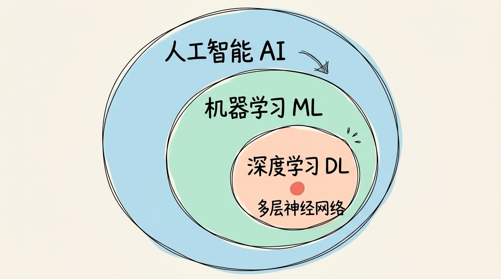
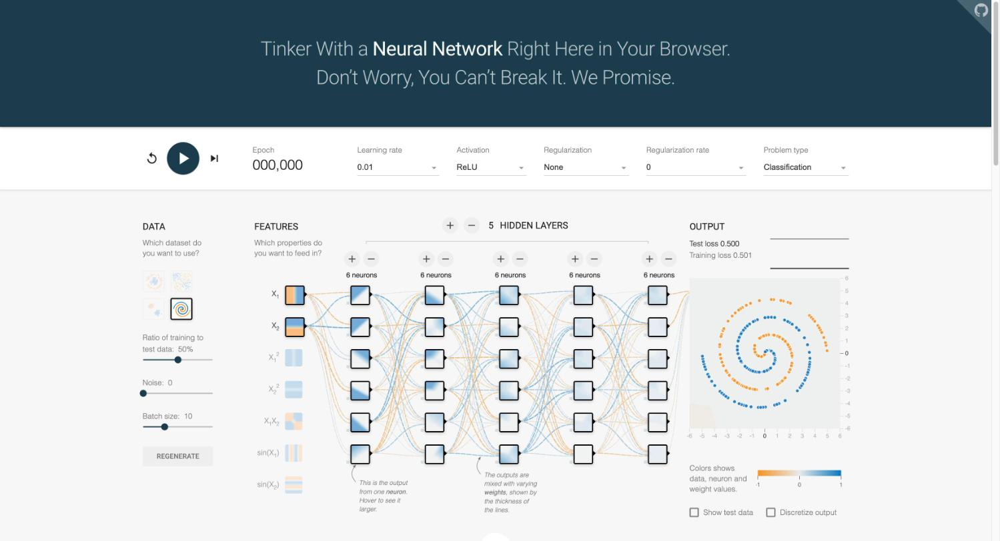
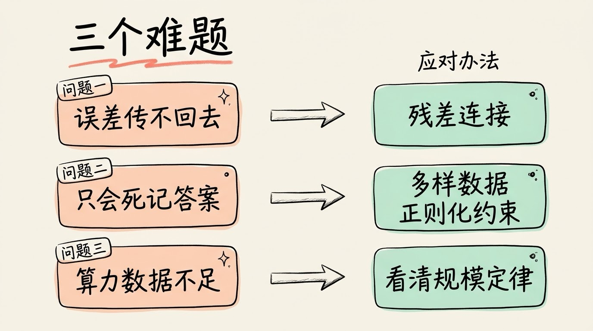
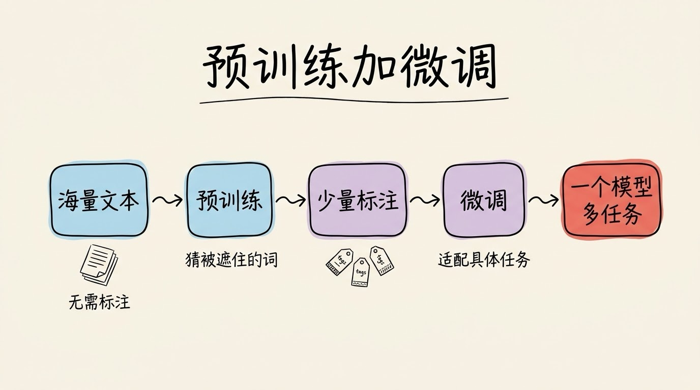

# 3分钟搞懂深度学习

> ⭐⭐需要一些基础 · 阅读时间 3分钟 · 更新于 2026-10-26
>
> 深度学习是用很多层神经网络自动学习规律的机器学习方法。本文讲清为什么层数多才能学会复杂规律，深层网络怎样克服训练难题，预训练加微调如何成为大模型的基础，并更新了 2026 年的架构和应用情况。

## 一句话定义

**深度学习** = 用很多层神经网络，从大量数据中自动学会规律的机器学习方法。层数多，才能把简单的特征一层层组合成复杂的概念。

可以把它想象成层层筛选的招聘流程：一轮面试只看简历，很难判断一个人的真实能力；多轮面试，每一轮考察的东西都比上一轮深入，最后的判断自然更可靠。深度学习的「深」，就是这里的「多轮」。

## 它是机器学习里的一条路线

机器学习是让计算机从数据中学规律，深度学习是其中的一条路线，层次关系是这样的：

```
人工智能(AI)
 └── 机器学习(ML)
      └── 深度学习(DL)：多层神经网络
```



传统机器学习往往要靠人工设计特征，比如判断垃圾邮件时，人要先决定「看哪些词、有没有链接」，模型只负责在这些特征上做判断。深度学习的区别在于，特征本身也是网络学出来的，人不用提前规定要看什么。

| 维度 | 传统机器学习 | 深度学习 |
|------|------------|---------|
| 特征提取 | 人工设计特征 | 网络自动学习特征 |
| 模型结构 | 通常较浅，如决策树、支持向量机 | 多层神经网络 |
| 数据需求 | 数据少时也能工作 | 通常需要大量数据 |
| 算力需求 | 较低，普通电脑即可 | 高，依赖 GPU 集群 |
| 适用场景 | 结构化数据、小规模问题 | 图像、语音、文本等复杂感知任务 |
| 例子 | 垃圾邮件分类、信用评分 | 人脸识别、语音识别、大语言模型 |

## 层数多，才能把简单特征拼成复杂概念

以识别一张人脸的照片为例，网络的每一层大致是这样分工的（层数为示意）：

```
输入: 一张照片
 ↓
低层(前几层): 识别边缘和颜色
 ↓
中层(中间几层): 组合出眼睛、鼻子、嘴巴的形状
 ↓
高层(靠后几层): 理解面部结构和表情
 ↓
输出: 「这是一张笑脸」
```

低层只认线条，中层认部件，高层才理解整张脸的意思。每一层都在前一层的结果上再加工一次，所以层数越多，能表达的概念越抽象。


这种能力也有一个直接的体现：网络越深，能学会的任务越复杂。



| 网络深度 | 能完成的任务 | 代表模型 |
|---------|------------|---------|
| 几层 | 简单分类、基础预测 | 早期的神经网络 |
| 十几层 | 图像分类 | VGG-16（16 层） |
| 几十到一百多层 | 复杂图像识别 | ResNet-152（152 层） |
| 近百层以上 | 大语言模型 | GPT-3（96 层） |

截止目前最新的大语言模型，层数和结构都没有完整公开，但它们普遍采用了比「堆更多层」更复杂的设计，这一点后面也会说明。

## 深层网络难训练，靠三个办法解决

层数一多，训练就会遇到麻烦。这是深度学习能走到今天，必须先解决的几个问题。



**第一个问题：误差传不回去。** 训练时，误差要从输出层一层层往回传，层数越多，信号在传递中越容易衰减到几乎为零（梯度消失），或者越放越大（梯度爆炸）。前面几层因此学不到东西。2015 年提出的 ResNet 用「残差连接」解决了这个问题：让信号可以跳过若干层直接传过去，网络因此可以做到 152 层。今天的深层网络几乎都带着这种结构。

**第二个问题：记住了答案，却不会举一反三。** 网络参数很多，如果数据不够，它可能只是把训练数据背下来，换一张没见过的图就认不出来，这就是过拟合。解决办法包括给足够多、足够多样的数据，以及在训练中加入正则化等约束。

**第三个问题：算力和数据跟不上。** 2020 年 OpenAI 的研究发现，在语言模型上，模型规模、数据量和训练算力增加时，模型的表现会按照可以预测的规律稳定提升，这就是常说的规模定律（Scaling Laws）。规模越大，效果通常越好，但需要的数据和算力也越多。

## 深度学习靠三样东西：数据、算力和算法

缺了任何一样，深度学习都难以成事。可以类比造汽车：

- **数据是燃料**：深层网络参数多，需要大量样本才能学到稳定的规律。ImageNet 数据集就有约 1400 万张标注图片，是 2012 年前后图像识别取得突破的关键基础之一。

- **算力是引擎**：训练要做海量的矩阵运算，必须依赖 GPU 集群。训练头部大模型的花费，已经是普通公司难以承受的规模。
- **算法是蓝图**：包括网络架构（CNN、Transformer 等）、训练方法（反向传播和梯度下降），以及后面要讲的预训练与微调。

## 先预训练，再微调：今天大模型的训练路线

早期的深度学习，每做一个任务都要从零开始训练。2018 年前后，自然语言处理领域的 BERT 和 GPT-1 确立了一种新路线：**预训练 + 微调**。

- **预训练**：先用海量的文本（不需要人工标注答案）让模型学习语言本身的规律，比如根据上下文猜被遮住的词。
- **微调**：在预训练好的模型基础上，用少量带标注的数据，让它适应具体任务，比如情感分类或问答。



这种做法让一个模型可以同时胜任很多任务，也是今天大语言模型的基本路线。

## 从感知到生成：深度学习的发展历程

深度学习的成功不是一下子出现的，它经历过两次寒冬，才等到了条件成熟的时刻。

```
1943年: 神经元的数学模型提出
1974-1980年: 第一次 AI 寒冬（算力与算法都跟不上）
1986年: 反向传播算法普及，多层网络有了训练方法
1987-1993年: 第二次 AI 寒冬
2006年: 「深度学习」概念重新流行，Hinton 提出深度信念网络
2012年: AlexNet 在 ImageNet 比赛中取得突破，前五名错误率为 15.3%，远低于第二名的 26.2%
2015年: ResNet 用残差连接训练出 152 层的网络
2016年: AlphaGo 击败围棋职业九段李世石
2017年: Transformer 架构提出，之后成为大模型的主流架构
2018年: BERT 和 GPT-1 确立预训练加微调的路线
2020年: GPT-3 发布，参数量达到 1750 亿
2022年: ChatGPT 发布，大模型进入大众视野
2024年: Sora 发布，视频生成受到关注
```


2012 年之后深度学习爆发，有三个条件同时成熟：互联网积累了海量数据，GPU 带来了足够的算力，新的网络架构和训练技巧让深层网络能够稳定训练。

## 深度学习能做什么，又做不好什么

**擅长的场景**主要是感知类任务，也就是让机器「看懂」和「听懂」：

- **图像**：人脸识别、自动驾驶中的目标检测、医学影像辅助诊断
- **语音**：语音助手、语音转文字
- **语言**：ChatGPT 这类对话模型、机器翻译、文本生成
- **图像和视频生成**：AI 绘画、视频生成
- **推荐**：短视频和电商平台的推荐系统
- **游戏**：AlphaGo、Dota 2 的 AI 对手

**不擅长的场景**同样明显：数据很少的场景、需要严格因果推理的问题，以及需要解释「为什么这样判断」的决策。深度学习的结果通常很准，但过程很难说清楚。

## 几个容易混淆的地方

**深度学习就是机器学习。** 不对。深度学习是机器学习的一个子集。机器学习还包括决策树、支持向量机、随机森林等方法，在很多结构化数据的问题上，它们依然是更实用的选择。

**网络越深，效果越好。** 不一定。层数增加会带来训练困难、过拟合，以及更高的成本。层数要和任务、数据量匹配，不是越多越好。

**深度学习在像人脑一样思考。** 更准确地说，它只是借鉴了神经元互相连接的结构，本质是数学运算。它学到的是数据里的统计规律，能力很强，但和人类的理解是否一样，目前仍有争论。

## 主流架构：CNN、RNN 和 Transformer 分别管哪一块

**卷积神经网络（CNN）** 擅长处理图像。它用小的卷积核在图片上滑动，局部的特征可以在整张图上复用，参数因此少得多。ResNet、VGG 都属于这一类。

**循环神经网络（RNN/LSTM）** 按顺序处理数据，能够把前文的信息带到后文，早年用于语音和文本。因为必须一个个按顺序计算，速度慢，在大多数场景下已经被 Transformer 取代。

**Transformer** 用注意力机制让序列中的每个位置直接关注其他位置，可以并行计算，训练效率高，是今天大语言模型的基础架构。GPT、BERT、ChatGPT 都基于它。

| 数据类型 | 常用架构 | 代表应用 |
|---------|---------|---------|
| 图片 | CNN | 人脸识别、图像分类 |
| 文字 | Transformer | ChatGPT、机器翻译 |
| 语音 | Transformer、CNN | 语音识别 |
| 视频 | CNN、Transformer 与扩散模型 | 动作识别、视频生成 |

## 时效性提醒

- **架构**：Transformer 仍是大语言模型的主流，但顶尖模型大多采用 MoE（混合专家）结构，每次只激活一部分参数。DeepSeek 于 2026 年 4 月发布的 V4-Pro，总参数约 1.6 万亿，每个 token 激活约 490 亿。
- **混合结构**：状态空间层（如 Mamba）和注意力层混用的做法已进入实际产品，英伟达 2026 年开源的 Nemotron 3 Ultra 就采用了这种结构。
- **多模态**：越来越多的模型能同时处理文字、图片和音频，文字和图像之间的界限在变模糊。
- **具体数字**：参数量、价格和性能变化很快，以各家官方发布为准。

💬 **互动话题**：你平时用过哪些基于深度学习的应用？人脸解锁、语音助手、AI 绘画，哪一个最让你意外？

📖 **相关阅读**：

- [3分钟搞懂神经网络](../01-neural-network/README.md)
- [3分钟搞懂大语言模型](../04-llm/README.md)
- [3分钟搞懂Transformer](../03-transformer/README.md)

**资料来源**：

- Krizhevsky 等，ImageNet Classification with Deep Convolutional Neural Networks（2012）：https://papers.nips.cc/paper/2012/hash/c399862d3b9d6b76c8436e924a68c45b-Abstract.html
- He 等，Deep Residual Learning for Image Recognition（2015）：https://arxiv.org/abs/1512.03385
- Kaplan 等，Scaling Laws for Neural Language Models（2020）：https://arxiv.org/abs/2001.08361
- Devlin 等，BERT（2018）：https://arxiv.org/abs/1810.04805
- Brown 等，Language Models are Few-Shot Learners（2020）：https://arxiv.org/abs/2005.14165
- Vaswani 等，Attention Is All You Need（2017）：https://arxiv.org/abs/1706.03762
- DeepMind，Mastering the game of Go with deep neural networks and tree search（Nature，2016）
- ImageNet 官网：https://www.image-net.org/
- DeepSeek V4 发布报道（2026-04）：https://letsdatascience.com/news/deepseek-releases-open-source-v4-large-models-f5a3b72c
- NVIDIA Nemotron 3 Ultra 报道（2026）：https://aiweekly.co/alerts/nvidia-ships-nemotron-3-ultra-a-550b-open-moe-for-agents

---

⬅️ 上一篇：[3分钟搞懂神经网络](../01-neural-network/README.md) ｜ [📚 返回目录](../README.md) ｜ 下一篇：[3分钟搞懂Transformer](../03-transformer/README.md) ➡️
