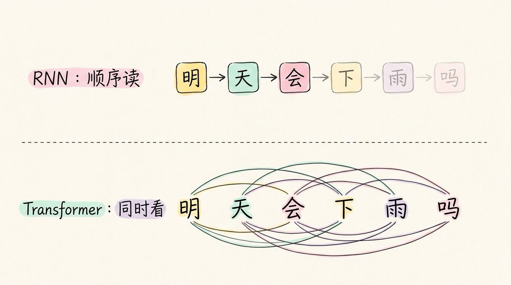
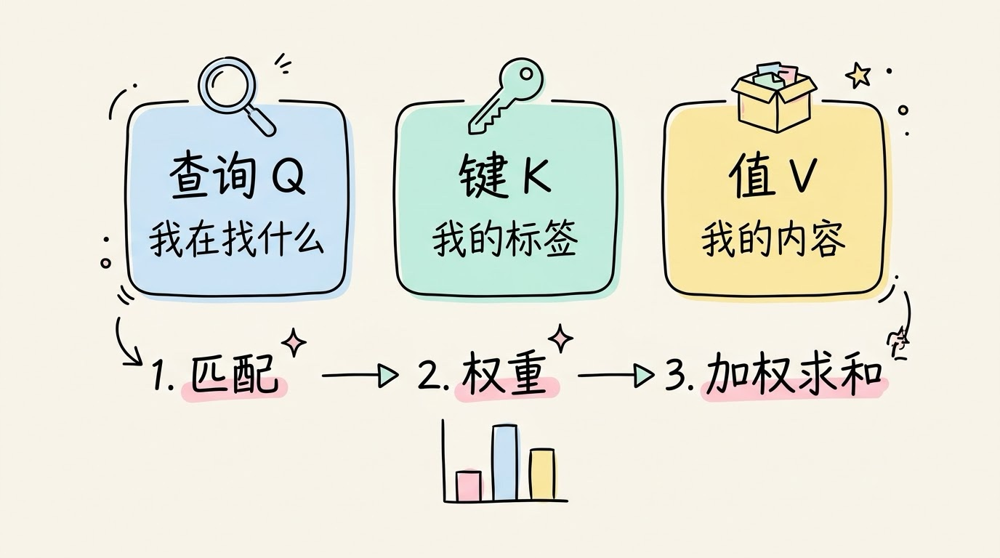
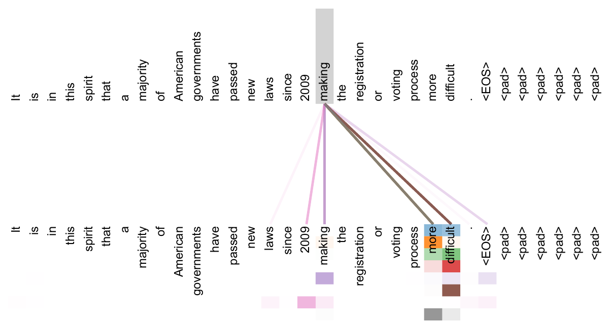
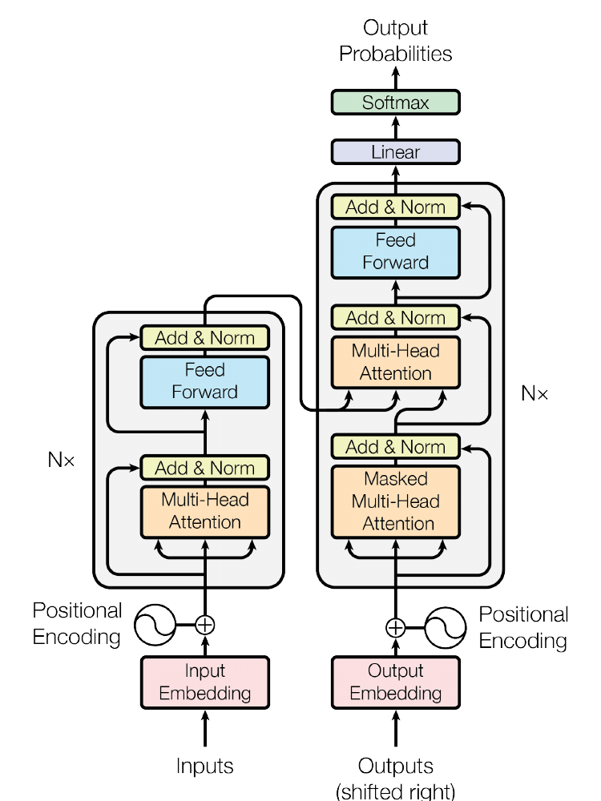

# 3分钟搞懂Transformer

> ⭐⭐⭐进阶 · 阅读时间 3分钟 · 更新于 2026-10-26
>
> Transformer 是今天大模型的共同底座，靠注意力让每个词同时计算自己与其他所有词的关联，并借助并行计算变快。本文讲清注意力怎么算、为什么需要位置编码，以及 2026 年它在混合专家和混合注意力上的新变化。

## 一句话定义

**Transformer** = 一种神经网络架构：处理一整段文字时，让每个词同时计算自己和其他所有词的关联强度，再据此更新自己的含义，从而读懂上下文。

ChatGPT、Claude、通义千问、DeepSeek 等大模型，底层几乎都是它的各种变体。

## 旧方法的毛病：一个字一个字排队读

在 Transformer 出现之前，处理文字的主流做法是 RNN（循环神经网络）。它读句子的方式，很像一个人顺着一行字往下看：读一个词，把理解压进一个“记忆”里，再读下一个词。

这种读法有两个明显的毛病：

- **读得慢**：必须等前一个词处理完，才能处理下一个词，没法同时算。
- **读得远就忘**：句子越长，前面的信息在一层层传递中被冲淡得越厉害，相隔很远的词很难互相影响。

例如，在“明天会下雨”里的“会”是“将要”，“下午要开会”里的“会”是“会议”，判断靠的是后面的“下雨”。普通的 RNN 按顺序读，读到“会”的时候，后面的字还没看到，只能先猜，等读到后面再回头修正，而前面的理解已经被压缩进了一个模糊的记忆。Transformer 则让“会”直接去看整句，和“下雨”“开”等词比对，一步就能确定它的意思。

## 注意力：每个词自己决定该看谁

Transformer 的核心是**自注意力（Self-Attention）**。

每个词会生成三组向量，可以这样理解：

- **查询（Q）**：我在找什么；
- **键（K）**：我能提供什么标签，方便别人来匹配；
- **值（V）**：我真正携带的内容。

计算时，每个词拿自己的 Q 去和所有词的 K 比对，得到一组相关分数；再用 softmax 把分数变成总和为 1 的权重；最后按权重把所有词的 V 加起来。权重高的词贡献大，权重低的词就会被忽略。

以“苹果发布新手机”为例：“苹果”的查询和“发布”“手机”的标签匹配度高，于是它吸收了更多这两个词的信息，模型就判断这里的“苹果”是公司，而不是水果。

真实的注意力权重长什么样？下面是原论文里的一个例子。句子很长，“making”和后面的“more difficult”隔着十几个词，但不少注意力头都会把“making”直接连到“more”和“difficult”上，因为它们一起构成了“making ... more difficult”这个搭配。这正是 RNN 很难做到的远距离关联。

这些权重不是工程师手工设定的，而是训练时从海量数据里学出来的。在实际训练时，模型还会同时开好几组注意力（多头注意力），每一组关注不同的关系：有的盯语法结构，有的盯指代，有的盯语义。最后再把结果合在一起用。

## 没有位置编码，词序就丢了

注意力看的是“哪些词和哪些词有关”，却天然不知道词的先后顺序。如果只靠注意力，“狗咬人”和“人咬狗”在模型眼里几乎没有区别。

所以 Transformer 会在输入时，给每个词加上一份位置信息（位置编码），让模型知道谁在前、谁在后。

## 快，是因为能一次看完整段

RNN 要排队，Transformer 不用排队。整段文字可以同时送进去，所有词之间的注意力分数，可以用一批矩阵运算一次算完。这正好适合 GPU 这种擅长同时做大量相同运算的芯片。

2017 年的原始论文里，基础版模型只在 8 块 P100 显卡上训练了 12 小时。注意，这是基础版的数字，更大的模型训练时间要长得多。

不过这种并行主要发生在训练阶段。模型真正回答问题时，仍然是一个字一个字往外生成，因为每个新字都依赖前面已经生成的内容。为了不重复计算，推理时会把之前算过的 K 和 V 缓存起来，这就是 **KV Cache**。这也解释了一个常见现象：为什么对话一长，显存占用就涨得很快。

## 一层 Transformer 里有什么

一层 Transformer 大致由两部分组成：

1. **多头注意力**：让词与词之间互相交换信息；
2. **前馈神经网络**：对每个词单独做一次非线性变换，提炼更抽象的特征。

两部分外面还包着残差连接和归一化，让深层网络更容易训练。把几十甚至上百层这样的结构堆叠起来，就是一个大模型。

可以把它理解成“交流”和“消化”交替进行：注意力负责词与词之间的交流，前馈网络负责把交流的结果消化成更高层的理解。模型的能力，就是靠这样反复堆出来的。

## 同一套结构，搭成了三种样子

按照用不用编码器和解码器，Transformer 有三种常见的搭法：

- **只用解码器**：GPT 系列就是这种，擅长一个字一个字地生成文字。ChatGPT 名字里的 GPT（Generative Pre-trained Transformer），说的就是它。
- **只用编码器**：BERT 是代表，擅长理解文字，常用于分类、搜索等任务。
- **编码器加解码器**：T5 是代表，适合“读一段输入，写一段输出”的任务，比如翻译、摘要。

名字里的 Transformer 有“转换”的意思，指的是把一串输入转换成一串输出。

它处理的本质上是一串向量序列，所以它不仅仅是只能处理文字。Vision Transformer（ViT）把图片切成小块当作“词”来处理，语音和视频也能用同样的思路。文字只是它最早、也最成功的应用。

## 短板：文本越长，计算越贵

注意力要让每个词和所有词都算一遍关系，计算量大致随文本长度的平方增长。文本长度翻一倍，计算量差不多要翻四倍。

这是 Transformer 目前最大的痛点，也是 2026 年大家最想解决的问题。

## 2026 年：骨架没变，内部在换

Transformer 的骨架仍然是主流，但围绕它的改造正在快速进行，主要有三个方向：

- **混合专家（MoE）**：模型总参数很大，但每次只激活其中一部分专家，单次计算量可以控制住。许多大模型都采用了这种做法。
- **混合注意力**：把大部分标准注意力换成线性注意力或稀疏注意力，只保留少量全注意力层。阿里的 Qwen3.5（2026 年 2 月发布）、Kimi Linear、DeepSeek V3.2 的稀疏注意力，都是这个思路。
- **状态空间模型**：以 Mamba 为代表，尝试在长文本上更省计算，目前也多与注意力混合使用。

不过，混合注意力这条路目前还没有定论。MiniMax 早期的模型用过线性注意力，后来的 M2 又换回了标准注意力。团队的说法是，线性注意力在生产环境里比较难处理，在推理和多轮对话这类任务上准确率不够理想。

## 用的时候要注意什么

对普通用户来说，最实用的一点是：模型能接住的上下文很长，不代表它每一处都同样用力。有研究发现，模型对长文本中间部分的信息利用相对较弱。所以把关键要求放在开头或结尾，资料太多时先做筛选，通常比一股脑全塞进去更有效。

对开发者来说，要记住两件事：一是注意力的计算成本会随长度快速上涨，长上下文不是免费的；二是 KV Cache 占用的显存，常常是长对话和大批量请求时的瓶颈。

不懂 Transformer 也能用好 AI，就像开车不需要懂发动机。但如果你要做开发、调模型、估算成本，它的原理就值得花这 3 分钟弄清楚。

## 时效性提醒

Transformer 的基本原理已经稳定了近十年，变化快的是：

- 模型规模和参数量，以各家官方发布为准。GPT-4 等闭源模型的结构和参数量没有完整公开，外界的估计不能当作确定数字。
- 注意力的变体和加速方法，如 FlashAttention 等，还在快速迭代。
- 混合架构最终会怎么演化，目前还没有定论。

**建议**：原理可以放心学，具体参数和性能数字，要以最新的官方资料为准。

💬 **互动话题**：你平时用大模型时，有没有遇到过它"漏看"一段资料的情况？你觉得问题可能出在哪？

📖 **相关阅读**：

- [3分钟搞懂神经网络](../01-neural-network/README.md) - 理解 Transformer 的基本单元
- [3分钟搞懂深度学习](../02-deep-learning/README.md) - 理解 AI 的整体框架
- [3分钟搞懂大语言模型](../04-llm/README.md) - 理解基于 Transformer 的大模型
- [3分钟搞懂Token和上下文](../06-token-and-context/README.md) - 理解上下文窗口为什么有限
- [3分钟搞懂工具调用](../../09-agent-engineering/02-function-calling/README.md) - 看看 Transformer 如何被用来真正干活

**推荐学习路径**：神经网络 → 深度学习 → 本篇（Transformer）→ 大语言模型

**资料来源**：

- Vaswani 等，Attention Is All You Need（2017）：https://arxiv.org/abs/1706.03762
- Devlin 等，BERT（2018）：https://arxiv.org/abs/1810.04805
- Brown 等，Language Models are Few-Shot Learners（2020）：https://arxiv.org/abs/2005.14165
- Dosovitskiy 等，An Image is Worth 16x16 Words（2020）：https://arxiv.org/abs/2010.11929
- Liu 等，Lost in the Middle（2023）：https://arxiv.org/abs/2307.03172
- Gu & Dao，Mamba（2023）：https://arxiv.org/abs/2312.00752
- Sebastian Raschka，Beyond Standard LLMs：https://magazine.sebastianraschka.com/p/beyond-standard-llms

---

⬅️ 上一篇：[3分钟搞懂深度学习](../02-deep-learning/README.md) ｜ [📚 返回目录](../README.md) ｜ 下一篇：[3分钟搞懂大语言模型](../04-llm/README.md) ➡️
