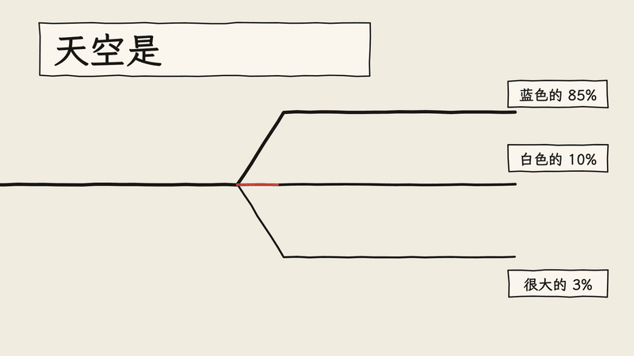
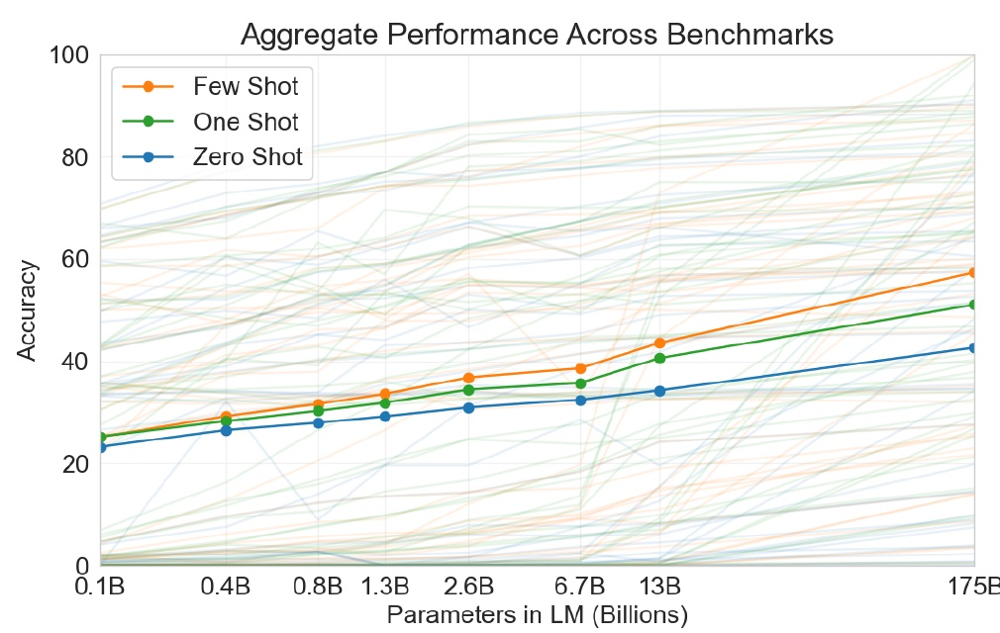
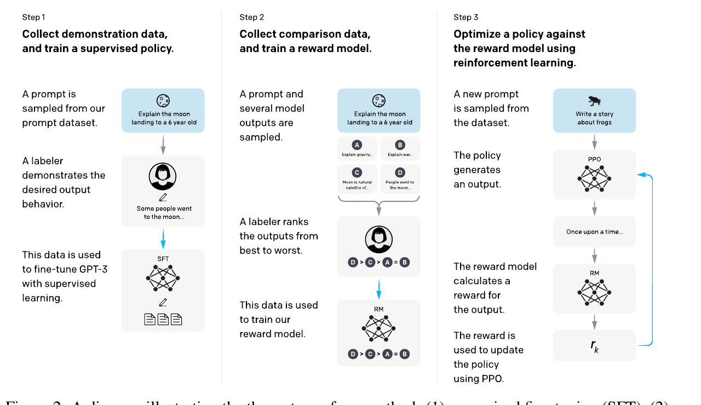
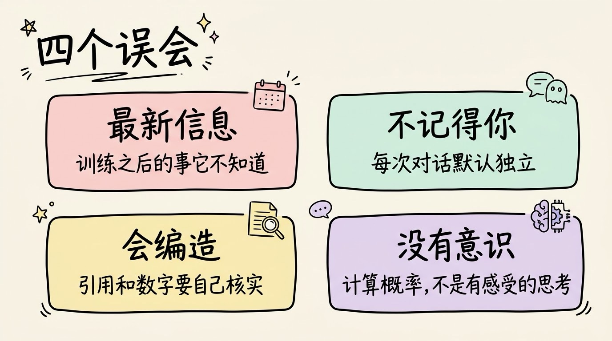
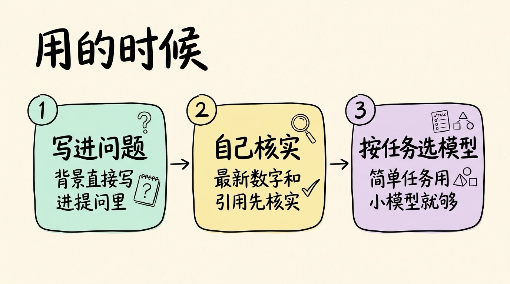

# 3分钟搞懂大语言模型

> ⭐⭐需要一些基础 · 阅读时间 3分钟 · 更新于 2026-10-26
>
> 大语言模型靠反复预测下一个词学会语言，参数越多能记住的规律越细，但它学到的是统计规律，不是查证过的知识。本文讲清它怎样经过预训练、指令微调和人类反馈练成，哪些事做得好、哪些事会出错，以及这几年推理模型和长上下文带来的变化。

## 一句话定义

**大语言模型（LLM）** = 用海量文本训练出来的超大神经网络。它的核心工作是：根据前面的文字，预测下一个最可能出现的词，然后一个词接一个词地生成回答。

比如输入“天空是”，模型会根据学到的规律，判断下一个词最可能是“蓝色的”；接着再预测下一个词，直到整句话写完。ChatGPT、Claude、Gemini、通义千问、DeepSeek 等，都是这一类模型。



## “大”指的是什么

模型里有大量可以调整的数字，叫做**参数**。训练的过程，就是不断调整这些数字。参数越多，能容纳的语言规律就越复杂。

| 模型 | 参数量 | 年份 |
| ----------- | ----------- | ----------- |
| BERT-base | 约 1.1 亿 | 2018 |
| GPT-2（最大版） | 15 亿 | 2019 |
| GPT-3 | 1750 亿 | 2020 |
| GPT-4 及之后的闭源模型 | 官方未公开 | 2023 起 |

这里要注意，参数多能力通常更强，但不是线性地变强。参数量增加一倍，成本却往往要多出不少。



## 模型是怎么练出来的

大语言模型的训练通常分三步，像读书、学规矩、听反馈。

**第一步：预训练**。把互联网上的书籍、网页、代码、论文等大量文本交给模型，让它不断预测下一个词。预测错了就调整参数，预测对了就强化。这一步学到的是语言本身，以及大量的知识和常识。训练要用大量的 GPU 连续跑很久，成本主要花在算力上。

**第二步：指令微调**。预训练出来的模型只会“接龙”，不一定会回答问题。所以要用人工写好的“问题 + 好回答”示例再训练一遍，让它学会按照指令来回答。

**第三步：人类反馈强化学习（RLHF）**。让人对同一个问题的多个回答排序，告诉模型哪种回答更好、更有帮助、更安全。2022 年 OpenAI 的 InstructGPT 论文就采用了这套做法，人工评测显示，13 亿参数的 InstructGPT 回答比 1750 亿参数的 GPT-3 更受欢迎。这说明，训练方法有时比单纯堆参数更重要。



## 它到底懂不懂

严格来说，它的本质是统计预测。以“北京是中国的”为例，模型可能会给出“首都”的概率最高（以下为示意数字）：

```
输入: "北京是中国的"
- "首都"  概率 85%  ← 选这个
- "城市"  概率 10%
- "地方"  概率  3%
```

这种机制能让它写出通顺、有条理的文章，同时也解释了它为什么会“一本正经地胡说八道”。它是根据规律“接得像”，而不会去查证事实。所以它的回答适合当作起点，关键事实还是要自己核对才可靠。

## 擅长什么，不擅长什么

| 任务 | 表现 | 例子 |
| ----------- | ----------- | ----------- |
| 文字生成与改写 | 很好 | 写邮件、改文章、润色 |
| 摘要与提取要点 | 很好 | 长文总结、会议纪要 |
| 翻译 | 很好 | 多语言互译 |
| 知识解释 | 较好，但需核实 | 解释概念、答疑 |
| 复杂推理与数学 | 有提升，仍会出错 | 多步推理、复杂计算 |
| 最新信息 | 不擅长 | 训练之后发生的事，需要搜索工具补充 |

## 它没有你想的那么无所不知

这里有几个常见的误会，值得单独说清楚。

第一，它不会自动知道最新的事。模型的知识停在训练数据的截止日期。如果产品接入了搜索工具，它才能查到新信息，这是工具的功劳，不是模型本身变新了。工具怎么接入，可以看我们系列文章的[《3分钟搞懂工具调用》](../../09-agent-engineering/02-function-calling/README.md)这一篇。

第二，它默认不记得你。每次对话默认是独立的，除非产品做了记忆功能，否则上一次聊过的内容，它不一定还记得。

第三，它会编造。引用、数字、人名、论文标题，都可能是看起来合理但不存在的内容，需要核实。

第四，它没有意识和感受。它的“思考”是计算概率，不是有感受的思维。把它当成工具来用，效果最好。



## 参数越大，不一定越好

参数大，能力通常更强，但训练和推理的成本也更高。对于大部分日常任务，中小模型已经够用。选模型时，看的应该是任务难度、响应速度和成本，而不是参数量。

## 这几年变了什么

- **2018 年**：谷歌的 BERT 和 OpenAI 的 GPT-1 相继出现，预训练加微调成为主流思路。
- **2020 年**：GPT-3 把参数量推到 1750 亿，展示出只靠提示词就能完成很多任务的能力。
- **2022 年**：InstructGPT 的训练方法被用到 ChatGPT 上，大模型开始走进普通人的生活。
- **2024 年**：推理模型兴起，它们在回答前会先进行一段较长的推理，数学和编程类问题的表现明显提升。
- **2025 年**：DeepSeek-R1 公开了用强化学习训练推理能力的方法，推理模型的训练路线更加清晰。
- **2026 年**：前沿模型的上下文窗口普遍达到几十万到百万 token 级别。不过，宣传上限不等于模型能有效利用的长度，长文本中间部分的信息仍可能被忽略。

另外，越来越多的模型开始采用混合专家（MoE）结构，每次只激活一部分参数，在总能力和推理成本之间取得平衡。Transformer 架构的具体变化，可以看《3分钟搞懂Transformer》。

## 用的时候要注意什么

- 重要的背景资料直接写进问题里，别指望它记得上次聊过的内容。
- 涉及最新信息、具体数字和引用来源时，先让它说明依据，再自己核实。
- 简单的任务用小一点、便宜一点的模型就够；复杂推理再考虑大模型或推理模型。



## 时效性提醒

大模型迭代很快，具体的模型名称、价格、上下文长度，都以各家官方发布为准。相对稳定的是底层逻辑：预测下一个词，加上预训练、指令微调和人类反馈。

💬 **互动话题**：你最常用大模型做什么？写作、编程、学习，还是闲聊？

📖 **相关阅读**：

- [3分钟搞懂神经网络](../01-neural-network/README.md) - 理解大模型的基本单元
- [3分钟搞懂深度学习](../02-deep-learning/README.md) - 理解大模型背后的训练方法
- [3分钟搞懂Transformer](../03-transformer/README.md) - 理解大模型的底层架构
- [3分钟搞懂训练和推理](../05-training-and-inference/README.md) - 理解模型训练与使用的区别
- [3分钟搞懂Token和上下文](../06-token-and-context/README.md) - 理解上下文窗口为什么有限
- [3分钟搞懂工具调用](../../09-agent-engineering/02-function-calling/README.md) - 理解模型如何接入搜索等外部工具

**推荐学习路径**：神经网络 → 深度学习 → Transformer → 本篇（大语言模型）

**资料来源**：

- Vaswani 等，Attention Is All You Need（2017）：https://arxiv.org/abs/1706.03762
- Brown 等，Language Models are Few-Shot Learners（2020）：https://arxiv.org/abs/2005.14165
- Kaplan 等，Scaling Laws for Neural Language Models（2020）：https://arxiv.org/abs/2001.08361
- Ouyang 等，Training language models to follow instructions with human feedback（2022）：https://arxiv.org/abs/2203.02155
- DeepSeek-AI，DeepSeek-R1（2025）：https://arxiv.org/abs/2501.12948

---

⬅️ 上一篇：[3分钟搞懂Transformer](../03-transformer/README.md) ｜ [📚 返回目录](../README.md) ｜ 下一篇：[3分钟搞懂训练和推理](../05-training-and-inference/README.md) ➡️
