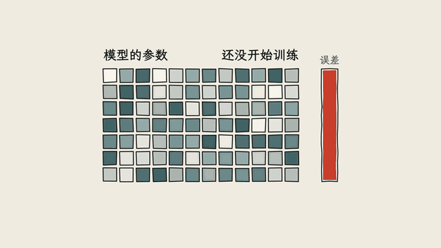
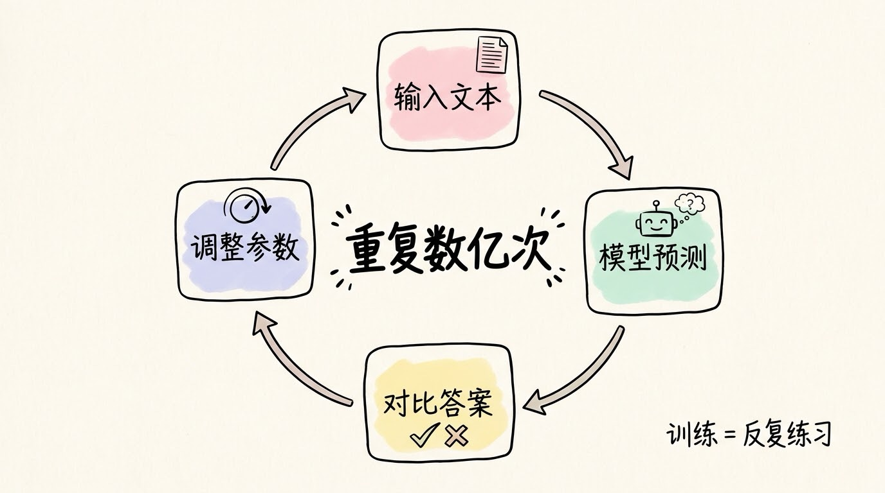
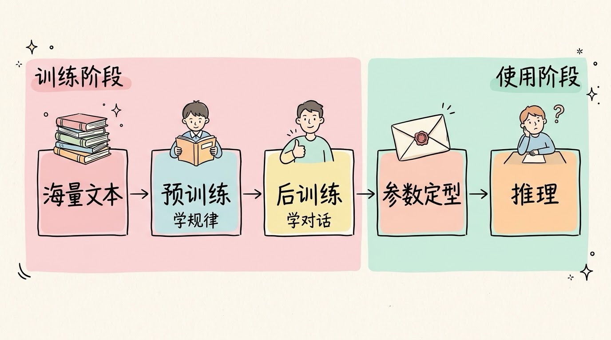
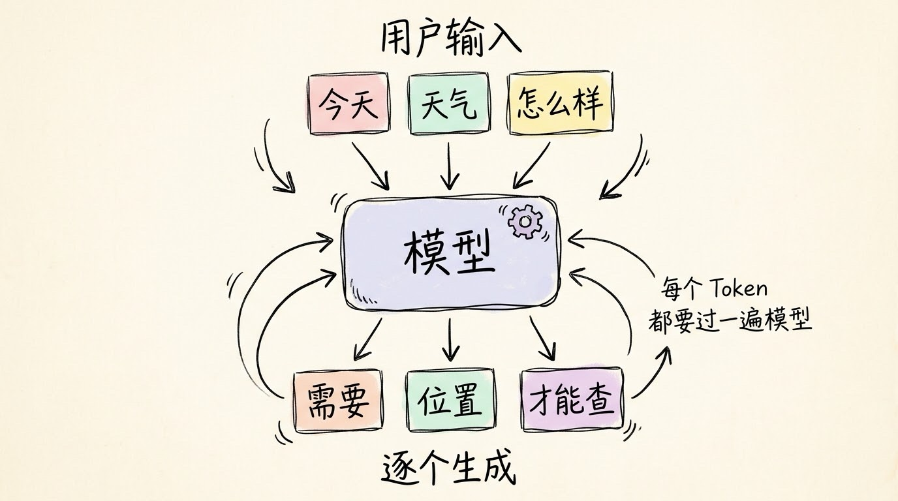
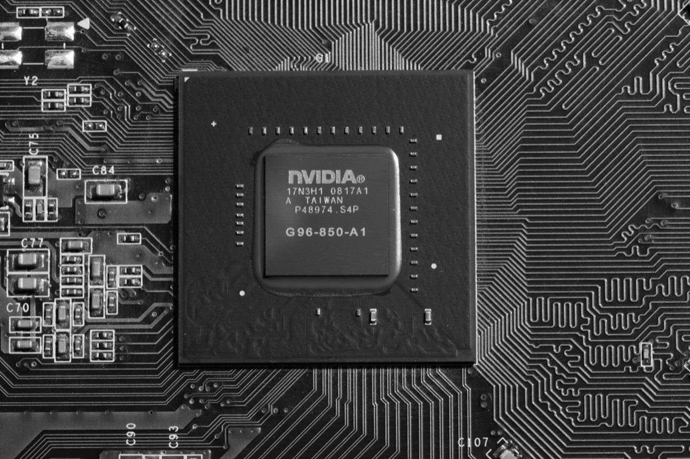
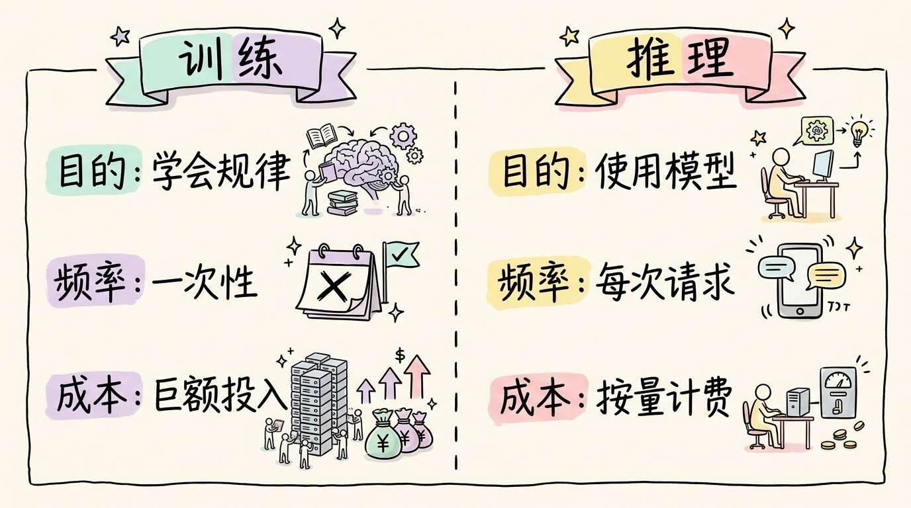
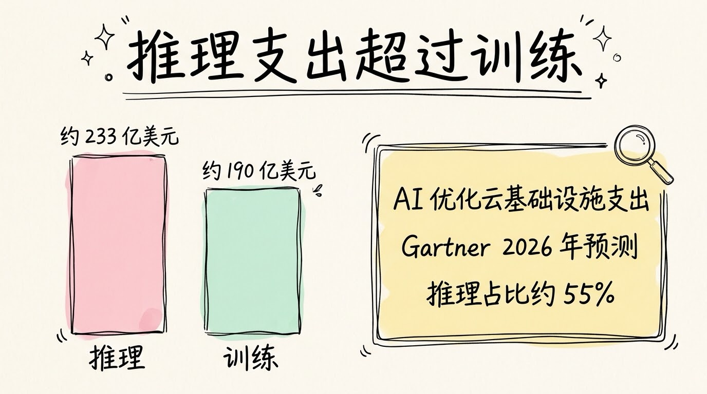

# 3分钟搞懂训练和推理

> ⭐⭐需要一些基础 · 阅读时间 3分钟 · 更新于 2026-10-27
>
> 训练是让模型用海量数据反复调整参数，一次性投入、成本最高；推理是用定型后的模型处理每一次请求，按 Token 计费。两者的成本结构决定了 AI 公司怎么赚钱，也解释了为什么推理的开销正在超过训练。

## 一句话定义

**训练**是用海量数据反复调整模型的参数，让它学会规律，一次性投入、耗算力最多；

**推理**是参数固定之后，用模型处理每一次输入并生成结果，每次使用都要做一遍。

## 训练：把参数一点点调到能用

模型本身可以理解成一大堆数字（参数）。刚开始这些数字是随机的，模型什么都不会。训练要做的，就是拿大量数据去"考"它，每次预测错了，就微调一下参数，让它下一次错得少一点。



<p align="center">动画：每一轮训练只推动参数一点点，误差随之变小</p>

以大语言模型为例，最基础的一步是**预训练**：给它看海量文本，让它不断预测下一个 Token 是什么。

每一轮都是同样的循环：

```
1. 取一批文本，输入模型
2. 模型预测下一个 Token
3. 和真实的下一个 Token 对比，算出误差
4. 沿着误差反方向调整参数（反向传播）
5. 重复上面的步骤，数以亿计次
```

一次预测看起来很简单，但乘上参数量和数据量，就变成了天文数字的计算。模型越大，要调的参数越多；数据越多，要"考"的题越多。所以大模型的训练要动用成百上千张甚至上万张 GPU 组成的集群，耗时数周到数月。



<p align="center">图：训练就是这样一圈圈转，重复数亿次</p>

训练结束后，模型还要经过**后训练**：用人工标注的问答数据教它怎么对话，用人类反馈或奖励信号让它答得更有帮助、更安全。这一步同样属于"训练"，而且近两年推理类模型在这上面投入的算力越来越大。



<p align="center">图：预训练和后训练属于训练阶段，参数定型后才交给推理使用</p>

GPT-3 的训练成本，公开估算在数百万美元量级；GPT-4 的训练成本，OpenAI 的 CEO 在 2023 年公开场合说过超过一亿美元。这些数字都是估算，但量级上的差距是确定的。

## 推理：每次提问都是一次推理

你在 ChatGPT 或 Claude 里输入一句话，模型做的就是推理。它不再调整参数，而是用固定的参数，把你的文字切成 Token，然后**一个 Token 一个 Token 地**生成回答。每生成一个 Token，都要完整的让模型算一遍。



<p align="center">图：回答不是一次吐完的，每个 Token 都要让模型重新算一遍</p>

这也解释了为什么推理的计费方式是按 Token 算的，而且输出 Token 通常比输入 Token 贵。输入的内容可以一次性并行来处理，输出的内容则只能一个接一个地往外吐，耗时更长，占用的算力也更多。

以 Anthropic 的 Claude Sonnet 为例，第三方整理的公开价格约为每百万输入 Token 3 美元、每百万输出 Token 15 美元（价格会调整，请以官方定价页为准）。按这个价格算，一次几百字的问答只会花掉几分钱人民币，这就是推理"便宜"的原因。

还有一点需要纠正：推理并非不需要算力。小模型可以放在一张显卡上跑，大模型的参数往往一张卡装不下，需要多卡协同来完成推理。它的单次算力远小于训练，但在用户量巨大的情况下，其计算总量并不小。



<p align="center">图：NVIDIA GPU 芯片，推理请求最终就是在这类芯片上计算的</p>

## 训练和推理的区别

| 维度 | 训练 | 推理 |
|------|------|------|
| 目的 | 让模型学会规律 | 用学好的模型处理输入 |
| 参数 | 不断被调整 | 固定不变 |
| 频率 | 一次性，或定期重训 | 每次请求都要做 |
| 硬件 | 大规模 GPU 集群 | 单卡、多卡，小模型甚至 CPU |
| 成本形态 | 一笔巨额固定投入 | 按用量计费，随使用量增长 |
| 耗时 | 数周到数月 | 毫秒到数十秒 |

一个好记的类比：训练像拍电影，前期投入巨大；推理像放映，每放一场都要付一点成本，但单场很便宜。



<p align="center">图：训练是一次性的大投入，推理是每次请求的小成本</p>

## 推理的成本正在超过训练

过去大家讨论 AI 的花费，重点大多在训练上。但随着模型上线、用户增多，推理的占比在快速上升。Gartner 在 2026 年的预测显示，在 AI 优化的云基础设施支出中，推理支出预计约 233 亿美元，超过训练的约 190 亿美元，占该类别支出的 55%。



<p align="center">图：Gartner 2026 年的预测：推理支出超过训练</p>

推理成本上升，有一部分来自推理模型的兴起。这类模型在回答之前会先生成一长段内部推理过程，用户通常看不到，但这些 Token 同样要生成、同样要付费。换句话说，模型"想得越久"，推理的花费就越高。

这里容易产生一个误解：单价在下降，总花费就一定在下降吗？不一定。同样能力的模型，每个 Token 的价格确实在降，但用户调用的次数和每次消耗的 Token 数在暴涨，总账单可能反而更高。

## 几个常见的误会

**训练完就一劳永逸？** 不是。知识会过时，新数据和新方法出现后，模型需要重新训练，或者用较小的数据做微调。这也是为什么模型都有知识截止日期。

**个人能训练大模型吗？** 训练 GPT-4 这一级别的模型，需要成千上万张 GPU 和巨额资金，个人负担不起。但微调一个小模型，用几张显卡、几个小时就能完成，比如基于开源模型训练一个特定领域的助手。这时用的依然是训练的方法，只是规模小得多。

**每次用 AI 都要重新训练吗？** 不用。你在 ChatGPT 里聊天，是在做推理。模型参数早就定型了，你的问题只是它的一次输入。

## 用的时候要注意什么

作为普通用户，你做的几乎全是推理，不需要关心训练细节，但有两件事会直接影响体验和花费：

- **输出越长，花费越高**。让模型写长篇文章、或者开启深度思考模式，都会消耗更多 Token。
- **上下文也是按 Token 算的**。每轮对话都会把前面的内容再次送进模型，聊得越久，每次请求的输入就越大。

作为开发者，如果只是把模型当作 API 调用，你做的就是推理；如果要针对自己的业务做微调，那是小规模的训练。两者的成本结构完全不同，选哪种要先算清楚账。

## 时效性提醒

AI 模型的价格、能力和知识截止日期更新很快，文中的价格和数字只能作为量级参考，实际请以各家官方定价页和文档为准。训练成本的数字多为公开估算，不同来源口径并不一致。

💬 **互动话题**：你每天会用多少次 AI？这些使用里，你觉得哪些最值得付费？

📖 **相关阅读**：
- [3分钟搞懂大语言模型](../04-llm/README.md)
- [3分钟搞懂深度学习](../02-deep-learning/README.md)
- [3分钟搞懂AI算力和GPU](../../04-advanced/07-compute-and-gpu/README.md)
- [3分钟搞懂AI微调和LoRA](../../04-advanced/08-fine-tuning-and-lora/README.md)

📚 **资料来源**：
- Gartner 2026 年 AI 基础设施支出预测（推理约 233 亿美元 vs 训练约 190 亿美元，AI 优化 IaaS 类别）
- Anthropic Claude API 定价（第三方整理汇总，以 Anthropic 官方定价页为准）
- GPT-4 训练成本：OpenAI CEO Sam Altman 2023 年公开发言（"超过 1 亿美元"）
- GPT-3 训练成本：公开估算（数百万美元量级）

🖼️ **图片来源**：
- GPU 芯片：NVIDIA GPU（Mickael Courtiade，Wikimedia Commons，CC BY 2.0）

---

⬅️ 上一篇：[3分钟搞懂大语言模型](../04-llm/README.md) ｜ [📚 返回目录](../README.md) ｜ 下一篇：[3分钟搞懂Token和上下文](../06-token-and-context/README.md) ➡️
