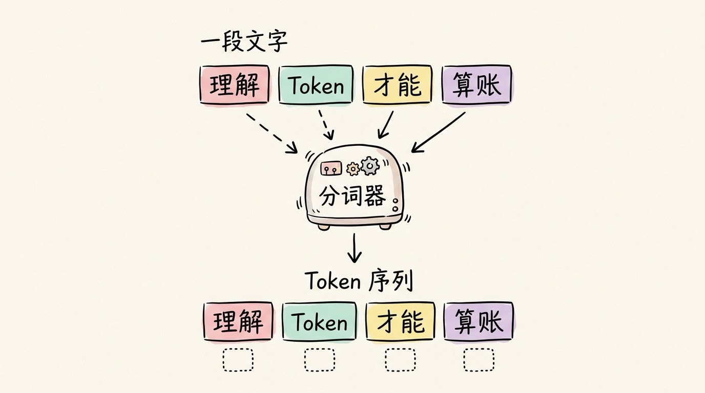
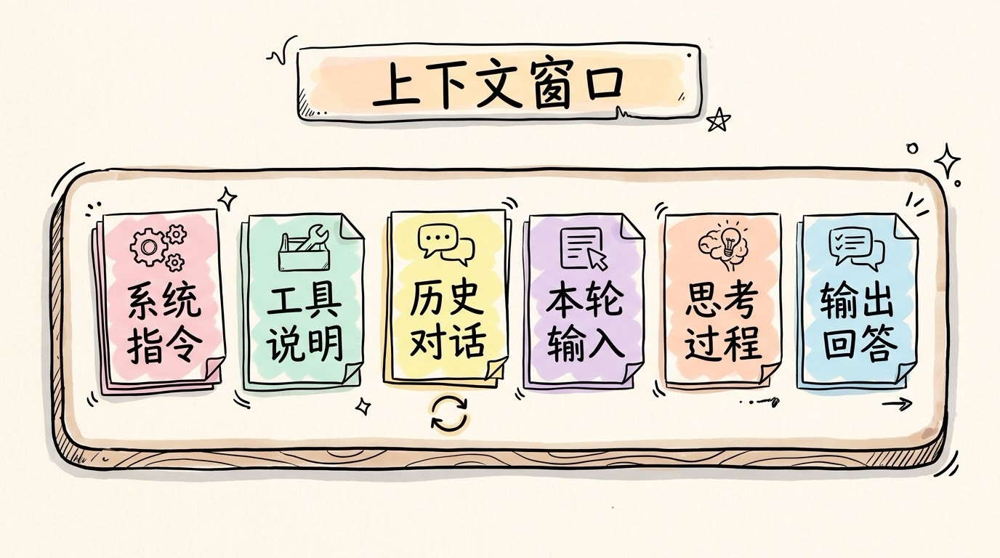
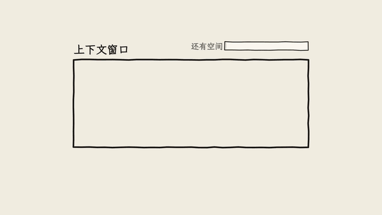
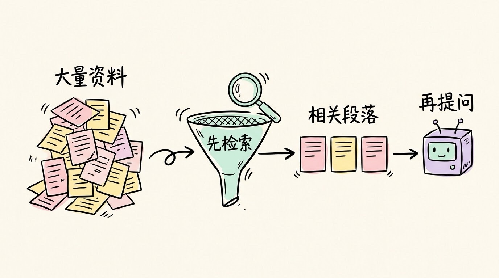

# 3分钟搞懂Token和上下文

> ⭐⭐需要一些基础 · 阅读时间 3分钟 · 更新于 2026-10-27
>
> Token 是大模型计量文字的最小单位，上下文窗口是它一次能处理的总量。这篇讲清楚两者怎么计算，为什么窗口越大不一定越好，以及怎样少花钱、少出现"AI 忘事"。

## 一句话定义

**Token** 是大模型读写文字的最小计量单位，大致介于一个字和一个词之间；**上下文窗口**是模型一次能处理的 Token 总量上限，输入、输出和思考过程都要占用它。

## Token 不是字，也不是词

大模型不直接读文字，而是先用分词器（tokenizer）把文本切成一小块一小块的 Token。常见的做法是 BPE：高频的片段整块保留，罕见的词则拆成几段。



<p align="center">图：分词器先把文字切块，每一块就是一个 Token</p>

这样设计是一种折中。如果按字切，序列会很长，同样一段话要算的次数更多；如果按词切，词表会大到难以维护，而且遇到新词就无从下手。Token 正好介于两者之间。

Token 数量取决于语言和分词器。以 OpenAI 的 o200k_base 分词器为例，第三方测算中文大约每个字 0.5 到 0.7 个 Token，英文大约每个单词 1 个左右。这些比例会随文本和模型变化，要精确计数，应该直接用分词工具。

早年流传的"中文一个字 1.5 到 2 个 Token"，来自更早的分词器，现在的主流模型已经少得多，这个说法需要更新。

```python
import tiktoken

enc = tiktoken.get_encoding("o200k_base")
text = "理解 Token，才能算清楚成本"
print(len(enc.encode(text)))  # 这段话占用的 Token 数
```

## 上下文窗口装的是什么

上下文窗口装的远不止你这一句话。每次请求，模型面对的都是一整包内容：系统指令、工具说明、之前的全部对话、本轮的输入，以及它正在生成的回答。推理模型还会先写一段思考过程，这部分会同样占用上下文窗口大小，也会进行计费。



<p align="center">图：每次请求，窗口里装的是这一整包内容，不只是你的问题</p>

这也解释了一个常见现象：多轮对话里 AI "记得"前面说过的话，是因为每次请求都把历史重新发了一遍。对话越长，每次请求的输入就越大，长对话因此越来越贵、越来越慢。

目前主流旗舰模型的窗口普遍在百万 Token 量级，不同来源的数字并不完全一致，具体以各家官方文档为准。

窗口装不下时，处理方式取决于使用的产品。通过 API 调用，超出上限通常会直接报错，请求失败；聊天应用则可能丢弃或压缩早期内容，这时 AI 就会"忘掉"前面的设定或内容。



<p align="center">动画：窗口满了以后，最早的对话会被挤出去，AI 也就"忘掉"了它</p>

## 窗口越大，效果一定越好吗

Chroma 在 2025 年 7 月发布的研究测试了 18 个大模型，结论是：即使任务本身很简单，输入越长，模型的表现也越不稳定，研究者把这种现象称为"上下文腐烂"（context rot）。另外有多项研究观察到"迷失在中间"的现象：信息放在开头和结尾时效果较好，埋在中间时更容易被忽略。

可以用一张会议桌来理解。当桌上铺满资料时，你要找的那一页如果压在中间，就很容易漏掉。窗口再大，资料堆得太多，注意力也会被稀释。

所以实际使用时，不必把所有资料一股脑塞进去：先筛选出相关的部分，关键内容尽量放在前面或后面。

## 费用怎么算

Token 按量计费，通常输入和输出分开定价，而且输出的单价一般更高。下面的价格是为了演示计算方法而假设的，不代表任何真实报价：

假设每百万输入 Token 2 美元、每百万输出 Token 8 美元。一次请求输入 8000 个 Token、输出 800 个 Token：

- 输入费用：8000 × 2 ÷ 1,000,000 = 0.016 美元
- 输出费用：800 × 8 ÷ 1,000,000 = 0.0064 美元
- 合计：约 0.022 美元

推理模型的思考 Token 按输出计费。问题很简单，账单却很高，常常就是思考过程太长。

另一个影响成本的因素是提示词缓存：同一段前缀被反复发送时，部分平台会对命中缓存的输入给出折扣。

具体价格请以官方定价页为准，各家通常会在发布新模型时会对价格作调整，价格变化还是比较频繁的。

## 三个省 Token 的办法

**第一，精简指令。** 去掉重复的修饰语，只保留真正的约束。

**第二，只带需要的历史。** 对话超过一定轮数后，把早期内容压缩成摘要，只保留关键信息。

**第三，先检索再提问。** 资料很多时，先用检索找出相关段落，再交给模型。这就是 RAG 的思路，比整本塞进去更省，效果通常也更好。相关内容见 [3分钟搞懂向量数据库](../../04-advanced/06-vector-database/README.md)。



<p align="center">图：资料多时，先筛出相关段落，再交给模型</p>

## 几个常见的误会

**Token 就是字数？** 不是。中文和英文的换算比例不同，标点、空格、代码也都要算进去。按字数估算，结果会有明显偏差。

**上下文越长越好？** 越长越贵，也更容易让模型抓不住重点。够用就好，不必追求最大窗口。

**超出上下文会悄悄截断？** 要看产品。API 调用超出上限一般直接报错；聊天应用可能自动丢弃早期内容，所以"AI 忘事"往往是这个原因。

**上下文就是 AI 的长期记忆？** 上下文只管当前这次对话或这次请求。关掉对话，它就没了。跨对话的记忆是另一套机制，通常是把信息存下来，需要时再取回到上下文里。

## 时效性提醒

上下文窗口、分词器和价格都在快速变化，文中的数字只作为量级参考，实际以各家官方文档为准。

💬 **互动话题**：你有没有遇到过 AI 聊久了就忘掉前面设定的情况？

📖 **相关阅读**：
- [3分钟搞懂大语言模型](../04-llm/README.md)
- [3分钟搞懂Prompt工程](../07-prompt-engineering/README.md)
- [3分钟搞懂提示词缓存](../../09-agent-engineering/05-prompt-caching/README.md)
- [3分钟搞懂上下文工程](../../09-agent-engineering/03-context-engineering/README.md)
- [3分钟搞懂向量数据库](../../04-advanced/06-vector-database/README.md)

📚 **资料来源**：
- Chroma Research，《Context Rot》，2025 年 7 月 14 日发布（测试 18 个大模型）
- 第三方汇总的 2026 年大模型上下文窗口对比（如 morphllm 的对比文章），数字因来源而异
- 第三方对 OpenAI o200k_base 分词器中文 Token 比例的测算
- OpenAI tiktoken 开源分词库

---

⬅️ 上一篇：[3分钟搞懂训练和推理](../05-training-and-inference/README.md) ｜ [📚 返回目录](../README.md) ｜ 下一篇：[3分钟搞懂Prompt工程](../07-prompt-engineering/README.md) ➡️
