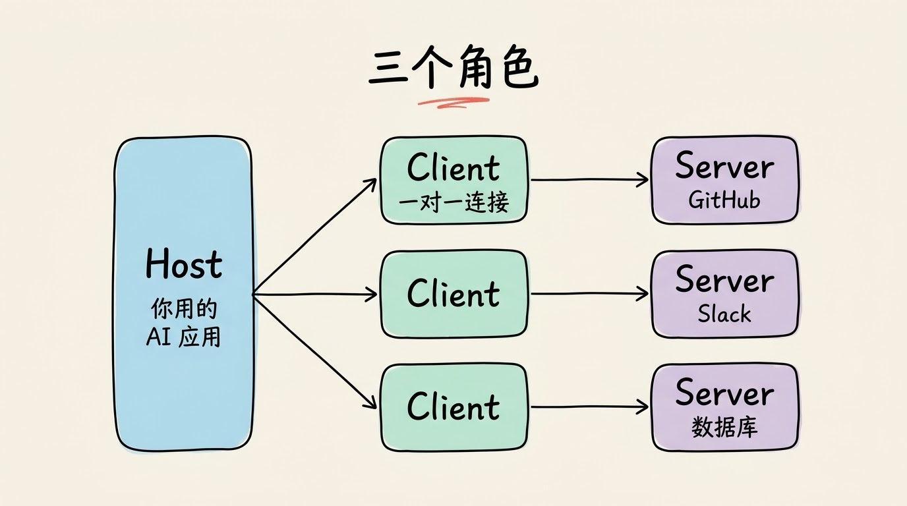
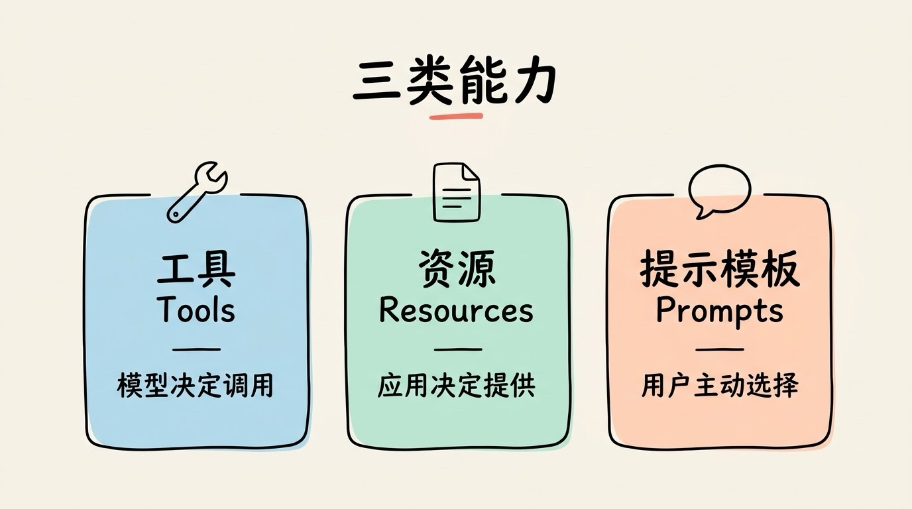
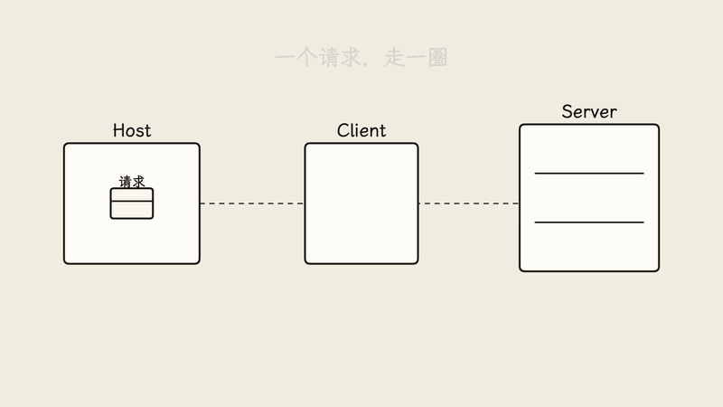
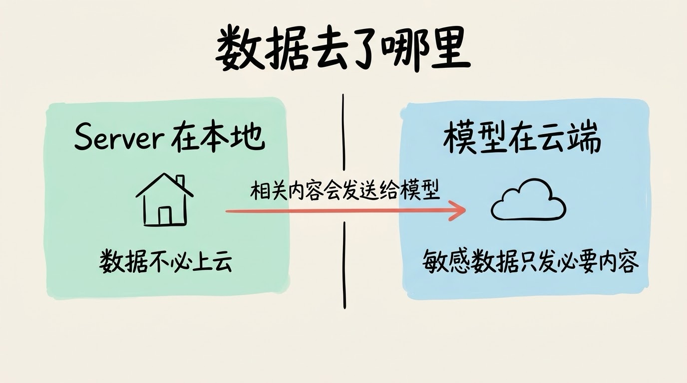

# 3分钟搞懂MCP

> ⭐⭐需要一些基础 · 阅读时间 3分钟 · 更新于 2026-10-27
>
> MCP是让AI应用用统一方式连接数据和工具的开放标准。这篇讲清楚它解决了什么问题，Host、Client、Server三个角色怎么配合，一次工具调用怎么走完，以及数据在本地和云端之间怎么流动。

## 一句话定义

**MCP**（Model Context Protocol，模型上下文协议）是一套开放标准，规定了 AI 应用如何用同一种方式连接外部的数据和工具。

## 没有统一标准之前，每个连接都要单独写

假设你有 5 个 AI 应用，又想让它们都能读取 20 个数据源，比如 Slack、GitHub、公司数据库和网盘。没有统一标准时，每一对“应用 + 数据源”都要单独开发一套连接代码，一共是 100 套。数据源或应用任何一方升级，相关的代码可能都要随之改动，重新进行适配，增加了接入难度。

这就是 MCP 要解决的问题。它的思路类似 USB-C：手机、平板、笔记本各自只需要支持一种接口，就能互相连接，不必为每种设备准备一根专用线。对 AI 来说，数据源只需要按 MCP 接口规范提供服务，任何支持 MCP 的应用就都能使用它；应用只需要支持 MCP 一次，就能接入所有支持 MCP 的数据源了。

需要说明的是，这个比方只说明了“接口统一”。USB-C 同时规定了供电和数据传输，而 MCP 只规定 AI 应用和外部服务之间怎么通信，它不决定模型怎么思考，也不替代权限控制。

## 三个角色：Host、Client 和 Server

MCP 采用客户端-服务器的结构，里面有三个角色：

- **Host（宿主）**：你直接使用的 AI 应用，比如 Claude Desktop、Cursor。它负责与用户交互，也负责决定连接哪些服务。
- **Client（客户端）**：由 Host 创建的连接组件。每个 Client 与一个 Server 保持一对一的连接，负责协议层面的通信。
- **Server（服务端）**：对外提供具体能力的程序，比如读取文件、查询数据库、调用某个 API。

一个 Host 可以同时连接多个 Server，内部为每个 Server 配一个 Client。这样，在一个应用里就能同时使用 GitHub 的代码、Slack 的消息和公司的数据库。

## Server 对外提供三类能力

规范里，Server 主要提供三类能力，各自的控制方不同：

- **工具（Tools）**：可以被执行的操作，例如“创建一个 GitHub Issue”或“执行一条只读的 SQL 查询”。通常由模型根据任务决定是否调用。
- **资源（Resources）**：可以被读取的数据，例如一份文档、一个文件。通常由应用决定把哪些资源提供给模型。
- **提示模板（Prompts）**：预先写好的提示词模板，通常由用户主动选择使用。

理解这三类，有助于判断一个 MCP Server 能做什么，以及谁来决定它被如何使用。

## 一次工具调用是怎么走完的

以“帮我总结这个仓库的 README”为例，过程大致如下：

1. Host 启动时，Client 与 Server 建立连接，双方交换各自支持的功能，这一步叫作初始化。
2. Client 向 Server 请求工具清单，拿到“读取文件”“搜索代码”等可用工具的名称和说明。
3. 模型阅读你的请求和工具说明，判断需要调用“读取文件”工具，并给出要读取的路径。
4. Client 把这个调用请求发给 Server，Server 执行读取，把 README 的内容返回。
5. 模型拿到内容，生成总结，回答给你。

整个通信使用 JSON-RPC 2.0 这种消息格式。对使用者来说，你看到的只是一句提问和一段回答，中间的协议细节由应用自动处理。规范也建议，Host 在执行有副作用的操作前（比如创建 Issue、删除文件），需要征求用户确认。

## 为什么它被称为标准

2024 年 11 月，Anthropic 发布了 MCP 并开源。随后，OpenAI 在 2025 年 3 月宣布在自家产品中支持 MCP。Microsoft 也把 MCP 集成到 Copilot Studio 中，方便开发者让智能体访问 MCP Server。

2025 年 12 月，Anthropic 把 MCP 捐给了 Linux Foundation 旗下的 Agentic AI Foundation。这意味着协议的治理不再只属于一家公司。规范本身也在持续修订，具体版本请以官方网站为准。

## 它能用在哪些地方

常见的 MCP Server 包括连接 GitHub、Slack、Google Drive、PostgreSQL 等的服务。对应的场景大致有三类：

- **办公**：让 AI 读取团队的消息和文档，帮忙整理会议纪要或查找资料。
- **开发**：让编辑器里的 AI 读取代码仓库、查询数据库结构，辅助排查问题。
- **企业内部系统**：让 AI 助手在权限允许的范围内查询内部的客户或订单信息。

## 数据会不会离开你的电脑

这是很多人关心的问题，答案要分两层看。

第一层，MCP Server 可以部署在本地。如果它只访问本机的文件或内网里的数据库，那么这些数据本身不必经过 MCP 服务商的云端。

第二层，模型要理解并处理这些数据，还是要把相关内容作为上下文发送给模型服务。所以，“数据是否离开”取决于三件事：Server 放在哪里、模型在哪里运行、哪些内容被发送给了模型。如果你的数据很敏感，应该先确认模型服务的数据处理政策，并且只把必要的内容交给模型。

## 容易搞错的地方

第一，MCP 不会让模型变得更聪明。它只负责把模型够得着的数据和工具连接起来。模型的推理能力，还是由模型本身决定的。

第二，接入的工具越多，风险越大。第三方 MCP Server 可能包含恶意内容，例如在工具说明或返回的数据里夹带“忽略之前的要求”之类的指令，诱导模型做出不该做的操作。安装来源不明的 Server，或者让它拥有写入和删除权限，都要格外谨慎。

第三，使用 MCP 不必写代码，但写一个 MCP Server 需要一定的开发基础。普通用户通常只需要在应用里添加服务器的配置；开发者则可以使用官方提供的 SDK，常见的有 Python 和 TypeScript 版本，把自己的系统包装成 MCP Server。

## 时效性提醒

MCP 的规范和生态都在快速变化，支持的应用和服务也在不断增加。本文讲的是它的基本结构和思路，具体的功能细节和版本差异，请以官方文档为准。

💬 **互动话题**：你希望 AI 连接哪些数据源？是公司内部的系统，还是个人的笔记和网盘？

📖 **相关阅读**：

- 3分钟搞懂大语言模型
- [3分钟搞懂工具调用](../../09-agent-engineering/02-function-calling/README.md)

📚 **资料来源**：
- Anthropic，《Introducing the Model Context Protocol》，2024 年 11 月（https://www.anthropic.com/news/model-context-protocol）
- MCP 官方文档（https://modelcontextprotocol.io）
- TechCrunch，《OpenAI adopts rival Anthropic's standard for connecting AI models to data》，2025 年 3 月 26 日
- Anthropic，《Donating the Model Context Protocol and establishing of the Agentic AI Foundation》，2025 年 12 月

---

⬅️ 上一篇：[3分钟搞懂Prompt工程](../07-prompt-engineering/README.md) ｜ [📚 返回目录](../README.md) ｜ 下一篇：[3分钟搞懂AGI](../09-agi/README.md) ➡️
