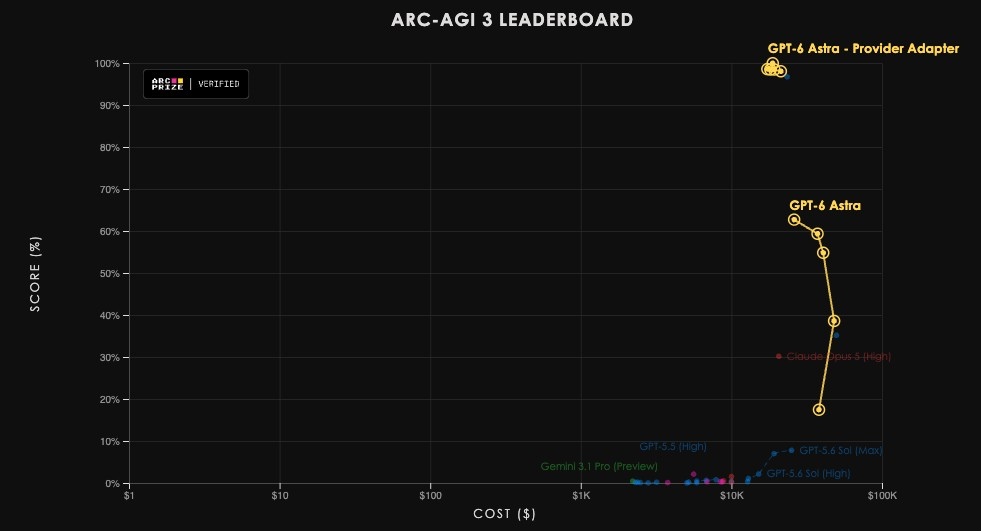
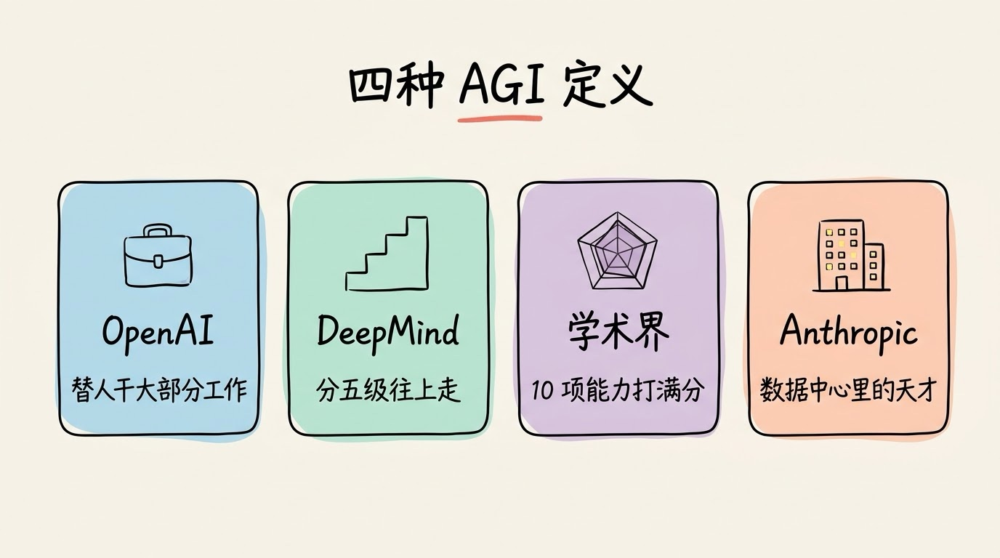
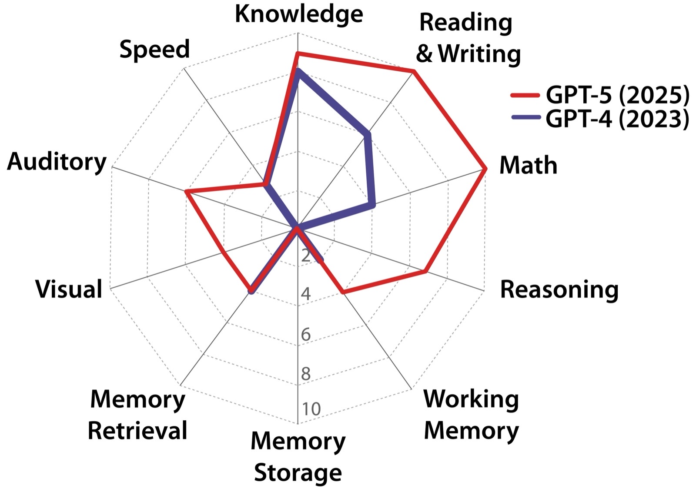
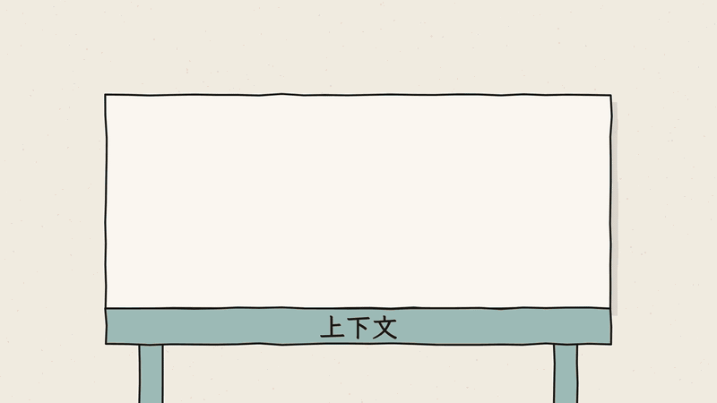
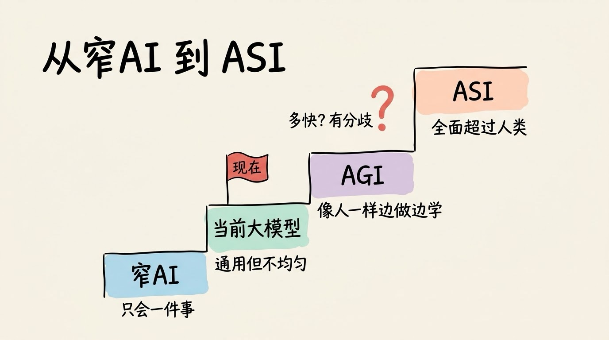

# 3分钟搞懂AGI

> ⭐⭐需要一些基础 · 阅读时间 3分钟 · 更新于 2026-10-27
>
> 大模型能拿奥数金牌，在没有规则说明的小游戏测试里，成绩半年内也从不到 1% 涨到了 62.7%，但出题方仍然认为这不是 AGI。本文讲清 AGI 的主流定义、大模型还差在哪、各家时间表为什么差这么多，以及 AGI 和 ASI 的关系。

## 一句话定义

**AGI**（Artificial General Intelligence，通用人工智能）= 在绝大多数认知任务上都能达到普通成年人的水平，并且遇到从没见过的新问题时，能像人一样边做边学、把经验积累下来的 AI 系统。

需要先说明的是，上面这个定义并不是行业共识。截至目前，AGI 没有统一的定义，也没有公认的测试标准，OpenAI、Google DeepMind、Anthropic 各有各的说法，后面会具体对比。

## “通用”比的是学新东西的能力

在大模型出现之前，AI 基本都是**窄AI**（Narrow AI），也就是一个系统只做一件事。AlphaGo 下围棋能赢世界冠军，但让它认一张猫的照片，它完全做不到；人脸识别系统认人很准，却不会做一道小学应用题。

今天的大模型已经不是这种意义上的窄AI 了。同一个模型能写代码、翻译、看图、分析表格，2025 年 7 月，OpenAI 和 Google DeepMind 的模型还在国际数学奥林匹克（IMO）上拿到了金牌水平的成绩。所以 Google DeepMind 在 2023 年提出的 AGI 分级框架里，把 ChatGPT 这类模型归为第 1 级“初级 AGI”（Emerging AGI）：通用性已经有了，但在大部分任务上，水平还只相当于或略好于一个没有相关技能的普通人。

那为什么大家还说 AGI 没有实现？因为大模型的能力分布很不均匀，这种现象常被称为**“锯齿状智能”**：在有些任务上超过大部分专家，在另一些人觉得很简单的任务上却会出错。

一个典型的例子是 **ARC-AGI-3** 测试。这套测试在 2026 年 3 月上线，由几百个回合制小游戏组成，不告诉规则，也不告诉目标，要靠自己摸索怎么过关。人类的得分是 100%，而上线时前沿模型的最好成绩只有 0.51%。

这些小游戏并不需要专业知识，难点在于面对一个完全陌生的环境时，能不能试几次就摸清规律。奥数题再难，模型在训练时也见过大量同类题目；而这些从没见过的游戏，考的正是“现学现用”的能力，**这也是 AGI 里“通用”两个字真正指的东西。**

不过这个差距缩小得非常快。2026 年 9 月 OpenAI 发布 GPT-6 Astra 之后，ARC Prize 用统一的标准测试方式测出它的成绩是 62.7%；如果换成 OpenAI 提供的测试方式，把模型之前的推理过程完整保留下来、长对话压缩后继续用，成绩能达到 99.9%，而且在 96% 的关卡里，它用的步数比人类还少。

*图注：ARC Prize 公布的 ARC-AGI-3 排行榜，横轴是跑完一轮测试的成本（美元，对数刻度），纵轴是得分。中间的黄色折线是 GPT-6 Astra 在标准测试方式下的成绩，最高 62.7%；右上角的 Provider Adapter 是换成 OpenAI 提供的测试方式后的成绩，接近 100%；Claude Opus 5 在 30% 左右，GPT-5.6 Sol、GPT-5.5、Gemini 3.1 Pro 等早一些的模型都在 10% 以下。数据截至 2026 年 9 月。*

即便如此，ARC Prize 也明确表示，这个成绩并不代表 AGI 已经实现：这些小游戏的规则是固定的，范围也很有限，和真实世界的复杂、开放程度还差得很远。**一项测试被攻克，不等于 AGI 实现了**，所以出题方也在研究怎么去测“自我改进”“开放式创新”这类更难的能力。

| | 窄AI | 当前的大模型 | AGI（目标） |
|---|---|---|---|
| 例子 | AlphaGo、人脸识别 | ChatGPT、Claude、Gemini、DeepSeek、千问 | 目前还不存在 |
| 能做的事 | 只有一件 | 大部分文字、代码、图片类任务 | 几乎所有人能做的认知任务 |
| 遇到新任务 | 完全不会 | 靠训练时学过的知识迁移，换到陌生环境容易失灵 | 像人一样边试边学 |
| 积累经验 | 不能 | 对话结束就忘，要靠外部记忆来补 | 能长期学习、越用越熟练 |

## 各家的 AGI 分别是什么

同样是 AGI 这三个字母，不同机构指的东西差别很大：

- **OpenAI**：写在 2018 年发布的公司章程里，AGI 是“在大多数有经济价值的工作上超过人类的高度自主系统”。它看的是 AI 能不能替人把活干了。
- **Google DeepMind**：按“表现水平”和“通用程度”两个维度来分级，从初级、胜任、专家、大师一直到超人，一共 5 级。它把 AGI 看成一级一级往上走的过程，而不是一条“过了就算”的线。
- **Hendrycks 等 30 多位学者**：2025 年 10 月发表论文《A Definition of AGI》，把 AGI 定义为“达到一个受过良好教育的成年人的认知广度和熟练程度”，并参照心理学里的 CHC 认知理论，把能力拆成知识、推理、记忆、感知等 10 项分别打分，满分 100% 才算 AGI。
- **Anthropic**：CEO 达里奥·阿莫代伊很少用 AGI 这个词，他更愿意说“强大的 AI”，标准是在生物、编程、数学等大多数领域比诺贝尔奖得主更聪明，能像远程员工一样独立干几小时到几周的活，并且可以同时运行上百万个副本，他把这种状态形容为**“数据中心里的天才国度”**。

定义不统一，不只是一个学术问题，还牵涉到真金白银。微软和 OpenAI 的合作协议里曾经有一个“AGI 条款”：一旦 OpenAI 实现了 AGI，微软对它部分技术的使用权就会终止。2024 年底有报道称，双方私下约定的标准是 OpenAI 的系统能赚到约 1000 亿美元利润；2025 年 10 月，条款改成由 OpenAI 宣布实现 AGI、再由独立专家小组来核实；到了 2026 年 4 月双方再次修改协议，OpenAI 付给微软的收入分成改为“与 OpenAI 的技术进展无关”，这个条款实际上已经失去了作用。

所以当你看到“某某公司离 AGI 还有几年”这类说法时，**先看它用的是哪一种定义**，否则不同说法之间是没法直接比较的。

## 离 AGI 还差在哪

还是拿《A Definition of AGI》这篇论文的打分来看：GPT-4 的总分是 27%，GPT-5 是 57%，两年多时间翻了一倍还多。但拆开看，GPT-5 在“长期记忆存储”这一项上得了 0 分。

*图注：论文给出的能力雷达图，蓝色是 GPT-4（2023），红色是 GPT-5（2025），每项满分 10 分。10 个方向分别是知识（Knowledge）、读写（Reading & Writing）、数学（Math）、推理（Reasoning）、工作记忆（Working Memory）、长期记忆存储（Memory Storage）、记忆检索（Memory Retrieval）、视觉（Visual）、听觉（Auditory）和速度（Speed）。GPT-5 在数学、读写上已经接近满分，而正下方的长期记忆存储，两代模型都是 0。*

这一项考的是能不能把新学到的东西长期记住。现在的大模型训练完之后，参数其实就已经固定下来了，你在对话里教给它的东西是不会写回到模型本身。上下文窗口更像一张临时的工作台，对话结束就清空了。现在各家产品里的“记忆”功能，其实是把信息存在模型外面，下次再取出来放进上下文，并不是模型自己学会了。

这个差距在实际工作中很容易体会到：一个新同事刚入职时犯过的错，过几周就不会再犯了；而模型如果没有外部记忆的帮助，同样的错误下一次对话还可能会再犯。

前面 ARC-AGI-3 的两种成绩也能说明记忆有多关键：GPT-6 Astra 的 62.7% 和 99.9% 之间差了将近 40 个百分点，差别主要就在于测试方式能不能把模型之前的推理过程保留下来，而在标准方式下，模型只能靠自己记的笔记。不过这种记忆只在一次任务里有效，任务结束之后，学到的东西仍然不会写进模型本身。

所以**持续学习**（Continual Learning）被普遍认为是通往 AGI 最关键的一道坎。Google DeepMind 联合创始人德米斯·哈萨比斯在 2026 年的访谈里也提到，持续学习、长时间的推理和记忆的一些问题都还没有解决，而 AGI 需要把它们全部解决。

## 时间表：从“今年”到“二十年后”

关于 AGI 什么时候到来，说法差得非常远：

| 谁 | 说法 |
|---|---|
| OpenAI CEO 萨姆·奥特曼 | 2026 年 8 月接受 TIME 采访时表示 OpenAI 还没到 AGI，但预计年底前会有一个他愿意称为 AGI 的内部系统；9 月 GPT-6 Astra 发布时，OpenAI 总裁格雷格·布罗克曼说它以后可能会被看作 AGI 到来的标志 |
| ARC-AGI 测试的设计者弗朗索瓦·肖莱 | 之前预计 AGI 在 2030 年左右，GPT-6 Astra 发布后改口说会更早，因为进展比他预想的要快 |
| Anthropic CEO 达里奥·阿莫代伊 | 2026 年 1 月的长文里写道，强大的 AI 可能只有 1 到 2 年的距离，但也可能要久得多 |
| 德米斯·哈萨比斯 | 2025 年说的还是 5 到 10 年，到 2026 年 10 月接受《华尔街日报》采访时已经提前到 2 到 3 年 |
| 阿里巴巴 CEO 吴泳铭 | 2025 年 9 月在云栖大会上说实现 AGI 已经是确定性事件，AGI 只是起点，终极目标是超级人工智能 |
| AI 研究者整体 | 2023 年对 2778 位 AI 论文作者的调查里，“机器在所有任务上都比人做得更好、更便宜”有 50% 可能实现的时间中位数是 2047 年，比前一年的同类调查提前了 13 年 |

可以看到，头部实验室负责人的预期普遍比学术界早得多。一方面，他们离最前沿的进展最近，看到的东西更多；另一方面，融资、招人和行业竞争也需要这样的叙事。所以这些时间表可以作为参考，但不必当成确定的日程，未来如何发展还需拭目以待。

## AGI 之后是 ASI

**ASI**（Artificial Superintelligence，超级人工智能）指的是在几乎所有领域都远远超过最顶尖人类的 AI。

从 AGI 到 ASI 要多久，分歧比 AGI 本身还要大。一种观点来自数学家 I. J. Good 在 1965 年提出的**“智能爆炸”**：一旦 AI 能改进自己，就可能越改越快，在很短时间内把人类远远甩在后面，这也是“AI 奇点”说法的来源。另一种看法要平缓得多，奥特曼就说过，AGI 建成以后世界大体上还会照常运转，从 AGI 到超级智能之间还有很长一段路要走。

这几年 ASI 这个词出现得越来越多，因为一些公司已经把它当成了直接目标：OpenAI 前首席科学家伊利亚·苏茨克维创办的公司直接取名 Safe Superintelligence（安全超级智能），Meta 在 2025 年 6 月成立了“超级智能实验室”，阿里巴巴的吴泳铭也提出了通往 ASI 的三个阶段：智能涌现、自主行动、自我迭代，并认为行业目前正处在第二阶段。

## 看 AGI 新闻时要注意什么

AGI 是 AI 新闻里经常出现的词，看到相关的标题时，可以先从下面三个方面判断一下：

1. **用的是哪种定义？** 是“能替人干大部分工作”，还是“在某项测试上超过人类”？两者差别很大。
2. **有没有可以验证的结果？** 是公开的测试成绩和产品，还是一场演示、一句表态？
3. **谁在说？** 说话的人和这件事有没有利益关系，比如正在融资或者推新产品。

还有一个常见的误解，是把 AGI 想象成科幻电影里的机器人。AGI 说的是 AI 的认知能力有多通用，和它有没有身体、有没有意识都没有关系。至于它会不会危险，是另一个问题，属于 AI 对齐和安全的研究范围，不过 AI 能力越强，这个问题就越重要。

## 时效性提醒

AGI 是变化最快的话题之一，下面这些内容尤其要注意更新：

- 各家对 AGI 的定义和时间表，奥特曼、哈萨比斯的说法在一年里都改过不止一次
- ARC-AGI-3 的最好成绩半年内从 0.51% 涨到了 62.7%，还会随着新模型不断刷新，2026 年 ARC Prize 比赛的结果计划在 12 月公布
- GPT-6 Astra 或 OpenAI 之后的系统会不会被正式称为 AGI、能不能得到外界认可，还要看后续进展

**建议**：看到“某某实现了 AGI”这类标题时，先去找原始的发布内容和测试数据。

💬 **互动话题**：你觉得 AI 要做到哪件事，你才会承认它是 AGI？

📖 **相关阅读**：

- [3分钟搞懂大语言模型](../04-llm/README.md) - 当前 AI 的本质
- [3分钟搞懂训练和推理](../05-training-and-inference/README.md) - 为什么训练完参数就固定了
- [3分钟搞懂Agent记忆系统](../../09-agent-engineering/06-agent-memory/README.md) - 模型外面的记忆是怎么做的
- [3分钟搞懂推理模型](../../04-advanced/01-reasoning-models/README.md) - 大模型拿下奥数金牌靠的是什么
- [3分钟搞懂AI对齐](../../04-advanced/12-alignment/README.md) - 能力越强，越需要对齐

**资料来源**：

- OpenAI Charter：https://openai.com/charter/
- Google DeepMind，Levels of AGI for Operationalizing Progress on the Path to AGI（2023-11）：https://arxiv.org/abs/2311.02462
- Google DeepMind，Gemini Deep Think 达到 IMO 金牌水平（2025-07）：https://deepmind.google/discover/blog/advanced-version-of-gemini-with-deep-think-officially-achieves-gold-medal-standard-at-the-international-mathematical-olympiad/
- Hendrycks 等，A Definition of AGI（2025-10）：https://arxiv.org/abs/2510.18212
- ARC Prize，Announcing ARC-AGI-3（2026-03-25）：https://arcprize.org/blog/arc-agi-3-launch
- ARC Prize，OpenAI's GPT-6 Astra on ARC-AGI-3（2026-09-03，文中排行榜图出处）：https://arcprize.org/blog/astra
- The Decoder，Benchmarks disagree on GPT-6 Astra…（2026-09-04，肖莱的说法）：https://the-decoder.com/benchmarks-disagree-on-gpt-6-astra-but-its-human-beating-efficiency-on-arc-agi-3-pulls-chollets-agi-forecast-forward/
- Wikipedia，GPT-6 Astra（发布时间与布罗克曼的说法）：https://en.wikipedia.org/wiki/GPT-6_Astra
- Center for AI Safety，A Definition of AGI 项目页（文中雷达图出处）：https://agidefinition.safe.ai/
- Dario Amodei，Machines of Loving Grace（2024-10）：https://www.darioamodei.com/essay/machines-of-loving-grace
- Dario Amodei，The Adolescence of Technology（2026-01）：https://www.darioamodei.com/essay/the-adolescence-of-technology
- OpenAI，The next chapter of the Microsoft–OpenAI partnership（2025-10）：https://openai.com/index/next-chapter-of-microsoft-openai-partnership/
- OpenAI，The next phase of the Microsoft partnership（2026-04-27）：https://openai.com/index/next-phase-of-microsoft-partnership/
- Simon Willison，Tracking the history of the now-deceased OpenAI Microsoft AGI clause（2026-04-27）：https://simonwillison.net/2026/Apr/27/now-deceased-agi-clause/
- TIME，Inside OpenAI's Reboot（2026-08-26）：https://time.com/article/2026/08/26/openai-sam-altman-interview/
- The Decoder，Hassabis shortens AGI timeline（2026-10-21，转述《华尔街日报》采访）：https://the-decoder.com/deepmind-founder-hassabis-shortens-agi-timeline-from-five-to-two-to-three-years/
- Grace 等，Thousands of AI Authors on the Future of AI（2024-01）：https://arxiv.org/abs/2401.02843
- 阿里云开发者社区，吴泳铭：超级人工智能之路（2025-09）：https://developer.aliyun.com/article/1683371

---

⬅️ 上一篇：[3分钟搞懂MCP](../08-mcp/README.md) ｜ [📚 返回目录](../README.md)
