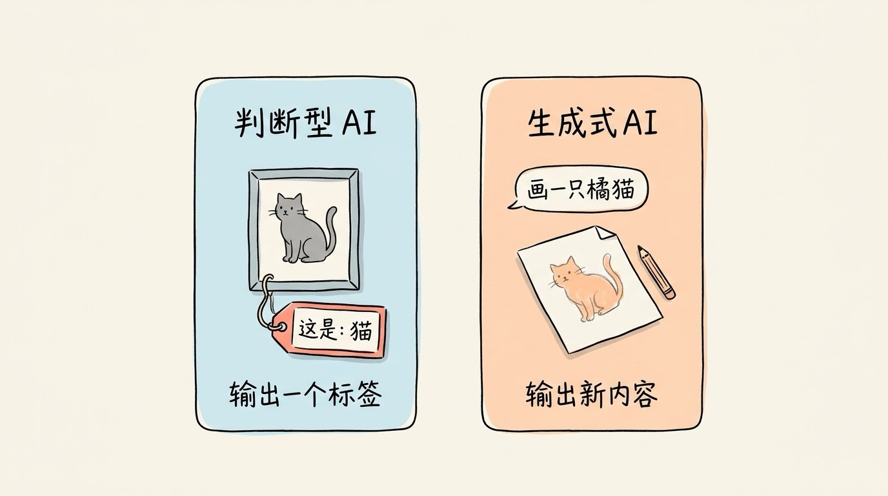
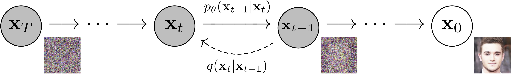
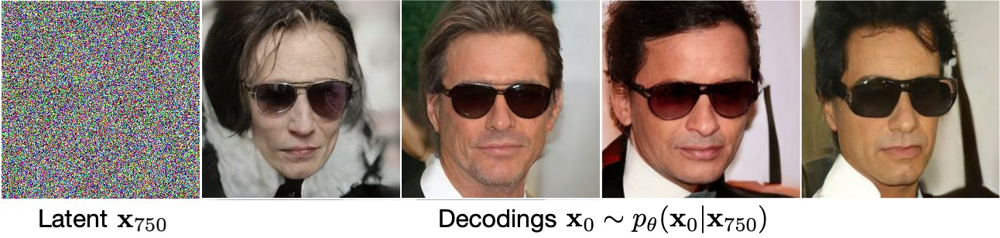
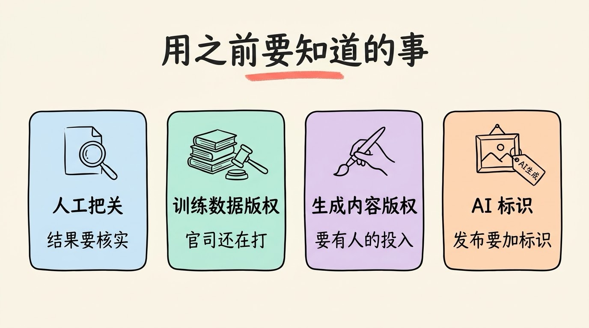

# 3分钟搞懂生成式AI

> ⭐入门 · 阅读时间 3分钟 · 更新于 2026-10-27
>
> 生成式AI不是去数据库里找答案，而是按学到的规律一点点“猜”出新内容，这也是它会编造、每次结果都不一样的原因。本文讲清它和传统AI的区别、文字和图片分别是怎么生成的、各类内容现在做到了哪一步，以及效率、版权和标识这些用之前要知道的事。

## 一句话定义

**生成式AI**（Generative AI）= 先从海量的文字、图片、音频、视频里学会“这类内容通常长什么样”的规律，再按你的要求，生成一份训练数据里原本不存在的新内容的 AI。

常和它一起出现的还有一个词叫 **AIGC**（AI Generated Content，AI 生成内容）。两者其实不是一回事：生成式AI 指的是技术本身，AIGC 指的是用这类技术生产出来的内容，比如一篇 AI 写的文案、一张 AI 画的海报。

## 和以前的 AI 相比，差别在输出

在 ChatGPT 火起来之前，我们日常接触的 AI 大多是做**判断**的：垃圾邮件过滤判断一封邮件是不是广告，人脸识别判断这张脸是不是你，推荐系统判断你会不会点开这条视频。它们的输出是一个标签、一个分数，或者一个排序。

生成式AI 的输出则是一份完整的新内容。同样是面对一只猫，判断型的 AI 告诉你“这是一只猫”，生成式AI 则可以按你的描述画出一只之前不存在的猫。

| | 判断型 AI（传统 AI） | 生成式AI |
|---|---|---|
| 要做的事 | 识别、分类、预测 | 写、画、说、剪 |
| 输出 | 标签、分数、排序 | 文字、图片、音频、视频、代码 |
| 例子 | 垃圾邮件过滤、人脸识别、推荐算法 | ChatGPT 写文章、AI 画海报、AI 生成短视频 |
| 怎么算对 | 和标准答案比，对就是对，错就是错 | 往往没有唯一答案，好不好要靠人来判断 |

不过这两类 AI 的边界已经越来越模糊了。现在的大模型既能写文章，也能帮你判断一封邮件是不是诈骗，只是它做判断的方式，也是“生成”一段回答。

## 它不是在“找”，而是在“猜”

很多人第一次用生成式AI 时，会以为它背后有一个巨大的数据库，你问什么，它就去里面找一段现成的内容拿出来。实际上并不是这样，它是根据学到的规律，一点一点地把内容“猜”出来的。

生成式AI 对文字和图片猜的方式也不太一样。

**文字：一个字一个字往后猜**。大语言模型做的事情，本质上就是根据前面已经有的内容，预测下一个最可能出现的词（准确地说是 Token）。比如前面是“今天天气很”，后面接“好”“热”“冷”的可能性都很大，模型会从这些候选里挑一个，再接着猜下一个，直到整段话写完。

**图片：从一团噪点里一步步还原**。主流的图片和视频模型大多用的是**扩散模型**（Diffusion Model）。训练时，先把一张清晰的图片一步步加上噪点，直到变成一团雪花，然后让模型学会反过来，一步步把噪点去掉。等到生成的时候，模型从一张纯噪点的图开始，按照你写的提示词，一点点“去噪”，最后得到一张清晰的新图片。

*图注：出自 2020 年提出扩散模型主流做法的论文《Denoising Diffusion Probabilistic Models》（Ho 等）。实线箭头是生成方向，模型从左边的纯噪点出发，每一步去掉一点噪点；下方的虚线箭头是训练时反过来加噪点的方向。中间那张还带着噪点的图里，已经能隐约看出人脸的轮廓。*

这两条路线现在也在互相融合。OpenAI 从 GPT-4o 开始，把图片生成直接做进了大模型里，官方说法是用了和生成文字类似的自回归方式，所以它能更好地理解长提示词，在图片里写准文字，也能在对话里一轮一轮地修改同一张图。视频模型也在往这个方向走，比如 Google 在 2026 年 I/O 大会上发布的 Gemini Omni，可以同时接收文字、图片、视频作为输入，然后通过对话直接修改生成的视频。

理解了“猜”这一点，生成式AI 的很多特点就都能解释了：

- **同一个问题，每次的结果都不一样**：模型每一步都是从多个候选里按概率挑一个，所以哪怕提示词完全相同，生成的结果也会有差别，这也是为什么出图时常常要多试几次。

*图注：同样出自《Denoising Diffusion Probabilistic Models》。最左边是同一个带噪点的起点（Latent），右边四张是模型分别去噪四次得到的结果（Decodings）：都戴着墨镜、构图也相近，但长相各不相同。这就是“同样的输入，每次结果都不一样”的直观例子。*

- **会一本正经地编造**：它追求的是“看起来合理”，而不是“事实正确”。当它在训练数据里没有学到准确的信息时，也会顺着规律编出一个看起来很像真的答案，这就是常说的 **AI 幻觉**。
- **它不是在拼贴，也可能“背出”原作**：生成的内容通常不是把几张已有的图剪下来拼在一起，所以它能画出“穿着宇航服的熊猫在月球上吃火锅”这种训练数据里大概率没有的画面。但如果某段内容在训练数据里出现得特别多，模型也可能把它几乎原样“背”出来，这正是版权争议的来源之一。

## 各类内容现在做到了哪一步

文字和代码是目前最成熟、用得最多的方向，图片已经能直接用在商业设计里，视频和音乐这两年进步最快。截止目前的主流工具大致如下：

| 内容类型 | 海外主流工具 | 国内主流工具 | 目前的水平 |
|---|---|---|---|
| **文字、代码** | ChatGPT、Claude、Gemini | 豆包、DeepSeek、千问、Kimi、元宝、文心 | 最成熟，写作、翻译、编程都已经是日常工具 |
| **图片** | GPT Image（ChatGPT 内置）、Nano Banana（Gemini 内置）、Midjourney、Flux | 即梦（Seedream）、通义万相、可图 | 商用级别，图里写中文、多轮修改都已经比较可靠 |
| **视频** | Veo、Gemini Omni、Runway | 可灵、即梦（Seedance）、通义万相、海螺 | 单段通常是几秒到十几秒，可以同步生成声音，长视频还要靠剪辑拼接 |
| **语音** | ElevenLabs | 豆包语音、MiniMax 语音 | 克隆一个声音只需要很短的录音，配音、有声书已经普遍在用 |
| **音乐** | Suno、Udio | Mureka（天工）、海绵音乐 | 能直接生成带人声的完整歌曲，版权问题还在处理中 |

这一年里有几个变化值得特别注意：

- **Sora 已经停用了**。OpenAI 在 2026 年 3 月宣布停用 Sora，App 和网页版在 4 月 26 日关闭，API 在 9 月 24 日也已经停止服务。如果你还在看推荐 Sora 的旧教程，可以直接换成上表里的其他工具。
- **DALL·E 也已经退役了**。OpenAI 在 2026 年 5 月 12 日下线了 DALL·E 2 和 DALL·E 3 的 API，现在 ChatGPT 里的图片生成用的是 GPT Image 系列，最新的是 9 月发布的 GPT Image 2.5。
- **国产视频模型已经处在第一梯队**。2026 年 2 月，快手发布了可灵 3.0，字节发布了 Seedance 2.0，在多个公开的视频模型排行榜上，它们和 Google 的模型排名都比较靠前。
- **从“一个工具做一件事”走向“一个对话里全搞定”**。现在在 ChatGPT、Gemini、豆包里，聊天、画图、改图、生成视频往往都能在同一个对话里完成，不用再在不同的工具之间来回切换。

## 效率能提升多少，要看具体的任务

“用了 AI 效率能提升百分之多少”是很常见的说法，但实际的数据差别很大。2022 年 GitHub 的对照实验里，开发者用 Copilot 写一个简单的 HTTP 服务器，平均快了 55%；而 2025 年 METR 让经验丰富的开源开发者在自己熟悉的大型项目里做真实任务，用了 AI 工具的反而慢了 19%。

这说明**任务越简单、越标准，AI 的提速越明显；项目越复杂、你对它越熟悉，AI 能帮上的就越少**。所以当你看到“提效 50%”“提效 10 倍”这类说法时，先看清楚它测的是什么任务。

## 用之前要知道的几件事

**结果需要人来把关**。前面说过，生成式AI 会编造信息，也可能出现细节错误，比如图片里的手指数量不对、视频里的物体突然变形、代码里调用了一个根本不存在的函数。尤其是涉及到事实、数据、法律和医疗这类内容时，一定要自己再核实一遍。

**训练数据的版权还在打官司**。生成式AI 需要用海量的作品来训练，很多作者和版权方认为这侵犯了他们的权益。2026 年 7 月，美国法院最终批准了 Anthropic 和图书作者之间 15 亿美元的和解协议，这是目前金额最大的 AI 版权和解；音乐领域，华纳、环球等唱片公司也已经和 Suno、Udio 达成了部分授权协议，但还有一些官司仍在进行中。

**生成的内容不一定受版权保护**。美国版权局的立场是，只靠写提示词、完全由 AI 生成的内容不受版权保护，人需要在其中有足够的创作投入才行。国内在 2023 年也有过类似的判例，北京互联网法院认定，用户在反复调整提示词和参数的过程中投入了自己的智力劳动，生成的图片可以受到著作权保护。所以如果你打算把 AI 生成的内容用在商业项目里，最好保留好自己的创作过程记录。

**国内发布 AI 内容需要标识**。《人工智能生成合成内容标识办法》从 2025 年 9 月 1 日起施行，要求 AI 服务提供者给生成的文字、图片、音频、视频加上用户能看到的显式标识，并在文件里写入隐式标识，任何人也不得恶意删除或篡改这些标识。现在你在各个平台上看到的“AI 生成”标签，就来自这个规定。

最后还有一个常见的误解：用了 AI，就不需要专业能力了。实际情况正好相反，AI 能很快地给你十个方案，但挑出哪个能用、发现哪里有错、把它改到能交付的水平，这些都要靠你自己的专业判断。**AI 降低的是动手的门槛，而不是判断的门槛。**

## 时效性提醒

生成式AI 是变化最快的领域之一，下面这些内容尤其容易过时：

- 各类工具的排名和版本号，视频和图片模型几乎每隔几个月就会更新一代
- 产品的停用和改名，比如 Sora、DALL·E 都已经下线了，国内的“通义”App 也已经改名为“千问”
- 各家的价格和免费额度
- 版权诉讼的进展，和各国关于 AI 内容的监管规定

**建议**：选工具之前，先去官网确认一下它现在还在不在、价格有没有变化。

💬 **互动话题**：你用生成式AI 做过最满意的一件作品是什么？是文章、图片，还是视频？

📖 **相关阅读**：

- [3分钟搞懂大语言模型](../../01-basics/04-llm/README.md) - 文字生成背后的模型
- [3分钟搞懂Transformer](../../01-basics/03-transformer/README.md) - 大模型和很多图片、视频模型共用的架构
- [3分钟搞懂Prompt工程](../../01-basics/07-prompt-engineering/README.md) - 怎么写提示词，让 AI 生成你想要的内容
- [3分钟搞懂AI幻觉](../../04-advanced/04-hallucination/README.md) - 为什么 AI 会一本正经地编造
- [3分钟搞懂多模态AI](../../04-advanced/03-multimodal-ai/README.md) - 一个模型同时处理文字、图片、声音
- 3分钟搞懂AI视频生成 - 视频生成的工具和用法

**资料来源**：

- OpenAI Help Center，What to know about the Sora discontinuation：https://help.openai.com/en/articles/20001152-what-to-know-about-the-sora-discontinuation
- OpenAI，API Deprecations（DALL·E 下线时间）：https://developers.openai.com/api/docs/deprecations
- Axios，OpenAI gives ChatGPT Images a major upgrade（2026-09-08）：https://www.axios.com/2026/09/08/exclusive-hands-on-with-chatgpts-new-image-editor
- Google，Introducing Gemini Omni：https://blog.google/innovation-and-ai/models-and-research/gemini-models/gemini-omni/
- 字节跳动 Seed，Seedance 2.0 正式发布（2026-02）：https://seed.bytedance.com/en/blog/official-launch-of-seedance-2-0
- 投资界，可灵与 Seedance 狭路相逢（2026-03）：https://news.pedaily.cn/202603/561837.shtml
- Ho 等，Denoising Diffusion Probabilistic Models 项目页（文中两张扩散模型图出处）：https://hojonathanho.github.io/diffusion/
- heise，Image generator from GPT-4o（OpenAI 关于自回归生成的说法）：https://heise.de/-10343544
- GitHub Blog，Research: quantifying GitHub Copilot's impact on developer productivity and happiness（2022-09）：https://github.blog/news-insights/research/research-quantifying-github-copilots-impact-on-developer-productivity-and-happiness/
- METR，Measuring the Impact of Early-2025 AI on Experienced Open-Source Developer Productivity（2025-07）：https://metr.org/blog/2025-07-10-early-2025-ai-experienced-os-dev-study/- JURIST，Judge approves record $1.5 billion AI copyright settlement involving Anthropic（2026-07）：https://www.jurist.org/news/2026/07/judge-approves-record-1-5-billion-settlement-involving-anthropic/
- Billboard，What Do the Suno and Udio Licensing Deals Mean for the Future of AI Music?：https://www.billboard.com/pro/what-suno-udio-licensing-deals-mean-future-ai-music/
- 美国版权局，Copyright and Artificial Intelligence Part 2: Copyrightability（2025-01）：https://www.copyright.gov/ai/Copyright-and-Artificial-Intelligence-Part-2-Copyrightability-Report.pdf
- 新华网，《人工智能生成合成内容标识办法》发布：https://www.news.cn/politics/20250314/b7a24028f2924b7681e6ed1bfbd8fade/c.html

---

[📚 返回目录](../README.md) ｜ 下一篇：[3分钟搞懂自然语言处理](../02-nlp/README.md) ➡️
