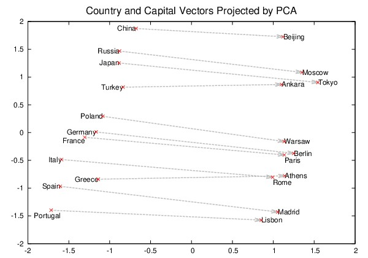
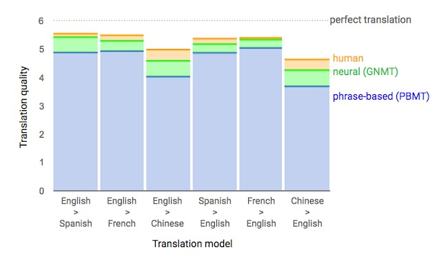
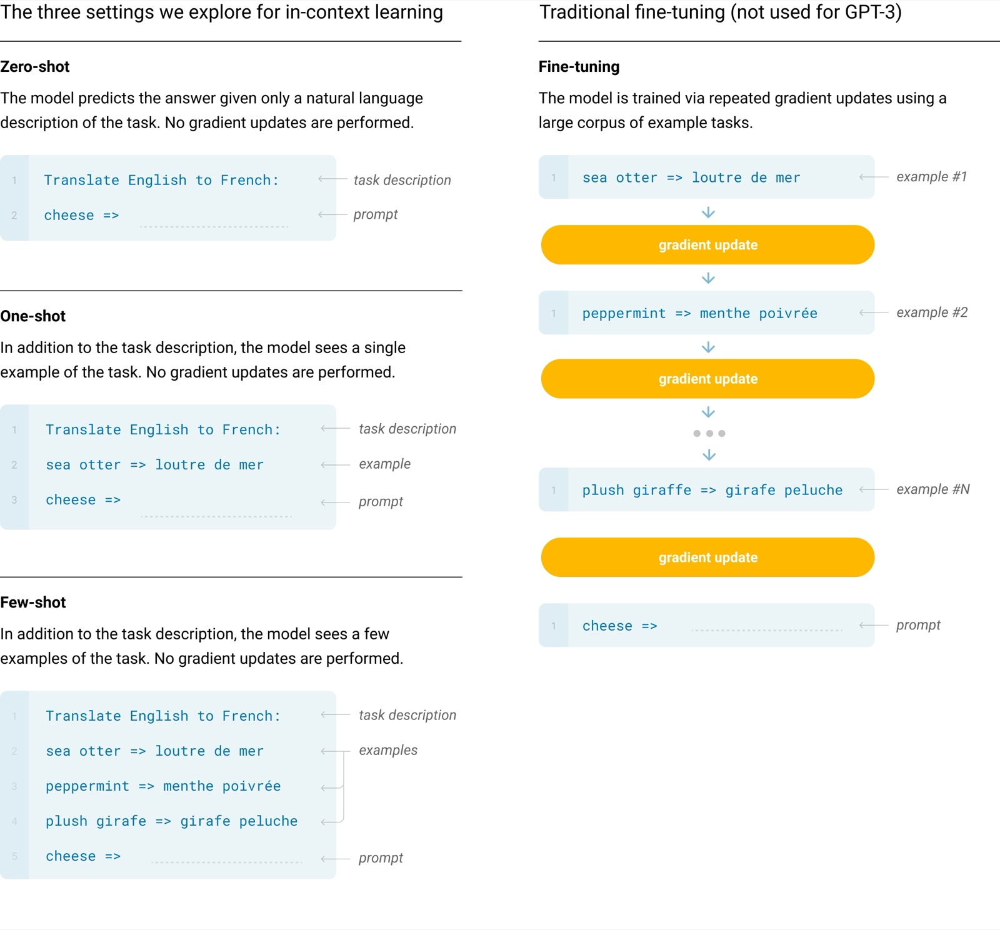
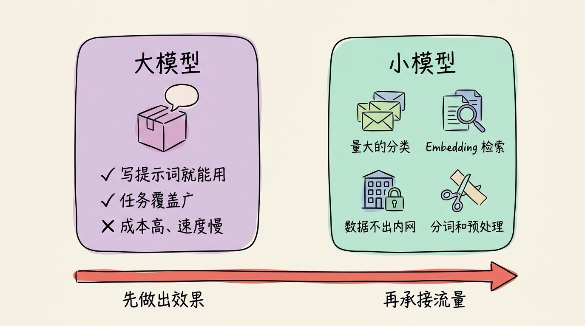

# 3分钟搞懂自然语言处理

> ⭐⭐需要一些基础 · 阅读时间 3分钟 · 更新于 2026-10-28
>
> 自然语言处理（NLP）是让计算机读懂、处理和生成人类语言的技术。本文讲清语言为什么难处理，NLP 七十年怎样从写规则走到大模型，为什么以前一个任务一个模型、现在一个模型做所有任务，以及分类、检索这类活为什么还在用小模型。

## 一句话定义

**自然语言处理**（Natural Language Processing，简称 NLP）= 让计算机既能读懂人写的文字，比如判断一条评论是好评还是差评、从一句话里找出时间和地点；也能自己写出通顺的文字，比如翻译、写摘要、回答问题。这里的“自然语言”指的是中文、英文这些人日常说的话，不是编程语言。

这两件事也有各自的名字：读懂文字叫**自然语言理解**（NLU），比如你问“北京明天天气怎么样”，计算机要知道你问的是北京、是明天、想查的是天气；写出文字叫**自然语言生成**（NLG），比如把查到的天气数据写成“北京明天晴，15 到 25 度，适合出门”。翻译、摘要、客服、搜索、ChatGPT 聊天，背后都是这两件事的组合。

语音助手看起来也是在“听懂人话”，但它其实分了好几步：先由语音识别把声音转成文字，再交给 NLP 去理解，最后再用语音合成读出来。现在的多模态模型把这几步合到了一起，但处理“意思”的那部分，仍然是 NLP 要解决的问题。

## 语言难处理，是因为意思全靠上下文

对人来说，读懂一句话几乎不费力，但对计算机来说，同一串文字可能有好几种意思。中文里就有不少这样的例子：

- **在哪里断开**：中文的词和词之间没有空格。“南京市长江大桥”可以切成“南京市 / 长江大桥”，也可以切成“南京 / 市长 / 江大桥”。所以中文 NLP 长期以来都有一个专门的步骤叫**分词**，英文就不太需要这一步。
- **一词多义**：“苹果发布了新手机”和“我买了两斤苹果”，同一个“苹果”，一个是公司，一个是水果。
- **字面相反，意思相同**：“中国队大胜美国队”和“中国队大败美国队”，赢的都是中国队。
- **话里有话**：“你可真行啊”，可能是夸奖，也可能是在讽刺，要看前面发生了什么。

人是靠常识和语境来判断的，而计算机一开始既没有常识，也看不懂语境。NLP 这七十年来做的事情，就是不断地换办法，让机器能更好地利用上下文。

## 七十年里，NLP 换了三套办法

**第一套：人来写规则（1950 年代到 1980 年代）**

1954 年，美国乔治城大学和 IBM 做了一次公开演示，用 250 个词和 6 条语法规则，把 60 多个俄语句子自动翻译成了英语。研究者当时乐观地预计，三到五年内机器翻译问题就能解决。但这些句子都是事先挑选过的，一旦换成真实文本，规则就不够用了。1966 年，美国的 ALPAC 报告认为机器翻译短期内看不到实用的希望，相关的研究经费随后被大幅削减。

同一年，MIT 的 Weizenbaum 做出了聊天程序 **ELIZA**，它模仿心理咨询师，靠关键词匹配和固定句式回话。不少人和它聊过之后觉得它真的懂自己，但其实它对句子的意思一无所知。

规则的问题在于：语言的例外情况太多，规则写得越多，互相冲突的地方也越多，最后会变得很难维护。

**第二套：让机器从数据里统计规律（1990 年代到 2000 年代）**

既然规则写不完，研究者就换了一个思路：不再告诉机器语法是什么，而是给它大量的双语对照文本，让它自己统计“这个词在这种上下文里，最常被翻译成什么”。早期的谷歌翻译、拼音输入法的联想、垃圾邮件过滤，用的都是这类统计方法。

统计方法比规则更灵活，但它主要看的是附近几个词，很难处理一个长句子前后的呼应关系。

**第三套：神经网络（2010 年代至今）**

2013 年的 **Word2Vec** 是一个转折点。它把每个词变成一串数字（叫**词向量**），意思相近的词，数字也相近。最经典的例子是：“国王”的向量减去“男人”，再加上“女人”，结果最接近“女王”。机器第一次能用计算的方式去衡量“意思有多像”。

*图注：出自 Mikolov 等 2013 年的 Word2Vec 论文《Distributed Representations of Words and Phrases and their Compositionality》。左边是国家（中国、俄罗斯、日本等），右边是首都（北京、莫斯科、东京等），模型训练时没有人告诉它“首都”是什么意思，但“国家 → 首都”的箭头方向几乎一致，说明这层关系已经被学进了数字里。*

之后的进展就很快了：

- **2016 年**：谷歌翻译改用神经网络。按谷歌论文里的人工评测，在英语和法语、西班牙语、中文等语言之间的翻译里，错误比原来的统计系统平均少了 60% 左右（测试用的是单独的简单句子）。
- **2017 年**：Transformer 架构发表，它用注意力机制让每个词都能直接“看到”整句话里的其他词，长距离的前后关系终于能处理好了。
- **2018 年**：谷歌发布 BERT，在 11 项 NLP 任务上刷新了当时的最好成绩。
- **2020 年**：GPT-3 展示了只给几个例子、不用重新训练，就能完成很多任务的能力。
- **2022 年**：ChatGPT 发布，NLP 第一次以产品的形式走进普通人的日常生活。

*图注：出自谷歌研究博客 2016 年 9 月的文章《A Neural Network for Machine Translation, at Production Scale》。纵轴是人工打分（0 到 6 分，6 分为完美翻译），蓝色是原来的统计翻译（PBMT），绿色是神经网络翻译（GNMT），橙色是人工翻译。可以看到，在六组语言里，神经网络都把和人工翻译之间的差距缩小了一大截；中英互译的分数整体比欧洲语言之间低，说明差别越大的语言越难翻译。*

## 从“一个任务一个模型”，到“一个模型做所有任务”

如果只记住一个变化，那就是这一条。

在大模型出现之前，NLP 是一个个分开的任务，每个任务都要单独准备数据、单独训练模型：

| 任务 | 做什么 | 例子 |
|------|--------|------|
| **文本分类** | 判断一段文字属于哪一类 | 垃圾邮件识别、新闻分栏目 |
| **情感分析** | 判断态度是正面还是负面 | 商品评论分析、舆情监控 |
| **命名实体识别** | 找出人名、地名、机构名 | 从合同里提取甲乙双方 |
| **机器翻译** | 一种语言转成另一种语言 | 翻译软件 |
| **文本摘要** | 长文压缩成要点 | 新闻摘要、会议纪要 |
| **问答** | 根据资料回答问题 | 智能客服、搜索 |

BERT 时代的做法叫**预训练 + 微调**：先用海量文本预训练出一个通用的模型，然后针对每个任务，再用几千到几万条标注好的数据单独微调一遍。比起从零开始训练已经省事很多了，但公司里要做情感分析、实体识别和分类，还是得维护三个模型。

到了大语言模型这里，做法变成了直接**写提示词**：把任务用一句话说清楚，再给它几个例子，同一个模型就能完成上面表格里的所有任务。以前要标注数据、训练模型几周才能上线的功能，现在可能写几行提示词就能先跑起来。

*图注：出自 OpenAI 2020 年的 GPT-3 论文《Language Models are Few-Shot Learners》。任务是把英文翻译成法文：左边三种方式都只是在提示词里写任务说明，再给 0 个、1 个或几个例子，模型参数不做任何改动；右边的传统微调则要拿一批例子反复训练、更新参数（图中黄色的 gradient update），才能用来做这个任务。*

这也是为什么现在很多人觉得“NLP 就是大模型”。更准确的说法是：**大语言模型是目前 NLP 最主要的技术路线，而 NLP 是它要解决的那一类问题。** ChatGPT 是 NLP 的一个应用，翻译、分类、摘要、信息提取这些任务也都属于 NLP。

## 传统 NLP 并没有消失，只是换了位置

大模型很强，但它不是所有场景里的最优解，下面这几类工作现在还在大量使用“小模型”和传统方法：

- **量大、要求快的分类任务**：比如每天要审核几千万条评论，或者给每封邮件判断是不是垃圾邮件。如果每一条都调用一次大模型，成本和延迟都扛不住，用一个微调过的 BERT 这类小模型，在一台普通服务器上就能跑，速度也快得多。
- **搜索和 RAG 里的检索**：要从一大堆文档里找出和问题相关的那几段，靠的是 **Embedding 模型**，它的作用和当年的词向量类似，只是把整段话变成一串数字，再比较哪段话和问题最接近。国内常用的有智源的 BGE 系列、阿里的 Qwen Embedding 系列等。
- **数据不能出内网的场景**：银行、医院这类机构，经常要求数据只能在本地处理，一个本地部署的小模型往往比调用云端大模型更合适。
- **分词和文本预处理**：大模型自己用分词器把文字切成 Token，但做搜索索引、统计词频、生成词云这类工作时，jieba、HanLP 这些中文分词工具仍然很常用。

现在比较常见的做法是两者配合：先用大模型快速做出效果、生成一批标注数据，等任务稳定了、量上来了，再用这些数据训练一个小模型来承担日常的流量。

## 现在还没解决好的问题

- **“懂”和“像”很难区分**：大模型能写出非常通顺的文字，但它也会一本正经地编造事实。尤其是做摘要和问答时，要注意它可能把原文里没有的内容写进去。
- **考试成绩不等于真实能力**：2018 年推出的 GLUE 测试集，很快就被模型刷到了人类水平，研究者又推出了更难的 SuperGLUE；2021 年 1 月，微软的 DeBERTa 和谷歌的 T5 也相继在 SuperGLUE 上超过了人类基线。但这并不代表模型已经像人一样理解语言了，所以测试集一直在换，评测本身也是 NLP 研究里的难题。
- **小语种的数据还是不够**：全世界有几千种语言，大多数在网上的文本都很少。Meta 在 2022 年发布的 NLLB-200 把机器翻译扩展到了 200 种语言，但小语种的翻译质量和中英之间还有不小的差距。
- **长文本读得进，不一定读得懂**：现在主流模型的上下文窗口已经到了几十万甚至上百万 Token，但能放进去不等于每一处都能注意到，长文档中间部分的信息仍然容易被忽略。

## 时效性提醒

NLP 的基本问题（歧义、上下文、常识）几十年来都没有变，变化快的是技术和工具：

- 大模型的版本、上下文长度和价格更新很快，以各家官方发布为准
- Embedding 模型和中文分词工具也在持续更新，选型前看一下最新的评测榜单
- 多模态模型正在把语音、图片和文字放到同一个模型里处理，NLP 和语音、视觉之间的边界越来越模糊

💬 **互动话题**：在你的工作里，有没有哪个 NLP 任务是你觉得用小模型反而比大模型更合适的？

📖 **相关阅读**：

- [3分钟搞懂大语言模型](../../01-basics/04-llm/README.md) - 目前 NLP 最主要的技术路线
- [3分钟搞懂Transformer](../../01-basics/03-transformer/README.md) - 让模型看懂长距离前后关系的架构
- [3分钟搞懂Token和上下文](../../01-basics/06-token-and-context/README.md) - 大模型怎么切分文字
- [3分钟搞懂RAG检索增强](../04-rag/README.md) - Embedding 检索的典型用法
- [3分钟搞懂生成式AI](../01-generative-ai/README.md) - 从文字扩展到图片、音频和视频
- [3分钟搞懂计算机视觉](../03-computer-vision/README.md) - AI 处理图像的另一条分支

**资料来源**：

- Wikipedia，Georgetown–IBM experiment：https://en.wikipedia.org/wiki/Georgetown%E2%80%93IBM_experiment
- Wikipedia，ALPAC：https://en.wikipedia.org/wiki/ALPAC
- Weizenbaum，ELIZA（1966）：https://dl.acm.org/doi/10.1145/365153.365168
- Mikolov 等，Efficient Estimation of Word Representations in Vector Space（2013）：https://arxiv.org/abs/1301.3781
- Mikolov 等，Distributed Representations of Words and Phrases and their Compositionality（2013，配图 1 出处）：https://arxiv.org/abs/1310.4546
- Wu 等，Google's Neural Machine Translation System（2016）：https://arxiv.org/abs/1609.08144
- Google Research Blog，A Neural Network for Machine Translation, at Production Scale（2016-09，配图 2 出处）：https://research.google/blog/a-neural-network-for-machine-translation-at-production-scale/
- Vaswani 等，Attention Is All You Need（2017）：https://arxiv.org/abs/1706.03762
- Devlin 等，BERT（2018）：https://arxiv.org/abs/1810.04805
- Brown 等，Language Models are Few-Shot Learners（2020，配图 3 出处）：https://arxiv.org/abs/2005.14165
- Microsoft Research，DeBERTa surpasses human performance on the SuperGLUE benchmark（2021-01）：https://www.microsoft.com/en-us/research/blog/microsoft-deberta-surpasses-human-performance-on-the-superglue-benchmark/
- Meta AI，No Language Left Behind（2022）：https://ai.meta.com/research/no-language-left-behind/

---

⬅️ 上一篇：[3分钟搞懂生成式AI](../01-generative-ai/README.md) ｜ [📚 返回目录](../README.md) ｜ 下一篇：[3分钟搞懂计算机视觉](../03-computer-vision/README.md) ➡️
