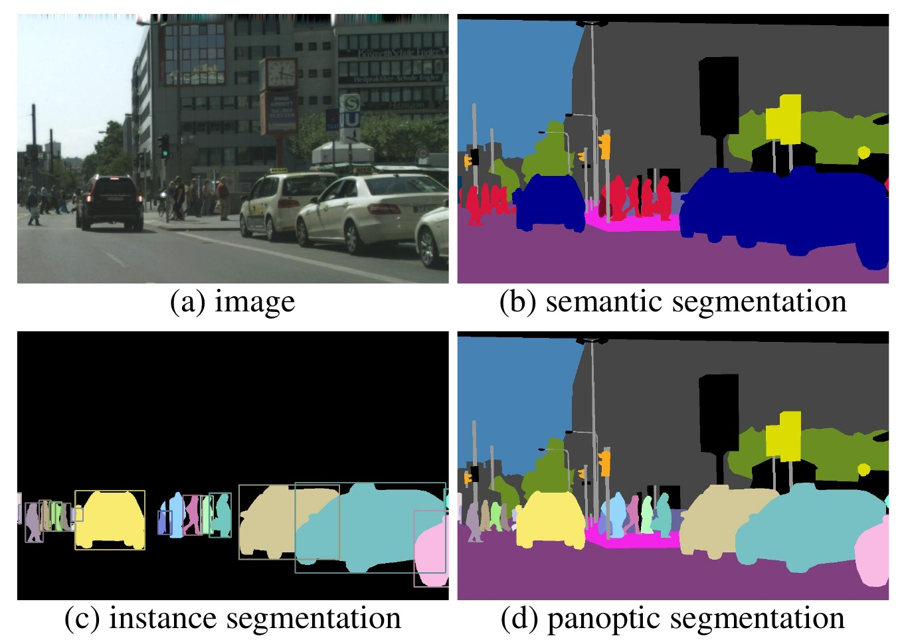
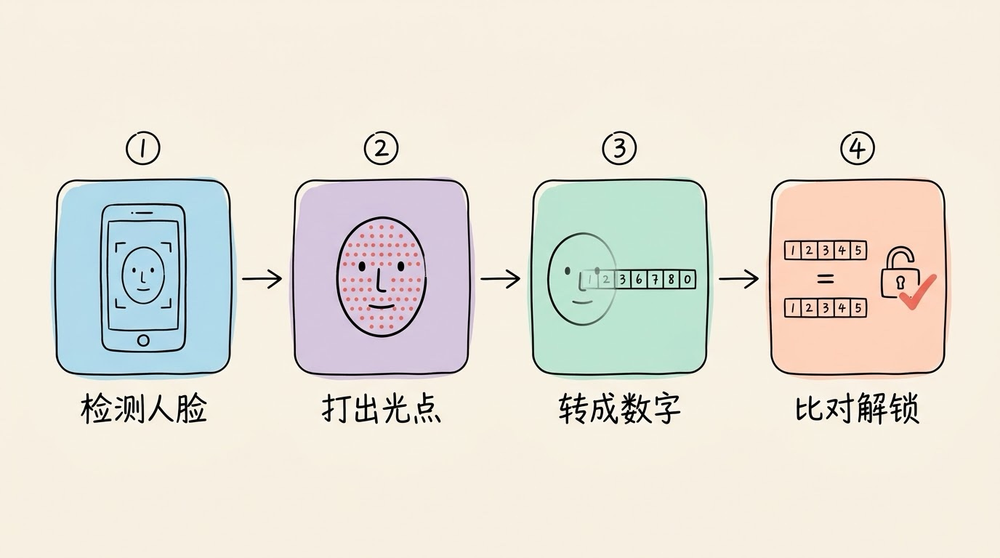
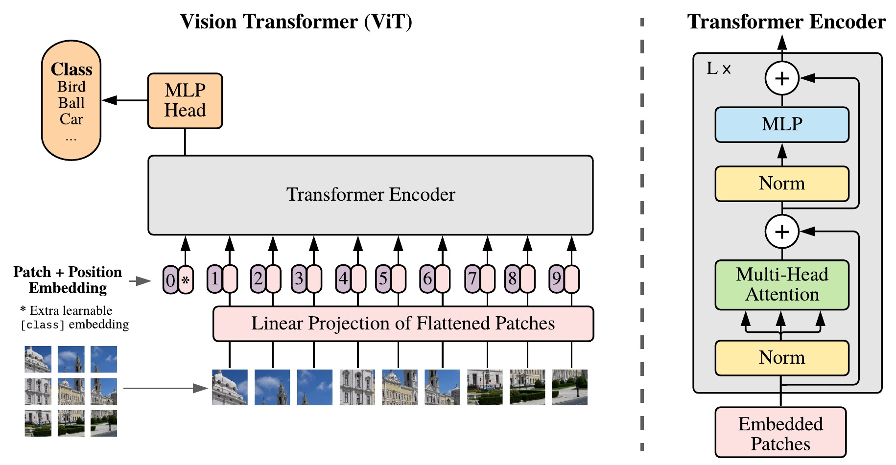
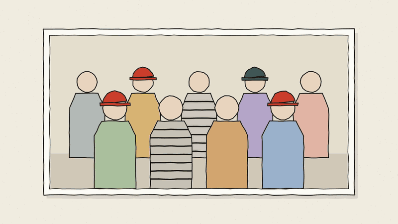
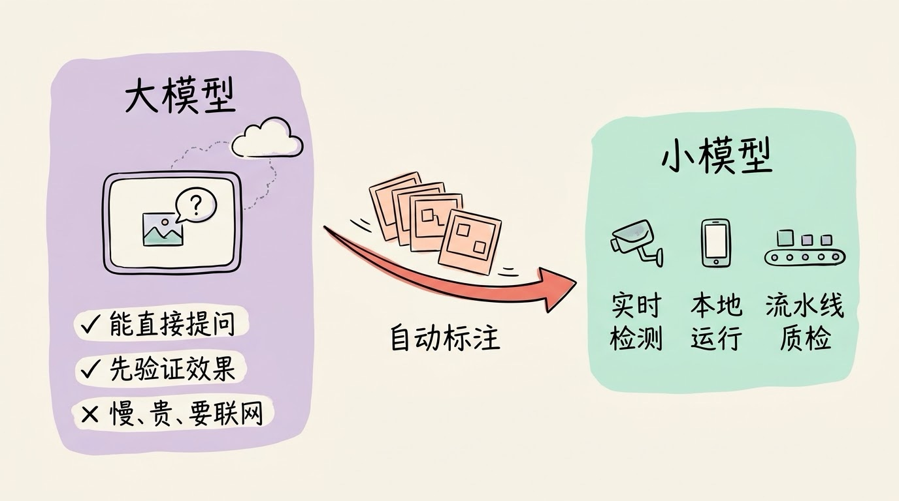
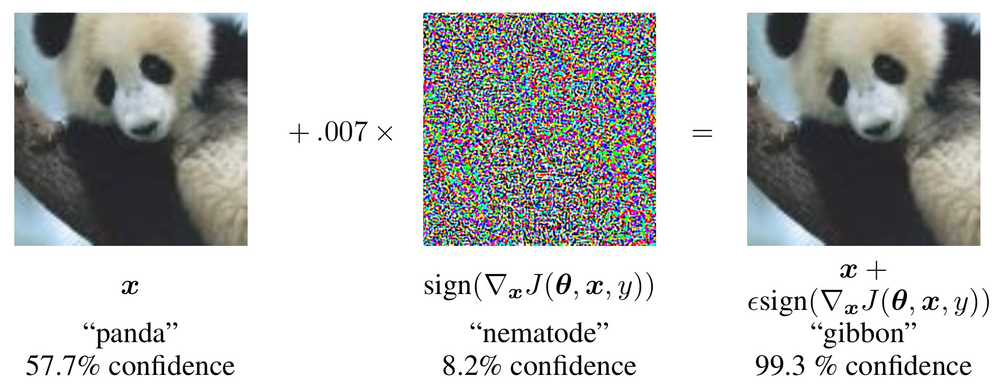

# 3分钟搞懂计算机视觉

> ⭐⭐需要一些基础 · 阅读时间 3分钟 · 更新于 2026-10-28
>
> 计算机视觉（CV）是让计算机从图片和视频里认出东西、找到位置、看懂场景的技术。本文讲清图片在机器眼里为什么只是一堆数字，CV 怎样从人工找特征走到深度学习，为什么现在能“说什么就找什么”，以及手机、工厂里为什么还在用小模型。

## 一句话定义

**计算机视觉**（Computer Vision，简称 CV）= 让计算机从图片和视频里看出东西来，比如判断照片里是不是有一只猫、找出路上每一辆车的位置、把一个人从背景里精确地抠出来、读出图片里的文字；再进一步，还要能看懂画面里正在发生什么，比如“一个人正在过马路”。

你每天都会用到它：刷脸解锁、扫码、拍照时自动对焦到人脸、相册按“猫”“海边”自动分组、拍一张照片搜同款，背后都是 CV。

## 在计算机眼里，图片只是一大堆数字

人看一张照片，一眼就能认出里面有一只猫。但计算机拿到的并不是“猫”，而是一张数字表格：每个像素用红、绿、蓝三个 0 到 255 之间的数字表示颜色。一张 1920×1080 的普通照片，就是 1920 × 1080 × 3，大约 620 万个数字。

CV 难就难在，**同一只猫，换个拍法，这些数字就几乎全变了**：

- **光线**：同一只猫在阳光下和台灯下拍，每个像素的数值都不一样
- **角度和距离**：正面、侧面、远处只占几十个像素，对应的数字完全不同
- **遮挡**：猫躲在沙发后面只露出半个头，大部分“猫的数字”都不见了
- **同类差别大**：橘猫、黑猫、无毛猫，长得差别很大，但都要认成“猫”

所以 CV 要做的，就是从这几百万个不断变化的数字里，找出那些不管怎么拍都不太会变的规律，比如猫的尖耳朵、胡须、眼睛的形状，不管光线和角度怎么变，这些特点都还在。

## 从人来找特征，到让机器自己学特征

**早期：人来设计“看什么”**

在深度学习出现之前，研究者的办法是自己设计规则，告诉计算机该看哪些特征。比如先找出亮度突然变化的地方，这就是物体的边缘；再找两条边相交形成的角（比如桌角、窗框的角）和重复出现的纹理，把这些特征组合起来，再交给一个判断程序决定这是什么。2004 年前后广泛使用的 SIFT 方法就是这类做法的代表，它会在图上找出一批很有辨识度的小区域，就算照片放大、缩小或者转了个角度，这些区域也能对得上，所以在拼接全景照片、匹配同一栋建筑的不同照片这类任务上效果很好。

但问题和自然语言处理早期写规则时一样：现实世界的变化太多，人很难把“猫长什么样”写成规则。

**2012 年：数据加深度学习，一次拉开差距**

转折来自一个数据集。2009 年，李飞飞团队发布了 **ImageNet**，这是一个人工标注过的大型图片库，最终收录了 1400 多万张图片，分成 2 万多个类别。

从 2010 年开始，研究者每年都会基于 ImageNet 举办一次图像识别比赛（ILSVRC）。比赛并不用整个图片库，而是从里面挑出 1000 个常见类别、大约 120 万张图片给参赛模型训练，再用另一批模型没见过的图片来测试，看它能不能认出每张图属于哪一类。

比赛的主要评分方式是：每张测试图片允许模型给出 5 个答案，只要正确答案在这 5 个里面就算答对，最后统计答错的比例，这就是常说的 **Top-5 错误率**。之所以允许给 5 个答案，是因为很多图片里不止一样东西，而且有些类别本身就很接近，比如不同品种的狗。

2012 年，多伦多大学 Hinton 团队用卷积神经网络 **AlexNet** 参赛并拿到了第一名，错误率是 15.3%；排在第二名的队伍用的是传统方法，错误率是 26.2%，比 AlexNet 高出 10 个百分点还多。这个差距在当时非常少见，之后几年，参赛队伍和整个领域几乎都转向了深度学习。

这次突破能成立，靠的是三样东西同时到位：足够多的标注数据（ImageNet）、足够强的算力（用 GPU 训练），以及能自己从数据里学特征的神经网络。

**2015 年：在这项比赛上，模型的错误率比人还低**

2015 年，微软亚洲研究院的 **ResNet** 把同样算法下的 Top-5 错误率降到了 3.57%。作为对比，之前有研究者亲自做过同样的测试，人的错误率大约是 5.1%。

不过要注意，这里的“超过人类”有明确的范围：只是在 ImageNet 这 1000 个类别、这批测试图片上。如果换一批风格不同的照片，比如手绘的猫、夜里拍的模糊照片，或者让模型回答“谁手里拿着什么”“杯子在桌子上还是桌子下”这类关系问题，它和人的差距仍然很大，后面会具体讲。

## CV 要回答的几个问题

“看懂一张图”其实可以拆成好几个不同的问题，难度和输出形式都不一样：

| 任务 | 回答什么问题 | 输出 | 例子 |
|------|------------|------|------|
| **图像分类** | 这张图是什么 | 一个类别标签 | 相册按“猫”“美食”分组 |
| **目标检测** | 图里有哪些东西，各在哪 | 每个物体一个方框加类别 | 自动驾驶识别车辆、行人 |
| **语义分割** | 每个像素属于哪一类 | 每个像素按类别涂上颜色的图 | 划出可行驶的路面 |
| **实例分割** | 同一类里，每一个个体的轮廓 | 每个个体一个精确轮廓 | 把合影里的每个人分别抠出来 |
| **文字识别（OCR）** | 图里写了什么字 | 文字和它的位置 | 扫描发票、拍照翻译 |
| **人脸 / 人体分析** | 这是谁、姿势是什么 | 身份、身体各关节的位置 | 刷脸支付、健身动作纠正 |
| **视频理解** | 画面里正在发生什么 | 动作、事件、时间段 | 监控里识别有人摔倒 |
| **三维重建** | 这个场景的立体结构是什么 | 每个点离镜头多远、三维模型 | 手机拍照虚化背景、扫描房间 |

分类和检测的区别最容易混淆：分类只说“图里有猫”，检测要说“左上角有一只猫，右下角有一只狗”，还要给出方框。分割则比方框更进一步，要精确到每个像素，抠图、医学影像里勾画病灶，用的都是分割。

*图注：出自 Facebook AI 研究院 2019 年的论文《Panoptic Segmentation》。(a) 是原图；(b) 是语义分割，每个像素都按类别涂色，所有的车都是同一种深蓝色、所有的人都是同一种红色，分不出是哪一辆、哪一个；(c) 是实例分割，每辆车、每个行人都单独涂成一种颜色并配一个方框，但天空、路面这类数不清个数的区域不处理；(d) 是论文提出的全景分割，把前两种合在一起。*

用 iPhone 的面容 ID 举例，一次刷脸其实串起了好几个任务：先**检测**屏幕前有没有人脸，再用红外点阵投射器打出 3 万多个看不见的光点，得到脸部的**三维结构**，然后把脸的形状转换成一串数字，和录入时保存的数字进行**比对**。苹果官方给出的数据是，随机一个人能用面容 ID 解锁你手机的概率小于百万分之一。正因为用了三维数据，所以拿一张照片是骗不过它的。

图片生成（比如 AI 绘画）有时也被归到 CV 里，不过它现在一般被归为生成式 AI，原理和上面这些“看懂”的任务不太一样，可以看文末的相关阅读。

## 机器是怎么“看”的：卷积和 ViT

**卷积神经网络（CNN）：用小窗口一块一块地看**

CNN 的做法是用一个很小的窗口（比如 3×3 像素）在图片上从左到右、从上到下滑过去，每到一个位置，就计算这一小块像不像某种图案。

- 第一层学到的是最简单的东西：横线、竖线、颜色变化
- 再往上几层，把线条组合成纹理、圆圈、角
- 更高的层，组合成眼睛、耳朵、车轮这类部件
- 最后几层，根据有没有这些部件判断“这是一只猫”

这些特征都不是人设计的，而是模型在训练中自己学出来的。同一个窗口在整张图上反复使用，不管猫出现在左上角还是右下角，用的都是同一套判断方法，所以模型要学的参数少、计算也快，这也是 CNN 到今天仍然被大量用在手机和摄像头里的原因。

**Vision Transformer（ViT）：把图片切成小块当成“词”来读**

2020 年，谷歌提出了 **ViT**，论文标题就是《一张图片相当于 16×16 个词》。它把图片切成一个个 16×16 像素的小块，一张 224×224 的图片正好切成 196 块，然后把这些小块像句子里的词一样交给 Transformer 处理。

*图注：出自谷歌 2020 年的 ViT 论文《An Image is Worth 16x16 Words》。左下角是一张建筑照片被切成 3×3 共 9 个小块（实际使用时切得更细），然后排成一行；每块转换成一串数字，再加上 1 到 9 的位置编号，让模型知道这一块原来在图片的哪个位置（最前面带星号的 0 号是额外加的一格，用来汇总整张图的信息）；最后一起送进中间的 Transformer Encoder，由左上角输出“鸟、球、车”这样的类别。右边是 Transformer Encoder 内部的结构，其中的 Multi-Head Attention 就是让每一块都能“看到”其他所有块的注意力机制。*

和 CNN 只看附近一小块不同，Transformer 的注意力机制让每一块从一开始就能“看到”整张图的其他部分，更容易理解远处物体之间的关系。代价是它需要更多的训练数据：数据量小的时候，ViT 的效果往往不如 CNN；数据量足够大时，它的上限更高。

**现在的分工**：需要理解复杂场景的大模型，基本都用 ViT 或类似结构做“眼睛”；手机、摄像头、工厂设备上要求又快又省电的任务，CNN 和 ViT 两者混合的结构仍然很常用，两者并不是谁淘汰谁的关系。

## 从“只认固定类别”，到“说什么就找什么”

这是 CV 最近几年最大的变化，和自然语言处理从“一个任务一个模型”变成“一个模型做所有任务”很像。

以前的 CV 模型，类别是在训练时就定死的。一个在 80 个类别上训练的检测模型，就只认识这 80 种东西。工厂想检测一种新的零件缺陷，就要重新收集几千张图片、一张张画框标注，再重新训练。

下面的三个关键进展彻底改变了这种模式：

**1. CLIP：让图片和文字对上号（2021）**

OpenAI 的 **CLIP** 用从网上收集的 4 亿对“图片 + 配文”来训练，让模型学会判断一张图和一段文字是不是在说同一件事。训练完之后，你只要给它几个候选文字，比如“一张猫的照片”“一张狗的照片”，它就能判断图片更接近哪一个，**不需要为新类别重新训练**。这为后面“用文字来指挥视觉模型”打下了基础，很多 AI 绘画模型也用它来理解提示词。

**2. SAM 系列：通用的“抠图”模型（2023 到 2025）**

Meta 在 2023 年发布了 **SAM**（Segment Anything Model），用 1100 万张图片、超过 10 亿个分割轮廓训练。你在图上随便点一下或者画个框，它就能把对应的物体精确地抠出来，不管这个物体在训练时有没有见过。

2025 年 11 月发布的 **SAM 3** 又往前走了一步：可以直接输入文字，比如“黄色的校车”“戴着红帽子的人”，它就会在图片或视频里把所有符合描述的对象都找出来、抠出来，并在视频里持续跟踪。以前要专门训练一个检测模型才能做的事，现在写一个短语就能先跑起来。

**3. 多模态大模型：直接用聊天的方式看图**

现在主流的大模型基本都能看图了，比如 GPT、Gemini、Claude，国内的通义千问、豆包、智谱 GLM 等。它们的做法通常是在大语言模型前面接一个**视觉编码器**，也就是一个专门“看图”的模块（一般是 ViT 结构）。它把图片切成小块、转换成一串串数字，这些数字的格式和文字转换出来的 Token 一样，所以语言模型可以把图片和你的问题放在一起理解。

这样一来，很多以前要专门开发的视觉功能，变成了直接提问：

- 拍一张电路板的照片，问“哪个元件看起来烧坏了”
- 上传一张报表截图，让它整理成表格
- 给它一段监控视频，问“这个人是几点进的门”

能让 AI 直接操作电脑的 Computer Use，也离不开这种能力：模型要先看懂屏幕截图，知道按钮在哪里，才能去点击。

## 小模型和专用模型仍然在干活

多模态大模型很灵活，但它慢、贵，而且通常要联网调用。下面这些场景里，专用的小模型仍然是主力：

- **要求实时的场景**：自动驾驶、工业流水线、视频监控，往往要在几十毫秒内处理完一帧画面，而且每秒要处理几十帧。这类场景常用 **YOLO** 系列检测模型，它的名字是 You Only Look Once（只看一次）的缩写：整张图只处理一遍，就同时给出所有物体的位置和类别，所以速度很快。从 2015 年第一版到现在，它一直在更新，Ultralytics 在 2026 年 1 月发布的 YOLO26，重点就是让模型更容易直接装进手机、摄像头这类设备里运行，不用把画面传到云端。
- **量大、重复的场景**：工厂质检每天要检查几十万个零件，如果每张图都调用一次大模型，成本完全不划算。用一个针对这种缺陷专门训练的小模型，在流水线旁边的一台普通工业电脑上就能跑。
- **数据不能出设备的场景**：刷脸解锁在手机芯片里直接完成，人脸数据不上传。医院、工厂的图像也常常要求只能在本地处理。
- **文字识别**：扫描发票、证件识别这类需求，百度飞桨的 PaddleOCR 等开源工具在中文场景下用得很多，速度快，也能本地部署。

比较常见的做法是两者配合：先用多模态大模型或 SAM 3 快速验证效果、自动生成一批标注数据，等方案稳定了，再用这些数据训练一个小模型部署到设备上。以前最耗时间的人工标注，现在可以先让大模型做一遍，人只负责检查和修正。

## 现在还没解决好的问题

- **认得出，不等于看得懂**：多模态大模型能准确描述一张照片，但在一些对人来说很简单的任务上反而会出错。2024 年有一篇论文专门测试了这一点，让模型数两条线有几个交点、判断两个圆有没有重叠，结果几个主流模型的表现都不理想。数数、判断精确的位置和距离，仍然是它们的弱项。
- **换个环境就可能失灵**：一个用白天、晴天数据训练的模型，到了夜里、雨天或者另一个城市，效果可能明显下降。这也是自动驾驶要收集大量各种天气、各种路况数据的原因。
- **容易被人为干扰**：前面说过，图片在计算机眼里就是一堆 0 到 255 的数字。2014 年的一项研究拿了一张熊猫照片，把每个像素的数值都微调了大约 1，有的调高一点，有的调低一点。改完之后，人眼看这两张图完全一样，但模型却把它认成了长臂猿，而且给出的把握高达 99.3%。这些微调不是随便改的，而是研究者根据模型的计算方式专门算出来的，每个像素往哪个方向改，都是为了让模型一步步偏向错误答案，这种图片也叫**对抗样本**。在路牌上贴几张特定的贴纸，也可能让识别系统看错。在安防、自动驾驶这类场景里，这是必须防范的安全问题。

*图注：出自 Goodfellow 等 2014 年的论文《Explaining and Harnessing Adversarial Examples》。左边是原图，模型认为是熊猫（panda），把握是 57.7%；中间是专门算出来的改动，为了让人看清楚做了放大显示，实际叠加时只乘以 0.007，相当于每个像素的数值只改了 1 左右；右边是叠加后的图片，人眼看和原图没有区别，模型却认成了长臂猿（gibbon），把握是 99.3%。*

- **长视频还是难点**：理解几秒钟的片段已经做得不错了，但要看完一部两小时的电影、记住前后的情节并回答细节问题，计算量和记忆能力都还跟不上。
- **隐私和合规**：人脸是很敏感的个人信息。国内的《人脸识别技术应用安全管理办法》已经从 2025 年 6 月 1 日起施行，要求有其他验证方式能达到同样目的时，不能把刷脸作为唯一的验证方式；处理不满 14 周岁未成年人的人脸信息，要取得监护人同意；存储人脸信息达到 10 万人的，还要向网信部门备案。如果你的产品里用到了人脸识别，这些规定一定要提前了解清楚。

## 时效性提醒

CV 的基本问题（光照、角度、遮挡、理解场景）几十年来没有变，变化快的是模型和工具：

- 多模态大模型的看图能力每次发布新版本都会有明显提升，具体效果以各家官方发布和实际测试为准
- 检测、分割这类开源模型更新也很频繁，比如 YOLO 和 SAM 系列，选型前看一下最新版本和许可证
- 视频生成的产品变化很快，比如 OpenAI 在 2026 年 3 月宣布分两步关停 Sora 的应用和 API，写方案前要确认用到的产品还在运营

💬 **互动话题**：你的工作里有没有用到视觉相关的功能？现在是直接调大模型，还是自己训练了小模型？

📖 **相关阅读**：

- [3分钟搞懂深度学习](../../01-basics/02-deep-learning/README.md) - CNN 和 ViT 背后的基础
- [3分钟搞懂Transformer](../../01-basics/03-transformer/README.md) - ViT 用的注意力机制
- [3分钟搞懂自然语言处理](../02-nlp/README.md) - AI 处理文字的另一条分支
- [3分钟搞懂生成式AI](../01-generative-ai/README.md) - AI 绘画、视频生成的原理
- [3分钟搞懂Computer-Use](../07-computer-use/README.md) - 让 AI 看着屏幕操作电脑
- 3分钟搞懂Stable Diffusion - 开源图片生成模型

**资料来源**：

- Deng 等，ImageNet: A Large-Scale Hierarchical Image Database（2009）：https://www.image-net.org/
- Krizhevsky 等，ImageNet Classification with Deep Convolutional Neural Networks（2012）：https://papers.nips.cc/paper/4824-imagenet-classification-with-deep-convolutional-neural-networks
- Russakovsky 等，ImageNet Large Scale Visual Recognition Challenge（2015，含人类错误率估计）：https://arxiv.org/abs/1409.0575
- He 等，Deep Residual Learning for Image Recognition（2015）：https://arxiv.org/abs/1512.03385
- Redmon 等，You Only Look Once（2015）：https://arxiv.org/abs/1506.02640
- Goodfellow 等，Explaining and Harnessing Adversarial Examples（2014，配图 3 出处）：https://arxiv.org/abs/1412.6572
- Dosovitskiy 等，An Image is Worth 16x16 Words（2020，配图 2 出处）：https://arxiv.org/abs/2010.11929
- Radford 等，Learning Transferable Visual Models From Natural Language Supervision（CLIP，2021）：https://arxiv.org/abs/2103.00020
- Kirillov 等，Segment Anything（2023）：https://arxiv.org/abs/2304.02643
- Kirillov 等，Panoptic Segmentation（2019，配图 1 出处）：https://arxiv.org/abs/1801.00868
- Meta AI，SAM 3（2025-11）：https://ai.meta.com/sam3/
- Ultralytics，YOLO26 发布（2026-01）：https://www.businesswire.com/news/home/20260114168538/en
- Rahmanzadehgervi 等，Vision language models are blind（2024）：https://arxiv.org/abs/2407.06581
- Apple，About Face ID advanced technology：https://support.apple.com/en-us/102381
- 国家网信办、公安部，人脸识别技术应用安全管理办法（2025-03 公布）：https://www.cac.gov.cn/2025-03/21/c_1744259796594932.htm
- the-decoder，OpenAI sets two-stage Sora shutdown（2026-03）：https://the-decoder.com/openai-sets-two-stage-sora-shutdown-with-app-closing-april-2026-and-api-following-in-september/

---

⬅️ 上一篇：[3分钟搞懂自然语言处理](../02-nlp/README.md) ｜ [📚 返回目录](../README.md) ｜ 下一篇：[3分钟搞懂RAG检索增强](../04-rag/README.md) ➡️
