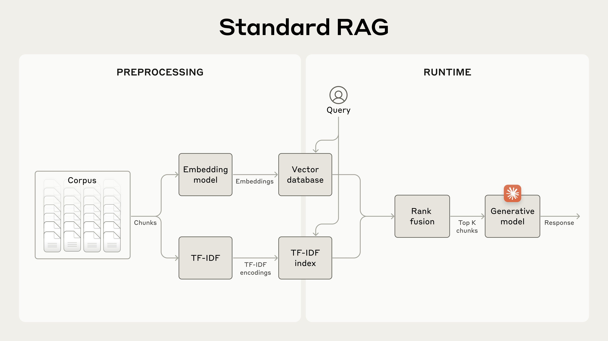
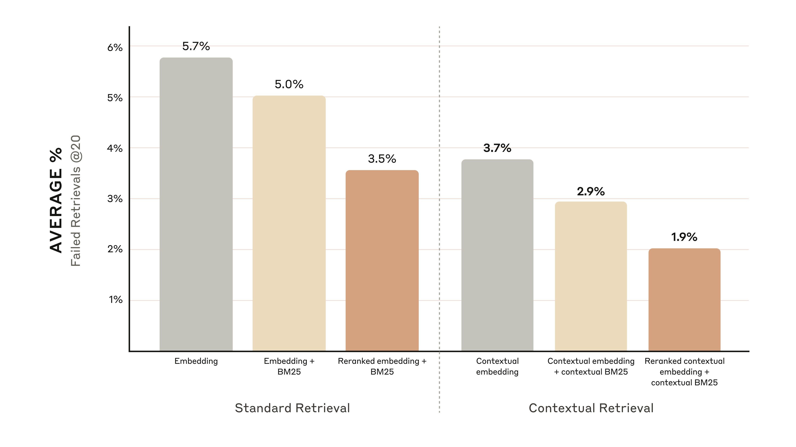
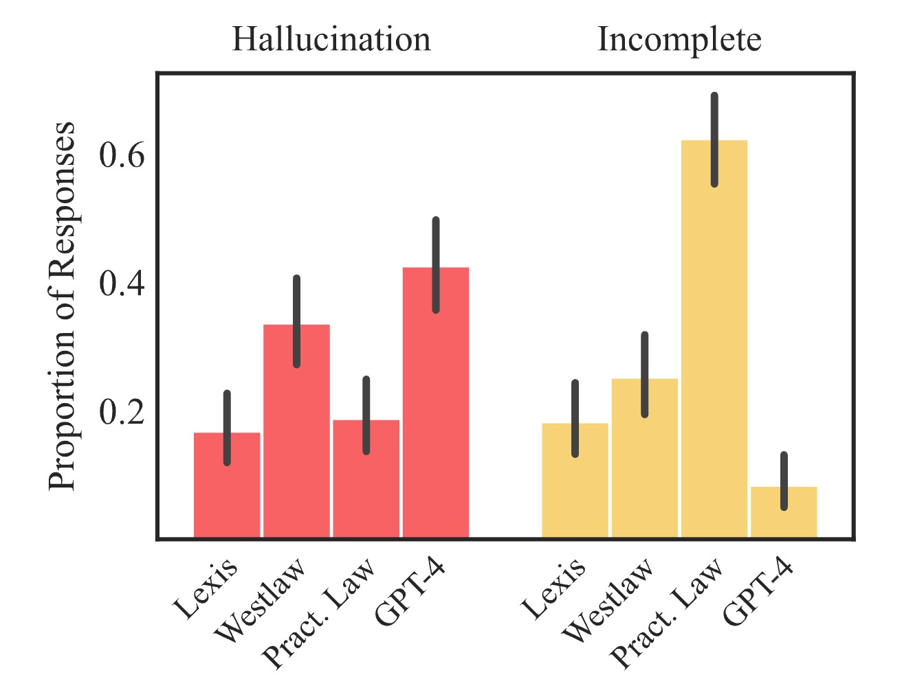
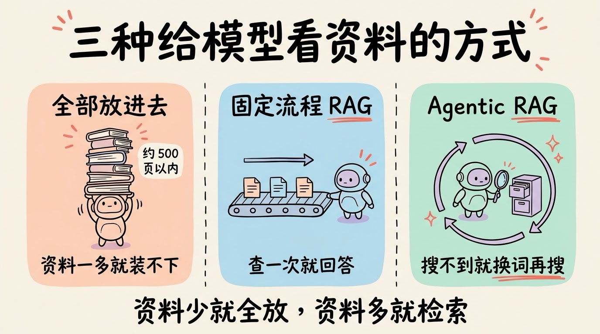

# 3分钟搞懂RAG检索增强

> ⭐⭐中级 · 阅读时间 3分钟 · 更新于 2026-10-28
>
> RAG 让模型先从你的资料里检索相关片段，再依据这些片段回答。本文讲清它的两段流程、答错时为什么多半出在检索这一步、资料查对了为什么也不一定答对，以及在百万 token 窗口和 Agent 搜索普及之后，RAG 该怎么用、怎么选。

## 一句话定义

**RAG**（Retrieval-Augmented Generation，检索增强生成）= 在模型回答之前，先从你指定的资料里检索出和问题最相关的几段内容，把这些内容和问题一起交给模型，让模型依据资料作答，并标出答案出自哪里。

举个例子：员工问公司的 AI 助手“去上海出差，一天的餐费能报多少”。模型的训练数据里不可能有你们公司的报销制度，如果直接问它，它要么说不知道，要么按“一般公司”的标准编一个数字出来。用了 RAG 之后，程序会先去公司的制度文档里找到“一线城市每人每天 150 元”（这里是假设的制度）这一段，再连同问题一起发给模型，模型就能给出准确的答案，并告诉你这条规定出自《差旅报销制度》的哪一条。

RAG 这个名字来自 2020 年 Facebook AI（现在的 Meta）等机构发表的一篇论文，之后它成了大模型在企业里落地最常用的做法之一。

## 模型没变，变的是它眼前的资料

大模型的知识来自训练，训练完参数就固定下来了，所以它有三个天然的短板：

- **知识有截止日期**：训练之后发生的事情，模型并不知道。
- **没见过你的私有资料**：公司制度、产品手册、内部代码，这些都不在公开的训练数据里。
- **细节记不准**：具体的数字、条款、型号，模型只有一个模糊的印象，记不清的时候就容易编，也就是常说的 **AI 幻觉**。

RAG 并没有改造模型本身，它改变的是每次提问时模型眼前摆着的资料。这很像闭卷考试和开卷考试的区别：闭卷只能靠记忆，开卷可以翻书找答案。不过开卷考试里有一个前提，就是**得翻到正确的那一页**。如果翻到的那页不对，学生再聪明也答不对。RAG 里负责“翻书”的就是检索这一步，后面会看到，大部分问题也都出在这里。

还有一个常见的误会：用了 RAG，是不是模型就“学会”了我的资料？其实并没有。每次提问，程序都会重新去资料里查一遍，模型本身什么都没有记住。资料删掉了，它也就答不出来了。真正把知识写进模型参数里的是**微调**，两者的区别后面会再对比。

## 一次 RAG 分两段：先建索引，再检索作答

一个 RAG 系统的工作分成两段。第一段是提前把资料整理好，叫建索引；第二段是每次用户提问时，去查资料并生成回答。

```
【建索引】提前做一次, 资料有更新时再增量处理
1. 解析: 把 PDF、Word、网页等转成纯文字
2. 切块: 按标题、段落切成几百字的小块
3. 向量化: 用 Embedding 模型把每一块转成一串数字
4. 入库: 存进向量数据库, 同时记下来源、日期、权限等信息

【检索作答】每次提问时
5. 检索: 把问题也转成数字, 找出意思最接近的若干块
6. 增强: 把这些块和问题拼进提示词
         "只根据下面的资料回答, 标注引用编号; 资料里没有就说不知道"
7. 生成: 模型依据资料作答, 并附上出处
```

这里有两个概念需要解释一下。

**切块**（Chunking）是因为整份文档太长，而且检索需要精确到段落。块切得太小，一句话会丢掉它的前因后果；切得太大，一块里又会混进很多无关内容。所以块的大小、按什么边界切，是 RAG 里最需要反复调的参数之一。

**向量化**是用 Embedding 模型把一段文字转成一串数字，意思相近的文字，转出来的数字也相近。这样“出差吃饭能报多少”和“餐费标准”虽然没有一个字相同，也能被检索出来。这些数字存在**向量数据库**里，它可以在几百万块内容里快速找出最相近的那几块。


*图注：Anthropic《Introducing Contextual Retrieval》里的标准 RAG 流程图。左边 PREPROCESSING 是建索引：文档切块（Chunks）后分两路，一路用 Embedding 模型转成向量存进向量数据库（Vector database），另一路用 TF-IDF 建关键词索引。右边 RUNTIME 是提问时：两路检索结果经过排序融合（Rank fusion），取最相关的前 K 块（Top K chunks）交给生成模型（Generative model），生成回答（Response）。下面那条关键词检索的路，就是后文说的混合检索。*

## 答错了，多半先检查检索这一步

如果 RAG 给出了错误答案，第一个要检查的就是：正确的那段资料到底有没有被检索出来。如果没有被检索出来，模型就只能凭记忆回答，或者回答不知道。

Anthropic 在 2024 年 9 月的《Introducing Contextual Retrieval》里总结了几类常见的检索问题：

- **切块之后丢了上下文**：比如有一块内容是“公司营收比上季度增长了 3%”，单看这一句，并不知道是哪家公司、哪个季度。当用户问“某公司二季度营收怎么样”时，这一块就很可能检索不出来。他们的解决办法叫**上下文检索**：在入库之前，先让模型给每一块补上一两句说明，比如“这段出自某公司 2023 年二季度财报”，再拿去向量化。
- **精确的词搜不到**：向量检索擅长找“意思相近”的内容，但不擅长“一字不差”的匹配。错误码、产品型号、人名这类内容，用户搜“TS-999”，向量检索可能返回一堆讲错误码的段落，偏偏漏掉了 TS-999 那一条。所以通常要再加一路传统的关键词检索（常用的算法叫 BM25），两路结果合在一起，这叫**混合检索**。
- **排序不准**：检索出来的结果里，最相关的那块不一定排在最前面。常见的做法是先多召回一些候选，再用专门的**重排模型**（Rerank）逐条打分，挑出最相关的几块交给大模型。


他们在测试里统计了“正确内容没有出现在检索到的前 20 块里”的比例，也就是检索失败率：基础方案是 5.7%，加上上下文说明之后降到 3.7%，再加上关键词检索降到 2.9%，最后加上重排降到 1.9%，失败率一共减少了 67%。给每块补说明需要额外调用模型，配合提示词缓存，按他们的估算，每百万 token 的文档大约只要 1 美元左右，而且只需要在入库时做一次就够了。


*图注：出自 Anthropic《Introducing Contextual Retrieval》。纵轴是取前 20 块时的平均检索失败率，越低越好。左边三根是标准检索（Standard Retrieval）：只用向量检索 5.7%，加上 BM25 关键词检索 5.0%，再加上重排 3.5%；右边三根是给每块补了上下文说明的上下文检索（Contextual Retrieval），同样三种组合依次是 3.7%、2.9%、1.9%。*

除了检索方法，**资料本身的质量**也很关键。比如新旧两版报销制度同时放在库里，模型就可能引用旧版本；薪资文件如果没有设置权限，普通员工也可能问出别人的工资。所以入库时要记下日期、版本、部门这些信息，检索时先按权限和版本过滤，再去比较相似度。

## 资料查对了，也不一定答对

RAG 能明显减少幻觉，但并不能完全消除幻觉。2024 年，斯坦福的研究者测试了 LexisNexis 和汤森路透推出的几款法律 AI 研究工具，这几款工具都用了 RAG，厂商也都宣传过“没有幻觉”。研究者用 200 多个法律问题测试后发现，这几款工具出现幻觉的比例在 17% 到 33% 之间，比直接用 GPT-4 要少，但离“没有幻觉”还差得很远（厂商对测试方法提出过异议，这项研究后来在 2025 年正式发表在期刊上）。


*图注：出自 Magesh 等的研究，斯坦福 HAI 博客转载。红色（Hallucination）是回答里出现幻觉的比例，黄色（Incomplete）是回答不完整或拒绝回答的比例，黑线是误差范围。Lexis 指 Lexis+ AI，Westlaw 指 Westlaw AI-Assisted Research，Pract. Law 指 Ask Practical Law AI，GPT-4 是没有接 RAG 的对照组。可以看到 Ask Practical Law AI 的幻觉比例不高，但有六成左右的回答是不完整的。*

出错的原因主要有两类：

- **检索到的资料看起来相关，实际上并不适用**。比如检索到的是另一个地区的法规，或者是已经被推翻的旧判例，模型照着它回答，答案自然就错了。
- **模型误读了资料**。引用的文档是真实存在的，但模型得出的结论和文档里写的并不一致。这种错误最难发现，因为答案后面附着看起来很可靠的出处。

所以在实际使用中，有三件事最好都要做到：要求模型标注出处，并且能点开原文核对；在提示词里明确允许它回答“资料里没有”；**尤其是涉及法律、医疗、财务这类领域时，答案一定要经过人工复核**。另外，知识库里的文档如果来自外部，比如网页、客户邮件，里面可能藏着“忽略之前的指令”这类文字，模型读到之后可能会被带偏，这就是 **Prompt 注入**，也需要提前做好防护。

## 窗口能装下整本书了，还需要 RAG 吗

现在主流模型的上下文窗口已经到了几十万甚至上百万 token，比如 Anthropic 从 2026 年 3 月起，让 Claude 的 100 万 token 窗口按标准价格计费。于是很多人会问：既然能把资料整个塞进去，还需要 RAG 吗？

答案是要看资料有多少。

Anthropic 自己给的建议是：如果知识库小于 20 万 token（大约 500 页），可以直接把全部内容放进提示词，再配合提示词缓存来降低成本，不必专门去搭 RAG。但是当资料超过这个量级时，直接全部塞进去就会遇到三个问题：

- **装不下**：企业的文档动辄几万份，远远超过任何模型的窗口。
- **成本高、速度慢**：每次提问都要把全部资料发一遍，费用和等待时间都会成倍增加。
- **效果反而变差**：Chroma 在 2025 年 7 月测试了 18 个主流模型，发现输入越长，模型的表现越不稳定，这种现象叫**上下文腐烂**。

Claude 的 Projects 功能就是两种方式结合的一个例子：项目资料不多的时候，全部放进上下文；当资料接近窗口上限时，会自动切换到 RAG 模式，按官方的说法，项目能容纳的资料最多可以扩大到原来的 10 倍。

另一个更大的变化是 **Agentic RAG**。传统的 RAG 是一条固定的流水线，查一次就回答。现在更常见的做法是把检索做成一个工具交给 Agent，由模型自己决定要不要搜、搜什么关键词、搜一次不够就换个说法再搜，直到资料够了再回答。

AI 编程工具 Claude Code 就是一个典型的例子：据它的负责人 Boris Cherny 说，早期版本试过用向量数据库给代码建索引，后来改成让 Agent 直接用 grep 这类命令去搜文件，实际使用下来效果更好，也省掉了索引过期、代码数据外泄这些麻烦。不过代码里的函数名、变量名本来就适合精确搜索，如果换成大量说法不统一的业务文档，向量检索仍然很有用。

国内平台也在往这个方向走，比如阿里云百炼的知识库在 2026 年 7 月发布了 RAG 4.0，主打的就是 Agentic 检索。我们平时用的“深度研究”功能，其实也可以看成是对整个互联网做多轮的 Agentic RAG。

还有一类问题，普通 RAG 处理得不太好：比如“这一千份客户反馈里，大家主要在抱怨什么”。这种需要通读全局的问题，只检索几段片段是回答不了的。微软在 2024 年开源的 **GraphRAG** 就是针对这类问题的，它会先把文档整理成实体和关系组成的知识图谱，再按主题汇总，代价是建索引的成本要高得多。

所以 RAG 并没有过时，它正在从一条固定的流程，变成 Agent 手里的一件检索工具。



## RAG、长上下文和微调怎么选

这三种做法经常被放在一起比较，它们解决的其实是不同的问题：

| | RAG | 长上下文直接放入 | 微调 |
|---|---|---|---|
| 怎么做 | 每次只取相关的片段 | 把整份资料全放进去 | 用自己的数据再训练模型 |
| 资料更新 | 更新知识库即可 | 换一份文件即可 | 需要重新训练 |
| 资料规模 | 几乎不受限制 | 受窗口大小限制 | 和训练数据量有关 |
| 能否标出处 | 能 | 能 | 不能 |
| 更适合 | 资料多、经常变化的事实类问答 | 资料不多、需要通读全文 | 固定的格式、语气和领域习惯 |

简单来说，**要让模型知道更多事实，用 RAG 或长上下文；要让模型改变做事的方式，用微调**。三者也可以组合使用，比如用微调让模型习惯客服的回答风格，再用 RAG 给它提供最新的产品资料。

## 想自己搭一个，有哪些现成的选择

按照上手难度，大致可以分成四类：

- **不用写代码**：ChatGPT 和 Claude 的 Projects 都可以直接上传资料来提问；国内的腾讯 ima 知识库比较适合个人整理资料，2026 年 6 月它还作为信源接入了元宝。
- **云平台托管**：OpenAI 的 Responses API 自带 file_search 工具，Google 在 2025 年 11 月给 Gemini API 推出了 File Search 工具，上传文件之后，切块、向量化、检索都由平台完成。国内有阿里云百炼知识库、腾讯云智能体开发平台（ADP）、百度智能云千帆、字节的扣子等平台可以选择。
- **开源平台**：如果数据不能出内网，可以私有化部署。Dify 是全功能的 AI 应用平台，知识库只是其中一项功能；RAGFlow 更擅长解析扫描件、复杂表格这类文档；FastGPT 和 MaxKB 更聚焦在知识库问答和客服场景。
- **自己拼装**：用 LangChain、LlamaIndex 这类框架，搭配 Embedding 模型（如开源的 Qwen3-Embedding、BGE-M3）、向量数据库（如 Milvus、pgvector、Chroma）和重排模型（如 Qwen3-Reranker、bge-reranker）自己组装，灵活度最高，需要调的参数也最多。

如果你想先理解原理，可以看看下面这个最小的例子，它不依赖任何 RAG 框架，把检索、拼提示词、生成三步都写出来了：

```python
# 最小可运行的 RAG: 检索 -> 拼提示词 -> 生成
# 使用阿里云百炼的 OpenAI 兼容接口, 换成其他兼容接口也一样
import os

import numpy as np
from openai import OpenAI

client = OpenAI(
    api_key=os.environ["DASHSCOPE_API_KEY"],
    base_url="https://dashscope.aliyuncs.com/compatible-mode/v1",
)

docs = [
    "差旅报销: 出差结束后 30 天内提交, 需附发票和行程单。",
    "餐费标准: 一线城市每人每天 150 元, 其他城市 100 元。",
    "年假: 入职满 1 年享 5 天, 满 10 年享 10 天。",
]


def embed(texts: list[str]) -> np.ndarray:
    resp = client.embeddings.create(model="text-embedding-v4", input=texts)
    vecs = np.array([d.embedding for d in resp.data])
    return vecs / np.linalg.norm(vecs, axis=1, keepdims=True)


# 建索引: 提前算好向量, 实际项目里要存进向量数据库
doc_vecs = embed(docs)


def ask(question: str, top_k: int = 2) -> str:
    q_vec = embed([question])[0]
    scores = doc_vecs @ q_vec  # 向量已归一化, 点积就是余弦相似度
    hits = [docs[i] for i in np.argsort(scores)[::-1][:top_k]]
    context = "\n".join(f"[{i + 1}] {h}" for i, h in enumerate(hits))
    prompt = (
        "只根据下面的资料回答, 并标注引用编号; 资料里没有就回答不知道。\n"
        f"资料:\n{context}\n\n问题: {question}"
    )
    resp = client.chat.completions.create(
        model="qwen-plus",
        messages=[{"role": "user", "content": prompt}],
    )
    return resp.choices[0].message.content


print(ask("去上海出差, 一天的餐费能报多少?"))
```

真正上线时，还要在这个基础上补上文档解析、切块、混合检索、重排和权限过滤，这些才是 RAG 里最花时间的部分。选型之前，建议先拿自己的几十个真实问题做一组测试，看看正确的资料能不能被检索出来、答案对不对，再决定用哪一种方案。

## 时效性提醒

RAG“先检索、再作答”的基本思路已经很稳定了，变化比较快的是这些：

- 模型的上下文窗口和价格还在变，“多少资料以内可以直接全放进去”的界线也会跟着变
- Agentic RAG 和各平台的知识库功能还在快速迭代
- Embedding 和重排模型的排行榜经常更新，选型前要看最新的榜单
- OpenAI 的 Assistants API 已经在 2026 年 8 月 26 日停用，旧教程里基于 Assistants 的文件检索代码，需要迁移到 Responses API 的 file_search

**建议**：动手之前，以各家官方文档为准。

💬 **互动话题**：你在工作中用过 RAG 类的知识库问答吗？它答错的时候，问题是出在没查到资料，还是查到了却理解错了？

📖 **相关阅读**：

- 3分钟搞懂Embedding - 文字是怎么变成向量的
- 3分钟搞懂向量数据库 - 检索那一步背后的数据库
- [3分钟搞懂上下文工程](../../09-agent-engineering/03-context-engineering/README.md) - 窗口再大也不能随便塞
- 3分钟搞懂AI幻觉 - RAG 能减少、但消除不了的问题
- 3分钟搞懂AI微调和LoRA - 把知识写进模型的另一条路
- [3分钟搞懂深度研究](../06-deep-research/README.md) - 面向整个互联网的多轮检索

**资料来源**：

- Lewis 等，Retrieval-Augmented Generation for Knowledge-Intensive NLP Tasks（2020）：https://arxiv.org/abs/2005.11401
- Anthropic，Introducing Contextual Retrieval（2024-09-19，文中流程图和检索失败率图出处）：https://www.anthropic.com/news/contextual-retrieval
- Magesh 等，Hallucination-Free? Assessing the Reliability of Leading AI Legal Research Tools（Journal of Empirical Legal Studies，2025）：https://doi.org/10.1111/jels.12413
- Stanford HAI，AI on Trial: Legal Models Hallucinate in 1 out of 6 (or More) Benchmarking Queries（文中幻觉比例图出处）：https://hai.stanford.edu/news/ai-trial-legal-models-hallucinate-1-out-6-queries
- Anthropic，1M context is now generally available for Opus 4.6 and Sonnet 4.6：https://claude.com/blog/1m-context-ga
- Claude 帮助中心，Retrieval Augmented Generation (RAG) for Projects：https://support.claude.com/en/articles/11473015-retrieval-augmented-generation-rag-for-projects
- Chroma，Context Rot（2025-07）：https://research.trychroma.com/context-rot
- OfficeChai，Boris Cherny 谈 Claude Code 从 RAG 改为 Agent 搜索：https://officechai.com/ai/claude-researcher-explains-how-agentic-search-performed-better-than-rag-for-code-generation/
- 阿里云，百炼知识库（Knowledge Studio）：迈入 Agentic RAG 4.0 时代（2026-07-15）：https://startup.aliyun.com/info/1093745.html
- Microsoft Research，GraphRAG: New tool for complex data discovery now on GitHub（2024-07）：https://www.microsoft.com/en-us/research/blog/graphrag-new-tool-for-complex-data-discovery-now-on-github/
- OpenAI，File search 文档：https://developers.openai.com/api/docs/guides/tools-file-search
- OpenAI，Assistants 迁移指南：https://developers.openai.com/api/docs/assistants/migration
- Google，Introducing the File Search Tool in Gemini API（2025-11-06）：https://blog.google/innovation-and-ai/technology/developers-tools/file-search-gemini-api/
- IT之家，ima 知识库作为信源接入元宝（2026-06-15）：https://www.ithome.com/0/964/468.htm
- Qwen3-Embedding 模型卡：https://huggingface.co/Qwen/Qwen3-Embedding-8B

---

⬅️ 上一篇：[3分钟搞懂计算机视觉](../03-computer-vision/README.md) ｜ [📚 返回目录](../README.md) ｜ 下一篇：[3分钟搞懂AI Agent](../05-ai-agent/README.md) ➡️
