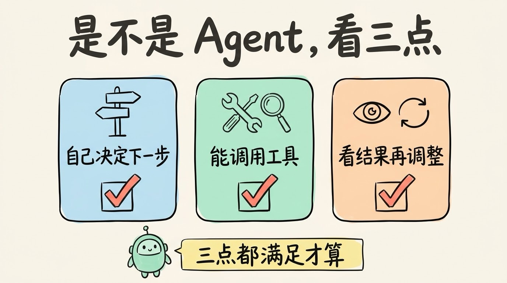
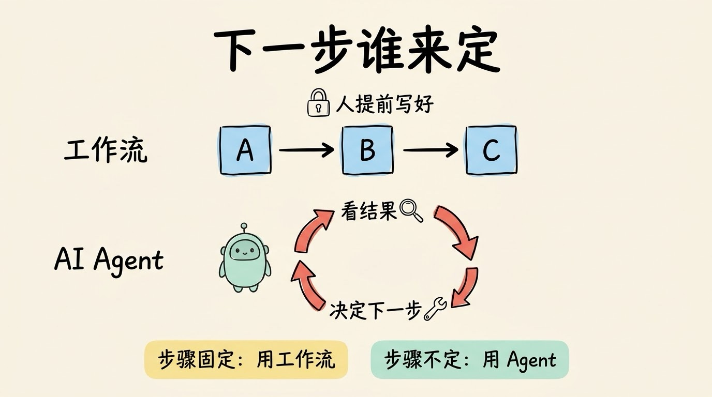
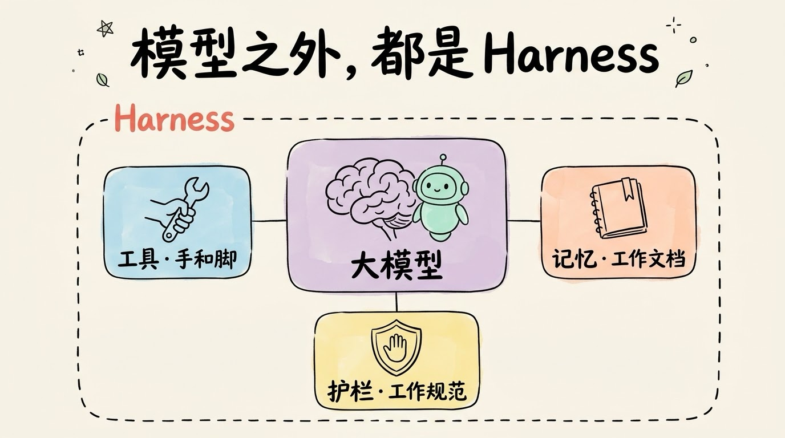
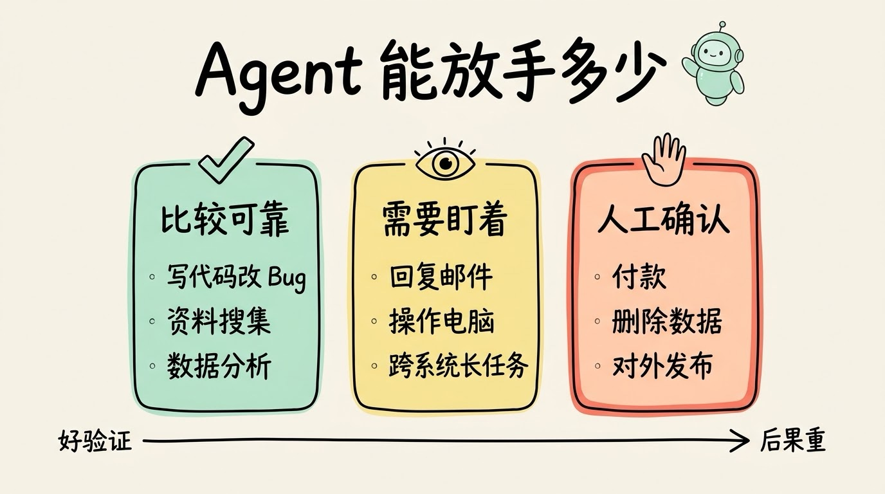

# 3分钟搞懂AI Agent

> ⭐⭐中级 · 阅读时间 3分钟 · 更新于 2026-10-20
>
> AI Agent 是能自己拆任务、调用工具、看结果再调整的 AI。本文讲清它和普通聊天、固定工作流的区别，它由哪几部分组成，2026 年能可靠完成多长的任务，以及国内外有哪些可以直接上手的 Agent 产品和开发框架。

## 一句话定义

**AI Agent**（智能体）= 会自己规划、自己动手的 AI 助手。你给它一个目标，它会拆分步骤、调用工具去执行，再根据真实的执行结果决定下一步，直到把事情做完。

判断一个 AI 是不是 Agent，可以看三点：**是不是它自己决定下一步做什么、能不能调用工具、能不能看到结果后再调整**。只有三点都满足，才算是真正的 AI Agent。



这和产品叫什么名字没有关系。现在 ChatGPT、千问、豆包这些聊天产品本身也有了 Agent 能力，可以在对话里直接帮你办事；反过来，一个名字里带 Agent 的产品，也可能只是一问一答。

## 聊天 AI 给建议，Agent 去办事

这就像公司前台和私人助理的区别。你问前台，前台会告诉你该找谁、该怎么办，但真正动手的还是你自己；私人助理听懂你的目标之后，会自己去安排，把一整件事从头到尾做完。

比如你说“帮我准备明天的会议”：

- **普通聊天 AI**：“你需要准备 PPT、发邮件通知、预订会议室……”（只给建议）
- **AI Agent**：查你的日历 → 整理相关资料 → 生成 PPT 大纲 → 起草会议邮件，**发送前先给你确认** → 预订会议室 → 会前提醒你

最后这一点很关键：好的 Agent 并不是什么事都自己闷头做完，而是知道哪些事情需要先问过你，尤其是那些比较关键决策的事情节点，这样 Agent 后面的执行才不会偏离你的意图。

再换一个工作里常见的场景，分析一份销售数据：

- 普通聊天 AI：你问“怎么分析数据”，AI 给你步骤，你自己打开表格一步步操作，遇到问题再回来问
- Agent：你说“帮我分析这份销售数据”，它会读取文件、清洗数据、写代码画图表，发现某个月的数据异常还会回头核查，最后交给你一份分析报告


所以 Agent 最大的变化，是从被动回答变成了**主动完成任务**。以前比的是 AI 能不能答对问题，现在比的是 AI 能不能把活干完。

## 下一步由谁决定，是 Agent 和工作流的分界线

还有一个很容易和 Agent 混淆的概念：**工作流**。

如果每一步都是人提前写死的（先做 A，再做 B，最后做 C），AI 只负责其中某一步，那叫工作流；如果下一步做什么是 AI 自己根据结果决定的，才叫 Agent。

这两种做法没有好坏之分，**步骤固定的任务用工作流反而更稳定，步骤不确定的任务才需要 Agent**。把三种方式放在一起看会更清楚：

| 维度 | 普通聊天 AI | 工作流 | AI Agent |
| ---- | ----------- | ------ | -------- |
| 交互方式 | 一问一答 | 按固定流程执行 | 给目标，自己规划 |
| 谁决定下一步 | 用户 | 提前写好的流程 | AI 自己 |
| 能否调用工具 | 部分可以 | 可以，但调用顺序固定 | 可以，按需调用 |
| 能否自我纠错 | 不能 | 只能处理预设的异常 | 能，根据真实结果调整 |
| 可靠性 | 会出现幻觉，需要自己核实 | 高，但只能处理设计好的情况 | 中，任务越长越容易出错 |
| 成本和耗时 | 低，秒级 | 低到中 | 高，几分钟到几小时 |

分清这两者，在选产品时很有用。很多产品只是把原来的聊天机器人、自动化脚本换了个名字，就号称是 Agent，这种做法被称为“Agent 洗白”（agent washing）。据 Gartner 估计，号称做 Agent 的厂商有好几千家，但真正符合的大概只有 130 家左右；Gartner 还预测，到 2027 年底，超过 40% 的 Agent 项目会因为成本高、价值不清晰或者风险控制不到位而被取消。

所以如果你在选型，可以先去了解清楚：**这个 Agent 的下一步是自己决定的，还是提前写死的？** 如果是提前写死的，它其实是工作流，按工作流的标准去评估就好。



## 想一步、做一步、看一眼

Agent 干活不是一次想好所有步骤再执行，而是一个不停转的循环：

1. **思考**：现在该做什么？
2. **行动**：调用一个工具（搜索、读文件、执行代码、调用 API）
3. **观察**：拿到工具返回的真实结果
4. **判断**：任务完成了吗？没完成就回到第 1 步

这个循环通常叫 **Agent Loop**。拿订机票举个例子：

```
用户: "帮我订明天去北京的机票, 上午出发"

[思考] 先查明天上午飞北京的航班
[行动] 调用航班查询接口
[观察] 返回 8 个航班, 其中 2 个已售罄

[思考] 按价格和时间筛选, 挑出 3 个候选
[行动] 把候选航班发给用户, 等用户选择
[观察] 用户选了 9:30 那一班

[思考] 下单涉及付款, 需要用户确认
[行动] 展示订单详情, 请求确认支付
[观察] 用户确认, 支付成功, 订单号已生成

[判断] 任务完成, 发送行程确认
```

可以看到，每一步都是根据上一步的真实结果来决定的。比如发现航班售罄，它就自动跳过；碰到付款这种涉及钱的操作，它会停下来等你确认。

要让这个循环转起来，光有大模型还不够。一个能用的 Agent，通常由这几部分组成：

| 组成部分 | 作用 | 类比 |
|---------|------|------|
| 大模型 | 理解目标、做判断 | 大脑 |
| 工具 | 搜索、读写文件、执行代码、调用 API | 手和脚 |
| 记忆 | 记住任务进度、你的偏好 | 工作文档 |
| 循环控制和权限护栏 | 控制什么时候继续、什么时候停、什么时候问人 | 工作规范 |

模型之外的这些工程部分，业内统称为 **Harness**。**同一个模型，装在不同的 Harness 里，干活的能力可能差很多**，这也是为什么同一个模型在不同产品里的表现会不一样。



## 能独立干半天的活，但一半还会失败

Agent 的能力提升得很快。评测机构 METR 专门测过 AI 能独立完成多长的任务，算法是：按人类专家完成同样任务所需的时间来衡量，取 AI 成功率 50% 的那个点。

- 2025 年发布的 GPT-5，大约能完成人类专家需要 **2 小时 17 分钟**的任务
- 到 2026 年春天，公开可用的最强模型大约能做到 **12 小时**左右

不过这组数字要看全：50% 的成功率意味着还有一半会失败，而且 METR 也说明了，超过 16 小时之后它的测量结果就不太可靠了。长任务里常见的问题是绕圈子或陷入死循环、还没完成却提前收工、甚至误判任务已经完成。

放到 2026 年的实际使用里，大致是这样的：

- ✅ 比较可靠：写代码和改 Bug（有测试能验证结果）、资料搜集和深度研究、数据分析、文档整理
- ⚠️ 需要盯着：代替你回复邮件、操作电脑和网页、跨多个系统的长任务
- ❌ 一定要人工确认：付款、删除数据、对外发布内容、重要决策

规律很简单：**结果越容易验证的任务，Agent 就做得越好；出错后果越严重的操作，越要留给人来拍板。**



这也说明 Agent 更像是一个“带工具的助手”，而不是能完全替代人的员工。它擅长重复性高、结果好验证的工作，但目标该怎么定、结果好不好、要不要承担风险，这些判断仍然需要也应该由人来做。**尤其是涉及到钱、账号和数据删除的操作时，一定要保留人工确认这一步。**

## 现在就能用上的几类 Agent

2026 年比较常见的 Agent 大概有这几类：

- **编程 Agent**：Claude Code、Codex、Cursor 等，能读整个代码库、改代码、跑测试，是目前最成熟的一类，因为代码对不对可以直接用测试来验证
- **深度研究**：自己去搜几十上百个网页，交叉比对后给你一份带出处的报告
- **电脑操作**：像人一样看屏幕、点鼠标、敲键盘，即使没有 API 的软件也能操作
- **常驻助理**：OpenAI 在 2026 年 9 月推出的 dots，每个 Agent 都有自己的云端电脑，可以在对话之外持续工作；开源的 OpenClaw 可以装在自己电脑上，通过聊天软件指挥
- **办事 Agent**：比如国内的千问 App 已经接入淘宝、支付宝、飞猪、高德等，可以一句话点外卖、订酒店

这几类产品的共同点是：你不再需要一步步教 AI 怎么做，只需要告诉 Agent 你想要什么结果就够了。

国内能直接用的产品也不少：

| 平台 | 产品 | 能做什么 | 访问 |
| ---- | ---- | -------- | ---- |
| 阿里 | 千问 App | 接入淘宝、支付宝、飞猪、高德，一句话点外卖、订酒店、买东西 | qianwen.com |
| 字节 | 扣子 | 搭建自己的智能体和工作流，2026 年的 3.0 版本强化了多 Agent 协作 | 主站 coze.cn；开发者入口「扣子编程」code.coze.cn |
| 字节 | 豆包手机助手 | 和手机厂商合作，在系统层面帮你跨 App 操作手机 | 合作机型 |
| 百度 | 文心智能体平台 | 零代码创建智能体，可以分发到百度搜索等入口 | agents.baidu.com |
| 腾讯 | 腾讯云智能体开发平台（ADP） | 面向企业搭建智能客服、知识助手等智能体，支持低代码编排工作流 | 腾讯云官网 cloud.tencent.com |
| 智谱 | AutoGLM | 开源的手机操作 Agent，用自然语言控制手机 | 开源项目 |

如果你只是想体验 Agent 能做什么，比较适合小白用户的是直接用千问 App 办事，或者用扣子搭一个自己的小助手；AutoGLM 需要自己部署，更适合极客用户；如果你是开发者，可以看文章后面的开发框架。

## 时效性提醒

AI Agent 是这两年变化最快的方向，按时间顺序捋一遍：

- **2022 年 10 月**：ReAct 论文提出“边思考边行动”的方法，成为后来 Agent 的基本思路
- **2023 年**：3 月 ChatGPT 推出插件，AutoGPT 在 GitHub 上爆火，Agent 概念出圈；6 月 OpenAI 推出 Function Calling（函数调用），让模型可以稳定地调用工具
- **2024 年 11 月**：Anthropic 发布 MCP 协议，统一了 AI 连接工具和数据的方式
- **2025 年**：编程 Agent（Claude Code、Codex 等）和深度研究成为主流；年底 Meta 收购了通用 Agent 产品 Manus，MCP 和 AGENTS.md 被捐给 Linux 基金会新成立的 Agentic AI 基金会
- **2026 年**：Agent 开始常驻和办事，OpenAI 推出 dots，千问 App 接入阿里生态办事；同时 OpenAI 宣布 2026 年 12 月起停用自定义 GPTs，改用插件

**建议**：产品功能和可用地区变化很快，以 OpenAI、Anthropic、Google 以及国内各家的官方公告为准。

## 技术补充（开发者可选阅读）

### ReAct 模式

前面讲的“想一步、做一步、看一眼”，来自 2022 年的 ReAct（Reasoning + Acting）论文：

1. **Thought**（思考）：我需要做什么？
2. **Action**（行动）：调用工具 X
3. **Observation**（观察）：工具返回结果 Y
4. **循环**：继续思考下一步

现在主流模型都已经原生支持工具调用，不用再靠提示词来“教”模型按这个格式输出了，但这个“思考 → 行动 → 观察”的循环，仍然是所有 Agent 的工作方式。

Agent 能调用的工具，常见的有这几类：

- 搜索工具：网页搜索、知识库检索
- 代码执行：在沙箱里运行 Python、Shell 命令
- API 调用：日历、邮件、地图、支付等外部服务
- 数据库：读写数据、执行 SQL
- MCP 服务：通过 MCP 协议接入的各种第三方工具，一次接入，多个 AI 应用都能用

### 主流 Agent 框架

| 框架 | 出品方 | 特点 | 适合谁 | 访问地址 |
| ---- | ------ | ---- | ------ | -------- |
| LangGraph | LangChain | 用“图”来编排步骤，支持状态保存和中断恢复 | 需要复杂流程、上生产环境的团队 | github.com/langchain-ai/langgraph |
| OpenAI Agents SDK | OpenAI | 概念少、上手快，内置多 Agent 交接 | 想快速做出原型的开发者 | openai.github.io/openai-agents-python |
| Claude Agent SDK | Anthropic | 就是 Claude Code 背后的那套骨架，自带文件操作、子 Agent | 想做编程类、操作类 Agent 的开发者 | code.claude.com/docs/en/agent-sdk/overview |
| Google ADK | Google | 支持多种编程语言，对 Gemini 优化 | 用 Google Cloud 的团队 | adk.dev |
| Microsoft Agent Framework | 微软 | AutoGen 和 Semantic Kernel 的后继者 | 用 Azure 和 .NET 的企业 | github.com/microsoft/agent-framework |
| 扣子 | 字节跳动 | 低代码，拖拽就能搭智能体和工作流 | 不写代码的普通用户 | 主站 coze.cn；开发者入口「扣子编程」code.coze.cn |

另外要注意，2023 年爆火的 AutoGPT 现在已经转型成了可视化的 Agent 搭建平台，原来那个全自动执行的版本基本只做维护，不太适合再作为入门选择。

💬 **互动话题**：如果你有一个 AI Agent 助手，你最希望它帮你自动完成什么工作？又有哪些事情是你绝对不会交给它的？

📖 **相关阅读**：

- [3分钟搞懂大语言模型](../../01-basics/04-llm/README.md) - Agent 的“大脑”
- 3分钟搞懂工具调用 - Agent 是怎么“动手”的
- [3分钟搞懂MCP](../../01-basics/08-mcp/README.md) - Agent 连接工具的统一接口
- 3分钟搞懂Agent Loop - “想一步、做一步、看一眼”的循环
- 3分钟搞懂Harness - 为什么同一个模型在不同产品里表现不一样
- 3分钟搞懂多智能体协作 - 多个 Agent 怎么分工
- 3分钟搞懂Agent沙箱与权限 - 怎么防止 Agent 乱来
- [3分钟搞懂Computer Use](../07-computer-use/README.md) - 会操作电脑的 Agent
- [3分钟搞懂深度研究](../06-deep-research/README.md) - 最先被普通人用起来的 Agent

**推荐学习路径**：大语言模型 → Prompt 工程 → 本篇（AI Agent）→ 工具调用 → MCP → Agent Loop

**资料来源**：

- METR，AI 任务完成时长评测：https://metr.org/time-horizons/
- METR，Frontier Risk Report（2026 年 2–3 月）：https://metr.org/blog/2026-05-19-frontier-risk-report/
- Gartner，超过 40% 的 Agent 项目将在 2027 年底前被取消：https://www.gartner.com/en/newsroom/press-releases/2025-06-25-gartner-predicts-over-40-percent-of-agentic-ai-projects-will-be-canceled-by-end-of-2027
- Anthropic，Building effective agents（工作流和 Agent 的区别）：https://www.anthropic.com/research/building-effective-agents
- ReAct 论文：https://arxiv.org/abs/2210.03629
- SiliconANGLE，OpenAI 发布 dots：https://siliconangle.com/2026/09/29/openai-launches-dots-always-on-ai-agents-in-chatgpt-with-their-own-cloud-computers/
- Virtualization Review，OpenAI 停用自定义 GPTs：https://virtualizationreview.com/articles/2026/09/28/openai-to-retire-custom-gpts-replace-them-with-plugins.aspx
- SD Times，Linux 基金会成立 Agentic AI 基金会：https://sdtimes.com/ai/linux-foundation-forms-agentic-ai-foundation-to-be-new-home-for-mcp-goose-and-agents-md/
- eWeek，Meta 收购 Manus：https://www.eweek.com/news/meta-acquires-manus-2b/
- 科技日报，千问 App 接入淘宝、支付宝等：https://www.stdaily.com/web/gdxw/2026-01/15/content_461939.html
- 腾讯元器停止服务公告（2026-11-09 停服）：https://yuanqi.tencent.com/cl/service-discontinuation
- 腾讯云，智能体开发平台产品概述：https://cloud.tencent.com/document/product/1759/104193
- 腾讯新闻，豆包手机助手：https://news.qq.com/rain/a/20260918A09OKV00
- 新京报，智谱开源 AutoGLM：https://m.bjnews.com.cn/detail/1765245862129382.html

---

⬅️ 上一篇：[3分钟搞懂RAG检索增强](../04-rag/README.md) ｜ [📚 返回目录](../README.md) ｜ 下一篇：[3分钟搞懂深度研究(Deep Research)](../06-deep-research/README.md) ➡️
