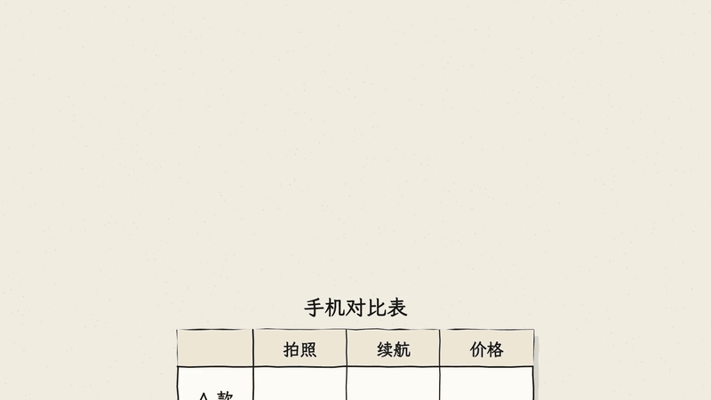
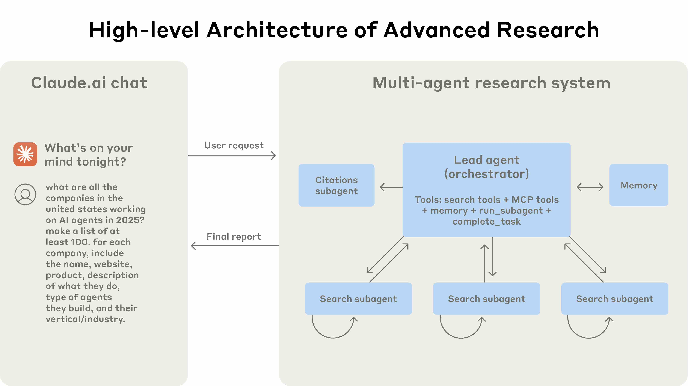
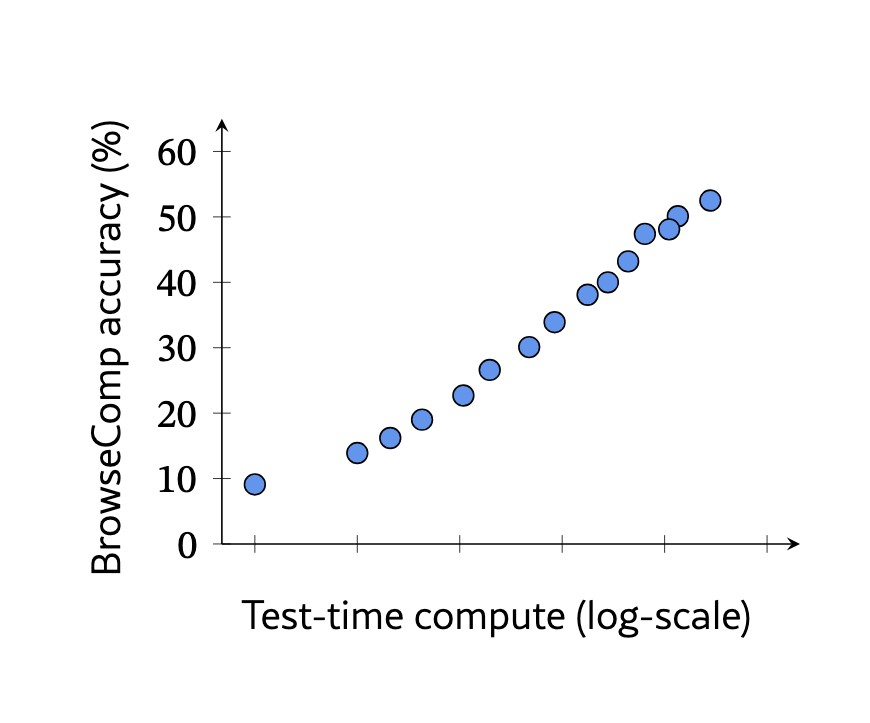
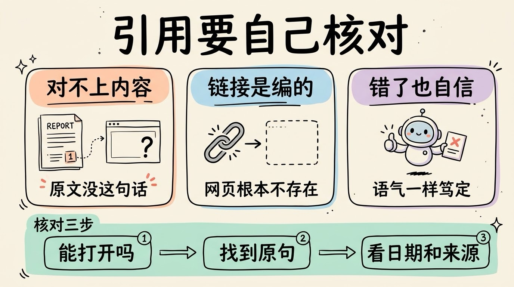
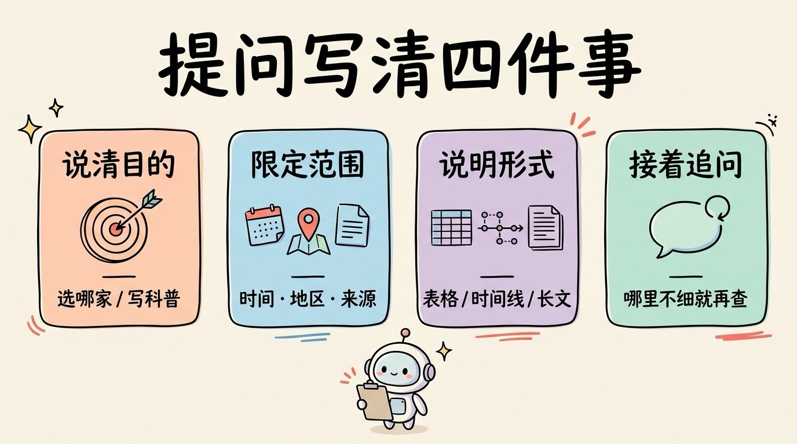

# 3分钟搞懂深度研究(Deep Research)

> ⭐入门 · 阅读时间 3分钟 · 更新于 2026-10-28
>
> 深度研究是让 AI 自己拆问题、反复搜索、整理成带出处报告的 Agent 功能。本文讲清它比普通 AI 搜索多做了什么、为什么又慢又有次数限制、引用为什么不能直接信，以及国内外有哪些产品可以用、怎么提问更有效。

## 一句话定义

**深度研究**（Deep Research）= 你交给 AI 一个需要大量查资料的问题，它自己把问题拆成几个小问题，多轮搜索、阅读几十到上百个网页，比对不同来源的说法，最后整理成一份带引用出处的报告。整个过程通常要几分钟到几十分钟。

举个例子：你问“个人开发者做一个 AI 记账小程序，国内有哪些大模型 API 可以选，价格和限制分别是什么”。普通的 AI 搜索会搜一次，抓几条结果直接总结；深度研究会先问你预算和用户量大概多少，然后一家一家去翻官方文档和价格页，发现某家的价格页打不开，就换个关键词再找，最后给你整理成一张对比表，并且在每个数字后面都会标着它的出处。

这也是**普通人最先用上的 Agent 形态**：不需要写任何代码，你就能亲眼看到 AI 自己规划、自己搜、自己决定还要不要继续查。

## 普通 AI 搜索只搜一次，深度研究搜到够了为止

这两者的区别，很像买手机时的两种做法。一种是随手搜一下“3000 元左右买什么手机”，看完排在前面的两三条结果就下单，几分钟搞定，买得好不好就要看运气了。另一种是认真做一次功课：先想清楚自己最在意拍照还是续航，再去翻测评、看差评、比价格，发现某款的信息对不上，就换个平台再查一遍，最后整理出一张对比表，还记下了每条信息是从哪里看来的。普通 AI 搜索是前一种，深度研究是后一种，只不过做功课的这部分活由 AI 替你干了。

一次深度研究大致分成这几步：

```
① 先确认需求  -> 问你几个问题: 预算多少? 只看国内? 要表格还是长文?
② 拆解问题    -> 把 "帮我调研 XX" 拆成七八个子问题
③ 分头检索    -> 每个子问题单独搜, 有的产品会派多个子 Agent 并行去查
④ 判断够不够  -> 信息缺了就换关键词再搜, 来源矛盾就再找第三个来源
⑤ 写成报告    -> 按结构组织内容, 把每个说法对应到引用链接
```



第 ④ 步是分水岭。普通搜索是“搜一次就交差”，深度研究是**搜到它自己觉得够了为止**。把“搜索、阅读、判断、再搜索”不断循环下去，其实就是 **Agent Loop** 在起作用。

第 ① 步很多人会直接跳过，但它对结果影响很大。ChatGPT、Kimi、千问等产品在开始之前都会先反问几个问题，**把这几个问题认真回答了，报告才不容易跑偏**。

## 查得深，所以又慢又有次数限制

深度研究到底比普通搜索强多少，OpenAI 在 2025 年 4 月发布的 **BrowseComp** 测试里给过一组很直观的数字。这套测试有 1266 道题，每道题的答案都藏在网上，但需要翻很多网页、把好几条线索拼起来才能找到。不过答案本身都很短，比如一个人名或者一个标题，和标准答案一对就知道对不对，所以评分不会有争议。

| 测试对象 | 答对比例 |
|---|---|
| 人类测试员（每题最多找约 2 小时） | 1255 道题里放弃了约 71%，只解出了约 29% |
| GPT-4o（不联网） | 0.6% |
| GPT-4o（可以联网搜索） | 1.9% |
| OpenAI 深度研究（2025 年初版本） | 51.5% |

从这张表可以看出，**光给模型加上联网搜索，几乎没有帮助**，答对率只从 0.6% 涨到 1.9%。真正拉开差距的，是深度研究那种“查不到就换个思路继续查”的能力。需要说明的是，这个深度研究模型训练时专门练过这类任务，所以这个分数更适合用来理解两种方式的差距，不代表它日常调研就有一半的把握。

代价也很明显：查得多，花得就多。Anthropic 在 2025 年 6 月公开了 Claude 研究功能的做法：由一个主 Agent 制定计划，再派出多个子 Agent 分头并行搜索，最后由主 Agent 汇总。


*图注：Anthropic 公开的 Claude 研究功能架构。左边是用户在对话里提出的请求（列出至少 100 家在做 AI Agent 的美国公司）；右边的主 Agent（Lead agent）负责规划和汇总，下面三个搜索子 Agent（Search subagent）各自循环搜索，引用子 Agent（Citations subagent）在最后给报告补上出处，Memory 用来保存研究计划。出自 Anthropic 工程博客（2025-06-13）。*

在他们的内部测试里，这种多 Agent 的方式比单个 Agent 的效果高出 90.2%，但消耗的 token 大约是普通聊天的 15 倍。他们还发现，在 BrowseComp 上，**token 用了多少，就能解释表现差异的 80%**。说白了，深度研究的效果很大程度上是靠“多花算力、多查资料”换来的。


*图注：OpenAI 在 BrowseComp 论文里给出的图。横轴是深度研究早期版本在答题时投入的算力，用的是对数刻度，越往右增加得越多；纵轴是答对率。投入的算力越多，答对率越高，从不到 10% 一直涨到 50% 以上。出自 OpenAI《BrowseComp》论文（2025-04）。*

这也就解释了为什么各家都会给深度研究设置次数限制：免费用户通常只有很少的次数，或者用的是轻量版本，付费档位越高，次数越多。**所以用之前最好先想清楚，这个问题值不值得花掉一次深度研究。**

## 有引用，也不代表内容一定可靠

深度研究的报告几乎都带着一长串引用链接，看起来非常严谨。但这恰恰是最需要警惕的地方，已经有好几项研究专门查过这些引用：

- **引用对不上内容**：2025 年 9 月的 DeepTRACE 研究审查了多款深度研究产品，引用准确率在 40% 到 80% 之间，报告里有相当一部分说法，在它自己列出的来源里根本找不到依据。
- **链接本身是编的**：2026 年 4 月的一项研究检查了 10 个模型和 Agent 给出的 5 万多条引用链接，其中 3% 到 13% 的链接在网页存档里从来没有出现过，基本可以判断是模型编出来的，还有 5% 到 18% 的链接打不开。而且深度研究类 Agent 给的引用更多，编造链接的比例也比普通联网搜索更高。
- **错了也很自信**：在前面提到的 BrowseComp 测试里，深度研究的校准误差高达 91%，也就是说，它自己声称的把握程度和实际答对的概率差得很远，答错的时候语气也一样笃定。

除了这些，还有几种常见的情况：

- **源头本身就是错的**：网上的错误信息被它当成事实写进了报告。
- **看起来交叉验证过了，其实是同一个来源**：十篇文章都在转载同一篇不靠谱的原稿，报告里引用了五篇，看起来很扎实，实际上只有一个出处。
- **时间对不上**：引用了两年前的数据来描述现在的情况，价格、政策、产品功能这类信息尤其容易出问题。

所以比较稳妥的用法是，**把报告当成一份带线索的初稿，而不是结论**。尤其是要拿去做决策、写进文章或者给别人看的关键数字和结论，一定要点开链接核对一遍：先看链接能不能打开，再在原文里找到那句话，最后看一眼发布时间和来源是不是一手的。



## 哪些问题值得交给它

| 问题的类型 | 表现 |
|---|---|
| 广度调研（行业概况、竞品盘点、技术选型对比） | 强项，能省下大量搜集资料的时间 |
| 有公开资料的事实梳理（政策变化、事件时间线） | 比较靠谱，但关键信息仍需要抽查 |
| 需要公司内部数据的分析 | 默认查不到，需要上传文件或接入内部数据 |
| 冷门、争议大、资料稀少的话题 | 容易被单一来源带偏 |
| 需要原创判断的结论 | 能把各方观点罗列清楚，但独立的洞见有限 |
| 查一个具体事实、问一个明确的定义 | 没必要，普通搜索几秒钟就能搞定 |

关于内部数据这一条，现在已经有了一些变化。2026 年 2 月 ChatGPT 的深度研究升级后，可以连接各种应用和 MCP 服务，读取你授权的数据，也可以只在你指定的几个网站里搜索；Gemini 的深度研究 API 也支持把自己的文档加进检索范围。**如果你的问题需要用到自己的资料，可以先看看手上的产品支不支持上传文件或连接数据。**

用的时候，提问的方式也很关键。和给实习生布置任务一样，交代得越清楚，结果越好：

- **说清楚目的**：“我要决定选哪家”和“我要写一篇科普”，需要的报告完全不一样。
- **限定范围**：时间（只看 2026 年的信息）、地区（只看国内）、来源（优先官方文档和财报）。
- **说明想要的形式**：对比表、时间线，还是带结论的长文。
- **报告出来后接着追问**：哪部分不够细，就让它针对那部分再查一轮，不用整个重来。



一条经验：**深度研究替你省的是“找资料”的时间，不是“下判断”的时间**。

## 现在有哪些产品可以用

国内外主流的 AI 助手基本都已经有了深度研究功能，只是叫法不太一样：

| 产品 | 功能名称 | 特点 |
|---|---|---|
| ChatGPT | 深度研究 | 2025 年 2 月最早推出的一批；2026 年 2 月升级到 GPT-5.2，可以连接应用和 MCP、限定搜索网站，还能实时看进度、中途插话调整方向 |
| Gemini | Deep Research | 2024 年 12 月最早上线；2025 年 12 月换成基于 Gemini 3 Pro 的研究 Agent，同时向开发者开放了 API |
| Claude | 研究（Research） | 主 Agent 加多个子 Agent 并行搜索，每个说法会对应到引用来源 |
| Perplexity | Research 模式 | 早期叫 Deep Research，速度相对比较快 |
| 豆包 | 深入研究 | 2025 年 6 月开始免费测试，结果可以生成报告文档或可视化网页，App 里还能一键转成播客 |
| Kimi | 深度研究 | 由自研的 Kimi-Researcher 模型驱动，开始前会先和你确认研究范围，报告支持导出 PDF 和 Word |
| 千问 | 深度研究 | 2025 年 5 月上线，之后升级支持把报告生成交互式网页和播客 |

如果你是开发者，想把深度研究接进自己的产品里，也有现成的选择：OpenAI 和 Google 都提供了深度研究的 API，因为一次运行要好几分钟，一般用后台任务加轮询的方式来拿结果；阿里通义实验室在 2025 年 9 月开源了 **通义 DeepResearch**，总参数约 305 亿，每次推理只激活约 33 亿，可以自己部署。

各家的次数限制、可用档位和底层模型变化都很快，**具体以你使用时产品页面上的说明为准**。

## 时效性提醒

深度研究的基本流程已经比较稳定了，变化比较快的是下面这些：

- 各家用的底层模型、单次耗时、每月可用次数和收费档位
- 能不能连接自己的文件和应用、能不能限定信源、能不能访问付费墙后的内容
- 引用准确率会随模型版本变化，上面提到的研究测的都是当时的版本

**建议**：重要结论一定要点开原始链接核对一遍。

💬 **互动话题**：你用深度研究查过什么？报告里有没有遇到过“链接是真的，但原文根本没说这句话”的情况？

📖 **相关阅读**：

- 3分钟搞懂AI搜索引擎 - 搜一次就总结的 AI 搜索
- [3分钟搞懂AI Agent](../05-ai-agent/README.md) - 会自己规划、自己动手的 AI
- [3分钟搞懂Agent Loop](../../09-agent-engineering/01-agent-loop/README.md) - 深度研究“搜到够为止”背后的循环
- [3分钟搞懂多智能体协作](../../09-agent-engineering/10-multi-agent/README.md) - 主 Agent 派子 Agent 分头查资料
- [3分钟搞懂AI幻觉](../../04-advanced/04-hallucination/README.md) - 编造引用链接也是一种幻觉

**资料来源**：

- OpenAI，BrowseComp: A Simple Yet Challenging Benchmark for Browsing Agents（2025-04）：https://arxiv.org/abs/2504.12516（文中配图出处）
- Anthropic，How we built our multi-agent research system（2025-06-13）：https://www.anthropic.com/engineering/multi-agent-research-system（文中配图出处）
- Venkit 等，DeepTRACE: Auditing Deep Research AI Systems（2025-09）：https://arxiv.org/abs/2509.04499
- Rao 等，Detecting and Correcting Reference Hallucinations in Commercial LLMs and Deep Research Agents（2026-04）：https://arxiv.org/abs/2604.03173
- OpenAI，Introducing deep research（含 2026-02 更新说明）：https://openai.com/index/introducing-deep-research/
- Google，Gemini Deep Research Agent 文档：https://ai.google.dev/gemini-api/docs/deep-research
- Google，Interactions API 发布（2025-12）：https://blog.google/innovation-and-ai/technology/developers-tools/interactions-api/
- Kimi，深度研究介绍：https://www.kimi.com/zh-cn/help/deep-research/deep-research-overview
- IT之家，豆包“深入研究”功能开启测试（2025-06-30）：https://www.ithome.com/0/864/734.htm
- VentureBeat，Qwen's new Deep Research update lets you turn its reports into webpages：https://venturebeat.com/ai/qwens-new-deep-research-update-lets-you-turn-its-reports-into-webpages
- 通义 DeepResearch 开源仓库：https://github.com/Alibaba-NLP/DeepResearch

---

⬅️ 上一篇：[3分钟搞懂AI Agent](../05-ai-agent/README.md) ｜ [📚 返回目录](../README.md) ｜ 下一篇：[3分钟搞懂Computer Use(电脑操作AI)](../07-computer-use/README.md) ➡️
