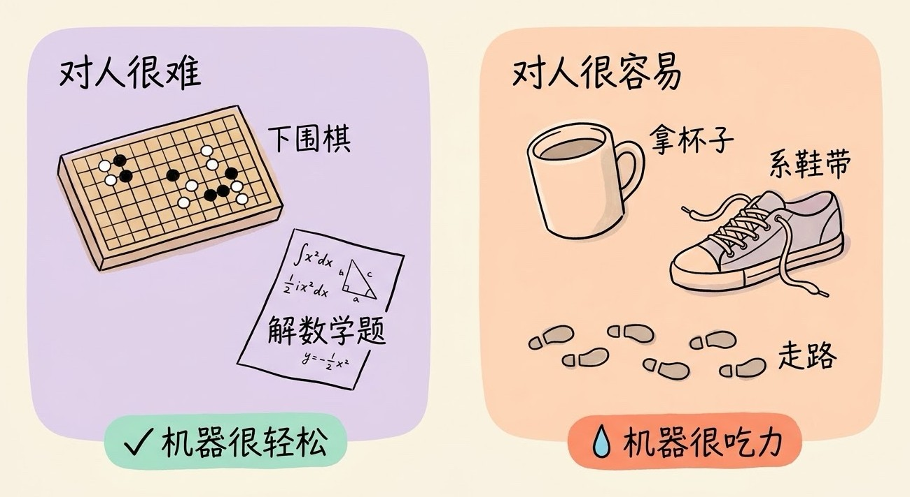
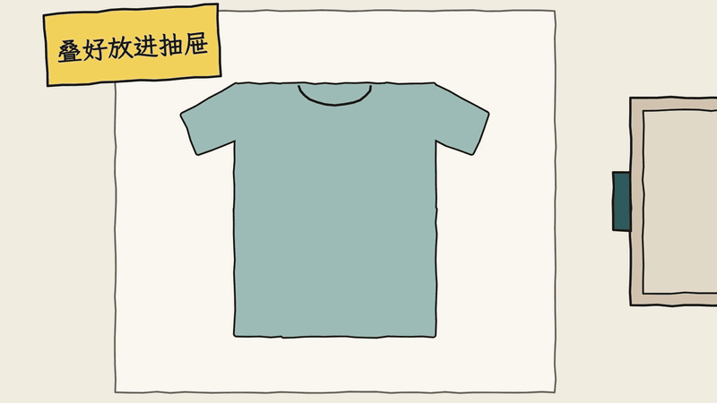
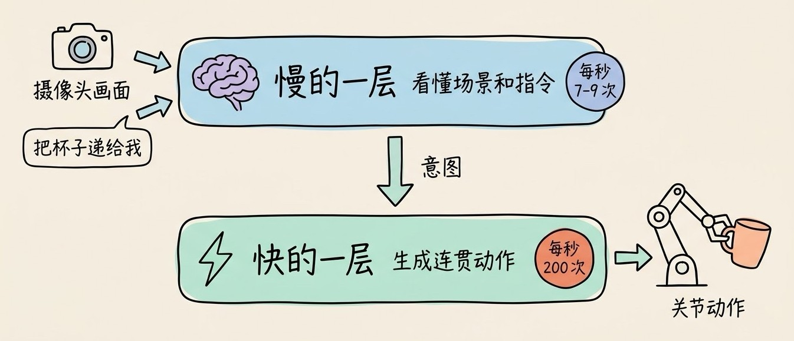
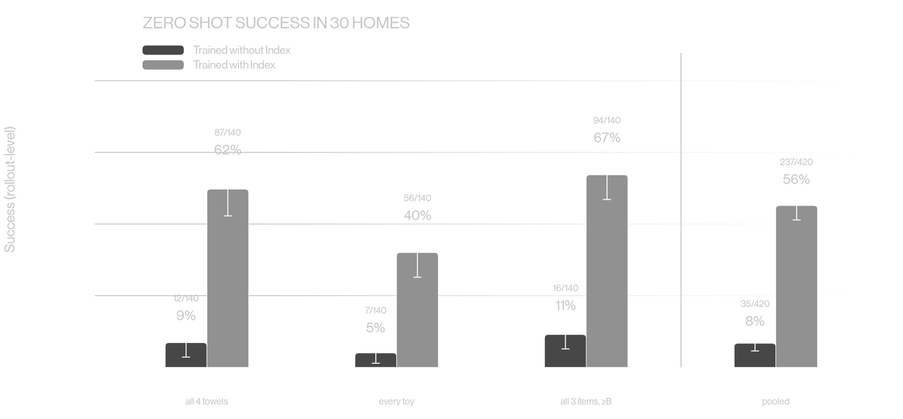
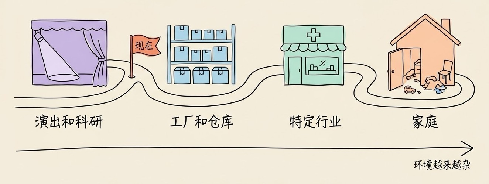
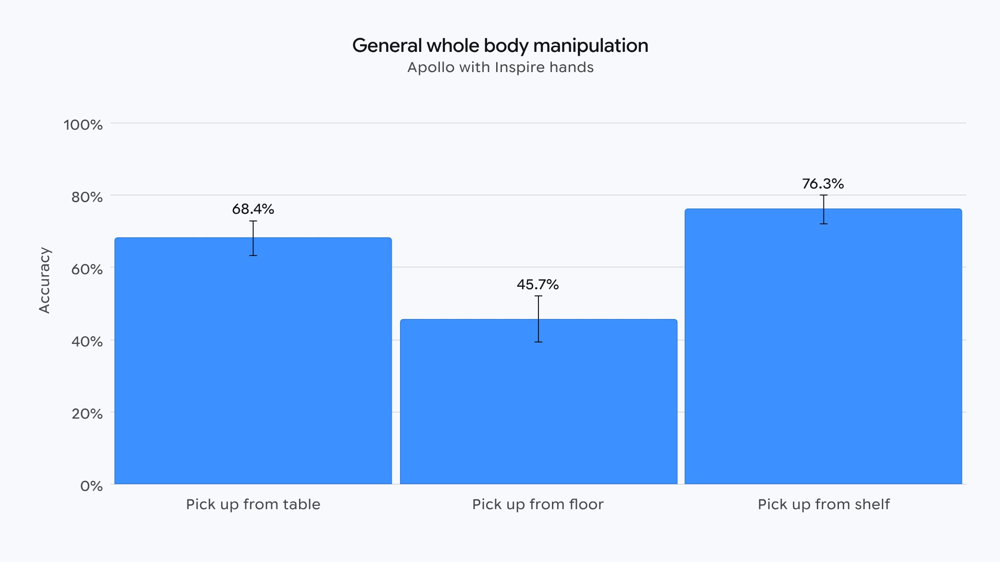

# 3分钟搞懂具身智能

> ⭐⭐中级 · 阅读时间 3分钟 · 更新于 2026-11-05
>
> 具身智能是让 AI 有一副身体，在真实世界里看清环境、听懂指令、动手把事做完。本文讲清它为什么比聊天难得多、VLA 模型怎么把“看懂”变成“动作”、训练数据从哪来，以及 2026 年人形机器人真实干到了哪一步、看演示视频时该注意什么。

## 一句话定义

**具身智能**（Embodied AI）= 让 AI 拥有一副身体（机械臂、轮子或双腿），用摄像头和传感器感知真实环境，听懂人的指令后自己规划动作、动手执行，在物理世界里把一件事做完。

拿叠衣服来说：你问 ChatGPT 怎么叠 T 恤，它能写出一份步骤清单；具身智能要做的，是让一台机器人从一堆衣服里认出 T 恤，抓起这块软塌塌、每次形状都不一样的布，叠好后放进抽屉，并且在叠歪了的时候自己发现、自己把叠歪的衣服重新叠整齐。

这两年常听到的**物理 AI**（Physical AI）、**人形机器人**，都和具身智能有关：物理 AI 是英伟达等公司更常用的叫法，意思基本一样；人形机器人只是具身智能的一种身体形态，后面会讲到，它并不是唯一的形态。

## 叠一件 T 恤，为什么比写一篇文章还难？

AI 研究里有个老说法叫**莫拉维克悖论**：对人来说很难的事，比如下围棋、解数学题，对计算机反而容易；对人来说不费脑子的事，比如走路、拿杯子、系鞋带，对计算机却极难。原因是这些动作人类已经练了几亿年，早就变成了本能，我们自己都说不清是怎么做到的，也就很难教给机器。



落到工程上，难点主要有三个：

- **每一次都不一样**：软件世界里，同样的输入可以得到同样的结果。物理世界里，杯子的位置差了两厘米、光线暗了一点、桌面更滑一些，动作就得跟着调整。布料、线缆、食物这类软的、会变形的东西更麻烦，同一件衣服每次被抓起来的样子都不同。
- **要求实时反应**：聊天 AI 想 3 秒再回答没关系，机器人走路时如果 3 秒才反应过来要摔倒，人早就摔在地上了。平衡、抓握这类动作需要每秒调整几十到几百次。
- **出错的代价是真实的**：聊天 AI 说错一句话，你可以让它重新回答；机器人捏碎一只杯子、撞到旁边的人，后果没法撤回。所以力度控制和安全设计，比“能不能做到”还要重要。

这也解释了为什么大语言模型火了好几年，家里却还没有一台能帮你收拾房间的机器人：**语言能力只解决了“听懂要做什么”，没有解决“手该怎么动”。**

## 看、想、动：机器人的大脑分几层？

早期的机器人主要靠工程师写规则：先用视觉算法识别出零件，再按写好的程序把机械臂移动到固定坐标。这种做法在汽车工厂的流水线上很好用，因为零件每次都放在同一个位置；但只要环境一变，程序就得重写。

现在主流的做法是 **VLA 模型**（Vision-Language-Action，视觉-语言-动作模型）。它的思路是在多模态大模型的基础上，把“输出文字”换成“输出动作”：

```
输入: 摄像头画面 + 一句指令("把桌上的苹果放进碗里")
  ↓
VLA 模型: 理解画面里有什么、苹果在哪、碗在哪
  ↓
输出: 一连串关节角度和夹爪开合的指令
  ↓
机器人执行, 摄像头再拍一帧, 模型根据新画面继续调整
```



可以看出，这和 Computer Use 里“看截图、输出鼠标坐标”的循环很像，只不过输出从鼠标点击换成了几十个关节的转动角度，而且每秒要算很多次。

问题在于，大模型“想”得慢，关节需要“动”得快。所以很多公司用**快慢两层**的结构来解决这个矛盾，有点像人的大脑和脊髓：大脑想清楚“去拿那个杯子”，具体手指怎么弯、身体怎么保持平衡，交给反应更快的神经去完成。

- **Figure 的 Helix**：慢的一层是一个 70 亿参数的视觉语言模型，负责看懂场景、理解指令；快的一层是一个小得多的模型，按 Figure 的说法每秒输出 200 次动作指令，负责把意图变成连贯的动作。
- **Google DeepMind 的 Gemini Robotics 2**：分成一个负责理解指令、拆解步骤、检查进度的推理模型（ER 2），和一个负责具体动作的 VLA 模型，另外还有一个可以直接在机器人上离线运行的小模型。

这种分层的好处是，上层可以直接用已经很强的大模型来理解世界，下层专心把动作做得又快又稳。



## 真正缺的，是机器人干活的数据

大语言模型能变强，靠的是互联网上海量的文字。但网上几乎没有“机器人拿起一只杯子时，每个关节转了多少度”这种数据，这是具身智能和其他 AI 方向最大的区别之一。目前补数据主要有四条路：

| 数据来源 | 怎么做 | 优点 | 缺点 |
|------|------|------|------|
| **遥操作** | 人戴着设备远程操控机器人做一遍，把动作录下来 | 数据最准，和真机完全一致 | 慢、贵，一个人一天只能录有限的几小时 |
| **仿真** | 在虚拟环境里让机器人练几百万次 | 便宜、可以大量生成 | 虚拟世界和真实世界有差距，练好的动作搬到真机上常常不灵 |
| **人类视频** | 让模型看人做家务、干活的视频，学习动作 | 数量多，场景丰富 | 人手和机械手结构不同，需要额外“翻译” |
| **真机部署** | 机器人在工厂、仓库干活时持续记录成功和失败 | 最贴近真实工作 | 得先有机器人能上岗，才能开始积累 |

2026 年的一个明显趋势是，**各家都在加大人类视频的比重**。Figure 发布 Helix 2.5 时就说，这个模型先用自己收集的大规模人类行为数据做预训练，再用真机数据训练，达到同样效果需要的专门任务数据比上一代少了一半。英伟达在 2026 年 3 月预告的 GR00T N2 模型，也把“世界模型”（能预测动作做完之后画面会怎么变化的模型）加了进去，让机器人先在“脑子里”推演一遍再动手。


*图注：Figure 发布 Helix 2.5 时公布的测试结果。机器人被带进 30 个从没去过的家庭，事先没有在这些家庭里采集过任何数据。深灰色柱子是没有用人类行为数据集 Index 预训练的模型，浅灰色是用了 Index 的模型；前三组是三项不同的家务，最右边的 pooled 是三项合起来的结果，成功率从 8% 提高到了 56%。柱子上方的分数是成功次数和总次数。*

真机数据飞轮也开始转起来：越多机器人在工厂里干活，就能采集越多真实的成功和失败记录，再反过来训练模型。这也是为什么很多公司宁愿先在工厂里做低价值的搬运活，也要尽早让机器人上岗。

## 不只是人形机器人

一提到具身智能，很多人脑子里就是一个和人差不多高的双足机器人。但从实际干活的情况看，人形只是其中一种形态：

- **机械臂**：工厂和实验室里最常见，固定在桌子或产线旁边，负责抓取、装配、分拣。
- **轮式底盘加双臂**：用轮子代替双腿，稳定、省电、成本更低，很多仓库、药店、商超里的机器人是这种样子。
- **四足机器狗**：用在巡检、救援和科研里。宇树的招股资料显示，2025 年它的四足机器人收入占主营业务的四成以上。
- **广义上的具身智能**：自动驾驶汽车、扫地机器人也需要感知环境、做决策、控制身体，很多研究者把它们也算进来。

既然人形不是最省事的形态，为什么这么多公司还在押注人形？主要理由是：人类的工厂、仓库和家里，楼梯、门把手、货架高度、工具都是按人的身材设计的，人形机器人理论上不用改造环境就能直接用，还能直接学习人类的动作视频。不过双足走路的稳定性、电池续航和成本，也让人形成了最难落地的一种形态。

## 2026 年，机器人真实干到了哪一步？

先看整体规模。据 IDC 统计，2025 年全球人形机器人出货量约 1.8 万台，同比增长约 508%，中国厂商占了大头，智元和宇树各出货约 5000 台。但 IDC 列出的主要用途是**商业演出、科研教育、数据采集和导览接待**，并不是在工厂里正式干活。2025 年春晚上扭秧歌的宇树机器人，就属于演出这一类。

再看主要玩家，截至 2026 年 11 月：

| 公司 | 代表产品 | 目前的进展 |
|------|------|------|
| **特斯拉** | Optimus | 2026 年第三季度财报电话会上，马斯克说已在弗里蒙特的量产线上开始早期生产，预计 2027 年底前后开始交付客户；量产时间表此前已多次推迟 |
| **Figure** | Figure 03 + Helix | 2025 年 2 月结束与 OpenAI 的合作，转向自研模型；在宝马工厂做过试点；2026 年 9 月发布 Helix 2.5，在 30 个从没去过的家庭里做整理、叠毛巾、铺床，整项任务成功率 56%；机器人不对外销售 |
| **波士顿动力** | 电动版 Atlas | 2026 年 1 月在 CES 发布量产版，当年的产量供给现代汽车和 Google DeepMind；现代计划 2028 年起在汽车工厂使用；和 DeepMind 合作接入 Gemini Robotics 模型 |
| **Google DeepMind** | Gemini Robotics 2 | 2026 年 7 月发布，首次能控制人形机器人的全身动作；推理模型可在 Google AI Studio 使用，动作模型仅向合作伙伴开放 |
| **Physical Intelligence** | π 系列模型 | 只做“机器人大脑”，不做硬件；2026 年 4 月发布 π0.7，模型已在合作方的仓库打包、叠衣服 |
| **英伟达** | GR00T 模型 + Isaac 仿真平台 | 给整个行业提供模型、仿真工具和芯片，自己不卖机器人 |
| **宇树科技** | G1、H2、R1 等 | 2025 年人形机器人卖出 5500 多台，2026 年 8 月在科创板上市；R1 在 2026 年 6 月降到 2.99 万元起，主要用在科研、教育、应用开发和文化表演 |
| **智元机器人** | 远征、灵犀等系列 | 2025 年出货量和宇树相当，全尺寸人形机器人出货量居全球第一 |
| **1X** | NEO | 面向家庭的人形机器人，售价 2 万美元或每月 499 美元；计划 2026 年在美国交付，截至 2026 年 10 月还没有公开确认的客户交付；不会的家务由 1X 员工远程操控完成 |

把这些放在一起看，大致的落地顺序是：**演出和科研 → 工厂、仓库里的固定工序 → 特定行业 → 家庭**。工厂和仓库的环境相对固定、任务重复，出了问题有专人处理，所以最先落地；家庭环境最乱、要做的事最复杂，还涉及老人小孩的安全，所以放到了最后。



还有一点需要注意：Helix 2.5 在陌生家庭里 56% 的成功率，已经是行业里很亮眼的成绩，但这也意味着差不多一半的任务没有做完。Gemini Robotics 2 也是一样，按 DeepMind 公布的测试，人形机器人从桌上拿东西的准确率是 68.4%，从地上拿东西只有 45.7%。这些数字都在快速提升，但离“交给它就不用管”还有不小的距离。


*图注：Google DeepMind 发布 Gemini Robotics 2 时公布的测试结果。测试用的是 Apptronik 的 Apollo 人形机器人，配上 Inspire 的灵巧手，从桌上（table）、地上（floor）、货架上（shelf）拿东西的准确率分别是 68.4%、45.7% 和 76.3%，柱子上的竖线是误差范围。从地上拿东西需要机器人弯腰下蹲、同时保持平衡，成绩明显低于另外两项。*

## 看机器人演示视频时，要注意什么？

具身智能是新闻最热闹的 AI 方向之一，演示视频很多，但视频和真实能力之间的差距也最大。如果你在网上看到一段机器人做家务、干活的视频，可以留意这几点：

- **是不是自主完成的**：有些视频里的机器人其实是人在远程操控，也就是遥操作。正规的公司一般会在视频里标注“autonomous”（自主）或“teleoperated”（遥操作），没标注的要多留个心眼。
- **有没有加速**：很多视频角落里会写着“2x”“4x”，说明实际速度只有画面里的一半甚至四分之一。
- **是一镜到底还是剪辑过**：剪辑过的视频可能只保留了成功的那几次。真正能说明问题的，是公司公布的成功率和连续工作时长。
- **炫技不等于能上班**：后空翻、跳舞说明运动控制很强，但工厂要的是连续工作 8 小时、遇到异常能自己处理、不需要人时刻盯着。
- **能不能买到、谁在用**：“已有客户”和“已经批量交付”是两回事，有没有公开的部署数量和工作数据，比发布会上的演示更有参考价值。

对普通人来说，别因为看到一个机器人慢慢递了一把扳手，就以为明年家家户户都会有机器人保姆。但也别因为现在不成熟就忽略它，如果机器人真的能稳定干体力活，首先收益的会是制造业的用工结构、老龄化社会的照护，以及高危环境里的作业。

## 时效性提醒

具身智能是目前融资最多、变化最快的方向之一，下面这些信息容易过时：

- 特斯拉 Optimus、1X NEO 等产品的量产和交付时间，官方说法经常调整
- Helix、Gemini Robotics、π、GR00T 等模型几个月就会更新一代，成功率数据也会跟着刷新
- 宇树等国内厂商的产品价格和出货量变化很快

**建议**：以各公司官方发布和可以核实的客户部署为准，看到“已经量产百万台”“明年进入千家万户”这类说法时，先找一找原始出处。

💬 **互动话题**：如果家用机器人只能先学会一项本领，你更希望它稳稳地叠好衣服、洗完碗，还是能扶着家里的老人安全走动？

📖 **相关阅读**：

- [3分钟搞懂AI Agent](../05-ai-agent/README.md) - 在软件世界里自己办事的 AI，具身智能是把它带进物理世界
- [3分钟搞懂Computer Use](../07-computer-use/README.md) - 看截图、点鼠标的循环，和机器人看画面、动关节很像
- [3分钟搞懂计算机视觉](../03-computer-vision/README.md) - 机器人认出物体、判断位置靠的是视觉能力
- [3分钟搞懂多模态AI](../../04-advanced/03-multimodal-ai/README.md) - VLA 模型是在多模态大模型的基础上发展出来的
- 3分钟搞懂英伟达 - 英伟达把物理 AI 当成算力之后的下一个增长点
- [3分钟搞懂AGI](../../01-basics/09-agi/README.md) - 不少研究者认为，AI 要真正理解世界，需要有一副身体

**资料来源**：

- Figure，Helix: A Vision-Language-Action Model for Generalist Humanoid Control（2025-02-20）：https://www.figure.ai/news/helix
- TechCrunch，Figure drops OpenAI in favor of in-house models（2025-02-04）：https://techcrunch.com/2025/02/04/figure-drops-openai-in-favor-of-in-house-models/
- 东方财富，人形机器人公司 Figure 推出 Helix 2.5 模型（2026-09-18）：https://finance.eastmoney.com/a/202609183878603031.html
- Figure，Helix 2.5: Zero-Shot 30-Home Generalization（2026-09-17，文中第一张图出自这里）：https://www.figure.ai/news/helix-2-5-zero-shot-30-home-generalization
- Google DeepMind，Gemini Robotics 2 brings whole-body intelligence to robots（2026-07-30，文中第二张图出自这里）：https://deepmind.google/blog/gemini-robotics-2-brings-whole-body-intelligence-to-robots/
- Boston Dynamics，Boston Dynamics Unveils New Atlas Robot to Revolutionize Industry（2026-01）：https://bostondynamics.com/blog/boston-dynamics-unveils-new-atlas-robot-to-revolutionize-industry/
- Engadget，Boston Dynamics unveils production-ready version of Atlas robot at CES 2026：https://www.engadget.com/big-tech/boston-dynamics-unveils-production-ready-version-of-atlas-robot-at-ces-2026-234047882.html
- Physical Intelligence 官网：https://www.pi.website/
- Physical Intelligence，π0.7 论文（arXiv 2604.15483）：https://arxiv.org/abs/2604.15483
- SiliconANGLE，NVIDIA GTC 2026 GR00T N2 发布报道（2026-03-16）：https://siliconangle.com/?p=734621
- The Motley Fool，Tesla (TSLA) Q3 2026 Earnings Call Transcript（2026-10-22）：https://www.fool.com/earnings/call-transcripts/2026/10/22/tesla-tsla-q3-2026-earnings-call-transcript/
- IT之家，IDC：2025 年全球人形机器人出货约 1.8 万台，中国厂商主导（2026-01）：https://www.ithome.com/0/915/802.htm
- 澎湃新闻，宇树科技 66 天极速上会：2025 年人形机器人卖出 5500 台：https://m.thepaper.cn/newsDetail_forward_33263102
- 上海市委金融办，宇树今日登陆科创板（2026-08-19）：https://jrj.sh.gov.cn/ZXYW178/20260819/754240ae6aa1482097d92a380fb45086.html
- 界面新闻，宇树 R1 降价至 2.99 万元起（2026-06）：https://m.jiemian.com/article/14644851.html
- GlobeNewswire，1X Opens NEO Factory in Hayward, CA（2026-04-30）：https://www.globenewswire.com/news-release/2026/04/30/3285118/0/en/1x-opens-neo-factory-in-hayward-ca-america-s-first-vertically-integrated-humanoid-robot-factory-with-consumer-shipments-planned-for-2026.html
- 1X NEO 订购页：https://www.1x.tech/order

---

⬅️ 上一篇：[3分钟搞懂Computer Use(电脑操作AI)](../07-computer-use/README.md) ｜ [📚 返回目录](../README.md)
