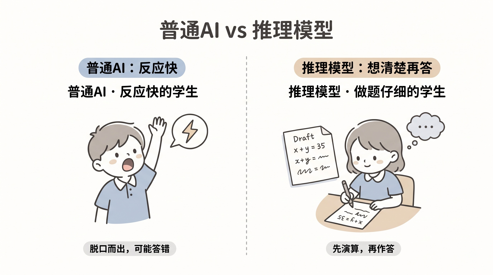
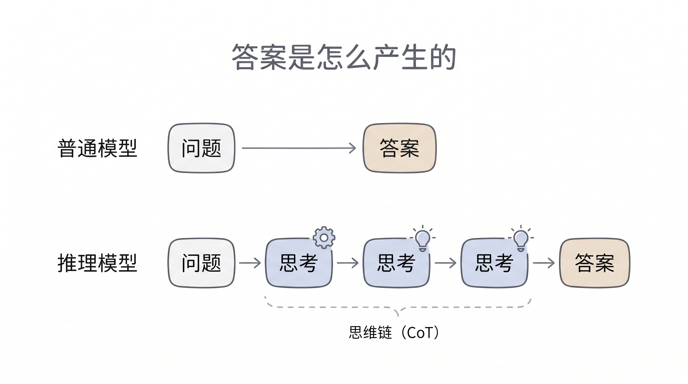
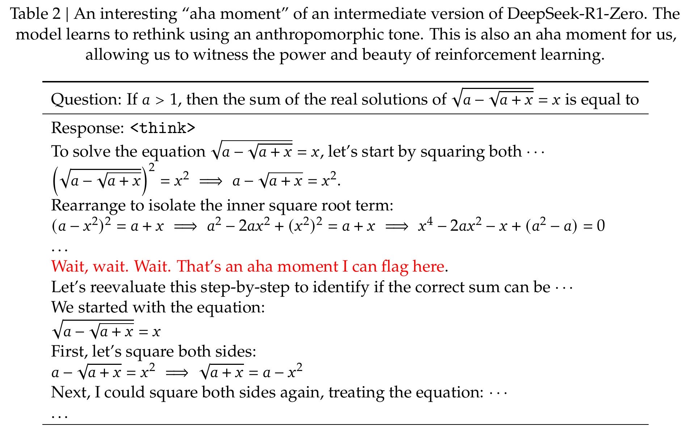
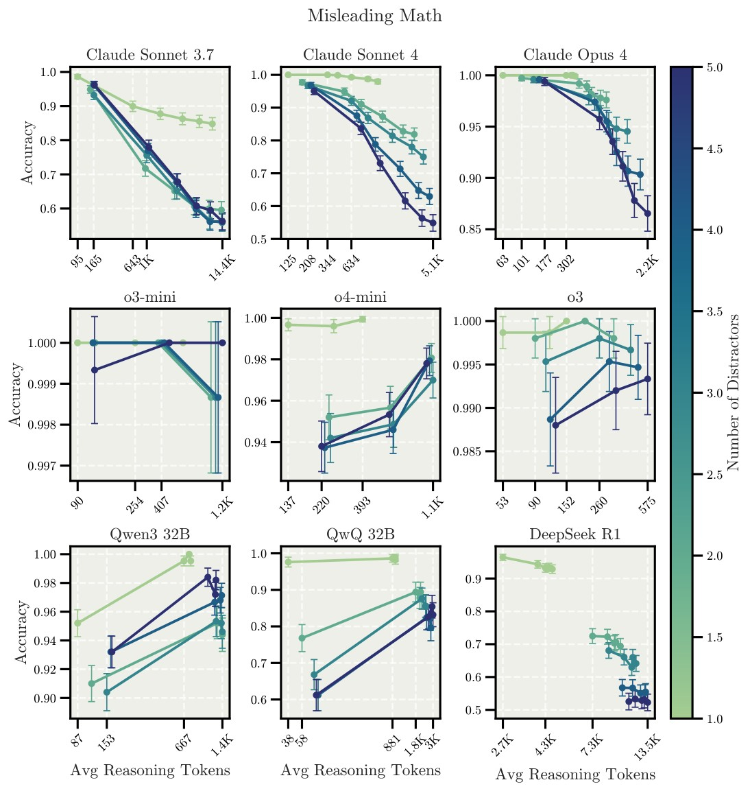

# 3分钟搞懂推理模型

> ⭐⭐中级 · 阅读时间 3分钟 · 更新于 2026-11-09
>
> 推理模型靠训练学会先想再答，数学和编程成绩因此大幅提升。如今思考已成为主流大模型的内置能力，本文讲清它的训练方式、计费和截断问题、思考力度怎么选，以及为什么想得久也不一定答得对。

## 一句话定义

**推理模型**（Reasoning Model）= 经过专门训练、在给出答案之前会先生成一段思考内容的大模型，它会拆解问题、尝试解法、检查中间结果，用更多的时间和 token 换取复杂任务上更高的准确率。

可以想象同一个学生做同一道数学题的两种方式：一种是老师刚念完题就举手抢答，另一种是先在草稿纸上列式，算完之后再验算一遍，发现不对就换个方法重算，确认了才写答案。推理模型走的就是第二种方式。



早期推理模型是单独的产品，现在思考已经成了主流模型的内置能力，你在各家产品里看到的“思考模式”“深度思考”，说的基本都是这项能力。所以现在更实用的问题变成了：这个任务应该让模型想多少。

## 模型思考时，到底多做了什么？

大语言模型是一个 token 接一个 token 往后生成内容的，推理模型也不例外。区别在于它在写答案之前，会先生成一大段思考内容，这段内容同样是 token，然后最终答案再根据这段思考内容生成：

```text
普通的生成方式: 问题 -> 答案
推理模型:       问题 -> 思考内容(拆解、尝试、检查、回头重来) -> 答案
```



以“鸡兔同笼，共 35 个头、94 条腿”为例，一段思考内容大致是这样的（这里是示意，不是某个模型的真实输出）：

```text
如果 35 只全是鸡, 一共有 70 条腿, 比实际少了 24 条
每把一只鸡换成兔子, 就多 2 条腿, 所以兔子有 12 只, 鸡有 23 只
验算一下: 23 x 2 + 12 x 4 = 46 + 48 = 94, 和题目一致
```

这种简单的题，现在不开思考的模型通常也能答对，例子只是用来说明过程。真正的差别出现在更难的问题上：第一种解法走不通时，推理模型会放弃它，然后换一条路重新来过。这就是它和“在提示词里写一句请一步步思考”最大的不同。提示词只是请模型多写一段步骤，模型的能力本身并没有变化，如果前面某一步算错了，后面往往会沿着错误的结果继续往下推；而推理模型是在训练阶段就专门练过怎么思考、怎么检查的。

## 思考能力是靠强化学习训练出来的

2024 年 9 月，OpenAI 发布 o1 系列，并说明它是用大规模强化学习训练出来的。**强化学习**的做法很像只给答案对错的刷题：模型自己尝试解题，做对了就得到奖励，在海量的练习中逐渐找到更容易做对的思考方式。

OpenAI 没有公开 o1 的训练细节，公开得比较完整的是 2025 年 1 月发布的 **DeepSeek-R1**。它的实验版本 R1-Zero 跳过了人工示范解题步骤的环节，只要求模型把思考内容写在 `<think>` 标签里，奖励主要看最终答案对不对，以及格式是否符合要求。训练过程中，模型开始自发地写“等等，这里好像不对”，然后回头重新检查，研究团队把这称为“顿悟时刻”。这种自我检查的行为并没有人专门教，是模型为了拿到奖励逐渐形成的。


*图注：出自 DeepSeek-R1 论文。这是 R1-Zero 一个训练中途版本的思考内容，红字部分意思是“等等，等等。等等。这是一个我可以标记出来的顿悟时刻”，之后模型重新检查了前面的推导。*

不过 R1-Zero 的思考内容可读性比较差，还会混杂多种语言，所以正式发布的 R1 又加入了少量示范数据，再做强化学习。按 Nature 论文的补充材料，R1 这一阶段的训练花费约 29.4 万美元，但它是建立在基础模型 V3 之上的，这个数字也只算了正式训练用的显卡时长，不包含前期研究和基础模型的成本。这也说明了推理能力不是从零造出一个新模型，而是在已有的大模型上继续训练。

另外还有一个常见的说法需要更正：R1 经常被说成“完全开源”，准确地说是**开放权重**。模型权重用 MIT 协议公开，可以免费下载和商用，但完整的训练数据和训练代码并没有公开。

训练带来的提升在数学和编程上最明显。下面是 OpenAI 发布 o1 时公布的结果：

| 测试 | GPT-4o | o1 |
|---|---|---|
| AIME 2024（美国数学奥林匹克选拔赛的一轮考试，每场 15 题） | 平均做对 1.8 题（12%） | 平均做对 11.1 题（74%） |
| Codeforces 编程竞赛题 | 超过约 11% 的人类选手 | 超过约 89% 的人类选手 |

到了 2025 年 7 月，进阶版的 Gemini Deep Think 在国际数学奥林匹克（IMO）中拿到 35 分（满分 42 分），解出了 6 道题里的 5 道，达到了金牌线。它在 4.5 小时的比赛时限内，直接用自然语言写出证明，成绩由 IMO 的协调员按照学生的评分标准批改认证。OpenAI 也用实验性的推理模型做出了同样的 35 分，不过这个成绩是由它自己找人批改的。这些都是对应时间点的成绩，现在的模型已经更新了很多代。

## 推理模型已经不再是单独的一类模型

早期推理模型是单独的产品，用户需要自己在普通模型和推理模型之间切换。后面的变化很快：

| 时间 | 事件 |
|---|---|
| 2024 年 9 月 | OpenAI 发布 o1-preview，推理模型开始进入大众视野 |
| 2025 年 1 月 | DeepSeek-R1 开放权重，并把思考过程直接展示给用户 |
| 2025 年 2 月 | Claude 3.7 Sonnet 发布，同一个模型可以选择要不要深度思考 |
| 2025 年 3 月 | Gemini 2.5 Pro 发布，开始把思考作为模型的默认能力 |
| 2025 年 8 月 | GPT-5 把普通模型和推理模型合并，由系统判断要不要深度思考；DeepSeek V3.1 也把两种能力合进了同一个模型 |
| 2026 年 | OpenAI 的 o 系列陆续下线：o3 在 8 月 26 日退出 ChatGPT；o1、o3-mini、o4-mini 的 API 在 10 月 23 日关闭，o3 的 API 将在 12 月 11 日关闭 |

所以原来常见的“o1、o3、R1、Gemini Flash Thinking”这张推理模型清单已经过时了。如果你的代码或者文档里还写着这些模型名，需要尽快迁移。截止目前，各家主力模型的思考功能大致如下：

| 厂商 | 代表模型 | 怎么控制思考 | 默认情况 |
|---|---|---|---|
| **OpenAI** | GPT-6 Astra、GPT-6.1 Sol | `reasoning.effort` 调力度，另有消耗更多算力的 Pro 模式 | 默认 medium，这两个模型都不能关闭思考 |
| **Anthropic** | Claude Opus 5.5、Sonnet 5.5 | 自适应思考，由模型判断想不想、想多少，用 `effort` 调整倾向 | 默认开启，Opus 5.5 默认 medium，Sonnet 5.5 不能直接关闭 |
| **Google** | Gemini 4 Argon、3.8 Flash | `thinking_level` 分 low、medium、high | 默认开启，默认 medium |
| **DeepSeek** | V4 系列 | 可开关，力度分 low、high、max | 默认开启，默认 high |
| **千问** | Qwen3.8 系列 | `enable_thinking` 开关，`thinking_budget` 限制思考长度 | 默认开启，另有只能思考的型号 |
| **豆包** | Doubao-Seed 2.1 系列 | `thinking` 开关，`reasoning_effort` 调力度 | 默认 high |
| **Kimi** | Kimi K3.1 Pro | `reasoning_effort` 分 low、high、max | 默认 max，不能关闭思考 |
| **智谱** | GLM-5.3 系列 | `reasoning_effort` 分 low、high、max | 默认 max，不能关闭思考 |

从表里可以看出，思考力度已经和温度、最大长度一样，成了调用模型时的常规配置，而且有些模型已经不允许关闭思考了。如果你用的是聊天 App，“深度思考”“思考模式”这类按钮，背后通常也是同样的能力。

## 思考内容要付费，还可能把答案挤掉

对开发者来说，推理模型有几个不太一样的地方，很多线上问题都出在这里：

- **思考内容按输出 token 计费**。输出 token 通常比输入 token 贵很多，而且你看不到的部分也要付费。OpenAI、Anthropic 和 Google 默认都不返回原始的思考内容，最多只能看到摘要，账单却是按完整的思考内容计算的。比如 Anthropic 文档的一个示例里，348 个输出 token 中有 312 个是思考内容，这只是一个示例，但可以看出来账单的主要部分可能都在思考上。开发者可以在 API 返回的用量字段里查到实际消耗，比如 OpenAI 的 `reasoning_tokens` 和 Anthropic 的 `thinking_tokens`。
- **最大输出长度也包含思考内容**。如果你还沿用以前的 `max_tokens: 1000` 这种配置，模型可能在思考阶段就用完了额度，最后连答案都没有返回，但思考的费用照样要付。OpenAI 建议刚开始时至少预留 25,000 个 token 给思考和输出，然后再根据实际用量调整。程序里也要处理好这种被截断的状态，不要当成空回答直接展示给用户。
- **做工具调用时要把思考内容传回去**。模型调用工具之后，下一步还要接着之前的思路继续想，所以需要把上一步的思考内容原样带回。各家的规则不一样，比如 DeepSeek 带工具调用时如果没有回传 `reasoning_content`，会直接返回 400 错误；OpenAI 和 Anthropic 也要求保留对应的思考内容。如果你是自己管理对话历史，这一步很容易漏掉。
- **部分老参数已经失效了**。比如 DeepSeek 在思考模式下会忽略 `temperature`，但不会报错，所以你可能一直以为这个参数还在起作用。另外调整 Claude 的 `effort` 还会让之前的提示词缓存失效，如果对话中途频繁切换力度，成本反而可能上升。
- **响应时间要重新评估**。OpenAI 提到思考消耗可能从几百到几万个 token 不等，同一个接口的响应时间波动也会变大。面向用户的产品最好使用流式输出，或者展示思考进度，否则用户会以为卡住了。

## 什么任务值得让模型多想一会儿？

原来大家常说“推理模型只适合数学和代码，不适合写作和聊天”，这个说法现在太绝对了。不少模型已经能自己判断简单问题要不要思考，真正需要你选择的是力度。下面的分档可以作为一个起步的参考：

| 任务类型 | 建议力度 |
|---|---|
| 翻译、改错别字、提取字段、文本分类 | 最低档，模型支持的话可以关闭思考 |
| 日常问答、写文案、常规代码修改 | 默认档 |
| 排查复杂 bug、架构设计、跨文件重构、数学证明、多步骤的 Agent 任务 | 高档 |

各家的档位不能直接横向对比，比如同样是 high，在不同模型上消耗的 token 可能差别很大。**最稳妥的做法是拿你自己的真实任务，分别用两三档跑一遍，对比答案质量、耗时和账单。** 在高并发、低延迟的场景里，把力度调低一档，经常是最直接的省钱办法。

在 Agent 任务中，思考的分布也不是平均的。以 Claude 为例，收到用户新指令后的第一次请求通常承担了大部分思考，后面只是处理工具结果的请求可能就直接跳过思考了，所以不用担心每一步都会想很久。

提示词的写法也可以简化：使用推理模型时，不用再写“请一步步思考”，把目标、限制条件和输出格式写清楚就可以了。思考深度交给力度参数来调整。

## 想得久，也不一定答得对

推理模型能解决的主要是“算不对、想不周全”的问题，有几种情况增加思考也帮不上忙：

**模型本身不知道的事实，想再久也想不出来。** 2025 年的一项研究测试了 14 个推理模型回答知识类问题的表现，这些题目不允许查资料。结果增加思考量并不能稳定地提高准确率，反而经常让幻觉变多，因为想得越久，模型越愿意尝试作答，其中很多答案都是错的；有时长时间的思考还会强化一开始的错误判断。所以当问题依赖事实时，联网搜索或者提供资料会比提高思考力度更有效。

**思考太久也可能跑偏。** 2025 年的论文《Inverse Scaling in Test-Time Compute》专门构造了一批任务，让模型想得越久准确率越低。比如在简单的计数题里混入无关信息，当时的 Claude 模型想得越久越容易被干扰；OpenAI 的 o 系列不容易被干扰，却容易过度套用题目形式相近的解法。这些都是专门设计的测试题，并不代表日常任务也会这样，但它说明了力度并不是越高越好。


*图注：出自论文《Inverse Scaling in Test-Time Compute》。每个小图是一个模型，横轴是平均思考 token 数，纵轴是准确率，线的颜色越深表示题目里混入的无关信息越多。第一行的三个 Claude 模型和右下角的 DeepSeek R1，都是想得越久准确率越低；中间一行的 o 系列基本没有下降。图中是论文测试时的模型。*

**规模变大之后，模型仍然可能出错。** 苹果的研究团队在 2025 年用汉诺塔这类可以调节难度的谜题测试发现，难度超过一定程度后，推理模型的准确率会突然崩溃。这个结论引起了不少争议，有研究者指出，部分失败是因为答案太长超过了输出上限，还有一些测试题本身无解；当改成让模型写程序来生成解法时，效果就好了很多。所以当任务需要严格执行很多步骤时，比较合理的做法是让模型写代码来运行，这通常比让它自己一步步推演更可靠。

**模型写出来的思考内容，也不一定是它得出结论的真实原因。** Anthropic 在 2025 年的实验发现，当模型因为题目里的提示改了答案时，Claude 3.7 Sonnet 只有约 25% 的情况在思考内容里提到了这个提示，DeepSeek-R1 约为 39%。所以思考过程写得再有条理，也不等于结论是对的，尤其是涉及到医疗、法律、财务这些重要决定时，一定要去核对结论和依据本身。

## 时效性提醒

推理模型的基本原理已经比较稳定了，变化比较快的是这些内容：

- 各家的模型名称、思考档位和默认值，新模型发布时经常会调整
- 哪些模型可以关闭思考，以及思考内容的展示方式和计费细节
- 文中的跑分和研究结论都来自当时测试的模型，不能直接套用到截止目前最新的模型上

**建议**：调用之前，以各家官方文档为准。

💬 **互动话题**：你有没有把思考力度调高之后，模型反而答得更差或者账单明显变多的任务？当时用的是哪一档？

📖 **相关阅读**：

- [3分钟搞懂思维链](../02-chain-of-thought/README.md) - 推理模型背后的基础方法
- [3分钟搞懂强化学习(RLHF)](../09-rlhf/README.md) - 模型是怎么通过奖励学习的
- 3分钟搞懂DeepSeek模型 - 从 R1 到思考模式的完整演变
- [3分钟搞懂Token和上下文](../../01-basics/06-token-and-context/README.md) - 思考内容为什么会占上下文和增加费用
- [3分钟搞懂Agent Loop](../../09-agent-engineering/01-agent-loop/README.md) - 思考和工具调用是怎么交替进行的
- [3分钟搞懂AI幻觉](../04-hallucination/README.md) - 为什么想得再久也可能编造内容

**资料来源**：

- OpenAI，Learning to reason with LLMs（2024）：https://openai.com/index/learning-to-reason-with-llms/
- OpenAI，Introducing GPT-5（2025）：https://openai.com/index/introducing-gpt-5/
- OpenAI，Reasoning 文档：https://developers.openai.com/api/docs/guides/reasoning
- OpenAI，Reasoning best practices：https://developers.openai.com/api/docs/guides/reasoning-best-practices
- OpenAI，Deprecations：https://developers.openai.com/api/docs/deprecations
- OpenAI，Model release notes：https://help.openai.com/en/articles/9624314-model-release-notes
- DeepSeek-R1 论文：https://arxiv.org/abs/2501.12948
- Hugging Face，Open-R1（说明 R1 未公开的训练数据和代码）：https://huggingface.co/blog/open-r1
- Science News，关于 DeepSeek-R1 Nature 论文的报道：https://www.sciencenews.org/article/ai-model-deepseek-answers-training
- Google DeepMind，Gemini Deep Think 在 IMO 达到金牌水平（2025）：https://deepmind.google/discover/blog/advanced-version-of-gemini-with-deep-think-officially-achieves-gold-medal-standard-at-the-international-mathematical-olympiad/
- Anthropic，Claude 3.7 Sonnet 发布公告（2025）：https://www.anthropic.com/news/claude-3-7-sonnet
- Google，Gemini 2.5 发布公告（2025）：https://blog.google/technology/google-deepmind/gemini-model-thinking-updates-march-2025/
- DeepSeek，V3.1 发布公告（2025）：https://api-docs.deepseek.com/news/news250821
- TechRepublic，关于 Google 和 OpenAI 的 IMO 成绩的报道（2025）：https://www.techrepublic.com/article/news-google-deepmind-math-olympiad/
- Zhao et al.，Test-Time Scaling in Reasoning Models Is Not Effective for Knowledge-Intensive Tasks Yet（2025）：https://arxiv.org/abs/2509.06861
- Gema et al.，Inverse Scaling in Test-Time Compute（2025）：https://arxiv.org/abs/2507.14417
- Shojaee et al.，The Illusion of Thinking（2025）：https://arxiv.org/abs/2506.06941
- Lawsen，Comment on The Illusion of Thinking（2025）：https://arxiv.org/abs/2506.09250
- Anthropic，Reasoning models don't always say what they think（2025）：https://www.anthropic.com/research/reasoning-models-dont-say-think
- Anthropic，Thinking 文档：https://platform.claude.com/docs/en/build-with-claude/thinking
- Anthropic，Steering thinking 文档：https://platform.claude.com/docs/en/build-with-claude/thinking-steering-and-cost
- Google，Gemini Thinking 文档：https://aistudio.google.com/docs/thinking
- DeepSeek，思考模式文档：https://api-docs.deepseek.com/zh-cn/guides/thinking_mode
- 阿里云百炼，深度思考文档：https://www.alibabacloud.com/help/zh/model-studio/deep-thinking
- 火山方舟，深度思考文档：https://docs.volcengine.com/docs/ark/deep-thinking
- Kimi，思考模式文档：https://platform.kimi.com/docs/guide/use-kimi-k2-thinking-model
- 智谱，深度思考文档：https://docs.bigmodel.cn/cn/guide/capabilities/thinking

---

[📚 返回目录](../README.md) ｜ 下一篇：[3分钟搞懂思维链](../02-chain-of-thought/README.md) ➡️
