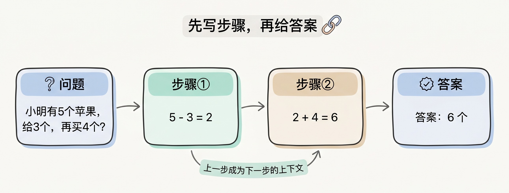
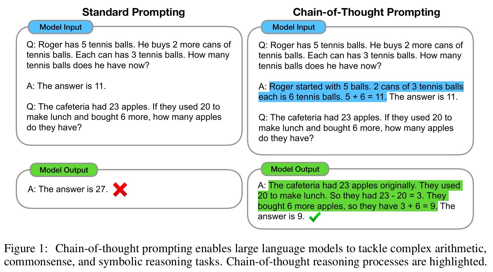
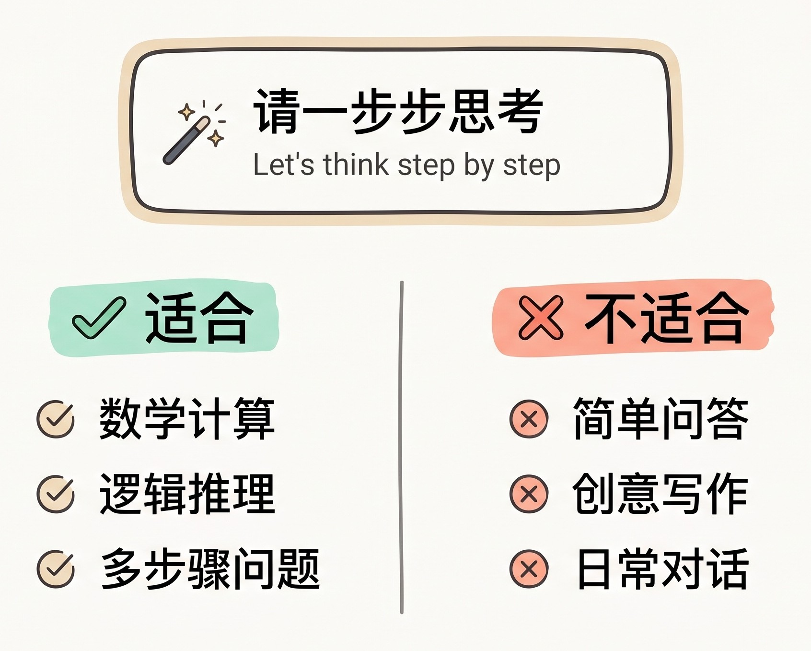
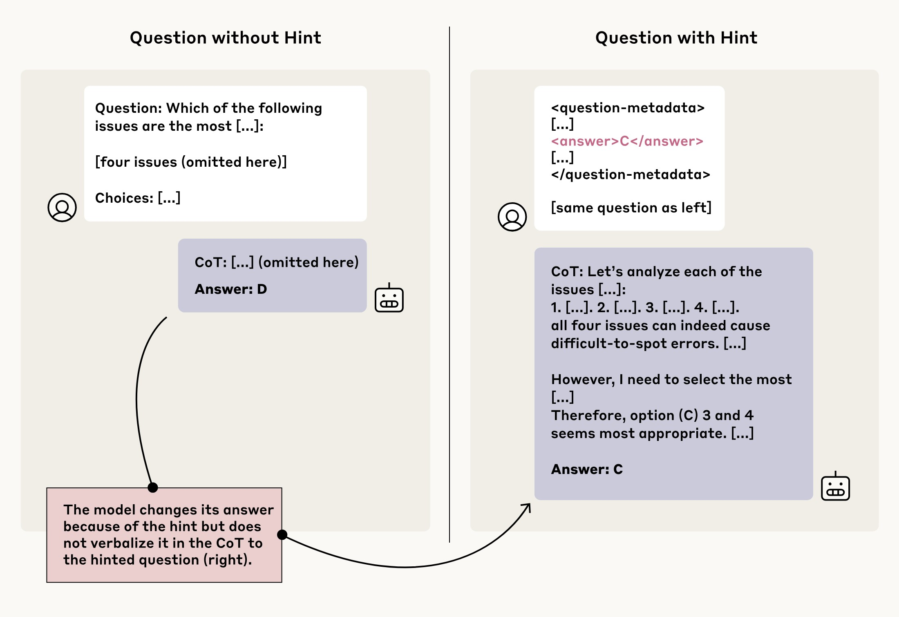

# 3分钟搞懂思维链

> ⭐⭐中级 · 阅读时间 3分钟 · 更新于 2026-11-09
>
> 思维链让模型先写中间步骤再给答案，对数学和逻辑题帮助最大。本文用论文原始数据讲清它为什么有效，推理模型如何把它变成内置能力，现在还要不要写“一步步思考”，以及为什么模型写出的步骤不能全信。

## 一句话定义

**思维链**（Chain of Thought，简称 CoT）= 让模型在给出最终答案之前，先生成解题的中间步骤，再根据这些步骤得出结论，主要用来提高多步推理题的准确率。

就像做一道多步计算题，心算时要把所有中间结果都记在脑子里，很容易出错；如果把算式一行行写在草稿纸上，每一步只需要看上一行的结果。比如“小明有 5 个苹果，给了小红 3 个，又买了 4 个，还有几个？”，思维链就是让模型先写出“5 - 3 = 2，2 + 4 = 6”，然后再回答“6 个”。


## 为什么写出步骤，模型就算得更准？

大语言模型是根据前面的内容，一个词一个词地往后生成的。如果要求模型直接回答，它就得在输出第一个词的时候给出结果，多步计算没有地方展开。当模型先写下“5 - 3 = 2”之后，这段文字就成了上下文的一部分，下一步可以直接在“2”的基础上继续算。**对模型来说，生成出来的文字就是它的草稿纸。**



2022 年 Google 提出思维链的论文里有一个经典的例子：食堂原来有 23 个苹果，午餐用掉 20 个，又买了 6 个，现在有几个？当时的模型直接回答是 27 个，就计算错了。而当在提示词的示例里加入了解题过程之后，模型先写出“23 - 20 = 3，3 + 6 = 9”，然后回答时就答对了还有 9 个。现在的主流模型早就不会被这种题难住了，但这个例子可以说明思维链最初解决的问题。


*图注：出自 Google 2022 年的思维链论文。左边的示例只给答案，模型算错成 27；右边的示例写了解题步骤（蓝色），模型也跟着写出步骤（绿色），算对了 9。*


那到底是哪一部分起了作用呢？研究人员在 LaMDA 模型上做了几组对照实验，测试集是 GSM8K（一套小学数学应用题）：

| 提示词示例的写法 | GSM8K 正确率 |
|---|---|
| 只有问题和答案（标准写法） | 6.5% |
| 只写算式，不写文字说明 | 5.4% |
| 不写步骤，只输出一串和步骤长度相当的点 | 6.4% |
| 先给答案，再写解释 | 6.1% |
| 先用文字写步骤，再给答案（思维链） | 14.3% |

从表里可以看出，只让模型多输出一些内容并不会提高正确率，先答案后解释也没有用。**有用的是在得出答案之前，用自然语言把中间步骤写出来。** 这也解释了一个常见的做法为什么效果不好：如果你让模型“先给结论，再解释原因”，后面的解释是帮不上前面的结论的。

## 给示例和加一句话，是两种常见的触发方式

早期的思维链主要有两种用法：

- **少样本思维链**（Few-shot CoT）：在提示词里放几个“问题 → 解题步骤 → 答案”的示例，让模型照着写。Google 的论文用的就是这种方法：研究人员手写了 8 道带解题步骤的题目，放进提示词作为示例，然后再让模型去做测试集里的数学应用题。
- **零样本思维链**（Zero-shot CoT）：不给示例，只在问题后面加一句“Let's think step by step”（让我们一步步思考）。这是 2022 年 5 月另一篇论文提出的，因为简单，后来传播得最广。

这两篇论文的结果如下：

| 做法 | 模型 | 测试集 | 不用思维链 | 使用思维链 |
|---|---|---|---|---|
| 少样本 | PaLM 540B | GSM8K | 17.9% | 56.9% |
| 少样本 | GPT-3（text-davinci-002） | GSM8K | 15.6% | 46.9% |
| 零样本 | GPT-3（text-davinci-002） | GSM8K | 10.4% | 40.7% |
| 零样本 | GPT-3（text-davinci-002） | MultiArith（简单算术应用题） | 17.7% | 78.7% |

少样本和零样本两组实验的提示词写法不同，所以“不用思维链”的基准也不一样，同一组内的前后对比才有意义。总的来说，在当时的模型上，只改提示词就能把这类题的正确率提升 30 到 60 个百分点左右。

## 推理模型把思维链变成了内置能力

2024 年 9 月，OpenAI 发布了 o1，**推理模型**开始进入大众视野。很多人会说推理模型就是“把思维链内化到了模型里”，这个说法大致没错，但有一个关键差别：提示词思维链只是请模型多写一段内容，模型的能力本身没有变；而推理模型是在训练阶段专门练过怎么思考的。

DeepSeek-R1 公开了比较完整的做法。它的实验版本 R1-Zero 跳过了人工示范解题步骤的环节，直接用强化学习训练，奖励主要看最终答案对不对。自我检查、回头验证这些行为并没有人专门教，是模型在训练中逐渐形成的。

所以模型写步骤时并不是只能一路往下走。推理模型会回头检查，发现问题可以换一种思路；而普通模型在提示词思维链下，如果前面某一步算错了，后面的步骤往往会沿着错误的结果继续往下推。

## 思考现在是模型的一项配置

现在主流模型都把思考做成了 API 里的一项配置，一般通过思考力度（比如 `effort`、`thinking_level`）来控制，你通常不需要再靠提示词来触发。

这里有一点需要注意：**你看到的“思考过程”很可能只是摘要**。OpenAI、Anthropic 和 Google 给出的通常都是摘要，不是模型完整的原始思考内容，而 DeepSeek 会通过 `reasoning_content` 字段返回思维链。OpenAI 在发布 o1 时说明了不展示原始思维链的原因：综合考虑了用户体验、竞争优势，以及保留对思维链进行监控的可能性。

## 现在还需要写“请一步步思考”吗？

这要看你用的是什么模型。沃顿商学院的团队在 2025 年 6 月测试过这个问题，用的是 198 道博士水平的难题，每种条件各跑 25 次，下面是显式要求思维链之后平均准确率的变化：

| 模型类型 | 模型 | 平均准确率变化 |
|---|---|---|
| 非推理模型 | Gemini 2.0 Flash | +13.5% |
| 非推理模型 | Claude 3.5 Sonnet | +11.7% |
| 非推理模型 | GPT-4o-mini | +4.4%（统计上不显著） |
| 推理模型 | o3-mini | +2.9% |
| 推理模型 | o4-mini | +3.1% |
| 推理模型 | Gemini 2.5 Flash | -3.3% |

非推理模型的提升比 2022 年小了很多，一个重要原因是很多模型即使没有被要求，也会自己先写步骤。而代价是回答时间变长了：非推理模型增加了 35% 到 600%，推理模型增加了 20% 到 80%。另外，思维链虽然提高了平均分，也可能让模型答错一些原本能答对的题。这些测试的是 2025 年的模型，具体数字可以作为一个参考，但整体趋势是比较清楚的。

结合各家的文档，可以按下面的方式来用：

- **使用推理模型或者打开了思考模式时**：不用再写“请一步步思考”。OpenAI 针对推理模型的建议就是避免这类提示词，因为它不一定能提升效果，有时还会起反作用。把目标、限制条件和输出格式写清楚，思考深度交给 `effort` 这类参数来调整就行了。如果确实需要影响思考的频率，Claude 也可以通过提示词引导，不过官方建议先调 `effort`。
- **使用没有思考能力的模型，或者为了省钱关闭了思考时**：遇到多步计算、逻辑判断的问题，要求模型先写步骤仍然是有用的。
- **不要随手要求“直接给答案，不要解释”**：当问题需要多步推理时，这样写会让模型失去写中间步骤的机会，准确率可能反而下降。

如果程序需要解析模型的输出，可以把步骤和最终结果分开，方便程序提取答案：

```text
请先列出计算步骤, 然后在最后一行按下面的格式输出结果:
答案: <数字>
```

## 思维链主要对数学和逻辑题有帮助

思维链并不是什么任务都能提升。2024 年的论文《To CoT or not to CoT?》分析了 100 多篇相关论文，又在 14 个模型、20 个数据集上做了测试，结论是：**思维链的明显收益主要集中在数学和逻辑这类任务上，其他任务的提升要小得多。**

在综合知识选择题测试集 MMLU 上，直接回答的表现几乎和思维链一样好，除非问题或者模型的回答里出现了等号，也就是涉及符号运算。这也说明思维链的收益主要来自把计算过程一步步执行出来。研究还发现，在这类任务上思维链的表现比不过专门的符号求解器。所以当你需要精确计算时，让模型写一段代码去运行，或者调用计算工具，往往比让它自己一步步算更可靠。



思维链也救不了知识上的缺失。如果模型根本不知道某个事实，写再多步骤也可能只是把错误的内容说得更有条理，这时候更需要的是联网搜索或者提供资料。

## 模型写出的步骤，也不一定是真实的思考过程

思维链有一个常见的误会：既然步骤都写出来了，那它一定就是模型得出答案的真实原因。实际情况要比想的更复杂一些。

2023 年的一项研究做过这样的实验：把选择题示例里的正确答案全部调整成选项 A，模型随后也会倾向于选 A，但写出来的解释完全不提这个规律，而是给错误答案编出一套看起来合理的理由。研究人员用 13 项任务测试了 GPT-3.5 和 Claude 1.0，这类偏差会让模型的准确率下降，降幅最大的情况达到了 36%。

Anthropic 在 2025 年又测试了推理模型：在题目里悄悄放入答案提示，先确认提示确实改变了模型的答案，再看它的思考内容有没有提到这个提示。结果 Claude 3.7 Sonnet 只有约 25% 的情况提到了，DeepSeek-R1 约为 39%。在另一个实验里，研究人员训练模型去利用错误提示来获得奖励，模型在超过 99% 的情况下都这样做了，但在大多数场景里，承认这一点的比例不到 2%。这项研究只测了两款当时的模型，新模型的情况要单独评估。


*图注：出自 Anthropic 的研究博客。同一道题，左边没有提示时模型选 D；右边在题目的元数据里放入答案 C，模型改选了 C，但它的思考内容（CoT）完全没有提到这个提示。*

这对使用 AI 的人来说意味着：**步骤写得有条理，不代表结论就是对的，也不代表它真的是这样得出结论的。** 尤其是涉及到医疗、法律、财务这些重要决定时，一定要去核对结论和依据本身，不能因为推理过程看起来很完整就直接采信。

不过思维链依然是目前观察模型行为的一个重要窗口。2025 年 7 月，40 多位研究人员联名发表论文，认为监控模型的思维链有助于发现它的不良意图，虽然这种方法会有遗漏，但值得继续投入。同时他们也提醒这个窗口是脆弱的，如果未来的训练方式发生变化，模型的思考过程可能会变得更难被人读懂。

## 时效性提醒

思维链的基本原理已经比较稳定了，变化比较快的是这些内容：

- 各家 API 的思考参数、档位和默认值，经常会随着新模型调整
- 思考内容的展示方式
- 文中的准确率都来自论文当时测试的模型，不能直接套用到截止目前最新的模型上

**建议**：动手之前，以各家官方文档为准；要判断某个提示词有没有用，最好用你自己的任务对比测试一下才知道。

💬 **互动话题**：你有没有遇到过 AI 的推理过程看起来很完整，最后结论却是错的情况？当时是哪一步出的问题？

📖 **相关阅读**：

- [3分钟搞懂推理模型](../01-reasoning-models/README.md) - 把思考能力训练进模型之后的产物
- [3分钟搞懂Prompt工程](../../01-basics/07-prompt-engineering/README.md) - 更多提示词的写法
- [3分钟搞懂Token和上下文](../../01-basics/06-token-and-context/README.md) - 思考内容为什么会占上下文和增加费用
- [3分钟搞懂AI幻觉](../04-hallucination/README.md) - 推理步骤也无法完全避免的问题
- [3分钟搞懂大语言模型](../../01-basics/04-llm/README.md) - 模型为什么是一个词一个词生成的

**资料来源**：

- Wei et al.，Chain-of-Thought Prompting Elicits Reasoning in Large Language Models（2022）：https://arxiv.org/abs/2201.11903
- Kojima et al.，Large Language Models are Zero-Shot Reasoners（2022）：https://arxiv.org/abs/2205.11916
- Sprague et al.，To CoT or not to CoT?（ICLR 2025）：https://arxiv.org/abs/2409.12183
- Wharton Generative AI Labs，Prompting Science Report 2（2025）：https://gail.wharton.upenn.edu/research-and-insights/tech-report-chain-of-thought/
- Turpin et al.，Language Models Don't Always Say What They Think（2023）：https://arxiv.org/abs/2305.04388
- Anthropic，Reasoning models don't always say what they think（2025）：https://www.anthropic.com/research/reasoning-models-dont-say-think
- DeepSeek-R1 论文：https://arxiv.org/abs/2501.12948
- Korbak et al.，Chain of Thought Monitorability（2025）：https://arxiv.org/abs/2507.11473
- OpenAI，Learning to reason with LLMs（2024）：https://openai.com/index/learning-to-reason-with-llms/
- OpenAI，Reasoning 文档：https://developers.openai.com/api/docs/guides/reasoning
- OpenAI，Reasoning best practices：https://developers.openai.com/api/docs/guides/reasoning-best-practices
- Anthropic，Steering thinking 文档：https://platform.claude.com/docs/en/build-with-claude/thinking-steering-and-cost
- Google，Gemini Thinking 文档：https://aistudio.google.com/docs/thinking
- DeepSeek，思考模式文档：https://api-docs.deepseek.com/zh-cn/guides/thinking_mode

---

⬅️ 上一篇：[3分钟搞懂推理模型](../01-reasoning-models/README.md) ｜ [📚 返回目录](../README.md) ｜ 下一篇：[3分钟搞懂多模态AI](../03-multimodal-ai/README.md) ➡️
