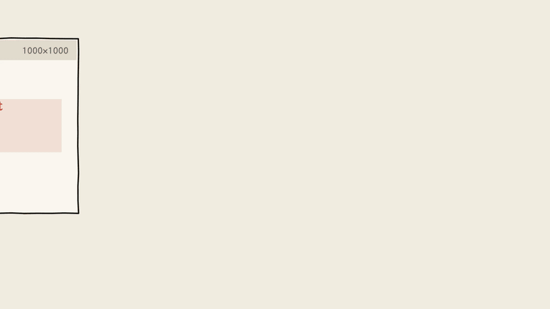
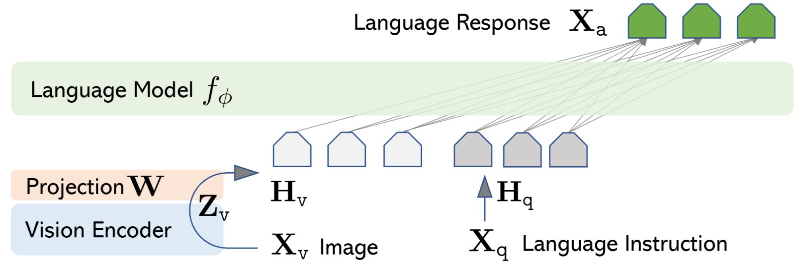
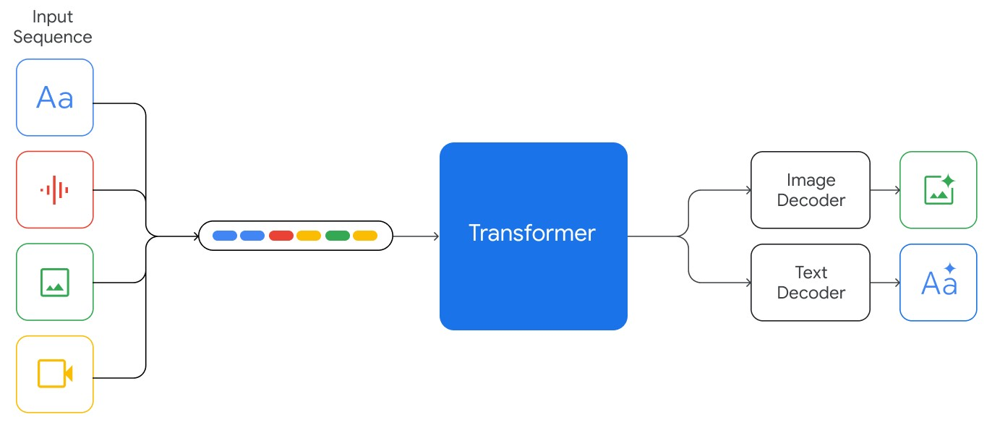
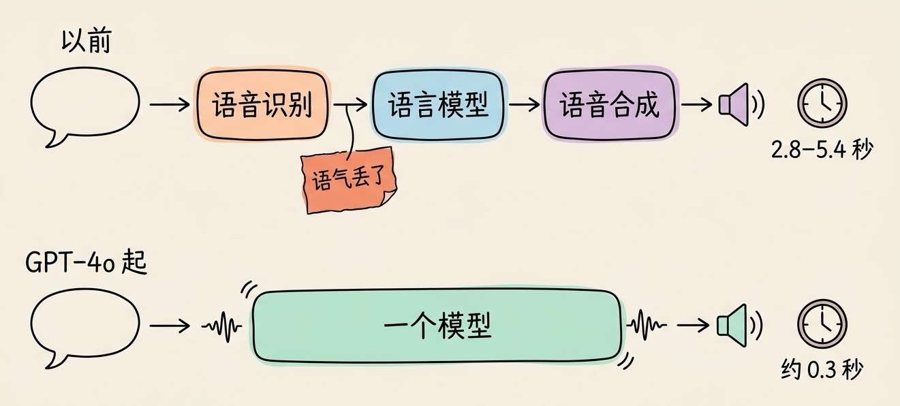
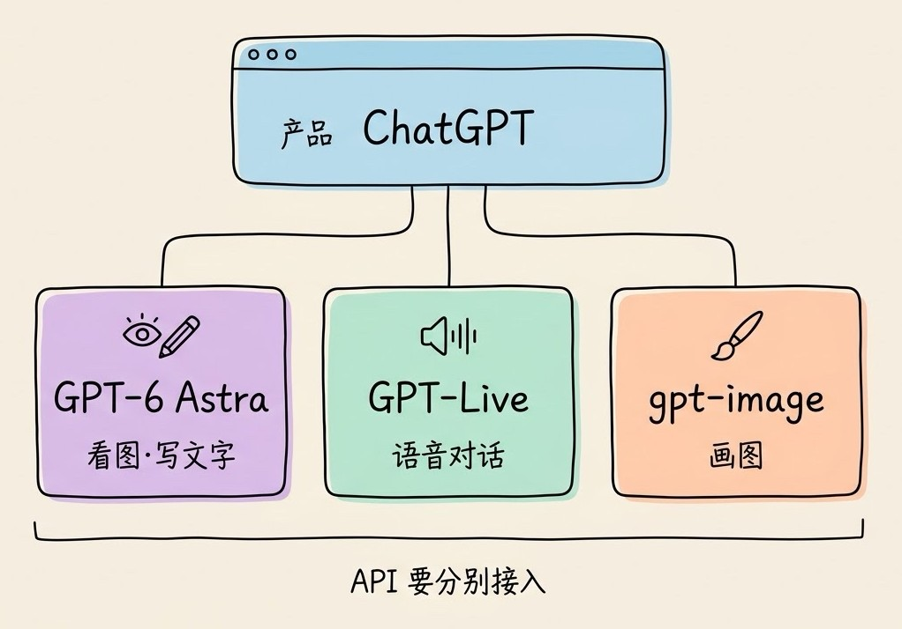

# 3分钟搞懂多模态AI

> ⭐⭐中级 · 阅读时间 3分钟 · 更新于 2026-11-10
>
> 多模态 AI 能同时处理文字、图片、语音和视频。本文讲清图片和视频是怎么变成 token 进入模型的、外接视觉模块和原生多模态有什么区别、语音对话怎么做到边听边说，以及主流模型各能输入什么、常在哪里看错。

## 一句话定义

**多模态 AI** = 能直接接收文字、图片、音频、视频等不同形式的信息，把它们放在一起理解和推理，再用文字、语音或图像给出结果的 AI 模型。

这里的“模态”，指的就是信息的形式。只能读写文字的模型是单模态的；你拍一张报错截图问它怎么修，或者把一段会议录像丢给它生成纪要，用到的就是多模态能力。

现在主流的大模型基本都能看图了，但“能看图”只是多模态的一部分。能不能听声音、能不能看视频、能不能直接用语音回答、能不能画图，每个模型的情况都不一样，后面会具体对比。

## 图片进了模型，也会变成 token

大语言模型本身只会处理一种东西：一串 token。文字可以按字词切成 token，那图片怎么办？

做法是先把图片切成很多个小方块。以 Claude 为例，每个 28×28 像素的方块算一个“视觉 token”。然后由一个专门的**视觉编码器**把每个小方块转换成一组数字，这组数字的格式和文字 token 是一样的。这样一来，图片和你的问题就可以排在同一个序列里，交给语言模型一起处理。

声音和视频也是类似的思路：

- **音频**按时间切段。Gemini 处理音频时，每秒大约是 32 个 token。
- **视频**会拆成画面和声音两部分。画面默认每秒抽 1 帧，每帧按图片处理；声音按音频处理。

理解了这一点，就能明白多模态在实际使用中的几个现象：

**图片和视频都是要算钱的。** 在 Claude 上，一张 1000×1000 的图片要消耗 1,296 个 token；一张 4K 截图会先被缩小到 2576×1449，消耗 4,784 个 token。按 Claude Opus 5.5 每百万输入 token 4 美元来算，1000×1000 的图片大约每千张 5 美元。视频更费：Gemini 在高清晰度下，视频每秒大约要 300 个 token，一小时的视频就超过 100 万 token 了；换成低清晰度大约是每秒 100 个 token。

**图太大会被压缩。** 每个模型能接收的分辨率都有上限，超过就会被缩小。截图里的小字、表格里密密麻麻的数字，缩小之后可能就看不清了。所以如果你只关心图里的某一块，**先把那一块裁出来再发，效果通常会更好**，也更省 token。

**视频是抽帧看的。** 每秒 1 帧意味着，一个只持续半秒的动作可能根本没被模型看到。Gemini 的官方文档也提醒过，快速运动、频繁切换镜头的视频，细节可能会丢失。如果要分析球赛、操作录屏这类快节奏的视频，需要调高抽帧频率。

## 让语言模型看懂图，有两种做法

把图片变成 token 只是第一步，难的是让语言模型真的理解这些 token 代表什么。目前主要有两种做法。

### 第一种：给语言模型外接一双“眼睛”

先拿一个已经训练好的语言模型，再拿一个已经训练好的视觉编码器，中间加一个小的转换层，把视觉编码器的输出“翻译”成语言模型能理解的格式。

这条路的基础是 OpenAI 在 2021 年发布的 **CLIP**。它用从网上收集的 4 亿对“图片 + 配文”训练，让图片和描述它的文字在向量空间里靠得更近。训练完之后，CLIP 的视觉编码器输出的东西本身就和语言对上了号，所以很适合拿来当语言模型的“眼睛”。

2023 年的开源项目 **LLaVA** 就是这么做的：CLIP 的视觉编码器 + 一个简单的转换层 + 开源语言模型 Vicuna，再用 GPT-4 生成的 15.8 万条图文问答数据做微调。这种做法成本低、上手快，很长一段时间里，开源社区的看图模型大多是这个结构。

*图注：LLaVA 论文里的结构图（CC BY 4.0）。左下角的 Image 是输入的图片，先经过 Vision Encoder（视觉编码器，用的是 CLIP 的），再经过 Projection（转换层），变成浅色的 H_v；右边的 Language Instruction 是你的文字问题，变成深色的 H_q。两组 token 排在一起交给中间的 Language Model（语言模型），最后输出顶部绿色的文字回答。整个结构里新加的只有转换层这一小块。*

它的缺点是，语言模型的知识几乎都是从纯文字里学来的，图片信息是后来“翻译”进去的。遇到需要把图和文字紧密结合起来推理的任务，比如一张图表里的数字要和旁边的文字说明对照着看，效果就会打折扣。

### 第二种：从训练一开始就混在一起学

另一种做法叫**原生多模态**：从预训练阶段开始，就把文字、图片，甚至音频和视频放在一起训练，让模型自己学会不同形式的信息之间是什么关系。

Google 的 Gemini 从 2023 年 12 月的第一代开始就是这么做的，所以它一直擅长直接看视频、听音频。阿里在 2026 年初的 Qwen3.5 也改成了文字和图像从训练一开始就一起学，所以从这一代开始，千问的主力模型本身就能看图，单独的 VL（视觉语言）版本变少了。

*图注：Gemini 1.0 技术报告里的结构图（CC BY 4.0）。左边四种颜色分别代表文字、音频、图片和视频，它们被转换成不同颜色的 token，排进同一个输入序列（Input Sequence），交给同一个 Transformer 处理。右边的 Image Decoder 和 Text Decoder 表示它既能输出文字，也能输出图片。和上面 LLaVA 的结构对比可以看出，这里没有“先有语言模型、再外接眼睛”的分工。*

需要说明的是，两种做法的界限其实已经没那么清楚了。很多原生多模态模型内部仍然有视觉编码器，真正的区别在于：不同模态是**从什么时候开始一起训练的**，以及训练数据里图文混排的内容占了多少。对使用者来说，不用太纠结模型属于哪一种，直接拿自己的任务去测更实际。

## 语音对话：从三段接力到边听边说

语音是多模态里变化最大的一块。

早期的 AI 语音助手是**三个模型接力**完成的：先用语音识别把你的话转成文字，再交给语言模型生成回答，最后用语音合成读出来。ChatGPT 早期的语音模式就是这个结构，按 OpenAI 公布的数据，平均要等 2.8 秒（GPT-3.5）到 5.4 秒（GPT-4）才能听到回答。

延迟高还不是最大的问题。语音转成文字之后，语气、情绪、背景里的声音、是谁在说话，这些信息都丢了；反过来，模型也没法用笑声、语气的变化来回应你。

2024 年 5 月发布的 **GPT-4o** 第一次把这三步合进了一个模型：直接听声音、直接输出声音，最快 232 毫秒、平均 320 毫秒就能回答，已经接近人与人对话时的反应速度。

到了 2026 年，语音对话又往前走了一步，变成了**全双工**，也就是能同时听和说，像打电话一样，你随时可以插话，它也能一边说一边听你的反应。OpenAI 在 7 月 8 日发布的 **GPT-Live** 就是这种模型，它还采用了一种分工的做法：GPT-Live 自己负责实时对话，遇到需要深入推理、调用工具的问题时，交给后台另一个模型去处理，这样对话的速度不会被拖慢。不过 GPT-Live 刚上线时还不支持打开摄像头和共享屏幕，需要这些功能的话，暂时还得用旧版的语音模式。

国内在这方面走得也不慢。字节 8 月推出的 **SeedRealtime** 是一个音视频全双工模型，已经在豆包 App 里全量上线：在对话框里选择“打电话”，就能打开摄像头和 AI 视频通话。它会同时接收画面、声音和文字，还能根据画面的变化自己判断要不要插话。比如在博物馆里，你可以提前跟它说“看到青铜器的时候提醒我一下”，之后你举着手机边走边看，等镜头扫到青铜器时，它会主动开口告诉你，不需要你再问一遍。以前的语音助手只有在你说完话之后才会回应，这种主动提醒是做不到的。阿里 9 月发布的 **Qwen3.8-Omni-Flash-Realtime** 则主要面向开发者，能同时接收语音和视频，用文字或语音回答，还支持调用工具，适合做语音助手、智能客服这类实时交互的应用。

## 能看图的模型，不一定能听、能画

这里有一个常见的误解：看到 ChatGPT 能语音聊天、能画图，就以为背后的 GPT 模型什么都能处理。

实际上，**产品能做的事情，往往是好几个模型一起完成的**。拿 OpenAI 来说，主力模型 GPT-6 Astra 只能输入文字和图片、输出文字；ChatGPT 里的语音对话靠的是 GPT-Live，画图靠的是 gpt-image 系列模型。开发者直接调 API 时，要分别接入不同的模型。

下面是目前主流模型在 API 里能处理的内容：

| 模型 | 能输入 | 能输出 | 说明 |
|---|---|---|---|
| **GPT-6 Astra**（OpenAI） | 文字、图片 | 文字 | 语音用 GPT-Live 和 gpt-realtime 系列，画图用 gpt-image 系列 |
| **Claude Opus 5.5**（Anthropic） | 文字、图片、PDF | 文字 | 不接收音频和视频；看截图、读文档、操作电脑是强项 |
| **Gemini 4 Argon**（Google） | 文字、图片、音频、视频、PDF | 文字 | 能直接看小时级的视频；画图用 Nano Banana，生成视频用 Gemini Omni |
| **Qwen3.8-Omni-Flash**（阿里） | 文字、图片、音频、视频 | 文字（实时版可以输出语音） | 上下文 100 万 token，只能通过 API 使用 |
| **Doubao-Seed-2.1**（字节） | 文字、图片、视频 | 文字 | 官方称视频理解多项评测领先，能处理小时级长视频 |

从这张表可以看出，**“多模态”在不同模型上的含义差别很大**。所以选模型时，先确认你要处理的内容在不在它的输入列表里。比如你要分析一段客户电话录音，GPT-6 Astra 和 Claude 的 API 都没法直接接收音频文件，要么先转成文字，要么换用 Gemini 或千问的全模态模型。

## 理解和生成，正在合到同一个模型里

前面讲的主要是“看懂”。多模态的另一半是“生成”，也就是根据文字画图、做视频、合成语音。

过去这两件事是分开的：聊天模型负责理解，Midjourney、Stable Diffusion 这类专门的模型负责画图，聊天模型最多帮你写一段提示词。2025 年 3 月开始，GPT-4o 和 Gemini 2.0 Flash 先后上线了**原生图片生成**，聊天模型可以直接输出图片。这样做的好处是，模型能理解整段对话的上下文：图里的文字写得更准确了，你也可以接着说“把背景换成白色”“人物往左移一点”，在同一张图上反复修改。

现在 OpenAI 的 gpt-image-2.6、Google 10 月发布的 Nano Banana 2.1，都是这条路线上的模型。

视频方面的变化更大。OpenAI 的 Sora App 已经在 2026 年 4 月 26 日停止服务，API 也在 9 月 24 日关闭了。Google 则在 5 月的 I/O 大会上发布了 **Gemini Omni**：可以拿文字、图片、视频或音频作为参考，直接生成视频，生成之后还能用对话的方式继续修改，比如加一个镜头推进，或者换掉背景。所有 Omni 生成的视频都会带上 SynthID 水印，方便识别出是 AI 生成的。

从这些变化来看，各家都在把“看懂”和“生成”往同一个模型里合，不过离一个模型什么都能输入、什么都能输出，还有一段距离，未来会怎么发展还需要继续观察。

## 多模态模型常在哪些地方看错？

多模态模型描述一张照片已经很准了，但在下面这些情况里仍然容易出错：

- **图片质量差**：图太小（比如 200 像素以下）、旋转了、模糊不清时，模型可能会凭猜测作答，说出图里并不存在的内容。
- **数数和定位**：模型能给出大概的数量和位置，但数量一多、物体一小，就不一定准了。Anthropic 的官方文档也明确说，Claude 输出的坐标和数量只是近似值，使用前需要核对。
- **快速变化的视频**：前面提到的抽帧问题，没被抽到的画面，模型是不知道的。
- **从图表里读数字**：读柱状图、折线图时，模型可能读错刻度或者把两条线搞混。如果这些数字要拿去做决策，**一定要回到原图核对一遍。**
- **图片里的文字也可能是“指令”**：如果截图或网页图片里藏着“忽略之前的要求”这类文字，模型读到后可能会被带偏。这在让 AI 看网页、操作电脑的场景里尤其需要注意。

日常使用时有几个简单的办法：只关心局部就先裁图；文档和表格尽量传清晰的原图或 PDF，不要传拍歪的照片；让模型回答时说明信息来自图的哪个位置、视频的哪个时间点，方便你去核对。

## 时效性提醒

多模态的基本原理比较稳定，变化快的是具体的模型和产品：

- 各家模型支持的输入类型、分辨率上限和计费方式，经常随新模型一起调整
- 实时语音模型更新很快，GPT-Live 的摄像头和屏幕共享功能还没有上线
- 图片和视频生成模型几乎每隔几个月就会换代，也有像 Sora 这样整个产品停掉的情况

**建议**：动手开发之前，以各家官方的模型文档为准，重点确认输入类型和计费方式。

💬 **互动话题**：你平时用 AI 看图、听录音或者看视频，最常用来做什么？有没有被它看错过？

📖 **相关阅读**：

- [3分钟搞懂计算机视觉](../../02-core-capabilities/03-computer-vision/README.md) - 机器是怎么“看”图片的
- [3分钟搞懂Embedding](../05-embedding/README.md) - CLIP 怎么把图片和文字放进同一个向量空间
- [3分钟搞懂Token和上下文](../../01-basics/06-token-and-context/README.md) - 图片和视频为什么会占上下文
- 3分钟搞懂Gemini - 原生多模态和长视频理解的代表
- 3分钟搞懂AI图像生成 - 多模态里“生成”的那一半
- [3分钟搞懂Computer-Use](../../02-core-capabilities/07-computer-use/README.md) - 看懂屏幕截图之后，再去操作电脑

**资料来源**：

- Radford 等，Learning Transferable Visual Models From Natural Language Supervision（CLIP，2021）：https://arxiv.org/abs/2103.00020
- Liu 等，Visual Instruction Tuning（LLaVA，2023，文中结构图出处，CC BY 4.0）：https://arxiv.org/abs/2304.08485 ，项目页：https://llava-vl.github.io/
- Google，Gemini: A Family of Highly Capable Multimodal Models（2023，文中结构图出处，CC BY 4.0）：https://arxiv.org/abs/2312.11805
- OpenAI，Hello GPT-4o（2024-05-13）：https://openai.com/index/hello-gpt-4o/
- OpenAI，GPT-Live 1 模型文档：https://developers.openai.com/api/docs/models/gpt-live-1
- OpenAI，模型列表文档：https://developers.openai.com/api/docs/models
- OpenAI 帮助中心，GPT-4o 等模型下线说明：https://help.openai.com/en/articles/20001051
- OpenAI 帮助中心，Sora App 停服说明：https://help.openai.com/en/articles/20001152-what-to-know-about-the-sora-app-discontinuation
- Anthropic，Vision 文档：https://platform.claude.com/docs/en/build-with-claude/vision
- Google，Gemini API 视频理解文档：https://aistudio.google.com/docs/video-understanding
- Google，Gemini 4 Argon 模型页：https://ai.google.dev/gemini-api/docs/models/gemini-4-argon
- Google，100 things we announced at I/O 2026：https://blog.google/innovation-and-ai/technology/ai/google-io-2026-all-our-announcements/
- 阿里千问，Qwen3.8-Omni-Flash 发布（IT之家报道）：https://www.ithome.com/1/004/049.htm
- 千问 AI 平台，全模态模型文档：https://platform.qianwenai.com/docs/developer-guides/speech/omni-models
- 字节跳动 Seed，Seed2.1 发布：https://seed.bytedance.com/zh/seed2_1
- 字节跳动 Seed，SeedRealtime 音视频全双工大模型发布：https://seed.bytedance.com/zh/blog/seedrealtime-audio-visual-full-duplex-llm-released-toward-omni-modal-natural-interaction

---

⬅️ 上一篇：[3分钟搞懂思维链](../02-chain-of-thought/README.md) ｜ [📚 返回目录](../README.md) ｜ 下一篇：[3分钟搞懂AI幻觉](../04-hallucination/README.md) ➡️
