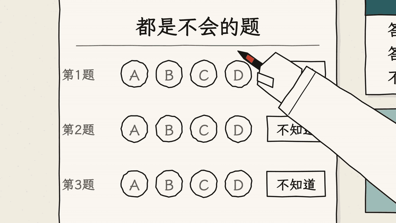
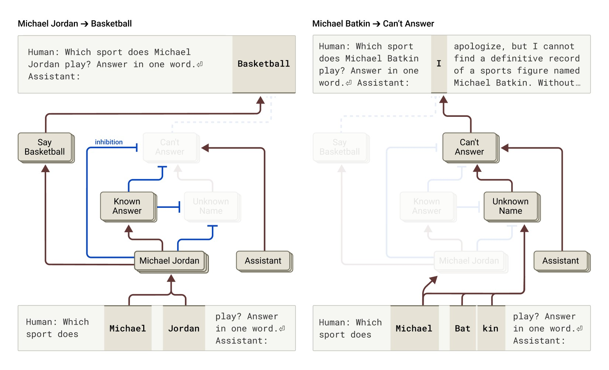
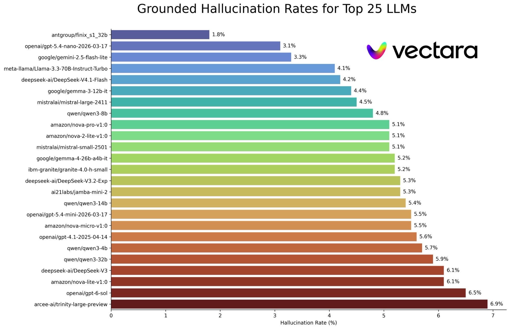
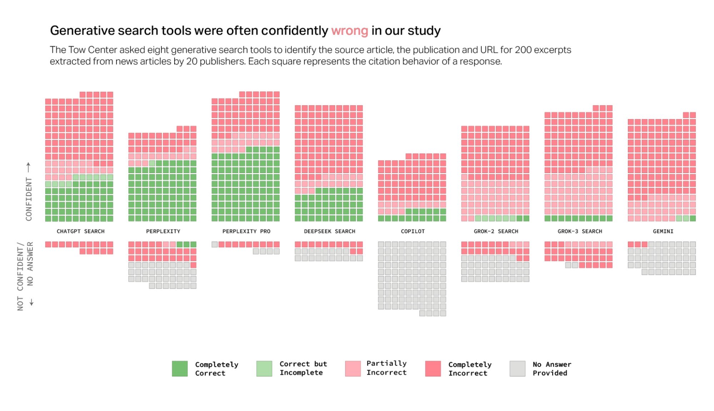
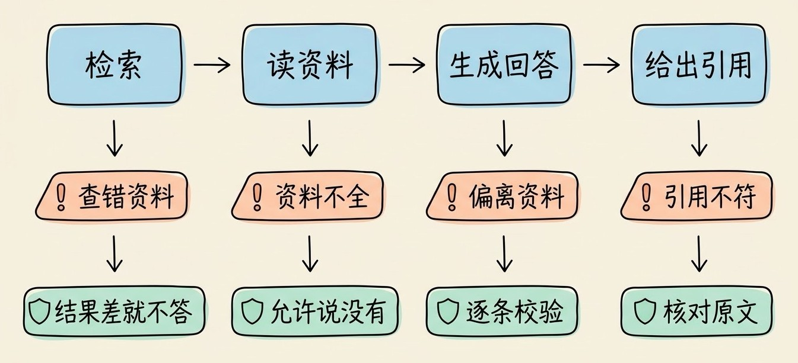

# 3分钟搞懂AI幻觉

> ⭐入门 · 阅读时间 3分钟 · 更新于 2026-11-08
>
> AI 幻觉的成因不只是训练数据有错，模型在考试式评测里“蒙对有分、不答零分”也是重要原因。本文用最新测试数据讲清幻觉为什么难以根除，推理和联网各能解决多少，以及普通用户和开发者分别该怎么防。

## 一句话定义

**AI 幻觉**（AI Hallucination）= 大模型生成了读起来通顺、语气也很肯定，但是和事实不符，或者和你提供的材料不符的内容，比如编造论文、判例、数据、函数名等错误内容。

举个真实的例子：有研究者把同一个问题分别发给了三款常用的聊天机器人，问研究员 Adam Kalai 的博士论文题目是什么。它们给出的回答分别是：

- **ChatGPT**：《Boosting, Online Algorithms, and Other Topics in Machine Learning》，还补充说这是 2002 年卡内基梅隆大学的论文
- **DeepSeek**：《Algebraic Methods in Interactive Machine Learning》，还补充说这是 2005 年哈佛大学的论文
- **Llama**：《Efficient Algorithms for Learning and Playing Games》，还补充说这是 2007 年麻省理工学院的论文

三个题目听起来都很专业，学校和年份也说得很具体，但是没有一个模型答对了题目和年份，从回答的语气上也完全看不出来它们并不知道答案。

这里也要注意，“幻觉”只是一个借来的说法。模型并不是看到了不存在的东西，也不是有意在骗你。它的任务是生成一段看起来合理的文字，而看起来合理和真实并不是一回事。

## AI 幻觉主要分成两类

你在使用 AI 时遇到的幻觉，大致可以分成下面两类：

| 类型 | 和什么对不上 | 例子 | 常见的场景 |
|------|------------|------|---------|
| **事实性幻觉** | 和真实世界对不上 | 编造一篇不存在的论文，把阿里巴巴的创立年份说错 | 直接问 AI 知识类问题 |
| **忠实性幻觉** | 和你给的材料对不上 | 总结合同时加上原文没有的条款，引用的网页其实没有说过这句话 | 文档总结、知识库问答、AI 搜索 |

区分这两类是有实际意义的，因为它们的处理方法不一样。事实性幻觉可以通过联网、接知识库来缓解。而忠实性幻觉恰恰发生在模型已经拿到材料之后，所以光给资料是不够的，还要检查它的回答是不是真的来自这些资料。

## 模型为什么宁可编，也不说不知道？

早期常见的解释是训练数据里有错误。这确实是一个原因，互联网上的错误信息会被模型学进去，而且训练数据还有截止日期，模型并不知道这个日期之后发生的事。不过，OpenAI 2025 年 9 月的论文《Why Language Models Hallucinate》指出，**就算训练数据完全正确，幻觉也不会自动消失**，下面是几个更根本的原因。

**第一，有些事实本身没有规律可学。** 模型靠大量文本学习语言规律，所以拼写和语法这类反复出现的规律，它很少出错。但是某个人的生日、某篇论文的页码这种信息，并不能从规律中推出来。论文给了一个估算：如果 20% 的生日信息在训练数据里只出现过一次，那么基础模型在生日问题上的出错率至少在 20% 左右。

**第二，评测在奖励模型去猜。** 这一点和学生做选择题很像。如果答错和不答都是 0 分，那么遇到不会的题，蒙一个总比空着好，因为蒙对了还能得分。大多数模型排行榜也是这样按准确率算分的，一个遇到不确定就猜的模型，分数往往比老实说“不知道”的模型更高。模型按这个标准不断优化，自然也就更倾向于猜。

**第三，模型内部的“不知道”机制可能会误判。** Anthropic 2025 年研究 Claude 的内部工作机制时发现，模型默认其实是倾向于拒绝回答的。当它识别出一个熟悉的名字时，一组和“已知实体”相关的特征才会把这个拒答倾向关掉。比如问到 Michael Jordan，它就会正常回答；问到一个虚构的名字，它通常会说不知道。问题出在模型只是听过一个名字，却并不了解这个人的时候。这时“已知实体”的特征仍然可能被触发，拒答被关掉，模型一旦决定要回答，就只能现编一段听起来合理的内容。

*图注：图片来自 Anthropic 的研究文章。左边问的是 Michael Jordan，模型识别出熟悉的人物，“Known Answer”（已知答案）压制了“Can't Answer”（无法回答），于是答出 Basketball。右边问的是虚构的 Michael Batkin，“Unknown Name”（未知名字）让“Can't Answer”继续生效，模型就表示无法回答。*

所以 OpenAI 的结论并不是幻觉不可避免。模型在没有把握时完全可以选择不答，只是有些问题本身就没有答案，**想让模型做到 100% 准确是不现实的**。

## AI 幻觉率为什么没有一个统一的数字？

如果你看到一篇文章说“某某模型的幻觉率是 5%”，一定要先看它测的是什么。截止目前，不同测试的结果差距很大，下面是两个常被引用的跨厂商测试：

| 测试 | 测的是什么 | 结果 |
|------|---------|------|
| Vectara 幻觉排行榜（2026-10-22 更新） | 总结一篇文档时，有没有加入原文没有的内容 | 榜单最低 1.8%，最高 24.2%。GPT-6 Sol 6.5%，DeepSeek V4-Pro 8.6%，GPT-5.5 9.3%，Claude Opus 5.5 9.9%，Gemini 3.1 Pro 预览版 10.4%，Qwen3.5-Plus 10.7% |
| AA-Omniscience 知识问答 | 在没有答对的题目里，有多大比例是答错，而不是拒答 | Stanford AI Index 2026 统计的 26 个主流模型在 22% 到 94% 之间。目前榜单上较低的 Gemini 4 Carbon（Medium）和 Argon（High）是 4% |

*图注：图片来自 Vectara 幻觉排行榜（2026-10-22 更新），只列出了幻觉率最低的 25 个模型，所以上表中的部分模型不在图里。可以看到，排名靠前的不一定是各家最新的旗舰模型。*

这几个数字不能放在一起比。Vectara 测的是模型有没有忠实于原文，AA-Omniscience 测的是模型不知道时会不会硬答，所以同一个模型在不同的榜单上，排名也会不一样。

单看幻觉率也可能产生误解。OpenAI 用 SimpleQA 这个问答测试，对比过两个模型：

| 指标 | gpt-5-thinking-mini | o4-mini |
|------|------|------|
| 拒绝回答 | 52% | 1% |
| 答对 | 22% | 24% |
| 答错 | 26% | 75% |

如果只看准确率，o4-mini 还略高一点。但是它几乎每道题都在答，答错的比例接近 gpt-5-thinking-mini 的 3 倍。这个例子说明，**让幻觉减少的一个重要办法，是让模型学会不答**，代价是它会更频繁地告诉你“我不知道”。

新模型总体上是在进步的，但是进步幅度也要看怎么统计。GPT-5.5 的系统卡显示，在用户标记过事实错误的高难度对话里，它的单条事实陈述正确的概率比上一代提高了 23%，但是整条回答包含错误的概率只降低了 3%。两个数字差这么多，主要是因为 GPT-5.5 每次回答里写出的事实陈述变多了，说得越多，其中至少出现一处错误的机会也越大。对读者来说，**回答越长、细节越多，越需要核实**。

## 推理和联网都不能完全消除幻觉

很多人认为，让模型多思考一会儿，或者让它联网，幻觉问题就解决了。实际情况要比想的更复杂一些。

**推理模型**擅长的是多步骤的数学和逻辑问题，可是思考得再久，也推不出一个它从未学过的生日。PersonQA 是 OpenAI 用来诱发幻觉的一项内部测试，题目都是关于人物的公开事实。2025 年 4 月 OpenAI 公布的数据里，o1 的幻觉率是 16%，而更新的 o3 和 o4-mini 反而升高到了 33% 和 48%，OpenAI 当时也表示还需要更多研究才能弄清原因。这组数据只涉及 OpenAI 当时的几个模型，但是可以说明模型的推理能力变强了，幻觉并不一定会跟着减少。o3-pro 在 Vectara 榜单上的幻觉率是 23.3%，也属于排在后面的模型。后来的 GPT-5 明显改善了这个问题，所以比较稳妥的理解是：推理模型不会自动减少幻觉，效果还要看具体的模型和训练方式。

**联网搜索和 RAG**（检索增强生成，也就是先查资料，再根据资料回答）能明显缓解“记不住”的问题，但是又带来了新的出错环节：

- **搜索的结果可能是错的**：模型如果拿到一个错误的网页，会基于这个网页给出错误的答案。
- **引用可能是错的**：2025 年 3 月，哥伦比亚大学 Tow Center 测试了 8 款 AI 搜索工具，让它们根据新闻原文的片段找出处，1600 次查询里答错的比例超过 60%。其中 Perplexity 答错 37%，Grok 3 答错 94%。这项测试只考察“找出新闻出处”这一件事，结果也不代表现在的版本，但是可以说明带链接的回答也不一定可靠。
- **专业场景也没有完全解决**：斯坦福的研究者测试了几款使用 RAG 的法律研究工具，结果幻觉比例在 17% 到 33% 之间，要低于通用的聊天模型，但是离厂商宣传的“没有幻觉”还差得很远。
- **引用了也不一定说过**：AI 在回答中引用了一篇真实存在的文献，它也可能回答了文献中并不存在的内容。这类错误比编造文献更难发现，因为你点开链接，发现文章确实存在，很容易就不再往下看了。

*图注：图片来自 Tow Center 2025 年 3 月的测试。每个方块代表一次回答，深绿色是完全正确，浅绿色是正确但不完整，浅红色是部分错误，深红色是完全错误，灰色是没有给出答案。分界线上方是语气肯定的回答，下方是语气不确定或者没有回答。可以看到，大量的错误答案都出现在语气肯定的区域。*

## 写代码时，幻觉可能带来安全问题

对开发者来说，最常见的幻觉包括不存在的函数、已经废弃的 API、写错的配置项。这些问题大多在编译或运行时就能发现，比较危险的是**不存在的依赖包**。

USENIX Security 2025 的一项研究测试了 16 个模型生成的 57.6 万个代码样本，商业模型平均至少有 5.2% 的推荐依赖包并不存在，开源模型是 21.7%，总共出现了 205,474 个不同的虚构包名。如果攻击者提前把这些名字注册下来，并且在里面放上恶意代码，当你照着 AI 给的命令安装时，就会直接中招。这种攻击叫 **slopsquatting**，也叫“幻觉抢注”。

2026 年的一项复测显示，5 个较新模型的比例已经降到了 4.62% 到 6.10%，但是有 127 个虚构的包名是 5 个模型都生成过的，其中有 53 个还能被攻击者注册。这也说明**多个模型给出相同的答案，并不代表答案就是对的**。

所以在安装 AI 推荐的陌生依赖之前，一定要先到官方包仓库确认它真实存在，再看一下维护者、发布时间和下载量。团队项目还可以锁定依赖版本，并使用内部的白名单镜像。

## AI 幻觉已经引发了法律后果

最有名的案例是 2023 年美国的 Mata v. Avianca 案。律师用 ChatGPT 查找判例，提交给法院的文书里有 6 个判例都是虚构的，后来两名律师和所在律所被处以 5000 美元的罚款。这件事并没有成为个例，法律研究者 Damien Charlotin 维护的数据库里，截至 2026 年 11 月初，全球法院和仲裁机构处理过的相关案件已经收录了 2266 起。

国内也有判例。2025 年，一位用户用 AI 查询高校报考信息时得到了错误内容，指出错误后，AI 却坚持自己是对的，还说：“如果生成内容有误，我将赔偿您 10 万元，您可前往杭州互联网法院起诉。”用户真的去起诉了，要求赔偿 9999 元。杭州互联网法院驳回了诉讼请求，主要理由是：

- AI 没有民事主体资格，它说的“赔偿承诺”并不代表平台的意思。
- 生成式 AI 按服务来处理，适用过错责任，生成了不准确的内容并不等于平台侵权。
- 平台不用保证零错误，但是要采取合理的措施提高准确性，并且要明显提示 AI 的局限；对法律明确禁止的有害信息，审查义务更严格。

**对普通用户来说，这意味着 AI 给出的承诺并不能当真，因为错误信息造成的损失，你也不一定能得到赔偿。**

## 普通用户怎么减少被幻觉误导？

不同的任务，风险并不一样。下面是按常见情况整理的参考：

| 场景 | 常见的问题 | 建议的做法 |
|------|-----------|-----------|
| 论文、判例、政策条文 | 编造出处，或者引用的内容和原文不符 | 一定要打开原文核对 |
| 医疗、法律、投资 | 建议看似专业，但不符合你的具体情况 | 只作为参考，一定要咨询专业人士 |
| 新闻、价格、产品功能 | 信息过时，或者找错来源 | 打开联网搜索，再去官方页面确认 |
| 数学和数据分析 | 计算出错，数字前后对不上 | 让 AI 写代码运行，并且抽查结果 |
| 代码 | 虚构的函数、参数和依赖包 | 运行测试，安装前核实依赖包 |
| 翻译、总结 | 漏掉内容，或者增加了原文没有的内容 | 重要的数字、人名和结论要对照原文 |
| 头脑风暴、创意写作 | 编造内容本身影响不大 | 如果要当作事实使用，还是要核实 |

平时提问时，下面几个做法比较实用：

- **把资料给它，并且限定回答范围**：比如“只根据我上传的文档回答，并且指出依据在哪一段；文档里没有的内容，就直接说没有”。
- **明确允许它说不知道**：这可以降低它硬答的倾向，但是也不能完全避免幻觉。
- **要检查引用，而不只是要引用**：让 AI 给出处之后，要打开链接，看原文是不是真的这样说。AI 也可能编造一个看起来很真实的链接。
- **不要只追问“你确定吗”**：前面法院的案例里，AI 被指出错误之后还在坚持；也有另一种情况，AI 本来答对了，你一质疑它就改口。比较好的做法是开几个新对话，把同一个问题再问一遍。
- **看几次回答的细节是不是一致**：2024 年发表在 Nature 上的一项研究，就是通过多次采样，看答案的意思是否分散来检测模型的胡编。如果三次回答给了三个不同的答案，基本就不能相信了。不过反过来，几次回答都相同，也可能是模型一直在犯同一个错。

## 开发者怎么在产品里降低幻觉？

用户层面的技巧靠的是自觉，产品里要把防护做进流程。常用的方法有下面这些：

- **能查询的事实不要让模型背**：价格、库存、订单状态这些信息，通过数据库或工具调用获取。需要注意的是，工具调用的严格模式只能保证参数格式正确，并不能保证内容正确，程序还要校验。
- **用 RAG 时，把“没查到”当成正常结果**：提示词和程序逻辑都要允许模型回答“资料里没有”，而不是在检索结果很差的时候继续生成。
- **逐条校验回答和来源**：把回答拆成一条条事实陈述，用规则或另一个模型，检查每一条是否能在来源里找到依据。
- **评测时给错误答案更高的扣分**：OpenAI 的论文建议在评测里写明把握要求，比如要求把握超过 90% 才回答，答对得 1 分，说不知道得 0 分，答错扣 9 分。这样，模型猜测的收益就变小了。放到自己的产品评测里，也可以把“答错”和“拒答”分开统计，不要只看准确率。
- **高风险操作交给人确认**：删除数据、付款、发送重要邮件这类操作，要求人工确认后才能执行。

还有一个常见的误会，是把 temperature 调成 0 就能解决幻觉。**temperature（温度）控制的是模型选词的随机程度**，调低之后输出会更稳定，但是模型如果认为一个错误答案的概率最高，就只会更稳定地给出这个错误答案。2026 年一项针对文档问答的大规模测试也发现，低温度在部分情况下能提高准确率，但是大多数模型的编造比例反而在较高温度下更低。所以 temperature 需要用你自己的任务来测试，不能把它当作减少幻觉的通用开关。

## 时效性提醒

幻觉产生的基本原因短期内不会变化，变化比较快的是下面这些内容：

- 各个榜单的模型排名和具体分数，Vectara、AA-Omniscience 都在持续更新，而且改过数据集或测试版本，新旧结果不能直接对比
- 各家模型的默认策略，有的更愿意拒答，有的更愿意尽量给出答案
- AI 搜索产品的引用质量，2025 年的测试结果不一定代表现在的表现
- 相关的法律和判例，各国法院的处理方式还在变化

**建议**：看到幻觉率的数字时，先确认测试的任务、版本和日期，然后再用自己的真实问题测一遍。

💬 **互动话题**：你遇到过最像真的 AI 幻觉是什么？最后是通过什么发现它是编的？

📖 **相关阅读**：

- [3分钟搞懂RAG检索增强](../../02-core-capabilities/04-rag/README.md) - 减少事实性幻觉最常用的方法
- [3分钟搞懂推理模型](../01-reasoning-models/README.md) - 推理模型擅长什么，局限在哪里
- [3分钟搞懂深度研究](../../02-core-capabilities/06-deep-research/README.md) - 带引用的研究报告应该怎么看
- [3分钟搞懂Evals](../../09-agent-engineering/09-evals/README.md) - 怎么用评测发现模型的问题
- [3分钟搞懂Prompt工程](../../01-basics/07-prompt-engineering/README.md) - 怎么写提示词来限定回答范围
- [3分钟搞懂AI对齐](../12-alignment/README.md) - 让 AI 的行为符合人的预期

**资料来源**：

- OpenAI，Why language models hallucinate（2025-09）：https://openai.com/index/why-language-models-hallucinate/
- Kalai 等，Why Language Models Hallucinate：https://arxiv.org/abs/2509.04664
- Anthropic，Tracing the thoughts of a large language model（2025-03）：https://www.anthropic.com/research/tracing-thoughts-language-model
- Vectara，Hallucination Leaderboard：https://github.com/vectara/hallucination-leaderboard
- Artificial Analysis，AA-Omniscience：https://artificialanalysis.ai/evaluations/omniscience
- Stanford HAI，2026 AI Index Report，Responsible AI 章节：https://hai.stanford.edu/assets/files/ai_index_report_2026_chapter_3_responsible_ai.pdf
- OpenAI，o3 and o4-mini System Card（2025-04）：https://cdn.openai.com/pdf/2221c875-02dc-4789-800b-e7758f3722c1/o3-and-o4-mini-system-card.pdf
- OpenAI，GPT-5.5 System Card（2026-04）：https://deploymentsafety.openai.com/gpt-5-5/gpt-5-5.pdf
- Tow Center，AI Search Has A Citation Problem（2025-03）：https://www.cjr.org/tow_center/we-compared-eight-ai-search-engines-theyre-all-bad-at-citing-news.php
- Magesh 等，Hallucination-Free? Assessing the Reliability of Leading AI Legal Research Tools：https://arxiv.org/abs/2405.20362
- Spracklen 等，We Have a Package for You!（USENIX Security 2025）：https://arxiv.org/abs/2406.10279
- Churilov，The Range Shrinks, the Threat Remains（2026）：https://arxiv.org/abs/2605.17062
- Farquhar 等，Detecting hallucinations in large language models using semantic entropy（Nature，2024）：https://www.nature.com/articles/s41586-024-07421-0
- How Much Do LLMs Hallucinate in Document Q&A Scenarios?（2026）：https://arxiv.org/abs/2603.08274
- LawSites，Mata v. Avianca 制裁令报道（2023-06）：https://www.lawnext.com/2023/06/court-imposes-sanctions-on-lawyers-who-filed-bogus-cases-after-relying-on-chatgpt-for-legal-research.html
- Damien Charlotin，AI Hallucination Cases：https://www.damiencharlotin.com/hallucinations/
- 中新网，全国首例 AI 幻觉案报道（2026-01-28）：https://www.chinanews.com.cn/sh/2026/01-28/10560482.shtml

---

⬅️ 上一篇：[3分钟搞懂多模态AI](../03-multimodal-ai/README.md) ｜ [📚 返回目录](../README.md) ｜ 下一篇：[3分钟搞懂Embedding嵌入](../05-embedding/README.md) ➡️
