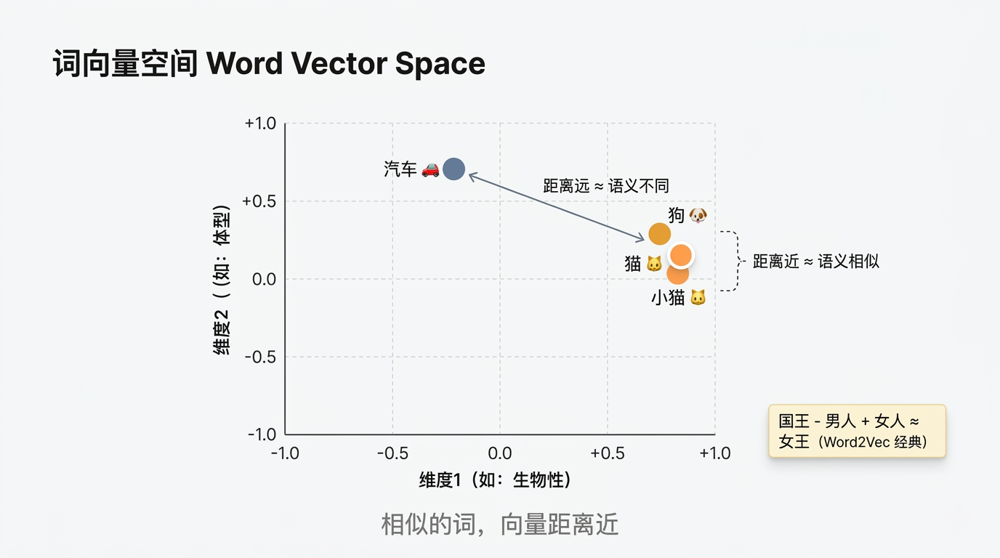
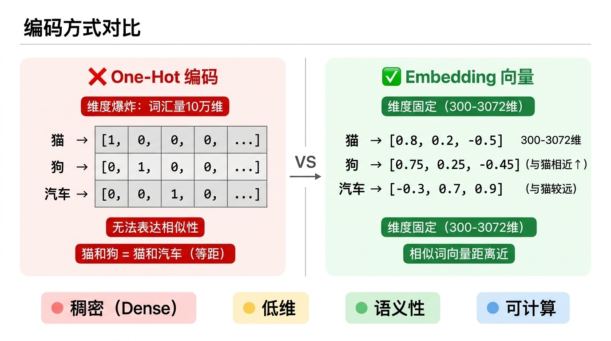
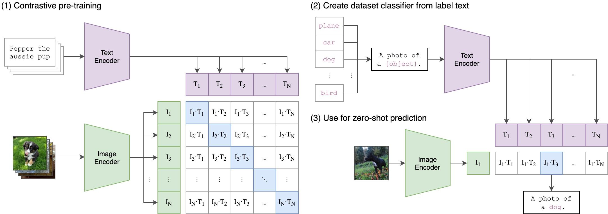
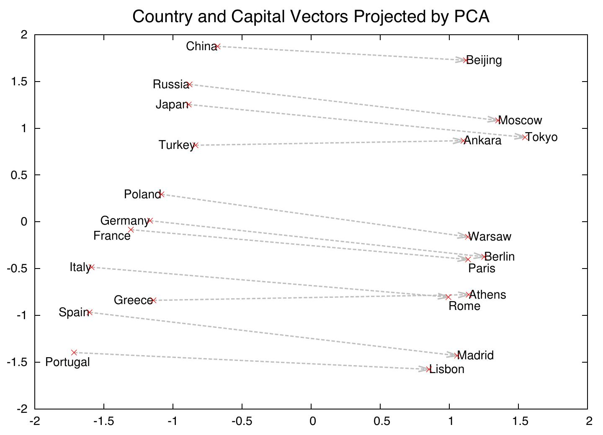
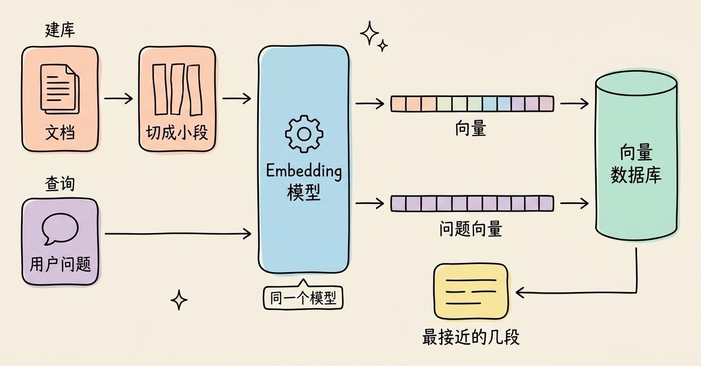
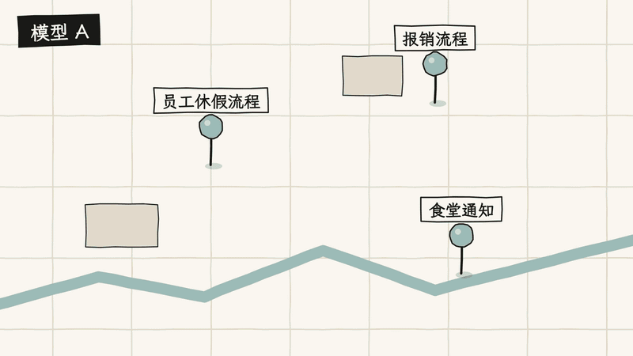

# 3分钟搞懂Embedding嵌入

> ⭐⭐中级 · 阅读时间 3分钟 · 更新于 2026-11-09
>
> Embedding 把文字、图片等内容变成一串数字，让程序能按意思计算相似度。本文讲清它的原理和演进、语义搜索流程、维度怎么选、换模型为什么要重建向量，以及截止目前的模型选择。

## 一句话定义

**Embedding**（嵌入）= 用模型把一段文字、一张图片或一段音频转换成一串固定长度的数字（也就是**向量**），让程序可以通过计算向量之间的距离，判断两段内容的意思是否相近。

比如你在知识库里搜“怎么申请年假”，有一篇文档的标题是“员工休假流程”。这两句话没有一个词完全相同，关键词搜索很难把它们对上。如果先把它们都转成向量，再比较两个向量的距离，程序就能发现它们讲的是同一件事。RAG、语义搜索、相似推荐这些功能，都用到了这一步。

## 计算机只认数字，但编号表达不了意思

要让程序处理文字，最简单的办法是给每个词编号。早期常用的 **One-Hot 编码**就是这样做的：词表里有多少个词，向量就有多少位，每个词只在自己的那一位上是 1。

```
猫   = [1, 0, 0, 0, ...]
狗   = [0, 1, 0, 0, ...]
汽车 = [0, 0, 1, 0, ...]
```

这种做法有两个问题。第一，如果词表有 10 万个词，每个词就需要 10 万位，其中几乎全是 0，非常浪费。第二，任意两个词的向量都互相垂直，“猫”和“狗”的距离与“猫”和“汽车”的距离完全一样，所以程序从这些数字里看不出任何语义关系。

Embedding 的做法是用几百到几千个小数来表示一段内容，每一位都有取值，这叫**稠密向量**：

```
猫   = [0.8, 0.2, -0.5, ...]
狗   = [0.75, 0.25, -0.45, ...]
汽车 = [-0.3, 0.7, 0.9, ...]
```

上面的数字是为了说明原理写的示意值。你可以把向量想成地图上的坐标：两家店的坐标接近，就说明它们离得近，不需要知道店名。Embedding 也是这样，只不过这张“地图”有成百上千个维度，意思相近的内容会被放在相近的位置。





这里有一个容易搞错的地方：很多教程会说“第 1 维代表生物性，第 2 维代表体型”，但实际模型的单个维度一般没有这样清晰的含义。语义是分散在所有维度的组合里的，所以不要试图去解读某一位数字代表什么。

## 模型是怎么知道两个词意思相近的？

没有人会手动给每个词标坐标，这些位置是模型从大量数据里训练出来的。背后的思路可以用一句话概括：**一个词的意思，可以从它经常和哪些词一起出现看出来。**

“猫”和“狗”经常出现在“喂食”“宠物”“打疫苗”的旁边，所以模型会把它们放得比较近；“汽车”经常和“加油”“保养”一起出现，就被放到了别的位置。

现在的句子级 Embedding 模型一般基于 Transformer，流程大致分成三步：

1. 把文本切成 token，也就是模型处理文本的基本单位。
2. Transformer 结合上下文，为每个 token 算出一个向量。
3. 把这些向量汇总成一个固定长度的向量，代表整段文本。

训练时，模型会看到大量“应该相似”和“不应该相似”的内容对，比如一个问题和它的答案、一张图片和它的描述。训练目标是让相关内容的向量靠近，让不相关内容的向量远离。**所以“相似”的标准其实是由训练数据决定的**，这也是不同模型在同一批数据上效果不同的原因。


*图注：CLIP 的结构图，出自 OpenAI 的 CLIP 开源仓库（MIT 协议）。左边的第 (1) 部分是训练过程：Text Encoder 和 Image Encoder 分别把文字和图片转成向量，矩阵中蓝色的格子代表配对的图文，训练时要让这些格子的分数变高，让其他格子的分数变低。右边的 (2)(3) 部分是使用过程：把类别名写成句子并转成向量，图片和哪一句最接近，就归为哪一类。*

## Embedding 从词向量发展到了多模态

Embedding 的发展主要解决了三个问题：从“一个词一个向量”到“结合上下文”，从只能表示词到能表示整段文本，从只支持文字到同时支持图片、音频和视频。

| 时间 | 代表 | 带来的变化 |
|------|------|-----------|
| 2013 | Word2Vec（Google） | 用神经网络从上下文中学习词向量，有 CBOW（用上下文预测中心词）和 Skip-gram（用中心词预测上下文）两种结构 |
| 2014 | GloVe（斯坦福） | 先统计整个语料库里每两个词一起出现的次数（也叫词共现统计），再用这些数据训练词向量 |
| 2018 | BERT（Google） | 同一个词在不同句子里有不同的向量，BERT-base 输出 768 维 |
| 2021 | CLIP（OpenAI） | 图片和文字进入同一个向量空间，可以用文字搜图片 |
| 2022 | text-embedding-ada-002（OpenAI） | 通过 API 就能调用，不用自己部署模型，降低了开发者的使用门槛 |
| 2024 | text-embedding-3（OpenAI） | 可以通过参数缩短向量维度，价格也比 ada-002 更低 |
| 2025-2026 | Qwen3-Embedding、Voyage 4、Gemini Embedding 2 等 | 开源模型提供了更多选择，长文本和多模态能力继续增强 |

Word2Vec 最出名的例子是“国王 - 男人 + 女人 ≈ 女王”。这个结果说明向量之间的差值能反映一部分语义关系，比如性别。不过这个例子也需要注意：原论文在寻找最接近的词时，会把题目里出现的词（国王、男人、女人）排除掉，而且这种词向量的加减只对部分关系比较有效。平时使用 Embedding 时，主要做的还是相似度计算，很少会直接对向量做加减。


*图注：出自 Word2Vec 团队 2013 年的论文 Distributed Representations of Words and Phrases and their Compositionality，这是把 1000 维的词向量用 PCA 方法压缩到二维后的结果。每条虚线连接一个国家和它的首都，比如 China 和 Beijing。这些虚线的方向和长度都比较接近，说明“国家到首都”这层关系被模型学成了相近的向量差，而训练时并没有人告诉模型什么是首都。*

Word2Vec 的局限是一个词只有一个向量。“苹果发布了新手机”和“这个苹果很甜”里的“苹果”，向量是完全一样的。BERT 这类模型会结合整句话来计算，两个“苹果”的向量就不同了，这也让语义搜索的结果变得更准确。

## 比较相似度时，看的是向量的方向

有了向量之后，最常用的比较方法是**余弦相似度**。它计算的是两个向量方向的接近程度，结果在 -1 到 1 之间，越接近 1 表示方向越一致。

用前面那三个示意向量来算，“猫”和“狗”的余弦相似度约为 0.997，“猫”和“汽车”约为 -0.48。

实际使用时需要注意两点：

- **分数不能跨模型比较**。在 A 模型上得到 0.8 的分数，换到 B 模型上不一定还有同样的含义。如果你的代码里写死了“相似度大于 0.8 才算匹配”，换模型之后一定要重新调整这个阈值。
- **向量已归一化时，可以直接用点积**。归一化就是把向量长度统一缩放成 1。OpenAI 返回的向量已经做过这一步，这时点积和余弦相似度的结果相同，计算也更快。如果你手动截短了向量，就需要重新归一化。

## 一次语义搜索是怎么完成的？

语义搜索分成提前建库和实时查询两个阶段：

```
建库(提前做一次):
文档 -> 切成小段 -> Embedding 模型 -> 向量 -> 存入向量数据库

查询(每次搜索):
用户问题 -> 同一个 Embedding 模型 -> 问题向量
         -> 在向量数据库里找最接近的几段 -> 返回结果
```

如果在最后一步之后，再把找到的内容连同问题一起交给大模型来生成回答，这就是 **RAG**。



下面是一个可以直接运行的最小示例，先安装 `openai` 和 `numpy`，再配置好 `OPENAI_API_KEY`：

```python
import numpy as np
from openai import OpenAI

# 使用兼容 OpenAI 接口的国内服务时,在这里传入 base_url 和 api_key
client = OpenAI()

MODEL = "text-embedding-3-small"


def embed(texts: list[str]) -> np.ndarray:
    response = client.embeddings.create(model=MODEL, input=texts)
    return np.array([item.embedding for item in response.data])


documents = [
    "员工休假流程: 年假需要提前三天在系统中提交",
    "报销流程: 差旅发票需要在当月提交",
    "公司食堂的营业时间调整通知",
]

doc_vectors = embed(documents)
query_vector = embed(["怎么申请年假?"])[0]

# OpenAI 返回的向量已归一化,点积就等于余弦相似度
scores = doc_vectors @ query_vector

for index in np.argsort(scores)[::-1]:
    print(f"{scores[index]:.3f}  {documents[index]}")
```

这段代码把所有向量都放在内存里，适合用来理解原理。数据量上来之后，就需要用向量数据库来做存储和快速检索了。

费用方面，Embedding 只按输入的 token 收费。截止目前，OpenAI 的 text-embedding-3-small 模型是每百万 token 0.02 美元。按每页约 800 token 来估算，1 美元大约可以处理 6.25 万页文档，所以对大部分项目来说，生成向量的费用并不高，**长期成本更多来自向量的存储和检索**。

## 维度不是越高越好

维度越高，能保留的信息一般越多，但占用的存储和计算量也越大。我们按每个数字占 4 字节来算一下 1000 万段文本的原始向量大小，这里还没有算索引占用的空间：

| 维度 | 单条向量 | 1000 万条 |
|------|---------|----------|
| 768 | 约 3 KB | 约 31 GB |
| 1536 | 约 6 KB | 约 61 GB |
| 3072 | 约 12 KB | 约 123 GB |

现在很多模型允许你自己选择输出维度。OpenAI 的 `dimensions` 参数、Gemini 的输出维度选项都是这样的。其中一种常见的训练方法是 **Matryoshka**（俄罗斯套娃）表示学习，它让向量靠前的部分也能单独使用，所以可以按需截短，不用重新训练模型。

截短之后的效果也不一定差。OpenAI 的文档提到，text-embedding-3-large 截短到 256 维后，在 MTEB 评测中的表现仍然好于 1536 维的 ada-002。MTEB 是一个常用的 Embedding 模型公开评测，这个例子说明模型代际带来的差距，有时比维度带来的差距更大。

如果你没有特殊需求，可以先从 768 或 1024 维开始，用自己的数据测试过之后再决定要不要增加维度。

## 换模型时，必须重新生成全部向量

Embedding 最容易踩的坑是：**不同模型生成的向量不能混在一起比较。** 每个模型都有自己的一张“地图”，同一个坐标在两张地图上指的不是同一个地方。哪怕是同一家的新旧版本也一样，比如 Google 就明确说明，从 gemini-embedding-001 升级到 gemini-embedding-2 时，需要把已有数据全部重新生成一遍。



所以在建库时最好做好这几件事：

- 在每条向量旁边记录模型名称、版本和维度。
- 保留切分好的原始文本，这样换模型时才能重新生成向量。
- 需要升级时，先建一份新索引，测试通过后再切换，不要在同一个索引里混用新旧向量。

另外，有些模型对“问题”和“文档”的处理是不一样的，调用时需要说明输入的类型。Voyage 提供了 `input_type` 参数，gemini-embedding-001 提供了 `task_type` 参数，而 gemini-embedding-2 需要在输入内容中加上任务前缀，Qwen3-Embedding 则建议在查询端加上一句描述任务的指令。这类参数如果用错或者漏掉，检索效果就会变差，接入时一定要看一下所用模型的文档。

## 长文档要先切分，再生成向量

Embedding 模型的单次输入长度是有上限的，比如 OpenAI 这三个模型的上限都是 8192 个 token。即使模型支持更长的输入，把一整篇长文压缩成一个向量，多个主题的信息也会混在一起，搜索某个具体问题时反而不容易命中。

所以实际项目一般会把文档切成多个小段，每段单独生成向量。切分时可以按标题、段落这些自然结构来切，相邻的片段之间适当重叠一部分，避免一句完整的话被切断。切得太碎会丢失上下文，切得太长又会让检索不够精确，具体大小要拿自己的文档测试才能确定。

## Embedding 不擅长处理哪些情况？

Embedding 擅长的是找到意思相近的内容，但是“意思相近”并不等于“答案正确”：

- **精确内容不一定搜得准**。订单号、错误码、产品型号、人名这类内容，关键词搜索往往更可靠。比较常见的做法是把向量搜索和关键词搜索结合起来，也就是**混合检索**，BGE-M3 这类模型还能同时输出稠密向量和稀疏向量。
- **否定和数字的区分能力有限**。“支持退款”和“不支持退款”的用词几乎一样，向量往往也很接近，但是意思完全相反。“2024 年营收”和“2025 年营收”也有同样的问题。这时可以加上时间、类别这类过滤条件，或者用重排序模型对结果进行二次筛选。
- **相似度排第一的内容，也不代表它真的能回答问题**。即使知识库里根本没有答案，向量搜索也会返回“最接近”的几条结果。如果是 RAG 应用，一定要处理好这种情况，否则大模型就可能基于不相关的内容来回答。
- **领域差距会影响效果**。通用模型对医疗、法律或者公司内部黑话的理解不一定好，上线前需要用真实问题来测试。

还有一点需要注意的是数据安全：**向量并不等于脱敏数据**。2023 年的一篇论文 *Text Embeddings Reveal (Almost) As Much As Text* 显示，研究人员的方法能够从向量中精确还原 92% 的 32 token 文本。所以如果原文比较敏感，向量也一定要按照和原文相同的级别来保护。

## 截止目前，Embedding 模型该怎么选？

下面列出的是截止目前比较有代表性的模型，“单次输入”是指单条输入的长度上限：

| 模型 | 支持的内容 | 最高维度 | 单次输入 | 价格（每百万 token） |
|------|----------|---------|---------|-----------------|
| OpenAI text-embedding-3-small | 文本 | 1536 | 8192 token | 0.02 美元 |
| OpenAI text-embedding-3-large | 文本 | 3072 | 8192 token | 0.13 美元 |
| Google gemini-embedding-2 | 文本、图片、音频、视频、PDF | 3072 | 8192 token | 文本 0.20 美元 |
| Cohere embed-v4.0 | 文本、图片 | 1536 | 12.8 万 token | 以官网为准 |
| Voyage voyage-4-large | 文本 | 2048 | 3.2 万 token | 以官网为准 |
| 阿里云 qwen3.7-text-embedding | 文本 | 2560 | 以文档为准 | 0.5 元 |
| 智谱 Embedding-3 | 文本 | 1024 | 约 8K token | 0.5 元 |
| BGE-M3（开源，MIT 协议） | 文本 | 1024 | 8192 token | 自部署 |
| Qwen3-Embedding-8B（开源，Apache 2.0 协议） | 文本 | 4096 | 3.2 万 token | 自部署 |

需要说明的是，OpenAI 和 Gemini 的官方 API 目前都不向中国大陆开放，如果你的服务部署在国内，优先考虑阿里云、智谱这样的国内平台，或者自己部署开源模型。

可以按下面的场景来选择：

- **国内项目**：阿里云的 qwen3.7-text-embedding 模型或者智谱的 Embedding-3 模型，都可以通过 API 直接调用，中文场景也比较合适。
- **数据不能出内网**：可以自部署 BGE-M3 或者 Qwen3-Embedding。Qwen3-Embedding 提供 0.6B、4B、8B 三种规格，显卡资源有限时可以先用小规格。
- **海外项目，预算优先**：OpenAI 的 text-embedding-3-small 模型价格比较低，足够用来做第一版。
- **需要统一检索图片、音频、视频**：可以用 gemini-embedding-2 模型，或者阿里云的多模态向量模型。
- **代码检索**：可以试试 Voyage 专门为代码设计的 voyage-code-4 模型。

另外，text-embedding-ada-002 截止目前并没有出现在 OpenAI 的弃用列表里，已经在用的项目不用着急迁移。不过它的价格是 3-small 模型的 5 倍，新项目就没有必要选择它了。

排行榜的成绩可以用来缩小选择范围，但最终还是要拿你自己的数据测一下才知道。比较实用的办法是：从真实用户问题里整理几十条，标注好每个问题应该命中哪些文档，然后对比各个模型能把正确文档排到前几名的比例。

## 时效性提醒

Embedding 的基本原理已经比较稳定了，变化比较快的是下面这些内容：

- 各家的模型版本、价格和输入限制，尤其是阿里云这样迭代较快的平台
- 多模态 Embedding 支持的内容类型和长度
- MTEB 等公开榜单的排名

**建议**：动手之前，以各家官方文档和你自己的测试结果为准。

💬 **互动话题**：你的知识库里有没有用向量搜索总是搜不准的内容，比如产品型号或者内部黑话？

📖 **相关阅读**：

- [3分钟搞懂向量数据库](../06-vector-database/README.md) - 向量生成之后怎么存储和快速检索
- [3分钟搞懂RAG检索增强](../../02-core-capabilities/04-rag/README.md) - Embedding 最主要的落地场景
- [3分钟搞懂Transformer](../../01-basics/03-transformer/README.md) - 现代 Embedding 模型的基础架构
- [3分钟搞懂多模态AI](../03-multimodal-ai/README.md) - 图片、音频和文字怎么放到一起处理

**资料来源**：

- Mikolov et al.，Efficient Estimation of Word Representations in Vector Space（2013）：https://arxiv.org/abs/1301.3781
- Mikolov et al.，Distributed Representations of Words and Phrases and their Compositionality（2013，文中国家和首都向量图出自该论文图 2）：https://arxiv.org/abs/1310.4546
- OpenAI，CLIP 开源仓库（文中结构图出处，MIT 协议）：https://github.com/openai/CLIP
- Radford et al.，Learning Transferable Visual Models From Natural Language Supervision（CLIP，2021）：https://arxiv.org/abs/2103.00020
- Kusupati et al.，Matryoshka Representation Learning（2022）：https://arxiv.org/abs/2205.13147
- Morris et al.，Text Embeddings Reveal (Almost) As Much As Text（2023）：https://arxiv.org/abs/2310.06816
- OpenAI，Embeddings 文档：https://developers.openai.com/api/docs/guides/embeddings
- OpenAI，API 定价：https://developers.openai.com/api/docs/pricing
- OpenAI，模型弃用列表：https://developers.openai.com/api/docs/deprecations
- OpenAI，API 支持的国家和地区：https://developers.openai.com/api/docs/supported-countries
- OpenAI，New embedding models and API updates（2024-01）：https://openai.com/index/new-embedding-models-and-api-updates/
- Google，Gemini Embeddings 文档：https://aistudio.google.com/docs/embeddings
- Google，Gemini API 定价：https://aistudio.google.com/docs/pricing
- Google，Gemini API 可用地区：https://aistudio.google.com/docs/available-regions
- Voyage AI，Text embedding models：https://docs.voyageai.com/docs/embeddings
- Cohere，Embed 模型文档：https://docs.cohere.com/docs/cohere-embed
- 阿里云百炼，向量模型文档：https://help.aliyun.com/zh/model-studio/embedding
- 智谱，Embedding-3 文档：https://docs.bigmodel.cn/cn/guide/models/embedding/embedding-3
- BAAI，BGE-M3 模型页：https://huggingface.co/BAAI/bge-m3
- Qwen，Qwen3-Embedding-8B 模型页：https://huggingface.co/Qwen/Qwen3-Embedding-8B
- MTEB 排行榜：https://huggingface.co/spaces/mteb/leaderboard

---

⬅️ 上一篇：[3分钟搞懂AI幻觉](../04-hallucination/README.md) ｜ [📚 返回目录](../README.md) ｜ 下一篇：[3分钟搞懂向量数据库](../06-vector-database/README.md) ➡️
