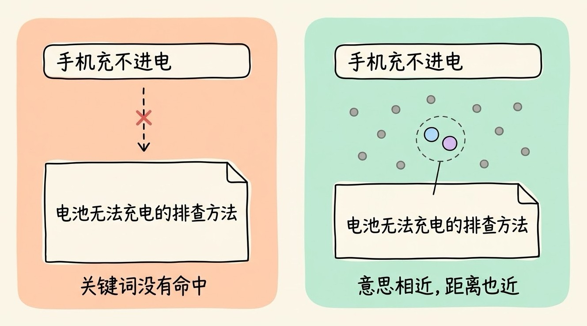
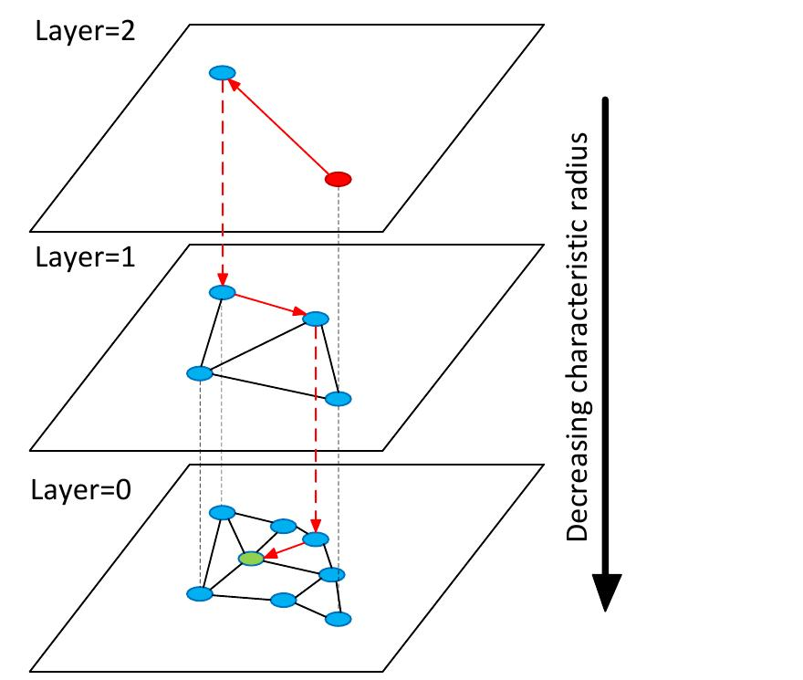
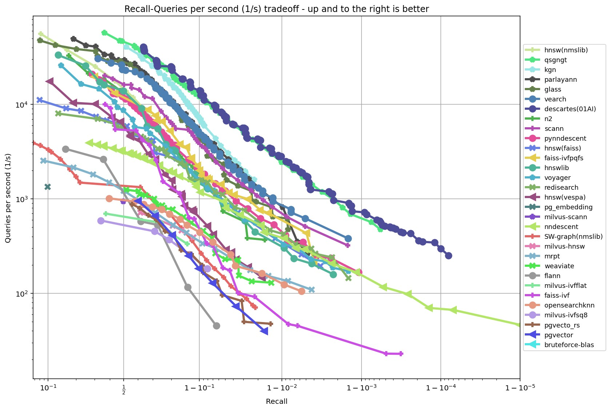
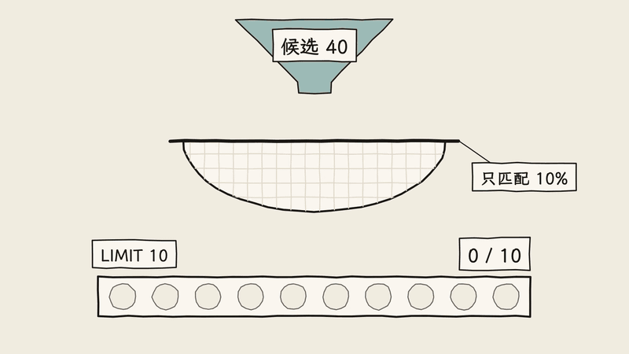
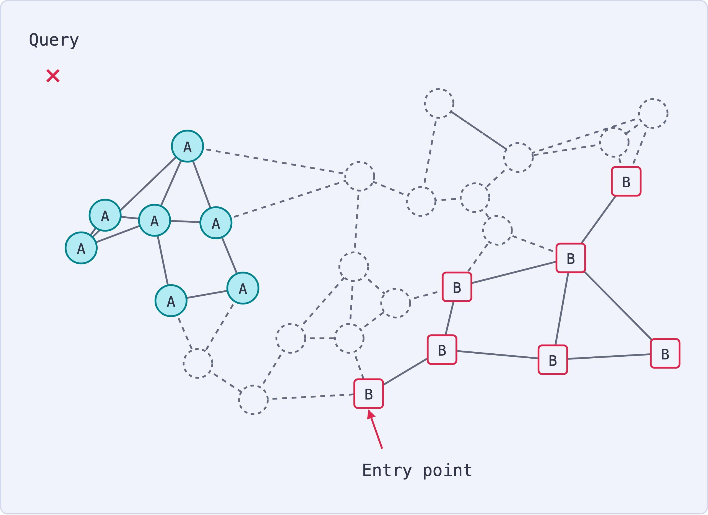

# 3分钟搞懂向量数据库

> ⭐⭐中级 · 阅读时间 3分钟 · 更新于 2026-11-09
>
> 向量数据库靠近似索引在海量向量里快速找出最相近的内容，代价是结果不保证精确。本文讲清 HNSW 和 IVF 的原理、内存怎么估算、过滤为什么会丢结果、截止目前各产品的差异，以及什么项目其实不需要它。

## 一句话定义

**向量数据库**（Vector Database）= 专门用来存储向量，并根据向量之间的距离，快速找出和查询内容最相近的若干条数据的数据库，常用于语义搜索、RAG 和相似推荐。

举个例子：用户在帮助中心搜“手机充不进电”，而文档的标题是“电池无法充电的排查方法”。这两句话用词差别很大，`LIKE '%手机充不进电%'` 这样的查询是找不到这篇文档的。如果先用 Embedding 模型把文字转成向量（一串表示内容含义的数字），意思相近的内容，向量之间的距离也会比较近，这样程序只要找出距离最近的几条数据就可以了。

**向量数据库要解决的核心问题，不是怎么算距离，而是当数据有几百万、几亿条的时候，怎么不用逐条比较就能很快拿到结果。**



## 普通索引为什么帮不上忙？

MySQL 常用的 B+ 树索引能工作，是因为数字和字符串可以排序，数据库沿着顺序很快就能定位到目标。但是向量有几百到几千个维度，没有一种排序方式能让所有相近的向量都排在一起，所以 B+ 树在这里帮不上忙。

如果没有专门的索引，就只能把查询向量和库里的每一条向量都算一遍距离。库里有 100 万条数据，每次查询就要算 100 万次距离，而且每次都要处理 1536 个数字（以 1536 维的向量为例）。这种逐条比较的方式叫**暴力搜索**，数据量小的时候没有问题，数据量大了之后查询就会很慢。

两类数据库的差别可以看下面这张表：

| 对比项 | 传统关系型数据库 | 向量数据库 |
|------|------|------|
| 查询方式 | 等值、范围、JOIN | 找最相近的 K 条（也叫 Top-K） |
| 常用索引 | B+ 树、哈希 | HNSW、IVF、DiskANN |
| 查询结果 | 符合条件的结果是确定的 | 走近似索引时，可能漏掉少量最相近的数据 |
| 典型数据 | 订单、用户、库存 | 文档片段、图片、商品的向量 |
| 事务支持 | 通常比较完善 | 大多比较弱，各产品差异很大 |

所以向量数据库并不会取代 MySQL 这样的数据库。比较常见的做法是订单、用户这些业务数据继续放在关系型数据库里，向量数据库只负责检索这部分工作，或者直接用 PostgreSQL 的向量扩展把两件事放在一起做。

## 存进去的不只有向量

向量本身只是一串数字，用户需要看的是原文，业务需要的是筛选条件，所以一条记录通常包含这几部分内容：

```json
{
  "id": "doc-1024-chunk-3",
  "vector": [0.12, -0.07, 0.33, "...共 1536 个数字"],
  "text": "如果手机无法充电, 请先检查充电线和充电头...",
  "metadata": {
    "product": "手机",
    "lang": "zh",
    "tenant_id": "company_a",
    "updated_at": "2026-10-20",
    "embedding_model": "text-embedding-3-small"
  }
}
```

查询的时候，程序要用**同一个 Embedding 模型**把问题也转成向量，再交给数据库去查找。不同模型生成的向量不能混在一起比较，所以要把模型名称也记录下来，以后换模型时需要重新生成全部向量。

距离的算法一般有余弦相似度、点积和欧氏距离三种，建索引时选择的算法要和 Embedding 模型的要求保持一致。文本检索最常用的是余弦相似度，如果向量已经归一化（长度统一缩放成 1），用点积的结果也是一样的。

下面是一个可以直接运行的例子，先执行 `pip install chromadb`：

```python
import chromadb

client = chromadb.Client()
collection = client.create_collection("help_docs")

# 没有传向量时, Chroma 会用默认的 Embedding 模型自动生成
collection.add(
    ids=["doc1", "doc2", "doc3"],
    documents=[
        "How to troubleshoot a phone battery that cannot charge",
        "Return and refund policy for orders within seven days",
        "How to fix a laptop that will not connect to Wi-Fi",
    ],
    metadatas=[{"category": "phone"}, {"category": "order"}, {"category": "laptop"}],
)

# 先按 category 过滤, 再找意思最接近的 1 条
results = collection.query(
    query_texts=["my phone won't charge"],
    n_results=1,
    where={"category": "phone"},
)
print(results["documents"])
```

这里的文档用了英文，是因为 Chroma 默认的 all-MiniLM-L6-v2 模型主要面向英文，第一次运行时还会自动下载。如果你要处理中文，需要换成中文效果好的模型，比如 BGE-M3 或者 Qwen3-Embedding，再把生成的向量传进去。

## 找得快，靠的是不再逐条比较

为了提高速度，向量数据库一般会使用**近似最近邻搜索**（Approximate Nearest Neighbor，简称 ANN）。它的思路是只比较一小部分最有希望的数据，用很小的准确度损失换取速度的大幅提升。常见的索引有下面几种：

| 索引 | 做法 | 优点 | 代价 | 适合的情况 |
|------|------|------|------|------|
| Flat（暴力搜索） | 逐条计算距离 | 结果精确，不用建索引 | 数据量大时很慢 | 数据量小，或者过滤后候选数据很少 |
| HNSW | 建一张多层的图，逐层接近目标 | 查询快，召回率高 | 占内存多，建索引慢 | 大多数在线检索场景 |
| IVF | 先分成很多个桶，只搜最接近的几个桶 | 比 HNSW 建索引更快，占内存更少 | 同等召回率下查询通常更慢 | 数据量大、变化不频繁 |
| DiskANN | 把图索引的大部分放在 SSD 上 | 大幅减少内存占用 | 依赖 SSD 的性能 | 数据太多，内存放不下 |

**HNSW** 是目前最常用的索引，它的思路和你去外地找一家店很像：先坐高铁到对应的城市，再坐地铁到对应的区域，最后步行找到这家店。HNSW 的上层节点少、连线跨度大，负责快速接近目标区域；越往下节点越多，最底层包含全部数据，负责精细查找。


*图注：出自 HNSW 原始论文 Efficient and robust approximate nearest neighbor search using Hierarchical Navigable Small World graphs 的图 1。搜索从最上层（Layer=2）的红色节点开始，红色箭头是搜索路径，在当前层走到最接近目标的节点后，就沿虚线下降到下一层继续找，最后在包含全部数据的 Layer=0 找到绿色的目标点。右边的箭头表示越往下层，连线的跨度越小。*

**IVF** 更像逛超市：想买酱油就直接去调料区，不用走遍整个超市。不过有些数据正好在两个分区的交界处，只看一个分区就可能漏掉，所以实际查询时一般会多看几个分区，看的分区越多结果越准，速度也越慢。

既然是“近似”，就要有一个指标来衡量它漏掉了多少，这个指标叫**召回率**。比如精确搜索的前 10 条结果里，ANN 找到了其中的 9 条，那么 Recall@10 就是 90%。

召回率并不是一个固定的数字，它取决于数据分布、索引类型和查询参数。以 HNSW 为例，`ef_search` 表示搜索时保留多少个候选结果，调大之后召回率会提高，查询也会变慢。所以看到“召回率 95% 以上”这样的说法时，一定要看它是在什么数据和参数下测出来的。


*图注：出自开源评测项目 ANN-Benchmarks（MIT 协议），数据集是约 118 万条 100 维的 GloVe 词向量。横轴是召回率，越往右越高；纵轴是每秒能处理的查询数（QPS），越往上越快，而且每一格相差 10 倍。每条线代表一种算法或产品在不同参数下的结果，几乎所有的线都是往右下方走的，说明想要更高的召回率，就要牺牲查询速度。这张图在仓库里最后更新于 2025 年 3 月，图中的产品版本不是最新的，所以只用来看趋势，不适合当作产品排名。*

## 向量很占内存，所以经常要压缩

向量的存储成本经常被低估。按每个数字占 4 字节来算，1000 万条 1536 维的向量，原始数据大约是 61 GB，这里还没有算 HNSW 图结构额外占用的空间。HNSW 通常又需要把这些数据放在内存里，所以内存费用往往是向量数据库的主要成本之一。

常见的解决办法是**量化**，也就是用更短的数字来近似表示原来的向量。还是以这 1000 万条向量为例：

| 表示方式 | 每个维度占用 | 原始向量总大小 | 精度损失 |
|------|------|------|------|
| 32 位浮点数 | 4 字节 | 约 61 GB | 无 |
| 16 位浮点数 | 2 字节 | 约 31 GB | 较小 |
| 8 位整数 | 1 字节 | 约 15 GB | 中等 |
| 二值量化 | 1 比特 | 约 1.9 GB | 较大 |

为了减少精度损失，实际产品一般会分成两步：先用压缩后的向量快速找出一批候选数据，再用原始向量对这批候选数据重新计算和排序。这样内存里主要放压缩向量，原始向量可以放在 SSD 这类更便宜的存储上。

这也是最近两年各家产品的一个重点方向。Elasticsearch 从 9.1 版本起，对 384 维及以上的向量默认使用 BBQ 量化；Milvus 2.6 加入了 RaBitQ 1 比特量化和分层存储；Amazon S3 Vectors 则直接把向量放在对象存储上，单个索引最多支持 20 亿条向量，官方给出的最低热查询延迟是 100 毫秒左右。如果你的数据量很大、查询又不频繁，这类方案可以明显降低成本，但是它并不适合对延迟要求很高的在线搜索。

## 加上过滤条件之后，结果可能会变少

实际查询很少是单纯的“找最相近的 5 条”，通常还要加上条件，比如只查某个公司的文档、只查最近一年的内容。这件事比看起来更难，因为 ANN 索引是按向量距离组织的，并不知道 `tenant_id` 这样的字段。

过滤的方式主要有三种：

- **先搜索，后过滤**：先从索引里找出一批候选数据，再把不符合条件的去掉。问题是结果可能不够数。pgvector 就给过一个例子：HNSW 默认的 `ef_search` 是 40，也就是只保留 40 个候选结果，如果过滤条件只匹配 10% 的数据，最后平均只剩下 4 条，哪怕你写的是 `LIMIT 10`。
- **先过滤，后搜索**：先用普通索引筛出符合条件的数据，再逐条比较距离。条件很严格、候选数据很少时，这种方式又快又准；但是候选数据很多时，就又回到暴力搜索的问题了。
- **搜索过程中同时过滤**：在遍历图的时候就考虑过滤条件，只把符合条件的结果计入候选。Qdrant 的可过滤 HNSW、Elasticsearch 9.1 加入的 ACORN 都属于这个方向。pgvector 0.8.0 则加入了迭代扫描，结果不够时会继续往下扫描。




*图注：出自 Qdrant 的文章 Filterable HNSW。图里的 Query 是查询位置，Entry point 是搜索的入口。当过滤条件只保留 A 和 B 两类数据时，虚线的节点和连线都不能走了，A 和 B 之间的路径也就断开了，从 B 区域的入口出发，就走不到靠近查询的 A 区域。所以在图索引上做过滤，不只是把结果删掉这么简单。*

选型时一定要用带过滤条件的查询来测试，只看不带过滤条件的跑分，上线后的表现可能会差很多。

过滤还关系到数据安全。如果你在做多租户或者企业知识库，**权限条件一定要放进检索查询里**，不能等大模型回答的时候再让它“不要透露”，否则员工就有可能通过提问看到自己无权访问的文档。

向量并不等于脱敏数据。2023 年的论文 *Text Embeddings Reveal (Almost) As Much As Text* 显示，研究人员的方法能够从向量中精确还原 92% 的 32 token 文本。所以向量数据库的访问权限，也要按照和原文相同的级别来管理。

## 只靠向量，有些内容搜不准

向量擅长找意思相近的内容，但是对订单号、错误码、产品型号这些需要一字不差的内容，就不太可靠了。比如用户搜“E1024”，向量检索可能会返回一堆讲错误码的文档，偏偏漏掉 E1024 那一篇。

所以生产环境一般会使用**混合检索**：一路走向量检索，一路走 BM25 关键词检索，再把两路结果合并起来。合并时常用的是 RRF（倒数排序融合）算法，它只看每条数据在两路结果里的排名，所以两边的分数不需要统一。如果对结果质量要求更高，还可以再用重排模型对合并后的候选结果重新打分。

这项能力已经逐渐变成了标配。Milvus 内置了 BM25 全文检索，写入原始文本后可以自动生成稀疏向量；Chroma 支持稠密、稀疏和混合检索；pgvector 可以和 PostgreSQL 自带的全文检索组合使用。不过中文全文检索还需要分词，上线前要确认所选的产品对中文的支持情况，否则关键词这一路的效果可能并不好。

另外需要注意的是，向量检索总是会返回“最接近”的结果，哪怕库里根本没有相关内容。在 RAG 应用里，如果把这些不相关的内容也交给大模型，它就可能根据错误的资料来回答。RAG 能够明显减少幻觉，但是并不能完全消除幻觉，检索结果的质量和模型对资料的使用都会影响最终答案。

## 截止目前，主流产品有哪些差异？

产品大致可以分成三类：专门的向量数据库、带向量能力的现有数据库，以及云厂商的托管服务。

| 产品 | 形态 | 特点 | 需要注意 |
|------|------|------|------|
| **Pinecone** | 商业托管（Serverless） | 不用运维，上手快 | 不能自己部署到普通服务器上，数据和成本都依赖服务商 |
| **Milvus / Zilliz Cloud** | 开源（Apache 2.0 协议）+ 托管 | 索引类型丰富，面向十亿级规模，截止目前已更新到 3.0 系列 | 分布式部署的组件比较多，运维成本更高 |
| **Qdrant** | 开源（Apache 2.0 协议）+ 托管 | Rust 编写，过滤能力比较强 | 过滤字段要提前建好索引，否则过滤不会被加速 |
| **Weaviate** | 开源 + 托管 | 内置接入 Embedding 模型的模块，集成比较方便 | 客户端现在走 gRPC，旧教程里的 GraphQL API 已经被弃用 |
| **Chroma** | 开源（Apache 2.0 协议）+ 托管 | 上手最简单，可以在本地运行，也提供云服务 | 自己部署时要补上认证、备份这些生产环境的能力 |
| **pgvector** | PostgreSQL 扩展 | 可以用 SQL 把向量和业务数据一起查询，支持事务 | 量级很大时需要自己做好调优和分区 |
| **Elasticsearch** | 搜索引擎 | 关键词检索成熟，方便做混合检索 | 部分高级能力和许可证有关 |
| **Redis** | 内存数据库 | 延迟低，提供 Query Engine 和 Vector Sets 两种用法 | 内存成本比较高 |
| **Amazon S3 Vectors** | 对象存储 | 存储成本低，容量大 | 延迟比内存方案高，不适合高频在线查询 |
| **腾讯云向量数据库** | 国内托管 | 全托管，自带文档解析、向量化和重排套件 | 依赖腾讯云的生态 |
| **阿里云 DashVector** | 国内托管 | 基于阿里自研的 Proxima 引擎 | 依赖阿里云的生态 |
| **OceanBase** | 分布式数据库 | 用 SQL 同时做向量、关键词和标量查询 | 如果原来没有使用 OceanBase，迁移成本比较高 |

这里有几个容易搞混的地方。**FAISS** 经常和这些产品放在一起比较，但它是 Meta 开源的向量检索库，只负责索引和搜索，持久化、权限、接口服务这些都要你自己来做。

pgvector 还有一个容易踩的坑：`vector` 类型的 HNSW 索引最多支持 2000 维，而 text-embedding-3-large 模型默认输出 3072 维，直接建索引是不行的。这时可以用 `dimensions` 参数把维度降下来，或者使用最多支持 4000 维索引的 `halfvec` 类型。

Pinecone 的价格也和很多人印象中的不太一样。截止目前，免费的 Starter 套餐提供 2 GB 存储，Builder 套餐是每月 20 美元，Standard 套餐每月最低消费 50 美元，超出的部分按量计费。如果你的服务在国内，要提前确认网络访问和数据合规的要求，优先考虑国内云服务或者自己部署。

## 向量数据库该怎么选？

选型时可以先从现有的技术栈开始考虑，不用一上来就引入一套新系统：

- **学习和做原型**：可以用 Chroma，本地几行代码就能跑起来。
- **已经在用 PostgreSQL**：先试试 pgvector，向量和业务数据放在一起，备份、权限和事务都可以沿用现有方案。
- **已经在用 Elasticsearch，或者很依赖关键词搜索**：直接用 Elasticsearch 的向量能力，混合检索也比较方便。
- **不想运维，服务部署在海外**：可以选择 Pinecone、Qdrant Cloud 或者 Zilliz Cloud。
- **服务部署在国内云上**：可以优先看所用云厂商提供的向量服务，比如腾讯云向量数据库或者阿里云 DashVector。
- **需要自己部署，数据量很大**：Milvus 的分布式能力更成熟；如果过滤条件比较复杂，也可以重点测试一下 Qdrant。
- **数据量很大，但是查询不频繁**：可以考虑 S3 Vectors 这样基于对象存储的方案。

网上的跑分只能用来缩小范围，因为不同测试使用的数据、参数和硬件都不一样，厂商自己发布的结果也往往是对自己有利的场景。比较可靠的方法是用你自己的数据和真实的问题，在相同的硬件条件下比较下面三项：

1. **召回率**：相同条件下，有多少正确结果被找回来了。
2. **P95 延迟**：95% 的请求都能在多长时间内返回，这比平均延迟更能反映用户的实际体验。
3. **带过滤条件时的表现**：把真实的租户、时间等条件都加上再测试一遍。

上线之后还要关注数据更新。很多索引的删除操作并不会马上释放空间，而是先做标记，之后再由后台任务清理，所以数据频繁更新时，查询性能和占用的空间都可能发生变化。

## 不是所有项目都需要向量数据库

如果你只有几千条数据，放在内存里用暴力搜索就足够了，结果还是精确的。如果数据已经在 PostgreSQL 里，用 pgvector 也可以少维护一套系统。

向量检索也不是所有搜索问题的答案。比如 Claude Code 的负责人 Boris Cherny 提到过，早期版本曾经用向量数据库给代码建索引，后来发现让 Agent 直接用 grep 这类命令搜索文件，效果通常更好，也省掉了索引过期的麻烦。这是因为代码里的函数名、变量名本来就适合精确搜索，Agent 还可以根据搜索结果不断调整关键词。如果换成大量说法不统一的业务文档，向量检索仍然很有用。

另外，向量数据库也不等于 AI 的“长期记忆”。它只提供了存储和检索的能力，至于哪些内容值得记住、旧信息过时了要怎么更新，还需要上层的记忆系统来处理。

## 时效性提醒

索引和检索的基本原理已经比较稳定了，变化比较快的是下面这些内容：

- 各产品的版本、功能和默认配置，比如 Milvus 3.0 系列、pgvector 尚未发布的 0.9.0
- Pinecone、S3 Vectors 等云服务的价格和限制
- Elasticsearch 等产品里和许可证相关的功能

**建议**：选型之前，以各家官方文档和你自己的测试结果为准。

💬 **互动话题**：你的项目里，向量检索最容易搜不准的是哪类内容？是错误码和型号，还是加上权限过滤之后的结果？

📖 **相关阅读**：

- [3分钟搞懂Embedding](../05-embedding/README.md) - 存进向量数据库的向量是怎么生成的
- [3分钟搞懂RAG检索增强](../../02-core-capabilities/04-rag/README.md) - 向量数据库最主要的应用场景
- [3分钟搞懂Agent记忆系统](../../09-agent-engineering/06-agent-memory/README.md) - 检索之外，Agent 还要管理哪些记忆
- 3分钟搞懂LangChain - 常用来集成向量数据库的开发框架

**资料来源**：

- Malkov 和 Yashunin，Efficient and robust approximate nearest neighbor search using HNSW graphs（文中多层图出自该论文图 1）：https://arxiv.org/abs/1603.09320
- Subramanya et al.，DiskANN（NeurIPS 2019）：https://www.microsoft.com/en-us/research/publication/diskann-fast-accurate-billion-point-nearest-neighbor-search-on-a-single-node/
- Morris et al.，Text Embeddings Reveal (Almost) As Much As Text（2023）：https://arxiv.org/abs/2310.06816
- pgvector README：https://github.com/pgvector/pgvector
- pgvector CHANGELOG：https://github.com/pgvector/pgvector/blob/master/CHANGELOG.md
- Milvus，发布说明：https://milvus.io/docs/release_notes.md
- Milvus，Full Text Search 文档：https://milvus.io/docs/full-text-search.md
- Zilliz，Milvus 2.6: Built for Scale, Designed to Reduce Costs：https://zilliz.com/news/milvus-2-6-built-for-scale-designed-to-reduce-costs
- Qdrant，Filtering 文档：https://qdrant.tech/documentation/concepts/filtering/
- Qdrant，Filterable HNSW（文中过滤示意图出处）：https://qdrant.tech/articles/filterable-hnsw/
- ANN-Benchmarks（文中召回率和 QPS 曲线图出处，MIT 协议）：https://github.com/erikbern/ann-benchmarks
- Weaviate，API 文档：https://docs.weaviate.io/weaviate/api
- Chroma，文档首页：https://docs.trychroma.com/docs/overview/introduction
- Chroma，Embedding Functions：https://docs.trychroma.com/docs/embeddings/embedding-functions
- Pinecone，定价页：https://www.pinecone.io/pricing/
- Amazon，S3 Vectors 产品页：https://aws.amazon.com/s3/features/vectors/
- Elastic，Elasticsearch 9.1 的 BBQ 和 ACORN：https://www.elastic.co/search-labs/blog/elasticsearch-9-1-bbq-acorn-vector-search
- Elastic，BBQ 文档：https://www.elastic.co/docs/reference/elasticsearch/index-settings/bbq
- Redis，Vector Sets 文档：https://redis.io/docs/latest/develop/data-types/vector-sets/
- 腾讯云，向量数据库产品页：https://cloud.tencent.com/product/vdb
- 阿里云，向量检索服务 DashVector 文档：https://help.aliyun.com/product/2510217.html
- OceanBase，向量检索文档：https://en.oceanbase.com/docs/common-oceanbase-database-10000000001976351
- FAISS：https://github.com/facebookresearch/faiss
- OfficeChai，Boris Cherny 谈 Claude Code 从 RAG 改为 Agent 搜索：https://officechai.com/ai/claude-researcher-explains-how-agentic-search-performed-better-than-rag-for-code-generation/

---

⬅️ 上一篇：[3分钟搞懂Embedding嵌入](../05-embedding/README.md) ｜ [📚 返回目录](../README.md) ｜ 下一篇：[3分钟搞懂AI算力和GPU](../07-compute-and-gpu/README.md) ➡️
