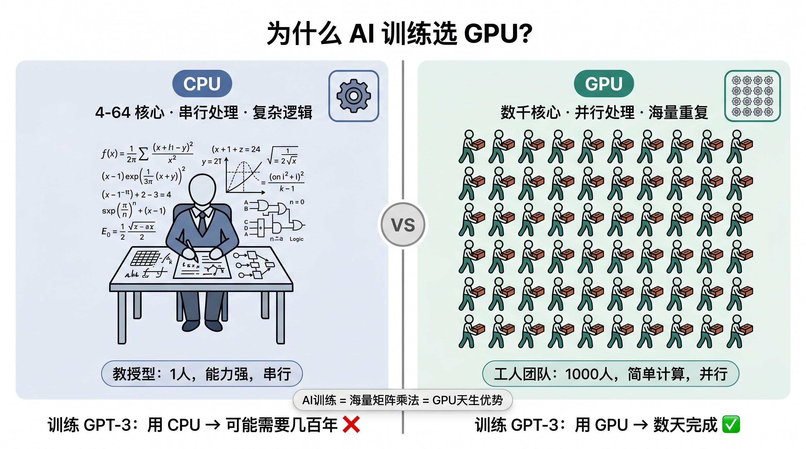
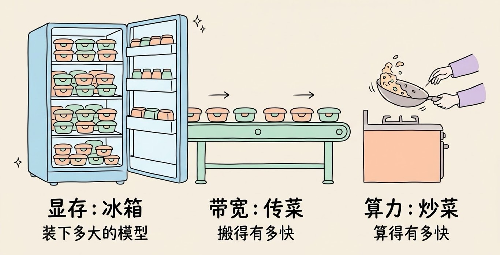
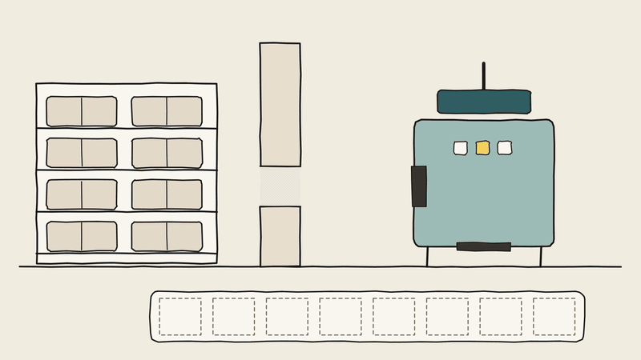
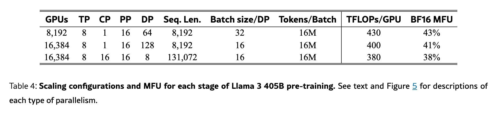
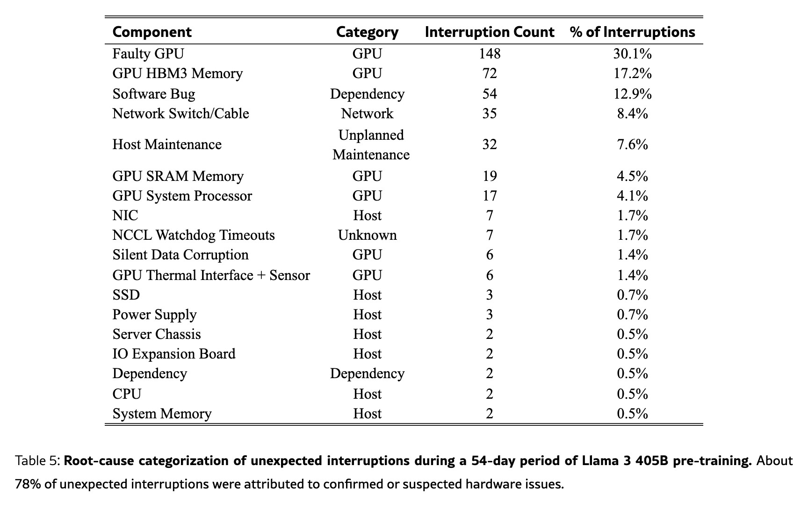
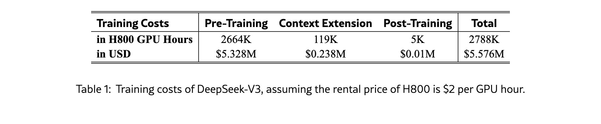

# 3分钟搞懂AI算力和GPU

> ⭐⭐需要一些基础 · 阅读时间 3分钟 · 更新于 2026-11-10
>
> AI 算力主要看三个数：每秒能算多少次、显存能装多大的模型、数据搬得有多快。本文讲清 GPU 为什么适合 AI、怎么估算跑一个模型要多少显存、训练大模型为什么要上万张卡，以及 2026 年显卡涨价之后，个人该买卡还是租卡。

## 一句话定义

**AI 算力** = 硬件在单位时间里能完成多少次计算，以及能装下、搬动多少数据的能力，它决定了一个模型能不能训练出来、能跑多快、要花多少钱。

**GPU**（图形处理器）是目前提供 AI 算力的主力硬件，它原本是用来画游戏画面的，后来因为擅长“同时做大量简单计算”，成了训练和运行大模型的首选。

## AI 要做的，是海量的乘法和加法

不管是训练模型还是和 AI 聊天，底层做的事情其实都很单调：把一大堆数字两两相乘，再把结果加起来，也就是**矩阵乘法**。一个 70 亿参数的模型，每生成一个字，就要做大约 140 亿次这样的运算。

这类计算有一个特点：每一次乘法都很简单，而且彼此之间互不依赖，完全可以同时进行。

CPU 和 GPU 的差别就在这里。CPU 像一位经验丰富的老师傅，核心数不多（常见的是 8 到 64 个），但每个核心都很强，擅长处理逻辑复杂、一步接一步的任务，比如运行操作系统、处理各种分支判断。GPU 则像一支上万人的流水线队伍，每个人只会做简单的算术，但所有人可以同时开工。像 RTX 5090 这样的消费级显卡，就有两万多个计算核心。

当任务是“把几十亿个数字分别乘一遍”时，老师傅再厉害也只能一个个算，而流水线队伍可以一次性铺开。这就是 AI 选择 GPU 的根本原因。



现在的 GPU 也不只是“核心多”这么简单。从 2017 年开始，NVIDIA 在 GPU 里专门加入了做矩阵乘法的 **Tensor Core**（张量核心），一个时钟周期就能算完一小块矩阵，AI 计算的速度又提升了一个量级。

## 衡量一张卡，主要看三个数

看 GPU 的参数表时，和 AI 关系最大的是下面三个指标：

- **算力**：每秒能做多少次浮点运算，单位是 **FLOPS**。常见的写法有 TFLOPS（每秒万亿次）和 PFLOPS（每秒千万亿次）。它决定了训练和处理长输入时有多快。
- **显存容量**：显卡自带的内存有多大，单位是 GB。模型的参数必须先放进显存才能计算，所以**显存大小基本决定了你能跑多大的模型**。
- **显存带宽**：每秒能从显存里搬多少数据，单位是 GB/s 或 TB/s。大模型生成文字时，每生成一个 token 都要把全部参数从显存里读一遍，所以**带宽往往决定了生成速度**。



看算力数字时需要注意一点：同一张卡在不同精度下的算力差别很大。精度越低，每个数字占的位数越少，算得就越快。比如 FP16（16 位）的算力，换成 FP8 大约能翻一倍，换成 FP4 还能再翻一倍。厂商发布会上最醒目的那个数字，通常是最低精度、甚至开启了稀疏加速之后的成绩，**比较两张卡的时候，一定要在同一种精度下比**。

下面是 2026 年常见的几张卡，数据中心的卡和消费级显卡差距主要在显存和带宽上：

| 型号 | 定位 | 显存 | 显存带宽 | 适合做什么 |
|------|------|------|---------|-----------|
| RTX 5060 Ti 16GB | 入门消费级 | 16GB | 448 GB/s | 本地跑 7B–14B 的量化模型、出图、学习 |
| RTX 5070 Ti | 中端消费级 | 16GB | 896 GB/s | 和上面能跑的模型差不多，但生成速度快一倍左右 |
| RTX 5090 | 高端消费级 | 32GB | 1792 GB/s | 本地跑 30B 级别的量化模型、LoRA 微调 |
| H100 | 数据中心 | 80GB | 3.35 TB/s | 企业训练和推理，过去几年的主力 |
| H200 | 数据中心 | 141GB | 4.8 TB/s | H100 的大显存版，更适合大模型推理 |
| B200 | 数据中心 | 180GB 左右 | 8 TB/s | Blackwell 架构，当前大规模训练的主力之一 |
| B300 | 数据中心 | 288GB | 8 TB/s | Blackwell Ultra，2026 年开始大量出货 |

国内销售的 RTX 5090 D v2 显存是 24GB，比海外版的 32GB 少一些，选购时要注意。数据中心的卡一般按整台 8 卡服务器出售，单卡价格就要二三十万元人民币起，个人基本接触不到。NVIDIA 下一代的 Rubin 平台，单卡会配 288GB 的 HBM4 显存，带宽提高到约 22 TB/s，计划 2026 年下半年开始由云厂商部署。

## 跑一个模型需要多少显存？

估算的方法其实很简单，只要知道两个数：模型有多少参数，每个参数用几个字节存。

```
显存(GB) ≈ 参数量(十亿) × 每个参数的字节数 × 1.2

每个参数的字节数:
  FP16 / BF16 (原版)  → 2 字节
  8 位量化            → 1 字节
  4 位量化            → 0.5 字节
最后乘 1.2, 是给运行时的额外开销留出余量
```

按这个公式算一下：

| 模型 | 原版（16 位） | 4 位量化 | 一张什么卡能跑 |
|------|-------------|---------|--------------|
| 8B | 约 19GB | 约 5GB | 4 位版 8GB 显存就够 |
| 14B | 约 34GB | 约 9GB | 4 位版需要 12GB 以上 |
| 32B | 约 77GB | 约 20GB | 4 位版需要 24GB 以上 |
| 70B | 约 168GB | 约 42GB | 4 位版要两张 24GB 的卡，或者大内存的 Mac |

不过这只是把模型“装进去”的部分。当对话越来越长时，模型还要把前面所有 token 的中间结果缓存下来，这就是 **KV 缓存**。上下文越长，KV 缓存就越大，长对话时它占的显存甚至可能超过模型本身。所以实际选卡时，最好在估算值的基础上再多留几个 GB。

**训练要的显存比推理多得多。** 推理时只需要放下参数；训练时每个参数还要额外存一份梯度（这一轮该往哪个方向改），常用的 Adam 优化器还要再给每个参数存两份统计值。混合精度训练下，每个参数大约要占 16 个字节，是 16 位推理的 8 倍。一个 7B 模型全量训练就要 110GB 以上的显存，一张消费级显卡根本放不下，这也是 LoRA、QLoRA 这类省显存的微调方法流行起来的原因。

显存带宽还能帮你预估生成速度的上限。因为每生成一个 token 都要把模型读一遍，所以：

```
生成速度上限(token/秒) ≈ 显存带宽 ÷ 模型占用的显存
```

比如在 RTX 5060 Ti（448 GB/s）上跑一个 5GB 的 4 位量化模型，理论上限大约是每秒 90 个 token，实际能跑到这个数的一半到七成。同样的模型放到带宽翻倍的 RTX 5070 Ti 上，速度也会差不多翻倍。这也解释了为什么 **MoE**（混合专家）模型在本地跑得快：它每生成一个 token 只会用到一部分参数，需要搬运的数据量少了很多。



## 训练一个大模型，为什么要上万张卡？

训练一个模型大概要多少计算量，有一个业内常用的估算公式：

```
训练计算量(次) ≈ 6 × 参数量 × 训练用的 token 数
```

我们拿 Meta 公开过完整数据的 Llama 3.1 405B 来算一下：4050 亿参数，训练了 15.6 万亿个 token，代入公式大约是 3.8 × 10²⁵ 次运算，和 Meta 在论文里公布的数字基本一致。

一张 H100 在 BF16 精度下的理论算力大约是每秒 1000 万亿次，但实际训练时受通信、等待数据这些因素影响，利用率通常只有 40% 左右。Meta 公布的实际消耗是 3084 万个 H100 GPU 小时，如果只用一张卡来训练，大约要连续跑 3500 年。Meta 最多同时用了 1.6 万张 H100，才把时间压缩到几个月。


*图注：Llama 3 论文中的 Table 4。第一列 GPUs 是同时使用的卡数，最多 16,384 张；中间几列是并行切分方式和训练参数；右边两列是每张卡实际跑出的算力（TFLOPs/GPU）和占理论算力的比例（BF16 MFU），卡越多、序列越长，利用率越低，在 38% 到 43% 之间。来源：Meta《The Llama 3 Herd of Models》。*

卡多了以后，新的问题也随之出现：

- **卡和卡之间要高速通信**。几万张卡要不停地交换计算结果，所以 NVIDIA 用 NVLink 把一个机柜里的 72 张 GPU 连成一个整体，机柜之间再用 InfiniBand 这类高速网络连接。互联的速度跟不上，再多的卡也只能干等。
- **硬件故障变成家常便饭**。Llama 3 训练的 54 天里，一共出现了 419 次意外中断，平均大约每 3 小时一次，其中大约八成是硬件问题，光是 GPU 和显存故障就占了将近一半。所以训练程序必须能定期保存进度，出了问题能接着跑。
- **电力成了硬约束**。一张 B300 的功耗约 1400 瓦，十万张卡级别的集群要消耗上百兆瓦的电力，现在新建的 AI 数据中心，都已经开始按“吉瓦”来规划了。


*图注：Llama 3 论文中的 Table 5，按中断次数从多到少排列。排在前两位的是 GPU 故障（Faulty GPU，148 次）和 GPU 显存故障（GPU HBM3 Memory，72 次），两项合计占 47.3%；Category 一列标出了故障属于 GPU、网络（Network）、主机（Host）还是软件依赖（Dependency）。表下的说明是：约 78% 的意外中断可以归因于确认或疑似的硬件问题。来源：Meta《The Llama 3 Herd of Models》。*

这些加在一起，就是训练成本居高不下的原因。OpenAI 的 Sam Altman 在 2023 年就表示过，GPT-4 的训练成本超过了 1 亿美元。

不过算法上的优化也能把成本压下来不少。DeepSeek-V3 是一个 6710 亿参数的 MoE 模型，但每个 token 只激活其中 370 亿参数，再加上 FP8 低精度训练等一系列工程优化，最终的正式训练只用了 2048 张 H800、约 279 万个 GPU 小时，按每小时 2 美元的租金算是 558 万美元。需要注意的是，这个数字只包括最后那一次正式训练，前期的研究、实验和数据准备都没有算进去，实际总投入要比这个高得多。但它确实说明了，**同样的算力，算法和工程做得好不好，结果可以差出好几倍**。


*图注：DeepSeek-V3 技术报告中的 Table 1。三列分别是预训练（Pre-Training）、上下文扩展（Context Extension）和后训练（Post-Training），合计 278.8 万个 H800 GPU 小时、557.6 万美元；表下说明这是按每 GPU 小时 2 美元的租金估算的。报告正文也写明，这个成本只包括正式训练，不含此前在架构、算法和数据上的研究和实验。来源：DeepSeek-V3 Technical Report。*

另外，算力的消耗重心也在变化。模型训练是一次性的投入，而推理是每个用户每次提问都要花的钱。当 Agent 一个任务就要循环调用几十次模型之后，推理消耗的算力增长得很快，这也是新一代芯片都在主打“降低每个 token 的推理成本”的原因。

## GPU 之外，还有哪些 AI 芯片？

GPU 是目前最通用的选择，但并不是唯一的选择：

- **TPU**：Google 自研的 AI 芯片，只在 Google Cloud 上提供。最新一代 Ironwood 单芯片配有 192GB 显存，Gemini 系列模型就是在 TPU 上训练的，Anthropic 也和 Google 签了使用多达 100 万颗 TPU 的协议。
- **云厂商自研芯片**：亚马逊有 Trainium，微软有 Maia，Meta 有 MTIA。它们的共同目标都是降低对 NVIDIA 的依赖，把自家的算力成本降下来。
- **NPU**：专门为 AI 推理设计的小型处理器，主打省电，手机芯片、苹果 M 系列芯片、新一代的 Windows 笔记本里都有。手机上的拍照增强、实时翻译、端侧小模型，靠的就是它。
- **国产 AI 芯片**：华为昇腾、寒武纪、海光、百度昆仑芯、阿里平头哥等都在做。其中华为昇腾 950PR 在 2026 年 3 月开始量产，用上了华为自研的高带宽内存（128GB，1.6 TB/s），面向训练和解码的 950DT 计划在 2026 年第四季度推出。

国产芯片这两年发展很快，背景是美国对高端 AI 芯片的出口限制。2026 年 1 月起，美国对 H200 出口中国改为逐案审批，并附带 25% 的费用和数量上限，但国内也同时限制了采购，引导企业优先使用国产芯片，所以实际进入国内的 H200 并不多。对国内的开发者来说，**国产芯片在大规模推理上已经用得很多，训练端的软件生态仍在追赶**，因为大部分 AI 代码最初都是基于 NVIDIA 的 CUDA 写的，迁移到其他芯片上还需要做适配。

## 个人用算力，买卡还是租卡？

先说一个 2026 年最大的变化：**显卡涨价了，而且涨得很厉害。** AI 数据中心大量采购高带宽内存，存储厂商把产能都转向了利润更高的服务器内存，消费级显卡用的显存也跟着涨价。从 2026 年下半年开始，RTX 50 系列的价格就一路上涨：RTX 5080 的国内首发指导价是 8299 元，7 月时渠道价已经涨到 1.2 万元左右；11 月厂商又上调了一轮成本价，5090 D v2 和 5080 一次就涨了两三千元，5060 Ti 16GB 也涨了几百元。

在这种行情下，选择的思路可以按你的使用频率来定：

| 你的情况 | 推荐的方案 | 说明 |
|---------|-----------|------|
| 只是想用 AI 聊天、写代码 | 直接用 AI 产品或 API | 不需要任何显卡，算力由厂商的服务器提供 |
| 想学习 AI、跑跑教程 | Colab、Kaggle、魔搭社区的免费 GPU | 有时长限制，但学习完全够用 |
| 偶尔微调模型、做实验 | 按小时租云 GPU | AutoDL 这类平台租一张 4090 大约 2 元一小时，用完就关 |
| 每天都要在本地跑模型 | 买一张 16GB 以上显存的显卡 | 显存比算力更重要，现在买之前一定要多比几家的价格 |
| 想在本地跑 70B 以上的大模型 | 大内存的 Mac 或 DGX Spark 这类设备 | 能装下，但生成速度比高端显卡慢 |

如果决定买卡，有几个实用的经验：

- **显存优先**。同样的价格，优先选显存大的卡。显存不够，模型根本跑不起来；而算力差一些，只是跑得慢一点。
- **二手 RTX 3090 仍然很受欢迎**。它有 24GB 显存，在本地部署的玩家里一直是性价比之选，不过买二手卡要注意检查有没有被拿去挖过矿。
- **大内存的 Mac 是另一条路**。苹果芯片的 CPU 和 GPU 共用一块内存，128GB 内存的 MacBook Pro 可以直接装下 4 位量化的 70B 模型，这是一张消费级显卡做不到的。代价是处理长输入比较慢，而且很多训练工具只支持 CUDA。NVIDIA 的 DGX Spark 和搭载 AMD 锐龙 AI Max+ 395 的迷你主机也是同样的思路，都有 128GB 的统一内存。
- **先租再买**。不确定自己会不会长期用时，先花几十块钱租几个小时的云 GPU 试一下，确认需求之后再决定要不要买。

## 几个常见的误会

**没有显卡就不能用 AI。** 你在手机上用的豆包、千问、DeepSeek，都是在厂商的服务器上推理的，和你的设备没有关系。就算想在本地跑模型，用 Ollama 这类工具在普通笔记本的 CPU 上也能跑起来 7B 左右的小模型，只是速度会慢一些。

**游戏显卡不能做 AI。** RTX 系列和数据中心的卡用的是同一套 CUDA 生态，PyTorch 等框架都能直接用。差别主要在显存大小、多卡互联能力和长时间稳定运行上，对个人学习、本地推理和小模型微调来说，游戏显卡完全够用。

**显存不够，用内存凑一下就行。** Ollama、llama.cpp 这类工具确实支持把一部分模型放到内存里，用显存加内存一起跑。但内存的带宽比显存低一个数量级，放到内存里的那部分会拖慢整体速度，模型越大，拖得越明显。

**卡越多，训练就越快。** 卡多了以后，卡与卡之间的通信会变成新的瓶颈。如果没有高速互联，几张卡一起训练的速度，未必比一张卡快多少。这也是数据中心在互联和网络上花大价钱的原因。

## 时效性提醒

GPU 的基本原理已经很稳定了，变化比较快的是下面这些：

- 显卡价格：2026 年受内存短缺影响波动很大，购买前请查看电商平台的实时价格
- 云 GPU 的租用价格，各平台之间差别很大，而且会随供需调整
- 芯片型号：NVIDIA 大约一年推出一代新平台，国产芯片的进展也很快
- 高端芯片的出口管制政策，仍在持续调整中

**建议**：选购和租用之前，以 NVIDIA 官网、各云平台的价格页为准。

## 国内可用方案

| 平台 | 产品 | 特点 |
|------|------|------|
| AutoDL | GPU 算力租用 | 专为 AI 设计，按秒计费，4090 大约 2 元一小时，高峰期可能要抢卡 |
| 阿里云 | GPU 云服务器、PAI 平台 | 配置多，适合企业长期使用 |
| 腾讯云 | GPU 云服务器 | 配置多，适合企业长期使用 |
| 魔搭社区（ModelScope） | 免费 Notebook | 绑定阿里云账号后有免费的 GPU 时长，适合学习 |

💬 **互动话题**：如果现在给你一张 32GB 显存的显卡，你最想在本地跑什么模型？

📖 **相关阅读**：

- [3分钟搞懂训练和推理](../../01-basics/05-training-and-inference/README.md) - 算力花在哪两件事上
- [3分钟搞懂模型量化](../11-quantization/README.md) - 怎么用 4 位量化把模型塞进更小的显存
- [3分钟搞懂AI微调和LoRA](../08-fine-tuning-and-lora/README.md) - 一张消费级显卡也能做的微调方法
- 3分钟搞懂Ollama - 在本地跑开源模型最简单的工具
- 3分钟搞懂开源大模型 - 本地能跑的模型有哪些
- 3分钟搞懂英伟达 - 卖 GPU 的公司和它的 CUDA 生态

**资料来源**：

- Meta，The Llama 3 Herd of Models（2024，训练计算量、GPU 小时数和训练中断统计；Table 4、Table 5 截图出处）：https://arxiv.org/abs/2407.21783
- DeepSeek，DeepSeek-V3 Technical Report（2024，训练用卡和成本；Table 1 截图出处）：https://arxiv.org/abs/2412.19437
- NVIDIA，H100 产品页：https://www.nvidia.com/en-us/data-center/h100/
- NVIDIA，H200 产品页：https://www.nvidia.com/en-us/data-center/h200/
- NVIDIA，DGX B200 / B300 产品页：https://www.nvidia.com/en-us/data-center/dgx-b200/
- NVIDIA，GeForce RTX 50 系列规格：https://www.nvidia.com/en-us/geforce/graphics-cards/50-series/
- NVIDIA，Vera Rubin 平台：https://www.nvidia.com/en-us/data-center/technologies/rubin/
- Google Cloud，Ironwood TPU 介绍：https://cloud.google.com/blog/products/compute/ironwood-tpus-and-new-axion-based-vms-for-your-ai-workloads
- Wired，OpenAI's CEO Says the Age of Giant AI Models Is Already Over（2023-04，GPT-4 训练成本）：https://www.wired.com/story/openai-ceo-sam-altman-the-age-of-giant-ai-models-is-already-over/
- TrendForce，Huawei Debuts Atlas 350 on Ascend 950PR with In-House HBM（2026-03-23）：https://www.trendforce.com/news/2026/03/23/news-huawei-debuts-atlas-350-on-ascend-950pr-with-in-house-hbm-touting-2-8x-h20-performance/
- Epoch AI，Huawei's roadmap to 2031（昇腾 950 系列规格）：https://epoch.ai/publications/huaweis-roadmap-to-2031
- TechTimes，Nvidia H200 Chips Enter China at 13% of Quota（2026-08-20）：https://www.techtimes.com/articles/325078/20260820/nvidia-h200-chips-enter-china-13-quota-beijing-not-washington-controls-rest.htm
- 游民星空，RTX 5080 渠道价上涨报道（2026-07-29）：https://www.gamersky.com/news/202607/2179758.shtml
- 腾讯新闻，英伟达 RTX 50 系列显卡 11 月再涨价（2026-11-03）：https://news.qq.com/rain/a/20261103A0BD4O00
- 新浪科技，RTX 50 全系涨价 40%-120%（2026-11-03）：https://finance.sina.com.cn/tech/roll/2026-11-03/doc-inixmhhh2405197.shtml

---

⬅️ 上一篇：[3分钟搞懂向量数据库](../06-vector-database/README.md) ｜ [📚 返回目录](../README.md) ｜ 下一篇：[3分钟搞懂AI微调和LoRA](../08-fine-tuning-and-lora/README.md) ➡️
