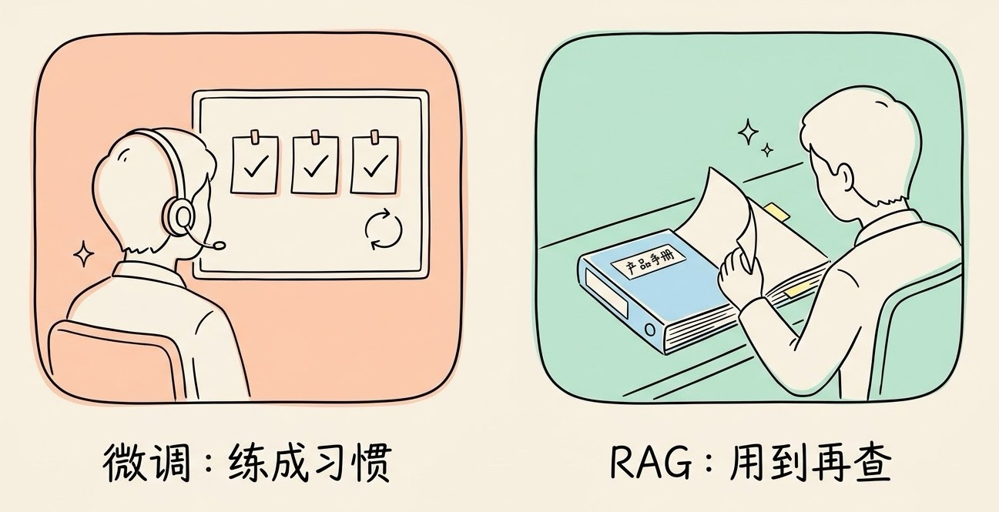
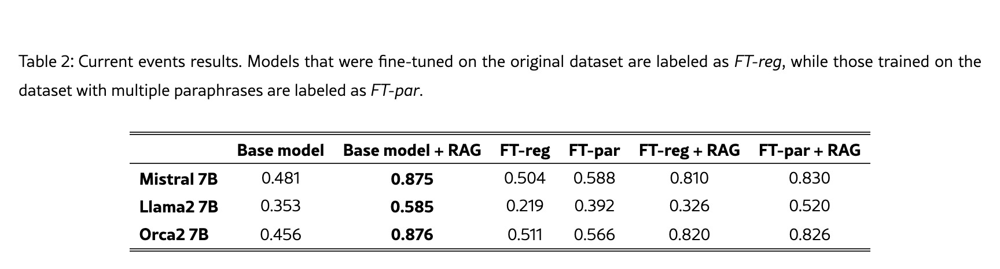
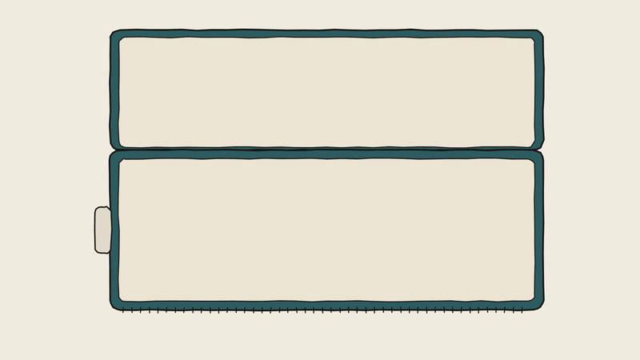
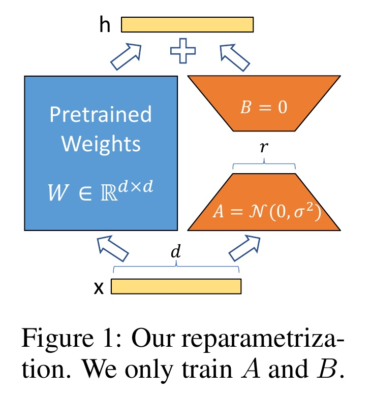
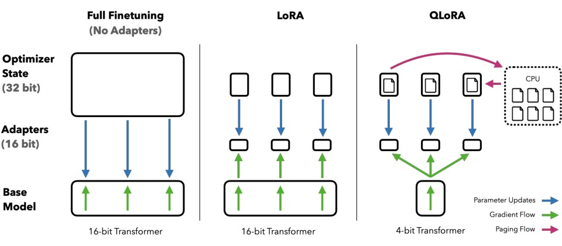
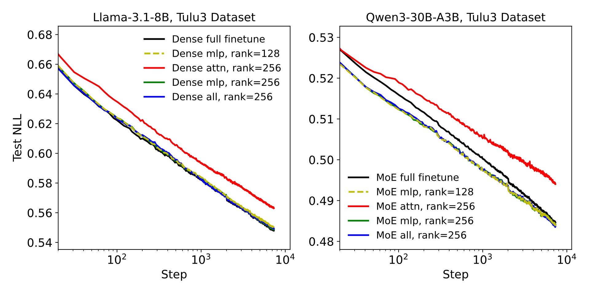

# 3分钟搞懂AI微调和LoRA

> ⭐⭐⭐需要技术背景 · 阅读时间 3分钟 · 更新于 2026-11-10
>
> 微调是用几百到几千条示例继续训练模型，让它稳定按你要的格式和风格回答，但不适合往里灌知识。LoRA 冻住原模型、只训练旁边两个小矩阵，QLoRA 再把原模型压到 4-bit，一张消费级显卡就能微调。本文讲清原理、显存账、效果差距和上手方法。

## 一句话定义

**微调**（Fine-tuning）= 拿一个已经训练好的大模型，用你准备的几百到几千条示例继续训练它，调整模型内部的参数，让它稳定地按你想要的格式、风格和做事方式来回答。

**LoRA**（Low-Rank Adaptation，低秩适应）= 一种省钱的微调方法：原模型的参数一个都不动，只在旁边加一组很小的附加参数来训练，需要训练的参数量通常不到原模型的 1%，显存需求也跟着大幅下降。

## 微调改的是习惯，不太适合往里灌知识

很多人第一次听说微调，想到的用法是：把公司的产品手册、内部文档喂给模型，让它“学会”这些知识。这恰恰是微调最不擅长的事。

可以拿新员工入职来理解。岗前培训教的是做事方式：客服怎么跟客户说话、报告用什么格式写、遇到投诉按什么流程处理。练上几百遍，这些就变成了习惯。但公司的产品价格、最新政策，没人指望新员工全背下来，而是放一本手册在桌上，用到时翻一下。

放到 AI 上，岗前培训对应的就是微调，桌上的手册对应的是 **RAG**（检索增强生成）：回答之前先去资料库里查出相关内容，再连同问题一起交给模型。



已经有研究专门对比过这两种做法。2024 年发表在 EMNLP 上的论文《Fine-Tuning or Retrieval?》，用同一个 Mistral 7B 模型测试“记住新知识”的效果：在一组模型训练时还没发生的时事问答上，直接用原模型加 RAG 的准确率是 0.875，而用这些资料做微调之后只有 0.504。
*图注：论文中的 Table 2，测试的是模型训练时还没发生的时事问答。每一行是一个 7B 模型，Base model 是原模型直接回答，+ RAG 是先检索资料再回答，FT-reg 是用原始资料微调，FT-par 是用同一批资料改写出多个版本再微调。以第一行 Mistral 7B 为例：原模型是 0.481，加上 RAG 提高到 0.875，而微调后只有 0.504，几乎没有提升；把资料改写成多个版本再微调能提高到 0.588，但离 RAG 还差很远。*

原因也不难理解：微调是把信息揉进几十亿个参数里，模型学到的是“大概的印象”，很难做到准确回忆某个具体数字；而且资料一更新，就得重新训练一次。

所以，遇到“模型答得不好”的问题，比较稳妥的顺序是：

| 你要解决的问题 | 先试什么 |
|---|---|
| 模型不按你要的格式输出、回答风格不对 | 先改提示词，加几个示例；还不行再考虑微调 |
| 模型不知道公司内部资料、最新信息 | RAG，资料更新后不用重新训练 |
| 同一类任务每天要跑几十万次，想换成更便宜的小模型 | 微调一个小模型，让它在这一个任务上接近大模型的表现 |
| 需要模型掌握一种全新的输出风格或领域写法，提示词里说不清楚 | 微调 |

阿里云百炼的官方文档里也是这么建议的：调优耗时长、费用也比较高，建议先尝试 Prompt 工程和工具调用，效果达不到要求时再考虑调优。

微调真正擅长的，是把那些提示词里很难说清楚、但能用大量示例演示出来的东西固化下来，比如一家公司客服特有的说话口吻，或者把杂乱的病历整理成固定格式的结构化字段。

## 全量微调为什么那么贵？

**全量微调**就是把模型的所有参数都放开来训练。贵的地方主要在显存上。

训练时，显卡里不只是要放模型本身。每个参数还要额外存一份“梯度”（这一轮该往哪个方向改、改多少），常用的 Adam 优化器还要再给每个参数存两份历史统计值。这几样加起来，显存占用就是模型本身的好几倍。

按开源微调工具 **LLaMA-Factory** 给出的估算，微调一个 7B（70 亿参数）的模型：

| 方法 | 大约需要的显存 |
|---|---|
| 全量微调（混合精度） | 约 120GB |
| 全量微调（纯 bf16） | 约 60GB |
| LoRA（16-bit） | 约 16GB |
| QLoRA（4-bit） | 约 6GB |

120GB 意味着要好几张数据中心级别的显卡一起跑；而 16GB、6GB 已经是一张游戏显卡就能放下的量了。模型越大，差距越明显：同样的估算，70B 模型全量微调需要约 1200GB，QLoRA 4-bit 只需要约 48GB。



除了训练贵，全量微调还有一个麻烦：每微调一次，就会得到一份和原模型一样大的新模型。如果要给法务、客服、销售三个部门各做一个专属模型，就得存三份完整的权重，部署时也要准备三份显存。

## LoRA：原模型冻住，只训练旁边两个小矩阵

LoRA 是微软的研究人员在 2021 年提出的。它的出发点是一个观察：模型在适应某个具体任务时，参数需要改动的部分其实是“低秩”的，也就是说，这些改动虽然分布在一个很大的矩阵里，但可以用两个很小的矩阵相乘来近似表示。

具体做法分成四步：

1. **冻结原模型**：原来的权重矩阵 W 保持不变，训练时不更新。
2. **旁边加两个小矩阵**：给 W 配上两个又细又长的矩阵 A 和 B，它们相乘的结果和 W 一样大，代表“要在 W 上改动多少”。
3. **只训练 A 和 B**：训练过程中，只有这两个小矩阵在更新。
4. **用的时候叠加上去**：最终效果相当于 W + B×A。

参数能省多少，可以算一笔账。假设模型里有一个 4096×4096 的权重矩阵，它有约 1677 万个参数。如果 LoRA 的**秩**（rank，常写作 r）设成 8，那么 A 是 8×4096，B 是 4096×8，两个加起来只有 65536 个参数，大约是原矩阵的 0.4%。秩 r 就是控制这组附加参数大小的旋钮：r 越大，能学的东西越多，参数也越多，常见的取值在 8 到 64 之间。


*图注：LoRA 论文中的 Figure 1，图下的原文意思是“我们只训练 A 和 B”。蓝色方块是冻住的原模型权重 W，大小是 d×d；右边两个橙色梯形就是 LoRA 加的两个小矩阵，中间最窄的地方宽度是秩 r。输入 x 同时经过两条路，结果在上方相加得到输出 h。训练开始时 B 设为 0，所以刚加上 LoRA 的模型和原模型完全一样，之后再慢慢学出要改动的部分。*

这种结构带来了三个实际的好处：

- **训练省显存**：原模型不需要存梯度和优化器状态，这部分是全量微调里占显存最多的。LoRA 论文里用 GPT-3 175B 做的实验中，需要训练的参数减少到原来的万分之一，显存需求降到原来的三分之一。
- **文件小，可以随时切换**：训练完保存下来的只有 A 和 B，通常是几 MB 到几百 MB。同一个底座模型可以配好几个 LoRA，客服用一个、法务用一个，按需加载。vLLM 这类推理框架已经支持一个底座同时挂载多个 LoRA 来提供服务。
- **推理时不会变慢**：训练完可以直接把 B×A 加回到 W 里，合并成一个普通的模型，推理速度和原模型完全一样。

## QLoRA：再把原模型压到 4-bit

LoRA 解决了梯度和优化器占显存的问题，但原模型本身还是要完整地放进显卡里。一个 7B 模型用 16-bit 存储大约要 14GB，对很多人的显卡来说还是不太够用。

2023 年 5 月，华盛顿大学的团队提出了 **QLoRA**：先把冻住的原模型**量化**到 4-bit，也就是用更少的位数来存每个参数，体积缩小到原来的四分之一左右，然后再在上面训练 LoRA。训练时，原模型只负责计算，不会被修改，所以压缩带来的精度损失被控制在可以接受的范围内。


*图注：QLoRA 论文中的 Figure 1。从左到右分别是全量微调、LoRA 和 QLoRA，每一列从下往上依次是原模型（Base Model）、LoRA 附加参数（Adapters）和优化器状态（Optimizer State），蓝色箭头表示参数更新，绿色箭头表示梯度传递。全量微调要给整个模型存一大块优化器状态；LoRA 只给几个小的附加参数存；QLoRA 进一步把原模型压到 4-bit（最下面的方块变小了），显存不够时还能把优化器状态临时挪到 CPU 内存里（紫色箭头）。*

论文里的成绩是：用 QLoRA，一张 48GB 显存的显卡就能微调 65B 的模型。他们用这个方法训练出的 Guanaco 模型，在 Vicuna 评测上达到了 ChatGPT 表现的 99.3%（这个评测是让 GPT-4 来打分的，可以作为参考）。

需要注意的是，QLoRA 也不是任何情况下都适用。比如 Unsloth 的官方文档就提到，对 Qwen3.5 的 MoE（混合专家）模型，不推荐用 4-bit QLoRA，建议直接用 16-bit 的 LoRA。对新手来说，先从普通的稠密模型开始练手会更顺利一些。

## LoRA 的效果到底差多少？

说 LoRA 是“省钱但效果打折”的妥协方案，这个说法不太准确，但说它和全量微调完全一样，也不对。具体要看任务：

**数据量不大的时候，基本打平。** LoRA 原论文在 RoBERTa、GPT-2、GPT-3 等模型上测试，效果和全量微调持平，有些任务甚至更好。2025 年 9 月，Thinking Machines 实验室（OpenAI 联合创始人 John Schulman 参与）发表了一篇系统研究《LoRA Without Regret》，结论是在中小规模的指令微调、推理训练数据上，LoRA 的效果和全量微调一样；在强化学习训练里，哪怕秩只设成 1，LoRA 也能追平全量微调。

**但有两个前提。** 同一篇研究发现：第一，LoRA 要加在模型的所有层上，尤其是 MLP 层（模型里负责“加工信息”的那部分），只加在注意力层上效果会明显差一些；第二，LoRA 的最佳学习率大约是全量微调的 10 倍，照搬全量微调的参数，效果就会打折扣。早期很多教程只在注意力层的 `q_proj`、`v_proj` 上加 LoRA，这也是不少人觉得 LoRA 效果不行的原因之一。


*图注：《LoRA Without Regret》中的对比实验，左边是稠密模型 Llama-3.1-8B，右边是 MoE 模型 Qwen3-30B-A3B，横轴是训练步数，纵轴是测试集上的损失，越低越好。黑线是全量微调，红线是只在注意力层加 LoRA（attn），绿线、黄线是只在 MLP 层加（mlp），蓝线是所有层都加（all）。可以看到红线始终在最上面，效果最差；而只要 LoRA 加到了 MLP 层，曲线就和全量微调基本重合，右图里甚至略低于全量微调。*

**数据量一大，差距就出来了。** 当训练数据多到超出 LoRA 那点参数能装下的量，它的表现就会逐渐落后。2024 年的论文《LoRA Learns Less and Forgets Less》专门测了编程和数学两个领域的大规模继续训练，LoRA 明显不如全量微调；不过它也有一个好处，就是原模型在其他任务上的能力保留得更好，不太容易出现“学了新的、忘了旧的”。

所以可以这样理解：**你要教模型的是一种风格、一种格式、一类任务，LoRA 基本够用；你要让模型在一个大领域里整体变强，比如喂几十亿 token 的代码让它变成编程模型，那还是全量训练更合适**，而这种规模的训练，本来也不是个人开发者要做的事。

## 微调也分好几种

前面说的微调，默认指的是最常见的一种，叫**监督微调**（SFT）：给模型看“问题 + 标准答案”，让它学着照这个样子回答。除此之外，还有两类也很常用：

- **偏好微调**：比如 DPO，给模型同一个问题的两个回答，告诉它哪个更好、哪个更差，让它往好的那边靠。适合调整语气、减少啰嗦这类“说不清标准答案、但能分出好坏”的情况。
- **强化学习微调**：让模型自己作答，再用程序或评分规则给结果打分，比如代码能不能跑通、数学题答案对不对，模型根据分数调整自己。现在的推理模型大多用了这一步。

需要注意的是，这里其实有两种不同角度的分类：

- **按怎么教来分**：监督微调、偏好微调、强化学习微调，区别在于给模型的是标准答案、好坏对比，还是分数。
- **按改哪些参数来分**：前面讲的全量微调、LoRA、QLoRA，区别在于训练时是改动模型的全部参数，还是只训练旁边的一小部分。

这两种分类可以自由组合。比如用 LoRA 来做 DPO，只训练旁边的小矩阵，但教的方式是好坏对比，LLaMA-Factory 这类工具都是支持的。

## 现在想动手，怎么开始？

### 先选底座模型

开放权重的模型才能自己下载下来做 LoRA。截至 2026 年 11 月，对个人开发者来说，比较顺手的选择是千问的中小尺寸模型：Qwen3.5 有 0.8B、2B、4B、9B 等多个尺寸，Qwen3.8-27B 能力更强，都是 Apache 2.0 协议，可以商用。按 Unsloth 文档给出的数据，用 16-bit LoRA 微调 Qwen3.5-4B 大约需要 10GB 显存，9B 大约需要 22GB，27B 大约需要 56GB；换成 QLoRA 还能再省不少。

建议先用小模型把流程跑通、确认数据有效，再换大模型。另外，**选模型时一定要看它具体的许可证**，同一个系列里不同尺寸的协议也可能不一样，比如 Qwen3.8 最大的版本就对大公司的商用有额外限制；Llama 系列的许可证也要求衍生模型的名字以“Llama”开头。

### 再准备数据

数据决定了微调的上限。Meta 在 2023 年的 LIMA 研究里，只用 1000 条精心挑选的问答，就把一个 65B 模型调出了不错的对话能力。所以**质量比数量重要得多**，几百条格式统一、答案正确的数据，往往比几万条随手爬来的数据效果好。

文本微调的数据，通常整理成和聊天一样的对话格式：

```json
{"messages": [
  {"role": "system", "content": "你是某某公司的售后客服"},
  {"role": "user", "content": "我买的耳机左边没声音了"},
  {"role": "assistant", "content": "很抱歉给您添麻烦了. 请先确认..."}
]}
```

另外要留出一部分数据不参与训练，用来在训练完之后检查效果。只看训练时的损失下降，很容易把模型练成只会背训练集的样子，也就是常说的**过拟合**。

### 选一个工具

现在已经不需要自己从头写训练代码了，常用的工具有这几个：

| 工具 | 特点 |
|---|---|
| **LLaMA-Factory** | 国内团队开发，有网页界面，不写代码也能配置训练，支持 LoRA、QLoRA、DPO 等，新模型跟进快 |
| **Unsloth** | 主打省显存、训练快，官方为热门模型都准备了现成的 Notebook，单卡用户用得比较多 |
| **ms-swift** | 魔搭社区（ModelScope）出品，国内下载模型方便，支持的模型种类很全 |
| **PEFT + TRL** | Hugging Face 官方的库，上面这些工具很多都基于它们，适合想自己控制训练细节的开发者 |

如果想直接看代码，用 PEFT 给模型加 LoRA 的核心部分就这几行：

```python
from transformers import AutoModelForCausalLM
from peft import LoraConfig, get_peft_model

# 1. 加载底座模型
model = AutoModelForCausalLM.from_pretrained("Qwen/Qwen3.5-4B", torch_dtype="auto")

# 2. 配置 LoRA
lora_config = LoraConfig(
    r=16,                         # 秩, 越大能学的越多, 参数也越多
    lora_alpha=32,                # 缩放系数, 常设为 r 的 2 倍
    target_modules="all-linear",  # 加在所有线性层上, 包括 MLP 层
    task_type="CAUSAL_LM",
)

# 3. 套上 LoRA, 原模型参数自动冻结
model = get_peft_model(model, lora_config)
model.print_trainable_parameters()  # 可以看到可训练参数只占很小一部分

# 4. 之后交给 TRL 的 SFTTrainer 训练, 学习率可以比全量微调高一个数量级
# 5. 保存时只会存下 LoRA 部分
model.save_pretrained("my-lora")
```

### 不想自己配显卡，可以用云平台

国内的大模型平台大多提供了在线微调，上传数据、点几下就能训练，训练完直接部署成 API：

- **阿里云百炼**：支持对千问系列做 SFT、DPO 和继续预训练，有 LoRA 高效微调的选项，也支持把自己在本地训练好的 LoRA 导入平台部署。
- **火山方舟**（字节）：提供模型精调，支持有监督微调、DPO 和强化学习。

海外方面，Google 的 Vertex AI 仍然提供 Gemini 的监督微调。而 OpenAI 在 2026 年 5 月宣布逐步关停自己的微调平台：新用户已经无法使用，老用户到 2027 年 1 月 6 日之后也不能再创建新的训练任务，已经训练好的模型可以一直用到它的底座模型下线为止。如果你原本打算在 OpenAI 上做微调，可以考虑改用开放权重模型自己训练，或者换到其他平台。

### 训练效果不理想时，可以从哪些地方排查？

- **训练完模型“变笨了”**：其他问题都答不好了，多半是学习率太高或训练轮数太多，原有的能力被冲掉了。可以降低学习率、减少轮数，或者在数据里混一些通用的对话数据。
- **效果几乎没变化**：检查 LoRA 是不是只加在了注意力层上，学习率是不是照搬了全量微调的数值。
- **显存不够**：换 QLoRA、减小 batch size、缩短单条数据的最大长度，或者开启梯度检查点（用多花一点计算时间换显存）。

## 图片模型的 LoRA

LoRA 最早火出圈，其实是在 AI 绘画领域。给图片生成模型训练一个 LoRA，就能让它稳定地画出某个特定角色、某种画风或者某个产品的样子。训练一个风格或角色 LoRA，一般准备几十张风格统一、主体清楚的图片就可以开始，每张图还要配上一段描述文字（现在多数工具都能自动打标）。

需要说明的是，大家常用的 Stable Diffusion WebUI 和 ComfyUI 主要是用来**加载和使用** LoRA 的，训练一般要用专门的工具：

- **kohya-ss/sd-scripts**：老牌的训练脚本，支持 SD 1.5、SDXL、FLUX.1 等模型，很多带界面的训练器都基于它。
- **ai-toolkit**：对 FLUX 等较新的模型支持得比较及时。
- **在线训练**：国内的哩布哩布（LiblibAI）提供在线 LoRA 训练，不需要本地显卡。

训练好的 LoRA 也可以拿去分享，海外最大的社区是 Civitai，国内用得多的是哩布哩布。不过要注意，用别人的作品、明星或真人的照片训练 LoRA，可能涉及版权和肖像权的问题，尤其是拿去商用的时候。

## 时效性提醒

LoRA 的基本原理已经很稳定了，变化比较快的是周边的内容：

- 可微调的开放权重模型更新很快，许可证条款也会随着版本调整
- 各家云平台的微调服务，支持的模型、价格和开放范围经常变化，OpenAI 已经开始收缩
- LoRA 的改进版本还在不断出现，比如 DoRA、LoRA+ 等，主流工具通常很快就会跟进
- 显存需求的数字都是估算，实际会受数据长度、batch size 和工具版本影响

**建议**：动手之前，以模型的官方仓库和工具的最新文档为准。

💬 **互动话题**：如果可以花一个周末微调一个自己的模型，你最想让它学会什么？

📖 **相关阅读**：

- [3分钟搞懂RAG检索增强](../../02-core-capabilities/04-rag/README.md) - 让模型掌握新知识，优先考虑的方法
- [3分钟搞懂Prompt工程](../../01-basics/07-prompt-engineering/README.md) - 微调之前应该先试的一步
- [3分钟搞懂模型量化](../11-quantization/README.md) - QLoRA 里 4-bit 压缩的原理
- [3分钟搞懂强化学习(RLHF)](../09-rlhf/README.md) - 偏好微调和强化学习微调的来历
- [3分钟搞懂蒸馏](../10-distillation/README.md) - 另一种把大模型能力迁移到小模型的方法
- 3分钟搞懂开源大模型 - 能拿来微调的底座有哪些
- 3分钟搞懂Qwen - 国内最常用的微调底座和它的许可证
- [3分钟搞懂AI算力和GPU](../07-compute-and-gpu/README.md) - 显存为什么是训练的瓶颈

**资料来源**：

- Hu et al.，LoRA: Low-Rank Adaptation of Large Language Models（2021，Figure 1 原理图出处）：https://arxiv.org/abs/2106.09685
- Dettmers et al.，QLoRA: Efficient Finetuning of Quantized LLMs（2023，Figure 1 对比图出处）：https://arxiv.org/abs/2305.14314
- Thinking Machines，LoRA Without Regret（2025-09-29，注意力层与 MLP 层对比曲线出处）：https://thinkingmachines.ai/blog/lora/
- Biderman et al.，LoRA Learns Less and Forgets Less（2024）：https://arxiv.org/abs/2405.09673
- Ovadia et al.，Fine-Tuning or Retrieval? Comparing Knowledge Injection in LLMs（EMNLP 2024，Table 2 结果表出处）：https://arxiv.org/html/2312.05934v3
- Zhou et al.，LIMA: Less Is More for Alignment（2023）：https://arxiv.org/abs/2305.11206
- LLaMA-Factory（硬件需求估算表）：https://github.com/hiyouga/LLaMA-Factory
- Unsloth，Qwen3.5 Fine-tuning Guide：https://unsloth.ai/docs/models/qwen3.5/fine-tune
- Hugging Face PEFT：https://github.com/huggingface/peft
- OpenAI，Model optimization 文档：https://developers.openai.com/api/docs/guides/model-optimization
- OpenAI，Deprecations（2026-05-07 微调平台调整）：https://developers.openai.com/api/docs/deprecations
- 阿里云百炼，模型调优概述：https://help.aliyun.com/zh/model-studio/model-training-overview
- Google Cloud，Vertex AI Gemini 监督微调：https://docs.cloud.google.com/vertex-ai/generative-ai/docs/models/gemini-supervised-tuning
- 火山方舟，模型精调文档：https://www.volcengine.com/docs/82379/1956278

---

⬅️ 上一篇：[3分钟搞懂AI算力和GPU](../07-compute-and-gpu/README.md) ｜ [📚 返回目录](../README.md) ｜ 下一篇：[3分钟搞懂强化学习(RLHF)](../09-rlhf/README.md) ➡️
