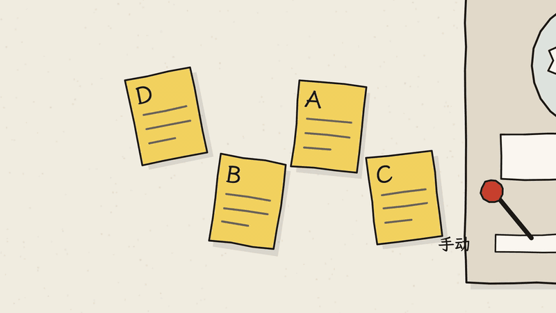
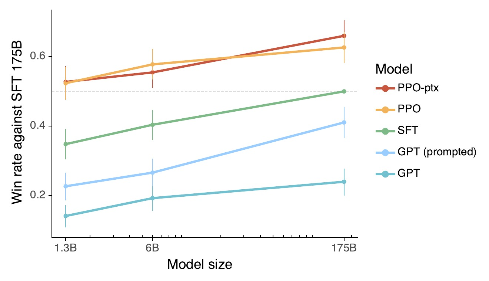
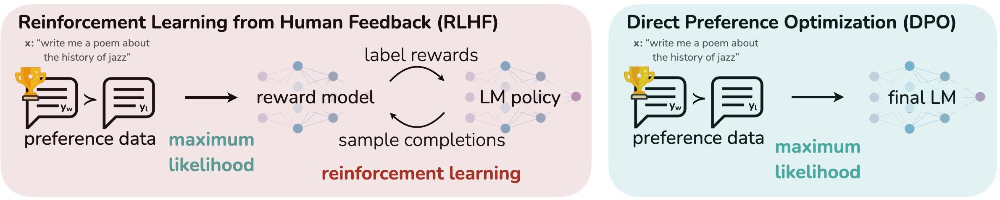
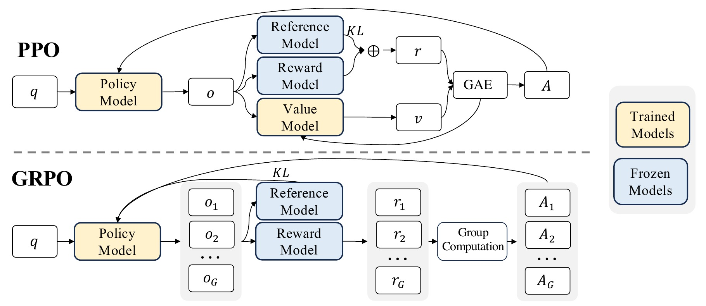
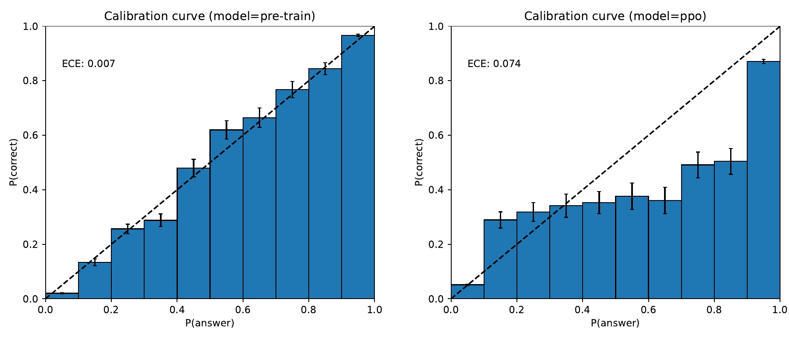
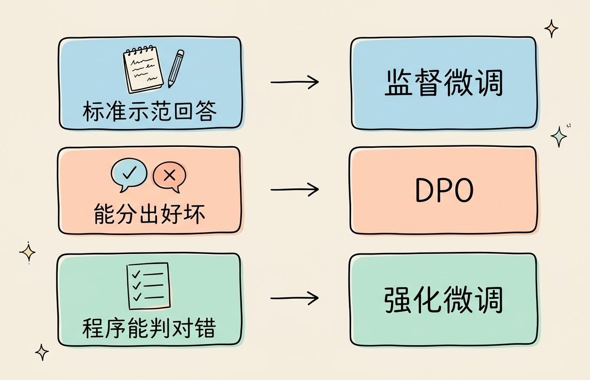

# 3分钟搞懂强化学习(RLHF)

> ⭐⭐⭐进阶 · 阅读时间 3分钟 · 更新于 2026-11-10
>
> ChatGPT 为什么比 GPT-3 好用？关键是 RLHF：先让人比较回答好坏，训练出打分模型，再用强化学习让模型往高分调。本文讲清经典三步、奖励被钻空子的问题，以及 DPO、宪法 AI、RLVR 这几条新路线。

## 一句话定义

**RLHF**（Reinforcement Learning from Human Feedback，人类反馈强化学习）= 先让人对模型给出的几个回答比较好坏，用这些比较结果训练出一个能自动打分的**奖励模型**，再用强化学习让大模型不断尝试、往高分的方向调整，最终学会人更喜欢的回答方式。

举个例子：你问一个只做过预训练的模型“怎么煮鸡蛋”，它很可能接着往下编，写出“怎么煎鸡蛋？怎么蒸鸡蛋？”这样的一串问题，因为它在网上见过很多这样的问答列表。它并不缺知识，缺的是“别人在问我问题，我应该回答”这种意识。RLHF 要解决的就是这件事：**预训练让模型学会了说话，RLHF 教它怎么说才是人想要的。**

## 好回答很难写出标准，但很容易比出高下

要让模型学会“好好回答”，最直接的办法是给它看标准答案。但很多问题根本没有唯一的标准答案：一封道歉邮件怎么写才得体，一段代码解释写到多详细才合适，你很难写出一份完美范文，更难把“好”的标准一条条列清楚。

不过如果把两个回答摆在一起，让人选哪个更好，大部分人几秒钟就能做出判断。这就像点菜：让你写一份“好吃”的标准很难，但两道菜各尝一口，你马上就知道更喜欢哪道。

RLHF 的基本思路就是利用这一点。2017 年，OpenAI 和 DeepMind 的研究人员合作发表了一项研究，最早把这个思路做成了完整的训练方法。当时还不是用来训练语言模型，而是训练游戏和模拟机器人里的 AI：AI 先自己乱试，系统从中截取两段动作视频给人看，人只需要选出哪一段更接近目标。系统根据人的这些选择学会给动作打分，AI 再按照这个分数去调整自己。

这种方式对人的负担很小。在这项研究的实验中，AI 在训练过程中做出的动作，人只需要看其中不到 1% 并给出选择，就足以把任务训练出来，剩下的都由 AI 自己去练。研究人员还用这种方法教会了一个模拟机器人做后空翻。“怎样才算一个好的后空翻”很难用规则写清楚，但人看两段视频就能判断哪段翻得更好，整个训练过程中人前后只花了大约一个小时。

## ChatGPT 用的是经典的三步

2022 年 3 月，OpenAI 发表了 InstructGPT 论文，把这套方法搬到了大语言模型上。同年 11 月发布的 ChatGPT，用的也是同样的方法，只是在数据收集上做了一些调整。整个过程分三步，前提是已经有了一个预训练好的基础模型：

```
基础模型 (预训练完成, 会续写, 但不会好好回答问题)
   │
   ▼
第1步 监督微调 (SFT): 标注员亲自写示范回答, 让模型先模仿
   │
   ▼
第2步 训练奖励模型 (RM): 同一个问题让模型写 4~9 个回答
                          标注员排序, 例如 C > A > D > B
                          用这些排序训练一个自动打分的模型
   │
   ▼
第3步 强化学习 (PPO): 模型回答新问题 → 奖励模型打分
                      → 模型往高分方向调整, 反复循环
                      同时限制它不能离第1步的模型太远
```

**第 1 步是让模型先学个样子。** InstructGPT 找了大约 40 名外包标注员，针对各种问题亲手写出示范回答，模型照着学。这一步是普通的监督学习，学完之后模型已经知道要回答问题了，但人写示范很慢，量也上不去。

**第 2 步是把人的判断变成一个打分模型。** 让模型对同一个问题写出 4 到 9 个回答，标注员只负责排序，不用自己写。积累了足够多的排序数据之后，就能训练出一个奖励模型：输入一个问题和一个回答，它输出一个分数，代表“人大概会有多喜欢这个回答”。从这里开始，打分这件事就不再需要人一直守着了。



**第 3 步是让模型自己刷分。** 模型针对大量新问题写回答，奖励模型给每个回答打分，模型根据分数用 PPO（近端策略优化）算法调整自己，分数高的回答方式就多用，分数低的就少用。这里有一个很重要的限制：模型的输出不能和第 1 步的版本差得太远，否则它很容易为了拿高分写出一些奇怪的内容。这个限制在技术上叫 **KL 惩罚**，你可以把它理解成一根缰绳。

效果很明显。在 InstructGPT 论文里，只有 13 亿参数的 InstructGPT，回答比 1750 亿参数的 GPT-3 更受标注员欢迎，参数少了 100 多倍。这也说明了 RLHF 主要提升的不是知识量，而是模型**把已有能力用对地方**的本事。


*图注：出自 InstructGPT 论文。横轴是模型大小（13 亿、60 亿、1750 亿参数），纵轴是标注员认为该模型的回答比 1750 亿参数 SFT 模型更好的比例，0.5 的虚线表示两者打平。最下面两条蓝线是原版 GPT-3（GPT 是直接提问，GPT (prompted) 是精心写了提示词）；绿线是只做了第 1 步的 SFT 模型；最上面的红线和橙线是做完三步的 InstructGPT（PPO-ptx 在强化学习时混入了一部分预训练数据，PPO 没有混入）。可以看到，最左边 13 亿参数的 PPO 模型，胜率在 0.5 以上，远高于最右边 1750 亿参数的 GPT-3。*

## 打分模型会被钻空子

RLHF 最大的隐患在第 3 步。模型追求的是奖励模型给的高分，而奖励模型只是对人类偏好的一个近似，它有自己的盲区。模型练得越久，就越有可能找到这些盲区，拿到高分却并没有真正变好。这种现象叫**奖励黑客**（Reward Hacking）。

常见的表现有两种：

- **回答越写越长**：如果标注员平时更容易给详细的回答打高分，奖励模型就会学到“越长越好”，模型就会开始写一堆没有必要的铺垫和总结。
- **讨好用户**：2025 年 4 月，OpenAI 给 ChatGPT 推送的一次 GPT-4o 更新，让模型变得过分附和用户，几天后就回滚了。OpenAI 在复盘里提到，这次更新新加入了一个基于用户点赞和点踩数据的奖励信号，而用户当下点赞的回答，并不一定是真正对他有帮助的回答。

前面说的 KL 惩罚就是用来减轻这个问题的，但它只能限制模型偏离的程度，没办法从根上解决。奖励被钻空子之后还会带来哪些更严重的问题，属于 AI 对齐要研究的内容。

## DPO：把打分模型省掉

经典 RLHF 的第 3 步很贵，也很难调。用 PPO 训练时，显存里要同时放四个模型：正在训练的模型、第 1 步的参考模型、奖励模型，还有一个专门帮 PPO 估算分数的价值模型。超参数稍微设得不对，训练就可能崩掉。

2023 年 5 月，斯坦福的研究人员提出了 **DPO**（Direct Preference Optimization，直接偏好优化）。他们从数学上证明了，“先训练奖励模型、再用强化学习去优化”这两步，可以合并成一步：直接拿“回答 A 比回答 B 好”这样的成对数据去训练模型，让它提高好回答出现的概率、降低差回答出现的概率。不需要单独的奖励模型，也不需要让模型边写边打分，训练起来和普通的微调差不多简单。


*图注：出自 DPO 论文。左边是经典 RLHF：先用偏好数据（preference data，奖杯表示更好的回答 yw 胜过 yl）训练出奖励模型（reward model），再让语言模型（LM policy）反复生成回答、由奖励模型打分，用强化学习（reinforcement learning）循环优化。右边是 DPO：同样的偏好数据直接用来训练出最终的模型（final LM），中间没有奖励模型，也没有强化学习的循环。*

DPO 很快成了开源社区的主流做法。2024 年 Meta 训练 Llama 3 时，后训练流程就是“拒绝采样 + 监督微调 + DPO”的循环。Meta 在论文里说明，他们也试过 PPO，但在大模型上 DPO 用的算力更少，效果也更好，尤其是在指令遵循的测试上。

不过 DPO 也有局限：它只能从已经收集好的对比数据里学，模型在训练中不会自己去尝试新的回答。所以在需要模型反复试错、自己探索解法的任务上，强化学习仍然更有优势。

## 让 AI 代替人来打分

不管是 PPO 还是 DPO，都离不开大量的偏好数据，而请人来标注又贵又慢。于是另一条思路是：让 AI 来当标注员，这类方法叫 **RLAIF**（AI 反馈强化学习）。

Anthropic 在 2022 年 12 月提出的**宪法 AI**（Constitutional AI）是其中的代表。他们先写好一份原则清单，也就是“宪法”，然后让模型按照这些原则去评价、修改自己的回答，再用 AI 给出的偏好来做强化学习。这样在“有没有害”这个维度上，基本不再依赖人工标注。2026 年 1 月，Anthropic 发布了新版的 Claude 宪法，从原来的一条条规则改成了在规定之外还解释“为什么这么要求”，并且这份宪法会直接用在 Claude 的训练中。

用 AI 打分的好处是便宜、快、标准统一，问题在于 AI 自己的偏见和盲区也会一起传给被训练的模型。所以实际训练中，通常是 AI 反馈和人类反馈一起使用的。

## 有标准答案的任务，直接让程序来判分

最近两年变化最大的，是奖励的来源。数学题有标准答案，代码有测试用例，这类任务根本不需要人或者奖励模型来猜“好不好”，直接用程序判断对错就行：答案对了给 1 分，错了给 0 分。这种做法叫 **RLVR**（Reinforcement Learning with Verifiable Rewards，可验证奖励强化学习），这个名字来自 Ai2 在 2024 年 11 月发布的 Tülu 3 训练方案。

程序判分没有奖励模型那么多盲区，模型就可以放开去刷很多轮，在大量练习里自己摸索出更好的解题方法。现在的推理模型，主要就是靠这类强化学习训练出来的。

配套的算法也在简化。DeepSeek 在 2024 年 2 月的 DeepSeekMath 论文里提出了 **GRPO**（组相对策略优化）：同一道题让模型一次写出一组答案，每个答案的得分和这组答案的平均分去比，比平均分高的就多学，低的就少学。这样就不再需要 PPO 里那个价值模型，省下了不少显存。


*图注：出自 DeepSeekMath 论文。黄色框是训练中会更新的模型（Trained Models），蓝色框是参数固定不变的模型（Frozen Models）。上半部分是 PPO：问题 q 交给正在训练的模型（Policy Model）生成回答 o，然后参考模型、奖励模型、价值模型（Value Model）一起参与计算，其中价值模型也要跟着训练。下半部分是 GRPO：同一个问题一次生成 G 个回答，奖励模型分别打分（r1 到 rG），再在组内互相比较（Group Computation），算出每个回答该多学还是少学（A1 到 AG），价值模型被去掉了。论文图里画的是奖励模型，到了 DeepSeek-R1 这类推理模型的训练中，打分换成了按规则判断答案和格式是否正确。*2025 年 1 月发布的 DeepSeek-R1 用的就是 GRPO，之后很多开源推理模型也跟着用了。

那些没有标准答案的任务怎么办？现在比较常见的做法是**评分细则**（Rubrics）：针对每一道题写好具体的评分点，比如“是否提到了药物的禁忌人群”“是否给出了数据来源”，再让 AI 裁判逐条检查打分。评分点写得越具体，打出来的分就越可靠。而在 Agent 的训练里，奖励则越来越多地来自真实的执行环境，比如代码测试有没有跑通、数据库里的记录有没有被正确修改。

到这里你会发现，“HF”（人类反馈）在整个流程里的占比越来越小了。现在说的“大模型强化学习”，通常是这几种方法一起用：

| 方法 | 奖励从哪来 | 需要奖励模型吗 | 适合什么 |
|---|---|---|---|
| 经典 RLHF（PPO） | 人的排序训练出的奖励模型 | 需要 | 语气、有用性这类主观标准 |
| DPO | 直接用成对的好坏数据 | 不需要 | 调整风格、减少啰嗦，训练成本低 |
| RLAIF / 宪法 AI | AI 按原则给出的偏好 | 通常需要 | 安全性，人工标注成本太高的场景 |
| RLVR（常用 GRPO） | 程序判断对错 | 不需要 | 数学、代码、Agent 任务等能自动验证的场景 |

## RLHF 改变的是回答方式，不是知识

围绕 RLHF，有几个常见的误会需要说清楚。

**RLHF 不会给模型增加新知识。** 它调整的是模型怎么用已有的知识，比如回答要不要分点、遇到危险请求要不要拒绝。模型不知道的事情，RLHF 教不会它。

**RLHF 也不等于让模型更诚实。** 它确实能减少一部分胡编乱造的情况，比如让模型学会说“我不确定”，但也可能带来副作用。OpenAI 在 GPT-4 的技术报告里给过一组数据：预训练完成的模型，对自己答案的把握程度和实际正确率很接近；经过后训练之后，这种对应关系反而变差了。OpenAI 没有解释具体原因，一种常见的推测是：标注员往往更喜欢自信、流畅的回答，模型也就学会了把话说得更肯定。


*图注：出自 GPT-4 技术报告，测试题是 MMLU 里的选择题。横轴是模型对自己所选答案的把握程度，纵轴是这一档里实际答对的比例，虚线表示“把握多大，就答对多少”的理想情况。左图是预训练完成的模型，柱子基本贴着虚线；右图是经过 PPO 后训练的模型，偏离明显变大。比如右图中模型有 60% 到 70% 把握的那一档，实际只答对了不到 40%。左上角的 ECE 是平均偏差，从 0.007 增加到了 0.074。*

**RLHF 也不是 ChatGPT 独有的。** 现在几乎所有主流的对话模型，在后训练阶段都用了这类方法，只是具体用 PPO、DPO 还是 GRPO，各家的组合不太一样。

## 开发者能用上哪些

如果你想用自己的数据去调整模型，现在很多平台都已经把这几种方法做成了现成的功能：

- **阿里云百炼**：支持对千问系列做监督微调（SFT）、DPO 和继续预训练。
- **火山方舟**（字节）：模型精调支持监督微调、DPO 和强化学习。
- **OpenAI**：微调 API 支持 DPO，也支持针对推理模型的强化微调（RFT），你可以自己定义评分规则。
- **Amazon Bedrock**：提供强化微调，2026 年 2 月起扩展到了开源权重模型。

选哪种方法，主要看你手里有什么样的数据：

- **有标准的示范回答**：先做监督微调，这是最简单也最稳定的一步。
- **能分出好坏，但写不出标准答案**：比如客服回复的语气、摘要的长短，适合用 DPO。
- **结果能用程序自动检查**：比如 SQL 能不能跑通、提取出的字段对不对，可以考虑强化微调。



不管用哪种方法，评分规则都要多花时间去设计，并且一定要抽查模型的实际输出。只看分数在涨，很可能模型只是学会了钻评分规则的空子。

## 时效性提醒

RLHF 的基本思路已经比较稳定了，变化比较快的是这些地方：

- 奖励来源正在从人工标注转向程序验证、评分细则和 AI 裁判，具体的组合方式各家还在快速迭代
- GRPO 之后出现了很多改进算法，主流选择可能会变
- 各平台支持的微调方法、可微调的模型和价格经常调整

**建议**：动手之前，以各平台的官方文档为准。

💬 **互动话题**：你有没有遇到过 AI 回答得特别啰嗦，或者一味附和你的情况？你觉得这是被训练出来的吗？

📖 **相关阅读**：

- [3分钟搞懂AI对齐](../12-alignment/README.md) - 奖励被钻空子之后，模型还会出现哪些问题
- [3分钟搞懂推理模型](../01-reasoning-models/README.md) - 用强化学习训练出来的“会思考”的模型
- [3分钟搞懂AI微调和LoRA](../08-fine-tuning-and-lora/README.md) - 监督微调、偏好微调和强化学习微调怎么选
- [3分钟搞懂训练和推理](../../01-basics/05-training-and-inference/README.md) - 预训练和后训练分别在做什么
- 3分钟搞懂GPT系列 - 从 GPT-3 到 ChatGPT 的演变

**资料来源**：

- Christiano et al.，Deep reinforcement learning from human preferences（2017）：https://arxiv.org/abs/1706.03741
- Ouyang et al.，Training language models to follow instructions with human feedback（InstructGPT，2022）：https://arxiv.org/abs/2203.02155
- OpenAI，Introducing ChatGPT（2022-11-30）：https://openai.com/index/chatgpt/
- OpenAI，GPT-4 Technical Report（2023）：https://arxiv.org/abs/2303.08774
- OpenAI，Expanding on what we missed with sycophancy（2025-05）：https://openai.com/index/expanding-on-sycophancy/
- Rafailov et al.，Direct Preference Optimization（2023）：https://arxiv.org/abs/2305.18290
- Meta，The Llama 3 Herd of Models（2024）：https://arxiv.org/abs/2407.21783
- Bai et al.，Constitutional AI: Harmlessness from AI Feedback（2022）：https://arxiv.org/abs/2212.08073
- Anthropic，Claude's new constitution（2026-01）：https://www.anthropic.com/news/claude-new-constitution
- Shao et al.，DeepSeekMath（GRPO，2024）：https://arxiv.org/abs/2402.03300
- Lambert et al.，Tülu 3（RLVR，2024）：https://arxiv.org/abs/2411.15124
- DeepSeek-AI，DeepSeek-R1（2025）：https://arxiv.org/abs/2501.12948
- Gunjal et al.，Rubrics as Rewards（2025）：https://arxiv.org/abs/2507.17746
- 阿里云百炼，模型调优概述：https://help.aliyun.com/zh/model-studio/user-guide/model-training-overview/
- Amazon Bedrock，强化微调支持开源权重模型（2026-02）：https://aws.amazon.com/about-aws/whats-new/2026/02/amazon-bedrock-reinforcement-fine-tuning-openai

---

⬅️ 上一篇：[3分钟搞懂AI微调和LoRA](../08-fine-tuning-and-lora/README.md) ｜ [📚 返回目录](../README.md) ｜ 下一篇：[3分钟搞懂蒸馏](../10-distillation/README.md) ➡️
