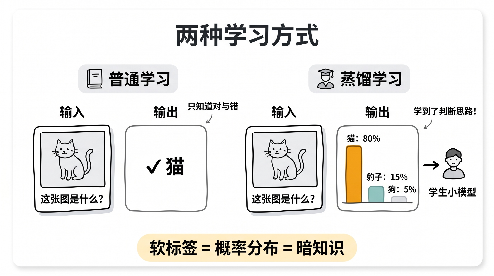
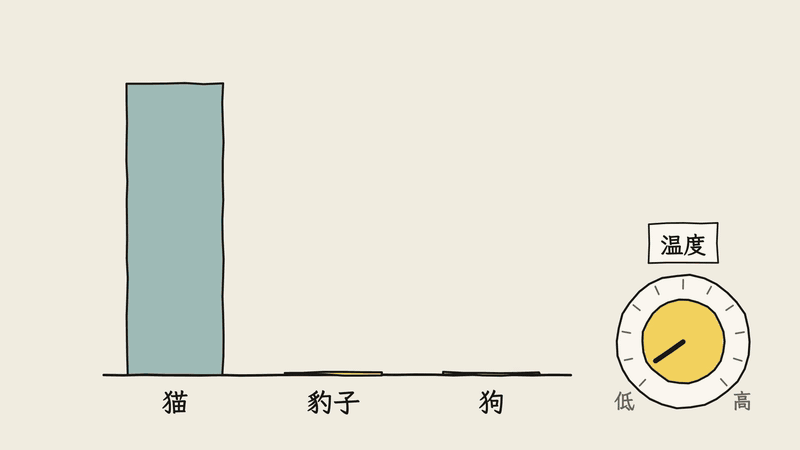
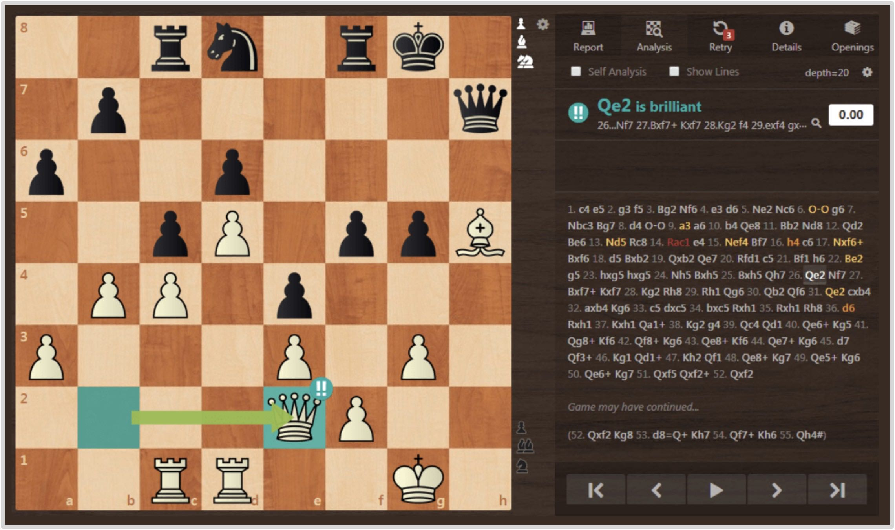
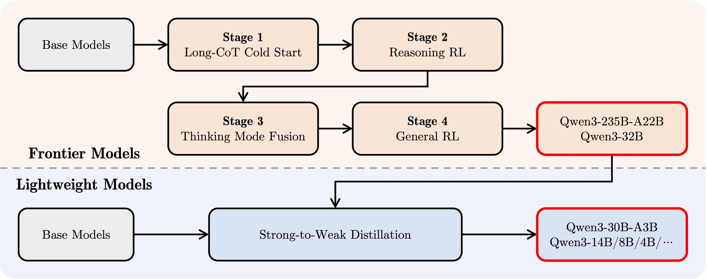

# 3分钟搞懂蒸馏

> ⭐⭐⭐需要技术背景 · 阅读时间 3分钟 · 更新于 2026-11-09
>
> 蒸馏是让大模型当老师、带出一个小而强的学生模型。本文讲清软标签为什么有用，大模型时代“学概率、学回答、老师逐字打分”三种做法的区别，DeepSeek R1 蒸馏版到底是怎么来的，以及“蒸馏攻击”的争议。

## 一句话定义

**蒸馏**（Knowledge Distillation）= 拿一个已经训练好的大模型当老师，把它对问题给出的回答、或者它给每个候选答案打出的概率当作教材，去训练一个小得多的学生模型，让学生在体积、成本都小很多的情况下，尽量学到老师的能力。

举个例子：DeepSeek 先训练出了 671B 参数的推理模型 DeepSeek-R1，然后用它生成了大约 80 万条带完整思考过程的回答，再拿这些回答去训练千问和 Llama 的小模型，得到了 1.5B 到 70B 的一系列“R1 蒸馏版”。其中 7B 的版本在 AIME 2024 数学竞赛题上的得分是 55.5，而当时的 GPT-4o 只有 9.3。

这里需要注意的一点是：**蒸馏不是把大模型“压”小**。学生是一个从头就小的模型，它的能力是重新训练出来的，只是训练用的教材来自老师。

## 学生学的不只是答案

蒸馏这个说法来自 Hinton 等人 2015 年的论文《Distilling the Knowledge in a Neural Network》。这篇论文的核心想法是：让小模型去学大模型给出的判断，而不只是学标准答案。我们拿 AI 识别一张猫的图片来举个例子。

普通训练时，一张猫的图片配的标签只有一个“猫”，模型只知道这道题的对错。而训练好的大模型看到这张图，输出的其实是一组概率，比如“80% 是猫、15% 是豹子、5% 是狗”。这组概率叫**软标签**，相对地，只写一个正确答案的叫硬标签。

软标签里多出来的那部分信息，Hinton 把它叫作**暗知识**（Dark Knowledge）。比如“豹子 15%、狗 5%”说明在老师眼里，这只猫长得更像豹子而不是狗，也就是说，猫和豹子的关系比猫和汽车近得多。这些信息标准答案里是没有的。学生去拟合老师的整组概率，就能把这种“哪些东西彼此相似”的判断一起学过去，所以用同样多的数据，学生能学得更快、更好。

不过实际情况会比上面这个例子复杂一些。训练好的大模型往往非常自信，输出可能是“99.9% 是猫”，其他答案的概率小到几乎为零，学生从中就学不到什么了。所以论文里加了一个叫**温度**的参数，把概率分布“拉平”一些，让那些小概率的答案也显出来，学生才看得到老师的判断思路。

这套方法在大模型出现之前就已经很成熟了。比如 Hugging Face 2019 年发布的 DistilBERT，就是用 BERT 当老师蒸馏出来的：参数少了 40%，速度快了 60%，同时保留了 BERT 约 97% 的语言理解能力。

## 大模型时代，蒸馏分成了三种做法

到了大模型这里，“老师给出答案”这件事本身就有不同的给法，所以现在常说的蒸馏，其实分成三种：

| 做法 | 学生学什么 | 需要老师提供什么 | 代表例子 |
|---|---|---|---|
| **学概率** | 每个位置上，老师给所有候选词打的概率 | 老师的内部输出（logits） | Gemma 3、Llama 3.2 1B/3B |
| **学回答** | 老师写出来的完整回答 | 只要能调用老师就行 | DeepSeek R1 蒸馏版 |
| **在线蒸馏** | 学生自己写回答，老师对每个词打分 | 老师的内部输出 | Qwen3 小尺寸模型 |

### 学概率：最接近原始的蒸馏

大模型是一个词一个词往外生成的，每生成一个词，它都会给词表里的所有候选词打一个概率。学概率的做法就是让学生在每个位置上都去拟合老师的这组概率，和上面猫的例子是同一个思路，只是把“分类”换成了“预测下一个词”。

Google 的 Gemma 系列就是这么训练的。Gemma 3 的技术报告里写到，预训练阶段沿用了 Gemma 2 的蒸馏方法：每个词从老师的概率里抽取 256 个候选词，让学生学习这部分概率分布。Meta 的 Llama 3.2 1B 和 3B 也类似，先从 Llama 3.1 8B 剪枝得到小模型，再用 Llama 3.1 8B 和 70B 的输出概率当训练目标，把剪枝损失的能力补回来。

这种做法效果好，但前提是你能拿到老师每一步的完整概率，所以一般只有模型的“自家人”才做得了，比如用自己的大模型带自己的小模型。

### 学回答：DeepSeek R1 蒸馏版的做法

很多文章说 DeepSeek R1 蒸馏版是“学习大模型的软标签”，这一点其实不准确。DeepSeek 在 R1 论文里写得很明确：他们用 R1 整理了大约 80 万条训练样本（约 60 万条推理类、20 万条非推理类），然后直接拿这些样本对 Qwen2.5 和 Llama 3 的模型做监督微调（SFT），**只做了微调，没有再加强化学习**。

也就是说，学生学的是老师写出来的完整回答，包括里面很长的思考过程，而不是老师的概率分布。这种做法也叫数据蒸馏，最终得到了 6 个模型：

| 蒸馏版模型 | 底座 | AIME 2024 | MATH-500 |
|---|---|---|---|
| R1-Distill-Qwen-1.5B | Qwen2.5-Math-1.5B | 28.9 | 83.9 |
| R1-Distill-Qwen-7B | Qwen2.5-Math-7B | 55.5 | 92.8 |
| R1-Distill-Llama-8B | Llama-3.1-8B | 50.4 | 89.1 |
| R1-Distill-Qwen-14B | Qwen2.5-14B | 69.7 | 93.9 |
| R1-Distill-Qwen-32B | Qwen2.5-32B | 72.6 | 94.3 |
| R1-Distill-Llama-70B | Llama-3.3-70B-Instruct | 70.0 | 94.5 |

这种做法门槛最低：只要能调用老师模型的 API，拿到它的回答就能做。这既是它流行的原因，也是后面会讲到的争议的来源。

### 在线蒸馏：学生自己答，老师逐字打分

前两种做法有一个共同的问题：学生学的都是老师的回答，但真正用的时候，学生要接着自己写的内容往下写。一旦学生在某一步写偏了，它遇到的就是老师从来没示范过的情况，后面很容易越错越远。

**在线蒸馏**（On-Policy Distillation）的办法是反过来：让学生自己先把回答写出来，再让老师对学生写的每一个词打分，告诉它“如果是我，这里大概率不会这么写”。这样学生练的就是自己真实会遇到的情况，而且每个词都有反馈，比强化学习那种“整道题做完才知道对错”的信号密集得多。

*图注：Thinking Machines 在讲在线蒸馏的博客里用了这张 chess.com 截图。分析引擎会给每一步棋打分，从“败着”到“妙着”（图中 Qe2 被标为 brilliant，也就是妙着）。博客的比喻是：强化学习像没有教练、只知道整盘输赢；学回答像看大师对局，但大师下出的局面新手很少遇到；在线蒸馏则像自己下棋，每一步都有引擎打分。*

阿里的 Qwen3 就是这么训练小模型的。Qwen3 技术报告里，0.6B、1.7B、4B、8B、14B 和 30B-A3B 这几个模型都不是单独做强化学习，而是用 Qwen3-32B 或 Qwen3-235B-A22B 当老师，先学回答，再做在线蒸馏。

*图注：Qwen3 官方博客公布的后训练流程。上半部分是旗舰模型（Frontier Models），从基础模型开始，依次经过长思维链冷启动、推理强化学习、思考模式融合、通用强化学习四个阶段，得到 Qwen3-235B-A22B 和 Qwen3-32B；下半部分是轻量模型（Lightweight Models），不再重复这四个阶段，而是直接由上面的大模型做“强到弱蒸馏”（Strong-to-Weak Distillation），得到 30B-A3B、14B、8B、4B 等小尺寸模型。*

报告里还给了一组对比，学生是 Qwen3-8B：

| 在学回答的基础上 | AIME 2024 | AIME 2025 | GPU 时长 |
|---|---|---|---|
| 只学回答 | 55.0 | 42.8 | - |
| 再做强化学习 | 67.6 | 55.5 | 17,920 小时 |
| 再做在线蒸馏 | 74.4 | 65.5 | 1,800 小时 |

在线蒸馏的效果更好，GPU 时长却只有强化学习的大约 1/10。2025 年 10 月，Thinking Machines 发了一篇专门讲在线蒸馏的博客，用自己的训练平台复现了这个结论，之后这个方向的论文也明显多了起来。

## 小模型为什么不直接用强化学习练？

DeepSeek-R1 本身的推理能力，主要是靠大规模强化学习练出来的。那小模型能不能也这么练，不用老师？

DeepSeek 在论文里专门做了这个实验：拿同一个 Qwen2.5-32B，一边用强化学习训练了 1 万多步，另一边直接用 R1 的数据做蒸馏。结果在 AIME 2024 上，强化学习版是 47.0 分，蒸馏版是 72.6 分，差距非常明显。

原因并不复杂。强化学习要靠模型自己反复尝试、偶尔做对了才得到奖励，小模型能力有限，自己摸索出好的解题方法很难；而有了老师，相当于直接把好的解法摆在它面前。所以 DeepSeek 的结论是：**把强模型蒸馏到小模型上效果非常好**，而要继续突破能力上限，还是需要更强的底座和更大规模的强化学习。

这也说明了蒸馏的天花板：学生的上限基本由老师决定，蒸馏是把已有的能力传下去，而不是创造新能力。

## 蒸馏、量化、微调有什么区别？

这三个词经常一起出现，也经常被混在一起：

| | 蒸馏 | 量化 | 微调（含 LoRA） |
|---|---|---|---|
| 解决什么 | 用小模型尽量复现大模型的能力 | 让同一个模型占用更少显存 | 让已有模型适应特定任务 |
| 怎么做 | 用老师的输出重新训练一个学生 | 把参数从 16 位降到 8 位、4 位等 | 用领域数据继续训练 |
| 要不要训练 | 要，而且是正经的训练 | 大多数情况下不需要 | 要，但规模比较小 |
| 模型变没变 | 换成了另一个小模型 | 还是原来的模型，精度降低 | 还是原来的模型，学了新东西 |

区分它们最简单的方法，是看模型本身变没变：量化之后还是原来那个模型，只是存得更省；蒸馏之后得到的是另一个更小的模型。

另外，**学回答**这种蒸馏在操作上就是一次监督微调，所以“蒸馏”和“微调”的边界其实没有那么清楚。区别在于目的：蒸馏的训练数据来自一个更强的老师，目标是把老师的能力搬过来；普通微调的数据通常是人整理的领域数据，目标是让模型学会某项新技能。

实际使用中这三者经常组合：先蒸馏出一个小模型，再按业务微调，最后量化部署到本地或手机上。

## 用蒸馏模型时要注意什么？

**分清蒸馏版和原版。** 很多人在 Ollama 里运行 `deepseek-r1:7b`、`deepseek-r1:14b`，以为自己在本地跑的是 DeepSeek-R1。实际上这些小尺寸版本都是蒸馏版，底座是千问或 Llama，直接运行 `deepseek-r1` 不加尺寸时默认拉取的也是 8B 的蒸馏版，只有 671B 那个才是原版 R1。两者的能力差距很大，如果你在本地用下来觉得“R1 也就这样”，评价的其实是蒸馏版。

**老师教了什么，学生就强在什么。** R1 蒸馏版的训练数据里，四分之三是数学、代码这类推理题，所以它在这些任务上的提升最明显。但它没有学到老师的全部知识，体积小了，能装下的事实性知识也就少了，问冷门知识时更容易出错。选模型的时候，要看蒸馏数据覆盖了哪些任务，再拿自己的任务测一下才知道。

**蒸馏是大模型能力下放的主要方式。** 现在各家发布的小尺寸模型，背后大多都有一个更大的老师，Gemma、Llama 3.2、Qwen3 都是例子。这也是为什么小模型的能力进步得这么快：只要大模型变强了，小模型就能跟着变强。对开发者来说，这意味着很多以前只能调用大模型 API 的任务，现在可以用一个蒸馏出来的小模型在本地完成，成本更低，数据也不用离开自己的机器。

## 蒸馏的争议：拿别人的模型当老师

学回答这种做法只需要调用老师的 API，所以理论上任何人都可以拿别家的闭源模型当老师。也正因为这样，OpenAI、Anthropic、Google 等公司的服务条款里都禁止用模型输出去训练有竞争关系的模型。

2026 年 2 月 23 日，Anthropic 发文称发现了三起大规模的“蒸馏攻击”，对象是 DeepSeek、月之暗面（Moonshot）和 MiniMax：这几家通过大约 2.4 万个虚假账号，和 Claude 进行了超过 1600 万次对话，其中 MiniMax 超过 1300 万次、月之暗面超过 340 万次、DeepSeek 超过 15 万次。Anthropic 表示，他们已经在 API 流量里部署了识别蒸馏行为的分类器，专门检测那些诱导模型输出完整思考过程、用来构造推理训练数据的请求。

需要说明的是，这是 Anthropic 单方面公布的结果。Anthropic 在同一篇文章里也强调，蒸馏本身是一种正当且被广泛使用的训练方法，各家用自己的大模型蒸馏自己的小模型完全没有问题，有争议的是违反条款、未经允许拿别人的模型当老师。这件事之后，“蒸馏”这个词在不少场合多了一层“抄作业”的意味，但从技术本身来看，它仍然是大模型行业里最常用的训练手段之一。

## 时效性提醒

蒸馏的基本原理已经很稳定了，变化比较快的是这些：

- 在线蒸馏和它的各种改进方法，2025 年下半年以来论文数量增长很快，具体做法还在迭代
- 各家小尺寸模型的蒸馏细节，很多只在技术报告里有，而且不一定公开
- 各家针对蒸馏攻击的检测手段和服务条款，可能还会继续收紧

**建议**：选用蒸馏模型前，先看它的模型卡片，弄清楚老师是谁、学了哪些数据。

💬 **互动话题**：你在本地跑过 DeepSeek R1 的蒸馏版吗？用下来和网页版的 R1 差距大不大？

📖 **相关阅读**：

- [3分钟搞懂AI微调和LoRA](../08-fine-tuning-and-lora/README.md) - 学回答式蒸馏在操作上就是一次微调
- [3分钟搞懂模型量化](../11-quantization/README.md) - 蒸馏之后常用的另一种瘦身方法
- [3分钟搞懂推理模型](../01-reasoning-models/README.md) - R1 蒸馏版学的就是推理模型的思考过程
- [3分钟搞懂强化学习(RLHF)](../09-rlhf/README.md) - 小模型为什么更适合蒸馏而不是强化学习
- 3分钟搞懂DeepSeek模型 - R1 和它的蒸馏版从哪里来
- 3分钟搞懂Qwen - 用在线蒸馏训练小模型的代表

**资料来源**：

- Hinton 等，Distilling the Knowledge in a Neural Network（2015）：https://arxiv.org/abs/1503.02531
- Sanh 等，DistilBERT, a distilled version of BERT（2019）：https://arxiv.org/abs/1910.01108
- DeepSeek-AI，DeepSeek-R1 论文（2025-01）：https://arxiv.org/abs/2501.12948
- Qwen Team，Qwen3 Technical Report（2025-05）：https://arxiv.org/abs/2505.09388
- Qwen Team，Qwen3: Think Deeper, Act Faster（官方博客，后训练流程图出处）：https://qwenlm.github.io/blog/qwen3/
- Gemma Team，Gemma 3 Technical Report（2025-03）：https://arxiv.org/abs/2503.19786
- PyTorch 博客，Distilling Llama 3.1 8B into 1B in torchtune：https://pytorch.org/blog/llama-into-torchtune/
- Thinking Machines，On-Policy Distillation（2025-10-27，国际象棋截图出处，原图来自 chess.com）：https://www.thinkingmachines.ai/blog/on-policy-distillation/
- Anthropic，Detecting and preventing distillation attacks（2026-02-23）：https://www.anthropic.com/news/detecting-and-preventing-distillation-attacks

---

⬅️ 上一篇：[3分钟搞懂强化学习(RLHF)](../09-rlhf/README.md) ｜ [📚 返回目录](../README.md) ｜ 下一篇：[3分钟搞懂AI模型量化](../11-quantization/README.md) ➡️
