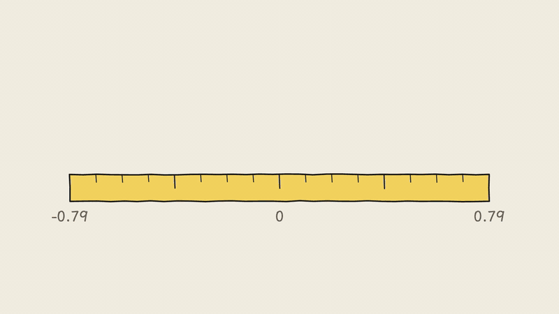
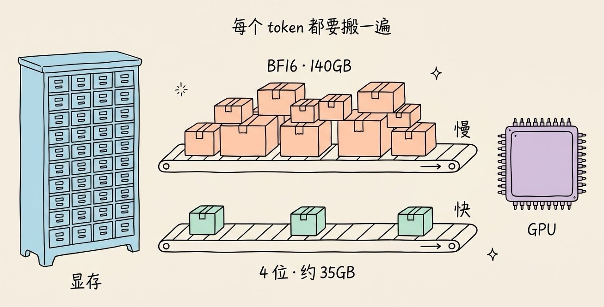
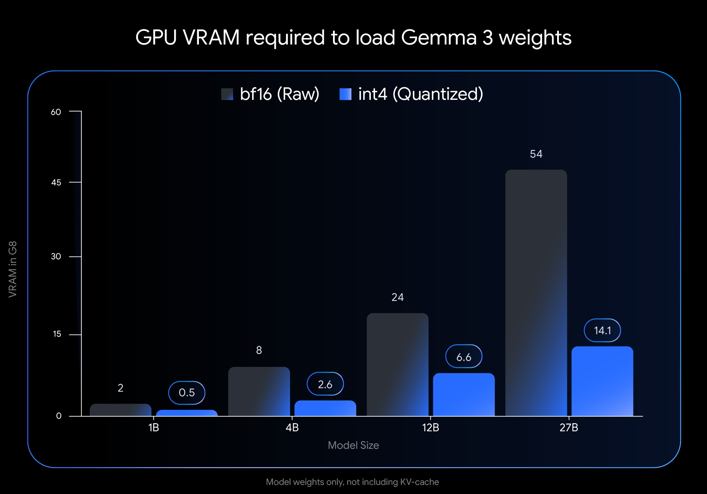
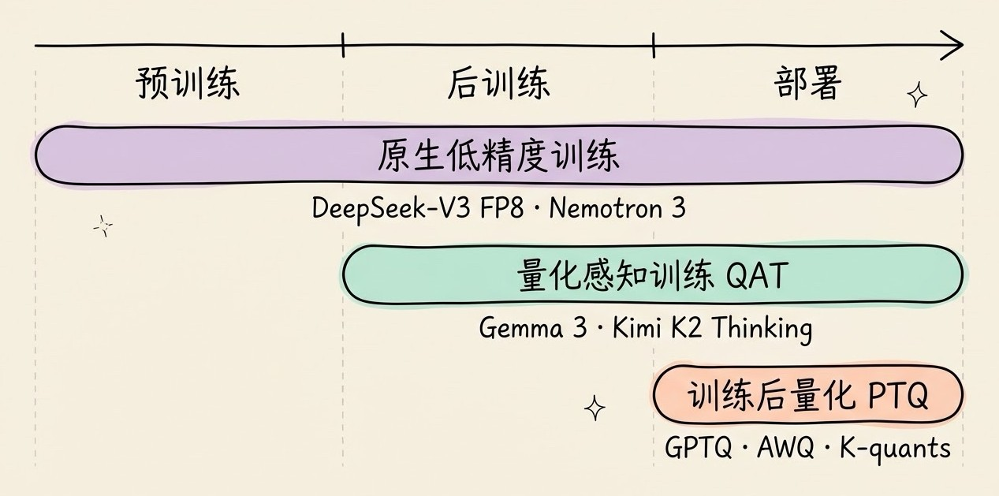
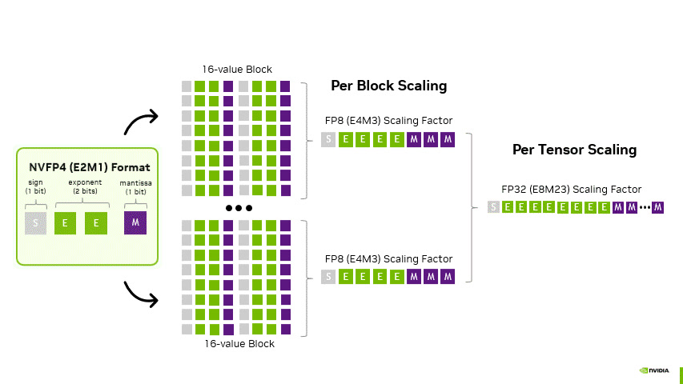
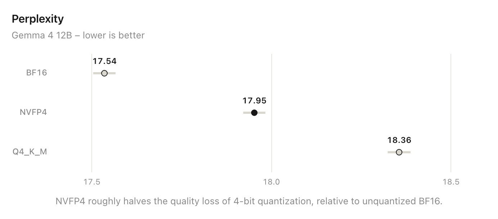

# 3分钟搞懂AI模型量化

> ⭐⭐⭐进阶 · 阅读时间 3分钟 · 更新于 2026-11-09
>
> 一个 70B 模型用 16 位存需要 140GB，换成 4 位量化版只要 40GB 出头。本文讲清量化压缩的到底是什么、为什么体积小了速度也会变快、GPTQ/AWQ/GGUF/FP4 各是什么，以及自己跑模型时该怎么挑量化版本。

## 一句话定义

**模型量化**（Quantization）= 把模型里的参数从 16 位的数字改成用 8 位、4 位甚至更少的位数来存，有时连推理过程中的中间结果和 KV 缓存也一起压缩，用一点点精度损失，换来更小的体积、更少的显存占用和更快的生成速度。

举个例子：Llama 3.3 70B 用 16 位（BF16）存，光是参数就要 140GB 左右，至少得两张 80GB 的数据中心显卡才放得下；而社区里最常用的 4 位量化版（Q4_K_M）文件只有 42.5GB，一台大内存的 Mac 或者两张 24GB 显卡的电脑就能跑起来。

现在你在 Ollama、LM Studio 里下载的开源模型，基本都是量化过的版本。很多厂商也开始直接发布 8 位、4 位的官方版本，量化已经从「玩家的省钱技巧」变成了模型发布时的标准配置。

## 量化压缩的到底是什么？

大模型本质上是一大堆数字（参数）。一个 70B 模型就有 700 亿个参数，每个参数占多少字节，直接决定了模型有多大：

| 精度 | 每个参数占用 | 70B 模型的参数体积 | 相对 BF16 |
|---|---|---|---|
| FP32 | 4 字节 | 约 280 GB | 2 倍 |
| BF16 / FP16 | 2 字节 | 约 140 GB | 基准 |
| FP8 / INT8 | 1 字节 | 约 70 GB | 1/2 |
| FP4 / INT4 | 0.5 字节 | 约 35 GB | 1/4 |

现在的大模型基本都是用 BF16 或 FP8 训练和发布的，FP32 早就不是常态了，所以大家说的「量化收益」一般以 BF16 为基准来算：4 位量化相比 BF16，体积大约是原来的四分之一。

量化的思路很像把一把精确到毫米的尺子换成只精确到厘米的尺子。具体做法是先找一个缩放比例（scale），把原来的小数等比例映射到有限的几个整数格子上：

```python
# 伪代码: 对称量化到 INT8 (可用范围 -127 ~ 127)
w = [0.123, -0.456, 0.789, -0.234]       # 原始 BF16 权重

scale = max(abs(w)) / 127                # 0.789 / 127 ≈ 0.00621
w_int8 = round(w / scale)                # [20, -73, 127, -38]

# 推理时再乘回去 (反量化)
w_restored = w_int8 * scale              # [0.124, -0.454, 0.789, -0.236]
```

可以看到，还原回来的数字和原来只差了千分之几。存的时候只需要存 4 个整数和 1 个缩放比例，体积就小了一半。

不过这里有一个问题：如果这组数字里混进了一个特别大的值（业内叫**离群值**），比如 50.0，那缩放比例就会被它撑得很大，剩下那些零点几的小数全都会挤到 0 附近的一两个格子里，精度就损失得很严重。所以实际的量化方案都不会让整个矩阵共用一个缩放比例，而是**每 16 个或 32 个数分成一组，每组单独算一个缩放比例**。这些缩放比例本身也要占空间，所以 GGUF 的 Q4_K_M 名义上是 4 位，Llama 3.3 70B 的文件算下来平均每个参数大约是 4.8 位。



## 体积变小了，为什么速度也会变快？

很多人以为量化只是为了省显存，其实它对速度的帮助也很大，原因在于大模型生成文字的方式。

模型每生成一个 token，都要把全部参数从显存里读一遍。对于 70B 的模型来说，用 BF16 存就意味着每生成一个字都要搬运 140GB 的数据。这时候瓶颈往往不在 GPU 算得够不够快，而在于**显存带宽**，也就是数据搬得够不够快。当参数从 16 位压到 4 位之后，每个 token 要搬的数据就只剩四分之一左右，生成速度自然就上去了。



另外一方面，新一代显卡开始在硬件上直接支持低精度计算：NVIDIA 的 Hopper（H100）和 Ada（RTX 40 系列）支持 FP8，Blackwell（B200、RTX 50 系列）进一步支持 FP4。当硬件原生支持某种精度时，不只是搬数据变快了，矩阵乘法本身也能算得更快。反过来，如果你的显卡不支持某种格式，就需要先把数字还原成 16 位再计算，省下的主要是显存，速度未必会有明显提升。

## 量化的不只是参数

前面说的都是**权重量化**，也就是只压缩模型参数。实际部署时还有两样东西可以压缩：

- **激活值**：模型在推理过程中算出来的中间结果。常见的写法是 W4A16（权重 4 位、激活值保持 16 位）和 W8A8（权重和激活值都是 8 位）。只量化权重比较简单，对效果的影响也小；激活值里离群值更多，压缩起来更难，但压好了能让计算也跑在低精度上，这是数据中心部署时最常用的提速办法。
- **KV 缓存**：模型为了不重复计算，会把前面所有 token 的中间结果缓存起来。上下文越长，KV 缓存就越大，长对话的时候甚至可能比模型本身占的显存还多。vLLM、llama.cpp 这类工具都支持把 KV 缓存压到 8 位，用来换取更长的上下文。

这也提醒我们，算显存的时候不能只看模型文件的大小。Google 在发布 Gemma 3 量化版时也专门说明，它给出的显存数字只包括加载参数的部分，运行时还需要额外的显存来放 KV 缓存，具体要多少取决于上下文有多长。


*图注：Google 公布的 Gemma 3 加载参数所需显存，单位是 GB。灰色是 BF16 原版，蓝色是 int4 量化版，27B 模型从 54GB 降到了 14.1GB。图下方那行小字的意思是「只包括模型参数，不包括 KV 缓存」。来源：Google Developers Blog。*

## 训练完再压，还是训练时就考虑量化？

量化有两条路线。

**第一条是训练后量化（PTQ）**：模型训练好之后再压缩，不需要重新训练，社区里绝大多数量化版本都是这么做出来的。直接把数字四舍五入的效果并不好，所以出现了几种专门针对大模型的方法：

- **GPTQ**（2022 年）：一列一列地量化权重。每量化完一列，就根据一小批校准数据算出这一列产生了多少误差，再微调还没量化的那些权重，把误差补偿回来。这样误差就不会一层层越积越大。
- **AWQ**（2023 年）：研究人员发现，权重里只有大约 1% 是特别重要的，而判断哪些重要，要看它们对应的激活值有多大，不是看权重本身。AWQ 的做法是在量化之前先把这些重要的通道放大一些，让它们在量化时损失更少，所有权重最后仍然是同一种精度，不需要混合存储，所以部署起来很方便。
- **llama.cpp 的 K-quants 和 I-quants**：K-quants 就是 Q4_K_M、Q5_K_M 这类档位，对不同的层用不同的精度，比较重要的层多给几位；I-quants（IQ 系列）会先用一批文本跑出一份「重要性矩阵」（imatrix），再根据它决定怎么量化，在 4 位以下的低比特档位上效果明显更好。

**第二条是量化感知训练（QAT）**：在训练阶段就模拟量化带来的误差，让模型提前适应低精度。效果更好，但需要训练资源，所以以前很少有人用。

这个情况在最近一两年发生了变化，越来越多的模型厂商开始自己做 QAT，直接发布低精度版本：

- **Google Gemma 3**（2025 年 4 月）发布了 QAT 版的 4 位模型，27B 版本加载参数需要的显存从 54GB 降到了 14.1GB，一张 RTX 3090 就能放下。按 Google 公布的测试，和直接量化相比，QAT 让量化带来的困惑度上升减少了 54%（困惑度是衡量语言模型预测准不准的指标，越低越好）。
- **OpenAI gpt-oss**（2025 年 8 月）出厂就把 MoE 部分的权重存成 MXFP4 格式，120B 版本一张 80GB 的显卡就能跑，20B 版本 16GB 内存就够了。
- **Kimi K2 Thinking**（2025 年 11 月）在后训练阶段做了 QAT，把 MoE 部分的权重压到 INT4。月之暗面的解释是，思考模型的输出特别长，普通量化很容易让效果明显下降；它公布的所有跑分也都是在 INT4 精度下测出来的。
- **DeepSeek V4**（2026 年 4 月）混合使用 FP8 和 FP4，其中 MoE 专家权重用 QAT 训练成了 FP4。

再往前一步，是直接用低精度来训练。DeepSeek-V3（2024 年 12 月）在超大规模上验证了 FP8 混合精度训练是可行的；NVIDIA 的 Nemotron 3 系列更进一步，预训练阶段就用 NVFP4 来做大部分矩阵运算。微软的 **BitNet b1.58** 则走得更远，它把每个权重限制成 -1、0、+1 三个值（平均约 1.58 位），并且从头开始按这种方式训练，2025 年 4 月开源了一个 20 亿参数的版本。

这里需要区分一下：BitNet 这类「原生低比特」模型能在极低位数下保持效果，是因为模型从一开始就是这么训练出来的。如果把一个普通模型训练完之后硬压到 2 位甚至更低，效果还是会明显下降。



## GPTQ、GGUF、FP4 不是同一类东西

量化相关的名词很多，很容易混在一起。其实它们分属三个不同的层面：

| 层面 | 回答的问题 | 常见的名字 |
|---|---|---|
| 数据类型 | 每个数用什么格式存 | INT8、INT4、FP8、MXFP4、NVFP4、NF4 |
| 量化方法 | 怎么把原始权重转过去，误差才最小 | GPTQ、AWQ、SmoothQuant、K-quants、imatrix |
| 文件格式 | 量化好的模型怎么打包成文件 | GGUF、safetensors、MLX |

比如很多老教程会把 GGUF 和 GPTQ、AWQ 并列成「第几代量化技术」，但这样比较是不准确的。**GGUF 是 llama.cpp 使用的文件格式**，2023 年取代了旧的 GGML 格式，文件里装的可以是 Q4_K_M、IQ4_XS 等不同档位的量化权重，也可以装 MXFP4。而 GPTQ、AWQ 是量化方法，做出来的模型一般存成 safetensors 文件，给 vLLM、SGLang 这类 GPU 推理框架使用。

你用什么工具跑模型，基本就决定了该下载哪种：

- **Ollama、LM Studio、llama.cpp**：下载 GGUF，CPU、显卡、Mac 都能跑，还能把放不下的部分卸载到内存里
- **vLLM、SGLang**（服务器部署）：下载 FP8、AWQ、GPTQ 或 NVFP4 版本的 safetensors
- **Mac**：除了 GGUF，还可以用苹果 MLX 框架的格式。Ollama 从 2026 年 3 月的 0.19 版本开始，在 Apple 芯片上预览了基于 MLX 的新引擎

## FP8 和 FP4：低精度开始用浮点数

早期的量化基本都是把数字转成整数（INT8、INT4）。最近两年的变化是转向**低精度浮点数**：同样是 8 位或 4 位，浮点数能用更多位数表示接近 0 的小数，用更少位数表示大数，更符合模型参数的分布，再加上新显卡有硬件支持，效果和速度都更好。

**FP8** 已经很成熟了。Qwen、DeepSeek 等厂商都会发布官方的 FP8 版本，在 H100、RTX 40 系列这类支持 FP8 的显卡上，效果和原版基本没有差别，显存减半，是服务器部署时最常用的选择。

**FP4** 是现在的热点，主要有两种格式：

- **MXFP4**：由 AMD、Arm、Intel、Meta、微软、NVIDIA、高通在开放计算项目（OCP）里共同制定的标准，每 32 个数共用一个缩放比例。gpt-oss 和 DeepSeek V4 的专家权重用的都是它。
- **NVFP4**：NVIDIA 在 Blackwell 上推的格式，每 16 个数一组，并且缩放比例本身用 FP8 存得更精细，再加一个全局的缩放比例，所以比 MXFP4 更准确。NVIDIA 已经给 DeepSeek V4、Qwen3.5、GLM-5.2 等开源模型发布了 NVFP4 版本。


*图注：NVIDIA 给出的 NVFP4 结构示意图。最左边是单个 4 位数的格式（1 位符号、2 位指数、1 位尾数）；中间每 16 个数组成一组（16-value Block），每组配一个 FP8 格式的缩放比例（Per Block Scaling）；最右边是整个张量共用的 FP32 缩放比例（Per Tensor Scaling）。来源：NVIDIA Technical Blog。*

本地工具也在跟进。llama.cpp 在 2025 年 8 月支持 gpt-oss 的时候加入了 MXFP4，2026 年春天又陆续合入了 NVFP4 的支持。Ollama 在 2026 年 6 月发布的测试里，用 Gemma 4 12B 做对比，NVFP4 带来的质量损失大约只有 Q4_K_M 的一半。


*图注：Ollama 用 Gemma 4 12B 测出的困惑度，越低越好。以 BF16 原版的 17.54 为基准，NVFP4 高了约 0.41，Q4_K_M 高了约 0.82，所以说损失大约减半。注意横轴是从 17.5 开始的，图上的差距看起来比实际大，三者的绝对差别其实不到 5%。这是 Ollama 自己做的测试。来源：Ollama 博客。*

需要注意的是，目前只有 Blackwell 架构的显卡（数据中心的 B200、消费级的 RTX 50 系列等）原生支持 FP4 计算。在 RTX 40、RTX 30 这类老一些的显卡上也能加载 FP4 模型，能省显存，但速度优势就没那么明显了。

## 量化会让模型变笨吗？

量化会损失一些精度，但损失多少没有一个固定的百分比，主要取决于下面几个因素：

- **压到几位**：8 位（FP8、INT8）基本可以看成无损；4 位在大多数日常任务上差别不大；3 位以下损失会明显增加。一篇发表在 COLM 2025 的研究专门测试了量化后的推理模型，结论是 W8A8 和 W4A16 基本没有损失，再往下压风险就会明显变大。
- **模型大小**：同样压到 4 位，参数越多的模型越扛得住，小模型掉得更多。
- **任务难度**：日常聊天、总结这类任务影响很小，难的数学题、复杂代码、长链条推理掉得更多。上面那篇研究也发现，题目越难，量化带来的下降越明显。
- **量化方法**：同样是 4 位，直接四舍五入、GPTQ/AWQ、imatrix 校准、官方 QAT，效果可以差很多。

所以有两个实际的建议：一是**看量化版本的跑分时，不要直接拿官方原版的分数来对比**，最好拿自己常用的任务测一下；二是当显存有限时，社区里常见的经验是优先选参数更多的模型配 4 位量化，而不是参数少的模型配 8 位，不过具体还是要以你自己任务上的实际效果为准。

另外，同一个开源模型，在不同的 API 服务商那里效果可能不太一样，背后的量化精度不同就是原因之一。如果你发现某家的效果明显比官方差，可以留意一下它用的是什么精度。

## 自己跑模型时，怎么挑量化版本？

在 Hugging Face 上搜一个模型的 GGUF 版本，通常会看到十几个文件。以 bartowski 发布的 Llama 3.3 70B 为例：

| 档位 | 文件大小 | 适合的情况 |
|---|---|---|
| Q8_0 | 74.98 GB | 显存充足，想要最接近原版的效果 |
| Q6_K | 57.89 GB | 效果和 Q8_0 很接近，体积小一些 |
| Q5_K_M | 49.95 GB | 不想纠结时的稳妥选择 |
| Q4_K_M | 42.52 GB | 最常用的平衡点，Ollama 多数模型的默认档位也是 4 位 |
| IQ4_XS | 37.90 GB | 比 Q4_K_M 更小，效果接近 |
| Q3_K_M | 34.27 GB | 显存紧张时的选择，效果开始下降 |
| IQ2_M | 24.12 GB | 极限压缩，只建议在实在放不下时尝试 |

挑选的时候可以参考这几条：

- **文件大小比显存小 1～2GB**：这样整个模型都能放进显卡，速度最快。如果显存不够，可以把显存和内存加在一起算，但放到内存里的部分会慢很多。
- **给 KV 缓存留出空间**：如果你要用很长的上下文，还要再多留一些显存。
- **4 位以下优先选 IQ 系列**：在 NVIDIA 和 AMD 显卡上，I-quants 在同样体积下效果更好；不过在 CPU 和 Mac 上它会比同级别的 K-quants 慢一些。
- **有官方 QAT 版本时优先用官方的**：比如 Gemma 的 QAT 版、gpt-oss 的 MXFP4 版，效果一般会比社区自己压的好。

上手的命令也很简单：

```bash
# Ollama: 不带标签时一般下载的就是 4 位量化版, 也可以指定档位
ollama run llama3.1:8b-instruct-q4_K_M
ollama run llama3.1:8b-instruct-q8_0

# llama.cpp: 直接从 Hugging Face 拉取指定档位的 GGUF
llama-cli -hf bartowski/Llama-3.3-70B-Instruct-GGUF:Q4_K_M

# vLLM: 服务器上部署官方 FP8 版本
vllm serve Qwen/Qwen3.6-27B-FP8
```

关于去哪里下载：早年最有名的量化模型上传者 TheBloke，最后一次更新停在 2024 年 1 月，现在社区里最活跃的是 **bartowski** 和 **Unsloth**（它的「动态量化」会给更重要的层多保留一些精度，在低比特档位上效果更好）。如果你在国内下载 Hugging Face 比较慢，可以去**魔搭社区**（ModelScope）找对应的 GGUF 版本，主流开源模型基本都有，Ollama 也支持直接从魔搭拉取模型。

## 量化和微调、蒸馏是什么关系？

这三个词经常一起出现，它们的分工是这样的：

- **量化**：参数的数量不变，每个参数用更少的位数来存。
- **蒸馏**：用大模型去教一个参数更少的小模型，参数的数量变少了。两者可以叠加使用，比如先蒸馏出一个 8B 的小模型，再把它量化到 4 位放进手机里。
- **QLoRA**：把量化和微调结合在一起。它把原模型压成 4 位（用的是专门为模型参数分布设计的 NF4 格式）并冻结不动，只训练旁边挂着的一小部分 LoRA 参数。按 QLoRA 论文的数据，这样一张 48GB 的显卡就能微调 65B 的模型，这也是开源社区里个人微调大模型最常用的方法。

## 时效性提醒

量化的基本原理已经很稳定了，变化比较快的是这几块：

- FP4（MXFP4、NVFP4）的硬件支持和软件支持还在快速推进，llama.cpp、Ollama、vLLM 的支持范围几乎每个月都在变
- 越来越多的厂商直接发布官方的 FP8、FP4 或 QAT 版本，社区自己量化的需求在变少
- 具体某个模型该选哪个档位，以模型页面的说明和你自己的实测为准

💬 **互动话题**：你本地跑模型时一般选哪个量化档位？有没有遇到过量化后效果明显变差的情况？

📖 **相关阅读**：

- 3分钟搞懂Ollama - 下载和运行量化模型最简单的工具
- [3分钟搞懂AI算力和GPU](../07-compute-and-gpu/README.md) - 显存、带宽和低精度计算从哪里来
- [3分钟搞懂AI微调和LoRA](../08-fine-tuning-and-lora/README.md) - QLoRA 把量化和微调结合在一起
- [3分钟搞懂蒸馏](../10-distillation/README.md) - 另一种把模型变小的方法
- [3分钟搞懂训练和推理](../../01-basics/05-training-and-inference/README.md) - 量化主要优化的是推理阶段
- 3分钟搞懂开源大模型 - 量化版本大多来自开源模型

**资料来源**：

- Frantar et al.，GPTQ: Accurate Post-Training Quantization for Generative Pre-trained Transformers（2022）：https://arxiv.org/abs/2210.17323
- Lin et al.，AWQ: Activation-aware Weight Quantization for LLM Compression and Acceleration（2023）：https://arxiv.org/abs/2306.00978
- Dettmers et al.，QLoRA: Efficient Finetuning of Quantized LLMs（2023）：https://arxiv.org/abs/2305.14314
- OCP，Microscaling Formats (MX) Specification v1.0：https://www.opencompute.org/documents/ocp-microscaling-formats-mx-v1-0-spec-final-pdf
- NVIDIA，Introducing NVFP4 for Efficient and Accurate Low-Precision Inference：https://developer.nvidia.com/blog/introducing-nvfp4-for-efficient-and-accurate-low-precision-inference/
- Google，Gemma 3 QAT Models: Bringing state-of-the-Art AI to consumer GPUs（2025-04-18）：https://developers.googleblog.com/en/gemma-3-quantized-aware-trained-state-of-the-art-ai-to-consumer-gpus/
- OpenAI，Introducing gpt-oss（2025-08-05）：https://openai.com/index/introducing-gpt-oss/
- Moonshot AI，Introducing Kimi K2 Thinking：https://www.kimi.com/blog/kimi-k2-thinking.html
- The Register，DeepSeek V4（2026-04-24）：https://www.theregister.com/2026/04/24/deepseek_v4/
- DeepSeek-AI，DeepSeek-V3 Technical Report（2024）：https://arxiv.org/abs/2412.19437
- NVIDIA，Nemotron 3: Efficient and Open Intelligence：https://arxiv.org/abs/2512.20856
- Microsoft，BitNet b1.58 2B4T Technical Report（2025）：https://arxiv.org/abs/2504.12285
- Liu et al.，Quantization Hurts Reasoning? An Empirical Study on Quantized Reasoning Models（COLM 2025）：https://arxiv.org/abs/2504.04823
- llama.cpp，llama : add gpt-oss（PR #15091）：https://github.com/ggml-org/llama.cpp/pull/15091
- bartowski，Llama-3.3-70B-Instruct-GGUF：https://huggingface.co/bartowski/Llama-3.3-70B-Instruct-GGUF
- Ollama，Ollama's highest performance on Apple Silicon yet with MLX（2026-06-11）：https://ollama.com/blog/mlx-performance

---

⬅️ 上一篇：[3分钟搞懂蒸馏](../10-distillation/README.md) ｜ [📚 返回目录](../README.md) ｜ 下一篇：[3分钟搞懂AI对齐](../12-alignment/README.md) ➡️
