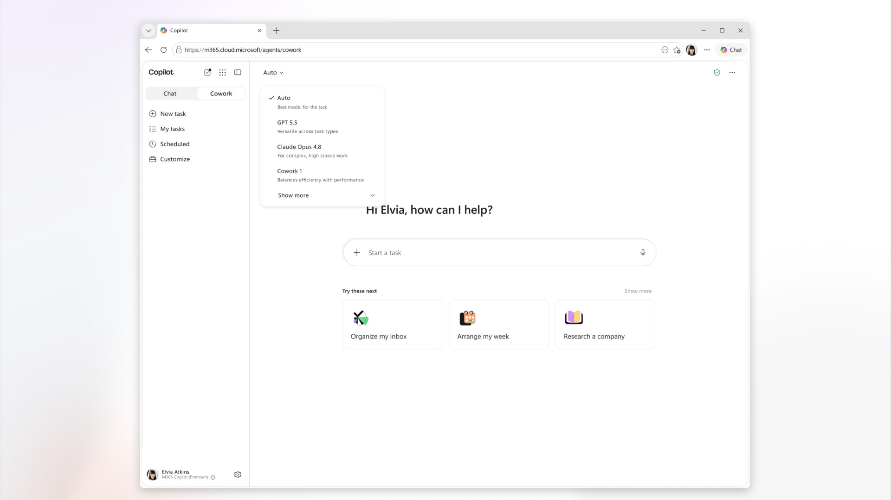
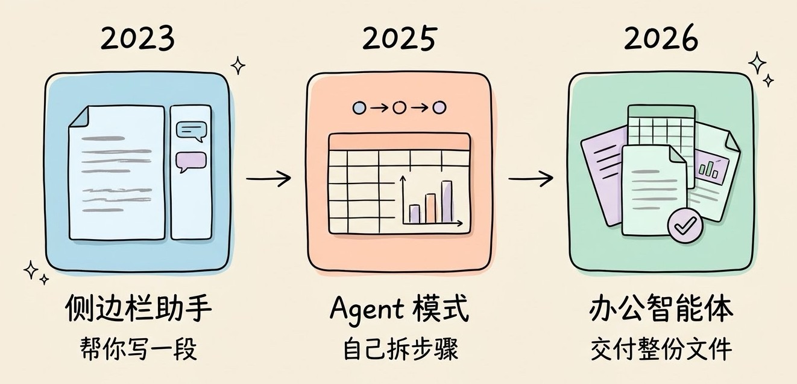
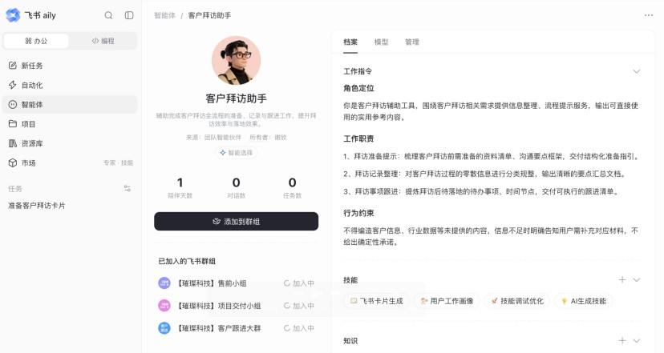
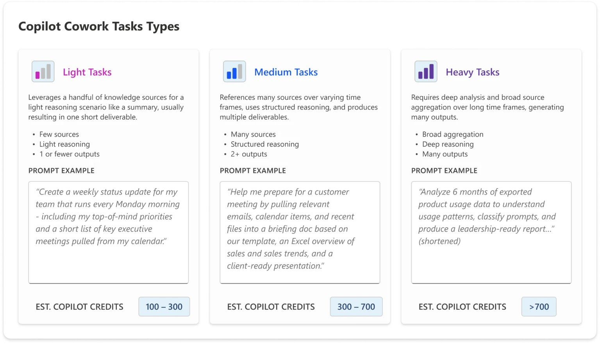
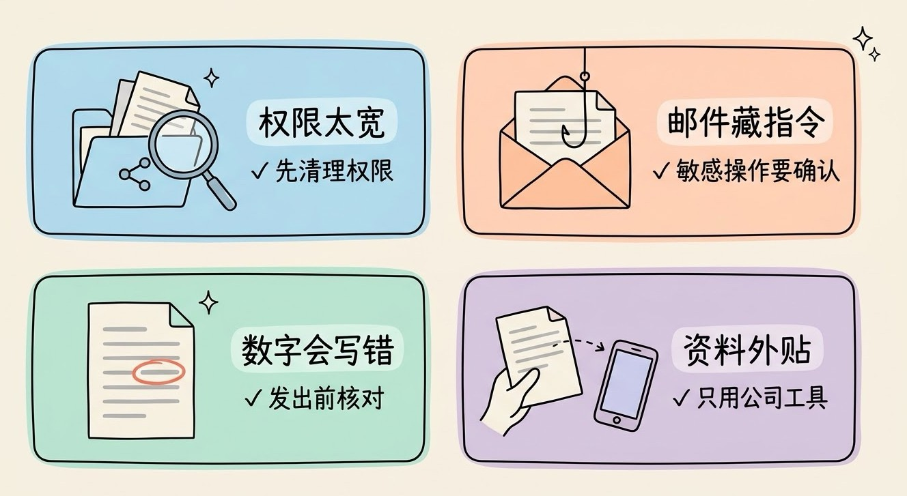

# 3分钟搞懂AI办公助手

> ⭐入门 · 阅读时间 3分钟 · 更新于 2026-11-18
>
> AI 办公助手正在从侧边栏里的写作助手，变成能直接交付文档、表格和 PPT 的智能体。本文讲清它和聊天 AI 的真正区别在于能读到你的邮件、会议和文件，主流产品怎么选，收费方式怎么变，以及用的时候要注意哪些问题。

## 一句话定义

**AI 办公助手** = 装在 Word、Excel、邮件、会议、协作文档这些办公软件里的 AI。它能在你的权限范围内读取邮件、文件、会议记录和日程，帮你起草文档、分析表格、生成 PPT、整理会议纪要，现在也能把一整份文件直接做完交给你。

它和你单独打开一个聊天 AI 最大的区别，并不是模型更聪明，而是**它能直接看到你工作中的资料，也能直接修改你正在用的文件**。

## 同样是写周报，差别在 AI 能看到什么

假设你要写一份周报。如果用普通的聊天 AI，你得先自己去翻这周的邮件、会议纪要和项目表格，把要点复制粘贴进对话框，AI 才能帮你整理成文。资料全靠你自己喂给它，漏了哪一条它也不会知道。

换成办公软件里的 AI 助手，你只需要说一句“根据我这周的邮件、会议和任务写一份周报”。它会自己去检索你这周参加过的会议、收发过的邮件、改过的文档，然后按你要的格式写出初稿。微软把这层提供工作背景的能力叫作 **Work IQ**；飞书的 aily 也是一样，在你授权的范围内读取飞书里的消息、文档、日历、会议、任务和多维表格来干活。

所以办公 AI 真正值钱的，是它背后连着的这些工作数据，而不是模型本身。有一个事实很能说明这一点：微软自己的 Copilot Cowork 在正式上线时，用的是 Anthropic 的 Claude 模型，参加预览计划的客户还可以选 OpenAI 的 GPT 模型。模型是可以随时换的，但你的邮件、文件和会议记录存在哪家的系统里，AI 就只有在哪家的系统里才最好用。

*图注：微软官方博客里的 Copilot Cowork 界面截图。左上角的模型菜单里，Auto 表示自动挑选模型，下面依次是 OpenAI 的 GPT 5.5、Anthropic 的 Claude Opus 4.8，以及微软自己调过的 Cowork 1。在同一个办公助手里，模型只是一个可以切换的选项。*

这也是选型的第一条原则：**你的工作数据存在哪套办公软件里，就优先用那一套的 AI**。公司用 Microsoft 365，就先看 Copilot；用 Google Workspace，就先看 Gemini；用飞书、钉钉、企业微信，就先看它们自带的 AI。为了 AI 去换一整套办公软件，迁移成本通常比两家 AI 在功能上的差距大得多。

## 从帮你写一段，到替你交付一份文件

办公 AI 这几年大致经历了三个阶段。

**第一阶段是侧边栏助手。** 2023 年前后，Microsoft 365 Copilot、Google 的 Duet AI（后来改名为 Gemini）、WPS AI 陆续上线，形态都差不多：在软件旁边开一个对话框，帮你续写一段话、总结一篇文档、写一个表格公式。每一步都要你来发起，AI 只负责眼前这一小块。

**第二阶段是 Agent 模式。** 2025 年下半年起，微软在 Excel 和 Word 里推出了 Agent 模式，其他家也陆续跟进。AI 开始能自己拆步骤、连续操作：你说“把这份销售数据做成一份分析报告”，它会自己整理数据、写公式、画图、写结论，中间不需要你一步步指挥。

**第三阶段是办公智能体，也是 2026 年各家集中在做的事。** 你交代一件完整的任务，AI 在后台跑上一段时间，跨好几个软件，最后交给你一份做好的文件：

- 微软的 **Copilot Cowork** 在 2026 年 6 月 16 日正式上线，微软的说法是它交付的是做完的结果，而不是一份草稿或建议。官方举的例子里，有团队用它对比了两个产品版本的近 4000 个文件，这件事原本要花几周时间。11 月 17 日的 Ignite 大会上，微软又把完整的 Word、Excel、PowerPoint 编辑功能放进了 Copilot 应用里，聊着天就能直接进入文档编辑。
- 飞书的 **aily** 在 7 月 23 日升级后，可以在云端 7×24 小时工作，比如会议改期后自动重排日程、准备材料。团队还可以给智能体设定角色和资料，把它拉进项目群，成员 @ 它就能整理需求变化、关键决定和待办。
- 阿里的 **千问办公** 在 11 月 9 日发布了 2.0 版本，已经接入钉钉，可以把 Agent 带进工作群，还能在收到特定的人发来的消息、出现审批任务时自动触发 Agent 去处理。
- 腾讯在 10 月 29 日发布了 **Buddy One**，把腾讯文档、腾讯会议、腾讯网盘和 ima 接到同一个 WorkBuddy Agent 底座上，让 AI 能跨应用完成任务。

*图注：飞书 aily 升级后的团队智能体页面，图片来自新华网的报道。右边是给智能体写的工作指令，包括角色定位、工作职责和“不得编造客户信息”这类行为约束；左边点“添加到群组”，就能把它拉进售前、交付这些项目群里使用。*

与此同时还有一个反方向的变化：聊天 AI 也在往办公软件里走。Anthropic 在 2026 年 5 月 7 日正式推出了 Claude 的 Excel、PowerPoint、Word 插件，付费用户可以直接在微软的办公软件里使用 Claude。同一段对话可以跨几个文件延续，比如你在 Excel 里改了一个假设，关联的 PPT 图表和 Word 备忘录也会跟着更新。千问办公走的也是类似的路，从对话框直接生成文档、表格和 PPT。

对普通用户来说，在比较办公 AI时，不能只看谁的续写和润色功能更好，还要看它能不能接上你的数据、能不能把一件事从头做到尾。

## 主流产品怎么选？

按你所在公司用的办公软件来对号入座，下面这张表列出了主流产品的情况：

| 产品 | 适合谁 | AI 怎么收费 |
|------|--------|------------|
| Microsoft 365 Copilot | 已经在用 Microsoft 365 的企业 | 基础的 Copilot Chat 随符合条件的套餐免费；完整版大企业每人每月 30 美元，300 人以下企业的 Copilot Business 每人每月 21 美元；Cowork 另按用量计费 |
| Gemini for Google Workspace | 用 Gmail、Google 文档的团队 | 已经打包进套餐，不单独收费；Business Starter 只能在 Gmail 等少数应用里用，Standard 及以上才能在文档、表格、会议里用 |
| 飞书 aily | 用飞书协作的企业 | 随飞书企业版提供，具体权益看所购版本 |
| 钉钉 + 千问办公 | 用钉钉的企业 | 免费标准版保留；9 月推出的 4 个 AI 商业版都接入了千问办公，按版本和人数赠送积分 |
| 腾讯文档 / WorkBuddy | 用企业微信、腾讯文档的团队 | WorkBuddy 按积分收费，个人版有免费体验档，付费档每月 99 元起 |
| WPS AI / 灵犀 | 个人用户和中小团队 | 基础 AI 功能免费，更多 AI 权益要开通 WPS 会员；灵犀专业版从 8 月 3 日起按“灵点”单独收费，和 WPS 会员分开 |
| Notion AI | 用 Notion 管理知识库的团队 | 完整 AI 功能包含在 Business 版（每人每月 20 美元）及以上；自定义 Agent 另按 Notion 积分收费 |
| Claude 的 Office 插件 | 想在微软 Office 里用 Claude 的人 | 需要 Claude 的付费订阅 |

如果公司没有统一采购，个人用户可以先用 WPS 自带的 AI、千问办公、WorkBuddy 这类产品的免费额度试一试，确定自己经常用之后再考虑付费。会议纪要这件事可以不用单独买工具，飞书妙记、腾讯会议、钉钉、Teams 都已经内置了转写和纪要功能，用公司正在用的那一款就行。

另外，Copilot 的价格要多说一句。微软在 2026 年 7 月 1 日到 12 月 31 日之间，给已有 Microsoft 365 商业版的老客户做了一个首年促销，Copilot Business 从每人每月 21 美元降到 18 美元，需要按年付费。

## 收费方式正在变：除了席位费，还要按用量付钱

从上面的表格可以看出一个共同的变化：几乎每一家都在原来按人头收的席位费之外，加上了按用量计费的部分。微软的 Cowork 用 Copilot Credits 计费，每个任务花多少钱，取决于用了哪个模型、检索了多少资料、调用了多少次工具、跑了多长时间；Notion 的自定义 Agent 用 Notion 积分；WPS 灵犀用灵点；钉钉和腾讯用积分。

原因并不难理解。侧边栏助手帮你改一段话，消耗的算力很少，按人头收一笔固定的钱就能覆盖；但办公智能体一跑就是几十分钟，要读大量文件、反复调用工具，不同任务之间的成本可能差出很多倍，固定价格就很难覆盖了。

微软给 Cowork 做的估算就能说明这一点：每周例行的团队周报属于轻任务，大约消耗 100 到 300 个 Copilot Credits；要分析几个月的数据、产出多份文件的重任务，会超过 700 个。按每个 Credit 0.01 美元的现付价格来算，轻任务大约是 1 到 3 美元，重任务就要 7 美元以上。

*图注：微软官方博客给出的 Cowork 任务分级。从左到右是轻、中、重三类任务：轻任务只用少量资料、产出一份简短结果，比如每周一自动生成的团队周报；中等任务要汇总邮件、日历和文件，产出简报、Excel 和给客户看的 PPT 等多份文件；重任务是分析 6 个月的产品使用数据，写出给管理层看的报告。每张卡片最下面是预计消耗的 Copilot Credits。*

另一个可能的原因是，按席位卖并不容易卖开。微软在 2026 年 1 月第一次公布了 Copilot 的付费席位数，是 1500 万，当时 Microsoft 365 的商业版用户有 4.5 亿；到 7 月底，付费席位超过了 3000 万，增长很快，但和庞大的用户基数相比，付费版覆盖的仍然只是一小部分人。降价促销、把基础的 Copilot Chat 免费送、再用按量计费去收重度用户的钱，是我们推测出来的一个合理思路。

对公司来说，这意味着**办公 AI 的预算不再是“人数 × 单价”这么简单**。开通按量计费的功能之前，最好先在后台设好每人或每个部门的用量上限。微软的 Cowork 默认是关闭的，需要管理员决定开给谁，也可以设置用量限制；其他家的积分制产品也建议先小范围试用，看清楚一个月实际花了多少，再决定要不要铺开。

## 哪些工作交给 AI 最划算？

办公 AI 省时间最明显的，通常是这几类工作：

- **有现成材料、只需要整理的**：会议纪要和待办提取、根据聊天记录和邮件写周报、把一份长文档压缩成要点。
- **格式固定、重复去做的**：通知、邮件回复、标准格式的报告，以及把文档转成 PPT 的初稿。
- **人做起来费时但不难判断的**：写复杂的表格公式、在几十上百个文件里找差异、把多张表的数据汇总到一起。

省时间不明显的，是那些需要你自己做判断的工作：方案该选哪个、对客户怎么承诺、人事和预算怎么安排。AI 可以帮你把材料准备好，但结论还是要你来下。

还有一个实用的经验：**给 AI 的指令越具体，返工就越少**。与其说“帮我做个 PPT”，不如说清楚给谁看、讲几页、重点是哪几个数字、参考哪一份旧文件的格式。办公 AI 能读到你的文件，所以你可以直接告诉它“按上个月那份季度汇报的结构来做”，这是普通聊天 AI 做不到的。

## 用 AI 办公助手时，需要注意哪些问题？

**第一，AI 能看到的资料，可能比你想的多。** 办公 AI 是按你的权限来检索资料的，你能打开的文件，它都能读到。很多公司的共享盘权限设得很宽松，以前没有人会专门去翻，现在只要一句“找一下最新的薪资调整方案”，本来不该被看到的文件就可能被搜出来。所以企业在开通之前，**一定要先清理一遍共享文件夹和文档的权限**。

**第二，邮件和文档里可能藏着攻击指令。** 2025 年 6 月披露的 EchoLeak 漏洞（CVE-2025-32711）就是一个例子：攻击者只需要给你发一封精心构造的邮件，你不用点开任何链接，当 Copilot 后来在回答问题时把这封邮件读进上下文，邮件里藏着的指令就可能让它把你能访问的敏感数据带出去。这个漏洞的危险评分是 9.3 分（满分 10 分），微软已经在服务端修复，并表示没有发现客户数据被利用。办公智能体能自己操作的事情越多，这类风险就越需要重视，所以涉及发邮件、改权限、删除文件的操作，最好保留人工确认这一步。

**第三，事实和对外口径要人来审。** 数字、日期、合同条款、对客户的承诺，AI 都可能写错，或者从过时的文件里拿了旧数据。把 AI 写的东西当作初稿，**对外发出去之前一定要自己核对一遍**。

**第四，最常见的泄露还是来自人。** 企业版办公 AI 通常在合同里承诺不用客户数据训练模型，数据也留在公司的租户范围内。但如果员工嫌公司的工具不好用，把内部资料复制到个人的免费 AI 工具里，这些承诺就都保护不了你。另外，现在有的办公套件会把任务交给其他厂商的模型来处理，比如 Copilot 里的 Claude，对数据存放地区有要求的企业，开启之前要先确认清楚。

还有一个常见的误会：觉得“效率提升 30%”就等于“可以少招 30% 的人”。实际上，AI 省下的往往是每个人身上零散的时间，比如每天少花半小时写纪要、回邮件，这些时间不会自动变成可以裁掉的岗位。真正被影响比较大的，是那些主要工作就是整理和搬运信息的岗位；会拆解任务、会检查 AI 输出、能推动事情落地的人，反而会更吃香。

## 时效性提醒

办公 AI 是变化最快的方向之一，下面这些内容最容易变：

- 各家的套餐价格、促销活动，以及按用量计费的单价和积分规则
- 办公智能体相关的功能，很多还处在预览阶段，比如微软的 Autopilot、Today 还只在 Frontier 预览计划里开放
- 各家接入的底层模型，微软、飞书、钉钉都在同时接入多家模型，随时可能调整

**建议**：先在公司已经采购的办公软件里打开 AI 功能，用一两周常见的工作去试，再决定要不要为另一套工具付费。

💬 **互动话题**：你现在用办公 AI 最多的是写邮件、做表格、做 PPT，还是整理会议纪要？有没有哪一件事是真的帮你省下了一整块时间的？

📖 **相关阅读**：

- 3分钟搞懂微软AI - Copilot 背后的微软 AI 布局
- [3分钟搞懂WorkBuddy](../../10-ai-agent-products/02-workbuddy/README.md) - 腾讯的桌面办公智能体，Buddy One 的底座
- [3分钟搞懂个人智能体](../../10-ai-agent-products/04-personal-agent/README.md) - 一直在线、替你干活的 AI 助理
- [3分钟搞懂Agent沙箱与权限](../../09-agent-engineering/08-sandbox-and-permissions/README.md) - 怎么防止 AI 越权操作
- [3分钟搞懂Prompt工程](../../01-basics/07-prompt-engineering/README.md) - 怎么把任务交代清楚，减少返工
- [3分钟搞懂AI就业影响](../../08-business-ethics/04-ai-and-jobs/README.md) - AI 办公对白领岗位的影响

**资料来源**：

- Microsoft 365 Copilot 价格页：https://www.microsoft.com/en-us/microsoft-365-copilot/pricing
- Microsoft，Copilot Cowork is now generally available（2026-06-16，文中 Cowork 界面截图和任务分级图出自此文）：https://www.microsoft.com/en-us/copilot/blog/2026/06/16/copilot-cowork-is-now-generally-available/
- Microsoft Ignite 2026 Book of News（2026-11-17）：https://news.microsoft.com/events/ignite/2026/book-of-news/
- Directions on Microsoft，Microsoft Claims 15 Million Paid M365 Copilot Seats（2026-01-29）：https://www.directionsonmicrosoft.com/microsoft-claims-15-million-paid-m365-copilot-seats/
- UC Today，Microsoft 365 Copilot Passes 30 Million Paid Seats（2026-07-30）：https://www.uctoday.com/unified-communications/microsoft-365-copilot-passes-30-million-paid-seats-as-cloud-and-ai-growth-power-record-quarter/
- Google Workspace 价格页：https://workspace.google.com/pricing
- 新华网，飞书 aily 升级（2026-07-23，文中飞书 aily 截图出自此文）：http://www.news.cn/tech/20260723/5a84c09560134a5c9937a825773fba95/c.html
- 腾讯新闻，钉钉发布四个 AI 商业版本（2026-09-24）：https://news.qq.com/rain/a/20260924A0CADK00
- 腾讯新闻，千问办公 2.0 发布（2026-11-09）：https://news.qq.com/rain/a/20261109A0A9FB00
- 21 世纪经济报道，腾讯 Buddy One 上线（2026-10-29）：https://m.sfccn.com/2026/10-29/wMMDE1MThfMjI4NzAwMg.html
- WPS 社区，灵犀专业版收费说明：https://bbs.wps.cn/topic/93775
- Notion 价格页：https://www.notion.com/pricing
- Anthropic，Collaborate with Claude across Excel, PowerPoint, Word and Outlook（2026-05-07）：https://claude.com/resources/articles/collaborate-with-claude-across-excel-powerpoint-word-and-outlook
- The Hacker News，Zero-Click AI Vulnerability Exposes Microsoft 365 Copilot Data（2025-06）：https://thehackernews.com/2025/06/zero-click-ai-vulnerability-exposes.html

---

⬅️ 上一篇：[3分钟搞懂AI搜索引擎](../01-ai-search/README.md) ｜ [📚 返回目录](../README.md) ｜ 下一篇：[3分钟搞懂AI翻译](../03-ai-translation/README.md) ➡️
