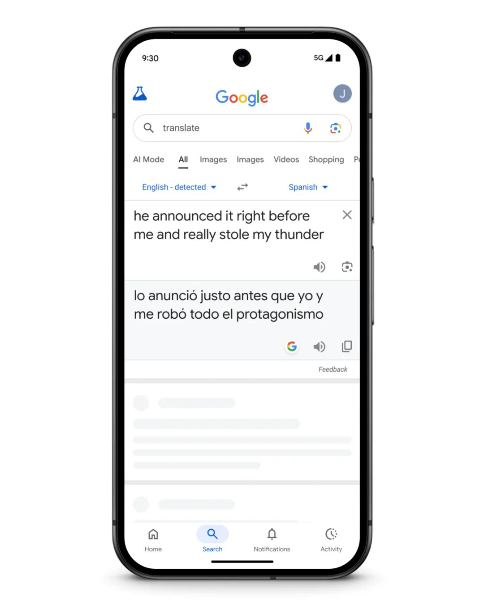
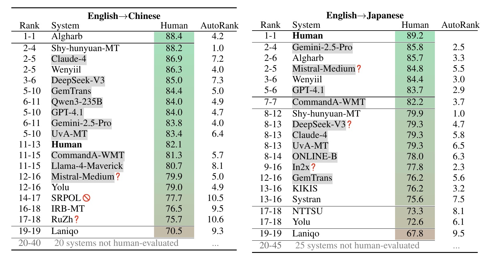
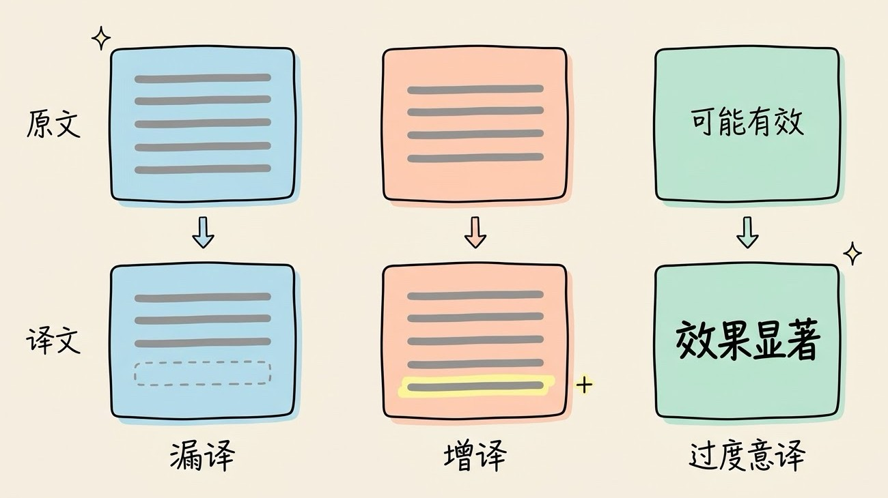
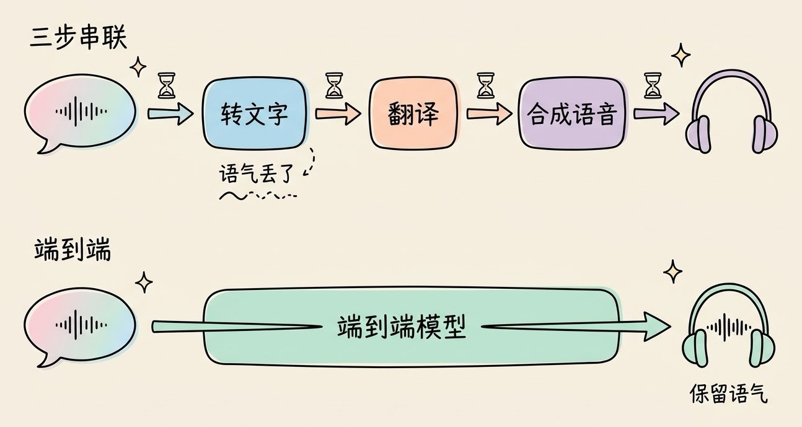
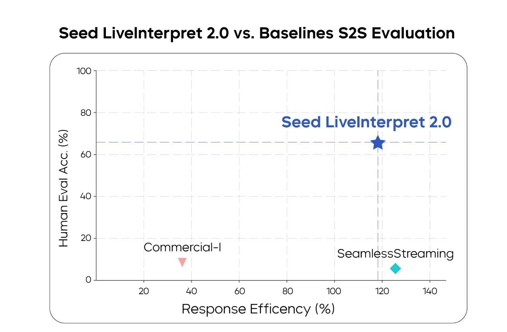

# 3分钟搞懂AI翻译

> ⭐入门 · 阅读时间 3分钟 · 更新于 2026-11-18
>
> 翻译引擎和大模型已经合流，Google 翻译换上了 Gemini，OpenAI 也做了独立的翻译页面。本文讲清 AI 翻译怎么从文字走到耳机里的实时同传、为什么跑分第一不等于人觉得最好、大模型译文的错为什么更难发现，以及不同场景怎么选工具。

## 一句话定义

**AI 翻译** = 让模型先读懂一段话在上下文里的意思，再用另一种语言重新把这个意思说出来，而不是逐个词查字典再拼起来。它能处理的已经不只是文字，网页、文档、图片里的字，还有对面那个人正在说的话，都可以实时翻译。

一个老例子就能看出差别：

```
原文: It's raining cats and dogs.

逐词拼接: 正在下猫和狗。
神经机器翻译: 下着倾盆大雨。
大模型(要求口语一点): 雨下得跟泼水似的。
```

从“下猫和狗”到“倾盆大雨”，是 2016 年前后神经机器翻译（NMT）取代统计翻译带来的变化：模型开始把整句话当成一个整体来理解。从“倾盆大雨”到“跟泼水似的”，是 2023 年之后大模型带来的变化：你可以告诉它读者是谁、要什么语气，它会照着改。

## 翻译引擎和大模型，已经合到一起了

前两年讨论 AI 翻译，常见的说法是两条路：DeepL、Google 翻译这类**专用翻译引擎**，打开就能用、速度快；ChatGPT、Claude 这类**大模型**，能听懂要求、能解释译法，但是用起来要自己写提示词。

现在这条界线已经很模糊了，两边在往中间走：

- **Google 翻译换上了 Gemini**。2025 年 12 月 12 日，Google 把 Gemini 的翻译能力接进了搜索和翻译 App，先在美国和印度上线，覆盖英语和近 20 种语言（包括中文）之间的互译。官方举的例子就是习语和俚语：以前会按字面直译，现在会结合上下文翻成当地人真正会说的话。
- **OpenAI 做了一个独立的翻译页面**。2026 年 1 月，OpenAI 低调上线了 ChatGPT Translate（chatgpt.com/translate），界面和 Google 翻译一样是左右两栏，支持 50 多种语言，还可以在“自然、商务、学术、给孩子看”这几种风格之间切换。上线时还不能整篇传文档、翻整个网页。
- **DeepL 也在往大模型和语音方向扩**。它支持的语言从 2024 年的三十多种扩展到了 100 种以上，2026 年又推出了实时语音翻译。


*图注：Google 官方博客给出的示例。英文里的 stole my thunder 字面意思是“偷了我的雷声”，实际意思是“抢了我的风头”，接入 Gemini 之后，译文按意思翻成了西班牙语里的“抢走了我所有的风头”，没有按字面直译。*

对普通用户来说，这意味着**选工具时不用再纠结“翻译引擎还是大模型”**，因为背后基本都是大模型了。真正的区别在产品形态：是打开就译、翻完就走，还是能一边翻一边跟你商量“这个词换个说法”。

## 跑分第一，不等于人读着最好

各家发翻译模型时都喜欢说“在某某评测里排名第一”，但翻译这件事，机器打分和人的感受有时候差得很远。

机器翻译领域最有名的比赛叫 **WMT**，每年举办一次。2025 年的 WMT25 出现过一个很有代表性的情况：腾讯基于混元翻译模型提交的系统（参赛名 Shy-hunyuan-MT，底座 Hunyuan-MT-7B 只有 7B 参数），在**自动评分**里几乎包揽了所有语言方向的第一，当时国内也有不少“小模型击败大模型”的报道。但等到**人工评估**结果出来，它在不少语言方向上都排到了最前面几个系统的后面，比如英译日，自动评分是第一，人工排名却只在第 8 到第 12 名之间。主办方在最终报告里给出的综合最佳是 Gemini 2.5 Pro，它在 14 个语言方向上进入了第一梯队。

当然，混元的成绩本身并不差，在限制模型规模和训练数据的那个组别里，它依然是表现最好的系统。问题出在自动评分把它排得太靠前了。


*图注：WMT25 总结报告里的两张排名表。Rank 是人工评估的排名区间，Human 是人工打分（越高越好），AutoRank 是自动评分的排名（越小越好）。Shy-hunyuan-MT 的 AutoRank 都是 1.0，人工排名在英译中是第 2 到 4，在英译日是第 8 到 12。表里加粗的 Human 是人类译者给出的参考译文：在英译日里它排第一，在英译中却只排到第 11 到 13。*

为什么会这样？因为自动评分用的也是模型，它擅长判断“意思对不对得上”，但不太擅长判断“读起来像不像人写的”“语气合不合适”。一个专门针对评分方式优化过的模型，分数可以很高，人读起来却未必舒服。主办方也明确说过，人工评估更可靠，以人工评估的结果为准。

这对选工具的启发很直接：**别只看榜单，拿你自己真正要翻的东西去试一下**。同一段产品文档，分别丢给两三个工具，挑一段你自己能判断好坏的内容对比一下，比看任何排名都靠谱。

## 大模型翻错时，你更难发现

老一代机器翻译出错，通常错得很明显：句子不通、词序奇怪，一眼就能看出“这是机翻”。

大模型翻译的问题正好相反，它的译文几乎总是通顺的，**错误就藏在通顺的句子里**。常见的有这几种：

- **漏译**：原文有五句话，译文只有四句，少的那句可能正好是“以下条款不适用于……”。
- **增译**：为了让句子更顺，模型自己补了原文里没有的内容，比如给一个数字加上了单位，或者给一个结论补上了原因。
- **过度意译**：原文是比较克制的“可能有效”，译文变成了“效果显著”。读着更漂亮了，意思却变了。

这其实就是 **AI 幻觉**在翻译场景里的样子。所以用大模型翻重要的内容时，有两个简单的检查办法：一是对一下段落数、数字、人名和专有名词有没有对上；二是让它把译文再翻回原文的语言（回译），看看意思有没有跑偏。回译不能保证没问题，但能帮你很快发现明显的漏译和改意。



## 翻译正在从文字走到耳朵里

如果说文字翻译已经“够用”，那 2025 年到 2026 年变化最大的是**实时语音翻译**：你说中文，对方耳机里听到的是英文，而且尽量还是你的声音、你的语气。

传统的做法是三步串起来：先把语音转成文字，再翻译文字，最后用合成的声音读出来。每一步都要等上一步做完，延迟会一层层叠加，你的语气和情绪在转成文字时也就丢掉了。新一代模型改成了**端到端**：直接听原声，直接输出译文的语音，中间不再拆成三步。



现在能用上的产品大致有这些：

| 产品 | 形态 | 情况 |
|------|------|------|
| Google 翻译“实时翻译” | 手机 App + 任意耳机 | 2025 年 12 月推出测试版，支持 70 多种语言，先在 Android 上线，部分国家可用 |
| Apple AirPods 实时翻译 | AirPods + iPhone | 支持中文，但要求 iPhone 15 Pro 及以后的机型，**中国大陆地区不可用** |
| DeepL Voice | 线上会议、面对面对话、API | 2026 年 4 月推出语音到语音翻译；11 月 11 日发布新语音模型 Aure，能把说话人语气、重音和语速的变化带进译文，首批支持英、德、法、日、韩等 8 种语言 |
| 豆包同声传译 2.0 | 火山引擎 API | 字节 Seed 团队 2025 年 7 月发布，中英互译，官方称延迟可以低到 2 到 3 秒，支持实时复刻说话人的声音 |
| 千问 Qwen3.8-LiveTranslate | 阿里云 API | 2026 年 9 月 19 日发布，支持 60 种语言，平均延迟从 2.8 秒降到 2.3 秒，新增了区分不同说话人、长上下文消歧 |
| 有道等翻译硬件 | 翻译机、会议耳机 | 网易有道 2026 年把子曰大模型升级到 4.0，翻译模型同步重构，会议耳机支持十几种语言实时互译 |

同声传译最难的地方，在于**句子还没说完就得开口**。比如中文说“我们决定，在下个季度结束之前，暂时不会……”，关键的那个“不会”可能放在最后。人类同传译员靠经验去预判，模型也一样，要在“等久一点更准”和“快一点不冷场”之间取舍。所以几秒钟的延迟，已经是现在比较好的水平了。



*图注：字节 Seed 团队在发布博客里公布的语音到语音同传评测，是厂商自己测的结果，对比的商用系统也做了匿名处理。纵轴是人工评估的准确率，横轴是响应效率。Seed LiveInterpret 2.0 的准确率在 66% 左右，另外两个系统都不到 10%。即使是表现最好的系统，也有三分之一左右的内容达不到人工评估的要求，说明端到端的实时语音翻译离“完全放心”还有一段距离。*

声音复刻也带来了新问题：你的声音可以被实时“借”去说另一种语言，那么别人的声音也可能被这样用。这部分可以看《3分钟搞懂AI声音克隆》。

## 不同场景怎么选

| 场景 | 推荐 | 原因 |
|------|------|------|
| 读外文网页、技术文档、论文 | 沉浸式翻译等浏览器插件 | 原文和译文对照着看，翻译引擎可以自己选，也可以接大模型 |
| 合同、产品文档这类要整篇翻的文件 | DeepL、Google 翻译的文档翻译 | 能保留原来的排版，不用自己一段段复制 |
| 要控制语气、统一术语、解释译法 | ChatGPT、Claude，国内用豆包、千问、Kimi、DeepSeek 等 | 可以给背景、给术语表，翻完还能追问 |
| 中英日常查词、学习 | 有道翻译、百度翻译、Google 翻译 | 打开就能用，有道和百度在国内访问稳定，词典、例句也更全 |
| 小语种、出国旅行 | Google 翻译 | 语种最多，拍照翻译、离线包都比较成熟 |
| 跨语言开会、当面交流 | 豆包、千问的同传能力，讯飞、有道的翻译硬件 | 国内能直接用；AirPods 实时翻译在大陆不可用 |

DeepL、Google 翻译、ChatGPT 在国内访问不稳定，或者需要特殊的网络环境，如果是日常用，国内的有道、百度和各家大模型 App 已经能覆盖大部分需求。

如果用大模型翻译，**效果好不好，主要看你给了多少上下文**。同样一句话，只说“翻译成英文”，和把读者、用途、术语一起交代清楚，结果差别很大：

```
把下面这段产品说明翻译成英文。
- 读者: 海外的开发者, 不是普通消费者
- 风格: 简洁、技术化, 不要营销腔
- 术语: "工作区"统一译为 workspace, "空间"统一译为 space
- 保留原文的 Markdown 格式, 不要增删内容
- 翻完之后, 单独列出你拿不准的地方
```

最后一条很有用，它会主动告诉你哪里有歧义，你只需要重点看这几处，不用逐句检查整篇译文。长文档也最好分段翻，但每段都带上前文的摘要和术语表，不然前后同一个词可能会被翻成两种说法。

## 哪些内容还需要人来翻译和审校

AI 翻译适合的场景已经很多了：读网页和文档、写邮件初稿、给视频生成字幕、学外语时做对照，还有多语言内容的第一稿。

但下面这几类内容，还是需要懂行的人来审校或者直接翻：

- **合同、判决书、病历、药品说明书**：一个术语翻错就是事故，而且出了问题，责任要有人来承担。
- **小说、诗歌、广告语**：要兼顾韵律、文化背景和品牌语气，“意思对”远远不够。
- **双关、梗和方言**：比如“打酱油”，模型很可能直接翻成 buy soy sauce。
- **正式的谈判和外交场合**：什么话要说得委婉、什么时候该停下来，现场的分寸还是人更能把握。

翻译行业确实受到了很直接的冲击。微软研究院 2025 年 7 月发布的研究，统计了 Copilot 的真实对话，在“AI 能覆盖的工作内容”这项上，口译和笔译员排在所有职业的第一位，不过作者也特别说明，覆盖度高说明的是工作内容和 AI 能力重合得多，不等于这个职业会被取代。英国作家协会 2024 年的调查里，有 36% 的译者表示已经因为生成式 AI 失去了一部分工作。

更现实的变化是分工变了：简单的、量大的文本交给机器，人从“从头翻”变成“审校 + 把关”，这种模式在行业里叫 **PEMT**（Post-Editing Machine Translation，机器翻译后编辑）。而高风险、高要求的文本，反而更需要有专业能力、能承担责任的译者。

对学外语的人来说也是一样，翻译工具让入门变容易了，但如果你要深度阅读专业资料、在谈判里听出对方的言外之意，或者跟人建立信任关系，自己懂这门语言仍然更快，也更稳。

## 时效性提醒

文字翻译的基本能力已经比较稳定，变化快的是这些：

- 各家产品支持的语种数量、免费额度和价格
- Google 翻译 Gemini 版本和耳机实时翻译开放的国家和平台
- 实时语音翻译的延迟、声音复刻效果，以及 AirPods 实时翻译在中国大陆能不能用
- 国内同传模型的版本，豆包、千问基本每隔几个月就会更新一次

**建议**：选工具前，拿自己真正要翻的一段内容实际试一下，语种和价格以各家官网为准。

💬 **互动话题**：你现在翻译外文，默认打开的是翻译软件、浏览器插件，还是直接丢给大模型？有没有遇到过译文读着很顺、意思却完全翻错的情况？

📖 **相关阅读**：

- [3分钟搞懂Transformer](../../01-basics/03-transformer/README.md) - 现代机器翻译背后的模型架构，它最早就是为翻译设计的
- [3分钟搞懂自然语言处理](../../02-core-capabilities/02-nlp/README.md) - 翻译是自然语言处理里最经典的任务之一
- [3分钟搞懂AI幻觉](../../04-advanced/04-hallucination/README.md) - 漏译、增译背后的原因
- [3分钟搞懂多模态AI](../../04-advanced/03-multimodal-ai/README.md) - 拍照翻译、实时语音翻译要用到的看图和听音能力
- [3分钟搞懂AI声音克隆](../06-ai-voice-cloning/README.md) - 同传时保留说话人声音用到的技术

**资料来源**：

- Google，Bringing state-of-the-art Gemini translation capabilities to Google Translate（2025-12-12）：https://blog.google/products-and-platforms/products/search/gemini-capabilities-translation-upgrades/
- WMT25，Findings of the WMT25 General Machine Translation Shared Task: Time to Stop Evaluating on Easy Test Sets（排名表截自第 376 页）：https://aclanthology.org/2025.wmt-1.22/
- 腾讯混元，Hunyuan-MT Technical Report：https://arxiv.org/abs/2509.05209
- Slator，OpenAI Quietly Launches ChatGPT Translate（2026-01）：https://slator.com/openai-launches-chatgpt-translate-standalone-translation-tool/
- DeepL，Voice-to-Voice 发布：https://www.deepl.com/en/press-release/deepl-unveils-real-time-spoken-translation-breaking-the-next-language-barrier-with-voice-to-voice
- DeepL，Aure 语音模型发布（2026-11-11）：https://www.prnewswire.com/news-releases/deepl-unveils-aure-its-most-lifelike-voice-ai-translation-model-yet-302935694.html
- DeepL，How we launched over 70 new languages on DeepL：https://www.deepl.com/en/blog/how-we-launched-70-new-languages-on-deepl
- 字节跳动 Seed，Seed LiveInterpret 2.0 发布（2025-07）：https://seed.bytedance.com/en/blog/seed-liveinterpret-2-0-released-an-end-to-end-simultaneous-interpretation-model-featuring-ultra-high-accuracy-close-to-human-interpreters-low-latency-of-3-seconds-and-real-time-voice-cloning
- 千问同声传译大模型 Qwen3.8-LiveTranslate 发布（2026-09-19）：https://www.sohu.com/a/1078215054_115060
- 网易有道子曰大模型 4.0（2026-05）：https://news.mydrivers.com/1/1123/1123674.htm
- Apple，使用 AirPods 实时翻译：https://support.apple.com/guide/airpods/dev9c215ca94/web
- Microsoft Research，Working with AI: Measuring the Occupational Implications of Generative AI（2025-07）：https://arxiv.org/abs/2507.07935
- The Bookseller，A third of translators report losing work to generative AI systems, SoA survey reveals（2024-04）：https://thebookseller.com/news/a-third-of-translators-report-losing-work-to-generative-ai-systems-soa-survey-reveals

---

⬅️ 上一篇：[3分钟搞懂AI办公助手](../02-ai-office-assistant/README.md) ｜ [📚 返回目录](../README.md) ｜ 下一篇：[3分钟搞懂AI图像生成](../04-ai-image-generation/README.md) ➡️
