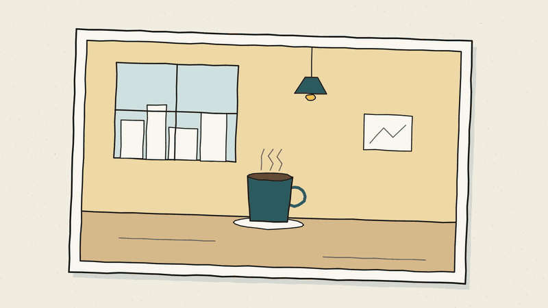
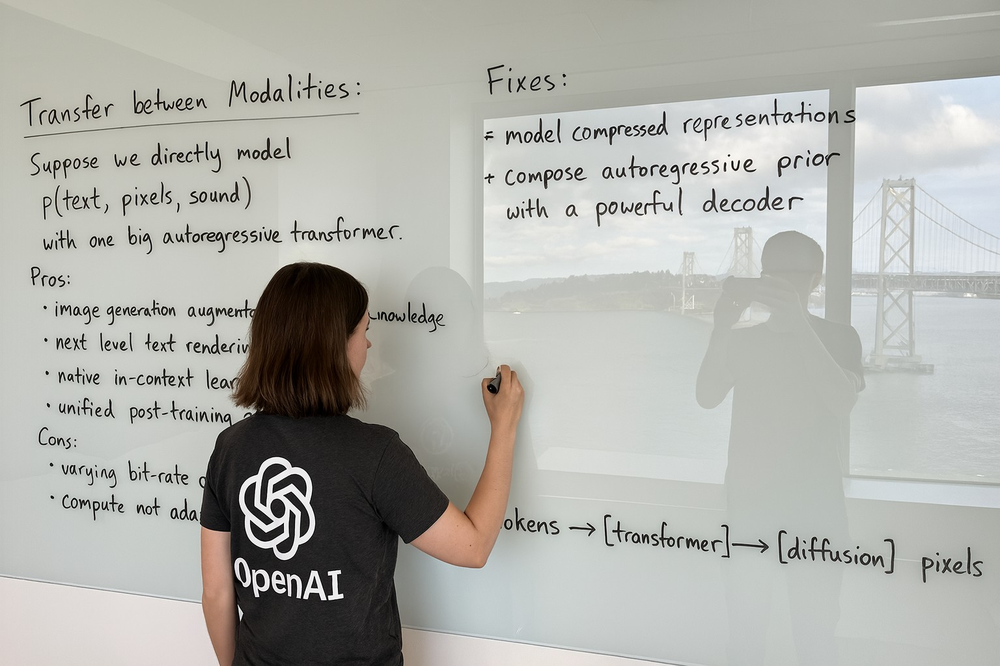
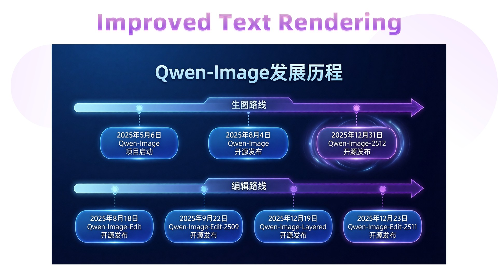
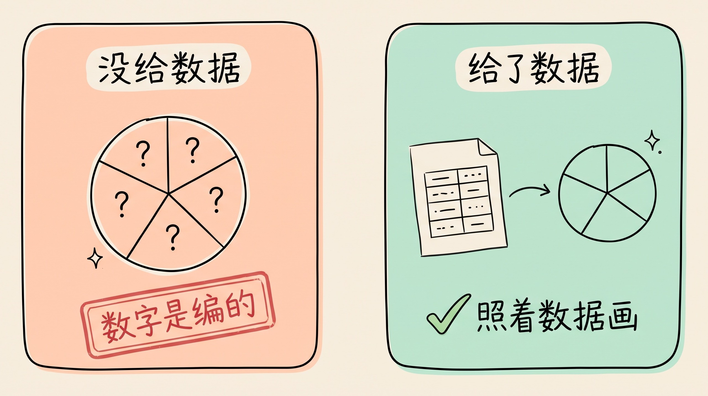
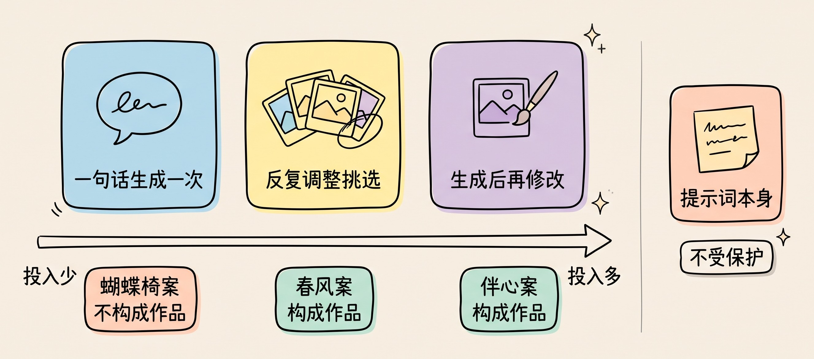

# 3分钟搞懂AI图像生成

> ⭐入门 · 阅读时间 3分钟 · 更新于 2026-11-24
>
> AI 画图已经从「抽卡出好看的图」变成能写准中文、能按对话改图的设计工具。本文讲清它为什么突然会写字了、按要做的图怎么选工具、还有哪些做不好，以及 AI 图在国内外法院眼里归谁、商用前要确认什么。

## 一句话定义

**AI 图像生成**，就是你用一段文字描述你想要的画面，或者再上传几张参考图，AI 直接画出一张新图片，或者按你的要求修改一张已有的图片，用来做海报、插画、电商主图、文章配图、PPT 配图这类工作。

两年前，大家用 AI 画图主要是为了「好看」：写一串英文关键词，生成几十张，挑出一张最惊艳的。现在它更像是一个能听懂话的设计助手：你可以直接说「把背景换成海边，人物不变，右上角加一行『周末特价』」，它会照着改，图里的中文也能写对。

## 从「抽卡」到「改图」，这两年变了什么？

早期的 AI 画图工具，最大的问题是**抽卡**：同一段提示词，每次生成的结果都不一样，想要的效果只能靠多生成几次碰运气。而且一旦生成出来，想改一个细节，几乎只能整张重来，改完之后人物的脸也可能变了。

转折点出现在 2025 年 3 月。OpenAI 把图像生成直接做进了 GPT-4o，用户在 ChatGPT 里上传一张照片，说一句「改成吉卜力风格」就能得到结果。这一波「吉卜力风」头像在全网刷屏，OpenAI 首席运营官 Brad Lightcap 当时披露，上线第一周就有超过 1.3 亿用户生成了超过 7 亿张图片。这个数字说明的不只是热度：用户不需要学提示词的写法，用平时说话的方式就能画图，用的人一下子多了起来。

之后各家的升级，基本都在这个方向上：

| 时间 | 发生了什么 |
|---|---|
| 2025 年 3 月 | GPT-4o 图像生成上线，可以在对话里直接改图 |
| 2025 年 8 月 | 谷歌发布 Nano Banana（Gemini 2.5 Flash Image），主打改图时人物保持一致 |
| 2026 年 2 月 | 字节 Seedream 5.0、阿里 Qwen-Image-2.0 同一天发布，谷歌推出 Nano Banana 2，几家都在强调中文文字和信息图 |
| 2026 年 3–7 月 | Midjourney V8 发布，7 月的 V8.2 成为默认版本 |
| 2026 年 4 月 | ChatGPT Images 2.0 上线，生成前会先「想一想」，图里的文字明显更准 |
| 2026 年 10–11 月 | Nano Banana 2.1、ChatGPT Images 2.6、可灵 Kling Image 4.0 相继发布，开始支持组图、GIF 动图和 8K 输出 |

从这张表可以看出，这两年比拼的重点已经从「画得好不好看」，变成了三件更实用的事：**能不能听懂长描述、能不能只改局部、图里的字能不能写对**。对你来说，这意味着画图的门槛从「会写提示词」降到了「能把需求说清楚」。



## 画图的 AI，为什么突然会写字了？

如果你用过早期的 AI 画图工具，大概见过这种情况：画面很精致，但招牌上的字是一堆看不懂的符号。现在主流的模型基本能写对，原因在于画图的模型和理解语言的模型，越来越多地被放进了同一个系统里。

以前的做法，是让一个**扩散模型**单独负责画图：它从一张全是噪点的图开始，一步步去掉噪点，最后得到清晰的画面。你写的提示词只是被压缩成一小段「方向提示」交给它，所以它擅长画出整体的氛围和质感，但很难精确理解「左边第三个人」「招牌上写『老王面馆』」这类具体要求。文字对它来说只是一种「看起来像字的纹理」，所以经常画成乱码。

现在的做法，是让一个读得懂文字、也有大量常识的大模型来主导：

```
以前: 提示词 -> 压缩成一小段方向提示 -> 扩散模型去噪 -> 图片
现在: 提示词 + 参考图 + 前几轮对话 -> 大模型理解需求、规划画面 -> 生成或修改图片
```

OpenAI 在 GPT-4o 图像生成的系统卡里写明，它和之前的 DALL·E 不同，不再是一个单独的扩散模型，而是一个直接内置在 ChatGPT 里的**自回归模型**，也就是像写文字一样，按顺序一块一块地生成图片。谷歌的 Nano Banana 是在 Gemini 模型的基础上做出来的；阿里的 Qwen-Image 则是用自家的多模态大模型来读懂提示词，再交给负责画图的部分。各家的具体做法不一样，到了 ChatGPT Images 2.0，OpenAI 也没有公开它用的是哪种架构，但方向是一致的：**让懂语言的模型来决定画什么，画图的部分负责画得好看**。


*图注：出自 OpenAI 2025 年 3 月发布 GPT-4o 图像生成时的官方示例，整张照片连同白板上的手写字都是 GPT-4o 生成的，在当时能把这么多英文写得清楚、自然，就是它最受关注的进步。白板左边写着「假设用一个大的自回归 Transformer 直接对文字、像素和声音建模」，优点里列了「借助世界知识生成图像」「更好的文字渲染」；右下角写着 tokens → [transformer] → [diffusion] pixels，意思是先由 Transformer 理解和规划，再由扩散模型还原成像素，和上文说的分工一致。这段内容是 OpenAI 写在提示词里的，OpenAI 没有正式说明这就是 GPT-4o 的具体架构。*

这个变化带来了三个你能直接感受到的好处：

- **图里的字能写对了**。大模型知道「老王面馆」是四个具体的汉字，而不是一团像字的纹理，所以海报、信息图、PPT 配图这类带文字的图，第一次变得可以直接用。
- **可以用对话来改图**。模型记得前几轮对话和上一张图的内容，所以你说「把杯子换成红色」，它能只改杯子，其他地方保持不变。
- **能理解常识和长描述**。你写「画一张北京地铁 1 号线换乘示意图」，它会调动自己对地铁线路图样式的了解，而不是只抓住「地铁」两个字。

不过这也带来一个需要注意的地方：模型懂得多，也会自己「补」得多。下面讲能力边界时会说到。

## 按要做的图来选工具

挑工具时，与其比较哪家「最强」，不如先想清楚你要做的是哪一类图。各家擅长的方向差别很大，按用途来选会准确得多：

| 你要做的图 | 优先试这些 | 国内能否直接使用 | 原因 |
|---|---|---|---|
| 带大段中文的海报、信息图、PPT 配图 | 千问（Qwen-Image 2.0）、即梦（Seedream 5.0）、可灵（Kling Image 4.0） | 能 | 中文文字渲染是国产模型重点优化的方向，Kling Image 4.0 支持在一张图里生成大段文字 |
| 修改一张已有的图：换背景、改局部、保持人物不变 | ChatGPT（Images 2.6）、Gemini（Nano Banana 2.1） | 不能 | 支持多轮对话修改，人物和产品在修改过程中比较稳定 |
| 有艺术感的插画、概念图、氛围图 | Midjourney V8.2 | 不能 | 审美风格稳定，但没有免费试用，最便宜的套餐每月 10 美元 |
| 电商组图、同一风格的系列图 | 可灵（Kling Image 4.0）、即梦 | 能 | 可灵一次最多生成 10 张风格统一的组图 |
| 开发者通过 API 批量生成 | Nano Banana 2.1、GPT Image 2.6、阿里云百炼 | 前两个不能，百炼能 | 价格公开，按张或按 Token 计费 |
| 自己部署，图片不出公司 | Qwen-Image、FLUX.2 [klein] 4B | 能 | 开源，使用 Apache 2.0 协议，这种协议允许商用 |


*图注：出自阿里 Qwen-Image 的 GitHub 主页，是 2025 年 12 月开源的 Qwen-Image-2512 模型生成的一张幻灯片。提示词用中文写明了标题、两条时间轴的名字和 7 个标签里的日期与版本号，生成的图里这些文字都写对了，排版也可以直接放进 PPT。最上面的「Improved Text Rendering」（文字渲染能力提升）标题和浅色外框是官方展示时加的，不是模型生成的。*

拿 API 的价格来算一笔账：按照第三方整理的谷歌官方价格，Nano Banana 2.1 生成一张 1K 分辨率的图片大约 0.034 美元，折合人民币两毛多一张。相比之下，国内的即梦、豆包、千问、可灵在网页版和 App 里都提供免费额度，具体的次数和积分规则经常调整。如果你只是偶尔做几张配图，先从国内这几家的免费额度开始试就够了。

选开源模型时，一定要看清协议。同样是 FLUX.2 系列，4B 参数的 klein 版本使用 Apache 2.0 协议，可以商用；而 32B 参数的 dev 版本使用的是非商用许可证，用在商业项目里需要另外向 Black Forest Labs 购买授权。

最可靠的选法，是拿同一个需求在两三家各生成几次，比较一下文字有没有写错、修改时人物会不会变，以及平均要生成几次才能得到一张能用的图。

## 能做好什么，还做不好什么？

目前 AI 画图已经比较成熟的用法有这些：

- **文章和 PPT 配图**：示意图、氛围图、封面图，以前要去图库买或者自己画，现在几分钟就能生成。
- **电商图片**：上传一张产品白底图，生成不同场景的主图和详情页配图，同一个产品可以快速做出好几个版本来测试效果。
- **改图**：去掉路人、换背景、把照片改成某种画风，这些以前需要会用 Photoshop，现在用一句话就能完成。
- **设计初稿**：海报、Logo、包装的方案，先用 AI 生成十几个方向，再挑出合适的交给设计师细化。

不过下面这几类事情，它现在还做不好：

- **小字和长段文字**：大标题基本能写对，但字号很小或者字数很多时，仍然会出现错字、漏字和笔画错误。所以生成的图在发布前，一定要逐个字核对一遍，尤其是价格、电话、日期这类信息。
- **精确的数量和位置**：「桌上放 7 个杯子」「第三个人举手」这类要求，模型经常会多画或少画，越具体越容易出错。
- **一组图之间的一致性**：单张图里的人物很稳定，但要做十几张连贯的漫画或绘本，人物的发型、衣服细节还是容易在中间某一张变掉。
- **精确还原产品和 Logo**：参考图能让产品「看起来差不多」，但按钮位置、Logo 的细节不一定完全一致，正式的商品图通常还需要用实拍图来补充。

还有一个容易被忽视的风险，就是前面说到的「模型会自己补」。比如你让 AI 生成一张「2026 年国内手机市场份额」的信息图，它能排出一张非常专业的图表，但如果你没有提供数据，图里的数字很可能是它按照「看起来合理」编出来的。所以带数据的信息图，一定要自己提供数字，生成后再和原始数据逐个核对。图做得越专业，读者越容易相信，出错的代价也越大。



## AI 画的图，归谁？

这个问题要分成两种情况来看：你用 AI 生成的图，自己有没有版权；以及你生成的图，会不会侵犯别人的权利。先说第一种。

**在国内，关键看你投入了多少「人的创作」**。把发生过的几起案子放在一起看，法院的思路比较清楚：

- 2023 年 11 月，北京互联网法院审理的「春风送来了温柔」案，原告用 Stable Diffusion 反复调整提示词和参数，从多次生成的结果里挑选出最终的图片，法院认定这张图构成美术作品，原告享有著作权。
- 2025 年 3 月，江苏常熟市人民法院审理的《伴心》案，原告用 Midjourney 生成图片后，又用 Photoshop 对画面做了修改，法院同样认定构成作品，并且审查了原告的操作记录和修改过程。
- 2025 年，江苏张家港市人民法院审理的「蝴蝶椅」案，原告用 Midjourney 生成了几张椅子的设计图，法院认为原告缺乏足够的独创性智力投入，认定这些图片不构成作品，驳回了原告的全部诉讼请求。
- 2025 年 11 月，上海黄浦区人民法院审理了上海首例涉 AI 提示词的著作权案，法院认定原告的提示词只是对艺术风格、材质这些常规元素的罗列，属于创作的想法，而不是受保护的表达，**提示词本身不构成作品**。

把这几个案子放在一起，可以得出一个很实用的结论：**能不能拿到版权，取决于你能不能证明自己做了创作**。如果你用 AI 做的图对你很重要，比如要用来参赛、做品牌或者授权给别人，最好保留每一轮的提示词、参数、生成结果和后期修改的记录。而只输入一句简单的提示词、生成一次就拿来用的图，在法院眼里大概率不受保护，别人拿去用，你也很难维权。



**在美国，标准更严格**。美国版权局要求作品必须有人类作者，并且认为只靠写提示词，一般不足以让使用者成为作者。2026 年 3 月 2 日，美国最高法院拒绝受理 Thaler v. Perlmutter 案，维持了下级法院的判决：完全由 AI 自主生成的图片不能登记版权。不过，人在 AI 生成内容的基础上做的选择、编排和修改，仍然可以受到保护。

## 商用前，需要确认哪些事？

再说第二种情况：你生成的图会不会给自己惹麻烦。在把 AI 图用到广告、商品、封面这些商业场景之前，建议你确认下面几件事。

**第一，不要生成别人的知名角色和品牌**。工具能画出来，不代表你能用。迪士尼和环球影业在 2025 年 6 月起诉了 Midjourney，指控它能生成大量迪士尼和环球的角色形象，华纳兄弟随后也提起了类似的诉讼。截至目前，这个案子还没有判决。但不管最后怎么判，如果你把生成的卡通角色印在商品上卖，侵权的责任是由你自己来承担的。用别人的照片生成图片也一样，涉及肖像权，一定要先取得本人的同意。

**第二，按规定添加 AI 标识**。国内的《人工智能生成合成内容标识办法》从 2025 年 9 月 1 日起施行，要求 AI 生成的图片同时带有两类标识：一类是画面上能看到的**显式标识**，比如角落里的「AI 生成」字样；另一类是写在文件元数据里的**隐式标识**，平台可以自动识别。办法也规定，任何人都不能恶意删除或篡改这些标识。海外的工具也在做类似的事情，谷歌会给 Nano Banana 生成的图片加上 SynthID 隐形水印，OpenAI 会给生成的图片写入 C2PA 元数据，从 Images 2.5 开始也加入了 SynthID。所以你在小红书、公众号这些平台发布 AI 图片时，记得勾选平台的 AI 生成声明，也不要用工具去掉图片里的标识。

**第三，看清你所用套餐的商用条款**。不同产品、不同会员档位对商用授权的规定可能不一样，有的免费版生成的图片不允许商用，有的要求必须保留水印。如果你要把图片用在商业项目里，先去看一下用户协议里关于版权和商用授权的条款，再决定开通哪个档位。

## 时效性提醒

AI 画图是更新最快的 AI 应用之一，下面这些信息尤其容易过时：

- 各家模型的版本号，OpenAI 和谷歌在 2026 年基本每隔一两个月就会更新一次图像模型
- 免费额度、积分规则和 API 价格，同一个模型的价格也会随着新版本发布而调整
- 迪士尼诉 Midjourney 等版权诉讼的结果，以及国内法院对 AI 生成图片的认定标准
- 开源模型的许可证条款，同一个系列里不同版本的协议可能不一样

**建议**：如果你是第一次尝试，可以先在即梦或千问里用免费额度，试着用一整句话描述你要的画面，再用对话一轮一轮地修改，比研究复杂的提示词写法更快上手。

💬 **互动话题**：你用 AI 画图时，最常遇到的问题是什么？是图里的字写错了、改一个地方别的地方也跟着变，还是生成的人物和你上传的照片不像？

📖 **相关阅读**：

- [3分钟搞懂生成式AI](../../02-core-capabilities/01-generative-ai/README.md) - 扩散模型「从噪点还原画面」的基本原理
- [3分钟搞懂多模态AI](../../04-advanced/03-multimodal-ai/README.md) - 为什么懂语言的模型也能看图、画图
- [3分钟搞懂Prompt工程](../../01-basics/07-prompt-engineering/README.md) - 怎么把需求描述清楚，图像生成同样适用
- [3分钟搞懂AI视频生成](../05-ai-video-generation/README.md) - 从生成一张图到生成一段视频，难在哪里
- [3分钟搞懂AI监管政策](../../08-business-ethics/06-ai-regulation/README.md) - AI 标识办法等规定的完整梳理

**资料来源**：

- OpenAI，Introducing 4o Image Generation（2025-03，文中白板配图出处）：https://openai.com/index/introducing-4o-image-generation/
- QwenLM，Qwen-Image GitHub 仓库（文中幻灯片配图出处）：https://github.com/QwenLM/Qwen-Image
- OpenAI，Addendum to GPT-4o System Card: Native image generation（2025-03）：https://openai.com/index/gpt-4o-image-generation-system-card-addendum/
- The Decoder，ChatGPT's image generation explodes with 700M creations in first week（2025-04）：https://the-decoder.com/chatgpts-image-generation-explodes-with-700m-creations-in-first-week/
- TechCrunch，ChatGPT's new Images 2.0 model is surprisingly good at generating text（2026-04-21）：https://techcrunch.com/2026/04/21/chatgpts-new-images-2-0-model-is-surprisingly-good-at-generating-text/
- Wikipedia，GPT Image：https://en.wikipedia.org/wiki/GPT_Image
- OpenAI on X，Introducing ChatGPT Images 2.6（2026-11）：https://x.com/OpenAI/status/2118124944928432327
- Google，Nano Banana 2: Google's latest AI image generation model（2026-02）：https://blog.google/innovation-and-ai/technology/ai/nano-banana-2/
- Android Authority，Google's latest version of Nano Banana ups the visual quality and consistency（2026-10）：https://www.androidauthority.com/google-launches-nano-banana-2-1-3719823/
- The Decoder，Google's new image model Nano Banana 2.1 generates better images for less money：https://the-decoder.com/googles-new-image-model-nano-banana-2-1-generates-better-images-for-less-money/
- FourWeekMBA，Google Halves Nano Banana Image Price：https://fourweekmba.com/ai-google-halves-nano-banana-image-price-triples-input-price/
- Wikipedia，Midjourney：https://en.wikipedia.org/wiki/Midjourney
- eesel AI，Midjourney pricing in 2026：https://www.eesel.ai/en/blog/midjourney-pricing
- 新浪科技，字节图像生成模型 Seedream 5.0 上线（2026-02-10）：https://finance.sina.com.cn/tech/digi/2026-02-10/doc-inhmihnp5584083.shtml
- 科技日报，千问发布最新图像模型 Qwen-Image-2.0（2026-02-10）：https://www.stdaily.com/web/gdxw/2026-02/10/content_472818.html
- IT之家，阿里千问推出新一代图像生成基础模型 Qwen-Image-2.0：https://www.ithome.com/0/920/788.htm
- 腾讯新闻，可灵AI发布 Kling Image 4.0：支持原生 8K 超高清、组图直出（2026-11-18）：https://news.qq.com/rain/a/20261118A05MPX00
- Black Forest Labs，FLUX.2（2025-11-25）：https://bfl.ai/blog/flux-2
- Hugging Face，FLUX.2-dev 许可证：https://huggingface.co/black-forest-labs/FLUX.2-dev/blob/main/LICENSE.txt
- 澎湃新闻，提示词是否属于作品？上海首例涉 AI 提示词著作权案宣判：https://www.thepaper.cn/newsDetail_forward_31908474
- IT之家，上海首例涉 AI 提示词著作权案今日宣判：涉案提示词不构成作品：https://www.ithome.com/0/895/371.htm
- 科技日报，AI 生成图片《伴心》著作权案（2025-03-22）：https://www.stdaily.com/web/gdxw/2025-03/22/content_313143.html
- Technology's Legal Edge，A Chinese court finds that AI-generated images are not protected by copyright: the Zhangjiagang People's Court and the Butterfly Chairs case（2025-07）：https://www.technologyslegaledge.com/2025/07/a-chinese-court-finds-that-ai-generated-images-are-not-protected-by-copyright-the-zhangjiagang-peoples-court-and-the-butterfly-chairs-case/
- 美国版权局，Copyright and Artificial Intelligence, Part 2: Copyrightability（2025-01）：https://www.copyright.gov/ai/Copyright-and-Artificial-Intelligence-Part-2-Copyrightability-Report.pdf
- Morgan Lewis，US Supreme Court Declines to Consider Whether AI Alone Can Create Copyrighted Works（2026-03）：https://morganlewis.com/pubs/2026/03/us-supreme-court-declines-to-consider-whether-ai-alone-can-create-copyrighted-works
- AI Lawsuit Tracker，Disney/Universal v. Midjourney：https://ailawsuittracker.com/cases/disney-enterprises-inc-v-midjourney-inc-2-25-cv-05275/
- 国家互联网信息办公室，关于印发《人工智能生成合成内容标识办法》的通知：https://www.cac.gov.cn/2025-03/14/c_1743654684782215.htm

---

⬅️ 上一篇：[3分钟搞懂AI翻译](../03-ai-translation/README.md) ｜ [📚 返回目录](../README.md) ｜ 下一篇：[3分钟搞懂AI视频生成](../05-ai-video-generation/README.md) ➡️
