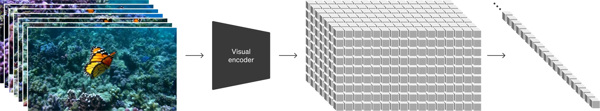
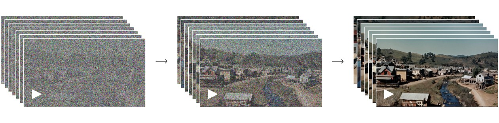
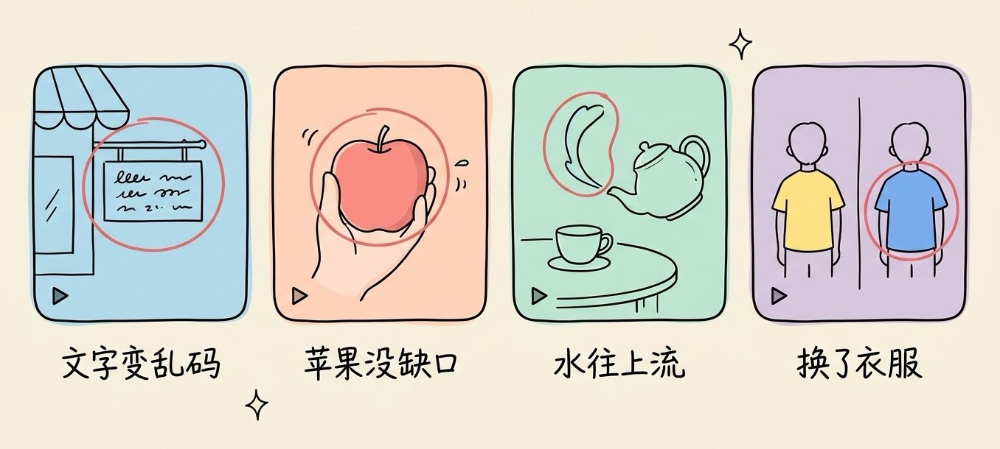
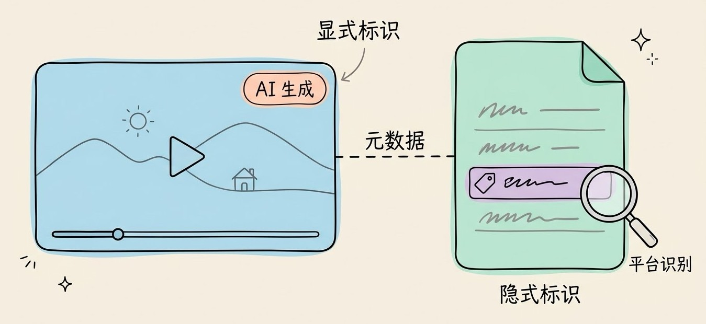

# 3分钟搞懂AI视频生成

> ⭐⭐中级 · 阅读时间 3分钟 · 更新于 2026-11-23
>
> AI 视频已经能一次生成 30 秒、带对白和音效的片段，可以用参考图锁住角色，也可以只改其中一段。本文讲清视频是怎么生成出来的、为什么按秒计费、Sora 为什么退场、国内外产品怎么选，以及发布前的版权和标识要求。

## 一句话定义

**AI 视频生成** = 你给模型一段文字描述，或者再加上几张参考图、一段参考视频或音频，它直接生成一段有画面、通常也带着对白和音效的视频片段，用来做短视频素材、广告草稿、短剧镜头和分镜预演这类工作。

传统的视频制作要先写脚本，再找演员、搭场景、拍摄，最后剪辑和配音，一个镜头从策划到成片往往要几天。AI 视频把「拍」这一步换成了「描述 + 生成」，几分钟就能拿到一个镜头的初稿。不过它交给你的仍然是一个个片段，要变成一条完整的片子，还需要你来挑选、剪辑和修改。

举个例子：你要给一款保温杯做 15 秒的短视频广告。以前要租场地、请人拍；现在你可以上传两张产品图，写上「清晨的办公桌，阳光从窗外照进来，一只手拿起保温杯，杯口冒着热气，镜头慢慢推近」，模型会生成一段带环境声的镜头。产品的外观靠参考图来锁住，你再生成几条不同风格的版本，挑出最合适的一条就行了。

## 一段视频是怎么生成出来的？

一段 5 秒、每秒 24 帧的视频，是由 120 张图片连起来的。如果让 AI 一张一张地单独画，每张都画得很好看，但是连起来播放时也会出问题：人物的衣服在这一帧是蓝色，下一帧就变成了深蓝，背景里的树一会儿多一棵一会儿少一棵，并且画面还会一直闪。所以视频模型不能逐帧画，而是要把整段视频当成一个整体来生成。

当前主流做法大致分三步：

```
① 压缩   -> 把视频压缩成更小的"时空块": 每一块既包含一小片画面区域,
             也包含连续的几帧, 相当于把视频切成一个个小立方体
② 去噪   -> 从一堆随机噪点开始, 模型按照你的描述, 一轮一轮地同时调整所有时空块,
             让它们越来越像一段符合描述的视频
③ 还原   -> 把调整好的时空块解压回正常的视频帧, 声音也在这一步一起输出
```


*图注：出自 OpenAI 2024 年发布的 Sora 技术报告。最左边是一段视频的连续帧，经过中间的视觉编码器（Visual encoder）压缩后，变成第三列由许多小方块组成的立方体，每个小方块就是一个时空块，同时包含一小片画面和连续的几帧；最右边是把这些时空块排成一长串，交给 Transformer 去处理。*

第 ② 步用的是**扩散模型**的思路：从噪点出发一点点还原出画面。和生成图片不同的是，视频模型在每一轮调整时，都能同时看到前后几秒的内容，所以第 3 秒的人物能和第 1 秒保持一致。OpenAI 在 2024 年发布 Sora 时公开的技术报告里，就是把视频切成这种**时空块**（spacetime patches），再交给 Transformer 去处理，这个做法后来被大多数视频模型沿用。


*图注：同样出自 Sora 技术报告。从左到右是去噪的过程：每一步处理的都是整叠视频帧，而不是一张一张单独处理，所以所有帧会一起从噪点变成清晰的小镇画面，前后帧里房子和河流的位置也能保持一致。*

这个原理也解释了视频生成的两个特点。

**一是越长越难**。时长每增加一秒，要处理的时空块就会多出一批，而 Transformer 需要让每个块都和其他所有块「对照」一遍，计算量会比时长增长得更快。这就是为什么 2024 年大多数产品只能生成 5 秒左右的视频，不过到 2026 年单次生成 30 秒已经是各家的旗舰能力了。

**二是声音最好和画面一起生成**。以前的做法是先生成无声视频，再单独配音，人物说话时的口型很难对上。2025 年 5 月 Google 发布的 Veo 3 开始把对白、音效和背景音一起生成，嘴型和声音是同一个模型同时算出来的，所以能对得上。现在主流的视频模型基本都支持了这种**音画同步生成**。

## 两年里，能力变在了哪里？

我们按时间顺序来看几个关键的节点：

| 时间 | 代表模型 | 当时的突破 |
|---|---|---|
| 2024 年 2 月 | OpenAI Sora（演示） | 展示了最长 60 秒的连贯视频，但当时没有开放给公众使用 |
| 2025 年 5 月 | Google Veo 3 | 画面和对白、音效一起生成 |
| 2025 年 9 月 | OpenAI Sora 2 | 带声音，并推出了类似短视频社区的 Sora App |
| 2026 年 1–2 月 | Vidu Q3、可灵 3.0、Seedance 2.0 | 单次 15–16 秒带声音的视频；一次生成里可以切换多个镜头；可以同时参考图片、视频和音频 |
| 2026 年 7–10 月 | Seedance 2.5、Wan 3.0、Kling 4.0 | 单次生成 30 秒，并支持继续延长，旗舰模型支持 4K |
| 2026 年 11 月 | Gemini Omni 1.2 Flash | 15 秒视频，可以像聊天一样多轮修改同一段视频 |

从这张表可以看出，这两年的变化主要集中在三个方面。

**第一，从无声到有声**。Veo 3 之后，带对白和音效几乎成了视频模型的标配。如果你做的是口播、剧情类内容，这一步省掉了大量配音和对口型的工作。

**第二，从单个镜头到一段戏**。早期的模型一次只能生成一个几秒钟的镜头，想讲一段故事要分开生成很多次，再自己剪到一起。现在的模型可以在一次生成里完成「全景 → 近景 → 特写」这样的镜头切换，单次生成的时长也从 5 秒左右拉长到了 30 秒。

**第三，从抽卡到能控制**。以前用 AI 视频，最大的痛点是**抽卡**：同样的提示词每次结果都不一样，想要的效果只能靠多生成几次碰运气。现在主要有两种控制手段：

- **参考素材**：上传人物、产品、场景的图片，模型会照着它们来生成，同一个角色在不同镜头里不会换脸。Seedance 2.0 一次最多可以参考 9 张图片、3 段视频和 3 段音频，到了 Seedance 2.5，单次最多可以输入 30 张图片、10 段视频和 10 段音频。
- **局部编辑**：生成完之后，如果只有某一段不满意，可以只修改这一段，比如把人物手里的杯子换个颜色，其他部分保持不变，不用整段重新生成。Gemini Omni 还支持用对话的方式连续修改同一段视频，Google 给出的说法是修改过程中角色和场景会保持一致。

所以现在用 AI 做视频，更像是在当导演：你准备好角色和场景的参考图，写清楚每个镜头的内容，生成之后再一段一段地调整，而不是写一句话然后等着看运气。

## Sora 为什么退场了？

2024 年 Sora 的演示视频让整个行业都很兴奋，但到了 2026 年，OpenAI 在 2026 年 3 月 24 日宣布停掉 Sora，网页版和 App 在 4 月 26 日下线，API 也在 9 月 24 日停止服务。2025 年 12 月宣布的迪士尼合作，包括迪士尼计划对 OpenAI 的 10 亿美元股权投资，也随之终止了。

OpenAI 没有在停服公告里给出具体原因，但它的发言人在回应媒体时提到，公司需要在算力成本高的产品之间做取舍。其实早在 2025 年底，Sora 团队就因为芯片供应紧张，限制过用户每天能生成的视频数量。停服之后，Sora 的研究团队转去做用于机器人的「世界模拟」研究。

为什么视频生成会这么费算力？上一节讲过，视频越长，计算量涨得越快。这一点直接体现在价格上，我们拿 Google 在 Gemini API 上公开的价格来算一笔账：

| 模型 | 价格（带声音） | 生成一段视频的费用 |
|---|---|---|
| Veo 3.1 | 1080p 每秒 0.40 美元 | 8 秒约 3.2 美元 |
| Veo 3.1 Fast | 1080p 每秒 0.12 美元 | 8 秒约 0.96 美元 |
| Gemini Omni 1.2 Flash | 720p 每秒 0.07 美元 | 15 秒约 1.05 美元 |

用 Veo 3.1 生成一段 8 秒的 1080p 视频，成本大约是二十多元人民币。如果你要生成好几次才能挑出一条满意的，一个镜头的成本就要翻好几倍。而 Sora App 的玩法是让大量用户免费地刷、免费地生成，每一条视频都在消耗算力，却很难带来对应的收入，这笔账自然算不过来。


对你来说，这件事有两个实际的意义：

- **视频生成的价格是按秒计费的**，免费额度通常很快就会用完。做预算时要按「最终需要的秒数 × 平均要生成几次」来估算，而不是只看单价。
- **不要把工作流程绑在一家服务上**。如果你的项目依赖某个视频模型的 API，最好提前接入两家，生成的素材也要及时下载保存。Sora 从宣布到 API 停服只给了半年时间，依赖它的团队都要临时迁移。

## 主流产品怎么选？

挑视频工具时，建议你重点看五个方面：单次能生成多长、能参考多少素材、带不带声音、价格怎么算、商用条款是否写清楚。按这几个方面，目前主流的产品是这样的：

| 产品 | 背后的模型 | 国内能否直接使用 | 更适合 |
|---|---|---|---|
| 即梦、豆包 | 字节 Seedance 2.5 | 能 | 多素材参考、30 秒长片段、短剧和广告 |
| 可灵 | 快手 Kling 4.0 | 能 | 30 秒一镜到底、人物对白和口型、4K 画质 |
| 千问、通义万相 | 阿里 Wan 3.0 | 能 | 已经在用阿里云百炼的开发者，可以直接调用 API |
| Vidu | 生数科技 Vidu Q3 | 能 | 参考图生视频、短剧镜头 |
| Gemini、Google Flow | Gemini Omni、Veo 3.1 | 不能 | 对话式修改，API 价格公开透明 |
| Runway | Gen-4.5 | 不能 | 影视后期团队，偏剪辑、镜头控制的完整工作流 |

字节的 Seedance 和快手的可灵是目前国内迭代最快的两家，都已经做到了单次 30 秒、带声音和 4K；如果你主要是做短视频和广告素材，从这两家里选一家开始就够了。即梦还提供了 480P 的**样片模式**，可以先用低分辨率、低成本把镜头调对，再生成高清版本，能省下不少费用。

如果你想在自己的服务器上部署，可以看阿里开源的 **Wan 2.2**，它使用的是 Apache 2.0 协议，这种协议允许商用。需要注意的是，最新的 Wan 3.0 并没有开源，只能通过 API 和在线平台使用；自己部署开源模型也需要显存比较大的显卡。

挑工具时，最可靠的办法是拿同一段分镜脚本，在两三家各生成几次，对比一下画面质量、角色的一致性，以及平均要生成几次才能得到一条能用的视频。各家的模型几个月就会更新一次，网上的排名很快就会过时。

## 能用它做什么，哪些还做不好？

目前 AI 视频已经比较成熟的用法有这些：

- **短视频素材**：视频里需要插入的空镜头、氛围镜头，以前要去素材网站买，现在可以直接生成。
- **电商和广告**：用产品图生成商品展示短片，同一个脚本可以快速做出好几个不同风格的版本来测试效果。
- **分镜预演**：影视团队在正式拍摄前，先用 AI 把分镜做成动态画面，确认镜头节奏和机位。
- **AI 短剧和教育内容**：用参考图固定角色形象，生成剧情镜头，或者把抽象的知识点做成动画演示。

不过下面这几类事情，它现在还做不好：

- **长篇叙事**：单次 30 秒已经是上限，一部几分钟的短片需要拼接很多段。段与段之间，角色的发型、服装和场景细节还是容易出现变化，需要人工挑选和修正。
- **画面里的文字**：招牌、包装上的字经常出现乱码或者变形，涉及品牌名的镜头最好在后期单独加字。
- **精细的物理动作**：倒水、手指的动作、多个人之间的肢体接触，仍然是穿帮最多的地方。比如人物咬了一口苹果，苹果上却没有缺口。
- **需要精确还原的产品**：参考图能让产品「看起来差不多」，但按钮位置、logo 的细节不一定完全准确，正式的商业广告通常还是需要实拍补充。



还有一个常见的误会，是把视频模型当成了真实世界的模拟器。Sora 的技术报告里确实提出过「视频生成模型可以作为世界模拟器」这个方向，但模型学到的是「视频看起来应该是什么样子」，并不真正理解物理规律，所以才会出现上面这些穿帮。看起来很真实，并不代表它符合事实，这也是为什么 AI 生成的视频不能当作新闻素材和证据来使用。

## 发布 AI 视频之前，需要注意哪些问题？

**第一，不要生成真人明星和受版权保护的角色**。2026 年 2 月 Seedance 2.0 刚上线时，网上流传着用它生成的「汤姆·克鲁斯和布拉德·皮特打斗」的视频，随后迪士尼向字节发出律师函，代表迪士尼、派拉蒙、索尼、环球、华纳兄弟和 Netflix 的美国电影协会（MPA）也发出了停止侵权函，字节之后收紧了相关的生成限制。即使工具能生成出来，你把这类视频发出去，侵权的风险还是由你自己来承担。用别人的照片生成视频也一样，涉及肖像权，一定要先取得本人的同意。

**第二，按规定添加 AI 标识**。国内的《人工智能生成合成内容标识办法》从 2025 年 9 月 1 日开始施行，要求 AI 生成的内容同时带有两类标识：一类是**显式标识**，也就是画面上能看到的文字或图形提示；另一类是**隐式标识**，写在文件的元数据里，平台可以自动识别。办法也明确规定，任何人都不能恶意删除或篡改这些标识。所以你在抖音、视频号这些平台发布 AI 视频时，记得勾选平台提供的 AI 生成内容声明，也不要用工具去掉视频上的水印。



如果你的视频要发到海外，欧盟《人工智能法案》也要求，从 2026 年 8 月 2 日起，发布深度伪造的图片、音频和视频时，必须说明它是 AI 生成或修改的。Google 的 Gemini Omni 和 Veo 也会在生成的视频里加入 SynthID 隐形水印，方便事后检测。

**第三，看清你所用套餐的商用条款**。不同产品、不同会员档位对商用授权和水印的规定可能不一样。如果你要把视频用在广告、带货这类商业场景，先去看一下用户协议里关于版权和商用授权的条款，再决定开通哪个档位。

## 时效性提醒

AI 视频是更新最快的 AI 应用之一，下面这些信息尤其容易过时：

- 各家模型的版本号、单次最长时长和最高分辨率，国内几家基本每隔几个月就会发布新版本
- 价格和积分规则，各家经常会推出限时折扣，同一个模型的价格也会随着新版本发布而调整
- 版权诉讼的结果，以及各国对 AI 标识的具体执行要求
- Google 的视频模型正在从 Veo 系列转向 Gemini Omni 系列，Veo 3.1 后续的服务安排要以官方文档为准

**建议**：如果你是第一次尝试，可以先在即梦或可灵上用免费额度生成几段，熟悉一下怎么写镜头描述、怎么用参考图，再决定要不要付费。

💬 **互动话题**：你用 AI 生成视频时，最常遇到的穿帮是什么？是手指、文字，还是角色在不同镜头里换了脸？平均要生成几次才能拿到一条能用的？

📖 **相关阅读**：

- [3分钟搞懂生成式AI](../../02-core-capabilities/01-generative-ai/README.md) - 扩散模型「从噪点还原画面」的基本原理
- [3分钟搞懂Transformer](../../01-basics/03-transformer/README.md) - 视频越长计算量涨得越快，原因在这里
- [3分钟搞懂多模态AI](../../04-advanced/03-multimodal-ai/README.md) - 让 AI 同时处理文字、图像、声音和视频
- [3分钟搞懂AI数字人](../08-ai-digital-human/README.md) - 数字人口播是视频生成最常见的落地场景之一
- [3分钟搞懂AI声音克隆](../06-ai-voice-cloning/README.md) - 视频里的对白和配音背后的技术

**资料来源**：

- OpenAI，Video generation models as world simulators（2024-02）：https://openai.com/index/video-generation-models-as-world-simulators/（文中两张配图出处）
- OpenAI 帮助中心，What to know about the Sora discontinuation：https://help.openai.com/en/articles/20001152-what-to-know-about-the-sora-discontinuation
- Unite.AI，OpenAI shuts down Sora and ends its $1 billion Disney deal：https://www.unite.ai/openai-shuts-down-sora-and-ends-its-1-billion-disney-deal/
- Wikipedia，Veo (text-to-video model)：https://en.wikipedia.org/wiki/Veo_(text-to-video_model)
- Google，Introducing Gemini Omni（2026-05）：https://blog.google/innovation-and-ai/models-and-research/gemini-models/gemini-omni/
- Google，Gemini Omni 1.2 Flash: 15-second video and lower pricing（2026-11）：https://blog.google/innovation-and-ai/technology/developers-tools/introducing-gemini-omni-1-2-flash/
- Google AI for Developers，Video generation in the Gemini API：https://ai.google.dev/gemini-api/docs/video
- Google AI for Developers，Gemini API pricing：https://ai.google.dev/gemini-api/docs/pricing
- 科技日报，字节发布 Seedance 2.0，豆包、即梦官宣接入（2026-02-12）：https://www.stdaily.com/web/gdxw/2026-02/12/content_473735.html
- IT之家，字节跳动：Seedance 2.0 正式发布：https://www.ithome.com/0/921/381.htm
- 腾讯新闻，迪士尼向字节跳动发律师函，Seedance 2.0 引发好莱坞版权争议：https://news.qq.com/rain/a/20260215A02DNX00
- 虎嗅，Seedance 2.0 出海受阻风波：https://m.huxiu.com/article/4843261.html
- 新浪财经，字节跳动正式发布 Seedance 2.5（2026-07-31）：https://finance.sina.com.cn/tech/shenji/2026-07-31/doc-iniksnxp1332658.shtml
- AIHub，即梦 Seedance 2.5 4K 正式上线，支持 480P 样片模式（2026-11-13）：https://www.aihub.cn/news/seedance-2-5-4k-release/
- 搜狐，快手可灵 3.0 发布：https://www.sohu.com/a/984517165_122004016
- 腾讯新闻，快手可灵发布 Kling 4.0，最长生成 30 秒（2026-09-29）：https://news.qq.com/rain/a/20260929A01SQM00
- 腾讯新闻，可灵 4.0 全量发布（2026-10-19）：https://news.qq.com/rain/a/20261019A0DU2200
- 阿里云开发者社区，阿里云 Wan3.0 模型解析：https://developer.aliyun.com/article/1754056
- 百度百科，Vidu Q3：https://baike.baidu.com/item/Vidu%20Q3/67330811
- eWeek，Runway Launches Gen-4.5 AI Video Model：https://www.eweek.com/news/runway-ai-video-model/
- 国家互联网信息办公室，关于印发《人工智能生成合成内容标识办法》的通知：https://www.cac.gov.cn/2025-03/14/c_1743654684782215.htm
- Goodwin，Not Delayed, Not Deferred: EU AI Act Transparency Obligations Are Now in Force（2026-08）：https://www.goodwinlaw.com/en/insights/publications/2026/08/alerts-technology-dpc-eu-ai-act-transparency-obligations-now-in-force

---

⬅️ 上一篇：[3分钟搞懂AI图像生成](../04-ai-image-generation/README.md) ｜ [📚 返回目录](../README.md) ｜ 下一篇：[3分钟搞懂AI声音克隆](../06-ai-voice-cloning/README.md) ➡️
