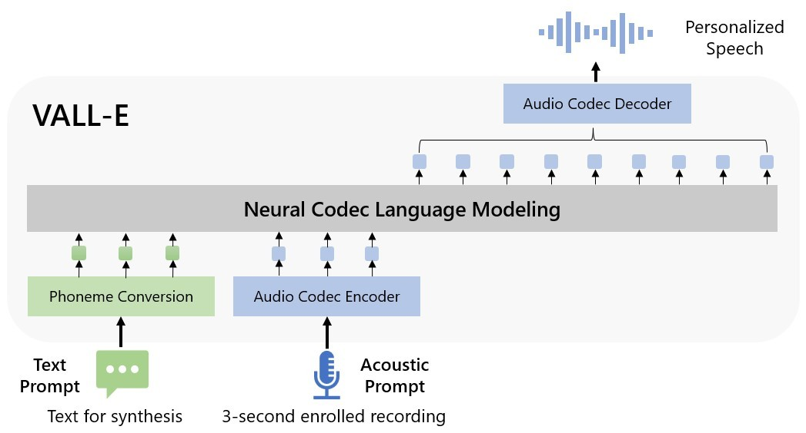
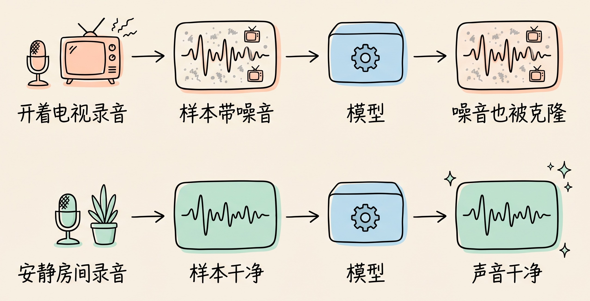
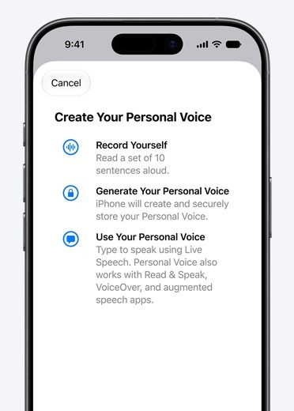
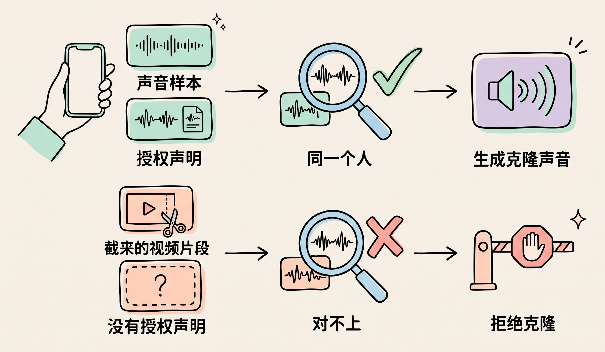
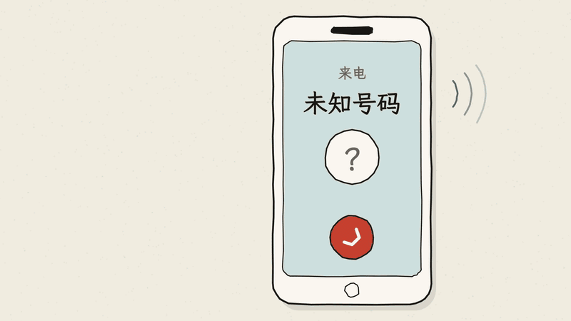

# 3分钟搞懂AI声音克隆

> ⭐⭐中级 · 阅读时间 3分钟 · 更新于 2026-11-23
>
> 克隆一个人的声音，现在只需要 10 秒左右的录音。本文讲清几秒样本为什么就够用、即时克隆和专业克隆差在哪、国内外产品怎么选，以及法院怎么判 AI 克隆声音、遇到 AI 拟声诈骗电话该怎么核实。

## 一句话定义

**AI 声音克隆** = 给模型一段某个人的录音，让它提取出这个人的音色、口音和说话节奏，然后把你输入的任意文字，用这个人的声音读出来，用来做有声书、课程配音、多语言视频、语音助手，也用来帮助即将失声的人保留自己的声音。

国内的产品大多把它叫作**声音复刻**，指的都是同一件事。

几年前，要做出一个像某个人的合成声音，需要这个人在录音棚里录上几个小时，再专门训练一个模型。现在门槛已经降到了几秒到几十秒：ElevenLabs 在 2026 年 9 月发布的 Eleven v4 中，即时克隆只需要 10 秒左右的录音；MiniMax Speech 2.8 也是 10 秒；阿里开源的 Qwen3-TTS 宣称 3 秒就能克隆。苹果的 Personal Voice 原来要求用户朗读 150 个句子，到了 iOS 26，在支持 Apple Intelligence 的 iPhone 上只需要读 10 个短句，不到一分钟就能生成。

门槛降下来以后，配音成本大幅下降，同时 AI 拟声诈骗、声音被冒用的问题也变多了。下面我们先讲几秒的录音为什么就够用，再讲怎么选工具，最后讲法律风险和怎么防诈骗。

## 几秒的录音，为什么就够模型模仿一个人？

早期的做法是给每个人单独训练一个模型。你录的素材越多，模型能学到的细节就越多，所以才需要录几个小时。

2023 年 1 月，微软发布的 VALL-E 换了一种思路，后来豆包、阿里、MiniMax 等国内外的语音模型大多沿用了类似的做法。核心是把语音合成变成「续写」：

```
① 切成 token -> 用一个音频编解码器, 把声音压缩成一串离散的 token,
                 就像大语言模型把文字切成 token 一样
② 续写       -> 把你的几秒录音 token 放在最前面, 后面接上要读的文字,
                 让模型接着往下生成音频 token
③ 还原       -> 把生成的 token 解码回声音波形
```


*图注：出自微软 2023 年发布的 VALL-E 论文。左下的 Text Prompt 是要合成的文字，先转换成音素（Phoneme Conversion）；右下的 Acoustic Prompt 是一段 3 秒的录音（3-second enrolled recording），经过音频编解码器的编码器（Audio Codec Encoder）切成 token。两串 token 一起交给中间的语言模型（Neural Codec Language Modeling），由它往下生成新的音频 token，最后由解码器（Audio Codec Decoder）还原成带有这个人音色的语音（Personalized Speech）。*

模型在训练时已经听过几万甚至几十万小时、成千上万个人的说话录音，各种嗓音、口音和语速它都见过。你给的那几秒录音，作用不是从零开始教它，而是告诉它「接下来请用这一种声音说话」。这和大语言模型看了几个例子就能模仿你的写作风格是同一个道理，所以这类做法也被叫作**零样本克隆**（zero-shot），火山引擎干脆把自家的复刻模型命名为 Doubao-Seed-ICL，ICL 就是「上下文学习」的英文缩写。

这个原理也解释了声音克隆的几个特点：

- **录音里有什么，模型就会模仿什么**。模型续写的是整段音频，所以样本里的背景噪音、混响、手机收音的闷声，也会被一起「克隆」进去。ElevenLabs 在 Eleven v4 的文档里特别强调，原始录音的质量比以前更重要了。如果你想克隆自己的声音，在安静的房间里用同一个麦克风录一段，效果会比随手截取的视频片段好得多。
- **样本的情绪会影响结果**。如果样本是你平静地读稿，生成的声音也偏平静；想要更丰富的表现，样本里最好包含不同的语气。
- **可以跨语言**。音色和语言在模型里是分开学的，所以用一段中文录音，也能让它说英文、日文。Eleven v4 还改进了这一点：跨语言克隆时会采用目标语言的本地口音，而不是带着原来语言的口音说外语。



## 即时克隆和专业克隆，差在哪里？

大部分平台都提供两档克隆服务：

| 对比项 | 即时克隆 | 专业克隆 |
|---|---|---|
| 需要的录音 | 10 秒到几分钟 | 通常 30 分钟以上，越多越好 |
| 怎么做 | 用上一节讲的「续写」方式，不训练新模型 | 用你的录音对模型进行微调 |
| 等待时间 | 几秒到几分钟 | 几小时到几天 |
| 效果 | 音色像，但长段落、特殊语气的稳定性一般 | 更稳定，能还原更多说话习惯 |
| 适合 | 短视频配音、试听、个人尝鲜 | 有声书、品牌声音、长期使用的商业项目 |

以 ElevenLabs 为例，即时克隆从每月 6 美元的 Starter 档就能用，专业克隆要到每月 22 美元的 Creator 档才开放，免费档两种都不能用。国内的火山引擎也有类似的分层：声音复刻用几秒到几十秒的样本就能出音色，而面向企业的定制音色要求按规范录音，还需要走授权流程。

如果你只是想给自己的视频配个旁白，即时克隆基本够用了；如果要录一整本有声书，或者这个声音要代表一个品牌长期使用，专业克隆在长时间朗读时的一致性会好很多。

## 声音克隆可以用来做什么？

目前比较成熟的用法有这些：

- **有声书和课程**：作者或讲师克隆自己的声音，修改讲稿之后直接重新生成，不用每次都重新录音。
- **视频多语言配音**：同一个人的声音，生成英文、日文等多个语言的版本，观众听到的还是原来那个人在说话。
- **语音助手和游戏角色**：给智能客服、AI 陪伴应用、游戏里的 NPC 定制专属的声音。
- **帮助失声的人保留声音**：渐冻症、喉癌等疾病会让患者逐渐失去说话能力。苹果的 Personal Voice 让用户提前录下自己的声音，之后在 iPhone 上打字，就能用自己的声音说出来。整个生成过程在手机上完成，录音不上传到云端，目前已经支持中文普通话。这是声音克隆里社会价值最高的一类用法。


*图注：出自苹果官网的辅助功能页面。界面上的三步依次是：录下自己的声音（朗读一组 10 个句子）、在 iPhone 上生成并安全保存你的 Personal Voice、打字后用自己的声音说出来（配合「实时语音」等功能使用）。*

## 主流产品怎么选？

挑工具时，建议你重点看四个方面：中文效果怎么样、需要多长的样本、能不能商用、平台有没有授权验证。按这几个方面，目前主流的产品是这样的：

| 产品 | 国内能否直接使用 | 克隆需要的样本 | 特点 |
|---|---|---|---|
| ElevenLabs（Eleven v4） | 不能 | 即时克隆约 10 秒，专业克隆 30 分钟以上 | 情感表现和多语言能力强，支持 90 多种语言，创作者用得最多 |
| Google Gemini TTS | 不能 | 10–30 秒，另加一段授权录音 | 开发者付费后自助开通，生成的音频自带 SynthID 水印 |
| OpenAI 自定义声音 | 不能 | 10–60 秒，另加一段授权录音 | 需要联系销售开通，主要面向企业客户 |
| 豆包语音（火山引擎） | 能 | 几秒到几十秒 | 中文韵律自然，声音复刻 2.0 可以直接用在豆包的实时语音模型里 |
| MiniMax Speech 2.8 | 能 | 约 10 秒 | 能还原呼吸声和说话节奏，偏向语音智能体场景 |
| Qwen3-TTS（阿里开源） | 能 | 约 3 秒 | Apache 2.0 协议，允许商用，可以部署在自己的服务器上 |

如果你想在自己的服务器上部署，除了 Qwen3-TTS，还可以看 B 站开源的 IndexTTS2 和阿里通义的 CosyVoice，它们的中文效果都不错。需要注意的是，开源模型的协议差别很大，比如英文效果很好的 F5-TTS，模型权重用的是不允许商用的 CC-BY-NC 协议，商用之前一定要先看清楚协议。

开源声音克隆模型也会因为滥用被撤回。2025 年 9 月，微软以「负责任地使用 AI」为由，把开源语音模型 VibeVoice 的语音合成代码从 GitHub 仓库里删除了。如果你的项目依赖某个开源模型，记得提前把代码和模型权重备份下来。

挑工具时，最可靠的办法是用同一段录音和同一段文字，在两三家分别生成，对比音色像不像、长句子会不会读错字、多音字和数字的读法对不对。

## 授权录音，正在成为平台的标准做法

仔细看上面的表格会发现，Google 和 OpenAI 在克隆声音之前，都要求提交两段录音：一段是用来克隆的声音样本，另一段是授权录音，要求声音的主人用指定语言，一字不差地读出一段固定的授权声明，比如「我是这个声音的主人，我同意用这个声音创建合成声音模型」。平台会核对两段录音是不是同一个人说的，对不上就拒绝克隆。



这个设计针对的正是声音克隆最常见的滥用方式：拿别人公开的视频片段去克隆。别人的视频你可以下载，但你很难让对方对着麦克风读出这段授权声明。Google 还会拒绝本身就是 AI 合成、或者带有 AI 水印的输入音频，防止有人用合成的声音去冒充授权录音。

不过并不是所有平台都这么严格，很多产品上传一段音频、勾选一个「我已获得授权」的选项就能克隆。所以技术上能克隆出来，并不代表你这样做是合法的。

## 使用 AI 克隆的声音，有哪些法律风险？

我国《民法典》第一千零二十三条规定，对自然人声音的保护，参照适用肖像权保护的有关规定。近两年有三起案件，把这条规定落到了 AI 声音上：

**2024 年 4 月，北京互联网法院审结了全国首例 AI 生成声音人格权侵权案**。配音师殷女士发现，一款配音 App 把她的声音做成 AI 音色，以「魔小璇」的名字对外出售。法院认定，只要一般听众能根据音色、语调和发音风格，把 AI 声音和本人联系起来，本人的声音权益就延伸到了这个 AI 声音上，判决被告赔偿 25 万元并书面道歉。法官还特别指出：**获得了录音制品的授权，不等于获得了声音的授权**。也就是说，你买了某个人录制的有声书版权，也不能拿这些录音去训练 AI 克隆他的声音。

**2026 年，上海审结了首例 AI 合成语音引发的声音权益纠纷案**。配音演员王女士发现一家公司在推广中使用了疑似 AI 合成的她的声音，一审判赔 5 万元，二审维持原判。这起案件明确了举证的方式：当被告以营利为目的使用合成声音时，原告只需要证明自己的声音公开发表过、对方有可能接触到，并且合成声音和自己高度相似，就完成了初步举证；接下来要由被告证明自己没有用过原告的声音素材，否则就要承担败诉的后果。这对普通人维权很有利，因为你几乎不可能拿到对方的训练数据。

**同年 6 月，上海浦东法院审结了游戏角色声音被 AI 复刻的案件**。一家 AI 变声软件未经许可，复刻了《原神》63 个角色的声音做成声音包出售，法院判赔 75 万元。这起案件走的是反不正当竞争法：游戏角色的声音经过长期运营，已经成为玩家识别这款游戏的标识，批量复刻并销售属于仿冒。不过法院也说明，借鉴基础的声线特征进行模仿是允许的，给 AI 语音的正常研发留了空间。

除了侵权责任，发布环节也有规定。国内的《人工智能生成合成内容标识办法》从 2025 年 9 月 1 日开始施行，对 AI 合成的音频，要求在音频的开头、结尾或中间适当位置加上语音提示或者提示音，同时在文件的元数据里写入隐式标识。所以你用克隆的声音发布有声书、短视频时，要按平台要求勾选 AI 生成内容的声明。

海外的情况是：美国田纳西州 2024 年通过了专门保护歌手和普通人声音的 ELVIS 法案；联邦层面的《NO FAKES 法案》2026 年版已经在 6 月通过参议院司法委员会的审议，但截止目前还没有成为法律。欧盟《人工智能法案》从 2026 年 8 月 2 日起，要求发布深度伪造的音频时必须说明是 AI 生成的。

## 接到熟人要钱的电话，怎么判断真假？

2026 年 2 月，最高人民法院公布了一起典型案例：2025 年 4 月下旬，诈骗分子在湖北黄石用 AI 模仿老人孙子的声音打电话，再安排人上门取钱，从三位老人手里骗走了 6 万元现金。负责上门取钱的被告人被判处有期徒刑二年一个月。

这类骗局的套路基本一样：骗子从短视频、直播、语音消息里截取几秒到几十秒的清晰录音，克隆出亲友或领导的声音，再编造车祸、打伤人、急需周转这类理由，催你马上转账。

**不要指望靠耳朵分辨**。在一通很短、信号不好、对方情绪激动的电话里，人耳很难听出合成痕迹。检测工具也帮不上太多忙：ElevenLabs 的 AI 语音检测工具在识别自家生成的、没有经过修改的音频时，召回率是 80%，也就是每 5 段里会漏掉 1 段，遇到其他厂商生成的或者压缩、剪辑过的音频，效果会更差。水印只能证明「这段音频是某个平台生成的」，没有水印并不代表它就是真人录音。

**声纹验证也已经不安全了**。OpenAI 的 CEO 萨姆·奥尔特曼 2025 年 7 月在美联储的会议上说，一些金融机构还在用声纹验证身份，这件事「很疯狂」，因为 AI 已经完全破解了这种验证方式。如果你的银行卡、手机号还开着声纹登录，建议换成其他的验证方式。

真正有效的办法，是不依赖声音本身来确认身份：

- **挂断后用你存的号码回拨**。不要用对方提供的新号码，也不要在原来的通话里继续确认。
- **问一个只有家人才知道的问题**，或者提前和家人约定一个暗号。和家里的老人可以约定，凡是电话里要钱的，都先打给其他家人确认一遍。
- **对「马上转账」保持警惕**。真正的急事，多花两分钟核实不会耽误；骗子最怕的就是你停下来。
- **少公开长段的清晰语音**。网上流传「接陌生电话说一声『喂』，声音就会被偷走」，一声「喂」能提供的信息其实很少，真正的风险来自你公开发布的较长的清晰语音，比如经常露声的短视频、直播回放、公开的语音消息。



## 时效性提醒

声音克隆是变化很快的领域，下面这些信息尤其容易过时：

- 各家模型的版本号、克隆需要的样本时长和价格，ElevenLabs、MiniMax、豆包基本每半年就会更新一次主力模型
- 平台的授权验证规则，以及开通克隆功能的地区和门槛
- 《NO FAKES 法案》等海外立法的进展，以及国内新的典型案例和司法解释
- AI 语音检测和水印的覆盖范围

**建议**：如果你想克隆自己的声音来做内容，可以先用豆包语音或 ElevenLabs 的即时克隆试几段，对比一下效果再决定要不要做专业克隆。涉及别人的声音时，一定要先拿到本人的书面授权。

💬 **互动话题**：如果可以合法克隆自己的声音，你会拿来做课程、有声书，还是绝对不碰？你和家人约定过电话里的「暗号」吗？

📖 **相关阅读**：

- [3分钟搞懂AI音乐生成](../07-ai-music-generation/README.md) - 把声音切成 token 再生成，音乐模型用的是同一类方法
- [3分钟搞懂AI数字人](../08-ai-digital-human/README.md) - 数字人口播是声音克隆最常见的落地场景之一
- [3分钟搞懂多模态AI](../../04-advanced/03-multimodal-ai/README.md) - 实时语音对话背后的模型是怎么处理声音的
- [3分钟搞懂AI监管政策](../../08-business-ethics/06-ai-regulation/README.md) - 深度合成、AI 标识这些规定是怎么来的

**资料来源**：

- Microsoft，Neural Codec Language Models are Zero-Shot Text to Speech Synthesizers（VALL-E，2023-01）：https://arxiv.org/abs/2301.02111（文中 VALL-E 结构图出处）
- ElevenLabs，Introducing Eleven v4（2026-09-28）：https://elevenlabs.io/blog/eleven-v4
- ElevenLabs 文档，Eleven v4：https://elevenlabs.io/docs/overview/capabilities/text-to-speech/eleven-v4
- ElevenLabs，Pricing：https://elevenlabs.io/pricing
- ElevenLabs 文档，AI Speech Classifier / Audio detector：https://elevenlabs.io/docs/eleven-creative/audio-tools/audio-detector
- Google AI for Developers，Voice replication：https://ai.google.dev/gemini-api/docs/voice-replication
- OpenAI 开发者文档，Custom voices：https://developers.openai.com/api/docs/guides/custom-voices
- MiniMax，MiniMax Speech 2.8（2026-01）：https://www.minimax.io/news/minimax-speech-28
- 53AI，阿里开源 Qwen3-TTS 全家桶（2026-01）：https://www.53ai.com/news/OpenSourceLLM/2026012564218.html
- 火山引擎文档，声音复刻：https://www.volcengine.com/docs/6561/1167802
- Apple，辅助功能：https://www.apple.com/accessibility/（文中 Personal Voice 界面图出处）
- 9to5Mac，iOS 26 made one of iPhone's most unique features a lot better（2026-03-19）：https://9to5mac.com/2026/03/19/ios-26-made-one-of-iphones-wildest-most-unique-features-a-lot-better/
- 澎湃新闻，全国首例 AI 声音侵权案一审宣判（2024-04）：https://thepaper.cn/newsDetail_forward_27130953
- 新浪科技（转载中国知识产权报），上海审结首例人工智能合成语音引发的声音权益纠纷案（2026-10-21）：https://finance.sina.com.cn/tech/roll/2026-10-21/doc-inivyhku4824547.shtml
- 澎湃新闻，上海首例涉 AI 声音仿冒不正当竞争案（2026-09-10）：https://www.thepaper.cn/newsDetail_forward_34043593
- 澎湃新闻，最高法典型案例：AI 拟声诈骗老人，线下取款者获刑（2026-02-26）：https://www.thepaper.cn/newsDetail_forward_32658710
- 国家互联网信息办公室，关于印发《人工智能生成合成内容标识办法》的通知：https://www.cac.gov.cn/2025-03/14/c_1743654684782215.htm
- Congress.gov，S.4591 - NO FAKES Act of 2026：https://www.congress.gov/bill/119th-congress/senate-bill/4591
- Fortune，Sam Altman warns of fraud crisis as AI impersonates voices（2025-07-23）：https://fortune.com/2025/07/23/sam-altman-financial-industry-fraud-crisis-ai-impersonates-voices-trick-security/
- byteiota，Microsoft VibeVoice: the voice AI Microsoft pulled back：https://byteiota.com/microsoft-vibevoice-the-voice-ai-microsoft-pulled-back/

---

⬅️ 上一篇：[3分钟搞懂AI视频生成](../05-ai-video-generation/README.md) ｜ [📚 返回目录](../README.md) ｜ 下一篇：[3分钟搞懂AI音乐生成](../07-ai-music-generation/README.md) ➡️
