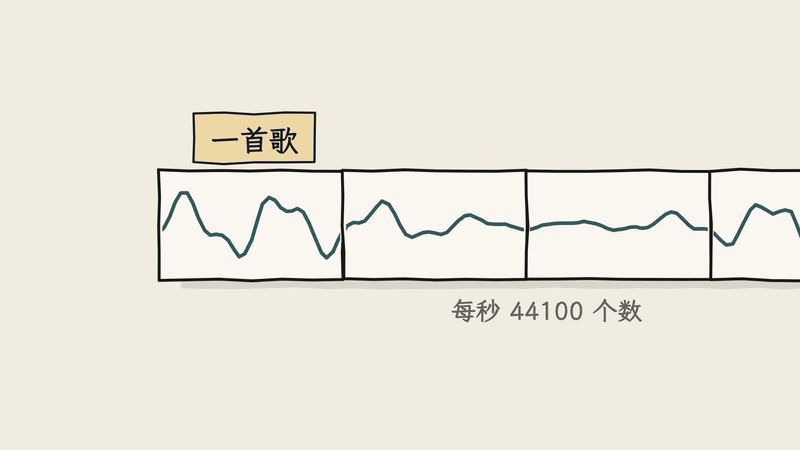
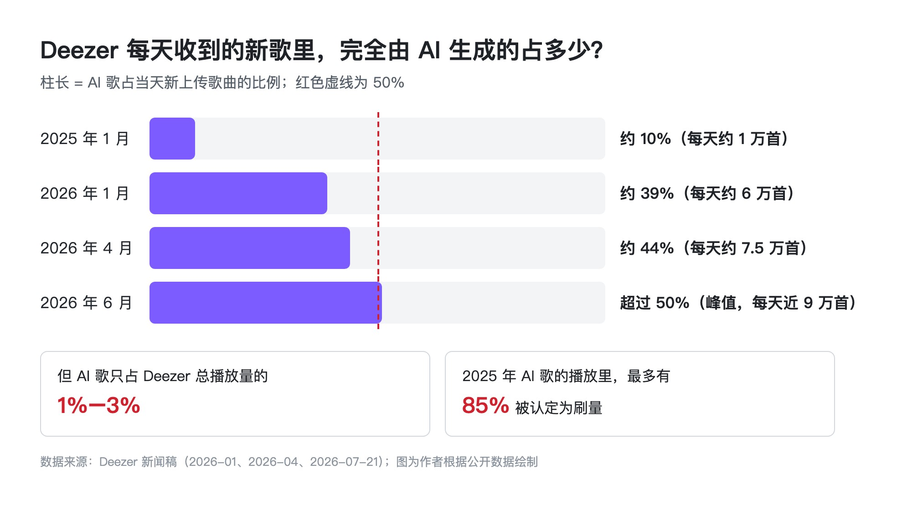
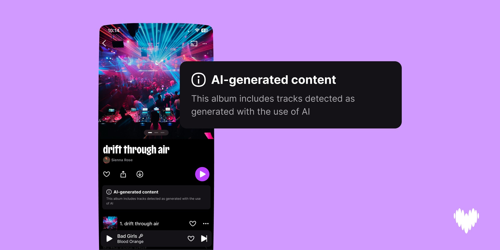
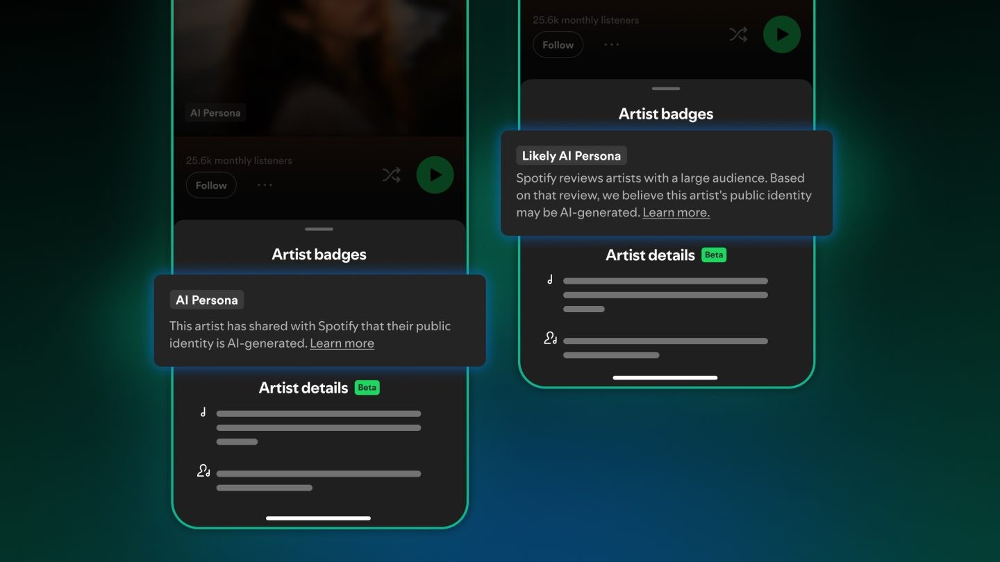
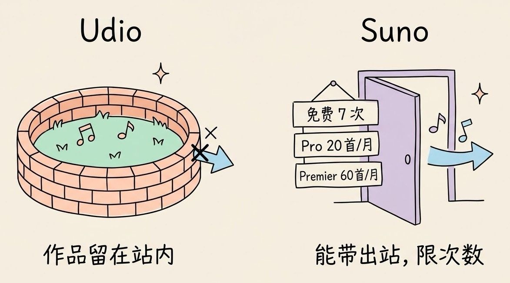
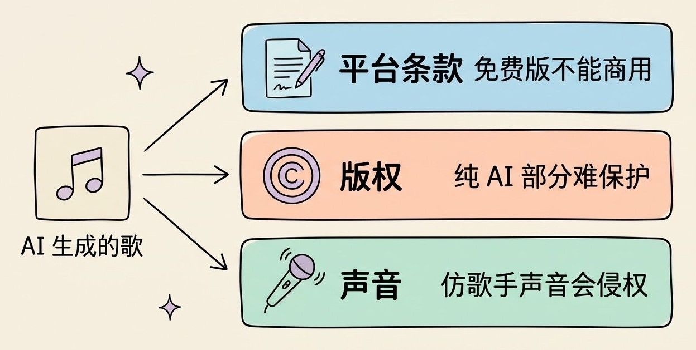

# 3分钟搞懂AI音乐生成

> ⭐入门 · 阅读时间 3分钟 · 更新于 2026-11-23
>
> AI 已经能用一段歌词生成带人声的完整歌曲，Deezer 每天收到的新歌里 AI 歌已过半，播放量却只占 1%–3%。本文讲清一首歌是怎么生成的、Suno 和 Udio 为什么改了下载规则、国内外工具怎么选，以及生成的歌归谁、能不能商用。

## 一句话定义

**AI 音乐生成** = 你给模型一段文字描述，或者再加上歌词、一张图片、一段参考音频，它直接生成一首有旋律、有伴奏、通常还带着人声演唱的歌，用来做短视频配乐、歌曲小样、生日歌这类工作。

以前做一首歌，要有人作词作曲，再编曲、找歌手录音、混音，哪怕只是一首粗糙的小样，也要花上好几天。现在你在 Suno 或 Mureka 里写上「一首适合深夜开车听的合成器流行，男声，副歌要容易记住」，再贴上自己写的歌词，一两分钟后就能拿到完整的歌，前奏、主歌、副歌、尾奏都有。

不过，2026 年这个领域最大的变化并不在音质上。主流产品的音质已经好到普通人很难分辨，现在真正决定你能不能用的，是另外几件事：模型训练用的歌有没有拿到授权，生成的歌能不能下载，能不能上传到音乐平台，能不能拿去商用。

## 一首歌是怎么「算」出来的？

AI 生成音乐比生成图片难的地方在于数据量。CD 音质的音频每秒有 44100 个采样点，一首 3 分钟的歌，单个声道就有将近 800 万个数字。如果模型一个点一个点地去预测，不但慢，而且很容易唱到一半就「跑调」。所以当前主流的做法是先压缩、再生成、最后还原：

```
① 编码  -> 把音频切成很短的片段, 每一小段压缩成几个离散的"音频词",
           一首歌就变成了一长串"音频词"
② 生成  -> 模型根据你的描述和歌词, 先安排好段落结构、速度和旋律走向,
           再一个接一个地生成"音频词", 人声和伴奏一起生成
③ 解码  -> 把这一串"音频词"还原成能播放的声音
```



这里的「音频词」，和大模型处理文字时用的 token 是同一个思路：文字模型逐个预测下一个字，音乐模型逐个预测下一小段声音。**MiniMax Music 3.0** 公开的结构正好对应这三步，分别是负责编码的 Tokenizer、负责生成的混合语言模型，以及负责还原声音的合成模块。开源的 **ACE-Step 1.5** 则是先让一个语言模型做规划，再交给扩散模型（从随机噪声出发、一步步还原出声音的模型）去生成具体的声音。

第二步里的「先安排结构」，决定了一首歌听起来像不像一首完整的歌。早期模型常见的问题是副歌和主歌听起来差不多，或者唱到后面旋律越来越散。昆仑万维把 Mureka 用的方法叫作「音乐思维链」，就是先把音乐的动机和整体结构想清楚，再去生成声音，这和大模型先思考再回答是同一个思路。

理解了这个过程，你就能明白使用时会遇到的几个现象：

- **同样的描述，每次生成的结果都不一样**：生成过程本身带有随机性，所以大家常把做 AI 歌叫作「抽卡」，一般要多生成几版再从里面挑。
- **歌词经常唱错字、吞字**：模型要让每个字落在合适的音符上，中文还有声调和咬字的问题，所以生成之后要逐句听一遍，唱错的地方用局部编辑功能单独重新生成。
- **大多数时候是新旋律，但也可能「背出」原曲**：模型学的是大量歌曲里的规律，通常生成的是新的旋律；但如果某首歌在训练数据里出现得足够多，模型也有可能把它的旋律和歌词几乎原样还原出来。德国法院判 Suno 侵权，认定的就是这种情况，后面会详细讲。

## 上传量过半，播放量只占 1%–3%

生成一首歌的成本降到几乎为零之后，最先感受到变化的是音乐平台。法国流媒体平台 **Deezer** 从 2025 年 1 月开始用自己的检测工具识别完全由 AI 生成的歌曲，当时每天大约有 1 万首，占新上传歌曲的 10% 左右；到了 2026 年 6 月的峰值，每天收到的 AI 歌接近 9 万首，第一次超过了当天上传总量的一半。

但是 Deezer 公布的另一组数字更能说明问题：这些 AI 歌只占平台总播放量的 1%–3%。而且在 2025 年，AI 歌的播放里最多有 85% 被认定为刷量，也就是有人批量上传 AI 歌，再用机器人反复播放，来骗取平台的版税分成。


*图注：作者根据 Deezer 2026 年 1 月、4 月和 7 月发布的数据绘制。上半部分是 AI 歌占当天新上传歌曲的比例，括号里是每天的大约数量；下半部分是同一批 AI 歌在播放量上的占比，以及其中被认定为刷量的比例。*

把这两组数字放在一起看，结论就很清楚了：AI 让「做出一首歌」变得非常容易，但听众的时间并没有因此变多。大部分 AI 歌根本没有人听，有人听的那一部分里，又有相当一部分是假的。

所以平台的态度也在收紧。

**Deezer** 不把 AI 歌放进算法推荐和编辑歌单，并向听众标注哪些歌是 AI 生成的；刷量产生的播放不计入版税，用来刷量的 AI 歌、半年以上没人播放的 AI 歌也会被下架。


*图注：出自 Deezer 新闻稿配图。专辑页面上的「AI-generated content」提示，意思是「这张专辑包含被检测为使用 AI 生成的曲目」，听众打开页面就能看到。*

**Spotify** 从 2026 年 9 月中旬开始，给「身份由 AI 生成、并不对应真实的人」的艺人主页加上 **AI Persona** 标签，这类艺人的歌默认不进入编辑推荐和算法推荐，除非听众主动关注了他们。需要注意的是，这个标签看的是艺人身份是不是虚构的，真实的音乐人用 AI 辅助编曲、混音，并不会被打上这个标签。


*图注：出自 Spotify 新闻稿配图。左边的「AI Persona」表示艺人自己向 Spotify 声明了身份是 AI 生成的；右边的「Likely AI Persona」表示 Spotify 审核了听众较多的艺人后，认为这个艺人的公开身份可能是 AI 生成的。*

对你来说，这意味着如果打算批量生成 AI 歌、上传到平台赚播放分成，这条路基本已经走不通了。AI 音乐真正好用的地方，是后面要讲到的那些「做给自己和身边人用」的场景。

## Suno 和 Udio，为什么都改了下载规则？

**Suno** 和 **Udio** 是 2024 年把「打字就能生成完整歌曲」带火的两家公司，也是唱片公司起诉的主要对象。2024 年 6 月，环球、索尼、华纳三大唱片公司起诉这两家公司，指控它们未经授权，用大量受版权保护的录音训练模型。两年下来，官司把两家的产品改成了完全不同的样子：

| 时间 | 发生了什么 |
|------|-----------|
| 2025 年 10 月 | 环球和 Udio 和解，双方合作开发一个获得授权的音乐平台；Udio 随即关闭了歌曲下载 |
| 2025 年 11 月 | 华纳先后和 Udio、Suno 和解，并签署授权协议 |
| 2026 年 7 月 | 德国慕尼黑地方法院一审判决 Suno 侵犯了德国音乐著作权协会 GEMA 代表的 6 首歌曲的版权 |
| 2026 年 9 月 3 日 | Suno 开始按会员档位限制下载次数 |
| 2026 年 9 月 9 日 | Suno 发布 v6，称用华纳、BMG、Believe 授权的音乐训练，旧模型陆续下线 |
| 2026 年 9 月 18 日 | 环球和索尼再次起诉 Suno，涉及 6 万多首录音，矛头直指 v6 |

**Udio 选择了「围墙花园」**。按照和环球的协议，Udio 要做的是一个订阅制的授权平台，用户可以在里面生成、改编和分享音乐，但作品不能下载到平台以外的地方。为了过渡，Udio 在 2025 年 10 月就关掉了下载功能。这个新平台原计划在 2026 年推出，目前还没有向所有用户开放。所以现在的 Udio 更像一个在站内玩音乐的地方，已经不适合用来给视频做配乐了。

**Suno 保住了下载，但加上了限制**。和华纳和解之后，Suno 保留了下载功能，但从 2026 年 9 月 3 日开始：

- 免费用户总共只能下载 7 次，而且只能个人使用，不能上传到音乐平台，也不能商用
- Pro 会员（每月 10 美元）每月最多下载 20 首，Premier 会员（每月 30 美元）每月最多下载 60 首，超出的部分可以另外购买
- Premier 会员在 Suno Studio（Suno 的网页版编曲工具）里做的作品，仍然可以不限次数地下载

新的服务条款还禁止用录屏、抓取音频流这类方式绕过下载限制，并且保留在歌曲里加入指纹、水印和元数据的权利，用来标记这首歌出自哪个会员档位、是不是通过正常渠道下载的。



**v6 也没有让官司结束**。Suno 称 v6 是从头训练的，没有使用之前版本的训练数据，也不包含环球和索尼的音乐。但环球和索尼在第二起诉讼里认为，v6 用到的「用户互动数据」，来自旧模型生成的歌曲和用户对这些歌的偏好，相当于让旧模型当老师、教出了新模型（这种做法叫「知识蒸馏」）。所以它们认为，用旧模型的输出去训练新模型，并不能消除侵权，只是把侵权「洗白」了，v6 仍然是「同一棵毒树结出的果子」。目前两起案件都还在审理中，按照现在的日程，第一起案件要到 2027 年才会进入是否构成合理使用的裁决阶段。

**德国的判决走了另一条路**。美国的官司主要在争论训练算不算「合理使用」，而慕尼黑法院在 GEMA 诉 Suno 案里看的是结果：GEMA 代表的 6 首歌在 Suno 的训练数据里，而且能在 v3.5 和 v4 模型里被还原出来，所以训练和输出都构成侵权，即使训练发生在美国，也不影响判决。法院还驳回了 Suno 提出的「是用户的提示词导致了侵权」的说法，因为 GEMA 用的提示词非常简单，真正决定输出内容的，是模型记住的东西。这只是一审判决，Suno 表示不同意，正在考虑上诉。

这些变化对你的影响是：选平台时，除了听生成效果，还要看它的训练数据有没有授权，下载和商用规则稳不稳定。平台的规则会跟着官司变，今天能下载、能商用的歌，换一版条款就可能不一样。所以如果是重要的商用项目，最好把生成时的服务条款、会员记录和下载记录都保存下来。

## 想做一首歌，该用哪个？

下面这张表按三个维度来比较：能不能在国内直接使用、中文唱得好不好、生成的歌能不能下载和商用。前两个决定好不好用，最后一个决定能不能用。

| 工具 | 出自 | 适合谁 | 需要知道的 |
|------|------|--------|-----------|
| **Suno** | 美国 Suno | 想做完整流行歌、玩法最多的人 | v6 支持局部编辑，能用图片、视频做参考；下载有次数限制，免费版不能商用 |
| **Udio** | 美国 Udio | 想在站内改编授权歌曲的人 | 目前不能下载，不适合做配乐 |
| **Lyria 3.5** | Google，在 Gemini 里使用 | 已经在用 Gemini，想快速做背景音乐、生日歌的人 | 可以选短曲或长曲、人声或纯音乐；Google 生成的音乐会嵌入 SynthID 隐形水印 |
| **Eleven Music** | 美国 ElevenLabs | 做广告、品牌内容的人 | 和独立厂牌版权组织 Merlin、版权公司 Kobalt 签了授权，主打可以商用 |
| **Mureka** | 昆仑万维 | 想写中文歌、国风歌的人 | V9.5 专门优化了中文歌词的咬字与和声编排，在国内就能直接使用 |
| **海绵音乐** | 字节跳动 | 想在手机上随手做一首歌的人 | 输入一句灵感或一段歌词就能出歌，也能根据图片生成歌曲 |
| **MiniMax Music 3.0** | MiniMax | 开发者、想自己部署的团队 | 开放权重，单首最长 5 分钟，也可以通过 API 调用 |
| **ACE-Step 1.5** | ACE Studio 与阶跃星辰 | 想在自己电脑上跑的人 | 开源，显存不到 4GB 也能跑，在 RTX 3090 上生成一首歌不到 10 秒 |

按用途来选的话：

- **只是自己玩，或者给家人做一首生日歌**：Gemini、海绵音乐、Mureka 的免费额度基本够用，不用急着付费。
- **给视频做配乐，需要下载**：用 Suno 或 Mureka 的付费档位，生成之前先看清楚这个档位的商用条款。Udio 暂时不能下载，不在考虑范围内。
- **写中文歌**：国产产品针对中文咬字做了专门优化，建议拿同一段歌词，在 Mureka、海绵音乐和 Suno 上各生成几版对比着听。
- **开发者要接进自己的产品**：可以调用 MiniMax 的 API，或者自己部署 ACE-Step、MiniMax Music 3.0 这类开放模型，但要先读一遍模型的许可证，看它允不允许商用。

## 生成的歌，到底归谁？

这个问题要分成三层来看。



**第一层是你和平台之间的约定**。免费版一般只允许个人使用，付费版才给商用授权，具体看各家的服务条款。但要注意，会员费解决的只是你和平台之间的合同问题，挡不住第三方的版权主张。如果生成的歌和某首现有作品太像，原作者照样可以找你，平台的会员协议帮不了你。

**第二层是你能不能对这首歌主张版权**。美国版权局 2025 年 1 月发布的报告认为，在当前的技术条件下，仅靠写提示词，还不足以让用户成为作品的作者，纯 AI 生成的部分不受版权保护；但你自己写的歌词，以及你对生成结果做的有创造性的挑选、编排和修改，仍然可以受到保护。国内目前还没有专门针对 AI 生成音乐著作权的法律规定。换句话说，一首完全由 AI 生成的歌，如果别人拿去用了，你很可能难以维权。如果你想对作品主张权利，最好自己写歌词，或者把 AI 生成的内容当作素材，再自己做编曲和修改。

**第三层是声音**。用 AI 模仿某位歌手的声音去「翻唱」，风险比旋律更直接。2024 年 4 月，北京互联网法院判决了全国首例 AI 生成声音人格权侵权案：一位配音师的声音被做成 AI 语音产品对外出售，法院判被告赔偿 25 万元。法院认为，只要普通听众能根据音色、语调听出这是谁的声音，AI 生成的声音也受声音权益保护；而且授权别人使用你的录音，并不等于授权别人把你的声音 AI 化。所以，「AI 翻唱某明星」这类内容自己听听可以，不要发布出去。

除了版权，还有一条容易被忽略的规定：国内的《人工智能生成合成内容标识办法》从 2025 年 9 月 1 日开始施行。对音频来说，**显式标识**是在开头、结尾或中间合适的位置加上语音提示或者音频节奏提示，**隐式标识**则写在文件的元数据里，供平台自动识别。所以你在抖音、视频号、音乐平台发布 AI 生成的歌时，记得勾选平台提供的 AI 生成内容声明，也不要去删除文件里的标识。

## 适合拿它做什么，不适合做什么？

结合前面 Deezer 的数据，可以得出一个判断：AI 音乐最适合的，是那些为某个人、某件事专门做的歌，而不是去和专业歌手争排行榜。这类歌只需要被少数人听到，但以前请人来做又太贵。比如：

- 给家人做一首唱着名字和共同回忆的生日歌，Gemini 里就直接提供了生日歌模板
- 给短视频、播客、产品演示配一段风格合适的背景音乐
- 独立游戏的原型阶段，先用 AI 配乐试试氛围，正式版再决定要不要请人做
- 音乐人用它快速试几种编曲方向，选定之后再自己重新编曲和录制
- 老师把要背的课文、单词编成一首歌，方便孩子记忆

它目前做不好的地方也很明确。想精确控制某一小节的和弦和配器，AI 还比不上你自己在编曲软件里修改；生成的歌是一个已经混好的整体，如果你想单独调整人声或者某件乐器，需要再用分轨功能把它们拆开，效果不一定理想。另外，歌词唱错、段落不满意时，只能局部重新生成，往往要来回试很多次。

还有一个常见的误会，是觉得 AI 歌一听就能听出来是假的。实际上，Deezer 需要专门开发检测工具，才能识别出每天上传的这些 AI 歌，靠耳朵已经分辨不出来了。但是听起来像真人唱的，并不代表它在法律上没有问题，好不好听和能不能用，是两件需要分开判断的事。

## 时效性提醒

AI 音乐的产品和规则都在快速变化，下面这些信息尤其容易过时：

- 各家模型的版本号和最长生成时长，国内几家基本每隔几个月就会发布新版本
- Suno 的下载次数、会员价格和商用条款，Udio 授权平台的开放时间
- 环球、索尼诉 Suno 案和索尼诉 Udio 案的进展，以及 GEMA 诉 Suno 案的上诉结果
- 各音乐平台对 AI 歌曲的标注、推荐和下架规则

**建议**：商用之前一定要打开官网的服务条款，确认当前档位的商用授权范围；如果是广告、品牌主题曲这类重要项目，最好准备一份传统授权音乐库的备选方案。

💬 **互动话题**：你用 AI 做过歌吗？是做给自己听、给视频配乐，还是送给别人的？在 Suno 限制下载、Udio 关闭下载之后，你现在主要用哪个工具？

📖 **相关阅读**：

- [3分钟搞懂生成式AI](../../02-core-capabilities/01-generative-ai/README.md) - 扩散模型「从噪声还原内容」的基本原理
- [3分钟搞懂Transformer](../../01-basics/03-transformer/README.md) - 音乐模型逐个预测「音频词」，用的就是这套架构
- [3分钟搞懂AI声音克隆](../06-ai-voice-cloning/README.md) - AI 歌里的人声背后，是同一类声音生成技术
- [3分钟搞懂AI视频生成](../05-ai-video-generation/README.md) - 视频模型现在也能一起生成对白、音效和配乐
- [3分钟搞懂AI监管政策](../../08-business-ethics/06-ai-regulation/README.md) - AI 生成内容的版权和标识是怎么管的

**资料来源**：

- TechCrunch，Suno replaces its AI models with a new one trained on licensed music as copyright suits pile up（2026-09-09）：https://techcrunch.com/2026/09/09/suno-replaces-its-ai-models-with-a-new-one-trained-on-licensed-music-as-copyright-suits-pile-up/
- Music Business Worldwide，Universal and Sony sue Suno for a second time（2026-09-18）：https://www.musicbusinessworldwide.com/universal-and-sony-sue-suno-for-a-second-time-claiming-platforms-v6-models-are-the-fruit-of-the-same-poisoned-tree/
- Music Business Worldwide，Universal and Sony fight Suno's bid to freeze second lawsuit：https://www.musicbusinessworldwide.com/universal-and-sony-fight-sunos-bid-to-freeze-second-lawsuit-warning-its-latest-ai-models-could-escape-scrutiny-until-at-least-2028/
- Music Business Worldwide，Suno limits Pro subscribers to 20 song downloads per month（2026-08-11）：https://www.musicbusinessworldwide.com/suno-limits-pro-subscribers-to-20-song-downloads-per-month
- Music Business Worldwide，Suno: We've hit 2M paid subscribers and $300M annual revenue（2026-02-26）：https://www.musicbusinessworldwide.com/suno-hits-2m-paid-subscribers-300m-annual-revenue/
- Music Business Worldwide，Warner Music Group strikes 'landmark' deal with Suno：https://www.musicbusinessworldwide.com/warner-music-group-settles-with-suno-strikes-first-of-its-kind-deal-with-ai-song-generator/
- Music Business Worldwide，Universal Music settles Udio lawsuit, strikes deal for licensed AI music platform：https://www.musicbusinessworldwide.com/universal-music-settles-udio-lawsuit-strikes-deal-for-licensed-ai-music-platform/
- PR Newswire，Warner Music Group and Udio collaborate to build a new licensed music creation service：https://www.prnewswire.com/news-releases/warner-music-group-and-udio-collaborate-to-build-a-new-licensed-music-creation-service-302620656.html
- Rolling Stone，AI Music Settlement: Why Universal Music Group is Teaming with Udio：https://www.rollingstone.com/music/music-features/ai-music-universal-music-group-settlement-udio-1235457945/
- JUVE Patent，Munich Regional Court stops Suno using GEMA-protected music：https://www.juve-patent.com/cases/munich-regional-court-stops-suno-using-gema-protected-music/
- Simmons & Simmons，GEMA v Suno AI: key EU decision on AI training, outputs and copyright：https://www.simmons-simmons.com/en/publications/cmszvaaz6003oug849s2sqawl/gema-v-suno-ai-key-eu-decision-on-ai-training-outputs-and-copyright
- Deezer，AI Music Tops 50% of Daily Uploads on Deezer（2026-07-21）：https://newsroom-deezer.com/2026/07/ai-music-exceeds-50-percent-daily-uploads-deezer/（数据图的主要数据来源，AI 标注截图出自此页）
- Deezer，AI-generated tracks reach 44% of uploads on Deezer（2026-04）：https://newsroom-deezer.com/2026/04/ai-generated-tracks-represent-44-of-new-uploaded-music/
- Music Business Worldwide，60,000 AI tracks hit Deezer daily：https://www.musicbusinessworldwide.com/60000-ai-tracks-hit-deezer-daily-as-platform-moves-to-license-detection-tech-to-wider-music-industry/
- Spotify，Introducing a New Label for AI-Generated Artist Identities on Spotify（2026-08-11）：https://newsroom.spotify.com/2026-08-11/ai-persona-badges-transparency/（AI Persona 标签截图出处）
- Google，A new way to express yourself: Gemini can now create music（Lyria 3）：https://blog.google/innovation-and-ai/products/gemini-app/lyria-3/
- Google，Create your best tracks yet with Lyria 3.5 in Gemini（2026-09-04）：https://blog.google/innovation-and-ai/products/gemini-app/better-tracks-lyria-gemini/
- Music Business Worldwide，Eleven Music launches with Merlin, Kobalt licensing deals：https://musicbusinessworldwide.com/eleven-music-new-ai-rival-to-suno-launches-with-merlin-kobalt-licensing-deals-in-the-bag
- 东方财富，昆仑万维发布 AI 音乐生成模型 Mureka V9.5（2026-08-18）：https://wap.eastmoney.com/a/202608183844385437.html
- App Store，海绵音乐 - AI 为你写好歌：https://apps.apple.com/cn/app/id6502927127
- MiniMax，MiniMax Music 3.0：新一代开放权重、生产级全能音乐模型：https://minimaxi.com/blog/minimax-music-3-0-cn
- arXiv，ACE-Step 1.5: Pushing the Boundaries of Open-Source Music Generation：https://arxiv.org/abs/2602.00744
- ACE-Step 1.5 项目主页：https://ace-step.github.io/ace-step-v1.5.github.io/
- U.S. Copyright Office，Copyright Office Releases Part 2 of Artificial Intelligence Report（2025-01-29）：https://copyright.gov/newsnet/2025/1060.html
- 光明网，全国首例 AI 生成声音人格权侵权案一审宣判（2024-04-23）：https://m.gmw.cn/2024-04/23/content_1303719951.htm
- 国家互联网信息办公室，关于印发《人工智能生成合成内容标识办法》的通知：https://www.cac.gov.cn/2025-03/14/c_1743654684782215.htm

---

⬅️ 上一篇：[3分钟搞懂AI声音克隆](../06-ai-voice-cloning/README.md) ｜ [📚 返回目录](../README.md) ｜ 下一篇：[3分钟搞懂AI数字人](../08-ai-digital-human/README.md) ➡️
