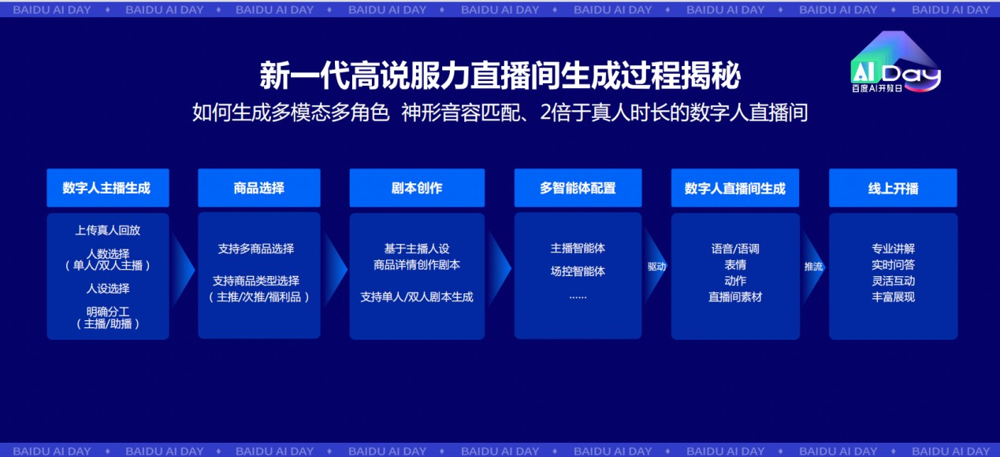
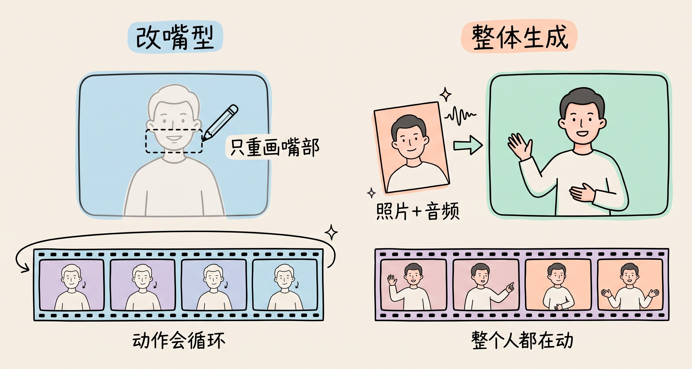
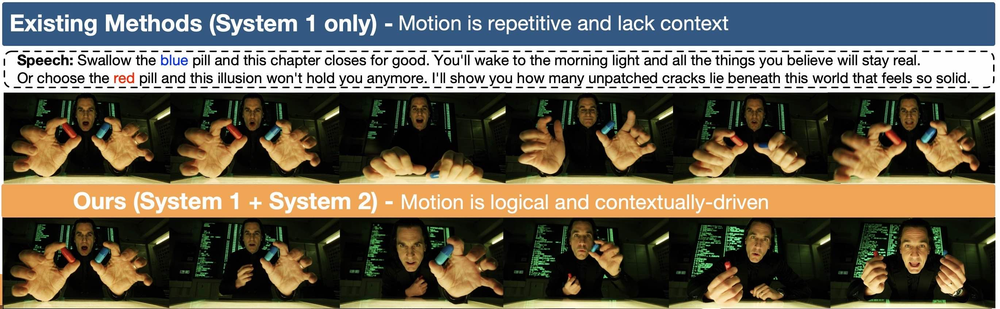
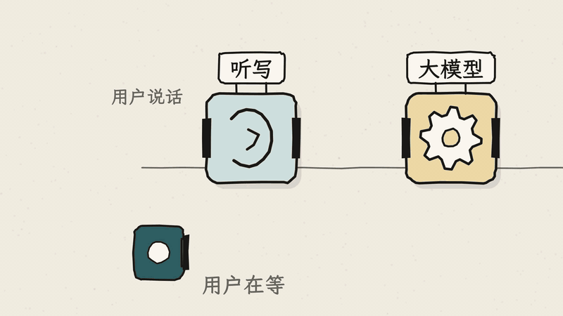

# 3分钟搞懂AI数字人

> ⭐⭐中级 · 阅读时间 3分钟 · 更新于 2026-11-24
>
> 一条数字人视频由形象、脚本、声音和驱动四层拼起来。本文讲清现在的数字人难在动作而不是嘴型，录播视频和实时对话为什么是两种产品，国内外工具怎么选，真正省下的是哪部分成本，以及 2026 年起数字人直播必须遵守的标识和授权规定。

## 一句话定义

**AI 数字人** = 用 AI 生成一个会说话、有表情和手势的人物形象，把一段文字或一段录音变成这个人出镜讲话的视频，或者让它接上大模型，在屏幕上实时和人对话，用来做口播视频、培训课程、直播带货、客服接待等。海外一般叫 AI Avatar，监管文件里的正式说法是「数字虚拟人」。

它可以是一个虚构的人，也可以是照着某个真人做出来的**数字分身**。后一种用法最多，风险也最大。

2025 年 6 月，罗永浩的数字人在百度电商做了一场 6 个半小时的直播：罗永浩和搭档朱萧木都换成了数字人，AI 生成的讲解词有 9.7 万字，数字人做出的动作超过 8300 个，遇到评论区的提问还能当场接话，最终 GMV 超过 5500 万元，观看超过 1300 万人次。作为对比，罗永浩本人一个月前在同一平台的真人首播，GMV 是 5000 多万元。


*图注：2025 年 6 月 15 日罗永浩数字人直播间的画面，出自 36 氪的报道。左边是朱萧木的数字人，右边是罗永浩的数字人。当时有观众注意到，数字人罗永浩端起酒杯做喝酒动作时，嘴角几乎没有变化，这就是下文说的「动作和内容对不上」。*

这场直播把数字人的几个关键问题都摆了出来：它是怎么做出来的、哪些地方已经能以假乱真、省下的到底是什么成本，以及照着真人做数字人需要遵守哪些规矩。下面我们一个一个来看。

## 一条数字人视频，是怎么做出来的？

不管是网页上几分钟生成的口播视频，还是直播间里连播几个小时的数字人，基本都由四层拼起来：

```
① 形象   -> 用一段真人视频或一张照片, 确定这个人长什么样
② 脚本   -> 人来写, 或者让大模型根据商品资料、课件生成要说的话
③ 声音   -> 用语音合成或声音克隆, 把脚本读出来
④ 驱动   -> 根据声音生成口型、表情、头部和手部动作, 合成最终画面
```

前三层都有现成的技术可以用，脚本靠大模型，声音靠 TTS 和声音克隆。数字人产品真正自己做的，主要是第 ④ 层：让画面里的人跟着声音动起来。


*图注：百度在 2025 年 6 月的 AI Day 上公开的数字人直播间生成流程，出自每日经济新闻的报道。第一步用真人直播回放生成主播形象，「剧本创作」根据主播人设和商品详情写讲解词，「多智能体配置」里的主播智能体、场控智能体负责直播时实时应答，再驱动语音、表情和动作生成直播画面，最后推流开播。和上面的四层对应起来，直播场景比录播视频多了一层负责实时应答的智能体。*

当前主流的做法分成两类：

- **改嘴型**：先录一段真人正常说话的视频，生成时保留原视频里的身体和表情，只把嘴部区域重新画一遍，让嘴型对上新的音频。这种做法成本低、画面稳定，很多「录 2 分钟视频，克隆数字分身」的产品用的都是它。缺点是动作只能来自原视频，视频一长，同样的点头、抬手就会循环出现。
- **整体生成**：给模型一张照片或一小段视频，再加上一段音频，由模型从头生成整个人的画面，包括口型、表情、眼神、手势和身体动作。字节的 OmniHuman、HeyGen 的 Avatar 6 都属于这一类。画面更自然，也能做半身、全身甚至多人对话，但对算力要求更高，偶尔也会生成出奇怪的手指或表情。



另外还有一类是 **3D 建模的数字人**，用建模软件做出一个三维角色，再用动作捕捉或算法驱动，常见于虚拟偶像、游戏和高端品牌形象。它的形象最可控，但制作周期和成本也最高，和上面两种「用 AI 直接生成画面」的产品，是两条不同的路线。

## 嘴型已经不是难点，难的是动作

两三年前判断一个数字人好不好，主要看嘴型对不对、牙齿糊不糊。现在主流产品在这方面已经差别不大了，拉开差距的是**动作**。

最常见的穿帮有这几种：

- **动作循环**：同一个手势每隔十几秒就重复一次，看上一分钟就能发现。
- **动作和内容对不上**：说到「第一点」时手没有比划，说到重点时表情却很平淡。
- **长视频不稳定**：前几分钟脸还很像，到后面脸型、肤色慢慢发生变化。
- **细节出错**：手指数量不对、眼神发直、低头时脖子变形。

HeyGen 在 2026 年 11 月发布的 Avatar 6，主要解决的就是第一种和第二种问题。它会先理解脚本的内容和语气，再生成对应的手势；模型一次能参考的音频上下文，从原来的 3 秒左右扩大到 30 秒左右，所以动作能和前后的内容连贯起来，而不是每隔几秒重新挑一个动作。字节的 OmniHuman 1.5 也是同样的思路，论文里给了一组对比：


*图注：截取自字节 OmniHuman 1.5 论文（2025 年 8 月）的图 1 右上部分。上方的虚线框是人物要说的台词，内容是让对方在蓝色药丸和红色药丸之间做选择。上排「Existing Methods」是只根据音频生成动作的旧方法，标注为「动作重复，缺少上下文」，六帧里人物基本都在重复双手前伸的动作；下排「Ours」是先理解台词再生成动作的新方法，标注为「动作有逻辑，由上下文驱动」，人物会随着台词先后举起不同颜色的药丸。*HeyGen 还表示，已经创建过的个人数字分身会自动升级到新模型，不需要重新录视频。

这对使用者来说意味着：**挑数字人工具时，不要只看官网上十几秒的样片**。样片通常是精选过的短片段，最能暴露问题的是 3 分钟以上的长视频。最好用自己的脚本生成一条 3 到 5 分钟的视频，重点看手势有没有重复、说到重点时表情有没有变化、结尾的脸和开头是不是同一个人。

## 录播视频和实时对话，是两种不同的产品

很多人说的「数字人」，其实指的是两种差别很大的产品：

| 对比项 | 录播类数字人 | 实时互动数字人 |
|---|---|---|
| 怎么用 | 输入脚本，等几分钟拿到一条视频 | 用户说话，数字人当场回答 |
| 对速度的要求 | 慢一点没关系，可以反复修改 | 回复要在一两秒内开始，否则对话就很别扭 |
| 内容可控性 | 每句话发布前都能审核 | 说什么由大模型当场决定，可能说错话 |
| 典型场景 | 产品介绍、培训课件、多语言视频 | 客服、导购、面试陪练、展厅接待、直播间答疑 |
| 代表产品 | HeyGen、Synthesia、即梦数字人 | HeyGen LiveAvatar、D-ID V4、百度一镜 |

实时互动数字人难做，是因为一次回复要依次走完好几步：先把用户的话转成文字，再交给大模型想怎么回答，然后把回答转成语音，最后根据语音生成画面并推流到用户的屏幕上。每一步都要花时间，加起来很容易超过两三秒。所以这类产品通常会把画面生成做得更轻量，画质也比录播类差一些。



有的产品也允许你把前面几步换成自己的系统。比如 HeyGen 的 LiveAvatar 提供了一种模式，语音识别、大模型和语音合成都由开发者自己负责，LiveAvatar 只负责把音频变成同步的数字人画面。如果你已经做好了一个语音智能体，只是想给它加一张脸，可以选择这种接法。

2026 年各家的方向都在往实时互动靠：D-ID 在 3 月发布了面向实时对话的 V4 数字人；Synthesia 在 1 月完成 2 亿美元 E 轮融资（估值 40 亿美元）时，也把下一步的重点放在了可以对话的「视频智能体」上；百度在 5 月把直播数字人平台慧播星升级为「百度一镜」，李彦宏把数字人称为「看得见的智能体」。数字人正在从一个生成视频的工具，变成大模型智能体对外的一个界面。

## 主流产品怎么选？

| 产品 | 国内能否直接使用 | 擅长的场景 | 特点 |
|---|---|---|---|
| HeyGen | 不能 | 营销视频、多语言口播 | 最新模型 Avatar 6，支持 175 种以上语言的配音和口型；免费版每月 3 条带水印、1 分钟以内的视频，Creator 档每月 29 美元 |
| Synthesia | 不能 | 企业培训、内部沟通 | 面向大企业，重视合规和团队协作，主打培训视频 |
| D-ID | 不能 | 照片说话、实时对话数字人 | 一张照片就能让人物开口；2025 年收购了德国的企业讲解视频平台 simpleshow |
| 百度一镜（原慧播星） | 能 | 直播带货、实时互动 | 罗永浩数字人直播背后的平台，数字人能根据评论区的提问实时回答 |
| 即梦 / 剪映数字人（字节） | 能 | 个人短视频口播 | 门槛低，适合先试效果；国际版 Dreamina 已接入 OmniHuman 1.5 |
| 硅基智能、商汤如影等 | 能 | 企业定制、私有化部署 | 偏向政企和大客户，按项目交付 |

如果想部署在自己的服务器上，也可以看看开源方案，比如腾讯音乐开源的口型同步模型 MuseTalk、硅基智能开源的 Duix-Avatar、美团开源的 LongCat-Video-Avatar 等。开源模型的效果、显卡要求和许可协议差别都很大，商用之前要先看清楚协议。

按用途来选，可以参考下面的思路：

- **只是想给自己的视频加一个出镜口播**：先用即梦、剪映这类免费或低价的工具试几条，觉得有用再考虑付费。
- **要做大量英文或多语言视频**：HeyGen、Synthesia 的多语言口型和配音更成熟，但需要海外账号和支付方式。
- **要做直播带货**：选百度一镜这类直播平台自己的数字人方案，推流、平台审核规则都更容易对接。
- **要做客服、导购等实时对话场景**：重点测试回复速度，以及答不上来时能不能转人工。

## 数字人省下的，是哪部分成本？

百度给出的数据是，用数字人直播的开播成本能降低 80%。这个数字是平台方自己公布的，不过省钱的方向是真实的：数字人不需要主播、场地和灯光，可以 24 小时开播，一个人写好的脚本能翻译成十几种语言的版本，课件改了几句话也不用重新拍。

但有几部分成本是省不掉的，甚至会变得更重要：

- **脚本**：罗永浩那场直播的数字人，是用罗永浩和朱萧木大量的直播数据训练出来的，讲解词也是按照罗永浩的人设和商品特点定制的。普通商家没有这么多积累，生成出来的脚本往往千篇一律，观众听两句就会离开。
- **审核**：大模型生成的话术里可能出现夸大功效、价格说错这类问题。录播视频可以在发布前审核，实时直播就要提前设好禁用词和兜底话术，还需要有人在后台盯着。
- **责任**：数字人说错了话，责任不会落到数字人身上。2026 年 2 月 1 日起施行的《直播电商监督管理办法》明确规定，使用 AI 生成的人物形象出现违法违规行为时，由管理或使用这个形象的直播间运营者承担责任。
- **信任**：同样一段话，观众对真人和对数字人的信任程度是不一样的。需要现场试用、即兴回答问题、处理突发情况的场景，真人主播仍然更有优势。

所以对普通从业者来说，数字人会替代的主要是**重复性的出镜工作**，比如照着稿子念的口播、深夜时段的轮播直播、标准化的产品讲解。会写脚本、懂产品、能判断内容风险的人，反而会更被需要。

## 用数字人发布内容，需要遵守哪些规定？

国内对数字人的管理，目前主要有三份文件：

- **《人工智能生成合成内容标识办法》**：2025 年 9 月 1 日起施行，AI 生成的视频要在画面上加上明显的提示标识，同时在文件的元数据里写入隐式标识。用数字人发布的视频，都要按平台的要求勾选 AI 生成内容的声明。
- **《直播电商监督管理办法》**：2026 年 2 月 1 日起施行，把数字人主播正式纳入了监管：用 AI 生成的人物形象做直播带货，要按规定进行标识，并且在直播过程中持续提示消费者，同时明确了上面提到的运营者责任。
- **《数字虚拟人信息服务管理办法（征求意见稿）》**：国家网信办在 2026 年 4 月公开征求意见，截止目前还没有正式发布。征求意见稿提出，未经本人同意，不得提供能识别出这个人身份的数字人服务；用人脸、声音这类敏感个人信息来建模，需要取得本人的单独同意；数字人展示的区域，要持续显示带有「数字人」字样的标识。

除了这些专门的规定，原有的法律同样适用于数字人。

**照着真人做数字人，必须先拿到本人授权**。2026 年 3 月，北京互联网法院通报了一起 AI 换脸短剧案：一部短剧里的角色被 AI 换成了某知名演员的脸，制作方被判侵犯肖像权，播出这部短剧的平台也因为没有尽到审查义务，被认定为共同侵权。法院的判断标准是**可识别性**：AI 生成的形象哪怕和本人不完全一样，只要一般观众能认出这是谁，就算使用了这个人的肖像。所以「我只是做了一个长得像的数字人」并不能免责。

**不能用数字人冒充医生卖药**。2026 年出现了不少用数字人扮成医生、专家，在视频里推荐药品和保健品的情况。《广告法》第十六条规定，医疗、药品、医疗器械广告不得利用广告代言人作推荐、证明。数字人医生说的「亲测有效」，本身就违反了这条规定，换成虚拟形象也一样。

海外也在推行类似的透明披露规则，欧盟《人工智能法案》从 2026 年 8 月 2 日起，要求发布深度伪造的视频时必须说明是 AI 生成的。

## 视频会议里的领导，也可能是数字人

数字人技术的另一面是**深度伪造**。2024 年初，英国工程公司奥雅纳（Arup）香港分公司的一名财务人员，被拉进了一场视频会议，会议里的「英国总部首席财务官」和几位「同事」都是用 AI 伪造的，画面和声音来自这些人在网上公开的视频。这名员工按照会议里的指示，分 15 次转出了 2 亿港元，事后向总部核实时才发现被骗。

这个案例说明，**「在视频里看到了本人」已经不能作为确认身份的依据**。尤其是涉及转账、改收款账户、发送敏感文件时，不管对方是以电话、语音还是视频的方式出现，都可以按下面的方法核实：

- **换一个渠道确认**：挂断后用你自己存的电话号码打回去，或者在公司内部的通讯工具上单独问一句，不要在原来的会议或通话里确认。
- **让对方做一个视频里难以伪造的动作**：比如请对方侧过脸、用手在脸前挥一挥。实时伪造的画面在侧脸和遮挡时更容易出现破绽，但这只能作为辅助手段，因为技术还在快速进步。
- **对「保密」「紧急」保持警惕**：要求你别告诉其他人、必须马上转账的，先按流程走一遍审批再说。

## 时效性提醒

数字人是变化很快的领域，下面这些信息尤其容易过时：

- 各家数字人模型的版本和效果，HeyGen 平均半年左右就会更新一次主力数字人模型
- 各平台的订阅价格、免费额度和商用条款
- 《数字虚拟人信息服务管理办法》的正式版本和施行时间，以及抖音、视频号、快手等平台对数字人直播的具体规则
- 实时互动数字人的回复速度和画质

**建议**：想试试数字人的话，可以先用即梦或剪映生成几条自己的口播视频，用 3 分钟以上的长视频来判断效果。涉及照着真人做数字分身时，一定要先拿到本人的书面授权，发布时记得加上 AI 生成的标识。

💬 **互动话题**：如果公司让你录一段视频做一个自己的数字分身，用它来讲产品课或者开直播，你会同意吗？你最担心的是什么？

📖 **相关阅读**：

- [3分钟搞懂AI声音克隆](../06-ai-voice-cloning/README.md) - 数字人开口说话的声音，大多来自声音克隆
- [3分钟搞懂AI视频生成](../05-ai-video-generation/README.md) - 整体生成类的数字人，用的是和视频生成同一类模型
- [3分钟搞懂多模态AI](../../04-advanced/03-multimodal-ai/README.md) - 实时互动数字人背后，模型是怎么同时处理语音和画面的
- [3分钟搞懂AI监管政策](../../08-business-ethics/06-ai-regulation/README.md) - 深度合成、AI 标识这些规定是怎么来的
- [3分钟搞懂AI就业影响](../../08-business-ethics/04-ai-and-jobs/README.md) - 数字人主播对相关岗位的影响

**资料来源**：

- PR Newswire，HeyGen Introduces Avatar 6, an Audio-Driven, Context-Aware AI Model（2026-11-17）：https://www.prnewswire.com/news-releases/heygen-introduces-avatar-6-an-audio-driven-context-aware-ai-model-that-alleviates-repetitive-or-unnatural-motion-in-ai-generated-video-302942527.html
- HeyGen，Pricing：https://www.heygen.com/pricing
- HeyGen 帮助中心，Introducing LiveAvatar：https://help.heygen.com/en/articles/12758516-introducing-liveavatar
- PR Newswire，D-ID Launches V4 Expressive Visual Agents（2026-03）：https://www.prnewswire.com/il/news-releases/d-id-launches-v4-expressive-visual-agents-for-real-time-llm-connected-interaction-at-enterprise-scale-302714463.html
- TechCrunch，D-ID acquires Berlin-based video startup simpleshow（2025-09-16）：https://techcrunch.com/2025/09/16/d-id-acquires-berlin-based-video-startup-simpleshow
- HLTH，Synthesia Raises $200M, With $4B Valuation（2026-01-27）：https://hlth.com/insights/news/synthesia-raises-200m-with-4b-valuation-2026-01-27
- ByteDance，OmniHuman-1.5（arXiv，2025-08）：https://arxiv.org/abs/2508.19209（文中动作对比图出处，图 1）
- Dreamina，OmniHuman 1.5 Guide：https://dreamina.capcut.com/resource/dreamina-omnihuman
- 每日经济新闻，罗永浩数字人直播首秀（2025-06-18）：https://www.nbd.com.cn/articles/2025-06-18/3913234.html（文中百度直播间生成流程图出处）
- 澎湃新闻，罗永浩数字人直播与真人首秀对比：https://m.thepaper.cn/newsDetail_forward_31011107
- 36氪，罗永浩用 AI 带货，一晚卖出 5500 万（2025-06）：https://www.36kr.com/p/3339115904972035（文中直播间画面出处）
- 钛媒体，百度数字人直播成本与商家数据：https://www.tmtpost.com/7600634.html
- 东方财富（转载证券时报），百度慧播星升级为“百度一镜”（2026-05-13）：https://finance.eastmoney.com/a/202605133735675433.html
- 国家互联网信息办公室，关于印发《人工智能生成合成内容标识办法》的通知：https://www.cac.gov.cn/2025-03/14/c_1743654684782215.htm
- 国家市场监督管理总局（转载人民日报），数字人主播等生成内容被纳入监管（2026-02）：https://www.samr.gov.cn/xw/mtjj/art/2026/art_b71cec6e11384080b91a779eb0bf7712.html
- 新华网，国家网信办拟加强数字虚拟人信息服务管理（2026-04-03）：https://www.news.cn/politics/20260403/1b4571378d624dc1951dc60ac5f3c37b/c.html
- 新京报，北京互联网法院通报 AI 换脸短剧侵犯肖像权案（2026-03）：https://www.bjnews.com.cn/detail/1774062715169592.html
- 界面新闻，数字人假扮医生带货：严打 AI 虚假广告向医疗领域渗透：https://www.jiemian.com/article/15150318.html
- SCMP，UK multinational Arup confirmed as victim of HK$200 million deepfake scam（2024-05）：https://scmp.com/news/hong-kong/law-and-crime/article/3263151/uk-multinational-arup-confirmed-victim-hk200-million-deepfake-scam-used-digital-version-cfo-dupe

---

⬅️ 上一篇：[3分钟搞懂AI音乐生成](../07-ai-music-generation/README.md) ｜ [📚 返回目录](../README.md)
