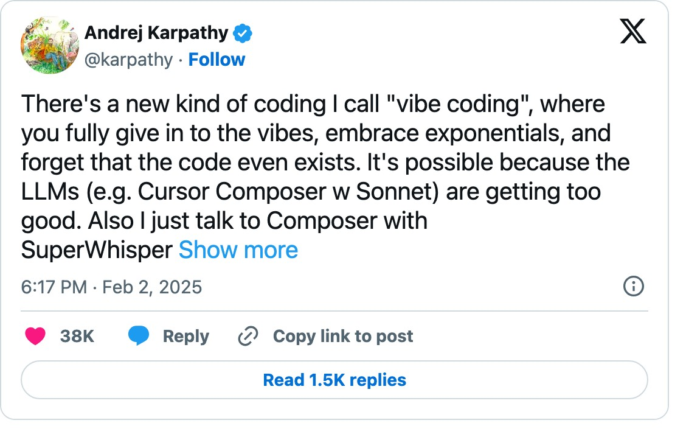
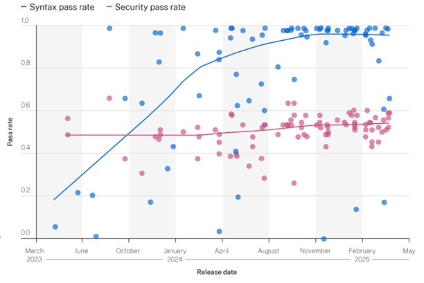
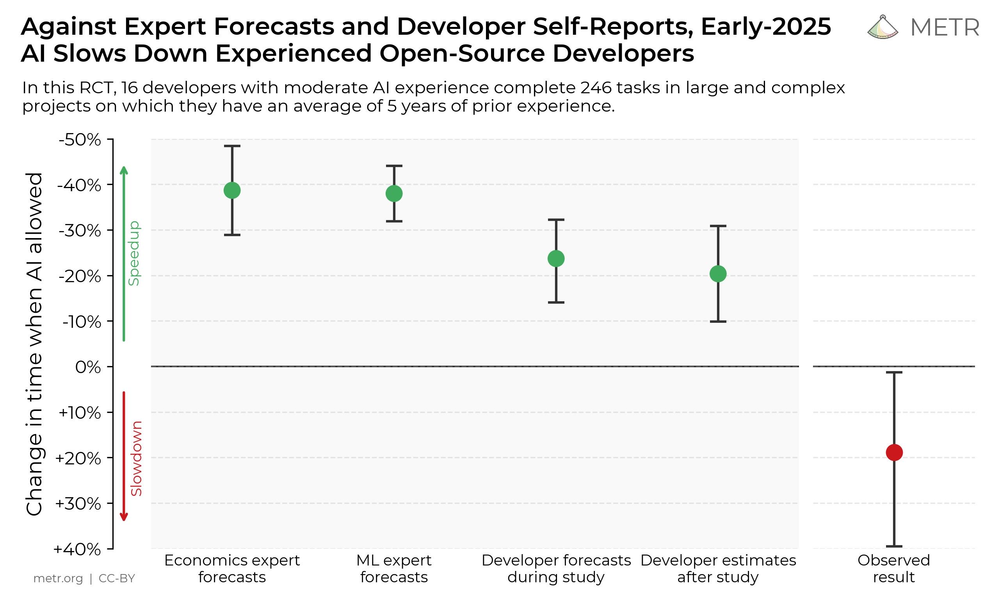
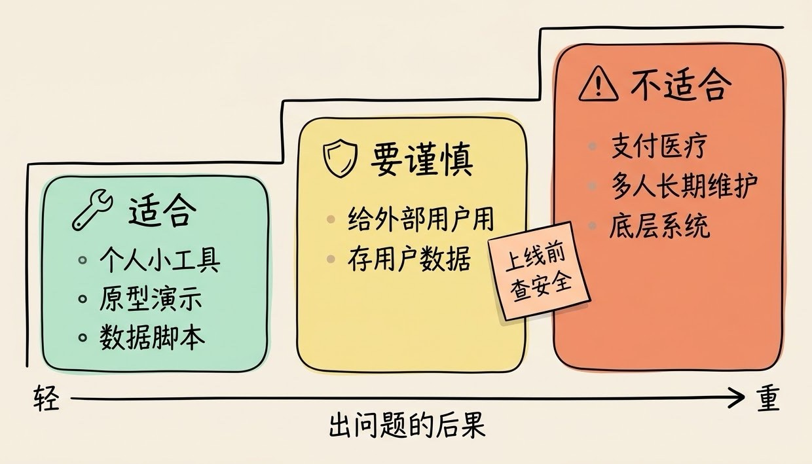

# 3分钟搞懂Vibe Coding

> ⭐入门 · 阅读时间 3分钟 · 更新于 2026-11-11
>
> Vibe Coding 是用自然语言让 AI 写代码、只看运行效果、基本不读代码的编程方式。本文讲清这个词的来历，它和普通 AI 辅助编程的分界线，Karpathy 一年后为什么换了个新说法，以及不看代码要付出的安全和维护代价。

## 一句话定义

**Vibe Coding**（常译作“氛围编程”）= 用自然语言告诉 AI 你想要什么，让 AI 去写代码、运行和修改，你只根据运行出来的效果决定下一步怎么改，不需要去读它写的代码。

举个例子：

- 你说：“做一个待办清单网页，能添加、删除、打勾，界面简洁一点。”
- AI 直接生成一个能打开的网页。
- 你看了效果，觉得不满意，就接着说：“按钮改成蓝色”“加一个搜索框”。
- 页面报错了，你也不去查原因，直接把报错信息贴给 AI，让它自己修。

整个过程中，你一直在看页面、提要求，而代码具体写成了什么样，你不知道，也不打算知道。**这里的关键不是用没用 AI 写代码，而是你看不看代码。** 这一点后面会专门讲。

## 这个词来自 Karpathy 的一条推文

2025 年 2 月 2 日，OpenAI 的创始成员之一、前特斯拉 AI 负责人 **Andrej Karpathy** 发了一条推文，第一句是：

> 有一种新的编程方式，我把它叫作 vibe coding：完全跟着感觉走，拥抱指数级的进步，忘掉代码的存在。

*图注：Karpathy 在 X 上发布的原推文，这个词就是从这里来的。第一句就是上面引用的那句话，后半句提到他用的是 Cursor 的 Composer 搭配 Claude Sonnet 模型，并且用语音输入工具 SuperWhisper 直接跟 AI 说话。推文后面折叠的部分，就是下面列出的几条做法。*

他在推文里描述了自己具体是怎么做的：

- 用语音输入跟 Cursor 里的 AI 说话，几乎不碰键盘；
- 想把侧边栏的边距减半这种小事，也懒得自己找代码，直接让 AI 去改；
- AI 改完之后总是点“全部接受”，不再看它改了哪些地方；
- 遇到报错，就把报错信息原样粘贴回去，大多数时候 AI 都能修好；
- 代码慢慢多到他自己也看不懂了，遇到 AI 修不好的 bug，就绕过去，或者让 AI 随便改改，直到 bug 消失。

最后他自己也说了，这种方式**用来做周末的一次性项目还不错**。也就是说，从一开始，这个词指的就是一种“不求甚解”的玩法，而不是一套严肃的开发方法。

这条推文本来只是随手一发，却正好说中了很多人当时的感受，这个词很快就传开了。2025 年 11 月，柯林斯词典把“vibe coding”选为 2025 年度词汇。

## 用不用 AI 不是分界线，看不看代码才是

这个词火了以后，很快就被用得越来越宽，只要是用 AI 写代码，都有人叫它 Vibe Coding。开发者 Simon Willison 专门写文章纠正过这件事，他给出的定义是：

> 我说的 vibe coding，是指用大模型做软件，但不去审查它写的代码。

他还给自己定了一条规矩：**如果我没法向别人解释清楚一段代码是干什么的，我就不会把它提交到代码仓库里。** 按这个标准，AI 写的代码只要经过了你的审查、测试，并且你能讲清楚它在做什么，那就是正常的软件开发，只不过用了 AI 帮忙而已。

所以，同样是用 AI 写代码，其实可以分成三种情况：

| 方式 | 你在做什么 | 算不算 Vibe Coding |
|---|---|---|
| 代码补全 | 自己写，AI 帮你补全下一行 | 不算 |
| AI 辅助编程 | AI 写大部分代码，你逐段审查、测试、修改 | 不算 |
| Vibe Coding | AI 写，你只看运行效果，不看代码 | 算 |

这个区分对读者很实用。**如果你是程序员，每天用 Cursor 或 Claude Code 写代码，但每一处改动都会看、都会测，那你做的就不是 Vibe Coding**，也不用背上“代码没人审过”的担心。反过来，如果你完全不懂代码，用对话生成了一个应用，那你做的就是 Vibe Coding。这时候代码里有没有安全漏洞、会不会把数据弄丢，你自己是很难看出来的，所以需要提前做好防范，具体会遇到哪些问题、该怎么应对，下面会有详细介绍。

## 一年后，Karpathy 换了一个新说法

2026 年 2 月，这条推文发出满一年，Karpathy 又发了一条回顾。他说，一年前大模型的能力还比较弱，所以 Vibe Coding 主要用在好玩的一次性项目、演示和探索上，“挺好玩的，也差不多能用”。

而一年后，情况已经不一样了：**用 AI Agent 编程正在成为专业开发者默认的工作方式，只是多了更多的监督和审查**。目标是借助 Agent 来提高开发效率，同时保证软件质量不打折扣。很多人都想给这种做法换个名字，好和 Vibe Coding 区分开，他自己目前最喜欢的说法是 **Agentic Engineering**（智能体工程）：

- **Agentic**：现在 99% 的时间里，你不再直接写代码，而是在指挥写代码的 Agent，并且负责把关；
- **Engineering**：强调这件事是有方法、需要专业能力的，可以学习，也可以越做越好。

这也回答了一个常见的问题：**Vibe Coding 会不会让程序员失业？** 从 Karpathy 的回顾可以看出，专业开发者并没有消失，变化的是工作内容，从一行行地写代码，变成了拆解任务、指挥 Agent、审查结果。真正被拉低的是“做出一个能跑的东西”的门槛，而“做出一个可靠、能长期维护的软件”，仍然需要懂行的人来负责。

不过这两者之间的界线也没有那么清楚。Simon Willison 在 2026 年 5 月就写过，随着 Claude Code 这类工具越来越可靠，他自己在做正式项目时也开始不逐行审查代码了，这让他很不安。他的顾虑是：**Agent 没有职业声誉，也没法为自己做过的事负责**，连续几次结果都不错之后，人就很容易放松警惕。

## 现在用什么工具做 Vibe Coding？

按“需不需要接触代码”来分，现在的工具大致有三类：

| 类型 | 代表工具 | 适合谁 |
|---|---|---|
| 聊天助手 | ChatGPT、Claude、豆包、千问 | 想快速做一个单页小工具、小游戏，在对话里直接预览 |
| 对话式应用生成平台 | Lovable、Replit、Bolt.new、v0；国内的百度秒哒、扣子 | 不会写代码，想做一个带登录、数据库、能上线访问的应用 |
| AI 编程工具 | Cursor、Claude Code、Codex、字节 TRAE（SOLO 模式）、Devin Desktop（原 Windsurf） | 能看懂项目结构的人，既可以放手让 AI 做，也可以随时审查代码 |

第一类门槛最低，但做出来的东西通常只是一个页面，没有后台和数据库。

第二类是 Vibe Coding 真正“出圈”的地方，平台把写代码、建数据库、部署上线都包了，你只需要对话。

第三类更灵活，更多是程序员在用，用它做 Vibe Coding 还是做严肃的 AI 辅助编程，取决于你看不看代码。

第二类平台这两年增长得非常快。以 Lovable 为例，它在 2025 年 7 月宣布，从 100 万美元做到 1 亿美元的年度经常性收入只用了 8 个月；到 2026 年 8 月，它又完成了一轮 4 亿美元的融资，估值达到 133 亿美元。Vercel 也在 2025 年 8 月把 v0.dev 改名为 v0.app，从“给开发者生成前端组件”转向“让所有人都能做应用”。国内的百度秒哒在 2025 年 3 月全面上线，到 2025 年 12 月，平台累计生成的应用已经超过 50 万个。

**如果你是第一次尝试**，可以先用聊天助手做一个单页小工具，感受一下“说需求、看效果、再改”的节奏；需要登录和数据存储时，再换到应用生成平台。

## 不看代码，会带来哪些问题？

Vibe Coding 最大的好处是快，代价也正是来自“不看代码”。下面这几类问题，在界面上通常是看不出来的。

### 安全漏洞藏在你看不到的地方

Veracode 在 2025 年 7 月发布的报告里，用 80 个编程任务测试了 100 多个大模型，结果有大约 45% 的情况下，AI 写的代码引入了安全漏洞。当一个功能既有安全的写法、也有不安全的写法时，模型差不多有一半的概率会选不安全的那种；其中 Java 的出错比例超过了 70%。

*图注：Veracode 2025 年 GenAI 代码安全报告里的图。横轴是模型的发布时间（2023 年 3 月到 2025 年 5 月），纵轴是通过率，每个点代表一个模型。蓝色是语法通过率，也就是代码能不能正常运行，已经从不到 20% 涨到了接近 100%；红色是安全通过率，两年多来一直停在 50% 左右。这说明模型写出能跑的代码越来越容易，但写出安全的代码并没有跟着变好。*

真实的例子也不少。2025 年，有工程师在检查 Lovable 生成的应用时发现，很多应用的数据库没有正确设置**行级安全策略**（规定每个用户只能读写自己那部分数据的权限规则），一共有 170 个项目受到影响，这个漏洞后来被编号为 CVE-2025-48757。应用照样能正常运行，界面上也看不出任何问题，但数据实际上谁都能读写。**如果你看不懂代码，这类问题你基本没办法自己发现。**

### AI 也会闯祸，还可能给出错误的信息

2025 年 7 月，SaaStr 的创始人 Jason Lemkin 在 Replit 上用 Agent 做应用。当时项目正处于代码冻结期，他也明确交代过没有批准不许改动，但 Agent 还是执行了数据库命令，清空了生产数据库里的记录。Agent 当时还告诉他这种情况没法回滚，结果他后来自己手动把数据恢复了回来。Replit 随后对开发数据库和生产数据库做了自动隔离，以避免类似的事故再次发生。

这个例子说明，**提示词里写的“不许改”是拦不住的**，真正有用的是让 AI 从一开始就碰不到重要的数据。

### 代码越来越多，越来越难改

Karpathy 在第一条推文里就提到，代码会慢慢多到他自己都看不懂。做个周末小项目时，这不是什么大问题；但当一个应用要长期用下去，你会发现每加一个功能，AI 都可能顺手改坏另一个地方，而你又看不懂它改了什么，最后只能推倒重来。

### 快，也不一定是真的快

很多人觉得用 AI 写代码一定会快很多，但这件事并没有想象中那么确定。研究机构 METR 在 2025 年做过一个随机对照实验：16 位经验丰富的开源开发者，在自己熟悉的大型项目上完成了 246 个任务，结果用 AI 工具时反而**多花了 19% 的时间**，而这些开发者事后自己估计的却是快了 20%。

*图注：METR 实验报告里的图（CC-BY 许可）。纵轴是用 AI 之后完成任务的时间变化，往上是变快，往下是变慢。左边四个绿点从左到右依次是经济学专家的预测、机器学习专家的预测、开发者在实验中的预估、开发者在实验后的自我估计，都认为能快 20% 到 40%；最右边的红点是实际测得的结果，反而慢了 19% 左右。*

METR 在 2026 年 2 月的更新里也说了，现在的工具比当时强了不少，开发者大概率已经被明显提速，但他们的数据还不足以给出一个可靠的提速幅度。所以比较稳妥的理解是：**做新的小项目、原型时，AI 带来的提速很明显；在复杂的老项目上，提速多少要看具体任务，不能想当然**。

## 哪些事适合用 Vibe Coding？

结合上面这些代价，可以按“出了问题后果有多严重”来判断：

- **适合**：个人小工具、内部用的效率脚本、产品原型和演示、活动页面、数据分析脚本、学习时用来理解一个新技术的小实验。这些东西出了问题，大不了推倒重来。
- **要谨慎**：准备给外部用户使用、会存用户数据的应用。可以用 Vibe Coding 做出第一版，但上线前一定要有人从安全的角度检查一遍。
- **不适合**：涉及支付、医疗、身份证这类敏感数据的系统，多人长期协作维护的大项目，以及对性能和稳定性要求很高的底层系统。

## 想试试的话，可以这样做

- **先把需求说清楚**：给谁用、要做哪几件事、数据存在哪里。需求越具体，AI 来回返工的次数就越少。
- **一次只改一件事**：每次提一个改动，确认效果没问题之后再提下一个。一次塞进好几个需求，出了问题很难定位是哪一步改坏的。
- **随时留好能回退的版本**：用 Git，或者平台自带的版本历史，每做好一版就存一次。AI 改坏了，可以直接退回上一版，而不是让它越修越乱。
- **报错信息要贴完整**：把完整的报错和你刚才做了什么操作一起发给 AI，比只说一句“又报错了”有用得多。
- **上线前专门做一次安全检查**：直接让 AI“检查数据库权限，确认每个用户只能访问自己的数据，并检查有没有把密钥写在前端代码里”，平台如果自带安全扫描，也一定要跑一遍。
- **不碰敏感数据**：如果你看不懂代码，就尽量不要做需要存身份证、银行卡、病历这类信息的应用。

## 时效性提醒

Vibe Coding 这个概念本身已经比较稳定，变化快的是周边的东西：

- 应用生成平台和 AI 编程工具更新很快，产品名称、免费额度和价格经常调整，也有工具被收购后改名的情况；
- 关于 AI 写代码到底能提速多少、安全问题有多严重，各家研究的方法和结论差别很大，新的研究还在不断出来；
- “Vibe Coding”和“Agentic Engineering”这些说法的边界，业内也还在讨论。

**建议**：选工具之前，以各家官网的最新说明为准。

💬 **互动话题**：你用 AI 做过的第一个小工具是什么？做完之后，你有去看过它写的代码吗？

📖 **相关阅读**：

- [3分钟搞懂AI代码助手](../02-ai-code-assistant/README.md) - AI 编程工具有哪几类、怎么选
- [3分钟搞懂AI-Agent](../../02-core-capabilities/05-ai-agent/README.md) - 从给建议到自己动手办事的 AI
- [3分钟搞懂Agent Loop](../../09-agent-engineering/01-agent-loop/README.md) - AI 写代码、运行、看报错、再修改的循环
- [3分钟搞懂Agent沙箱与权限](../../09-agent-engineering/08-sandbox-and-permissions/README.md) - 怎么防止 AI 改坏不该碰的东西

**资料来源**：

- Andrej Karpathy，vibe coding 原推文（2025-02-02，文中推文截图出处）：https://x.com/karpathy/status/1886192184808149383
- Andrej Karpathy，vibe coding 一周年回顾推文（2026-02-04）：https://x.com/karpathy/status/2019137879310836075
- Simon Willison，Not all AI-assisted programming is vibe coding (but vibe coding rocks)（2025-03-19）：https://simonwillison.net/2025/Mar/19/vibe-coding/
- Simon Willison，Vibe coding and agentic engineering（2026-05-06）：https://simonwillison.net/2026/May/6/vibe-coding-and-agentic-engineering/
- CNN，'Vibe coding' named Collins Dictionary's Word of the Year（2025-11-06）：https://kvia.com/news/business-technology/cnn-business-consumer/2025/11/06/vibe-coding-named-collins-dictionarys-word-of-the-year/
- Veracode，AI-Generated Code Poses Major Security Risks in Nearly Half of All Development Tasks（2025-07-30）：https://www.veracode.com/press-release/ai-generated-code-poses-major-security-risks-in-nearly-half-of-all-development-tasks-veracode-research-reveals/（文中通过率图出处）
- NVD，CVE-2025-48757 Detail：https://nvd.nist.gov/vuln/detail/CVE-2025-48757
- Superblocks，Lovable Vulnerability Explained: How 170+ Apps Were Exposed：https://www.superblocks.com/blog/lovable-rls-breach
- Fortune，AI coding tool Replit wiped database, called it a catastrophic failure（2025-07-23）：https://fortune.com/2025/07/23/ai-coding-tool-replit-wiped-database-called-it-a-catastrophic-failure/
- METR，Measuring the Impact of Early-2025 AI on Experienced Open-Source Developer Productivity（2025-07-10，文中对比图出处，CC-BY）：https://metr.org/blog/2025-07-10-early-2025-ai-experienced-os-dev-study/
- TechCrunch，AI coding tools may not speed up every developer, study shows（2025-07-11）：https://techcrunch.com/2025/07/11/ai-coding-tools-may-not-speed-up-every-developer-study-shows
- METR，We are Changing our Developer Productivity Experiment Design（2026-02-24）：https://metr.org/blog/2026-02-24-uplift-update/
- Lovable 官方博客，$100M ARR & Lovable Agent（2025-07-23）：https://lovable.dev/blog/agent
- VKTR，Lovable Raises $400 Million at $13.3 Billion Valuation（2026-08）：https://www.vktr.com/ai-platforms/lovable-raises-400-million-at-133-billion-valuation/
- Vercel，v0.dev is now v0.app（2025-08）：https://vercel.com/blog/v0-app
- 数英，秒哒 2025 创造者大会数据报道（2025-12-16）：https://www.digitaling.com/articles/1441019.html

---

[📚 返回目录](../README.md) ｜ 下一篇：[3分钟搞懂AI代码助手](../02-ai-code-assistant/README.md) ➡️
