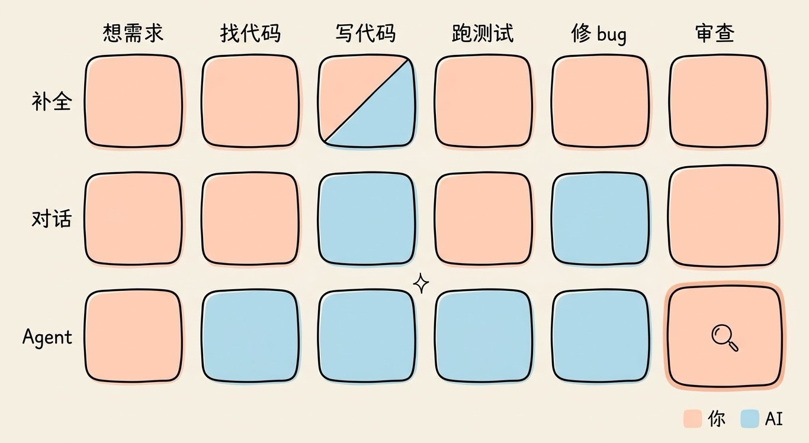
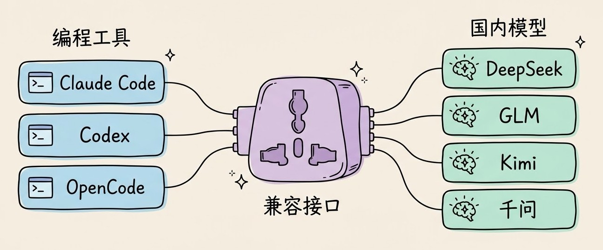
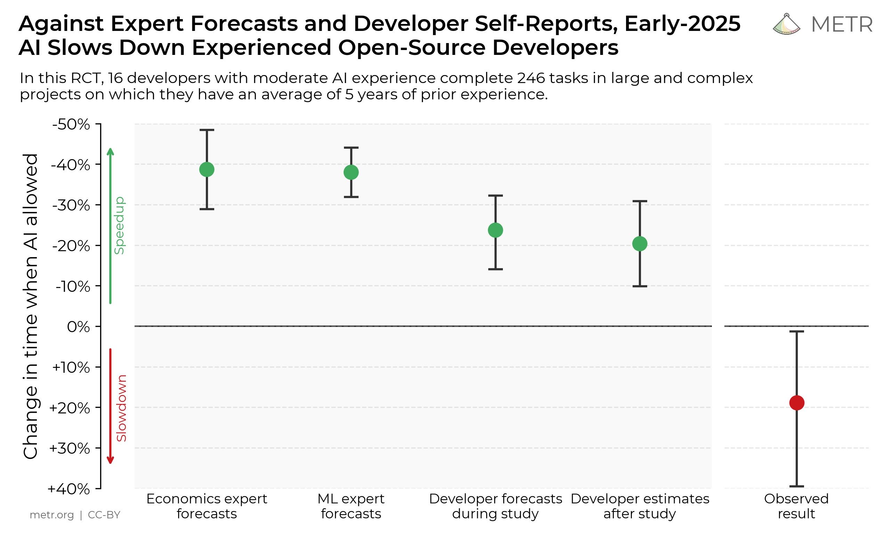
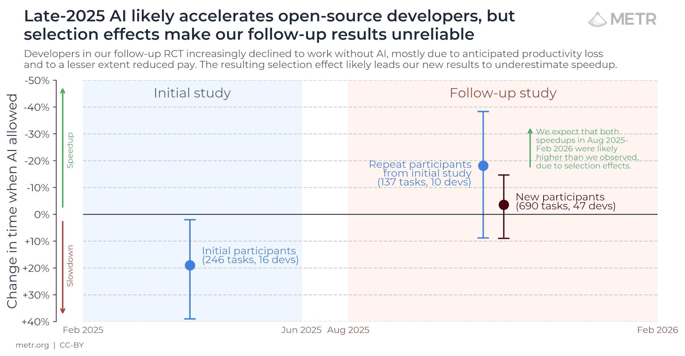
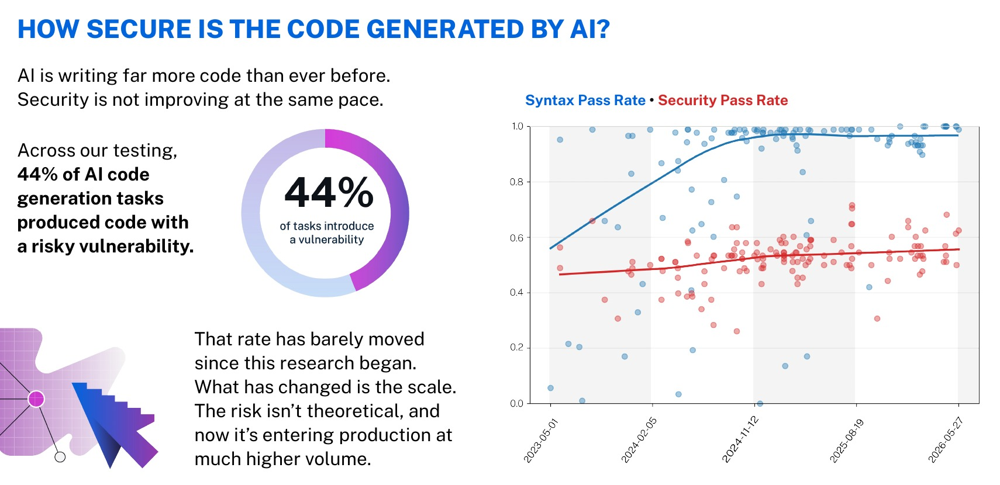

# 3分钟搞懂AI代码助手

> ⭐入门 · 阅读时间 3分钟 · 更新于 2026-11-13
>
> AI 代码助手已经从补全一行代码，发展到能自己读仓库、改文件、跑测试的编程 Agent。本文讲清它的三种用法、主流工具的区别和怎么选、国内能用哪些，以及它到底能提效多少、用的时候要注意什么。

## 一句话定义

**AI 代码助手** = 装在编辑器、终端或代码托管平台里的 AI 工具：它根据你正在写的代码和你交代的任务，帮你补全代码、解释代码、回答问题，或者自己去读代码仓库、修改文件、执行命令和测试，把写代码过程中重复和机械的部分接过去，让你把精力放在需求、设计和审查上。

举个例子，同样是「给注册接口加上邮箱格式校验」这件事，用不同的方式会是这样的：

```
补全: 你打开文件开始写校验函数, AI 用灰色文字提示下一行, 你按 Tab 接受
对话: 你把代码贴给 AI, 问它怎么写, 它给出一段代码, 你再自己复制回项目里
Agent: 你只说一句需求, AI 自己找到注册接口的代码, 改完再补上测试并跑一遍,
       测试没过就接着改, 最后把改动列出来等你确认
```

这三种用法现在在大部分工具里都同时存在，区别在于每一步由谁来做。**你交给 AI 的步骤越多，你要花在检查结果上的精力也就越多。**



## 从补全到 Agent，AI 代码助手经历了哪些变化？

AI 代码助手这几年变化很快，如果你看到的教程是一两年前写的，里面说的产品可能已经改名、被收购，甚至停止服务了。让我们按时间顺序看一下它是怎么一步步变过来的：

| 阶段 | 大致时间 | 代表产品 | 你要做什么 |
| --- | --- | --- | --- |
| **补全** | 2021 年起 | GitHub Copilot | 自己写代码，AI 猜你下一行要写什么 |
| **对话** | 2023 年起 | ChatGPT、Copilot Chat | 把问题和代码交给 AI，自己把答案搬回项目 |
| **Agent** | 2025 年起 | Claude Code、Codex、Cursor | 交代任务，AI 自己读代码、改文件、跑测试，你来审查 |
| **多 Agent 和云端** | 2026 年 | Cursor 3、Devin、Copilot 云端 Agent | 同时派几个 Agent 在云端干活，你更多是在分配任务和合并结果 |

第一个阶段的代表是 2021 年推出的 **GitHub Copilot**，它在你打字时预测接下来的代码，有点像手机输入法的联想词。第二个阶段，大家开始在聊天窗口里问 AI 怎么写、为什么报错、让AI给出正确的代码等。

真正的变化发生在 2025 年。Anthropic 在 2 月推出了 **Claude Code**，OpenAI 在 4 月推出了开源的 **Codex CLI**，Cursor 也把 Agent 模式做成了主要功能。这类工具和前两种最大的不同在于：它能自己执行命令、看到运行结果，再根据结果决定下一步，这就是我们常说的**编程 Agent**。

到了 2026 年，各家又往前走了一步：Agent 可以在云端的虚拟机里运行，你关上电脑它也能继续干活，做完了直接提交一个 PR 等你审查；一个人也可以同时派出好几个 Agent，各自负责不同的任务。

在 Stack Overflow 2026 年的开发者调查里，用 AI 的开发者中，有 73% 每天都在使用编程助手或编程 Agent；而在编程 Agent 这一项里，用得最多的是 Claude Code 和 GitHub Copilot，分别有 66% 和 59% 的受访者在用。

## 主流工具分成哪几类？

现在的 AI 代码助手，按照「你主要在哪里用它」大致可以分成四类：

| 类型 | 代表产品 | 适合什么情况 |
| --- | --- | --- |
| **编辑器插件** | GitHub Copilot、JetBrains AI、Qoder CN 插件、文心快码、CodeGeeX | 不想换掉用惯了的 VS Code 或 JetBrains，只是加一层 AI |
| **AI 原生编辑器** | Cursor、Devin Desktop（原 Windsurf）、Trae、Kiro、Antigravity | 愿意换一个编辑器，换来更深的整项目理解和 Agent 体验 |
| **终端 Agent** | Claude Code、Codex CLI、Antigravity CLI、Kimi Code、OpenCode | 习惯在终端里工作，或者想把 AI 放进脚本和 CI 流程里 |
| **云端 Agent** | Copilot 云端 Agent、Codex Cloud、Cursor 云端 Agent、Devin Cloud | 把一个完整的任务丢给它，过一会儿回来审查它提交的 PR |

需要注意的是，这四类之间的边界已经越来越模糊了。Copilot 本来是编辑器插件，现在也有了命令行版本和云端 Agent；Claude Code 本来是终端工具，现在在 VS Code、桌面应用和网页里也都能用；Cursor 是编辑器，但也能在终端里运行。**所以这里的分类是看它主要的使用场景，而不是说它只能这样用。**

## 几款主流工具有什么区别？

先用一张表看一下几款海外主流工具的大致情况（价格是美国的月付价格）：

| 工具 | 公司 | 主要形态 | 能用哪些模型 | 个人付费起步价 |
| --- | --- | --- | --- | --- |
| **GitHub Copilot** | 微软 / GitHub | 编辑器插件、CLI、云端 Agent | Claude、GPT、Gemini 等多家 | 10 美元（有免费版） |
| **Cursor** | SpaceX（原 Anysphere） | AI 编辑器、云端 Agent | 套餐内是 Grok 和 Composer，其他模型另外付费 | 8 美元（有免费版） |
| **Claude Code** | Anthropic | 终端、IDE 扩展、桌面和网页 | 只用 Claude 系列 | 20 美元（随 Claude 订阅） |
| **Codex** | OpenAI | 终端、IDE 插件、ChatGPT 桌面应用、云端 | GPT 系列 | 20 美元（随 ChatGPT 订阅） |
| **Devin Desktop** | Cognition | AI 编辑器、云端 Agent | 多家 | 有免费版 |
| **Antigravity** | Google | AI 编辑器、CLI | 以 Gemini 为主 | 随 Google AI 订阅（有免费版） |
| **Kiro** | 亚马逊 AWS | AI 编辑器、CLI | 以 Claude 为主 | 有免费版 |

从这张表可以看出，各家最大的区别其实不在于「会不会写代码」，而在于**能用哪些模型、怎么收费、主要在哪里用**。另外每款工具也各有侧重，下面会有详细介绍。

**GitHub Copilot：不想换编辑器的首选**。它支持 VS Code、JetBrains、Visual Studio、Xcode 等主流编辑器，入门门槛最低。免费版每月有 2,000 次代码补全和少量的对话、Agent 用量，经过认证的学生也可以免费使用。付费版分为 Pro（10 美元）、Pro+（39 美元）和 Max（100 美元）三档。从 2026 年 6 月 1 日起，Copilot 改成了按 **AI Credits** 计费：代码补全在付费版里不限量，而对话、Agent、代码审查这些功能会按实际消耗的 token 扣除额度，用得越多、选的模型越强，扣得就越多。Pro+ 及以上的套餐还可以在 Copilot 里直接调用 Claude Code 和 Codex 这样的第三方 Agent。如果你的团队代码本来就放在 GitHub 上，它和 PR、issue 的结合是最顺手的。

**Cursor：把 AI 用得最深的编辑器**。它基于 VS Code 改造而来，原来的插件和快捷键基本都能直接用，补全、Agent 和管理多个 Agent 的窗口都做得很完整。不过它在 2026 年 8 月被 SpaceX 收购之后变化很大：套餐并入了 The X Subscription，和 Grok、X Premium 一起卖，套餐里包含的用量只能用在 Grok 和自家的 Composer 模型上；想用 Claude、GPT 这些模型，要从预充值的余额里按 API 价格另外付费。OpenAI 也宣布了要停止给 Cursor 供应模型。所以如果你选 Cursor 主要是为了用 Claude，需要先把这部分额外的费用算进去。

**Claude Code：适合把整个任务交出去**。它最擅长的是长任务：读懂一个陌生的仓库、跨好几个文件改代码、跑测试再根据报错修复。它只能用 Claude 系列模型（也可以通过兼容接口换成其他模型），用量包含在 Claude 订阅里，Pro 每月 20 美元，高强度使用的话一般要上 100 美元以上的套餐。它的权限模式设计得比较细，从「每一步都问你」到「后台用另一个模型检查每一步」都可以选。

**Codex：ChatGPT 用户可以直接用**。它的用量包含在 ChatGPT 套餐里，如果你已经订阅了 ChatGPT Plus，就不用再额外付钱。Codex 的命令行工具是开源的，本地和云端两种用法都很成熟，桌面版已经并进了 ChatGPT 桌面应用。它默认推荐的 GPT-6.1 Sol 模型在编程上的表现很强，价格也比旗舰款低很多。

**Devin Desktop：原来的 Windsurf**。Windsurf 是 Codeium 公司做的 AI 编辑器，2025 年 7 月被做 Devin 的 Cognition 公司收购，2026 年 6 月 2 日正式改名为 Devin Desktop，原来的 Agent「Cascade」也换成了新的 Devin Local。如果你以前是冲着 Windsurf 去的，现在搜不到这个名字也不奇怪，按 Devin 的产品线来看就行：编辑器是 Devin Desktop，云端 Agent 是 Devin Cloud，此外还有命令行和代码审查工具。

**Antigravity：Google 的 AI 编辑器**。它没有单独的订阅，跟着 Google AI 的套餐走，免费版就能用 Gemini 的 Flash 模型。需要注意的是，2026 年 6 月 18 日起，Google 已经停止让个人账号使用 Gemini CLI，命令行工具换成了 Antigravity CLI，所以以前教程里的 `gemini` 命令，个人用户现在需要换成新的工具。

**Kiro：AWS 的 AI 编辑器**。它主打「先写需求文档再写代码」：在动手之前先和你一起把需求、设计和任务清单整理成文档，再按清单一项项实现，适合需求比较复杂、需要多人协作的项目。它也是 Amazon Q Developer 的接班产品：Q Developer 从 2026 年 5 月 15 日起已经不接受新用户注册，IDE 插件和付费订阅会在 2027 年 4 月 30 日停止支持，还在用的团队需要提前规划迁移。

**开源工具：模型自己选**。如果你不想被某一家的模型绑定，可以看看开源的编程 Agent，比如终端里用的 **OpenCode**、VS Code 插件形式的 **Cline**、命令行里的老牌工具 **Aider**。它们本身免费，接入哪家的模型、付多少钱都由你自己决定。其中 OpenCode 支持 200 多家模型服务商，国内主要厂商的编程套餐都已经内置，也能接入本地用 Ollama 运行的开源模型。不过要注意，模型的 API 费用是按用量计算的，如果你用的是很强的模型、跑的是很长的任务，花费不一定比订阅便宜。

## 国内开发者能用哪些？

国内开发者选工具，首先要考虑的是**能不能用**。Anthropic 和 OpenAI 的服务都不对中国大陆开放，Claude Code 和 Codex 默认用的模型在国内无法直接使用；Cursor 的软件可以下载，但在国内使用时，Claude、GPT、Gemini 这些模型通常不会出现在模型列表里。通过第三方中转平台来使用，有账号被封和代码泄露的风险，**涉及公司代码时一定要谨慎**。

好在国内厂商也都推出了自己的 AI 编程工具：

| 工具 | 厂商 | 形态 | 说明 |
| --- | --- | --- | --- |
| **Trae** | 字节跳动 | AI 编辑器 | 国内讨论最多的 AI 编辑器，有国内版和海外版，主打 SOLO 模式 |
| **Qoder CN**（原通义灵码） | 阿里云 | 编辑器、插件、CLI | 2026 年 5 月 20 日由通义灵码改名而来，支持 VS Code、JetBrains、Visual Studio |
| **CodeBuddy** | 腾讯云 | 编辑器、插件、CLI | 内置混元，也能用 DeepSeek、GLM、Kimi 等模型 |
| **文心快码 Comate** | 百度 | 插件为主 | 基于文心大模型，企业版本比较成熟 |
| **Kimi Code** | 月之暗面 | CLI、桌面端、VS Code 插件 | 配合 Kimi 自家的编程模型使用 |
| **CodeGeeX** | 智谱 | 编辑器插件 | 智谱和清华大学团队推出 |

这些工具在国内可以直接注册使用，付款也方便。需要注意的是，2026 年各家普遍调整了收费方式，从「免费」或「按次数」改成了积分或者按 token 计费，比如腾讯 CodeBuddy 国内个人版从 7 月 1 日起分成了标准、高级、旗舰三档。所以在下单之前，最好先去官网确认一下当前的额度和价格。

另一种思路是**工具用海外的，模型换成国内的**。Claude Code、Codex 和 OpenCode 这些工具本身都可以通过修改配置换成其他模型，DeepSeek、智谱 GLM、Kimi、千问等国内厂商都提供了兼容的接口，智谱、阿里云百炼等平台还推出了专门面向编程工具的包月套餐。不过这些工具的提示词和工具设计是针对自家模型调过的，换了模型之后，长任务的稳定性可能会有差距，建议先拿一个小任务试一试，再决定要不要用在正式的项目里。



## 怎么选更适合自己？

如果你还拿不准选哪一个，可以按下面几种情况来对照：

- **不想换编辑器**：GitHub Copilot，或者国内的 Qoder CN、文心快码、CodeGeeX 这类插件，装上就能用，原来的工作习惯基本不用变。
- **想要一个完整的 AI 编辑器**：海外可以选 Cursor、Devin Desktop、Antigravity，国内可以选 Trae、Qoder CN、CodeBuddy。
- **习惯在终端里工作，想把整个任务交出去**：Claude Code 或者 Codex。如果你已经订阅了 Claude 或 ChatGPT，选对应的那个就不用额外付钱。
- **不想被某一家模型绑定**：OpenCode、Cline 这类开源工具，模型和费用都由你自己决定。
- **公司对代码安全有要求**：优先看各家的企业版，确认代码会不会被拿去训练模型、能不能私有化部署。比如 Qoder CN 和文心快码都有面向企业的私有部署版本。

选好之后，**最好拿你自己的真实项目试用一到两周**，而不是只看别人的评测。同一个工具，在一个规范的 TypeScript 项目和一个十年历史的老 Java 项目里，表现可能会差很多。

还有一个常见的误会：觉得某一款工具已经「全面取代」了另一款。实际上很多开发者是混着用的，比如在编辑器里用 Copilot 补全，遇到大任务再交给 Claude Code 或 Codex。现在 AGENTS.md 这种通用的项目说明文件，也已经被大部分编程 Agent 支持，换工具的成本比以前低了很多。

## AI 代码助手到底能让你快多少？

这个问题没有一个统一的答案，而且有一些研究结果和大家的感觉并不一致。

非营利研究机构 METR 在 2025 年 7 月公布过一项随机对照实验：他们请 16 位经验丰富的开源项目开发者，在自己熟悉的项目里完成真实的任务，一部分任务允许用 AI，一部分不允许。结果是，**允许用 AI 的任务反而多花了 19% 的时间**，但这些开发者自己估计 AI 让他们快了 20%。也就是说，感觉上变快了，实际上并不一定。


*图注：METR 官方博客里的结果图（CC-BY 许可）。纵轴是「允许用 AI 时，完成任务的时间变化」，越往上越快、越往下越慢，竖线是误差范围。左边四个绿点依次是经济学专家的预测、机器学习专家的预测、开发者在实验中的预测和实验结束后的自我估计，都认为用 AI 能快 20% 到 40%；最右边的红点是实际测出来的结果，16 位开发者完成的 246 个任务，用 AI 时反而多花了大约 19% 的时间。*

不过到了 2026 年 2 月，METR 公布了用 2025 年底的 AI 工具做的跟进研究：上一次参加过实验的 10 位开发者，用 AI 后完成任务的时间减少了大约 18%；新招募的 47 位开发者只减少了大约 4%。而且这两个数字的误差范围都很大，比如前者从减少 38% 到增加 9% 都有可能。METR 自己也说明，这次的数据不太可靠：很多开发者已经不愿意在不用 AI 的条件下工作了，有的人干脆不参加实验，30% 到 50% 的人表示会把一部分任务留着不拿出来测试，所以实际的提速可能被低估了。METR 的判断是，现在的 AI 工具很可能比 2025 年初更能帮开发者提速，但具体能快多少，目前的数据还说明不了。


*图注：METR 官方博客里的对比图（CC-BY 许可），纵轴和上一张图一样，越往上表示用 AI 越快。左边蓝底是 2025 年 2 月到 6 月的第一次实验（Initial study），16 位开发者慢了大约 19%；右边是 2025 年 8 月到 2026 年 2 月的跟进研究（Follow-up study），其中蓝点是回来再参加的 10 位开发者（137 个任务），快了大约 18%，深红点是新招募的 47 位开发者（690 个任务），快了大约 4%。右上角的绿字说明，因为不愿意离开 AI 的开发者没有参加或者没有提交任务，METR 认为这两个提速其实都被低估了。*

从这两次研究可以看出，**AI 能不能帮你提速，和工具本身的进步有关，也和任务类型、你对项目的熟悉程度、你会不会用它关系很大**。厂商宣传里的「提效 50%」这类数字，只能作为一个参考，不能当成对你个人的承诺。

另一个需要注意的数据是安全。Veracode 在 2026 年 7 月发布的报告里测试了 100 多个模型，在没有额外安全提示的情况下，AI 生成的代码平均只有 56% 能通过安全检查，大约 44% 的任务里都引入了有风险的安全漏洞，而且这个比例和一年前相比几乎没有改善。这也解释了为什么在 Stack Overflow 2026 年的调查里，有 48% 的开发者表示，只有在能很容易验证结果的时候才会信任 AI 的输出。


*图注：截自 Veracode《2026 GenAI Code Security Report》配套的官方信息图。右边的散点图里，每个点是一个模型在某个时间点的测试成绩，横轴是 2023 年 5 月到 2026 年 5 月的几次测试。蓝线是语法通过率，也就是代码能不能正常运行，已经从 0.6 左右涨到了接近 1.0；红线是安全通过率，三年里一直在 0.5 左右徘徊，几乎没有变化。左边的 44% 表示有 44% 的生成任务引入了有风险的漏洞。*

## 用 AI 代码助手时，要注意什么？

**先把需求说清楚**。如果你只说「优化一下这个项目」，AI 就只能按最常见的理解去改；而「给 auth.ts 里的登录函数加上参数校验，用户名为空时返回 400」这样的描述，它读的文件更少，改得也更准。复杂的任务可以先让它出一份计划，你确认方向之后再动手，大部分工具都有类似的 Plan 模式。

**把项目的规矩写成文件**。AI 每次新开一个对话都不记得上次说过什么，「用 pnpm 不用 npm」「改完要跑 lint」这类规矩，可以写进 AGENTS.md、CLAUDE.md 或者 Cursor 的 Rules 里，它每次开工之前都会先读一遍。

**任务拆小，每一步都提交 Git**。不要一次丢给它「写一个完整的用户系统」，拆成数据表、接口、校验、测试几步来做，每完成一步就提交一次。这样一旦它改坏了，你随时可以退回到上一个能用的版本。

**代码能跑，不代表代码是对的**。AI 写的代码通常看起来很专业，但它可能为了让测试通过而改了测试本身，可能调用了一个根本不存在的函数，也可能在边界条件、并发和权限上埋下问题。**最终合并之前，你还是要像审查同事的代码一样自己看一遍**，尤其是涉及登录、权限、支付和删除数据的部分。


**不要随便开全自动权限**。编程 Agent 能直接在你的电脑上执行命令，各家都提供了「跳过所有确认」的模式，这类模式只适合在隔离的容器或虚拟机里使用。另外，代码仓库、网页和文档里可能藏着专门写给 AI 看的恶意指令，诱导它执行危险命令或者把密钥发出去，这就是**提示词注入**。所以不要让 Agent 在有生产环境权限的机器上，去处理来路不明的仓库。

**确认公司代码能不能交给 AI**。你的代码会被发送到模型服务商的服务器上处理，个人版的默认设置里，有的工具可能会把你的代码用于训练模型。如果是公司代码，先确认公司的规定，再去设置里检查隐私选项，或者直接使用企业版。

最后还有一个常见的误会：有了 AI，就不用学编程了。实际情况恰恰相反，AI 降低的是敲键盘的成本，但对设计和审查能力的要求更高了。你要能看出它哪里写错了、哪里不安全、哪里和业务规则对不上，**基础越薄弱，越容易被看起来很专业、但实际上有问题的代码带偏。**

## 时效性提醒

AI 代码助手是变化最快的 AI 产品之一，下面这些内容最容易过时：

- **价格和计费方式**：Copilot、Cursor、Trae、CodeBuddy 都在 2026 年改过收费方式，各家的额度和价格几乎每个季度都在调整；
- **产品名称和归属**：Windsurf 改名 Devin Desktop、通义灵码改名 Qoder CN、Gemini CLI 换成 Antigravity CLI、Amazon Q Developer 交接给 Kiro，后续可能还会有类似的变化；
- **模型供应关系**：比如 OpenAI 停止给 Cursor 供应模型的最终日期还没有确定；
- **地区限制**：海外工具在国内能不能用、能用哪些模型，也可能随时调整。

**建议**：以各产品官网的价格页和文档为准，本文里的数字只作为大致的参考。

💬 **互动话题**：你现在主力用的是哪一款 AI 代码助手？更多是用它补全代码，还是已经习惯把整个任务交给 Agent 了？

📖 **相关阅读**：

- [3分钟搞懂Claude Code](../06-claude-code/README.md) - Anthropic 的编程 Agent，权限模式、费用和国内用法
- [3分钟搞懂Codex](../07-codex/README.md) - OpenAI 的编程 Agent，本地和云端两种用法
- [3分钟搞懂Cursor](../03-cursor/README.md) - 被 SpaceX 收购后，模型和收费方式的变化
- [3分钟搞懂Vibe Coding](../01-vibe-coding/README.md) - 不看代码、全靠 AI 写程序的方式，以及它的风险
- [3分钟搞懂AI Agent](../../02-core-capabilities/05-ai-agent/README.md) - 编程 Agent 背后的 Agent 是什么
- [3分钟搞懂Agent沙箱与权限](../../09-agent-engineering/08-sandbox-and-permissions/README.md) - 为什么 Agent 动手之前需要权限控制
- [3分钟搞懂Ollama](../11-ollama/README.md) - 给编程工具换上本地运行的开源模型
- [3分钟搞懂Prompt工程](../../01-basics/07-prompt-engineering/README.md) - 怎么给 AI 把需求写清楚
- [3分钟搞懂AI就业影响](../../08-business-ethics/04-ai-and-jobs/README.md) - AI 写代码对程序员岗位的影响

**资料来源**：

- GitHub Copilot 价格页（各档价格、AI Credits、免费版额度、第三方 Agent）：https://github.com/features/copilot/plans
- GitHub Blog，GitHub Copilot is moving to usage-based billing（2026-04-27，6 月 1 日起改为 AI Credits）：https://github.blog/news-insights/company-news/github-copilot-is-moving-to-usage-based-billing/
- Cursor 官方文档，Models & Pricing（自家模型、第三方模型、套餐）：https://cursor.com/docs/models
- Cursor 官方文档，Regions（地区限制）：https://cursor.com/docs/account/regions
- Cursor 博客，Cursor is now a part of SpaceX（2026-08-14）：https://cursor.com/blog/joining-spacex
- OpenAI，Our decision on Cursor following its acquisition by SpaceX：https://openai.com/index/our-decision-on-cursor-following-its-acquisition-by-spacex/
- Claude Code 官方文档：https://code.claude.com/docs/en/overview
- Claude 价格页：https://claude.com/pricing
- OpenAI Codex 官方文档：https://developers.openai.com/codex
- OpenAI Codex 价格与用量：https://chatgpt.com/codex/pricing
- Devin 博客，Windsurf is now Devin Desktop（2026-06-02）：https://devin.ai/blog/windsurf-is-now-devin-desktop
- Google Developers Blog，An important update: Transitioning Gemini CLI to Antigravity CLI：https://developers.googleblog.com/an-important-update-transitioning-gemini-cli-to-antigravity-cli/
- AWS DevOps Blog，Amazon Q Developer end-of-support announcement（2026-04-30）：https://aws.amazon.com/blogs/devops/amazon-q-developer-end-of-support-announcement/
- 阿里云帮助中心，Qoder CN 个人版快速入门（原通义灵码，2026-05-20 更名）：https://help.aliyun.com/zh/lingma/getting-started/individual-edition-quick-start
- 腾讯云文档，CodeBuddy 国内个人版计费说明：https://cloud.tencent.com/document/product/1831/134334
- IT之家，国内 AI 编程工具盘点（2026-10-30）：https://www.ithome.com/1/019/989.htm
- OpenCode 官网：https://opencode.ai/
- Stack Overflow 2026 开发者调查，AI 部分：https://survey.stackoverflow.co/2026/ai
- METR，Measuring the Impact of Early-2025 AI on Experienced Open-Source Developer Productivity（2025-07-10，文中第一张 METR 图出处，CC-BY）：https://metr.org/blog/2025-07-10-early-2025-ai-experienced-os-dev-study/
- METR，We are Changing our Developer Productivity Experiment Design（2026-02-24，文中第二张 METR 图出处，CC-BY）：https://metr.org/blog/2026-02-24-uplift-update/
- Veracode，2026 GenAI Code Security Report（2026-07-28）：https://www.veracode.com/blog/2026-genai-code-security-report
- Veracode，2026 GenAI Code Security Report 信息图（文中 Veracode 图表出处）：https://www.veracode.com/wp-content/uploads/2026-GenAI-Report-Infographic.pdf

---

⬅️ 上一篇：[3分钟搞懂Vibe Coding](../01-vibe-coding/README.md) ｜ [📚 返回目录](../README.md) ｜ 下一篇：[3分钟搞懂Cursor](../03-cursor/README.md) ➡️
