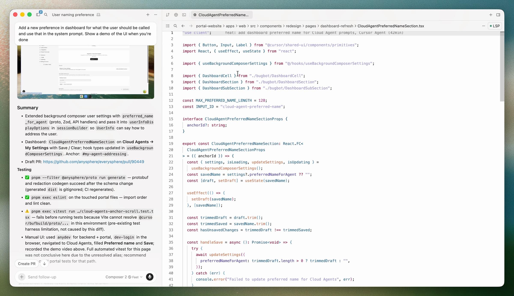
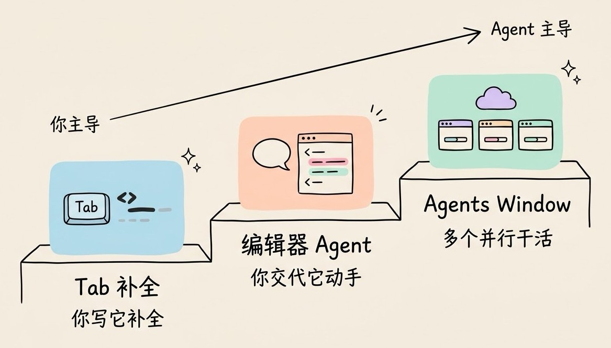
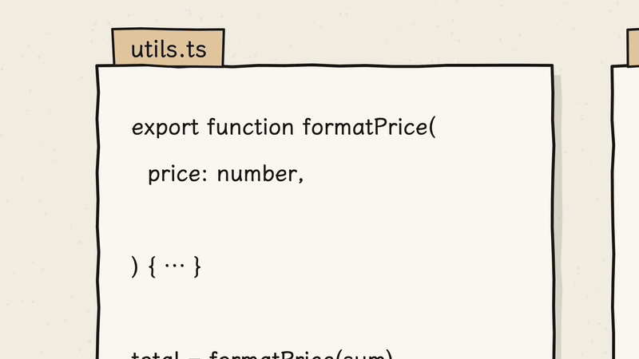

# 3分钟搞懂Cursor

> ⭐⭐中级 · 阅读时间 3分钟 · 更新于 2026-11-13
>
> Cursor 是基于 VS Code 的 AI 编程软件，现在主打管理多个 Agent。被 SpaceX 收购后，自家模型换成 Grok 和 Composer，套餐并入 X 订阅，OpenAI 宣布断供。本文讲清用法、收费和国内使用的问题。

## 一句话定义

**Cursor** 是一款 AI 编程软件：它在 VS Code 编辑器的基础上改造而来，你写代码时它帮你补全，你交代任务时它会自己读代码、改文件、跑命令，然后把改动摆出来让你检查。如果你用过 VS Code，打开 Cursor 会觉得很熟悉，原来的插件、快捷键和主题基本都能直接用。

举个例子，当你刚接手了一个陌生项目，打开文件夹后按 `Cmd+I`（Windows 上是 `Ctrl+I`）唤出 Agent，输入：

```text
讲讲这个代码库: 入口在哪, 主要模块有哪些, 改代码之前我应该先读哪些文件
```

Cursor 会自己搜索仓库、读相关文件，再给你一份项目结构的说明。接着你说「给注册接口加上邮箱格式校验，再补上测试」，它就会去改代码、跑测试，改完的地方以红绿对比的形式列出来，你只需要逐个确认要不要保留就可以了。

Cursor 的开发公司叫 **Anysphere**，2022 年由四位 MIT 学生创办。它是最早把「AI 写代码」做成完整编辑器的产品之一，也是用户最多的产品。2026 年 8 月 14 日，SpaceX 完成了对 Cursor 的收购，所以现在的 Cursor 和 Grok、X 属于同一家公司，被收购之后也改变了它用什么模型、怎么收费等等，后面会详细讲。

## 从补全工具，到管理一群 Agent 的工作台

Cursor 这几年的定位变化很大，如果你看到的教程是一两年前的，里面说的功能可能已经换了名字或者换了位置。让我们按时间顺序看几个关键节点：

| 时间 | 发生了什么 |
| --- | --- |
| 2023 年 | 产品推出，主打 Tab 补全和侧边栏聊天 |
| 2025 年 7 月 | 20 美元的 Pro 套餐从「每月 500 次请求」改成按用量计费，不少用户被意外扣费，Cursor 公开道歉并退款 |
| 2025 年 10 月 | Cursor 2.0 发布，可以同时开多个 Agent 并行干活，同期推出自研模型 **Composer** |
| 2026 年 3 月 | Composer 2 发布，后来被发现底座是月之暗面的开源模型 Kimi K2.5，Cursor 发布时没有说明，事后承认 |
| 2026 年 4 月 2 日 | Cursor 3 发布，新增 **Agents Window**（Agent 窗口） |
| 2026 年 5 月 18 日 | Composer 2.5 发布 |
| 2026 年 8 月 14 日 | SpaceX 完成收购，Cursor 团队并入 SpaceXAI |
| 2026 年 10 月 | 套餐并入 **The X Subscription**，和 Grok、X Premium 打包销售 |

这里最值得注意的是 Cursor 3 的发布。在这之前，Cursor 的主界面是一个编辑器，AI 是侧边栏里的助手；Cursor 3 之后多了一个以 Agent 为中心的窗口，你在这里可以同时指挥好几个 Agent，各自在不同的项目、不同的分支上干活，自己更多是在分配任务和审查结果。


*图注：Cursor 官方文档里的 Agents Window 截图。左上角是给 Agent 的任务：在后台加一个「希望 Agent 怎么称呼你」的设置，并录一段界面演示；下面依次是它录的演示画面、改动总结（Summary）和测试情况（Testing），其中两项检查通过，还有一项测试因为环境问题没跑起来，Agent 也如实写了出来；左下角可以直接创建 PR。右边是它修改的代码，可以在这个窗口里直接查看。*

不过编辑器并没有被取代。官方的说法是两个界面会一直同时维护：想一行行看代码、用 VS Code 插件、分屏对照多个文件时，用编辑器；大部分代码交给 Agent 写的时候，用 Agents Window。

## 补全、Agent、Agents Window，分别在什么时候用？

现在的 Cursor 里有三层用法，从「你主导」到「Agent 主导」排下来：



**第一层是 Tab 补全**。你打字的时候，它根据你最近的修改、周围的代码和报错信息，用灰色文字提示接下来可能要写的内容，按 Tab 接受，按 Esc 拒绝。它和普通补全的区别在于：它能一次改好几行、顺手补上缺的 import，接受之后再按一次 Tab，光标会跳到它预测你下一个要改的位置，甚至能跳到另一个文件里。比如你给函数加了一个参数，它会接着提示你去改所有调用这个函数的地方。



**第二层是编辑器里的 Agent**。用 `Cmd+I` 打开，它能读文件、改文件、执行终端命令、搜索网页。Agent 有三种模式，在输入框里按 `Shift+Tab` 切换：

| 模式 | 会不会改代码 | 适合什么时候用 |
| --- | --- | --- |
| **Agent** | 会，能用全部工具 | 目标明确的修改，比如修一个 bug、加一个接口 |
| **Plan** | 先不改，出方案等你批准 | 要改很多文件、需求还不清楚、有好几种做法可选的时候 |
| **Ask** | 不会，只读 | 只想弄懂代码，不希望它动任何文件 |

Plan 模式值得多用一用。它会先研究代码库、反过来问你几个问题，再写出一份实施计划，你确定好计划后才开始动手。如果 Agent 做出来的东西和你想的不一样，官方建议不要在对话里一遍遍纠正，而是撤回改动、把计划写得更具体，再重新跑一次，这样通常更快，结果也更干净。

**第三层是 Agents Window 和云端 Agent**。在编辑器里按 `Cmd+Shift+P`，输入 Open Agents Window 就能打开。这里可以让多个 Agent 并行工作，每个 Agent 用独立的 Git 工作目录（worktree，同一个仓库的另一份独立副本），互不干扰。任务很长的话，可以交给**云端 Agent**：它在 Cursor 的云端虚拟机里克隆你的仓库、装好依赖、跑测试，做完以后推送一个新分支给你审查，你的电脑关机了它也能继续。

云端 Agent 不一定要在电脑上启动，在网页 cursor.com/agents、iPhone 上的 Cursor App、Slack、Linear 里都可以发起；在 GitHub 的 PR 或 issue 下面评论 `@cursor`，也能直接叫它来干活。

如果你更习惯终端，Cursor 还有命令行版本，安装后输入 `agent` 就能用，同样支持这三种模式：

```bash
# 安装 (macOS、Linux、WSL)
curl https://cursor.com/install -fsS | bash

# 带着任务直接开始
agent "把 auth 模块改成用 JWT 鉴权"

# 不进对话界面, 适合放进脚本或 CI
agent -p "检查这次改动有没有安全问题" --output-format text
```

## 用 Rules 和 AGENTS.md，告诉它项目的规矩

大模型每次对话都不记得上次说过什么，所以「组件用命名导出」「不要改 dist 目录」这类规矩，你不想每次都重复的话，就要写成文件让 Cursor 自动带上。Cursor 支持四种写法：

| 类型 | 放在哪 | 作用范围 |
| --- | --- | --- |
| **Project Rules** | 项目里的 `.cursor/rules/` 目录，`.mdc` 文件 | 当前项目，可以跟着 Git 提交给全组 |
| **User Rules** | Cursor 设置里 | 你自己的所有项目 |
| **Team Rules** | 团队管理后台 | 整个团队，仅限 Teams 和 Enterprise 套餐 |
| **AGENTS.md** | 项目根目录或子目录 | 当前项目，纯 Markdown，最简单 |

Project Rules 的好处是能控制「什么时候生效」。每个 `.mdc` 文件开头有几行配置，比如下面这条规则只在 Agent 处理 `src/components` 下的 tsx 文件时才会加载：

```markdown
---
globs: src/components/**/*.tsx
alwaysApply: false
---
- 组件使用命名导出, 不用默认导出
- 单个组件不超过 200 行, 超过就拆出子组件
```

除了按文件路径匹配，规则还可以设成每次都加载、由 Agent 根据描述自己判断要不要用，或者只在你手动 `@` 它的时候才用。需要注意的是，`.cursor/rules` 里的文件必须是 `.mdc` 后缀，写成普通的 `.md` 会被直接忽略；如果你只想写纯 Markdown，用 AGENTS.md 就行。

AGENTS.md 是 Codex 等多款编程 Agent 都能读取的通用格式，所以如果你的团队同时在用好几种工具，把规矩写进 AGENTS.md，换工具时不用重写一遍。

除了 Rules，Cursor 也支持 Skills（把一套做事方法打包成文件夹，需要时再加载）、子代理、Hooks 和 MCP（连接数据库、设计稿等外部工具的协议），用法和其他编程 Agent 大同小异。

## 被 SpaceX 收购后，模型和收费有哪些变化？

收购本身分了几步：2026 年 4 月，SpaceX 和 Cursor 签下协议，拿到了年内以 600 亿美元收购 Cursor 的权利；6 月 16 日宣布行使这项权利，用全股票的方式收购；8 月 14 日交易完成。对用户来说，影响主要落在三件事上。

### 自家模型换成了 Grok 和 Composer

现在 Cursor 文档里的「Cursor 自家模型」只有两个系列：**Grok**（4.5、4.6、4.7）和 **Composer 2.5**。Grok 本来是 xAI（后来改名 SpaceXAI）的模型，收购之后，Cursor 团队也参与了 Grok 的训练。套餐里包含的用量，只能用在这两个系列上。

Claude、GPT、Gemini、DeepSeek、Kimi、GLM 这些模型都还在，但现在统一算作**第三方模型**：只有 Premium 及以上的套餐能用，而且不占套餐里的用量，从你预充值的余额里按各家的 API 官方价格扣费。也就是说，以前 20 美元的 Pro 套餐里能直接用 Claude，现在想用 Claude，订阅费之外要另外付钱。

### 收费方式并进了 X 订阅

2026 年 10 月起，新用户只能按 **The X Subscription** 订阅，一个订阅同时包含 Grok、Cursor 和 X Premium 的功能，价格按月计：

| 档位 | 每月价格 | Cursor 里能用什么 |
| --- | --- | --- |
| **Free** | 0 | 少量 Agent 和对话 |
| **Plus** | 8 美元 | 只能用 Grok 和 Composer，固定中等推理强度；不含云端 Agent、Auto、第三方模型，也不能填自己的 API Key |
| **Premium** | 30 美元 | Plus 的 4 倍用量，加上云端 Agent、自动化、Bugbot 代码审查、第三方模型（另外付费） |
| **Super** | 100 美元 | Plus 的 15 倍用量，高峰期优先 |
| **Ultra** | 200 美元 | Plus 的 50 倍用量，新功能、新模型最先用 |

团队版按席位收费，每个席位可以选 30、100 或 200 美元，对应 Premium、Super、Ultra 的用量；Enterprise 单独谈价。

和以前相比，有两点需要注意。第一，**用量改成了每周刷新**，而且这个用量池是和 Grok 共用的，你在 Grok App 里聊天、生成图片，花的也是同一份额度；用完了可以等下周刷新、充值，或者升级套餐。第二，以前的 Hobby、Pro、Pro+、Ultra 等旧套餐，老用户可以继续用，新用户已经订阅不到了。


所以选哪一档，主要看你要不要用 Claude 这类第三方模型：只用 Grok 和 Composer 的话，8 美元的 Plus 就够试用；要用云端 Agent 或者第三方模型，至少要 Premium。

### OpenAI 宣布停止给 Cursor 供应模型

8 月 28 日，OpenAI 宣布要结束给 Cursor 供应模型的合同，给出的理由是「无法确信 SpaceX 会在我们的服务条款范围内使用我们的技术」，提议的截止日期是 11 月 12 日。在此之前，Cursor 里已有的 GPT 模型照常可用，但 OpenAI 不会再给 Cursor 提供新模型。所以你在 Cursor 的模型列表里，看到的 OpenAI 最新型号停在了 GPT-5.6 系列，OpenAI 之后发布的 GPT-6 系列都不在里面。

Cursor CEO Michael Truell 当时表示，OpenAI 模型大约占 Cursor 用户流量的 5%，双方还在沟通。截至目前，OpenAI 在公告里补充说明，已经把 Cursor 的使用期限临时延长到 11 月 12 日之后，但没有公布新的截止日期。

如果你主要靠 GPT 系列写代码，有两个办法：一是在 Cursor 里填自己的 OpenAI API Key（需要 Premium 及以上，Plus 不支持自带 Key）；二是直接在 Cursor 里安装 OpenAI 官方的 Codex 插件，用你的 ChatGPT 账号登录。

## 国内用 Cursor，会遇到哪些问题？

Cursor 的软件本身在国内可以下载和登录，但模型是另一回事。Anthropic、OpenAI、Google 都对部分地区限制 API 访问，中国大陆在限制范围内，所以在国内打开 Cursor，Claude、GPT、Gemini 这些模型通常不会出现在模型列表里。Cursor 是按 IP 地址判断地区的，官方给的建议是用 Auto 让它自动挑可用的模型，或者手动选还能用的模型。

自带 API Key 也不一定能解决。官方文档写得很直接：如果模型提供商不服务你所在的地区，即使填了自己的 Key，调用也可能失败。另外，就算你用自己的 Key，请求也会先经过 Cursor 的服务器拼装提示词，再转发给模型提供商。

Grok 和 Composer 这两个自家模型在国内能不能稳定使用，Cursor 官方目前没有单独说明。如果你身在国内、又希望模型可选、付款方便，字节的 Trae、阿里的通义灵码和 Qoder、腾讯的 CodeBuddy 都是同类的 AI 编程工具，可以接入 DeepSeek、千问、Kimi、GLM 这些国产模型，值得一起比较。

## 用 Cursor 时，要注意什么？

**Agent 改文件，默认不用你批准**。按照官方的安全说明，Agent 读文件、搜代码不需要批准，修改工作区里的文件也不需要（配置文件除外），改动会立刻写进硬盘；执行终端命令和调用 MCP 工具，默认才需要你点头。所以一定要用 Git 管理项目，开始一个大任务之前先提交一次，改坏了随时能退回去。如果项目开着「保存后自动重新加载」，Agent 的改动甚至可能在你看到之前就已经跑起来了。

**不要用 Cursor 打开来路不明的仓库**。Cursor 支持 VS Code 的「工作区信任」功能，但默认是关闭的。陌生仓库里可能藏着专门写给 AI 看的指令（这类攻击叫提示词注入），诱导 Agent 执行危险命令。官方的建议是，不信任的仓库直接用普通文本编辑器打开。

**插件市场也出过事**。10 月 29 日，Cursor 的插件市场里出现了冒充 Anthropic 官方的恶意 Claude Code 插件（2.1.312 和 2.1.313 两个版本），会收集电脑信息、尝试植入 SSH 后门，前后上架了大约 11 个小时。安装插件时，要认准发布者，留意版本号是否异常。

**个人用户的隐私模式需要自己确认**。开启隐私模式（Privacy Mode）后，Cursor 和模型提供商都不会用你的代码训练模型；关闭的话，Cursor 可能会存储和使用你的代码、提示词来训练自家模型。隐私模式在 Enterprise 团队里默认开启，个人用户最好去设置里看一眼。另外要注意，云端 Agent 是唯一需要 Cursor 存储你代码的功能，代码会加密存放，任务结束后删除，公司规定代码不能出内网的话，就不要开启它。

**代码能跑，不代表代码是对的**。Agent 说「测试已通过」，可能只是因为它改了测试本身。审查改动时，除了看功能对不对，也要看它有没有动你没让它动的地方。

## 时效性提醒

Cursor 是变化最快的 AI 编程工具之一，几乎每周都有更新。下面几项最容易过时：OpenAI 模型在 Cursor 里的最终截止日期；The X Subscription 各档的价格和用量倍数；Grok 和 Composer 的版本号；第三方模型的计费规则。动手之前，建议先看一眼 Cursor 官网的价格页和更新日志。

💬 **互动话题**：收购之后，Claude 这类模型要在 30 美元订阅之外另付 API 费用，你会继续留在 Cursor，还是换到 Claude Code、Codex 这类模型厂商自己的工具？

📖 **相关阅读**：

- [3分钟搞懂AI代码助手](../02-ai-code-assistant/README.md) - Cursor 和 Copilot、Claude Code 这些工具怎么选
- [3分钟搞懂Claude Code](../06-claude-code/README.md) - Anthropic 的编程 Agent，主打终端
- [3分钟搞懂Codex](../07-codex/README.md) - OpenAI 的编程 Agent，也能装进 Cursor 里用
- 3分钟搞懂Grok - Cursor 现在的自家模型，以及 The X Subscription 的来龙去脉
- 3分钟搞懂xAI - 收购 Cursor 的 SpaceX 旗下 AI 公司
- [3分钟搞懂Vibe Coding](../01-vibe-coding/README.md) - 不看代码、全靠 AI 写程序的方式，Cursor 是常用工具之一
- [3分钟搞懂Agent沙箱与权限](../../09-agent-engineering/08-sandbox-and-permissions/README.md) - 为什么 Agent 动手之前需要权限控制
- [3分钟搞懂Skills](../../09-agent-engineering/04-skills/README.md) - Cursor 也支持用 Skills 扩展做事方法
- [3分钟搞懂MCP](../../01-basics/08-mcp/README.md) - Cursor 连接外部工具用的协议

**资料来源**：

- Cursor 官方文档，Quickstart（上手流程、Plan Mode 快捷键）：https://cursor.com/docs/get-started/quickstart
- Cursor 官方文档，Tab completion（补全、跨行和跨文件修改）：https://cursor.com/docs/tab
- Cursor 官方文档，Plan Mode：https://cursor.com/docs/agent/modes
- Cursor 官方文档，Agents Window（Cursor 3 发布日期、并行 Agent、worktree；文中 Agents Window 截图出处）：https://cursor.com/docs/agent/agents-window
- Cursor 官方文档，Cloud Agents（云端虚拟机、发起入口）：https://cursor.com/docs/cloud-agent
- Cursor 官方文档，Cursor CLI（安装、模式、非交互模式）：https://cursor.com/docs/cli/overview
- Cursor 官方文档，Rules（四种规则、.mdc 格式、AGENTS.md）：https://cursor.com/docs/context/rules
- Cursor 官方文档，Agent Security（审批规则、工作区信任）：https://cursor.com/docs/agent/security
- Cursor 官方文档，Models & Pricing（自家模型、第三方模型、套餐、每周用量、旧套餐）：https://cursor.com/docs/models
- Cursor 官方文档，Regions（地区限制、自带 API Key）：https://cursor.com/docs/account/regions
- Cursor 官方文档，Privacy and Data Governance（云端 Agent 的代码存储）：https://cursor.com/docs/enterprise/privacy-and-data-governance
- Cursor，Data Use & Privacy Overview（隐私模式、自带 Key 仍经过 Cursor 后端）：https://cursor.com/data-use
- Cursor 价格页：https://cursor.com/pricing
- Cursor 博客，Cursor is now a part of SpaceX（2026-08-14）：https://cursor.com/blog/joining-spacex
- Cursor 博客，恶意 Anthropic.claude-code 插件安全通告（2026-10-29）：https://cursor.com/blog/claude-code-extension-security-notice
- Cursor Changelog：https://cursor.com/changelog
- OpenAI，Our decision on Cursor following its acquisition by SpaceX：https://openai.com/index/our-decision-on-cursor-following-its-acquisition-by-spacex/
- CNBC，OpenAI to end model access to Cursor after acquisition by Elon Musk's SpaceX（2026-08-29）：https://www.cnbc.com/2026/08/29/openai-cursor-spacex-model-access.html
- TechCrunch，SpaceX to acquire Cursor for $60B in stock, days after blockbuster IPO（2026-06-16）：https://techcrunch.com/2026/06/16/spacex-to-acquire-cursor-for-60b-in-stock-days-after-blockbuster-ipo/
- PricingSaaS，Cursor rebuilds its pricing around Grok and X, with plans from $8 to $200（2026-10-19）：https://pricingsaas.com/news/article/cursor-rebuilds-its-pricing-around-grok-and-x-with-plans-from-8-to-200
- Wikipedia，Cursor (code editor)（公司沿革、2025 年定价风波、Composer 2 底座争议）：https://en.wikipedia.org/wiki/Cursor_(code_editor)

---

⬅️ 上一篇：[3分钟搞懂AI代码助手](../02-ai-code-assistant/README.md) ｜ [📚 返回目录](../README.md) ｜ 下一篇：[3分钟搞懂Trae](../04-trae/README.md) ➡️
