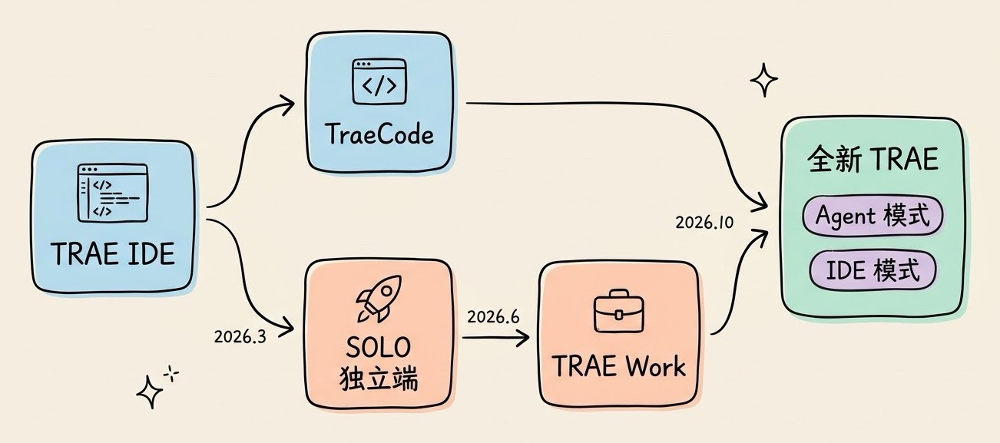
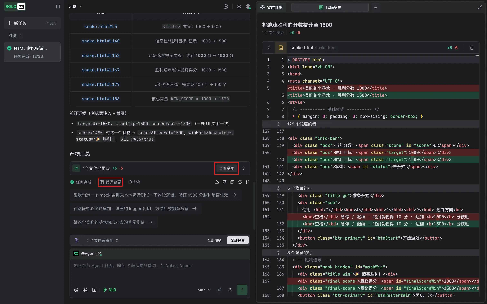
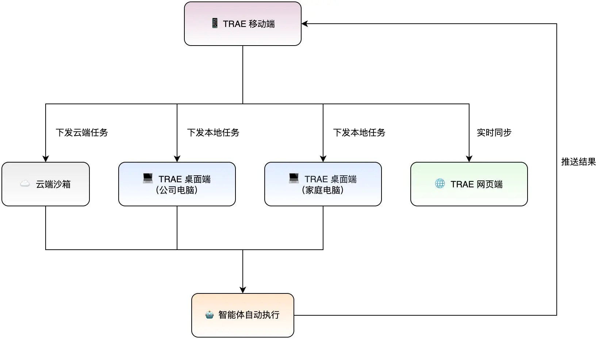

# 3分钟搞懂Trae

> ⭐入门 · 阅读时间 3分钟 · 更新于 2026-11-16
>
> Trae 是字节的 AI 编程软件，10 月 TraeCode 和 TraeWork 合并成新 TRAE。国内版改为积分制，海外版按美元用量计费、已没有 Claude。本文讲清窗口和模式怎么分、两个版本差在哪、免费还够不够用。

## 一句话定义

**Trae**（官方写作 TRAE）是字节跳动做的 AI 编程软件：你可以像用 VS Code 一样自己写代码，让它帮你补全；也可以用一句话交代任务，让它自己读项目、改文件、跑命令、打开预览，最后把改了哪些地方列给你检查。

举个例子，你用 TRAE 打开一个已有的网站项目，在对话框里输入：

```text
登录页加一个"记住我"的勾选框, 勾上之后 7 天内免登录, 改完把页面跑起来让我看看
```

它会先在项目里找到登录相关的文件，列出打算怎么改，然后动手修改前端和后端代码，启动项目，在内置浏览器里打开登录页。你要做的，是看它改了哪些文件、页面效果对不对，再决定保留还是退回。

按 TRAE 官方 2025 年度报告的数据，全球用户超过 600 万，月活跃用户超过 160 万。它最早吸引人的地方是**国内版免费**，而且模型在国内能直接用，不用折腾网络。不过这两年它改动很大，名字、形态、收费方式都变了好几轮，如果你看的是去年的教程，很多说法已经对不上了。

## 从免费 IDE 到「开发平台」，它是怎么一步步变过来的？

TRAE 的变化太多，先把时间线理一遍，后面的内容才好懂：

| 时间 | 发生了什么 |
| --- | --- |
| 2025 年初 | 海外版先上线，3 月 3 日国内版上线，内置豆包和 DeepSeek 模型，个人免费使用 |
| 2025 年 7 月 | Trae 2.0 推出 **SOLO 模式**，AI 从需求到代码到预览一路自己推进 |
| 2025 年 11 月 | Anthropic 限制中资控股企业使用 Claude，海外版从 11 月 4 日起不再提供 Claude 模型 |
| 2026 年 3 月 31 日 | SOLO 从编辑器里拆出来，做成独立的桌面端和网页端 |
| 2026 年 6 月 9 日 | SOLO 独立端改名 **TRAE Work**，除了写代码，还能写文档、做调研、出 PPT |
| 2026 年 10 月 9 日 | TraeWork 和原来的编辑器 TraeCode 合并成**全新的 TRAE**，TraeWork 独立服务于 10 月 23 日停止 |
| 2026 年 11 月 18 日 | 国内版个人账号统一升级为豆包飞书账号 |



拆出去又合回来，看起来有点折腾，但方向其实很一致：TRAE 不再只想做一个「带 AI 的编辑器」，而是想让 AI 接手越来越多的整段任务，从写代码一路延伸到交付成果。合并之后，官方对它的定位也从 AI 编程工具改成了「覆盖开发全流程的一体化平台」。

## 打开新版 TRAE，先分清两个窗口和两种模式

合并后的 TRAE 名词很多，新手最容易搞混的就是「窗口」和「模式」。官方文档的说法是这样的：桌面端有 **Agent 窗口**和 **IDE 窗口**两种形态，而 IDE 窗口里又可以切换 **IDE 模式**和 **SOLO 模式**。

| 叫法 | 主角是谁 | 适合做什么 |
| --- | --- | --- |
| Agent 窗口 | AI | 同时管多个任务、多个项目，把耗时的任务丢到云端跑，回来审核改动、管理 PR |
| IDE 窗口 · IDE 模式 | 你 | 和 VS Code 几乎一样的编辑器，自己写代码、调试、用插件，AI 在旁边帮忙 |
| IDE 窗口 · SOLO 模式 | AI | 你用文字或语音描述需求，AI 自己规划、写代码、测试、预览，最后给你一份改动总结 |

简单的判断方法是：**你想自己掌控每一行改动，就用 IDE 模式；你只关心结果，就用 SOLO 模式；你手上同时有好几件事要推进，就用 Agent 窗口。**


*图注：TRAE 官方文档里的 SOLO 模式示例。任务是把贪吃蛇小游戏的胜利分数从 1000 改成 1500，AI 改完后列出了改动的 6 处位置和验证结果，右边用红绿对比显示每一行的修改，底部的「全部撤销」「全部保留」由你来决定。*

除了桌面端，TRAE 还有网页端和手机端。网页端不用安装，打开就有一个云端环境，适合临时验证一个想法。手机端更像一个遥控器：你可以在手机上给家里或公司电脑上的 TRAE 派任务、看进度、补充要求，如果电脑离线了，任务会自动转到云端继续跑，任务状态在三端之间同步。


*图注：TRAE 官方文档里的三端联动示意图。手机端可以把任务派给云端沙箱或不同的电脑执行，和网页端的状态实时同步，智能体执行完再把结果推送回手机。*

另外，TRAE 的 IDE 窗口基于 VS Code 改造，支持 VS Code 的扩展，也支持 MCP（让 AI 连接外部工具的协议）、Skills、Rules 和自定义智能体。如果你之前在别的 AI 编程工具里配过这些，迁移过来的成本不高。

## 国内版和海外版，是两套产品

很多人以为 TRAE 只是分了中文界面和英文界面，实际上两个版本的官网、账号、模型、收费方式都是分开的：

| | 国内版 | 海外版 |
| --- | --- | --- |
| 官网 | trae.cn | trae.ai |
| 账号 | 手机号登录，11 月 18 日起升级为豆包飞书账号 | 独立的海外账号，和国内版不互通 |
| 内置模型 | 字节自家的 Seed，以及 DeepSeek、千问、Kimi、智谱 GLM、MiniMax、小米 MiMo、阶跃 Step | GPT 系列、Gemini、Kimi、GLM、DeepSeek、MiniMax、Seed |
| Claude | 没有 | 2025 年 11 月起没有 |
| 收费方式 | 积分制，按人民币买套餐 | 按美元用量扣费 |
| 付费地区 | 中国大陆 | 官方列出的几十个国家和地区，不含中国大陆 |

所以，如果你身在国内，基本就是用国内版。国内版的模型都是国产模型，不需要特殊网络，付款支持抖音支付、支付宝和微信支付。如果你一定要用 GPT 系列，海外版有，但它的付费服务不面向中国大陆，这条路走起来并不顺。

两个版本都不能用 Claude，这一点对习惯用 Claude 写代码的人影响最大。如果你离不开 Claude，Claude Code 或者 Cursor 这类工具更合适。

## 「免费」还剩多少？

TRAE 早期最大的卖点是国内版个人免费。现在国内版改成了**积分制**：只有调用 TRAE 内置模型才扣积分，模型越强、思考强度越高、上下文越长，扣得越多。

免费用户每月能拿到的积分来自这几个途径：

- 每月登录送 500 积分，当月有效；
- 新用户注册一次性送 1500 积分，31 天内有效；
- 每天签到送 100 积分，31 天内有效；
- 邀请一个新用户，双方各得 500 积分。

这里有一个需要注意的地方：每月赠送的 500 积分其实不多，按增购价每 1000 积分 50 元来算，只相当于 25 元左右的额度。真正的大头是每日签到，如果一个月天天签，能攒下约 3000 积分，是每月赠送的 6 倍。所以如果你想尽量不花钱，记得每天签到。


付费套餐的价格如下：

| 套餐 | 单月购买 | 连续包月 | 每月积分 | 云端任务并行数 |
| --- | --- | --- | --- | --- |
| 会员 Lite | ¥49 | ¥45 | 2000 | 2 |
| 会员 Pro | ¥99 | ¥89 | 4000 | 10 |
| 会员 Pro+ | ¥239 | ¥219 | 12000 | 10 |
| 会员 Ultra | ¥699 | ¥629 | 40000 | 20 |

会员还有几项额外权益：高峰期优先使用；字节自家的 Seed-2.1-Turbo 和 Seed-Code 模型按 2.5 折扣积分；Seed-Evolving 模型只开放给 Pro 及以上的会员。积分用完了，可以按每 1000 积分 50 元增购，但免费用户不能增购。

还有一个省钱的办法：**调用你自己添加的模型不扣积分**。如果你已经有 DeepSeek、千问或 Kimi 的 API Key（调用模型的密钥），可以在 TRAE 里添加成自定义模型，费用直接走你自己的模型账户。不过要注意，Auto 模式（系统自动挑模型）只会调用内置模型，不会用你添加的模型。

海外版的套餐是 Free、Lite、Pro、Pro+、Ultra 五档，月费分别是 0、8、20、60、200 美元，付多少钱基本就给多少美元的用量，用量按每次请求消耗的 token（模型处理文字的计量单位）乘以模型单价来扣。海外版的免费用户只能用 Auto 模式，不能自己选模型，也不能用 SOLO 模式；Lite 档只在泰国、印度、巴西等 12 个国家开放。

## 和 Cursor 比，它适合谁？

TRAE 和 Cursor 都是在 VS Code 基础上改造的 AI 编程软件，形态很像，但适合的人不太一样。

如果你人在国内，主要用国产模型，希望付款方便、价格便宜，TRAE 国内版是阻力最小的选择。SOLO 模式对不太会写代码、想先做个能跑的小工具或页面的人也比较友好。

如果你主要靠 Claude 写代码，或者在团队里已经有一套成熟的 Cursor、Claude Code 工作流，TRAE 目前给不了你 Claude，换过来的理由就不那么充分。同类的国产工具还有腾讯的 CodeBuddy、阿里的通义灵码和 Qoder、百度的文心快码，选的时候可以一起比较。

## 用 TRAE 写代码时，需要注意哪些设置？

**先打开隐私模式**。官方文档写明，如果不开隐私模式，你的对话内容、代码片段和 AI 生成的结果可能会被用于数据分析、产品优化和模型训练。开启后就不会再用于这些用途。另外，隐私模式只在登录状态下生效，退出登录会自动关闭，所以重新登录后最好再确认一次。

**不要随手开「自动运行命令」**。开了之后，智能体可以在沙箱（一个和你电脑隔开的受限环境）外面直接执行命令，不再逐条问你，高风险命令也可能直接执行。官方自己的建议也是如无必要不要开启。用 AI 改代码之前，项目一定要用 Git 管理，开始大任务前先提交一次，改坏了随时能退回去。

**陌生项目选「不信任」**。打开一个文件夹时，TRAE 会问你是否信任这个文件夹的作者。选不信任的话，项目里自带的规则、技能、命令和 Hooks 都不会加载。从网上下载的陌生仓库里可能藏着写给 AI 看的恶意指令（这类攻击叫提示词注入），不信任它就能挡掉一部分风险。

**11 月 18 日前核对手机号**。国内版个人账号会升级为豆包飞书账号，升级后同一个账号可以登录豆包、飞书、火山引擎等产品。如果你 TRAE 和豆包绑定的不是同一个手机号，升级后会变成两个并存的账号；想合并成一个，需要在 11 月 18 日之前把 TRAE 的手机号换绑成和豆包一致的。如果你不想升级，也只能在这之前注销 TRAE 账号。

**AI 说做完了，不代表做对了**。SOLO 模式会自己写代码、自己跑测试，但它说「测试已通过」时，有可能只是改了测试本身。检查改动时，除了看功能对不对，也要看它有没有动你没让它动的文件。

## 时效性提醒

TRAE 是改动最频繁的 AI 编程工具之一，下面几项最容易过时：积分的获取规则和各档套餐价格；内置模型列表；海外版各档的用量和开放地区；新版 TRAE 的灰度推送进度。官方文档也提到，代码库索引功能正在逐步下线。动手之前，建议先看一眼官方文档里的「套餐与计费」和「更新日志」。

💬 **互动话题**：TRAE 国内版从免费改成积分制之后，你是天天签到继续用免费额度，还是接上自己的 DeepSeek、Kimi API Key，或者干脆买会员？

📖 **相关阅读**：

- [3分钟搞懂AI代码助手](../02-ai-code-assistant/README.md) - TRAE 和 Cursor、Copilot、Claude Code 这些工具怎么选
- [3分钟搞懂Cursor](../03-cursor/README.md) - 同样基于 VS Code 的 AI 编程软件，TRAE 最常被拿来比较的对象
- [3分钟搞懂Claude Code](../06-claude-code/README.md) - 想用 Claude 写代码，可以看这款终端工具
- [3分钟搞懂Vibe Coding](../01-vibe-coding/README.md) - 不看代码、全靠 AI 写程序的方式，SOLO 模式就是为它设计的
- 3分钟搞懂豆包大模型 - TRAE 内置的 Seed 模型来自这里
- 3分钟搞懂字节跳动AI - TRAE 在字节 AI 版图里的位置
- [3分钟搞懂Agent沙箱与权限](../../09-agent-engineering/08-sandbox-and-permissions/README.md) - 为什么不建议随手开「自动运行命令」
- [3分钟搞懂MCP](../../01-basics/08-mcp/README.md) - TRAE 连接外部工具用的协议

**资料来源**：

- TRAE CN 官方文档，关于 TRAE（三端、双形态、双模式、隐私与权限能力）：https://docs.trae.cn/ide_what-is-trae-code
- TRAE CN 官方文档，重磅更新：TraeCode 与 TraeWork 已融合为全新的 TRAE：https://docs.trae.cn/ide_traework-to-traecode-data-migration
- TRAE CN 官方文档，SOLO 模式概览（文中 SOLO 模式截图出处）：https://docs.trae.cn/ide_solo-mode
- TRAE CN 官方文档，TRAE 桌面端、网页端与移动端间的联动（文中三端联动示意图出处）：https://docs.trae.cn/ide_trae-across-desktop-web-and-mobile
- TRAE CN 官方文档，套餐与计费（积分类型、套餐价格、积分获取与消耗、自定义模型不扣积分）：https://docs.trae.cn/ide_plans-and-billing
- TRAE CN 官方文档，TRAE 内置模型（模型列表、Auto 模式、Max 模式）：https://docs.trae.cn/ide_trae-built-in-models
- TRAE CN 官方文档，隐私模式（含代码库索引逐步下线）：https://docs.trae.cn/ide_privacy-mode
- TRAE CN 官方文档，目录信任 & 自动运行：https://docs.trae.cn/ide_auto-run-and-security
- TRAE CN 官方文档，重要通知：TRAE 账号体系融合升级：https://docs.trae.cn/ide_important-notice-for-trae-account-upgrade-and-integration
- TRAE 海外版官方文档，Plans & billing（五档套餐、Dollar Usage、付费地区、模型列表）：https://docs.trae.ai/ide/new-plans-and-billing
- TRAE 官方博客，Introducing TRAE Work（2026-06-09）：https://www.trae.ai/blog/trae_work_0609
- IT之家，字节 TraeWork 和 TraeCode 合并为全新 TRAE（2026-10-10）：https://www.ithome.com/1/011/176.htm
- TechNode，ByteDance merges TraeWork and TraeCode into unified TRAE platform（2026-10-10，TraeWork 10 月 23 日停服）：https://technode.com/2026/10/10/bytedance-merges-traework-and-traecode-into-unified-trae-platform/
- 凤凰网（科创板日报），字节 AI 编程产品 TRAE SOLO 独立端上线：https://finance.ifeng.com/c/8rwIyHTbCoi
- TechNode，ByteDance launches Trae AI IDE in China with Doubao 1.5 Pro and DeepSeek models（2025-03-04）：https://technode.com/2025/03/04/bytedance-launches-trae-ai-ide-in-china-with-doubao-1-5-pro-and-deepseek-models/
- SCMP，Tech war: ByteDance cuts Claude model after Anthropic restricts China access（2025-11）：https://www.scmp.com/tech/big-tech/article/3331638/tech-war-bytedance-cuts-claude-model-after-anthropic-restricts-china-access
- 量子位，TRAE 2025 年度报告（全球用户超 600 万、月活超 160 万，2025-12-29）：https://www.qbitai.com/2025/12/366118.html
- Product Hunt，Trae 2.0 - SOLO（2025-07-21）：https://www.producthunt.com/p/trae/trae-2-0

---

⬅️ 上一篇：[3分钟搞懂Cursor](../03-cursor/README.md) ｜ [📚 返回目录](../README.md) ｜ 下一篇：[3分钟搞懂国产AI编程工具](../05-chinese-ai-coding-tools/README.md) ➡️
