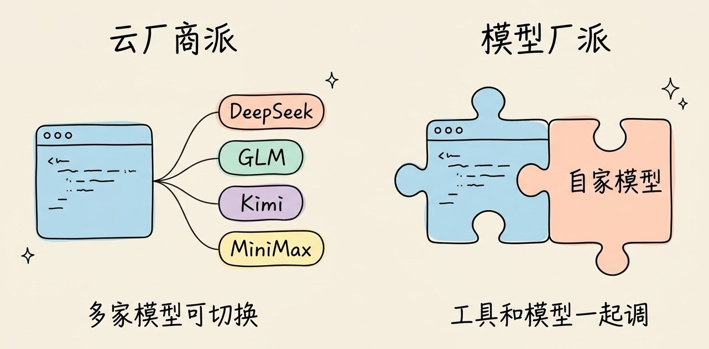
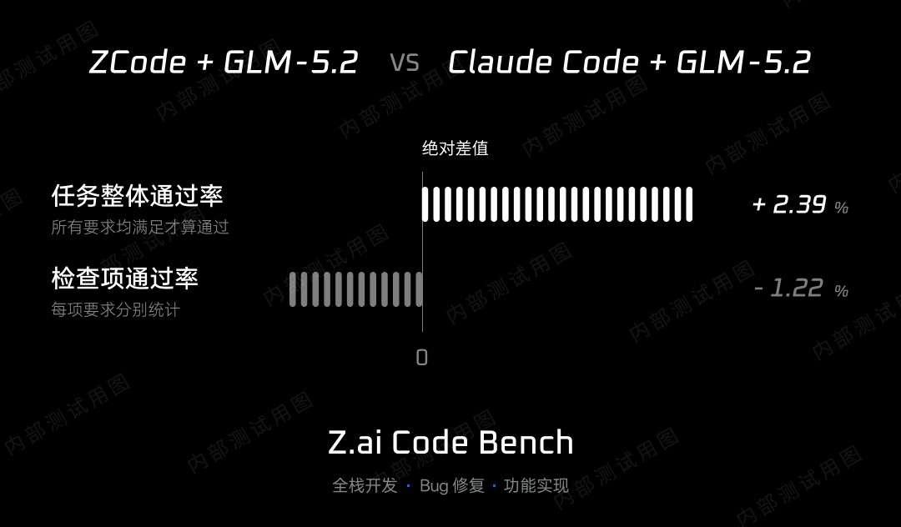
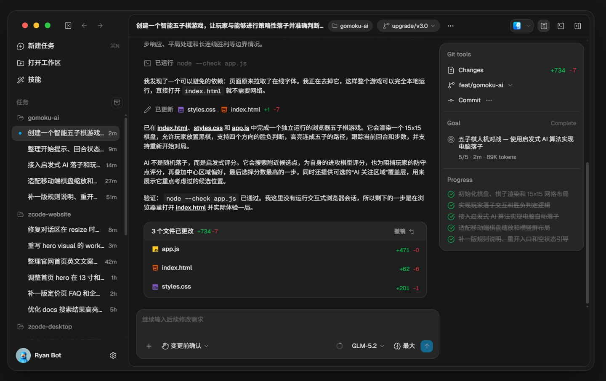

# 3分钟搞懂国产AI编程工具

> ⭐入门 · 阅读时间 3分钟 · 更新于 2026-11-16
>
> 国产 AI 编程工具分两派：腾讯、阿里、百度做的是多模型的工具，智谱、月之暗面卖自家模型的套餐、工具附送。各家都改成了积分制，但积分不能横向比。本文讲清各家差别、价格怎么看、怎么选，以及要注意的代码隐私问题。

## 一句话定义

**国产 AI 编程工具**，是国内公司做的、帮你写代码的 AI 软件：能补全代码、回答项目里的问题，也能接一整段任务，自己改多个文件、跑命令、修 bug，并且在国内就能直接使用用，也支持国内的主流支付方式进行付款。

目前大家常提到的有这几款：腾讯的 **CodeBuddy**、阿里的 **Qoder CN**（2026 年 5 月 20 日之前叫通义灵码）、百度的**文心快码 Comate**、智谱的 **ZCode**、月之暗面的 **Kimi Code**，还有字节的 **TRAE**。它们看起来都是「编辑器 + AI 对话框」，在功能上也非常相近，真正的差别有两个地方：做它的公司靠什么赚钱，以及它背后接的是谁家的模型。

## 两种出身：云厂商做的工具，和模型厂做的工具

把这几款工具按出身分一下，会清楚很多。

**第一派是云厂商和大厂做的**：腾讯 CodeBuddy、阿里 Qoder CN、百度文心快码、字节 TRAE。它们的工具本身就是产品，收的是工具的会员费；里面除了自家模型，通常还接了好几家别人的模型，你可以在 DeepSeek、智谱 GLM、Kimi、MiniMax 之间切换。腾讯和阿里还想借工具把你带到自家的云上，比如在 CodeBuddy 里写完代码直接部署到腾讯云。

**第二派是模型公司做的**：智谱的 ZCode、月之暗面的 Kimi Code。工具本身免费或者随会员附送，真正收钱的是模型套餐。它们只围绕自家模型打磨，工具里的提示词、工具调用方式、长任务的处理流程，都是按自家模型的习惯调的。业内把这层套在模型外面、负责读文件、跑命令、管理上下文的程序叫 **Harness**，ZCode 官网就直接把自己称作 GLM-5.3 的官方 Harness。

两派的取舍很明显：

| | 云厂商派 | 模型厂派 |
| --- | --- | --- |
| 代表 | CodeBuddy、Qoder CN、文心快码、TRAE | ZCode、Kimi Code |
| 你付钱买的是 | 工具会员，里面含一定积分 | 模型套餐，工具附送 |
| 模型 | 自家模型 + 几家别人的，可以切换 | 基本只用自家模型 |
| 优势 | 一个工具里试多家模型，编辑器、插件、团队管理更全 | 工具和模型配合更紧，同一个模型在这里通常发挥得更好 |
| 不足 | 每家模型都要适配，单个模型不一定调到最好 | 换模型就得换工具 |

关于「配合更紧」，智谱给过一个自己测的例子：在它自研的编程评测里，同样用 GLM-5.2 模型，放在 ZCode 里的任务整体通过率比放在 Claude Code 里高 2.39%，但细分到检查项的通过率，ZCode 反而低了 1.22%。差距不大，而且是智谱自己的评测，没有第三方复核，所以不能说明 ZCode 比 Claude Code 更强。它能说明的是模型公司为什么要自己做工具：模型相同的情况下，外面这层程序也会影响最终效果，模型公司想把这部分效果握在自己手里。

*图注：智谱 2026 年 8 月发布 ZCode 升级时给出的对比图。「任务整体通过率」要求一个任务的所有要求都满足才算通过，「检查项通过率」是把每一项要求分开统计。图上的「内部测试用图」水印是原图自带的，测试由智谱自己完成。*

## 腾讯 CodeBuddy：和微信、腾讯云绑得最紧

**CodeBuddy** 有三种形态：VS Code 和 JetBrains 插件、独立的 CodeBuddy IDE，以及命令行工具 CodeBuddy Code。模型方面内置腾讯混元，2026 年 7 月 6 日发布的混元 Hy3 已经接入，也能切换到 DeepSeek、智谱 GLM、Kimi 和 MiniMax。

它和其他几家最不一样的地方，是和腾讯生态的连接。官方文档里列出的功能包括：Figma 设计稿一键转成前端代码；写完的项目可以直接部署到腾讯云的 CloudBase（云开发）、EdgeOne Pages 上；配套的 CloudBase AI 工具包里内置了微信小程序的开发知识。所以如果你要做的是**微信小程序**，或者项目本来就跑在腾讯云上，CodeBuddy 能少走很多弯路。

另外，腾讯把 CodeBuddy 和办公智能体 **WorkBuddy** 放在了同一个账号体系里，两边的积分是共享的，不用分别订阅。

## 阿里 Qoder CN：通义灵码改名后，换了一套玩法

很多人还记得**通义灵码**，它是国内最早一批 AI 编程插件。2026 年 5 月 20 日，阿里云把它正式改名为 **Qoder CN**，同时把收费方式换成了 Credits（积分）。需要注意，阿里还有一个面向海外的 **Qoder**，和 Qoder CN 是两个产品，账号和价格都不通用，国内用户用的是 Qoder CN。

改名之后，Qoder CN 变成了一个系列：独立的 Qoder CN IDE、VS Code 和 JetBrains 插件、命令行工具 Qoder CN CLI，还有面向办公场景的 QoderWork CN。插件支持的 JetBrains 系列包括 IntelliJ IDEA、PyCharm、GoLand、Android Studio 等，华为的 DevEco Studio 也能装。

它的几个特点：

- **模型**：除了 GLM、DeepSeek、Kimi、MiniMax，还有阿里专门为它训练的 Qwen-Coder-Qoder 模型。这个模型以 Qwen-Coder 为基础，用强化学习针对 Qoder 自己的工具和流程做了训练，思路和模型厂派做 Harness 类似，只是方向反过来：是工具厂去定制模型。
- **长任务功能**：Quest 2.0 会把复杂任务拆成步骤一步步完成；Repo Wiki 会给整个代码仓库生成一份说明文档，方便 AI 和人理解项目；Agent 模式改坏了可以回滚到快照。
- **自带模型不扣积分**：个人专业版可以填入阿里云百炼、智谱、Kimi、MiniMax 的 API Key（调用模型的密钥），费用直接走你在这些平台的账户，不占用 Qoder CN 的积分。
- **企业版**：有专属 VPC 部署的版本，代码可以只在企业内网里流转，适合对代码安全要求高的公司。

## 百度文心快码：插件覆盖的编辑器最多

**文心快码 Comate** 走的是插件路线起家，覆盖的编辑器在这几家里最多：JetBrains 全系、Android Studio、VS Code、Visual Studio、Eclipse，还有 Xcode。如果你写的是 iOS 应用，或者公司里还有老项目在用 Eclipse，文心快码是少数能直接装上的国产选择。

后来百度也补上了独立的 **Comate AI IDE** 和命令行工具。IDE 里的智能体叫 **Zulu**，能自己拆解任务、改代码；另外有 Spec 模式，先让 AI 写一份需求和技术方案，你确认之后再写代码，适合需求比较复杂、不想让 AI 一上来就动手的场景；还有设计稿转代码、在预览页面上点选某个元素直接调试的功能。

文心快码的另一个优势在企业市场：支持私有化部署，代码可以完全留在公司自己的服务器上。它的个人版有免费档，付费档的价格和额度这一年调整过好几次，使用前请以官网价格为准。

## 智谱 ZCode 和 Kimi Code：工具免费，钱花在模型上

**ZCode** 是智谱的桌面端编程工具，支持 macOS、Windows 和 Linux，主推 2026 年 8 月发布的 GLM-5.3 模型。软件本身免费下载，但要用模型，需要订阅智谱的 **GLM Coding Plan**，或者填入智谱开放平台的 API Key。智谱推出过好几次只在 ZCode 里才有的额度优惠，比如 2026 年 8 月底之前，在 ZCode 里用 Coding Plan 的额度按 1.5 倍计算，比在别的工具里接 GLM 更划算。这就是模型厂派常用的做法：用额度优惠把你留在自家工具里。这类优惠大多是限时活动，订阅前最好先确认当前还有没有。

ZCode 的功能偏向长任务：用 Goal 设定一个能检查的目标，让它反复规划、执行、验证，直到达成；用子智能体（Subagent）分头干活；还可以通过微信、飞书机器人远程给电脑上的 ZCode 派任务、看进度。它还有一个「闲时任务」功能，把不着急的任务放到用的人少的时段去跑，智谱推出这个功能时说过，在权益范围内这部分不扣 Coding Plan 的额度。

*图注：智谱发布的 ZCode 界面截图。任务是做一个能和电脑对战的五子棋游戏，右侧的 Goal 显示 5 个步骤已全部完成，用时 2 分钟、消耗 89K token；下方的进度清单逐条划掉已完成的步骤，底部可以看到当时用的是 GLM-5.2 模型。*

如果你几年前用过智谱的 **CodeGeeX**，它是智谱和清华大学团队推出的编辑器插件，现在还能找到；智谱如今主推的编程产品是 ZCode。

**Kimi Code** 是月之暗面的编程工具，有命令行、桌面端和 VS Code 插件三种形态，由 2026 年 10 月上线的 K3.1 Pro 模型驱动，支持 100 万 token（模型处理文字的计量单位）的上下文，能一次读下很大的代码库。它不单独收费，包含在 Kimi 会员里，不过最便宜的 Go 档（49 元/月）不含 Kimi Code，要从 Plus 档（99 元/月）起才能用。

## 各家都改成了积分，为什么不能直接比数字？

2026 年，这几款工具几乎都从「免费」或「按次数」改成了**积分制**：每次调用模型扣一些积分，模型越强、上下文越长、任务越复杂，扣得越多。下面是几家个人版入门档的情况：

| 工具 | 免费额度 | 入门付费档 | 每月积分 |
| --- | --- | --- | --- |
| CodeBuddy | 体验版每月 500 积分 | 标准版 99 元/月（连续包月 70 元） | 4000（含赠送 2000） |
| Qoder CN | 300 积分 + 2 周专业版试用 | 专业版 59 元/月 | 2000 |
| TRAE 国内版 | 每月 500 积分，另有签到积分 | Lite 49 元/月（连续包月 45 元） | 2000 |
| 文心快码 | 有免费档 | 以官网为准 | 以官网为准 |
| ZCode | 软件免费，模型另付 | GLM Coding Plan Lite 118 元/月（官网常有折扣） | 每周 10000 积分 |
| Kimi Code | 无 | Kimi 会员 Plus 99 元/月 | 按会员权益 |

看到这张表，很容易得出「CodeBuddy 99 元给 4000 积分，比 Qoder CN 59 元给 2000 积分划算」这类结论，但这样比是不成立的。**每家的「1 积分」不是同一个东西**：同一个任务，在 A 工具里扣 10 积分，在 B 工具里可能扣 30 积分；而且同一个工具里，选不同的模型，扣的积分也差好几倍。Qoder CN CLI 的文档就列过一个例子：同一个中等复杂度的任务，选「智能路由」档约扣 10 积分，选「极致」档约扣 20 积分，选「经济」档只扣 3 积分。

所以比较价格，比较靠谱的做法是：用免费额度在两三款工具里跑同一个真实任务，比如给你自己的项目修一个 bug，然后去各自的用量页面看扣了多少积分，再换算成钱。另外，如果你手上已经有 DeepSeek、Kimi 或者百炼的 API Key，优先看支不支持自带模型，Qoder CN 和 TRAE 用自带模型都不扣积分。

## 该怎么选？

按你的情况，可以这样挑：

- **做微信小程序、项目部署在腾讯云**：CodeBuddy，生态连接最顺。
- **在用阿里云，或者想要一个功能全、能切换多家模型的独立 IDE**：Qoder CN。
- **用 Xcode、Eclipse、Visual Studio，不想换编辑器**：文心快码的插件覆盖最广。
- **已经认定某个模型好用**：直接用这家模型公司的工具，比如喜欢 GLM 就用 ZCode，喜欢 Kimi 就用 Kimi Code，额度和效果通常都比在别的工具里接入要好。
- **想先免费体验 SOLO 那种全自动的写法**：TRAE 国内版，免费额度加签到相对宽松。
- **公司代码要求不出内网**：重点看 Qoder CN 企业专属版、文心快码私有化部署这类方案，个人版不要用在公司项目上。

还有一种用法：编程工具用 Claude Code、OpenCode 这类海外的开源或通用工具，模型换成国内的。智谱、Kimi、阿里云百炼都推出了可以接进这些工具的编程套餐。这样做的好处是工具和模型可以分开换，但正如前面说的，工具没有针对这些模型调过，长任务的稳定性可能会差一些，建议先拿小任务试一试。

## 用国产 AI 编程工具时，需要注意哪些问题？

**弄清楚代码会不会被传到云端**。2026 年 9 月就出过一次事：社区发现 ZCode 的客户端在生成 Repo Wiki 时，会把本地代码仓库打包上传。智谱随后道歉，在 v3.14.0 版本里删掉了 Repo Wiki 功能和上传流程，把 ZCode 开源交给社区监督，并经中国信通院和绿盟科技确认，云端存放这些数据的存储桶已经清空，同时承诺这些代码没有用于模型训练。这件事的教训适用于所有工具：「理解整个仓库」「生成项目文档」这类功能要处理大量代码，用之前最好看清它是在本地处理还是在云端处理，隐私设置里有没有「不用于训练」的选项，如果有，一定要打开。

**个人版不要用在公司代码上**。个人版的用户协议和企业版通常不一样，公司的项目最好走公司统一采购的企业版，或者先问清楚公司的规定。

**留意自动续费和退款规则**。CodeBuddy 和 Qoder CN 的连续包月默认自动续费；CodeBuddy 有效期内不能直接升降档，加量包买了不退；Qoder CN 的资源包到期没用完会清零。买之前先把这几条看一遍。

**AI 说做完了，不代表做对了**。不管用哪家工具，项目都要用 Git 管理，让 AI 做大改动之前先提交一次，改完逐个看它动了哪些文件，尤其要看它有没有为了让测试通过而去改测试本身。

## 时效性提醒

国产 AI 编程工具是 2026 年变化最快的产品之一，这一年里有改名的（通义灵码改成 Qoder CN）、从免费改成积分制的（CodeBuddy、Qoder CN、TRAE、文心快码）、模型几个月就换一代的（混元 Hy3、GLM-5.3、K3.1 Pro）。最容易过时的是各家的价格、积分规则和免费额度，以及内置模型列表，动手之前建议先看一眼各家官网的计费说明。

💬 **互动话题**：你现在写代码用的是 CodeBuddy、Qoder CN、文心快码，还是 ZCode、Kimi Code 这类模型公司的工具？同一个任务，你有没有比过在不同工具里各扣了多少积分？

📖 **相关阅读**：

- [3分钟搞懂AI代码助手](../02-ai-code-assistant/README.md) - 把国产工具放到 Cursor、Copilot、Claude Code 中间一起比较
- [3分钟搞懂Trae](../04-trae/README.md) - 字节的 AI 编程软件，积分制和 SOLO 模式讲得更细
- [3分钟搞懂Harness](../../09-agent-engineering/07-harness/README.md) - 为什么同一个模型放在不同工具里效果不一样
- [3分钟搞懂OpenCode](../08-opencode/README.md) - 可以接入国产模型的开源编程工具
- [3分钟搞懂Claude Code](../06-claude-code/README.md) - 海外最常被拿来和 ZCode、Kimi Code 比较的终端工具
- 3分钟搞懂GLM - ZCode 背后的智谱模型
- 3分钟搞懂Kimi - Kimi Code 背后的月之暗面模型
- 3分钟搞懂混元 - CodeBuddy 内置的腾讯模型
- [3分钟搞懂Token和上下文](../../01-basics/06-token-and-context/README.md) - 积分为什么跟上下文长度挂钩
- 3分钟搞懂中国AI公司版图 - 这些工具背后的公司各自在做什么

**资料来源**：

- 腾讯云文档，CodeBuddy 国内个人版计费说明（体验版、标准版、高级版、旗舰版，2026-07-01 生效）：https://cloud.tencent.com/document/product/1831/134334
- 腾讯云文档，CodeBuddy 产品概述（插件、IDE、CLI，Figma 转代码，CloudBase / EdgeOne Pages 集成）：https://www.tencentcloud.com/document/product/1256/77266
- CloudBase AI Toolkit 文档：https://docs.cloudbase.net/en/ai/cloudbase-ai-toolkit/
- 新华网，腾讯混元 Hy3 发布（2026-07-06）：http://www.news.cn/tech/20260706/d611426ecba54475b2dd94920e4e3557/c.html
- 阿里云帮助中心，什么是 Qoder CN（产品形态、支持的编辑器、模型、功能、企业版）：https://help.aliyun.com/zh/lingma/qoder-cn/product-overview/what-is-qoder-cn
- 阿里云帮助中心，Qoder CN 计费说明（2026-05-20 新定价）：https://help.aliyun.com/zh/lingma/billing-description
- 阿里云帮助中心，Qoder CN 自定义模型：https://help.aliyun.com/zh/lingma/qoder-cn/user-guide/custom-model
- 阿里云帮助中心，Qoder CN CLI 模型分级与 Credits 倍率：https://help.aliyun.com/zh/lingma/model-3033422
- Alibaba Cloud Blog，Qwen-Coder-Qoder: Customizing a Fast-Evolving Frontier Model for Real Software：https://www.alibabacloud.com/blog/qwen-coder-qoder-customizing-a-fast-evolving-frontier-model-for-real-software_603370
- 百度智能云文档，智能代码助手 Comate 常见问题（支持的 IDE、Comate AI IDE、CLI）：https://cloud.baidu.com/doc/COMATE/s/Dlnvqzquu
- 文心快码官网：https://comate.baidu.com/zh
- ZCode 官网（GLM-5.3、GLM Coding Plan 价格、Goal、Bot 控制）：https://zcode.z.ai/
- Z.ai 开发者文档，ZCode 接入说明（API Key 配置）：https://docs.z.ai/devpack/tool/zcode
- 凤凰网科技，智谱宣布 ZCode 全面升级（Goal、Subagents、Remote Control、闲时任务，1.5 倍额度活动截至 8 月 31 日，文中 Z.ai Code Bench 对比图和 ZCode 界面截图出处，2026-08-11）：https://tech.ifeng.com/c/8vUtFkgXlDY
- 爱范儿，实测 GLM-5.3：https://www.ifanr.com/1675225
- 第一财经，智谱完成 ZCode 开源并整改（2026-09-21）：https://www.yicai.com/news/103371614.html
- 新浪财经，智谱 ZCode 回应代码库数据上传争议：https://t.cj.sina.com.cn/articles/view/1644983660/620c756c02001vuko
- Kimi 帮助中心，会员价格（Go 档不含 Kimi Code）：https://www.kimi.com/zh-hans/help/membership/membership-pricing
- IT之家，国产 AI 编程工具盘点（Kimi Code 形态与 K3.1 Pro、Qoder CN、文心快码 Spec Mode，2026-10-30）：https://www.ithome.com/1/019/989.htm

---

⬅️ 上一篇：[3分钟搞懂Trae](../04-trae/README.md) ｜ [📚 返回目录](../README.md) ｜ 下一篇：[3分钟搞懂Claude Code](../06-claude-code/README.md) ➡️
