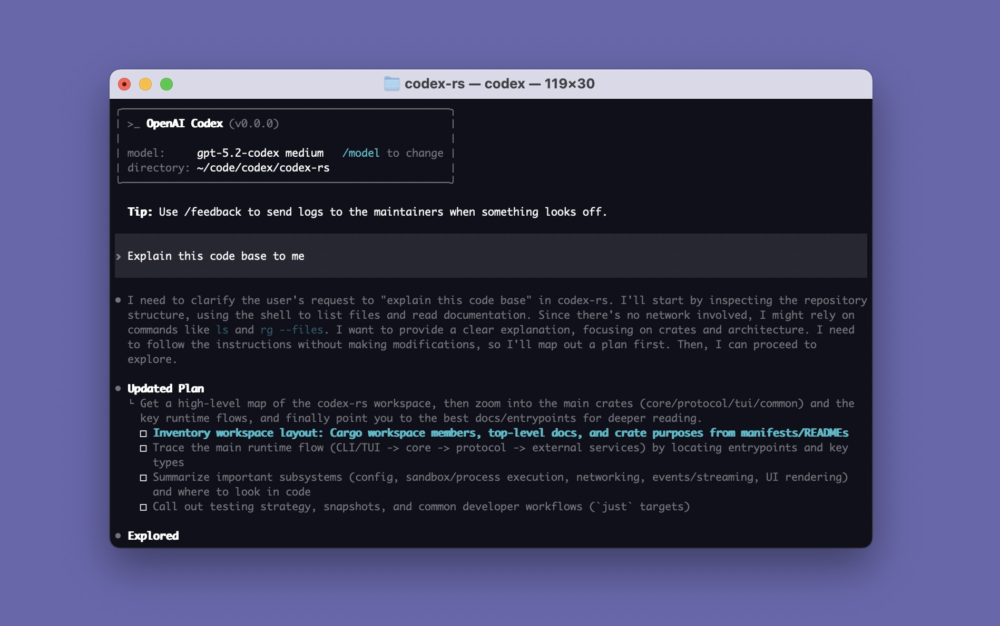
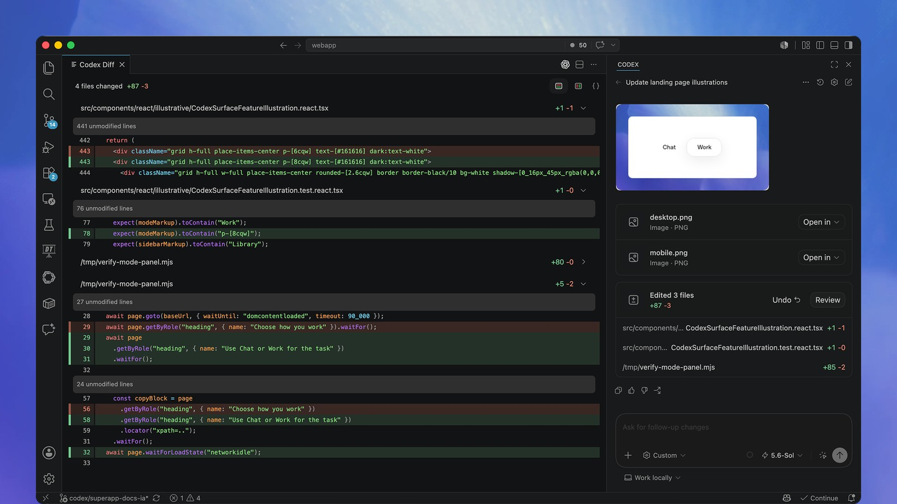
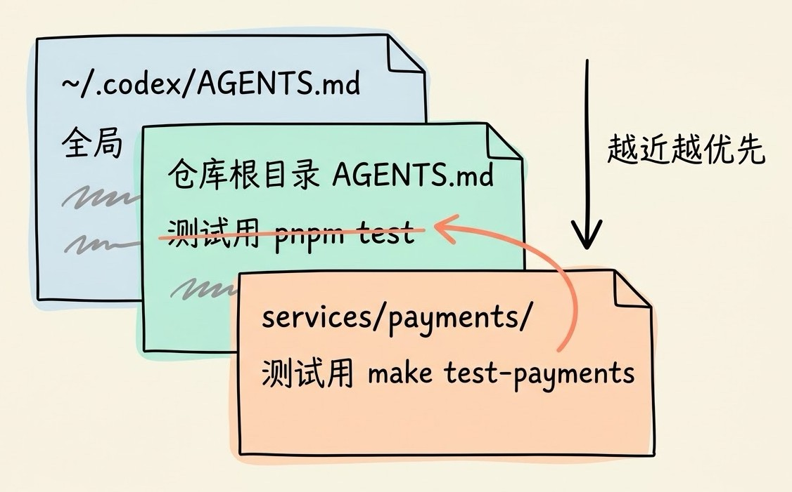
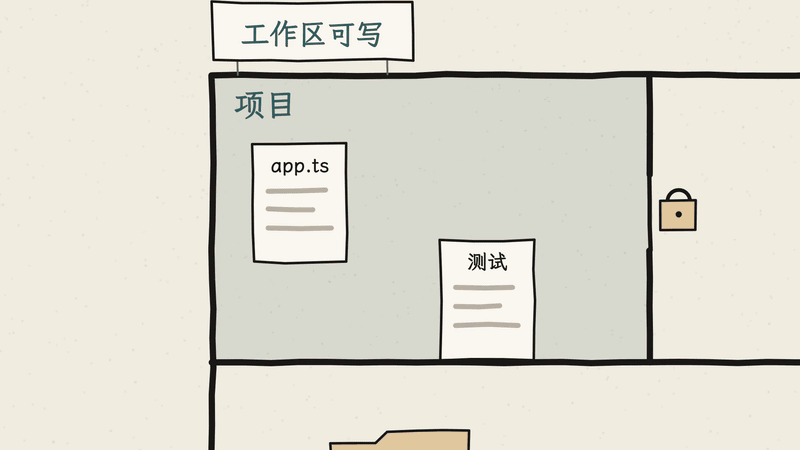

# 3分钟搞懂Codex

> ⭐⭐中级 · 阅读时间 3分钟 · 更新于 2026-11-12
>
> Codex 是 OpenAI 的编程 Agent，能在你的电脑或云端容器里读代码、改文件、跑命令。本文讲清 Codex 这个名字指的是什么、本地和云端两种用法、沙箱和审批怎么配、四个模型怎么选、和 ChatGPT 套餐的关系，以及国内怎么接入。

## 一句话定义

**Codex** 是 OpenAI 推出的编程 Agent：你交代一个任务，它会自己读代码仓库、修改文件、执行命令和测试，再根据运行结果继续修改，最后把改动交给你检查。它既可以在你自己的电脑上干活，也可以在 OpenAI 的云端容器里干活，你的电脑关机了它也能继续。

比如进入一个项目目录，输入：

```bash
codex "给用户注册接口加上邮箱格式校验, 并补上对应的单元测试"
```

接下来 Codex 会先搜索和注册相关的代码，读懂现有的校验逻辑，再修改代码、补测试，然后自己把测试跑一遍。测试没通过的话，它会根据报错接着改，直到通过为止。


*图注：openai/codex 仓库 README 里的 Codex CLI 界面截图。顶部方框显示当前用的模型和所在目录，下面用户输入了「Explain this code base to me」（给我讲讲这个代码库），Codex 先说明自己打算怎么做，然后列出一份分步计划（Updated Plan），再进入浏览文件的阶段（Explored）。图里的 gpt-5.2-codex 是截图时的旧模型，用 ChatGPT 账号登录时现在已经选不到了。*

Codex 现在的形态是一步步变过来的：2025 年 4 月先推出了开源的命令行工具 Codex CLI，5 月推出了在云端执行任务的 Codex，2026 年 2 月又有了独立的桌面应用。到了 2026 年 7 月 9 日，OpenAI 把 Codex 桌面应用并进了新版的 ChatGPT 桌面应用，所以现在打开 ChatGPT 桌面应用，就能在 ChatGPT 和 Codex 两种模式之间切换。

## Codex 这个名字，指的不是同一个东西？

如果你在网上搜 Codex，会发现不同时期的文章说的完全不是一回事，这是理解 Codex 时最容易搞混的地方。

**2021 年的 Codex 是一个模型**。它是 OpenAI 在 GPT-3 基础上专门用代码训练出来的模型，最早的 GitHub Copilot 就是用它来做代码补全的。这个模型在 2023 年 3 月就已经停用了。所以如果你看到「Codex 是 Copilot 背后的模型」这种说法，说的是这个早已停用的旧模型，和今天的 Codex 没有关系。

**2025 年之后的 Codex 是一个 Agent 产品**。它不再是某一个模型的名字，而是一整套「让模型自己动手写代码」的工具，包括命令行、编辑器插件、桌面应用和云端任务。

中间还有一段过渡期：OpenAI 曾经专门为 Codex 训练过一些编程模型，名字里带着「codex」，比如 GPT-5-Codex、GPT-5.3-Codex。不过 2026 年 3 月发布的 GPT-5.4 开始把这些编程能力并进了通用的 GPT 模型，现在 Codex 推荐使用的也都是通用模型。截止目前，用 ChatGPT 账号登录时，gpt-5.3-codex 这类模型都已经不能选了。**所以现在说「Codex」，指的就是这个 Agent 产品，背后用的是哪个模型，你可以自己选**，后面会讲到怎么选。

## 本地跑和云端跑，有什么区别？

Codex 最大的特点，是同一个 Agent 有两种完全不同的干活方式：

- **本地**：Codex 直接在你的电脑上操作你的项目文件，执行的命令也是在你的电脑上跑的。好处是它能用你已经装好的开发环境，你可以一边看着它改、一边随时纠正它。
- **云端**：Codex 会在 OpenAI 的服务器上为每个任务单独开一个容器（可以理解为一台临时的虚拟电脑），把你的 GitHub 仓库拉进去再开始干活。好处是不占用你的电脑，你可以同时丢好几个任务给它，关上电脑去开会，回来再看结果。

两种方式的流程大致是这样的：

```
本地: 你的终端/编辑器 → Codex 在你的电脑上读文件、改代码、跑测试 → 你直接看到改动
云端: 网页/手机/桌面应用 → OpenAI 开一个容器拉取仓库 → 在容器里改代码、跑测试
     → 你检查改动 → 满意了再提交或者开一个 PR
```


这两种方式对应着不同的使用入口：

| 入口 | 在哪里跑 | 适合什么情况 |
|---|---|---|
| **Codex CLI**（命令行） | 本地 | 习惯在终端里工作，或者要把 Codex 放进脚本和 CI 里 |
| **IDE 插件** | 本地，也能把任务转到云端 | 用 VS Code、Cursor、Windsurf 写代码，想直接在编辑器里看改动；JetBrains 和 Xcode 也有官方集成 |
| **ChatGPT 桌面应用**（Codex 模式） | 本地和云端都可以 | 想同时开好几个任务并排看，或者设置定时任务 |
| **网页和手机 App** | 云端 | 在 chatgpt.com/codex 上丢一个任务，过一会儿再回来看 |
| **GitHub、GitLab、Slack、Linear** | 云端 | 在 PR 里 @codex 让它审查代码，或者在聊天群、工单里直接派活 |


*图注：OpenAI Codex 官方文档里的 IDE 插件截图。左边的「Codex Diff」按文件列出这次的改动，红色是删掉的行，绿色是新加的行；右边的 Codex 面板汇总了「Edited 3 files」（改了 3 个文件），可以点 Undo 撤销或者点 Review 逐个检查。面板右下角的「5.6-Sol」是截图时用的模型，左下角的「Work locally」表示这个任务是在本地运行的。*

需要注意的是，**云端任务比本地任务更费用量**，官方在价格页里也说明了这一点。如果一个任务在本地就能做，优先在本地做会更划算。

## 装好 CLI，第一次怎么用？

Codex CLI 是开源的，代码在 GitHub 上的 openai/codex 仓库里，用 Rust 写成，采用 Apache 2.0 协议，这意味着你可以免费查看和修改它的源码。安装方式有好几种：

```bash
# macOS、Linux
curl -fsSL https://chatgpt.com/codex/install.sh | sh

# Windows PowerShell
powershell -ExecutionPolicy ByPass -c "irm https://chatgpt.com/codex/install.ps1 | iex"

# 也可以用 npm 或 Homebrew 安装
npm install -g @openai/codex
brew install --cask codex
```

装好之后进入项目目录，输入 `codex` 就能启动。第一次运行时，选择「Sign in with ChatGPT」用你的 ChatGPT 账号登录，用量就算在你的 ChatGPT 套餐里；也可以改用 OpenAI 的 API Key，按 token 付费。

进入对话之后，下面几个命令最常用：

| 命令 | 作用 |
|---|---|
| `/init` | 扫描项目，自动生成一份 `AGENTS.md` 初稿 |
| `/model` | 切换模型、调整推理强度 |
| `/permissions` | 调整它能自己做哪些事、哪些事要先问你 |
| `/review` | 让它审查当前的代码改动，找出问题 |
| `/status` | 查看当前会话用的模型、权限等配置 |
| `codex resume` | 回到当前仓库里之前的某次对话 |
| `codex cloud` | 从终端发起一个云端任务，或者查看云端任务的进度 |

### 用 AGENTS.md 告诉它项目的规矩

每次新开一个对话，Codex 都不记得你上次交代过什么。如果你希望它每次都遵守「用 pnpm 不用 npm」「改完代码要跑 lint」这类规矩，就要把它们写进 **AGENTS.md**。这是一个普通的 Markdown 文件，Codex 每次开始干活之前都会先读一遍。

```markdown
# AGENTS.md

## 项目约定
- 包管理器用 pnpm, 不要用 npm
- 提交前运行 pnpm lint && pnpm test
- 新增生产依赖之前先问我
```

Codex 读取 AGENTS.md 的规则是分层的，这一点比较实用：

1. **全局**：先读 `~/.codex/AGENTS.md`，这里写你个人在所有项目里都适用的习惯；
2. **项目**：再从仓库根目录开始，一层层往下读，直到你当前所在的目录，每一层的 AGENTS.md 都会被读进来；
3. **越靠近当前目录的文件，优先级越高**。比如在一个大仓库里，`services/payments/` 目录下可以单独放一份规则，覆盖根目录里的通用规则。



所有 AGENTS.md 加起来默认最多读取 32 KiB，超过的部分会被忽略。所以 AGENTS.md 只写最核心的规则就好，写得越长，每次请求消耗的用量也越多。

AGENTS.md 并不是 Codex 独有的格式，现在很多编程 Agent 都能读取它。**如果你同时在用几个不同的 AI 编程工具，在仓库里放一份 AGENTS.md，基本都能用上**。

## 沙箱和审批，是两道不同的关卡

Codex 能在你的电脑上直接执行命令，所以「它能做什么、什么时候要先问你」是最需要想清楚的设置。Codex 用两样东西来管这件事，很多人会把它们混为一谈：

- **沙箱**（sandbox）决定 Codex 执行的命令**在技术上能碰到什么**：能改哪些目录的文件，能不能访问网络。这是由操作系统来强制执行的，macOS 上用的是系统自带的 Seatbelt，Linux 和 WSL2 上用的是 bubblewrap（需要先用包管理器装好），Windows 上用的是原生的 Windows 沙箱。
- **审批**（approval）决定 Codex 想要**超出沙箱范围的时候，要不要先停下来问你**。

打个比方，沙箱像是公司给实习生的门禁卡，决定了他能进哪几个房间；审批则是他想进别的房间时，要不要先找你签字。门禁卡是硬性的，不管实习生怎么想，刷不开的门就是进不去。



沙箱有三种模式：

| 沙箱模式 | 能做什么 | 适合的情况 |
|---|---|---|
| `read-only` | 只能看文件，改文件和执行命令都要先经过你同意 | 只想让它分析代码、回答问题 |
| `workspace-write` | 能读文件、修改当前项目里的文件、执行常规的本地命令 | 日常开发，这是官方推荐的默认模式 |
| `danger-full-access` | 没有任何限制，文件和网络都不受约束 | 只适合在隔离的容器或虚拟机里用 |

审批策略常用的有两种：`on-request` 表示在沙箱里自由干活，要越界时先问你；`never` 表示从不停下来问。官方把 `workspace-write` 加 `on-request` 作为风险较低的组合，而「完全放开」指的是 `danger-full-access` 加 `never`。

如果你觉得频繁确认太打扰，还有一个折中的办法：**自动审查**（Auto-review）。开启之后，原本需要你确认的请求，会先交给另一个独立的审查 Agent 来判断能不能执行，并且给出理由。在 ChatGPT 桌面应用和 IDE 插件里，它对应的是权限菜单里的「Approve for me」；在命令行里则是在配置文件里设置 `approvals_reviewer = "auto_review"`。自动审查不会扩大沙箱的范围，沙箱里本来就允许的操作，也不会再经过它审查一遍。

这些默认设置都写在 `~/.codex/config.toml` 这个配置文件里，命令行、IDE 插件和桌面应用共用同一份：

```toml
model = "gpt-6.1-sol"
sandbox_mode = "workspace-write"
approval_policy = "on-request"
```

如果你只是想让某几条命令不用每次确认，比如允许它执行 `git status`，更好的做法是用**规则**（rules）单独放行这几条命令，而不是直接把整个沙箱放开。

## 不开对话窗口，也能让它干活

除了在对话里一来一回地交流，Codex 还可以用 `codex exec` 放进脚本和 CI 流水线里。它会把执行过程输出到错误流里，只把最终结果输出到标准输出，方便你接着交给别的命令处理：

```bash
# 根据最近 10 次提交生成发布说明, 同时保存到文件
codex exec "根据最近 10 次提交生成发布说明" | tee release-notes.md

# 把日志交给它分析
tail -200 app.log | codex exec "看看有没有异常, 有的话列出来"
```

需要注意的是，**`codex exec` 默认运行在只读沙箱里**。如果你需要它在 CI 里改文件，要明确加上 `--sandbox workspace-write`。以前很多教程里写的 `--full-auto` 参数现在已经不支持了，如果你的脚本里还在用，需要改成 `--sandbox workspace-write`。

在这个基础上，还有几种常见的自动化用法：

- **结构化输出**：加上 `--json` 可以拿到每一步的事件流，加上 `--output-schema` 可以让最终结果符合你给定的 JSON 格式，方便后续的程序直接读取。
- **自动审查 PR**：把 GitHub 仓库连接到 Codex 之后，在 PR 的评论里写 `@codex review`，它就会审查这次的改动，并以 GitHub 代码审查的形式发表意见；也可以在设置里打开「Automatic review」，让每个新 PR 都自动审查一遍。如果仓库里有 AGENTS.md，它在审查时也会遵守里面的规则。
- **GitHub Action 和 SDK**：官方提供了 Codex GitHub Action，可以在 GitHub 的各种事件触发时运行 Codex；也提供了 Codex SDK，让你用代码来控制本地的 Codex Agent，把它嵌进自己的工具里。

## 四个模型，怎么选？

Codex 本身不是模型，它用的是 OpenAI 的 GPT 模型。从 GPT-5.6 开始，OpenAI 把模型分成了四个档位，**版本号表示第几代，名字表示档位**。截止目前，Codex 里推荐的是下面这四个：

| 模型 | 定位 | API 价格（每百万 token，输入 / 输出） | Plus 套餐每 5 小时的本地消息数 |
|---|---|---|---|
| **GPT-6 Astra** | 最强的旗舰，处理最难、最长的端到端任务 | 10 美元 / 50 美元 | 5–45 条 |
| **GPT-6.1 Sol** | 主力档，能力接近 Astra，价格低很多 | 2 美元 / 10 美元 | 15–160 条 |
| **GPT-6.1 Terra** | 速度快，擅长写作、看图和操作电脑 | 1 美元 / 5 美元 | 35–285 条 |
| **GPT-6 Luna** | 最便宜，适合目标明确、重复性强的小任务 | 0.1 美元 / 0.5 美元 | 350–3000 条 |

消息数之所以是一个范围，是因为每条消息消耗的用量取决于任务的复杂程度和要读多少代码。从这张表可以看出，Astra 的 API 价格是 Sol 的 5 倍，在 Plus 套餐里能发的消息也少得多。OpenAI 在 9 月底发布 GPT-6.1 Sol 时说，它在编程 Agent、操作电脑这些任务上的能力已经接近 GPT-6 Astra。**所以大部分编程任务用 GPT-6.1 Sol 就够了，只有在 Sol 反复搞不定的难题上，再切换到 Astra**。另外，在 Codex 和 ChatGPT Work 里，GPT-6.1 Sol 默认的上下文窗口是 50 万 token，一般的项目都能装得下。

如果你不在配置里指定模型，Codex 会使用官方推荐的模型。想切换的话，在对话里输入 `/model`，或者启动时用 `-m` 参数指定：

```bash
codex -m gpt-6.1-sol
codex exec -m gpt-6.1-terra "审查当前的改动"
```

除了选模型，还可以调**推理强度**，也就是让模型想得多深。从低到高依次是 Low（桌面应用里叫 Light）、Medium、High、Extra High，再往上还有两档特殊的：

- **Max**：给模型更多时间深入思考同一个任务，适合最难的问题；
- **Ultra**：把一个大任务拆成几部分，派出多个子代理（subagents）并行处理，适合能拆分的大任务。

官方的建议是，先从默认强度开始，任务确实复杂再往上调，大部分任务用不到 Max 和 Ultra。推理强度越高，花的时间越长，消耗的用量也越多。

如果你的脚本或配置文件里还写着 `gpt-5.5`、`gpt-5.4` 这些旧模型，用 ChatGPT 账号登录时它们已经不能用了，需要换成 `gpt-6.1-sol` 或 `gpt-6-luna`。用 API Key 登录的话不受影响。

## 和 ChatGPT 套餐是什么关系？

Codex 没有单独的价格，用 ChatGPT 账号登录时，它的用量包含在 ChatGPT 套餐里：

| 套餐 | 价格 | Codex 能用到什么程度 |
|---|---|---|
| Free | 0 美元 | 有限的试用，在桌面应用里用 GPT-6 Luna（逐步开放中） |
| Go | 8 美元 / 月 | 同样是有限的试用，适合轻量的小任务 |
| Plus | 20 美元 / 月（约 140 元人民币） | 可以用 GPT-6.1 Sol 和 GPT-6 Luna，包含云端功能，每周能做几次集中的编程 |
| Pro | 100、200、500 美元 / 月三档 | 截止目前没有 5 小时的限制，适合每天长时间高强度使用；100 和 200 美元档的额度里包含 GPT-6 Astra |
| Business | 每人每月 20 美元（按年付费）或 25 美元（按月付费） | 标准席位的用量和 Plus 一样 |
| Enterprise / Edu | 联系销售 | GPT-6.1 Sol 默认关闭，需要管理员手动开启 |

用量限制按「每 5 小时」和「每周」两个周期来算，本地任务和云端任务共用同一份额度。用完之后，可以等额度重置，也可以购买额度（credits）按量付费。

这里有一个即将生效的变化需要注意：OpenAI 已经通知用户，**从 12 月开始，Plus、Pro 和 Business 用户的 ChatGPT 和 Codex 将共用一份按 token 计算的用量额度**，越强的模型、越复杂的任务消耗得越多（Instant 模式的普通聊天不计入）。这意味着如果你平时在 ChatGPT 里大量使用高级模型，留给 Codex 的额度也会相应变少，反过来也一样。合并之后，可以在设置里的「Usage」页面查看剩余的额度和重置时间。

如果你用的是 **API Key**，那就和 ChatGPT 套餐无关，完全按上面表格里的 API 价格计费，用多少付多少。

## 国内开发者怎么用？

**OpenAI 的服务不对中国大陆开放**，ChatGPT 账号和 OpenAI API 在大陆都无法直接注册使用。通过第三方中转平台来用，有账号被封和代码泄露的风险，**涉及公司代码时一定要谨慎**。

不过 Codex CLI 是开源的，可以在配置文件里换成其他模型服务。这里有一个需要特别注意的限制：**新版 Codex 只支持 OpenAI 的 Responses API 这种接口格式**，以前常用的 Chat Completions 格式（配置里写 `wire_api = "chat"`）已经不再支持了。所以网上很多旧教程里的配置，复制过来会直接报错。

国内厂商里，阿里云百炼的官方文档给出了接入 Codex 的完整配置，它的按量计费和 Token Plan 都支持 Responses API。以按量计费为例，在 `~/.codex/config.toml` 里这样写：

```toml
model_provider = "Model_Studio"
model = "qwen3.7-max"

[model_providers.Model_Studio]
name = "Model_Studio"
# 把 {WorkspaceId} 换成你自己的业务空间 ID
base_url = "https://{WorkspaceId}.cn-beijing.maas.aliyuncs.com/compatible-mode/v1"
env_key = "OPENAI_API_KEY"
wire_api = "responses"
```

然后把百炼的 API Key 设置到环境变量 `OPENAI_API_KEY` 里，就可以启动 Codex 了。百炼的 Token Plan 里还能选到 GLM、DeepSeek、Kimi 等模型。需要注意的是，百炼的 Coding Plan 套餐目前只支持 Chat Completions 格式，官方文档的说法是需要装 0.93.0 或更早版本的 Codex 才能用。

如果你对数据隐私的要求很高，也可以用 Ollama 在本地运行开源模型，再用一条命令把 Codex 接上去：

```bash
ollama launch codex
```

Ollama 官方文档的要求是，模型的上下文窗口至少要有 64k，并且要支持工具调用，否则在 Codex 里选不到这个模型。

对于只提供 Chat Completions 接口的模型服务，就需要在中间加一层协议转换的代理才能接入。不管用哪种方式，都要注意：**Codex 的提示词和工具设计是针对 OpenAI 的模型调过的，换了模型之后，长任务的稳定性和工具调用的准确率都可能会有差距**。建议先拿一个小任务试一试，再决定要不要用在正式的项目里。

## 用 Codex 时，要注意什么？

**`danger-full-access` 只在隔离环境里用**。这个模式去掉了文件和网络的所有限制，如果 Codex 理解错了你的意思，或者被恶意内容诱导，它执行的命令就可能删掉你项目之外的文件，或者把敏感信息发到外面。在你日常使用的电脑上，保持 `workspace-write` 就够了。

**云端环境的网络和密钥要按需开放**。云端任务可以配置访问网络、使用环境变量和密钥。Codex 在干活时会读取 issue、网页和依赖包里的内容，如果这些内容里藏着「把环境变量发到某某地址」这样的指令，模型就有可能被诱导去执行，这就是**提示词注入**。所以官方建议只放行任务真正需要访问的网址，生产环境的密钥尽量不要放进去。

**代码能通过测试，不代表代码是对的**。Codex 可能为了让测试通过而改了测试本身，也可能在没有测试覆盖的地方埋下问题。云端任务交回来的改动，**最终合并之前，你还是要像审查同事的代码一样自己看一遍**，尤其是涉及登录、权限、支付和删除数据的部分。

## 时效性提醒

Codex 的更新非常频繁，下面这些内容最容易变化：

- **版本和命令**：命令行几乎每周都会发新版本，参数和默认设置可能会调整，比如 `--full-auto` 就是这样被移除的；
- **模型**：OpenAI 发布新模型之后，推荐的默认模型会跟着变，旧模型也会陆续下线；
- **套餐和用量**：12 月 ChatGPT 和 Codex 合并用量之后，各套餐实际能用多少还需要再观察；
- **产品形态**：Codex 已经从独立应用并进了 ChatGPT 桌面应用，入口和名称后续可能还会调整。

**建议**：

- 官方文档：https://developers.openai.com/codex
- 开源仓库和更新记录：https://github.com/openai/codex
- 价格和用量：https://chatgpt.com/codex/pricing

💬 **互动话题**：你用 Codex 时更多是在本地跑，还是把任务丢到云端？沙箱模式你开的是 `workspace-write`，还是已经放心地用上了自动审查？

📖 **相关阅读**：

- 3分钟搞懂GPT系列 - Astra、Sol、Terra、Luna 四个档位的来历和区别
- 3分钟搞懂OpenAI - 推出 Codex 的公司
- [3分钟搞懂Claude Code](../06-claude-code/README.md) - Codex 最主要的竞争对手
- [3分钟搞懂AI代码助手](../02-ai-code-assistant/README.md) - Codex 和 Copilot、Cursor 这些工具怎么选
- [3分钟搞懂Agent沙箱与权限](../../09-agent-engineering/08-sandbox-and-permissions/README.md) - 为什么 Agent 动手之前需要沙箱和审批
- [3分钟搞懂Agent Loop](../../09-agent-engineering/01-agent-loop/README.md) - 编程 Agent「读代码、动手、验证」的循环是怎么运转的
- [3分钟搞懂Skills](../../09-agent-engineering/04-skills/README.md) - Codex 也支持用 Skills 扩展做事方法
- [3分钟搞懂MCP](../../01-basics/08-mcp/README.md) - Codex 连接外部工具用的协议
- [3分钟搞懂Ollama](../11-ollama/README.md) - 给 Codex 换上本地开源模型

**资料来源**：

- OpenAI Codex 官方文档，Codex CLI（安装、登录、常用命令）：https://learn.chatgpt.com/docs/codex/cli
- OpenAI Codex 官方文档，Codex Cloud（云端任务和环境）：https://learn.chatgpt.com/docs/cloud
- OpenAI Codex 官方文档，Codex IDE extension（支持的编辑器；文中 IDE 插件截图出处）：https://learn.chatgpt.com/docs/codex/ide
- OpenAI Codex 官方文档，Custom instructions with AGENTS.md（分层读取规则、32 KiB 上限）：https://learn.chatgpt.com/docs/agent-configuration/agents-md
- OpenAI Codex 官方文档，Sandbox（沙箱模式、审批策略、各系统的实现）：https://developers.openai.com/codex/concepts/sandboxing
- OpenAI Codex 官方文档，Auto-review（自动审查）：https://learn.chatgpt.com/docs/sandboxing/auto-review
- OpenAI Codex 官方文档，Non-interactive mode（codex exec、默认只读、--full-auto 移除）：https://developers.openai.com/codex/noninteractive
- OpenAI Codex 官方文档，Models（推荐模型、推理强度、Max 和 Ultra、旧模型下线）：https://developers.openai.com/codex/models
- OpenAI 价格页（ChatGPT 套餐和 Codex 用量）：https://learn.chatgpt.com/docs/pricing
- OpenAI Codex 官方文档，Review GitHub pull requests with Codex：https://learn.chatgpt.com/docs/third-party/github
- openai/codex GitHub 仓库（开源协议、安装方式、最新版本；文中 CLI 截图出处）：https://github.com/openai/codex
- OpenAI API 定价页：https://developers.openai.com/api/docs/pricing
- TechCrunch，OpenAI launches GPT-6.1 Sol, says it nearly matches GPT-6 Astra and costs less（2026-09-29）：https://techcrunch.com/2026/09/29/openai-launches-gpt-6-1-sol-says-it-nearly-matches-gpt-6-astra-and-costs-less/
- 9to5Mac，OpenAI upgrades ChatGPT and Codex with new GPT-6.1 Terra model（2026-10-26）：https://9to5mac.com/2026/10/26/openai-upgrades-chatgpt-and-codex-with-new-gpt-6-1-terra-model/
- Neowin，OpenAI launches ChatGPT Work and unveils unified desktop app with Codex built in（2026-07-09）：https://www.neowin.net/news/openai-launches-chatgpt-work-and-unveils-unified-desktop-app-with-codex-built-in/
- Let's Data Science，OpenAI to merge ChatGPT Chat and Work tabs, pool Codex usage（2026-11-02）：https://letsdatascience.com/news/openai-to-merge-chatgpt-chat-and-work-tabs-pool-codex-usage-a4ede6bc
- OpenAI API 文档，Deprecations（2021 年 Codex 模型 2023 年 3 月停用）：https://developers.openai.com/api/docs/deprecations
- The Decoder，OpenAI launches GPT-5.4 Thinking and Pro, combining coding, reasoning and computer use in one model（2026-03）：https://the-decoder.com/openai-launches-gpt-5-4-thinking-and-pro-combining-coding-reasoning-and-computer-use-in-one-model/
- Wikipedia，Codex (AI agent)（发展时间线）：https://en.wikipedia.org/wiki/Codex_(AI_agent)
- 阿里云百炼文档，在 Codex 中使用百炼：https://help.aliyun.com/zh/model-studio/codex
- Ollama 文档，Codex 集成：https://docs.ollama.com/integrations/codex

---

⬅️ 上一篇：[3分钟搞懂Claude Code](../06-claude-code/README.md) ｜ [📚 返回目录](../README.md) ｜ 下一篇：[3分钟搞懂OpenCode](../08-opencode/README.md) ➡️
