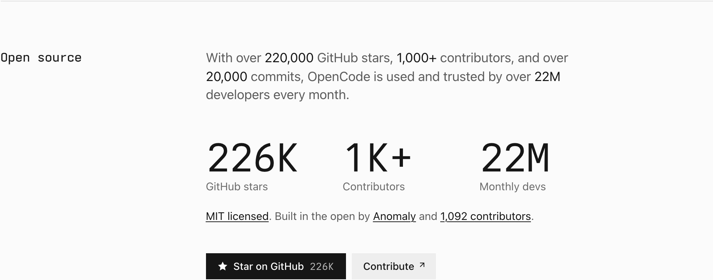
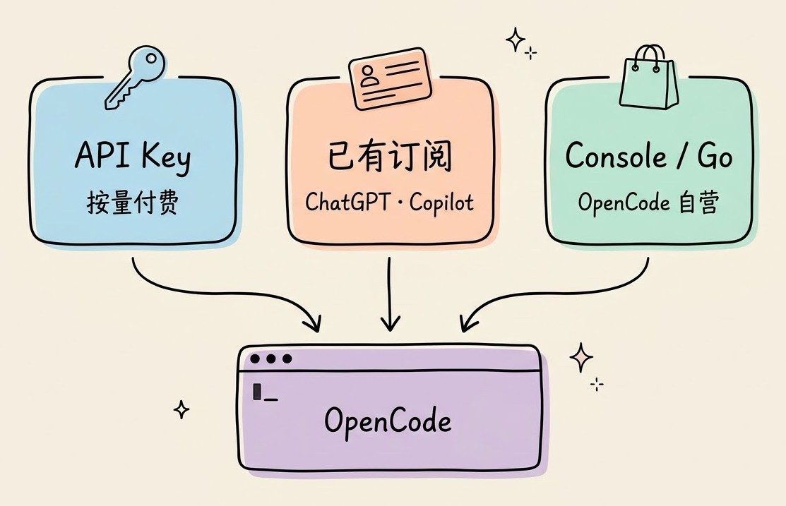
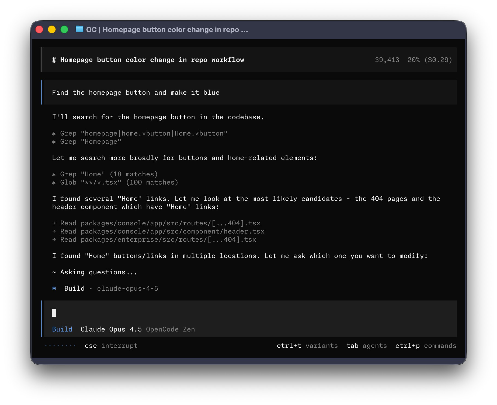
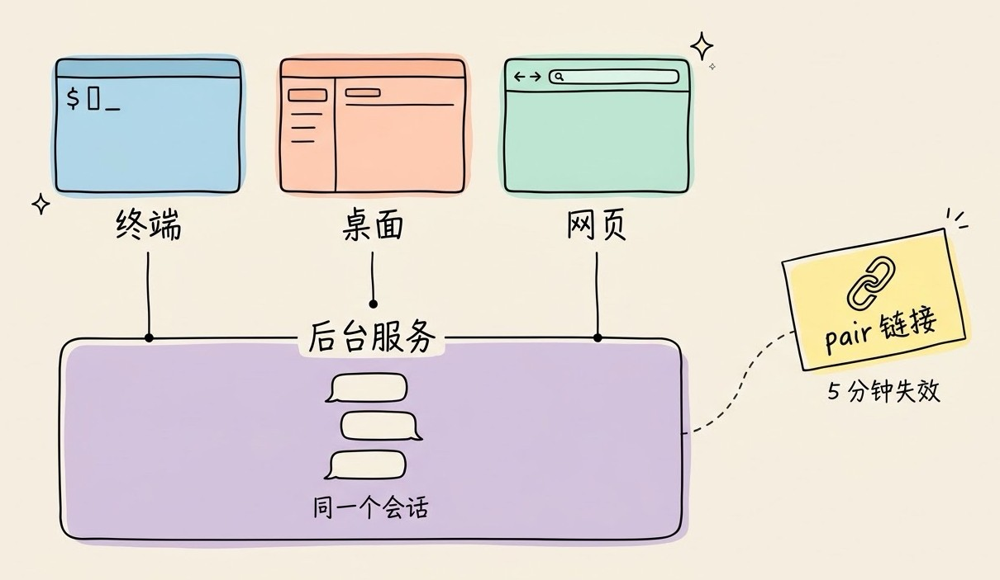

# 3分钟搞懂OpenCode

> ⭐⭐中级 · 阅读时间 3分钟 · 更新于 2026-11-13
>
> OpenCode 是 MIT 协议开源的编程 Agent，能接 200 多家模型服务商，含国产和本地模型。本文讲清它和 Claude Code、Codex 的区别、模型的三种接法，以及默认全放行的权限和 Console 密钥泄露怎么应对。

## 一句话定义

**OpenCode** 是一个开源的编程 Agent：你在终端、桌面应用或者网页里用一句话交代任务，它会自己读代码、改文件、跑命令，做法和 Claude Code、Codex 差不多。最大的不同是，**它不绑定任何一家的模型**，Claude、GPT、Gemini、DeepSeek、GLM、Kimi、千问，甚至你在自己电脑上用 Ollama 跑的开源模型，都能接进来用。

OpenCode 的代码在 GitHub 的 anomalyco/opencode 仓库里，采用 MIT 协议，可以免费使用和修改，截止目前有 22 万多颗 star，是 star 数最多的开源编程 Agent 之一。它背后的团队是 **Anomaly** 公司，前身是做开源部署框架 SST 的团队，所以早期的仓库地址是 sst/opencode，2026 年初才迁到现在的地址。官网的说法是，每个月有超过 2200 万开发者在用它。


*图注：OpenCode 官网首页的「Open source」区块，截至写这篇时的数字。三个大字依次是 GitHub star 数（226K）、贡献者人数（1K+）和每月使用的开发者数（22M），最后一个是官方自己统计的数字。下方一行写着「MIT 协议，由 Anomaly 和 1092 名贡献者公开开发」。截图时隐藏了页面上的贡献者头像。*

## 和 Claude Code、Codex 有什么不一样？

三者干的活是一样的，区别主要在「谁的模型」「开不开源」和「默认管得多严」这几件事上：

| | OpenCode | Claude Code | Codex CLI |
|---|---|---|---|
| 开发方 | Anomaly | Anthropic | OpenAI |
| 是否开源 | 开源，MIT 协议 | 不开源 | 开源，Apache 2.0 协议 |
| 能用的模型 | 200 多家服务商的模型，包括本地模型 | Claude 系列，改接口地址后可以换成兼容的模型 | OpenAI 的模型为主，也可以配置其他服务商 |
| 工具本身收费吗 | 免费，只为模型付钱 | 需要 Claude 订阅或 API Key | 需要 ChatGPT 订阅或 API Key |
| 项目说明文件 | `AGENTS.md`，没有的话读 `CLAUDE.md` | `CLAUDE.md`，也能读 `AGENTS.md` | `AGENTS.md` |
| 动手前的检查 | 默认几乎全部放行，没有沙箱 | 六种权限模式，Auto 模式有分类模型把关 | 操作系统级沙箱加审批 |

从这张表可以看出，OpenCode 的优势在于**选择自由**：同一套用法，今天用 Claude，明天换成更便宜的国产模型，配置文件、快捷键、`AGENTS.md` 都不用变。如果你的团队里有人用 Claude、有人用 GPT，大家也可以统一用 OpenCode，不用各学一套工具。

不过选择自由也有代价。Claude Code 和 Codex 的提示词、工具设计是专门为自家模型调过的，**同一个模型，放在原厂工具里通常会发挥得更稳定一些**。另外，OpenCode 在安全上默认管得最松，这一点后面会专门讲。

还有一件容易搞混的事：2025 年，另一个用 Go 写的同名项目 opencode 也很火，它后来交给 Charm 团队维护，改名叫 **Crush**。所以网上一些早期教程里的 OpenCode 指的是那个项目，安装命令和配置方式都对不上，搜教程时要看清楚仓库地址。

## 模型从哪来？三种接法

OpenCode 支持哪些服务商，来自一个叫 **models.dev** 的开源模型目录，这也是 Anomaly 维护的项目，里面记录了每家服务商的接口地址、模型列表和价格。官网写的是「200 多家」，我查了一下 models.dev 的数据，目前一共收录了 236 家服务商、9000 多个模型条目。

启动 OpenCode 之后，在对话框里输入 `/connect`，就可以从列表里选择服务商、登录或者填入 API Key。大致有三种接法：



**一是用各家的 API Key 按量付费**。OpenAI、Anthropic、Google、DeepSeek、智谱、Moonshot、阿里云百炼、火山方舟、硅基流动这些服务商，都能在 `/connect` 的列表里直接找到。如果某家服务商不在列表里，只要它提供兼容 OpenAI 格式的接口，也可以在配置文件里手动加上。

**二是用你已经买了的订阅**。OpenCode 支持用 ChatGPT Plus 或 Pro 账号登录，用的是你订阅套餐里的额度，不用另外买 API；GitHub Copilot 的订阅也能直接登录使用。Claude 订阅的情况比较特殊，下面单独说。

**三是用 OpenCode 自己卖的模型服务**。一种是在 OpenCode Console 里按 token 付费，目前提供 29 个经过他们测试、适合编程的模型，比如 Claude Opus 5.5 的价格是每百万 token 输入 4 美元、输出 20 美元，和 Anthropic 官方价一致。另一种是 **OpenCode Go** 包月套餐：

| 套餐 | 价格 | 说明 |
|---|---|---|
| Go | 10 美元 / 月（约 70 元人民币） | 用量按 5 小时、每周、每月三个周期计算 |
| Go Plus | 40 美元 / 月 | 用量是 Go 的 2 到 4 倍，不同模型倍数不同 |

Go 套餐里的模型以便宜的开源模型和小模型为主，比如 Kimi K3、DeepSeek V4 Pro、GLM-5.3-Flash、Qwen3.7 Plus、MiniMax M3.1 Flash，也有 Claude Haiku 5.5 和 GPT 6 Luna。额度用完之后可以充值继续用，也可以切换到每天有次数限制的免费模型。

### Claude 订阅为什么不能直接登录了？

OpenCode 早期支持用 Claude Pro、Max 账号直接登录，很多人就是冲着「用 Claude 订阅的额度、换一个更顺手的工具」来的。但 2026 年 1 月，Anthropic 开始在服务端拦截第三方工具用订阅账号登录；2 月又在条款里写明，**Claude Free、Pro、Max 账号的登录凭证，只能在 Claude Code 和 Claude.ai 里使用**。OpenCode 随后在 2 月 19 日删掉了 Claude 订阅登录功能，提交记录里写的原因是「Anthropic 的法律要求」。

现在在 OpenCode 里用 Claude，有两条路。一是用 Anthropic 的 API Key 按量付费，这一条没有限制。二是 2.2.3 版本（10 月 30 日）新加的 **Claude Agent** 选项：你先在电脑上装好官方的 Claude Code 并登录，OpenCode 会在背后调用这个 Claude Code 来干活。这种方式用的是你本机的官方客户端，不过订阅额度的使用规则以 Anthropic 的条款为准，如果你担心账号受影响，用 API Key 是最稳妥的。

## 国内开发者怎么接模型？

对国内开发者来说，OpenCode 可能是最省事的编程 Agent 之一：Claude Code 和 Codex 要用国产模型，需要自己去改接口地址和环境变量，而 OpenCode 的 `/connect` 列表里，**国内主要厂商的编程套餐基本都已经内置了**，包括智谱 GLM Coding Plan、Kimi 的编程套餐、阿里云百炼 Coding Plan、火山方舟 Coding Plan、腾讯云 Coding Plan 和 MiniMax 的套餐。选中之后填入对应平台的 API Key 就能用，不需要自己查接口地址。

如果你对数据隐私要求很高，代码不想发到任何云端，也可以用 Ollama 在本地运行开源模型。OpenCode 会自动发现本机 Ollama 的默认地址，你也可以直接运行 `ollama launch opencode`，让 Ollama 帮你配置好并启动 OpenCode。LM Studio、vLLM 这类本地推理工具同样能自动识别。

需要注意的是，本地能跑的模型通常比较小，**在需要连续调用几十次工具的长任务里，小模型更容易中途迷路或者调错工具**。建议先拿一个小任务试一试效果，再决定要不要用在正式项目里。

## 装好之后，先认识 build 和 plan

安装命令在 2.0 之后有变化，以官方仓库的说明为准：

```bash
# macOS、Linux 一键安装
curl -fsSL https://opencode.ai/v2/install | bash

# 用 npm 安装(Windows 也可以用这种方式, 或者到官网下载安装包)
npm i -g @opencode/cli@latest

# Homebrew(官方 tap, 更新最及时)
brew install anomalyco/tap/opencode-v2
```

进入项目目录，输入 `opencode` 就能打开终端界面。第一次在某个项目里使用时，建议先运行 `/init`，它会扫描整个项目，生成一份 `AGENTS.md`，把项目用的技术栈、常用命令、代码规范写进去，之后每次对话都会先读这份文件。如果项目里已经有给 Claude Code 写的 `CLAUDE.md`，没有 `AGENTS.md` 的时候它也会读 `CLAUDE.md`，不用重写一遍。

OpenCode 内置了两个主要的 **Agent**，按 `Tab` 键可以来回切换：

- **build**：默认的 Agent，能读文件、改代码、执行命令，日常干活用它；
- **plan**：只分析不改动，除了它自己的计划目录，不能修改项目文件。适合刚接手一个陌生项目，或者想先让它出个方案、你确认了再动手。


*图注：OpenCode GitHub 仓库 README 里的终端界面截图。用户的任务是「找到首页按钮，把它改成蓝色」，OpenCode 先用 Grep 和 Glob 搜索代码、读了 3 个文件，发现好几个地方都有「Home」按钮，于是停下来问用户要改哪一个（Asking questions）。右上角是这次对话用掉的 token 数、上下文占比和花费（0.29 美元）。底部输入框左边的「Build」就是当前的 Agent，右下角的「tab agents」提示按 Tab 键切换 Agent。这张截图是官方较早时候做的，所以显示的模型还是 Claude Opus 4.5，后面的「OpenCode Zen」是 OpenCode 按量付费模型服务以前的名字，现在归在 Console 里。*

另外还有两个**子代理**：**general** 负责多步骤的调研任务，**explore** 只负责搜索和阅读代码。主 Agent 遇到需要翻大量文件的任务时，会派子代理去查，查完只把结论带回来，这样主对话的上下文不会被几千行搜索结果占满。你也可以在消息里输入 `@general`，手动把任务交给它。

如果内置的不够用，你还可以在项目的 `.opencode/agents/` 目录下用 Markdown 文件定义自己的 Agent，给它单独设置提示词、模型和权限。比如做一个专门审查代码的 reviewer，让它用便宜的模型，并且只给它读文件的权限。

几个常用的命令：

| 命令 | 作用 |
|---|---|
| `/connect` | 连接模型服务商 |
| `/init` | 生成或更新 `AGENTS.md` |
| `/undo` | 撤销最近一次的文件改动和对话，改错了可以回退 |
| `/usage` | 查看用量 |
| `opencode run "..."` | 不打开界面，直接执行一个任务并输出结果，适合写进脚本 |

除此之外，OpenCode 也支持 MCP、Skills（用 `SKILL.md` 定义做事方法）、自定义斜杠命令和插件，概念和 Claude Code 里的基本一致。

## 2.0 之后，终端、桌面、网页是同一个会话

OpenCode 2.0 在 2026 年 9 月 11 日发布，这是它到目前为止最大的一次改动：以前终端版、桌面版、网页版各跑各的，现在它们背后共用**同一个后台服务**。



这个改动对你的影响是：你可以在终端里开始一个任务，出门后用网页查看进度，回来再在桌面应用里接着做，看到的是同一个会话、同一份历史。想在别的设备上打开当前会话，可以运行 `opencode pair` 生成一个连接链接，这个链接只能用一次，5 分钟后失效。

如果你是从 1.x 升级上来的，需要注意两点：**1.x 的插件在 2.0 里不能用了**，需要等插件作者适配；另外 1.x 和 2.x 的安装方式是分开的，旧的 Homebrew 命令 `brew install anomalyco/tap/opencode`（不带 `-v2`）装上的还是 1.x，照着旧教程安装时要留意。

## 用 OpenCode 之前，这几个坑要先知道

### 默认几乎什么都不问

这是 OpenCode 和 Claude Code、Codex 差别最大的地方。按照官方文档，build Agent 的**默认权限是全部放行**：改文件、执行任何命令、联网、读写项目以外的目录，都不会先问你，唯一默认会询问的是读取 `.env` 这类存放密钥的文件。而且 OpenCode **没有沙箱**，它执行的命令拥有和你本人一样的权限，能删你电脑上的文件，也能访问网络。

所以如果你要在正式项目里用 OpenCode，建议先在项目根目录的 `opencode.jsonc` 里把命令执行收紧，比如改成「执行命令前先问我，`git status` 直接放行，`git push` 一律禁止」：

```jsonc
{
  "permissions": [
    // 规则从上往下匹配, 最后一条匹配上的生效
    { "action": "shell", "resource": "*", "effect": "ask" },
    { "action": "shell", "resource": "git status", "effect": "allow" },
    { "action": "shell", "resource": "git push *", "effect": "deny" }
  ]
}
```


官方文档也明确提醒，它对危险命令的识别只能尽力而为，**与其想办法拦住所有危险命令，不如只放行少数几条你确定安全的命令**。对话中你选了「总是允许」的操作，会作为一条规则保存在项目配置里，但它不会覆盖你写好的禁止规则。

如果你要处理来路不明的仓库，或者想让它长时间无人看管地运行，更稳妥的做法是放进 Docker 容器或者虚拟机里跑，官方也提供了 Docker 镜像。

### Console 里存过的 API Key，最好换掉

2026 年 10 月 16 日夜里，OpenCode 的一个旧系统被入侵，**在 OpenCode Console 网页上保存过 OpenAI、Anthropic、Google 等服务商 API Key 的用户**，密钥可能已经泄露。OpenCode 说受影响的是大约 1.4% 的 Console 用户，并在 10 月 17 日发邮件通知了他们。截止目前，OpenCode 还没有公布入侵是怎么发生的，有部分用户反映收到了不是自己产生的账单。

联合创始人 Dax Raad 的说法是，这次出问题的是 Console 这个网站，不是 OpenCode 工具本身：**你在本机 OpenCode 里填的 API Key，保存在你电脑上的数据库里，不会上传到他们的服务器**。

如果你在 Console 里绑定过自己的 API Key，建议这样处理：

- 到对应服务商的后台**作废旧密钥、生成新密钥**。只在 Console 里删除是不够的，旧密钥在服务商那边仍然有效；
- 检查 10 月 16 日以来的用量和账单，看有没有不是你发起的请求；
- 以后给每个工具单独生成一个 API Key，并在服务商后台设置消费上限，这样即使泄露，损失也有上限。

### 换了模型，效果也会跟着变

OpenCode 能接 200 多家服务商，但不代表每个模型都能把编程 Agent 的活干好。编程 Agent 需要模型连续几十次准确地调用工具、读懂报错、记住前面做过什么，**模型越小、越便宜，在长任务里越容易出错**。比较实际的用法是：复杂任务用 Claude、GPT 这一档的强模型，简单的改动、写注释、查代码用便宜的模型，把这两类分配给不同的 Agent。

至于 OpenCode 写出来的代码，和用其他工具一样，合并之前都要自己看一遍改动，尤其是涉及登录、权限、支付和删除数据的部分。

## 时效性提醒

OpenCode 更新非常频繁，下面这些内容最容易变化：

- **版本和功能**：2.x 几乎每隔几天就有新版本，命令、默认设置和安装方式都可能调整，以官方的更新日志为准；
- **模型和价格**：Go 套餐包含哪些模型、Console 里的价格，都会随着新模型发布而调整；
- **Claude 的使用方式**：Anthropic 对第三方工具的限制还在变化，Claude Agent 这种接法后续是否有新的规定，需要关注 Anthropic 的条款；
- **安全事件**：Console 泄露事件截止目前还没有完整的调查结论。

**建议**：

- 官方文档：https://opencode.ai/docs
- 更新日志：https://opencode.ai/changelog
- GitHub 仓库：https://github.com/anomalyco/opencode

💬 **互动话题**：如果你用过 OpenCode，你给 build 和 plan 分别配了什么模型？有没有哪个国产模型在它里面跑长任务的表现让你满意，或者让你失望？

📖 **相关阅读**：

- [3分钟搞懂AI代码助手](../02-ai-code-assistant/README.md) - OpenCode 和 Copilot、Cursor 这些工具怎么选
- [3分钟搞懂Claude Code](../06-claude-code/README.md) - Anthropic 自家的编程 Agent，权限模式更细
- [3分钟搞懂Codex](../07-codex/README.md) - OpenAI 的编程 Agent，用操作系统沙箱限制它能碰什么
- [3分钟搞懂Ollama](../11-ollama/README.md) - 在本地跑开源模型，再接进 OpenCode
- [3分钟搞懂Agent沙箱与权限](../../09-agent-engineering/08-sandbox-and-permissions/README.md) - 为什么默认全放行的 Agent 需要你自己收紧权限
- [3分钟搞懂Harness](../../09-agent-engineering/07-harness/README.md) - 同一个模型换一个「外壳」，效果为什么会不一样
- [3分钟搞懂MCP](../../01-basics/08-mcp/README.md) - OpenCode 连接外部服务用的协议
- [3分钟搞懂Skills](../../09-agent-engineering/04-skills/README.md) - 用 SKILL.md 给 Agent 装上做事方法

**资料来源**：

- OpenCode GitHub 仓库（开源协议、star 数、安装方式、内置 Agent；文中终端界面截图出处）：https://github.com/anomalyco/opencode
- OpenCode 更新日志（v2.2.3 新增 Claude Agent、v2.2.7 等）：https://github.com/anomalyco/opencode/blob/dev/CHANGELOG.md
- OpenCode 官网（每月开发者数、200 多家服务商、功能列表；文中开源数据截图出处，2026-11-13 截取）：https://opencode.ai
- OpenCode 官方文档，Providers（models.dev、ChatGPT 和 GitHub Copilot 登录、本地模型自动发现）：https://opencode.ai/docs/providers/
- OpenCode 官方文档，Agents（build、plan、general、explore 和自定义 Agent）：https://opencode.ai/docs/agents/
- OpenCode 官方文档，Rules（AGENTS.md、/init、CLAUDE.md 兜底）：https://opencode.ai/docs/rules/
- OpenCode 官方文档，Permissions（默认权限、规则写法、没有沙箱的说明）：https://opencode.ai/docs/permissions/
- OpenCode 官方文档，CLI（opencode run、后台服务）：https://opencode.ai/docs/cli/
- OpenCode Go 价格页：https://opencode.ai/go
- OpenCode Console 模型价格页：https://opencode.ai/zen
- models.dev 数据接口（2026-11-13 统计服务商和模型数量）：https://models.dev/api.json
- The New Stack，OpenCode 2.0 puts its terminal, desktop, and web apps on one shared service：https://thenewstack.io/opencode-2-shared-service/
- The Register，Anthropic clarifies ban on third-party harnesses with Claude subscriptions（2026-02-20）：https://www.theregister.com/2026/02/20/anthropic_clarifies_ban_third_party_claude_access
- The Hacker News，OpenCode Console Breach May Have Exposed OpenAI, Anthropic, and Google API Keys（2026-10-19）：https://thehackernews.com/2026/10/opencode-console-breach-may-have.html
- Hacker News 社区讨论（2025-07，opencode 与 Crush 分家）：https://news.ycombinator.com/item?id=44482504

---

⬅️ 上一篇：[3分钟搞懂Codex](../07-codex/README.md) ｜ [📚 返回目录](../README.md) ｜ 下一篇：[3分钟搞懂Pi](../09-pi/README.md) ➡️
