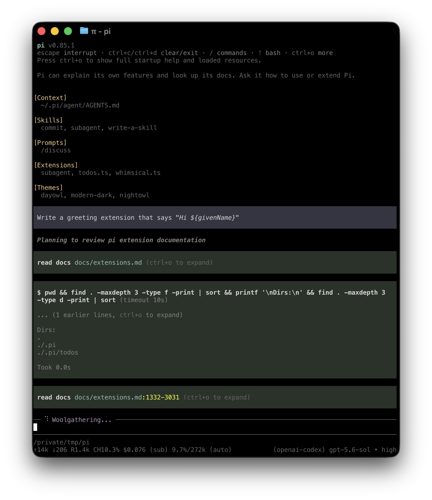
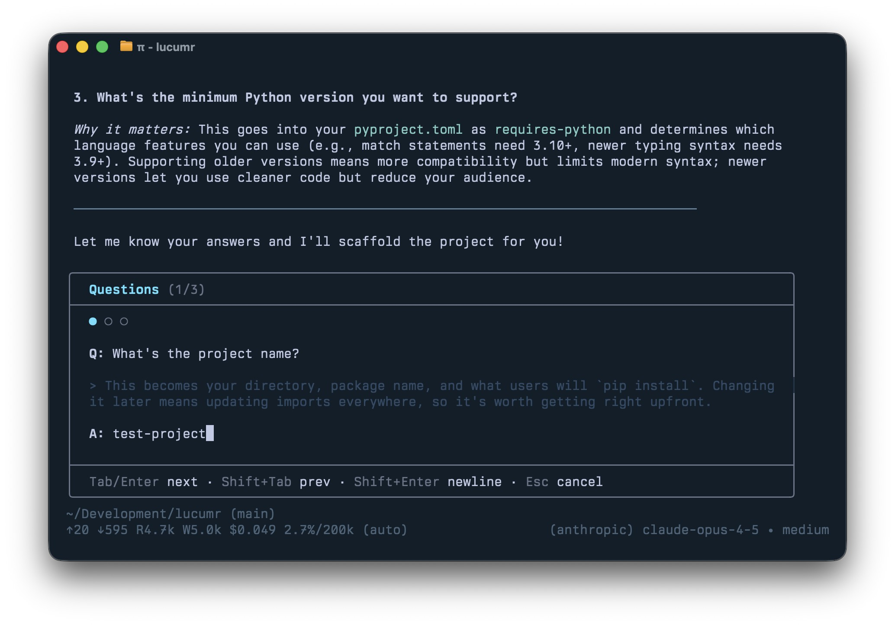
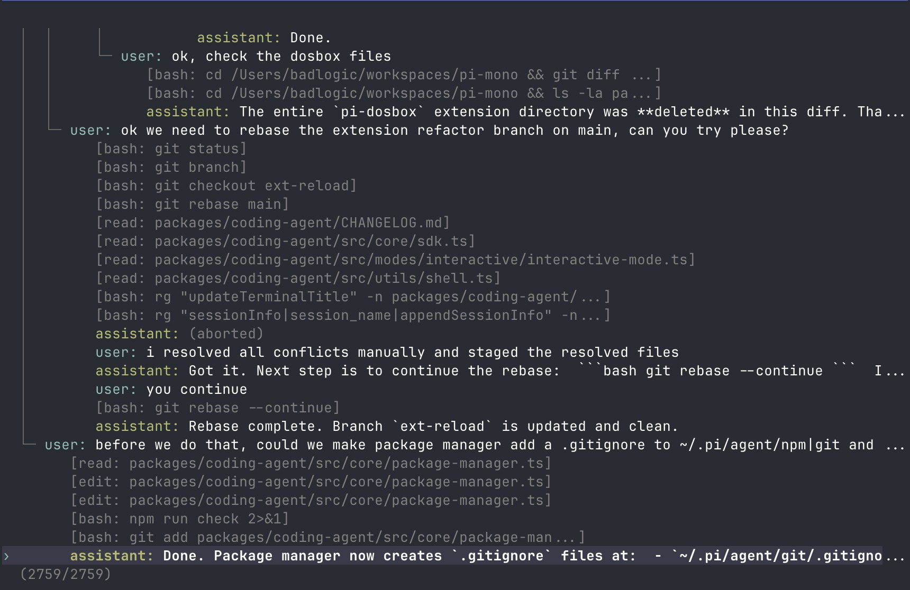
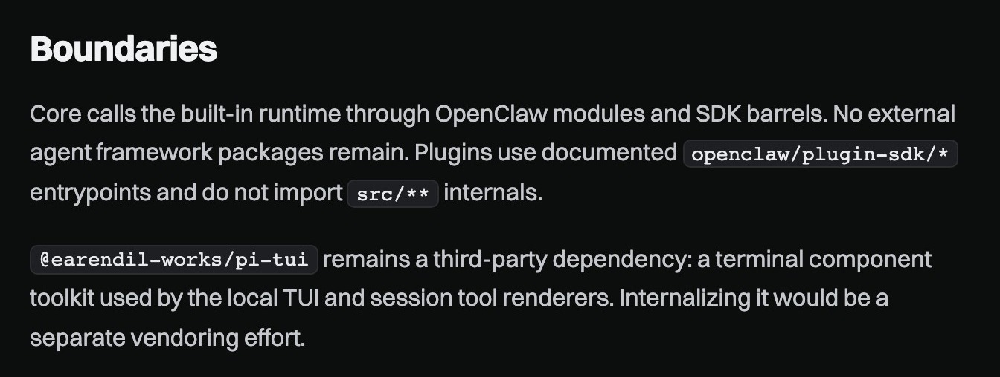

# 3分钟搞懂Pi

> ⭐⭐中级 · 阅读时间 3分钟 · 更新于 2026-11-15
>
> Pi 是 Mario Zechner 写的开源编程 Agent，默认只给模型读、写、编辑、执行命令 4 个工具，缺的功能让它自己写扩展补上。本文讲清它为什么做减法、1.0 加回 MCP 其实没有违背初衷，以及它和 OpenClaw 现在的关系。

## 一句话定义

**Pi** 是一个开源的命令行编程 Agent：你在终端里交代任务，它会自己读代码、改文件、跑命令，把活干完。和 Claude Code、Codex 这些工具不同的是，Pi 默认只给模型 **4 个工具**：读文件（read）、写文件（write）、编辑文件（edit）和执行命令（bash），子代理、计划模式、权限弹窗这些别家标配的功能，它一个都不内置。你需要什么，就让 Pi 自己写一个扩展装上。

Pi 的作者是 **Mario Zechner**，他更早的作品是开源游戏框架 libGDX。2026 年 4 月，Pi 被 Armin Ronacher（Python 框架 Flask 的作者）参与创办的公司 **Earendil** 收购，Mario 也加入了这家公司，代码仍然是 MIT 协议开源。现在 Pi 的仓库地址是 earendil-works/pi，截止目前有 12 万多颗 star，现在每周有几十万人都在用它。

需要注意的是，名字叫 Pi 的 AI 产品不止一个。Inflection AI 在 2023 年推出过一个同名的聊天机器人，和这里说的编程 Agent 没有关系。搜教程时认准官网 pi.dev 和上面的仓库地址。

## 只给 4 个工具，真的够用吗？

Mario 在 2025 年 11 月写过一篇长文，解释 Pi 为什么这样设计。他的判断是：现在的大模型已经被大量训练过怎么用命令行，**会用 bash，就几乎什么都能做**。查找文件可以用 `find`，搜索代码可以用 `grep`，跑测试、装依赖、看 git 记录也都是一条命令的事，没必要每件事都单独做一个工具。

工具少带来的直接好处是**上下文干净**。上下文就是每次请求时发给模型的全部内容，包括系统提示词、工具说明和对话历史，它越长，花的钱越多，模型也越容易被无关信息干扰。Mario 给的数字是，Pi 的系统提示词加上 4 个工具的说明，一共不到 1000 个 token。作为对比，他统计过两个常用的 MCP 服务：Playwright 的 MCP 有 21 个工具，说明文字约 1.37 万 token；Chrome DevTools 的 MCP 有 26 个工具，约 1.8 万 token。也就是说，**还没开始干活，光是装上这两个服务，就先占掉了上下文窗口的 7% 到 9%**。

这有点像你请一位有经验的装修师傅来家里干活：你只需要告诉他工具箱放在哪，不用每次进门先给他念一遍几十页的电钻说明书。他本来就会用，念多了反而耽误事。

Pi 也带了 `grep`、`find`、`ls` 这几个只读工具，只是默认关着。当你只想让它看、不想让它动手时，可以这样启动：

```bash
# 只给它读和搜索的工具, 它就改不了任何文件
pi --tools read,grep,find,ls
```

当然，这套思路依赖模型本身足够强。模型越小，越需要工具和提示词替它把路铺好，**同样只给 4 个工具，强模型能干完的活，小模型可能会在第几步就迷路**。

## 别家标配的功能，Pi 怎么替代？

Pi 不内置的功能，不是因为没想到，而是 Mario 认为这些功能放进 Agent 里，会让模型多一份要记住的状态，或者让你看不清它在干什么。他给每一项都提供了替代做法：

| 别家常见的功能 | Pi 的做法 |
|---|---|
| 计划模式 | 让它把计划写进 `PLAN.md`，你和它都能改，换个会话也能接着用；需要的话用 `--tools` 只给读工具 |
| 待办清单 | 用一个带勾选框的 `TODO.md` 文件代替，不让模型在脑子里记状态 |
| 子代理 | 需要另起一个干净的上下文时，让它用 `pi --print` 调用自己，结果你能直接看到 |
| 后台运行命令 | 用 tmux（一个终端分屏工具）跑长时间的进程，你和 Agent 可以在同一个窗口里看日志 |
| 动手前的权限确认 | 不做，默认全部放行，需要隔离就放进容器里跑 |

这张表里，子代理那一行最能体现 Pi 的想法。很多工具的子代理是一个黑盒：主 Agent 把任务派出去，子代理翻了哪些文件、为什么得出这个结论，你都看不到。Mario 的建议是，如果你需要先调研再动手，就单独开一个会话把调研结果写成文件，再在新会话里让它读这份文件。这样多了一步，但每一步你都看得见。

在需要的项目里，你可以把计划和规矩写进 `AGENTS.md`，Pi 每次启动都会读取它；如果项目里只有给 Claude Code 写的 `CLAUDE.md`，那么它也会读这个文件。

## 缺什么功能，就让它自己写

Pi 的 README 里有一句话：「Ask Pi to build what you want」，意思是你想要什么功能，就让 Pi 帮你写出来。它的扩展方式有四种：

- **扩展（Extensions）**：用 TypeScript 写的模块，能注册新工具、新的斜杠命令，也能拦截和修改工具调用。比如在执行 `rm -rf`、`sudo` 之前先弹窗确认，或者禁止它写 `.env` 和 `node_modules/`，这些都是官方文档里举的例子；
- **技能（Skills）**：用 `SKILL.md` 描述某件事该怎么做，平时只占一行说明，用到时才把完整内容读进来；
- **提示词模板**：把常用的长提示词存起来，输入一个命令就能展开；
- **主题**：改终端界面的配色。

这些东西可以打包成 **Pi 包**，通过 npm 或 git 分享给别人，安装只要一条命令：

```bash
pi install npm:@example/pi-tools@1.0.0
pi install git:github.com/example/pi-tools@v1
```

真正让 Pi 和其他工具拉开差距的，是**扩展可以热重载**。扩展放在 `~/.pi/agent/extensions/` 或者项目的 `.pi/extensions/` 目录里，改完之后输入 `/reload` 就能生效，不用重启。再加上 Pi 自带了扩展的文档和示例代码，它可以自己写一个扩展、重载、试一下、发现问题再改，直到扩展能用为止。


*图注：Pi 官方文档里的终端界面截图。用户输入的任务是「写一个扩展，跟用户说 Hi 加上名字」，Pi 没有直接动手，而是先读了自带的扩展文档 docs/extensions.md，又用一条 find 命令看了项目里有哪些文件，然后接着读文档的后半部分。上方的 [Context]、[Skills]、[Extensions] 列出了这次启动加载的说明文件、技能和扩展；最下面一行是用掉的 token、花费和上下文占比，右下角是当前用的模型。截图里的版本号是 v0.85.1，是收购后 1.0 之前的版本。*

Armin Ronacher 在 2026 年 1 月的博客里，列出了他让 Pi 给自己写的几个扩展：`/answer` 会把 Agent 上一条回复里提的问题挑出来，放进输入框让他逐个回答，他用这个代替计划模式；`/review` 会另开一个分支，用干净的上下文审查 Agent 刚写的代码；`/todos` 则用 `.pi/todos` 目录下的 Markdown 文件管理待办，他和 Agent 都能改。这些功能在别的工具里要等官方排期，在 Pi 里，说一句话就能有。


*图注：Armin Ronacher 博客里 /answer 扩展的截图。上半部分是 Agent 回复里提的问题（这里是第 3 个问题：要支持的最低 Python 版本），下面的「Questions (1/3)」对话框是扩展把这些问题挑出来后生成的，用户逐个填写答案，按 Tab 或回车切到下一题。*

## 会话是一棵树，走错了可以回到岔路口

大多数编程 Agent 的对话是一条直线：聊到一半发现方向错了，要么在后面接着纠正，要么清空重来。Pi 把会话存成一棵**树**，每条消息都记着它的上一条是谁。

这样做的好处是，当它走进死胡同时，你可以输入 `/tree` 回到之前任意一条消息，换个说法重新发出去，原来那条路不会被删掉，还留在同一个会话文件里。离开一条分支时，Pi 还可以把这条分支做了什么总结成几句话，带到新分支里，这样**试错的经验留下了，试错过程中的几十条消息不会占用上下文**。


*图注：Pi 官方文档里的 /tree 截图，内容是 Mario 开发 Pi 本身时的一段会话。左侧的竖线和拐角表示分支：同一个会话里，先后在不同的位置分出了几条路，比如一条去检查 dosbox 扩展的文件，一条去做 rebase。每条 user 是用户的消息，assistant 是 Pi 的回复，方括号里是它调用过的工具（bash、read、edit）。底部的 2759/2759 表示这个会话一共有 2759 条记录，当前在最后一条。*

和分支相关的命令有三个：

| 命令 | 作用 |
|---|---|
| `/tree` | 在当前会话里跳到之前的某条消息，从那里开一个新分支 |
| `/fork` | 从之前的某条消息开始，复制出一个新的会话 |
| `/clone` | 把当前这条分支整个复制成一个新会话 |

Armin 举过一个实际的用法：他发现某个扩展有 bug，就开一个旁支让 Pi 去修，修好之后回到主分支，让 Pi 把旁支的结果总结一下，主任务的上下文里不会混进修 bug 的过程。

另外，一个会话里可以随时用 `/model` 切换模型，比如先用 Claude 做规划，再换成便宜的模型写代码，前面的对话历史会一起带过去。Pi 内置了几十家模型服务商，国内的 DeepSeek、智谱（Z.AI 的 Coding Plan 国内版）、Kimi For Coding、MiniMax、千问的 Token Plan、小米 MiMo 都在列表里；本地的 Ollama、LM Studio、vLLM，只要在 `models.json` 里填上对应模型的接口地址就能用。

## 1.0 加回了 MCP，算不算打脸？

被收购后，Pi 在 2026 年 10 月 1 日发布了 1.0 版本。这个版本最受关注的变化，是**加上了 MCP 支持**，也就是 Mario 在 2025 年那篇文章里明确拒绝过的东西。The Register 当时的标题就叫「Pi 来了个 180 度大转弯」。

但仔细看 1.0 的实现方式，会发现它并没有违背当初的理由。Mario 反对的从来不是 MCP 本身，而是**把几十个工具的说明一股脑塞进上下文**。1.0 的做法是新增了一个叫 **Codemode** 的工具：

1. 模型不再直接看到每个 MCP 工具的说明，MCP 工具默认是「延迟加载」的，只在需要时才去查找；
2. 模型想用这些工具时，写一段 JavaScript 脚本，在脚本里调用工具、并行发出请求、过滤结果；
3. 脚本在一个隔离的 JavaScript 环境（QuickJS）里运行，**最后只有脚本的输出会进入上下文**，中间几千行的原始数据模型都看不到。

举个例子，如果你让它统计这一周的提交记录，模型不需要把每条提交都读进上下文，而是写一段脚本把它们取回来、分好类、算好数，最后只把一张汇总表交给自己。


所以更准确的说法是：Pi 换了一种不占上下文的方式接入 MCP。Earendil 给出的理由是，MCP 这一年改进了不少，而 Pi 需要的东西和 MCP 一样，都是「一个可以随便折腾的解释器沙箱」。

Codemode 默认是关着的，加上 `--tools +codemode` 或者在设置里把它加进默认工具就能开启。1.0 还带来了 Anthropic 模型的缓存预热、全屏终端界面，以及一个独立的实验性项目 **Pi Durable**，用来搭建需要长时间运行、能从不同入口访问的 Agent 应用。Earendil 特意把它做成了单独的包，没有塞进 Pi 本身，理由还是那一条：保持核心足够小。

## 它和 OpenClaw 是什么关系？

**OpenClaw** 是 2026 年初爆红的个人 AI 助手，前身叫 Clawdbot、Moltbot，你可以在 Telegram、WhatsApp 这些聊天软件里给它发消息，让它替你干活。它在早期确实是**基于 Pi 搭起来的**：Armin 在 1 月的博客里写道，OpenClaw 底层用的就是 Pi，Mario 自己的 Slack 机器人和 Armin 的 Telegram 机器人也是这样做的。这也是 Pi 被很多人知道的原因。

能这样用，是因为 Pi 不只是一个命令行工具，而是拆成了几个可以单独使用的库：

| 包 | 作用 |
|---|---|
| pi-ai | 统一的模型接口，用同一套代码调用 OpenAI、Anthropic、Google 等服务商 |
| pi-agent-core | Agent 的循环逻辑，负责调用模型、执行工具、管理状态 |
| pi-tui | 终端界面组件库 |
| pi-coding-agent | 也就是你平时用的 `pi` 命令行工具 |

OpenClaw 的作者 Peter Steinberger 在 2026 年 2 月加入了 OpenAI，OpenClaw 则交给一个独立的基金会，继续开源维护。之后 OpenClaw 逐步把 Agent 的核心换成了自己写的 `@openclaw/agent-core`。截止目前，OpenClaw 官方文档的说法是「已经没有外部的 Agent 框架依赖」，只保留了 Pi 的终端界面组件库 pi-tui，以前配置里写的 `pi` 运行时，现在会被自动当成 OpenClaw 自己的运行时。


*图注：OpenClaw 官方文档「Agent runtime architecture」页面的 Boundaries 一节，截至写这篇时的内容。第一段的「No external agent framework packages remain」意思是已经没有外部的 Agent 框架依赖；第二段说 @earendil-works/pi-tui 还是一个第三方依赖，它是本地终端界面用的组件库，要把它也换成自己的，需要另外再做。*

所以现在说 Pi 是「OpenClaw 的底层引擎」已经不准确了，更准确的说法是：**OpenClaw 是在 Pi 上长出来的，后来把核心搬回了自己家**。这个结果其实也说明了 Pi 的定位：它就是给你拿去改、拿去拆的，用成自己的样子之后，要不要继续依赖它，由你自己决定。

## 用之前要想清楚的几件事

### 它不会替你拦住任何操作

Pi 的官方文档写得很清楚：Pi **没有内置的权限系统**，它执行的命令拥有和你本人一样的权限，能读写你电脑上能访问的所有文件，也能联网。它不会在每次调用工具前问你，文档还特别提醒，盯着屏幕看、审查改动，都不算安全边界。

Mario 的观点是，别家的权限弹窗大多是「安全表演」，只要一个 Agent 同时能读数据、执行代码、访问网络，就不可能真正防住。所以如果你要让它处理来路不明的仓库，或者长时间无人看管地运行，官方给了三种隔离方式：用 Gondolin 扩展把工具调用放进本地的 Linux 小虚拟机里执行；把整个 Pi 放进 Docker 容器；或者用 OpenShell 这类带策略控制的沙箱。如果你只是在自己的项目里用，至少要保证代码都提交到了 git，改坏了能回退。

还有一个细节：项目目录里的 `.pi/extensions` 这类扩展是可以执行代码的，所以 Pi 第一次在某个目录里发现它们时，会先问你信不信任这个项目。但 `AGENTS.md`、`CLAUDE.md` 这类说明文件**不管你选不选信任都会被读取**，如果你克隆了别人的仓库，最好先看一眼里面写了什么，防止有人在里面藏指令。

### 它更适合愿意折腾的人

Pi 的极简是有代价的：开箱即用的体验不如 Claude Code、Cursor 完整，很多功能需要你自己装包或者让它写。如果你希望装上就能用、不想管配置，Claude Code、Codex 或者 OpenCode 会更省心。

反过来，如果你遇到下面这些情况，Pi 值得一试：

- 你经常同时用好几家的模型，想在一个会话里随时切换；
- 你对别家工具里塞进上下文的内容不放心，想清楚地知道每次发给模型的是什么；
- 你想在自己的产品里嵌入一个 Agent，需要一套能拆开用的库（Pi 还提供了 RPC 模式和 TypeScript SDK）；
- 你有一套自己的工作习惯，想让工具适应你，而不是反过来。

安装需要 Node.js 22.19 或更高版本，官方的安装脚本会自动处理：

```bash
# macOS、Linux
curl -fsSL https://pi.dev/install.sh | sh

# Windows PowerShell
powershell -c "irm https://pi.dev/install.ps1 | iex"
```

装好后进入项目目录输入 `pi`，再用 `/login` 登录模型服务商或者填入 API Key，就可以开始交代任务了。

## 时效性提醒

- **版本**：Pi 更新很快，1.0 之后一个多月就到了 1.5，命令和默认设置都可能调整，以官方文档为准；
- **安装方式**：npm 包名已经从 `@mariozechner/pi-coding-agent` 换成了 `@earendil-works/pi-coding-agent`，网上的早期教程里还是旧包名，照着装会装到停更的旧版本；
- **和 OpenClaw 的关系**：OpenClaw 迁移到自研核心的过程官方没有公布具体时间，现在只保留了 pi-tui 一个依赖，后续是否完全移除还不确定；
- **模型服务商**：内置的服务商列表和价格会随着新模型发布变化，可以在 pi.dev/models 查看最新的。

**建议**：

- 官网和文档：https://pi.dev
- GitHub 仓库：https://github.com/earendil-works/pi

💬 **互动话题**：如果只给你的编程 Agent 留 4 个工具，你觉得哪个功能是你最离不开、一定会自己装回去的？是计划模式、子代理，还是动手前的权限确认？

📖 **相关阅读**：

- [3分钟搞懂Harness](../../09-agent-engineering/07-harness/README.md) - Pi 自称「Agent Harness」，先弄懂 Harness 指的是什么
- [3分钟搞懂上下文工程](../../09-agent-engineering/03-context-engineering/README.md) - Pi 做减法，本质上是在管上下文里放什么
- [3分钟搞懂OpenClaw](../../10-ai-agent-products/01-openclaw/README.md) - 在 Pi 上长出来的个人 AI 助手
- [3分钟搞懂Claude Code](../06-claude-code/README.md) - 功能齐全、权限模式更细的编程 Agent，可以和 Pi 对照着看
- [3分钟搞懂OpenCode](../08-opencode/README.md) - 同样能接多家模型的开源编程 Agent，开箱功能更完整
- [3分钟搞懂MCP](../../01-basics/08-mcp/README.md) - Pi 1.0 加回来的那个工具连接协议
- [3分钟搞懂Skills](../../09-agent-engineering/04-skills/README.md) - 用 SKILL.md 给 Agent 装上做事方法，Pi 也支持
- [3分钟搞懂Agent沙箱与权限](../../09-agent-engineering/08-sandbox-and-permissions/README.md) - 没有权限系统的 Agent，该怎么隔离

**资料来源**：

- Pi GitHub 仓库（MIT 协议、包结构、安装方式、权限与容器化说明、star 数 2026-11-15 查询）：https://github.com/earendil-works/pi
- Pi 官方文档，CLI（默认工具 read/bash/edit/write、只读工具、Codemode 开启方式）：https://github.com/earendil-works/pi/blob/main/packages/coding-agent/docs/cli.md
- Pi 官方文档，Usage（文中「Pi 读文档写扩展」截图出处）：https://github.com/earendil-works/pi/blob/main/packages/coding-agent/docs/usage.md
- Pi 官方文档，Extensions（扩展能力、权限确认和路径保护示例、/reload 热重载）：https://github.com/earendil-works/pi/blob/main/packages/coding-agent/docs/extensions.md
- Pi 官方文档，Packages（pi install 安装方式）：https://github.com/earendil-works/pi/blob/main/packages/coding-agent/docs/packages.md
- Pi 官方文档，Sessions（/tree、/fork、/clone 与分支总结；文中 /tree 截图出处）：https://github.com/earendil-works/pi/blob/main/packages/coding-agent/docs/sessions.md
- Pi 官方文档，Codemode 与 MCP（QuickJS 沙箱、延迟加载）：https://github.com/earendil-works/pi/blob/main/packages/coding-agent/docs/codemode.md
- Pi 官方文档，Security（没有权限系统、项目信任、AGENTS.md 不受信任设置限制）：https://github.com/earendil-works/pi/blob/main/packages/coding-agent/docs/security.md
- Pi 官方文档，Providers 与 Models（内置服务商、本地模型接入）：https://github.com/earendil-works/pi/blob/main/packages/coding-agent/docs/providers.md
- Pi GitHub Releases（v1.5.2，2026-11-10）：https://github.com/earendil-works/pi/releases
- Mario Zechner，What I learned building an opinionated and minimal coding agent（2025-11-30，4 个工具、系统提示词不到 1000 token、MCP 的 token 开销、不做子代理和计划模式的理由）：https://mariozechner.at/posts/2025-11-30-pi-coding-agent/
- Armin Ronacher，Pi: The Minimal Agent Within OpenClaw（2026-01-31，OpenClaw 基于 Pi、会话树和自写扩展的例子；文中 /answer 扩展截图出处）：https://lucumr.pocoo.org/2026/1/31/pi/
- Armin Ronacher，Mario and Earendil（2026-04-08，Mario 加入 Earendil、Pi 转由 Earendil 维护）：https://lucumr.pocoo.org/2026/4/8/mario-and-earendil/
- Earendil，Pi 1.0（2026-10-01，新功能列表、Pi Durable、每周使用人数）：https://earendil.com/posts/pi-1-0/
- The Register，Pi coding agent pulls a 180 and adds MCP support（2026-10-02）：https://www.theregister.com/ai-and-ml/2026/10/02/pi-coding-agent-pulls-a-180-and-adds-mcp-support/5300678
- OpenClaw 官方文档，Agent runtime architecture（@openclaw/agent-core、仅保留 pi-tui 依赖、pi 运行时别名；文中 Boundaries 截图出处，2026-11-15 截取）：https://docs.openclaw.ai/agent-runtime-architecture
- Help Net Security，OpenClaw creator Peter Steinberger joins OpenAI（2026-02-16）：https://www.helpnetsecurity.com/2026/02/16/openclaw-creator-peter-steinberger-joins-openai/

---

⬅️ 上一篇：[3分钟搞懂OpenCode](../08-opencode/README.md) ｜ [📚 返回目录](../README.md) ｜ 下一篇：[3分钟搞懂Hugging Face](../10-hugging-face/README.md) ➡️
