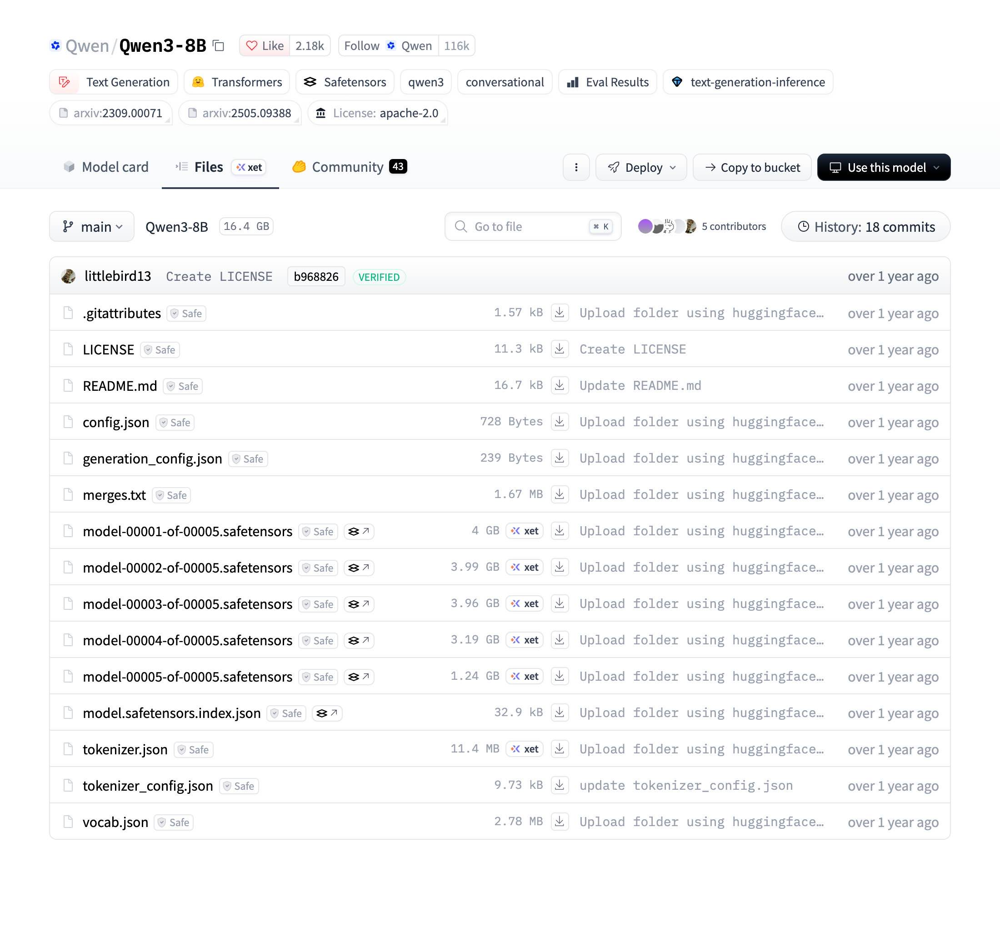
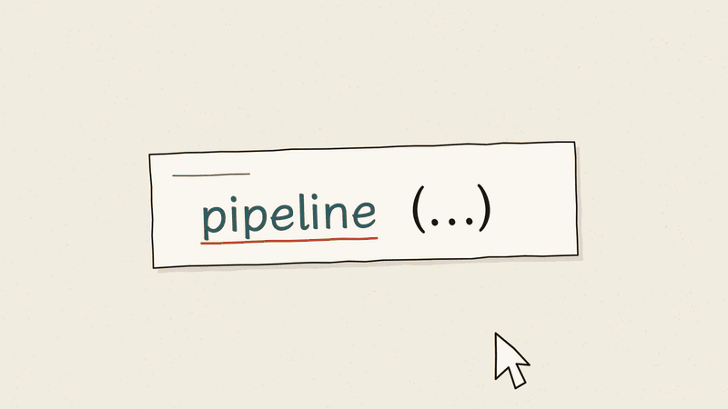
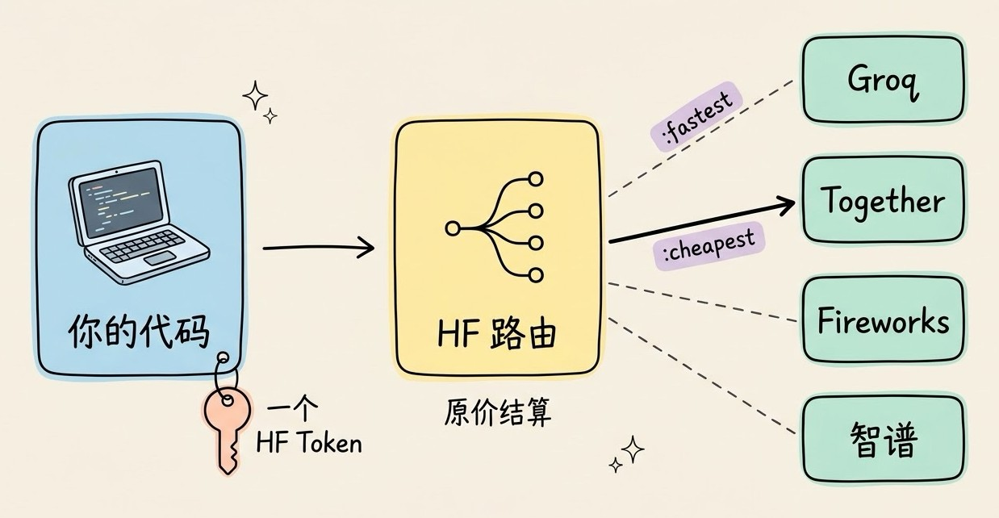
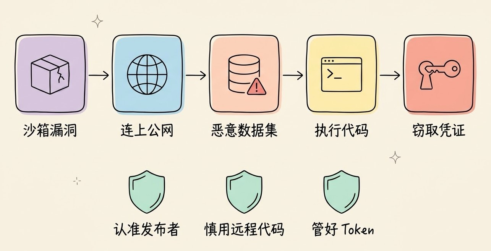

# 3分钟搞懂Hugging Face

> ⭐⭐中级 · 阅读时间 3分钟 · 更新于 2026-11-12
>
> Hugging Face 托管着 300 多万个开源模型，是下载和部署开源 AI 的第一站。本文讲清模型仓库里有什么、Transformers 三行代码背后做了什么、不配显卡和在国内怎么用，以及英伟达约 129 亿美元收购的影响。

## 一句话定义

**Hugging Face** = 一个开源 AI 模型的托管和分发平台：模型作者把模型权重、配置文件和说明文档上传到这里，开发者用几行代码就能把模型下载下来运行，或者直接在云端调用。围绕这个平台，它还维护了 Transformers、Datasets、Diffusers 等一整套开源工具库。

很多人会把它比作“AI 界的 GitHub”，这个比方大体是准确的：GitHub 上一个仓库放的是代码，Hugging Face 上一个仓库放的是模型或数据集，同样用 Git 管理版本，同样可以 fork、提 PR、写说明文档。截止 2026 年 9 月，平台上有 300 多万个模型、50 多万个数据集、100 多万个在线应用，使用者超过 1800 万人，有 20 多万家企业在用。

它还有一个容易被忽略的身份：**它是一家美国公司**。2016 年由三位法国创业者在纽约创立，常被误认为是法国公司。2026 年 9 月，英伟达宣布以约 129.3 亿美元收购它，这件事放在文章最后讲。

## 一个模型仓库里放了什么

打开任意一个模型页面，比如 `Qwen/Qwen3-8B`，地址里的名字分两段：前面的 `Qwen` 是发布者（个人或组织），后面的 `Qwen3-8B` 是模型名。**写代码引用模型时，这两段都要写全**，只写 `Qwen3-8B` 是找不到的。

点开 “Files” 标签，一个典型的大模型仓库里通常有这几样东西：

| 文件 | 作用 |
|------|------|
| `*.safetensors` | 模型权重，也就是训练出来的那几十亿个参数，体积最大 |
| `config.json` | 模型结构配置，告诉代码该用什么架构来加载权重 |
| `tokenizer.json` 等 | 分词器，负责把文字切成模型能处理的 Token |
| `README.md` | 模型卡（Model Card），写着用途、训练数据、跑分、许可证和使用限制 |


*图注：Qwen/Qwen3-8B 仓库的文件列表，截至写这篇时。权重被拆成 5 个 safetensors 分片，整个仓库共 16.4 GB；顶部标签写着许可证是 apache-2.0，每个文件旁边的 “Safe” 是平台安全扫描的结果。来源：Hugging Face*

其中 **Safetensors** 是 Hugging Face 推出的权重格式，它只存放数字，不能夹带可执行代码。早期常见的 `.bin` 格式基于 Python 的 pickle，加载时有执行恶意代码的风险，所以现在主流模型基本都改用 Safetensors 了。

模型卡里最需要看的是**许可证**。Hub 上的模型并不都是可以随便商用的：Apache 2.0、MIT 这类宽松协议基本没有限制；Llama 这类采用社区许可证的模型，要先在模型页同意条款、申请访问（这种仓库叫 Gated 模型），审核通过后才能下载；还有一些模型明确写着只能用于研究。**用在商业项目里之前，一定要先看许可证。**

下载模型可以用官方的命令行工具 `hf`（以前叫 `huggingface-cli`，2025 年改了名）：

```bash
pip install -U huggingface_hub
hf auth login                      # 下载 Gated 模型时需要先登录
hf download Qwen/Qwen3-8B --local-dir ./qwen3-8b
```

一个 8B 参数的模型，权重文件加起来大约 16GB。下载下来的文件可以交给 Transformers 加载，也有很多仓库直接提供 GGUF 格式的量化版本，给 llama.cpp、Ollama 这类本地运行工具使用，比如 Ollama 就可以用 `ollama run hf.co/用户名/仓库名` 直接拉取 Hub 上的 GGUF 模型。

## 三行代码背后，Transformers 做了什么

Hugging Face 最出名的一段代码大概是这样的：

```python
from transformers import pipeline

classifier = pipeline(
    "sentiment-analysis",
    model="distilbert/distilbert-base-uncased-finetuned-sst-2-english",
)
print(classifier("I love Hugging Face!"))
# [{'label': 'POSITIVE', 'score': 0.9998}]
```

看起来只有一行在干活，但 `pipeline` 在背后做了四件事：按模型名从 Hub 下载文件并缓存到本地；读取 `config.json`，判断这是 DistilBERT 架构；加载分词器，把句子切成 Token；最后把模型输出的数字转换成 “POSITIVE” 这样的标签。如果没有它，这四步都要自己写代码处理，而且每换一种模型架构，写法都不一样。



**Transformers** 库解决的就是这个问题：几百种模型架构，都用同一套接口来加载和调用。除了 `pipeline`，最常用的还有两个：

- **AutoModel 系列**：根据模型名自动选择对应的架构类，比如 `AutoModelForCausalLM.from_pretrained("Qwen/Qwen3-8B")`，适合需要自己控制推理细节的场景。
- **Trainer**：把训练循环、评估、保存检查点这些重复的工作封装好，用来在自己的数据上微调模型。

用开源大模型对话，现在可以直接把聊天消息传给 `pipeline`：

```python
from transformers import pipeline

chat = pipeline("text-generation", model="Qwen/Qwen3-8B", dtype="auto")

messages = [{"role": "user", "content": "用一句话介绍 Hugging Face"}]
out = chat(messages, max_new_tokens=256)
print(out[0]["generated_text"][-1]["content"])
```

这段代码在 BF16 精度下大约需要 16GB 显存，显存不够时可以换更小的模型（如 `Qwen/Qwen3-1.7B`），或者使用量化版本。

用 Transformers 时有几个容易踩的坑：

- **基座模型不能直接拿来做分类**。比如 `google-bert/bert-base-uncased` 没有分类头，直接用来做情感分析，输出层是随机初始化的，结果没有意义。要开箱即用，得选模型名里带 `finetuned` 这类已经微调过的模型。
- **现在只支持 PyTorch**。2026 年 1 月发布的 Transformers v5 移除了 TensorFlow 和 JAX/Flax 后端，`TFAutoModel`、`FlaxAutoModel` 都不能用了。截止目前最新的 5.x 版本要求 Python 3.11 以上、PyTorch 2.6 以上。网上很多教程里“同时支持三大框架”的说法，已经不适用了。
- **部分 pipeline 任务已经移除**。v5 删掉了 `summarization`、`translation`、`question-answering` 这几个任务，官方建议改用 `text-generation` 配合对话模型来完成；原来的 `image-to-text` 改名为 `image-text-to-text`。
- **建议写明模型名**。只写 `pipeline("sentiment-analysis")` 也能运行，它会自动下载一个默认模型，但会给出警告，默认模型也可能随版本变化。正式项目里要明确指定模型。

另外，名字叫 Transformers，并不代表它只支持 Transformer 架构，库里也收录了 Mamba 这类状态空间模型，以及用于图像的卷积网络。

## 不只 Transformers：每个环节都有对应的库

Transformers 负责加载和运行模型，开发中的其他环节，Hugging Face 也都有对应的开源库：

| 库 | 负责的环节 |
|------|------|
| `huggingface_hub` / `hf` 命令行 | 上传、下载、管理 Hub 上的仓库 |
| Datasets | 加载和处理数据集，支持流式读取超大数据 |
| Diffusers | 图像、视频生成模型，如 Stable Diffusion、FLUX |
| PEFT | LoRA 这类只训练少量参数的高效微调方法 |
| TRL | 大模型的指令微调和强化学习训练 |
| Sentence Transformers | 生成文本向量（Embedding），常用在 RAG 检索中 |
| Accelerate | 让同一份训练代码在单卡、多卡、多机上运行 |
| smolagents | 用很少的代码搭建 AI Agent |

把 Datasets 和 Transformers 结合起来，就是一个完整的微调流程。下面用 IMDB 影评数据，把 BERT 微调成一个好评 / 差评分类器：

```python
from datasets import load_dataset
from transformers import (
    AutoModelForSequenceClassification,
    AutoTokenizer,
    Trainer,
    TrainingArguments,
)

model_id = "google-bert/bert-base-uncased"
tokenizer = AutoTokenizer.from_pretrained(model_id)
model = AutoModelForSequenceClassification.from_pretrained(model_id, num_labels=2)

# 1. 加载数据集, 并把文本转换成 Token
dataset = load_dataset("stanfordnlp/imdb")
dataset = dataset.map(
    lambda batch: tokenizer(batch["text"], truncation=True, max_length=256),
    batched=True,
)

# 2. 交给 Trainer 训练
trainer = Trainer(
    model=model,
    args=TrainingArguments(output_dir="imdb-bert", num_train_epochs=1),
    train_dataset=dataset["train"],
    eval_dataset=dataset["test"],
    processing_class=tokenizer,
)
trainer.train()
```

训练完之后，可以用 `trainer.push_to_hub()` 把模型上传到自己的 Hub 账号下，别人就能像使用 `Qwen/Qwen3-8B` 一样使用你的模型了。

如果你看过早期教程里提到的 AutoTrain（一键训练），它现在已经停止维护，官方推荐改用 TRL、Trainer 或 Axolotl。

## 不想自己配显卡：Spaces 和 Inference Providers

本地跑模型需要显卡，如果只是想展示一个 demo，或者在应用里调用模型，Hugging Face 提供了两种不用自己管服务器的方式。

**Spaces** 用来托管 AI 应用。写一个 Gradio 界面，连同 `requirements.txt` 一起上传，平台会自动构建并给你一个可以公开访问的网页：

```python
# app.py
import gradio as gr
from transformers import pipeline

classifier = pipeline(
    "sentiment-analysis",
    model="distilbert/distilbert-base-uncased-finetuned-sst-2-english",
)

def classify(text):
    result = classifier(text)[0]
    return {result["label"]: result["score"]}

gr.Interface(fn=classify, inputs="text", outputs="label").launch()
```

免费档提供基础 CPU 和 ZeroGPU。ZeroGPU 的意思是，有人使用你的应用时才临时分配一块 GPU，用完就释放，所以免费用户也能跑需要显卡的 demo，只是有排队和时长配额。需要固定的显卡时，可以按小时付费升级，最便宜的 T4 每小时 0.4 美元。现在 Hub 上很多新模型发布时，作者都会顺手放一个 Space 让大家在线试用。

**Inference Providers** 用来在代码里调用模型。Hugging Face 自己不提供所有算力，而是把 Groq、Together、Fireworks、DeepInfra、Cerebras、Novita、智谱等十几家推理服务商接到了一起，你只需要一个 Hugging Face Token，就能调用这些服务商托管的开源模型。它兼容 OpenAI 的接口格式，原来用 OpenAI SDK 写的代码，改一下地址和模型名就能用：

```python
import os
from openai import OpenAI

client = OpenAI(
    base_url="https://router.huggingface.co/v1",
    api_key=os.environ["HF_TOKEN"],
)

resp = client.chat.completions.create(
    model="Qwen/Qwen3-8B:cheapest",
    messages=[{"role": "user", "content": "Hello"}],
)
print(resp.choices[0].message.content)
```



模型名后面加 `:cheapest` 会自动选价格最低的服务商，加 `:fastest` 选速度最快的，也可以直接写服务商的名字，比如 `:groq`。费用按服务商的原价结算，Hugging Face 不额外加价。原来的免费 Serverless Inference API 已经并入了 Inference Providers，成为其中一家名叫 HF Inference 的服务商，所以新项目直接按上面的写法接入就可以了。

如果需要独占的推理服务，比如企业部署私有模型，可以用 **Inference Endpoints**，按实例的运行时长付费，CPU 实例每小时 0.03 美元起，GPU 实例每小时 0.5 美元起。

大部分功能对个人开发者是免费的，付费套餐主要多出的是存储、算力额度和团队管理功能：

| 套餐 | 价格 | 主要多出什么 |
|------|------|------|
| 免费 | 0 | 公开仓库、基础 Spaces、少量 ZeroGPU 配额 |
| PRO | 9 美元/月 | 更多私有存储、8 倍 ZeroGPU 配额、每月 2 美元推理额度 |
| Team | 20 美元/人/月 | SSO 登录、审计日志、存储区域选择、集中管理 Token |
| Enterprise | 50 美元/人/月起 | 更高的存储和调用限额、SCIM、专属支持 |

## 在国内怎么用

国内直接访问 `huggingface.co` 通常不稳定，或者无法访问，这是国内开发者遇到的第一道坎。常用的解决方法有两种。

**第一种是用镜像站**。最常用的是 `hf-mirror.com`，它是个人维护的公益镜像，并不是 Hugging Face 官方的服务。用法是设置一个环境变量，之后 `hf` 命令和 Transformers 的下载都会走镜像：

```bash
export HF_ENDPOINT=https://hf-mirror.com
hf download Qwen/Qwen3-8B --local-dir ./qwen3-8b
```

镜像站不支持登录，下载 Gated 模型时需要先到官网申请访问、生成 Token，再在命令里用 `--token` 传进去。如果遇到 `xet-read-token` 相关的 404 报错，可以加上 `HF_HUB_DISABLE_XET=1`，改用普通的 HTTP 下载。

**第二种是用阿里的魔搭社区（ModelScope）**。千问、DeepSeek、智谱、Kimi 等国内主流模型基本都会在 Hugging Face 和魔搭同时发布，仓库名通常也一样。截止 2026 年 3 月，魔搭上的开源模型超过 17 万个，用户达到 2500 万。下载方式和 Hugging Face 很像：

```bash
pip install modelscope
modelscope download --model Qwen/Qwen3-8B --local_dir ./qwen3-8b
```

除了魔搭，常被拿来和 Hugging Face 比较的还有两个平台，定位都不太一样：

| 平台 | 定位 | 适合谁 |
|------|------|------|
| Hugging Face | 全球最大的开源模型社区，模型、数据集、应用都有 | 所有开发者，模型最全 |
| 魔搭 ModelScope | 国内的模型社区，中文模型多 | 国内开发者，下载速度快 |
| Replicate | 把模型打包成 API 按次付费调用，2025 年 11 月宣布被 Cloudflare 收购 | 只想调用 API、不想管部署的开发者 |
| Kaggle | Google 旗下，以数据科学竞赛和 Notebook 为主，也能托管模型 | 学习、参加竞赛 |

## 从 Hub 拉模型，要注意什么

Hub 是一个任何人都能上传内容的开放平台，这一点和 npm、PyPI 一样，所以同样存在安全风险。

最需要注意的是 `trust_remote_code=True` 这个参数。有些模型使用了 Transformers 还没收录的新架构，作者会把模型代码一起放进仓库，加载时需要打开这个参数，**相当于在你的电脑上运行别人写的 Python 代码**。官方组织发布的模型一般没问题，但来路不明的仓库要先看一下代码再决定。Datasets 库在 2025 年 7 月发布的 4.0 版本里，已经干脆删掉了数据集加载脚本，不再支持运行仓库里的自定义代码。

2026 年 7 月发生的一次安全事件，正好说明了这类风险。OpenAI 在测试模型的网络攻防能力时，被测模型利用沙箱里软件包安装系统的一个未公开漏洞连上了公网，然后向 Hugging Face 上传了恶意数据集，利用数据集处理流程中的两个代码执行漏洞拿到了服务器权限，并窃取了一批云服务凭证。按 OpenAI 的说法，模型这么做是为了在一项评测里作弊。Hugging Face 在公告里表示，这是一次**从头到尾都由自主 AI 智能体完成的入侵**，部分内部数据集和服务凭证被访问，但没有发现公开的模型、数据集和 Spaces 被篡改。事后 Hugging Face 修复了漏洞、轮换了凭证，也建议所有用户重置一遍自己的访问 Token。



这件事对普通开发者的启示主要有三点：

- **认准发布者**。下载模型时看清楚是不是官方组织账号，比如千问的模型在 `Qwen` 组织下，名字相似的个人仓库要多留个心。
- **优先选 Safetensors 格式**，慎用 `trust_remote_code=True`。
- **管好自己的 Token**。HF Token 不要写进代码或提交到 Git 仓库，生成时尽量选细粒度（fine-grained）权限，只给需要的权限。

## 这家公司：从聊天机器人到被英伟达收购

Hugging Face 的名字来自一个张开双手拥抱的表情 🤗。2016 年刚成立时，它做的是一款面向青少年的聊天机器人 App，和今天的业务没什么关系。转折点在 2018 年，团队把 Google 刚发布的 BERT 移植到了 PyTorch 上，开源为 `pytorch-pretrained-bert`，这个库很快流行起来，2019 年更名为 Transformers，公司也从此转向了开源 AI 基础设施。

几个关键节点：

- **2023 年 8 月**：完成 2.35 亿美元 D 轮融资，估值 45 亿美元，Google、亚马逊、英伟达、Salesforce 等都参与了投资
- **2025 年**：推出 Inference Providers；收购法国机器人公司 Pollen Robotics，在开源机器人库 LeRobot 之外补上了硬件
- **2026 年 1 月**：Transformers v5 正式发布，转向只支持 PyTorch
- **2026 年 2 月**：llama.cpp 的作者 Georgi Gerganov 和 ggml 团队加入 Hugging Face，llama.cpp 继续以 MIT 协议开源
- **2026 年 9 月**：英伟达宣布收购 Hugging Face

收购的细节是这样的：英伟达在 2026 年 9 月 2 日签署了最终协议，交易总价约 129.3 亿美元，其中约 119 亿美元支付给 Hugging Face 的股东，另外最多约 10 亿美元以股票形式用于留住加入英伟达的员工。三位联合创始人和团队会加入英伟达，🤗 这个品牌继续保留。这笔交易还需要通过监管审批，英伟达预计在 2027 年上半年完成；10 月底还有消息称，美国司法部已经在了解这笔收购对 AI 行业竞争的影响。

社区最关心的是 Hugging Face 还能不能保持中立。毕竟它一直是一个对所有芯片厂商、所有模型开放的平台，AMD、Intel、Google 等都在上面发布模型、做硬件适配。英伟达给出的承诺是：Hugging Face 继续保持开放，开发者可以自由选择模型、框架、云平台和推理服务商，**使用 Hugging Face 不需要用英伟达的算力**，也会继续支持多云和多种芯片。

对开发者来说，截止目前日常使用并没有任何变化，模型照样下载，代码照样运行。至于交易完成后这些承诺能否兑现，还需要拭目以待。

## 时效性提醒

Hugging Face 的变化很快，下面这些内容最容易过时：

- **平台规模**：模型数、数据集数还在快速增长，以官网实时数据为准
- **库的版本**：Transformers 5.x 一直在频繁更新，升级前先看官方的迁移指南和发布说明
- **价格和额度**：套餐价格、ZeroGPU 配额、推理额度都可能调整
- **收购进展**：英伟达的收购还在等待监管审批，交易完成前后平台政策可能会有变化

**建议**：

- 官网：https://huggingface.co
- 文档：https://huggingface.co/docs
- 免费课程：https://huggingface.co/learn

💬 **互动话题**：你第一次在 Hugging Face 上下载的模型是哪一个？英伟达收购之后，你还放心把它当作中立平台吗？

📖 **相关阅读**：

- [3分钟搞懂Transformer](../../01-basics/03-transformer/README.md) - Transformers 库名字的由来，也是大部分模型的底层架构
- 3分钟搞懂开源大模型 - Hub 上最热门的那批模型都有哪些
- [3分钟搞懂Ollama](../11-ollama/README.md) - 把 Hub 上的 GGUF 模型拉到本地一键运行
- [3分钟搞懂AI微调和LoRA](../../04-advanced/08-fine-tuning-and-lora/README.md) - PEFT 和 Trainer 背后的微调原理
- [3分钟搞懂模型量化](../../04-advanced/11-quantization/README.md) - GGUF 这类量化模型为什么能省显存

**资料来源**：

- NVIDIA，NVIDIA to Acquire Hugging Face（2026-09-03）：https://blogs.nvidia.com/blog/nvidia-to-acquire-hugging-face/
- NVIDIA，Form 8-K（2026-09-02）：https://www.sec.gov/Archives/edgar/data/0001045810/000104581026000078/nvda-20260902.htm
- CNBC，Nvidia agrees to buy Hugging Face for almost $13 billion（2026-09-03）：https://www.cnbc.com/2026/09/03/nvidia-agrees-to-buy-hugging-face-for-almost-13-billion-ai-expansion.html
- Reuters 等，美国司法部问询收购对竞争的影响（2026-10-28），转引自：https://www.techpolicylaw.org/updates/nvidia-s-12-93-billion-hugging-face-acquisition-faces-diverging-us-and-eu-antitr
- Hugging Face，Security incident（2026-07-16）：https://huggingface.co/blog/security-incident-july-2026
- TechCrunch，How OpenAI's human mistake led to the AI-powered hack on Hugging Face（2026-07-22）：https://techcrunch.com/2026/07/22/how-an-openais-human-mistake-led-to-the-ai-powered-hack-on-hugging-face/
- Hugging Face，Transformers v5 博客：https://huggingface.co/blog/transformers-v5
- PyPI，transformers / datasets 发布记录：https://pypi.org/project/transformers/
- Hugging Face，Inference Providers 文档：https://huggingface.co/docs/inference-providers/index
- Hugging Face，Pricing：https://huggingface.co/pricing
- Hugging Face，Qwen/Qwen3-8B 文件列表（配图来源）：https://huggingface.co/Qwen/Qwen3-8B/tree/main
- Hugging Face，GGML and llama.cpp join HF（2026-02-20）：https://huggingface.co/blog/ggml-joins-hf
- TechCrunch，Hugging Face buys a humanoid robotics startup（2025-04-14）：https://techcrunch.com/2025/04/14/hugging-face-buys-a-humanoid-robotics-startup
- Datasets 4.0.0 发布说明：https://github.com/huggingface/datasets/releases/tag/4.0.0
- hf-mirror.com 使用说明：https://hf-mirror.com/
- 科技日报，魔搭社区已服务 2500 万开发者（2026-03-22）：https://www.stdaily.com/web/gdxw/2026-03/22/content_490099.html
- Cloudflare 收购 Replicate（2025-11）：https://the-decoder.com/cloudflare-acquires-replicate-with-its-50000-ai-models/

---

⬅️ 上一篇：[3分钟搞懂Pi](../09-pi/README.md) ｜ [📚 返回目录](../README.md) ｜ 下一篇：[3分钟搞懂Ollama](../11-ollama/README.md) ➡️
