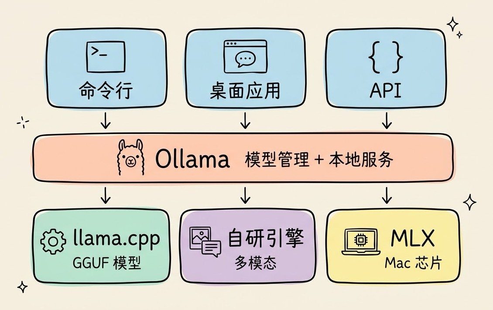
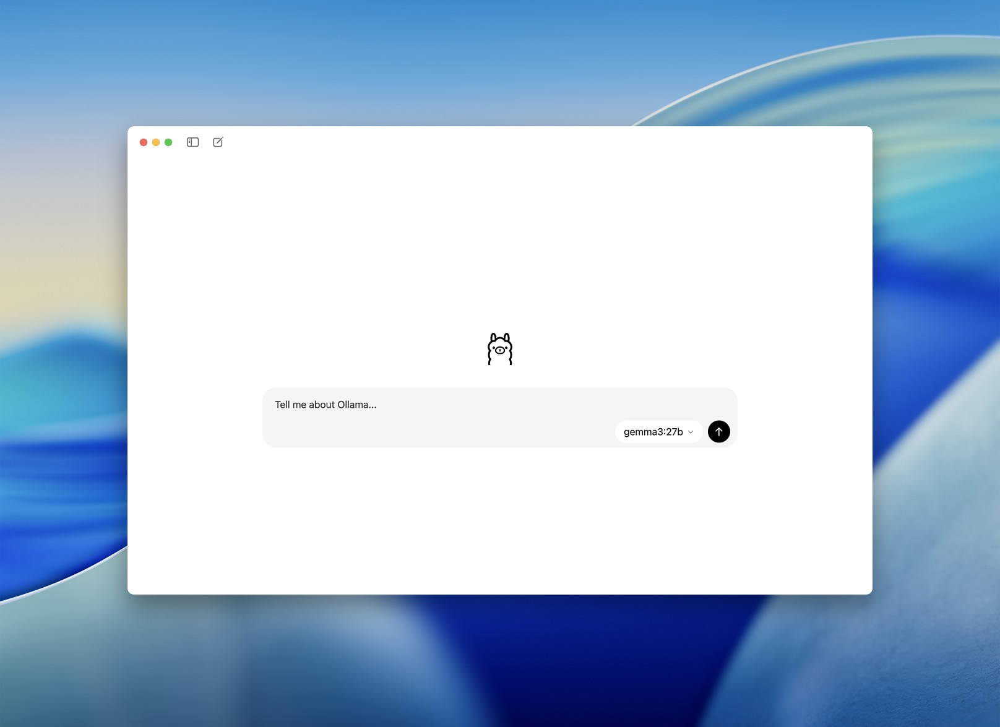
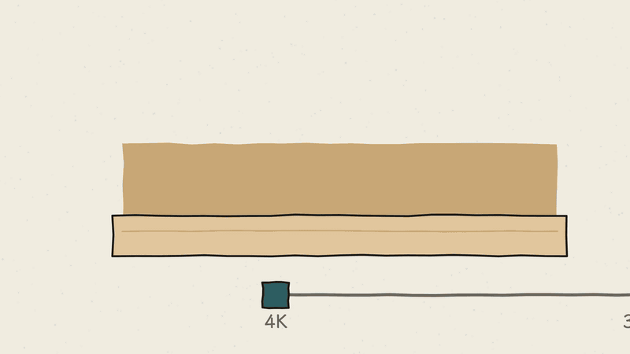
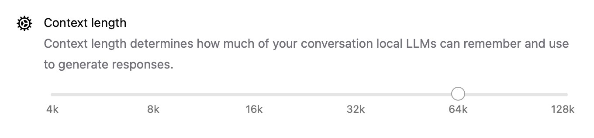
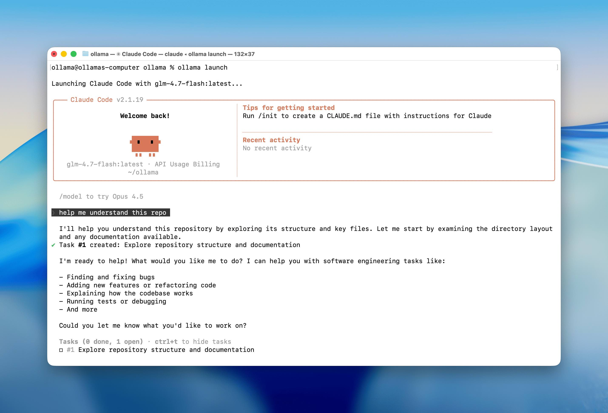

# 3分钟搞懂Ollama

> ⭐⭐中级 · 阅读时间 3分钟 · 更新于 2026-11-12
>
> Ollama 是在自己电脑上运行开源大模型的工具。本文讲清一条命令背后它做了什么、多大内存能跑多大模型、上下文长度这个常见的坑、本地 API 怎么接进代码和 Claude Code，以及云模型收费和端口暴露的安全风险。

## 一句话定义

**Ollama** = 一个在自己电脑上下载、运行和管理开源大模型的工具：一条命令就能把模型拉到本地跑起来，同时在本机开一个 API 服务，让你的代码、编辑器插件或者 Agent 像调用 OpenAI 接口一样去调用它。

举个例子，装好 Ollama 之后，在终端里输入：

```bash
ollama run qwen3.5
```

第一次运行时，它会自动从模型库下载阿里的 Qwen3.5（默认是 9B 版本，大约 6.6GB），下载完直接进入对话。整个过程不需要注册账号，也不需要 API Key，你输入的内容也只在你自己的电脑上处理。

需要注意的是，从 2025 年 9 月开始，Ollama 也提供了跑在它自家数据中心的**云模型**，所以“Ollama 就等于纯本地、完全免费”这个说法，现在已经不完全准确了，后面会专门讲。

## 一条命令背后，Ollama 做了哪几件事？

很多人把 Ollama 叫作“大模型界的 Docker”，这个比方其实很贴切。Ollama 的两位创始人 Jeffrey Morgan 和 Michael Chiang，之前做过 Docker 的图形化管理工具 Kitematic，这个工具在 2015 年被 Docker 收购。所以 Ollama 从一开始就借鉴了 Docker 的思路：模型像镜像一样有名字和标签，用 `pull` 下载、`run` 运行、`rm` 删除。

当你输入 `ollama run qwen3.5` 时，背后其实发生了这几件事：

1. **下载模型**：从 Ollama 的模型库拉取已经压缩好的模型文件。模型库里的模型大多做过**量化**，也就是把模型参数从高精度压缩到 4 位左右，体积能缩小到原来的四分之一左右，普通电脑才放得下。
2. **加载到内存或显存**：自动检测你的硬件，有显卡就用显卡，显存不够就把一部分放到内存里用 CPU 算。
3. **启动本地服务**：在 `127.0.0.1:11434` 上开一个 API 服务，命令行对话、桌面应用和你的代码，都是通过这个服务和模型交互的。
4. **自动卸载**：模型闲置 5 分钟后会自动从内存里卸载，把资源还给其他程序。

日常最常用的几个命令如下：

```bash
ollama run qwen3.5        # 下载(如果没有)并运行模型
ollama pull gemma4        # 只下载, 不运行
ollama list               # 查看已下载的模型
ollama ps                 # 查看正在运行的模型、占用的内存和上下文长度
ollama stop qwen3.5       # 立刻卸载模型, 释放内存
ollama rm gemma4          # 删除模型文件
```

在对话里输入 `/bye` 可以退出，输入 `/set parameter num_ctx 32768` 可以临时调整上下文长度。

**Ollama 底层用的是什么推理引擎？** 早期的 Ollama 主要基于开源项目 llama.cpp，所以很多人说它是“llama.cpp 套了个壳”。但这几年情况已经变了：2025 年 5 月，Ollama 为了更好地支持多模态模型，开始直接基于 llama.cpp 底层的 GGML 张量库写自己的推理引擎；2026 年 9 月发布的 v0.40 版本，在 Apple Silicon 的 Mac 上默认改用苹果的 **MLX** 框架来运行它支持的模型；同时它仍然通过 llama.cpp 来兼容大量 GGUF 格式的模型。所以现在更准确的理解是：**Ollama 是一个整合了多个推理引擎的模型管理和服务层**，你不用关心底层用了哪个引擎，它会自动选择。



关于这家公司，还有几个背景信息：Ollama 是 YC 2021 年冬季批次孵化的公司，项目在 2023 年开源，采用 MIT 协议。2026 年 7 月，它宣布累计融资 8800 万美元，其中最近一轮是 Theory Ventures 等机构参与的 6500 万美元 B 轮。按官方公布的数据，目前有 890 万开发者在使用 Ollama。

## 装好就能用，第一次怎么上手？

### 安装

**macOS 和 Linux**，在终端里执行官方的安装脚本：

```bash
curl -fsSL https://ollama.com/install.sh | sh
```

**Windows**，在 PowerShell 里执行：

```powershell
irm https://ollama.com/install.ps1 | iex
```

不习惯命令行的话，也可以直接去官网下载安装包，Mac 是 `.dmg`，Windows 是 `.exe`：

> https://ollama.com/download

装好后输入 `ollama --version` 确认一下版本就可以了。截止目前，最新的正式版本是 2026 年 11 月发布的 v0.40.16。

### 不想用命令行，也有桌面应用

2025 年 7 月，Ollama 推出了 macOS 和 Windows 的桌面应用，打开就是一个类似 ChatGPT 的聊天窗口，可以直接选模型、拖入 PDF 和文本文件让模型阅读、发图片给支持视觉的模型，还能在设置里调大上下文长度。现在在终端里只输入 `ollama` 不带任何参数，也会打开一个欢迎引导界面，帮你选模型、登录账号。


*图注：Ollama 官方博客发布的桌面应用截图（macOS 版）。界面只有一个输入框，右下角的下拉菜单用来选择模型，图里选的是 gemma3:27b，左上角的按钮可以打开历史对话和新建对话。*

### 选哪个模型？

模型库在 https://ollama.com/library ，每个模型页面都会列出不同大小的版本和对应的文件大小。截止目前，下载量比较大、适合入门的有这几类：

| 模型 | 来自 | 特点 | 示例命令 |
|---|---|---|---|
| Qwen3.5 | 阿里 | 中文好，从 0.8B 到 122B 都有，能看图、支持工具调用 | `ollama run qwen3.5` |
| Gemma 4 | Google | 小尺寸版本适合笔记本，小版本还能听音频 | `ollama run gemma4` |
| gpt-oss | OpenAI | OpenAI 的开源权重模型，20B 版本适合本地跑 Agent | `ollama run gpt-oss:20b` |

模型名后面冒号的部分叫**标签**，用来指定版本，比如 `qwen3.5:4b`、`qwen3.5:27b`。不写标签时默认下载 `latest`，通常是这个系列里比较适中的那个尺寸。

**国内下载慢的话**，Ollama 还可以直接运行魔搭社区（ModelScope）和 Hugging Face 上的 GGUF 模型，格式是在模型地址前加上域名：

```bash
# 魔搭社区上的模型
ollama run modelscope.cn/Qwen/Qwen2.5-3B-Instruct-GGUF

# Hugging Face 上的模型
ollama run hf.co/{用户名}/{仓库名}
```

## 能跑多大的模型，主要看内存

很多人以为本地跑大模型一定要有高端显卡，其实**最关键的指标是内存（或显存）够不够放下模型**。一个简单的估算方法：模型文件有多大，至少就要准备多大的可用内存，再额外留出几个 GB 给上下文和系统。

以 Qwen3.5 在 Ollama 模型库里的文件大小为例：

| 版本 | 文件大小 | 大致适合的设备 |
|---|---|---|
| `qwen3.5:0.8b` / `2b` | 1.2GB ~ 3.1GB | 8GB 内存的轻薄本，适合简单问答、分类 |
| `qwen3.5:4b` | 3.3GB ~ 4.0GB | 8GB ~ 16GB 内存 |
| `qwen3.5:9b`（默认） | 6.6GB ~ 7.6GB | 16GB 内存的笔记本，或 8GB 以上显存的显卡 |
| `qwen3.5:27b` / `35b` | 17GB ~ 22GB | 32GB 以上内存的 Mac，或 24GB 显存的显卡 |
| `qwen3.5:122b` | 81GB | 128GB 内存的 Mac Studio 或多卡服务器 |

这里有两个细节值得了解：

- **Mac 的统一内存可以直接当显存用**。一台 32GB 内存的 Mac，能跑的模型比 16GB 显存的独立显卡还要大，这也是很多人选择用 Mac 跑本地模型的原因。
- **35B 这类 MoE 模型跑起来比参数量看上去更快**。`qwen3.5:35b` 是混合专家架构（35B-A3B），每生成一个词只激活大约 3B 参数，所以速度接近小模型，但内存还是要按 35B 的文件大小来准备。

**显卡支持情况**：NVIDIA 显卡需要计算能力 5.0 以上（大约是 2014 年之后的型号），驱动版本 550 以上；AMD 显卡在 Linux 和 Windows 上通过 ROCm 支持一部分型号；Windows 和 Linux 上还默认启用了 Vulkan，能让更多的集成显卡参与计算；Mac 则使用 Metal 和 MLX 加速。没有显卡也能用 CPU 跑，只是速度会慢不少。

**速度能有多快？** 这取决于硬件和模型，没有一个统一的数字。可以参考 Ollama 官方在 2026 年 3 月做的一组测试：在 32GB 以上内存的 Apple Silicon Mac 上运行 Qwen3.5-35B-A3B，换成 MLX 引擎之后，生成速度从每秒 58 个 token 提高到了每秒 112 个 token，大约翻了一倍。对日常聊天来说，每秒十几个 token 就已经比人的阅读速度快了。

### 一个很多人会踩的坑：上下文长度

Ollama 默认的上下文长度是按显存大小自动决定的：

| 显存 | 默认上下文长度 |
|---|---|
| 小于 24GB | 4K token |
| 24GB ~ 48GB | 32K token |
| 48GB 及以上 | 256K token |

也就是说，**大部分笔记本用户的默认上下文只有 4K token**，大约相当于三四千个汉字。如果你把一份几十页的文档丢给模型，超出的部分会被截掉，模型就会表现得像“没看完文档”一样，回答得前言不搭后语。用编程 Agent 时问题更明显，官方建议编程工具的上下文至少设置到 64K。



调整的方法有三种：

```bash
# 1. 启动服务时全局设置
OLLAMA_CONTEXT_LENGTH=32768 ollama serve

# 2. 在对话里临时设置
>>> /set parameter num_ctx 32768

# 3. 在 API 请求里通过 options 传入 "num_ctx": 32768
```

桌面应用里也可以直接在设置中拖动调整：


*图注：Ollama 桌面应用设置页里的 Context length 选项，出自官方博客。说明文字的意思是：上下文长度决定了本地模型能记住并用来生成回答的对话内容有多少。滑块从 4k 到 128k，图中拖到了 64k，正好是官方给编程工具建议的最低值。*

需要注意的是，**上下文越长，占用的内存也越多**。调整之后可以用 `ollama ps` 看一下：`CONTEXT` 一列是实际分配的上下文长度，`PROCESSOR` 一列如果出现了 CPU，就说明显存放不下，有一部分转到 CPU 上计算了，速度会明显下降，这时候可以考虑换一个更小的模型或者把上下文调小一些。

## 开发者最常用的，是它的本地 API

对开发者来说，Ollama 最大的价值不是命令行聊天，而是它在本机提供的 API。只要 Ollama 在后台运行（桌面应用打开时会自动启动服务，命令行下可以用 `ollama serve` 启动），你就可以用好几种方式去调用它。

### 兼容 OpenAI 接口，改一个地址就能用

Ollama 兼容 OpenAI 的 Chat Completions、Responses、Embeddings 等接口，**原来用 OpenAI SDK 写的代码，把 `base_url` 换成本机地址、模型名换成本地模型就能跑**：

```python
from openai import OpenAI

client = OpenAI(
    base_url="http://localhost:11434/v1",
    api_key="ollama",  # 必须填, 但本地不会校验
)

response = client.chat.completions.create(
    model="qwen3.5",
    messages=[{"role": "user", "content": "用一句话解释什么是量化"}],
)
print(response.choices[0].message.content)
```

需要注意的是，“兼容”指的是接口格式一样，不代表本地模型的能力和 GPT 一样，模型换了，效果也要重新测一下才知道。

### 也兼容 Anthropic 接口，可以给 Claude Code 换上开源模型

2026 年 1 月，Ollama 又加上了对 Anthropic Messages API 的兼容，这意味着 Claude Code 这类原本只能连 Anthropic 的工具，也能改用 Ollama 上的开源模型来驱动。为了省去手动配置环境变量的麻烦，Ollama 同时推出了 `ollama launch` 命令：

```bash
ollama launch claude      # 配置并启动 Claude Code
ollama launch codex       # 配置并启动 OpenAI Codex CLI
ollama launch opencode    # 配置并启动 OpenCode
```

运行后会让你选择一个本地模型或者云模型，然后自动把工具的接口地址指向 Ollama。


*图注：Ollama 官方博客里的 `ollama launch` 演示截图。输入命令后，终端提示“Launching Claude Code with glm-4.7-flash:latest”，Claude Code 的欢迎框里显示的模型也是这个本地运行的智谱 GLM-4.7-Flash，而不是 Claude。下面是用它分析代码仓库的对话，用法和平时一样。*

不过本地模型做复杂的编程任务，和 Claude、GPT 的旗舰模型还是会有些差距，比较适合用来处理隐私要求高的代码，或者在没有网络的环境里应急使用。

### 原生 API 和官方 SDK

Ollama 也有自己的原生接口，功能更全，比如可以控制模型在内存里保留多久：

```bash
curl http://localhost:11434/api/chat -d '{
  "model": "qwen3.5",
  "messages": [{"role": "user", "content": "为什么天空是蓝色的?"}],
  "stream": false
}'
```

官方提供了 Python 和 JavaScript 的 SDK（`pip install ollama` / `npm install ollama`），LangChain、LlamaIndex 这些框架也都有对应的集成。以 LangChain 为例，现在推荐用单独的 `langchain-ollama` 包：

```python
# pip install langchain-ollama
from langchain_ollama import ChatOllama

llm = ChatOllama(model="qwen3.5")
print(llm.invoke("公司的年假政策一般包括哪些内容?").content)
```

除了基础对话，Ollama 的 API 还支持这些常用能力：

- **工具调用**：模型可以返回要调用的函数和参数，用来搭建本地 Agent。
- **结构化输出**：传入一个 JSON Schema，模型的输出会严格按照这个格式来生成，方便程序直接解析。
- **思考模式开关**：对 Qwen3.5、DeepSeek-R1 这类推理模型，可以按需打开或关闭思考过程。
- **向量嵌入**：运行 `embeddinggemma` 这类嵌入模型，配合向量数据库，就能在本地搭一套 RAG 知识库问答，文档全程不出你的电脑。

### 用 Modelfile 定制自己的模型

Modelfile 的写法和 Dockerfile 很像，可以在已有模型的基础上，固定系统提示词和参数，做成一个新模型：

```dockerfile
# 文件名: Modelfile
FROM qwen3.5

SYSTEM """你是一名资深 Python 工程师, 回答时先给代码, 再简要解释."""

PARAMETER temperature 0.7
PARAMETER num_ctx 32768
```

然后在终端里执行：

```bash
ollama create py-expert -f Modelfile
ollama run py-expert
```

这样以后每次运行 `py-expert`，都会自动带上这些设置，不用每次再重新交代一遍。

### 想要网页界面，可以搭配 Open WebUI

如果团队里有不熟悉命令行的同事，可以用 Open WebUI 给 Ollama 套一个类似 ChatGPT 的网页界面，支持多用户、对话历史和上传文档：

```bash
docker run -d -p 3000:8080 \
  --add-host=host.docker.internal:host-gateway \
  -v open-webui:/app/backend/data \
  --name open-webui --restart always \
  ghcr.io/open-webui/open-webui:main
```

启动后访问 `http://localhost:3000`，它会自动连接本机的 Ollama。

## Ollama 现在也有云模型，而且是收费的

2025 年 9 月，Ollama 推出了云模型。原因很直接：GLM、Kimi、DeepSeek 这些最强的开源模型动辄几百 B 参数，普通电脑根本放不下。云模型跑在 Ollama 的数据中心里，但使用方式和本地模型基本一样，模型名带 `cloud` 标签就行：

```bash
ollama signin              # 先登录 ollama.com 账号
ollama run gemma4:cloud    # 运行云端版本, 不需要下载
```

云模型同样可以通过本机的 `localhost:11434` 调用，也可以用 API Key 直接调用 `https://ollama.com/api`。

**费用方面**，2026 年 8 月 31 日起，Ollama 的云服务改成了按 token 计费，套餐里包含一定的用量额度：

| 套餐 | 月费 | 包含的云端用量 | 并发请求数 |
|---|---|---|---|
| 按量付费 | 0 美元 | 无，云模型按 token 付费 | 3 |
| Pro | 20 美元（约 140 元人民币） | 价值 60 美元 | 3 |
| Max | 100 美元 | 价值 300 美元 | 10 |
| Team（早期开放） | 500 美元 | 价值 1000 美元，团队共享 | 10 |

**本地运行模型始终是免费且不限次数的**，收费的只有云模型。

这里有一点需要注意：**一旦用了云模型，你的提示词就会离开你的电脑**。Ollama 官方的说法是不记录、不用于训练提示词和回答，服务器主要在美国，必要时会把请求路由到欧洲。如果你用 Ollama 的初衷就是数据不出本地，可以设置环境变量 `OLLAMA_NO_CLOUD=1`，把云模型和联网搜索功能整个关掉，避免误用。

对国内开发者来说，如果需要更强的模型，直接使用 DeepSeek、千问、智谱这些国内厂商的 API 也是一个选择，它们大多同样兼容 OpenAI 的接口格式，切换成本很低。

## 本地运行也不等于安全，别把 11434 端口暴露到公网

“数据在本地”很容易让人产生“绝对安全”的错觉，但 **Ollama 的 API 本身是没有任何身份验证的**，谁能访问到这个端口，谁就能用你的模型、你的算力。

默认情况下，Ollama 只监听 `127.0.0.1`，只有本机能访问，这是安全的。问题出在很多人为了让局域网里的其他设备访问，把 `OLLAMA_HOST` 改成了 `0.0.0.0`，而服务器恰好又有公网 IP。2026 年 1 月，SentinelOne 和 Censys 的联合研究在公网上扫描到了 **17.5 万个**直接暴露的 Ollama 服务，分布在 130 个国家，其中大约 30% 在中国，接近一半还开启了工具调用能力。这些服务已经被黑产盯上，有人专门扫描、验证之后打包倒卖访问权限，最后的电费和算力账单都要由服务器的主人来承担。

除了被白嫖算力，Ollama 本身也出现过严重漏洞。2026 年 5 月，安全公司 Cyera 披露了编号为 CVE-2026-7482 的漏洞（被称为 “Bleeding Llama”），攻击者无需登录，就可能通过上传构造好的模型文件，读取到服务器内存里的数据，其中可能包含其他用户的提示词和 API Key。这个漏洞在 0.17.1 版本已经修复，但当时的更新说明里并没有标注这是一次安全修复，所以很多人一直没有升级。

如果你需要在局域网或者远程访问 Ollama，建议这样做：

- **能不改监听地址就不改**，只在本机使用时保持默认的 `127.0.0.1`。
- **用 Docker 部署时要指定本机地址**。`-p 11434:11434` 默认会绑定到所有网卡，应该写成 `-p 127.0.0.1:11434:11434`。
- **需要远程访问时，在前面加一层带身份验证的反向代理**（如 Nginx 加 Basic Auth），或者通过 Tailscale、WireGuard 这类 VPN 组网访问，不要把端口直接开放到公网。
- **保持更新到最新版本**，桌面应用一般会自动提示更新，Linux 服务器上需要自己定期重新执行安装脚本。

## 本地模型和云端旗舰模型怎么选？

现在的开源模型已经比两年前强了很多，27B、35B 这个级别的模型，处理总结、翻译、信息提取、文档问答这类日常任务已经比较可靠了。但在复杂推理、长时间运行的编程 Agent 这类任务上，和 Claude、GPT、Gemini 的旗舰模型相比还是会有些差距。可以按下面的思路来判断：

| 情况 | 更适合 |
|---|---|
| 合同、病历、内部代码等不能上传的数据 | 本地 Ollama |
| 批量处理大量文本，调用量很大 | 本地 Ollama |
| 没有网络或网络受限的环境 | 本地 Ollama |
| 学习 Prompt、RAG、Agent 开发，需要反复调试 | 本地 Ollama |
| 复杂推理、写长篇代码、多步骤 Agent 任务 | 云端旗舰模型 |
| 电脑内存只有 8GB，或者只是偶尔用一下 | 云端旗舰模型 |

比较常见的做法是**两者混着用**：敏感数据和简单的批量任务交给本地模型，复杂任务再交给云端模型。因为 Ollama 和大部分云端 API 都兼容 OpenAI 的接口格式，在代码里切换往往只需要改 `base_url` 和模型名。

还有一笔账也要算清楚：本地模型不是完全没有成本。软件和调用本身是免费的，但如果为了跑大模型专门买一台大内存的 Mac 或者一张高端显卡，再加上长期运行的电费，只有在调用量确实很大、或者数据确实不能出本地的时候才划算。如果只是偶尔用一下，按量付费的云端 API 反而更省钱。

## Ollama 和 LM Studio、llama.cpp、vLLM 有什么区别？

本地跑模型的工具不止 Ollama 一个，它们的定位各有侧重：

| 工具 | 形态 | 更适合谁 |
|---|---|---|
| **Ollama** | 命令行加桌面应用，自带本地 API 服务，模型管理简单 | 想把本地模型接进代码、编辑器和 Agent 的开发者 |
| **LM Studio** | 图形界面为主，可以浏览和下载 Hugging Face 上的模型，也能开本地 API 服务 | 喜欢图形界面、想直观对比不同模型的用户 |
| **llama.cpp** | 底层推理引擎，参数可以调得非常细 | 需要极致控制和性能调优的进阶用户 |
| **vLLM** | 面向服务器的推理框架，擅长同时处理大量并发请求 | 要给很多用户提供服务的企业生产环境 |

简单来说：**个人开发、在自己电脑上用，选 Ollama 或 LM Studio；要在服务器上给几十上百人同时提供服务，更适合用 vLLM**。Ollama 默认每个模型同时只处理 1 个请求，虽然可以通过 `OLLAMA_NUM_PARALLEL` 调大，但它的设计重点还是在易用性上，而不是高并发。

## 时效性提醒

Ollama 的更新非常频繁，几乎每周都会发布新版本，下面这些内容变化最快：

- **模型库**：新的开源模型发布后，通常几天内就会上架，文中提到的模型和文件大小以模型库页面为准；
- **云模型的套餐和价格**：2026 年 8 月刚改成按 token 计费，后续还可能调整；
- **推理引擎**：MLX、Vulkan 等后端还在持续扩大支持的模型范围，同样的硬件，升级版本后速度可能会有明显变化；
- **安全问题**：建议关注 GitHub Releases 页面，保持更新到最新版本。

**建议**：

- 官网：https://ollama.com
- 模型库：https://ollama.com/library
- 官方文档：https://docs.ollama.com
- GitHub：https://github.com/ollama/ollama

💬 **互动话题**：你在本地跑过哪个模型？用的是什么配置，速度和效果能满足日常使用吗？

📖 **相关阅读**：

- 3分钟搞懂开源大模型 - Ollama 上能跑的模型都从哪来、怎么挑
- [3分钟搞懂模型量化](../../04-advanced/11-quantization/README.md) - 模型为什么能压缩到普通电脑放得下
- 3分钟搞懂Qwen - 本地部署最常用的国产开源模型
- [3分钟搞懂RAG检索增强](../../02-core-capabilities/04-rag/README.md) - 用本地模型搭一套私有知识库问答
- [3分钟搞懂Hugging Face](../10-hugging-face/README.md) - 开源模型的集散地
- [3分钟搞懂Claude Code](../06-claude-code/README.md) - 可以通过 Ollama 换上开源模型的编程 Agent

**资料来源**：

- Ollama 官方博客文章列表（含 Cloud models 2025-09-19、Claude Code with Anthropic API compatibility 2026-01-16 等）：https://ollama.com/blog
- Ollama，all aboard open models（2026-07-09，融资与用户数据）：https://ollama.com/blog/all-aboard-open-models
- Ollama 定价页：https://ollama.com/pricing
- Ollama，Ollama's new app（2025-07-30，文中桌面应用截图和上下文长度设置截图出处）：https://ollama.com/blog/new-app
- Ollama，Ollama's new engine for multimodal models（2025-05-15）：https://ollama.com/blog/multimodal-models
- Ollama，Ollama is now powered by MLX on Apple Silicon in preview（2026-03-30）：https://ollama.com/blog/mlx
- Ollama，Improved performance and model support with GGUF（2026-06-05）：https://ollama.com/blog/gguf
- Ollama，ollama launch（2026-01-23，文中 Claude Code 启动截图出处）：https://ollama.com/blog/launch
- Ollama GitHub Releases（v0.40.0 MLX 默认启用、v0.40.16 等）：https://github.com/ollama/ollama/releases
- Ollama 文档，FAQ：https://docs.ollama.com/faq
- Ollama 文档，Context length：https://docs.ollama.com/context-length
- Ollama 文档，Hardware support：https://docs.ollama.com/gpu
- Ollama 文档，Cloud：https://docs.ollama.com/cloud
- Ollama 文档，OpenAI compatibility：https://docs.ollama.com/api/openai-compatibility
- Ollama 模型库，Qwen3.5 / Gemma 4：https://ollama.com/library/qwen3.5 、https://ollama.com/library/gemma4
- The Hacker News，Researchers Find 175,000 Publicly Exposed Ollama AI Servers Across 130 Countries（2026-01，SentinelOne 与 Censys 联合研究）：https://thehackernews.com/2026/01/researchers-find-175000-publicly.html
- Cyera，Bleeding Llama: A Critical Memory Leak in the World's Most Popular Local AI Platform（2026-05）：https://www.cyera.com/blog/bleeding-llama-a-critical-memory-leak-in-the-worlds-most-popular-local-ai-platform

---

⬅️ 上一篇：[3分钟搞懂Hugging Face](../10-hugging-face/README.md) ｜ [📚 返回目录](../README.md) ｜ 下一篇：[3分钟搞懂Dify和扣子](../12-dify-and-coze/README.md) ➡️
