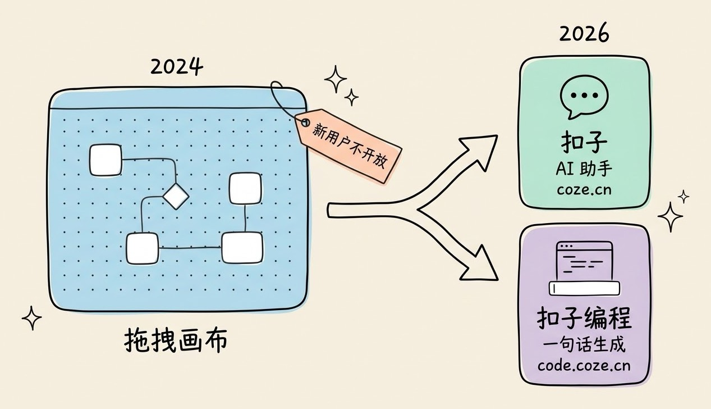
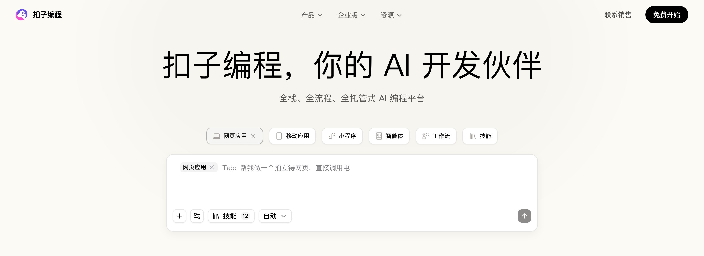
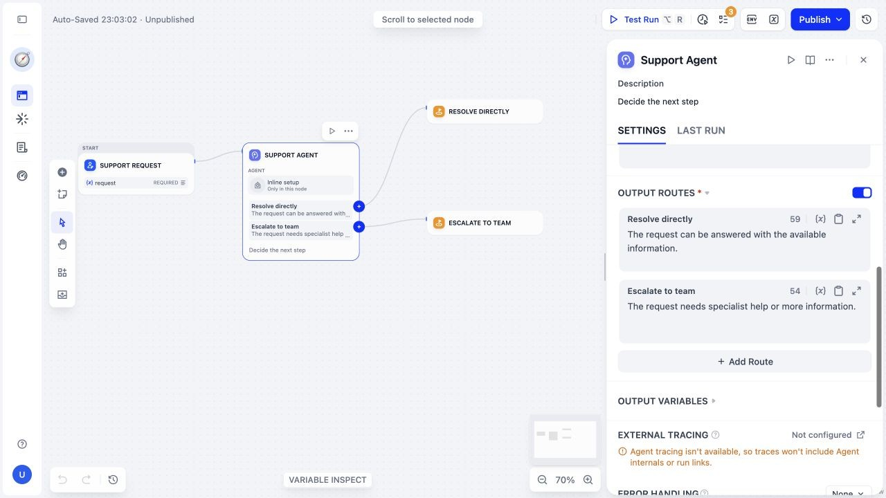

# 3分钟搞懂Dify和扣子

> ⭐入门 · 阅读时间 3分钟 · 更新于 2026-11-16
>
> Dify 和扣子都是不写代码搭智能体和工作流的平台，但今年两者已经分道扬镳：扣子的拖拽式开发不再对新用户开放，企业版宣布下线；Dify 继续做可私有部署的开源画布。本文讲清它们现在分别是什么、怎么选、有哪些风险。

## 一句话定义

**Dify** 和**扣子**（海外版叫 Coze）都是**智能体开发平台**：你在网页上把大模型、知识库、插件和判断条件像搭积木一样连起来，就能做出客服机器人、内部文档问答、自动写日报这类 AI 应用，不需要从零写代码。Dify 是开源软件，可以装在公司自己的服务器上；扣子是字节跳动的产品，用的是字节的云服务。

举个例子，你想给公司做一个「产品手册问答」机器人，在这类平台上大概是这样搭的：

```text
用户提问
  ↓
知识库检索: 从上传的产品手册里找出最相关的几段
  ↓
大模型: 根据找到的内容组织回答
  ↓
条件判断: 手册里找不到答案?
  ├─ 是 → 回复"已转人工", 并把问题发到客服群
  └─ 否 → 直接回复用户
```

每一步在画布上就是一个方块，方块之间用线连起来。搭好之后点一下发布，就能得到一个网页聊天窗口，或者一个 API（让别的程序调用它的接口），接进公司官网或飞书群里。

这类平台在 2024 年到 2025 年非常火，很多教程都把 Dify 和扣子放在一起比：一个开源、一个免费。不过到了 2026 年，两者已经走上了完全不同的方向，扣子甚至不再让新用户用拖拽的方式搭应用了。如果你看的是去年的教程，很多说法已经对不上了，下面会具体讲。

## 画布上那几个方块，各管什么？

不管是 Dify 还是扣子，画布上最常用的就是下面几类方块：

- **模型节点**：调用一个大模型，比如 DeepSeek、千问、豆包或 GPT，负责理解问题、生成文字。
- **知识库**：你把 PDF、Word、网页上传上去，平台会自动把文档切成小段、存起来。提问时先从里面找出相关段落，再交给模型回答。这个做法叫 **RAG**（检索增强生成），作用是让模型根据你的资料回答，而不是凭印象乱编。
- **插件（工具）**：让 AI 能做模型本身做不到的事，比如联网搜索、查天气、读写飞书表格、发邮件。
- **条件和循环**：像流程图里的菱形判断框，满足条件走这条线，不满足走那条线。

用这些方块，可以搭出两种东西：**工作流**和**智能体**。打个比方，同样是处理一张报销单，工作流像一张固定的审批流程单，先查金额、再查发票、超过 5000 元交给经理，每一步都写死了；智能体则像把报销单交给一个有经验的同事，你只告诉他目标和能用的工具，查什么、先查哪个，由他自己判断。

所以，如果你的任务步骤固定、要求每次结果都稳定，比如每天把销售数据整理成日报，用工作流更合适；如果任务需要随机应变，比如回答客户各种各样的问题，用智能体更合适。实际做项目时，两者经常混着用：智能体在需要的时候调用一段工作流。


## 和用 LangChain 写代码，差在哪？

做同样的 AI 应用，开发者还有另一条路：用 **LangChain** 这类开发框架直接写代码。两条路的区别可以这样理解：

| | Dify、扣子这类平台 | LangChain 这类框架 |
| --- | --- | --- |
| 怎么搭 | 网页上拖方块、填配置 | 用 Python 或 TypeScript 写代码 |
| 上手门槛 | 不会编程也能做出能用的东西 | 需要会编程 |
| 改起来 | 改流程只要拖一拖线 | 改代码、测试、重新部署 |
| 灵活度 | 受平台提供的方块和插件限制 | 想怎么做就怎么做 |
| 出了问题 | 看平台的运行记录 | 自己打日志、自己排查 |
| 适合 | 快速验证想法、做内部工具、非技术人员参与搭建 | 逻辑复杂、要深度定制、要和现有系统紧密集成 |

一个常见的做法是：先用平台花一两天把想法搭出来，给业务同事试用；确认真的有用，而且平台的限制开始碍事了，再考虑用代码重写。如果你一开始就知道要做的东西很复杂，比如要接公司内部好几个系统，权限规则也很多，那直接写代码可能更省事。

## 2026 年，扣子变成了另一个产品

扣子今年的变化太大，先把时间线理一遍：

| 时间 | 发生了什么 |
| --- | --- |
| 2023 年 12 月 | 海外版 Coze 上线 |
| 2024 年 2 月 | 国内版扣子上线，个人免费搭智能体，可以一键发布到飞书、抖音、微信公众号等平台 |
| 2025 年 7 月 | 开源 **Coze Studio**（开发平台）和 **Coze Loop**（调试和评估工具），采用 Apache 2.0 协议 |
| 2026 年 1 月 19 日 | 扣子 2.0 上线，主打 **Skills**（技能包），原来的「扣子开发平台」改名为**扣子编程** |
| 2026 年 5 月底 | 扣子 3.0 上线，主站 coze.cn 变成一个可以直接用的 AI 助手，主打多人和多个 Agent 一起协作，还能接入 Claude Code、Codex CLI 等本地 Agent |
| 2026 年 10 月 29 日 | 宣布企业标准版和企业旗舰版 11 月 30 日起停止新售，2027 年 12 月 31 日全面下线 |



这里面对读者影响最大的有两件事。

**第一，拖拽式的开发方式不再对新用户开放了。** 由于产品方向调整，扣子开发平台（低代码）已经不再向新注册用户开放，新注册的账号默认使用扣子编程。老用户之前搭好的智能体和工作流还能继续用，但如果你今天才注册，已经看不到那块熟悉的画布了。

**第二，在扣子编程里，智能体和工作流变成了由 AI 写代码来实现。** 你用一句话描述需求，比如「每天早上 9 点抓取竞品官网的新闻，整理成摘要发到飞书群」，扣子编程会在云端开一个运行环境，让 AI 把代码写出来、调试好，再一键部署。除了智能体、工作流和技能，它还能用同样的方式做网页、手机 App 和微信小程序。这和 Vibe Coding（用自然语言让 AI 写程序）的做法是一样的。


*图注：扣子编程官网首页。智能体和工作流现在和网页应用、小程序并列，都是先选类型、再用一句话描述需求，首页上已经没有拖方块的画布入口了。*

扣子为什么这么改，官方只说是「产品方向调整」和「产品整合」，没有展开解释。一个可能的解释是两头都在挤压拖拽式平台：一头是通用 AI 助手越来越能干，查资料、写周报这类简单需求，直接让它做就行，不需要专门搭一个工作流；另一头是 AI 写代码越来越熟练，与其让用户学怎么拖方块，不如让 AI 直接把代码写出来，灵活度还更高。

扣子个人版 11 月 14 日调价后，四档套餐的价格和积分，和同属字节的 TRAE 国内版完全一样，都是每月 49、99、239、699 元（单月购买），对应 2000、4000、12000、40000 积分。字节内部的 AI 产品正在往一起收拢。

## Dify 走的是另一条路

和扣子相反，Dify 今年仍然把可视化画布当作核心，只是往画布里加了越来越多给 Agent 用的能力，主要是这几类：

- **更强的 Agent 节点**：Agent 可以在沙箱（和服务器隔开的受限环境）里执行代码和命令，还能根据情况决定工作流下一步走哪条分支；
- **技能管理**：可以在工作空间里统一管理 Skills，带版本，多个应用共用；
- **命令行工具 difyctl**：开发者可以不打开网页，直接在终端里运行和管理应用；
- **更细的运行追踪**：一个工作流调用另一个工作流时，能一层层看清里面每一步的输入输出，方便排查「为什么这次回答错了」。


*图注：Dify 1.18.0 更新说明里的截图。画布上的 SUPPORT AGENT 是一个 Agent 节点，右侧给它配了两条输出路线：Resolve directly（信息足够，直接回答）和 Escalate to team（需要专人处理，转给团队），Agent 读完用户的请求后自己决定走哪条。这和文章开头「找不到答案就转人工」的例子是同一类搭法，只是判断交给了 Agent。*

Dify 的 GitHub 仓库已经有超过 16 万个 Star，更新也很频繁，11 月刚发布了 1.19.0 版本。今年 3 月，Dify 宣布完成 3000 万美元融资，估值 1.8 亿美元，资金主要用于加强 Agent 能力和组建企业产品团队。

Dify 最大的优势是**私有化部署**：你可以用 Docker 把它装在公司自己的服务器上，最低配置是 2 核 CPU、4GB 内存。数据不出公司内网，模型也可以接公司自己部署的开源模型，这对银行、医院、政府单位这类对数据很敏感的机构很重要。

不过要注意，Dify 的开源协议并不是标准的 Apache 2.0，而是在它的基础上加了两条限制：

1. 不能直接用 Dify 的源码搭建「多租户」服务，也就是说，你不能拿它改一改，做成一个让很多公司各自注册使用的 SaaS 平台来卖；
2. 使用 Dify 自带的前端界面时，不能去掉或修改上面的 Logo 和版权信息。

公司内部自己用不受这两条影响。如果你打算基于 Dify 做商业产品对外销售，就需要先找 Dify 官方买商业授权。

## 现在该怎么选？

扣子和 Dify 已经不是同一类产品了，所以选的时候，先想清楚你要做什么：

| 你的情况 | 推荐 | 原因 |
| --- | --- | --- |
| 只想让 AI 帮你干活，不想自己搭 | 扣子（coze.cn）、豆包、千问这类 AI 助手 | 查资料、写文档、做 PPT 这类需求，直接说就行 |
| 不会编程，想做一个自己的智能体或小应用 | 扣子编程（code.coze.cn） | 一句话描述需求，AI 写代码并部署，不用自己管服务器 |
| 公司内部的知识库问答、客服、审批流程，数据不能出内网 | Dify 社区版，私有化部署 | 开源免费，画布可视化，业务同事也能看懂和参与修改 |
| 想用云服务快速试一下 Dify | Dify 云服务 | 不用自己装，免费版可以先体验 |
| 喜欢扣子以前的画布，又想自己部署 | Coze Studio | 开源，Apache 2.0 协议，但今年 2 月之后就没有再发新版本，更新明显放缓了 |
| 逻辑复杂，需要深度定制 | LangChain 等开发框架 | 写代码，灵活度最高 |

如果你在国内想找其他云上的智能体平台，还可以看看阿里云百炼、腾讯云智能体开发平台（ADP）和百度智能云千帆，它们都背靠各自的大模型和云服务，更偏向企业用户。和 Dify 定位接近的开源项目还有 FastGPT 和 MaxKB，它们更专注知识库问答和客服场景。

两边的价格大致如下：

| | 免费额度 | 付费价格 |
| --- | --- | --- |
| 扣子个人版 | 免费版没有每月积分，新用户一次性送 60 积分，30 天内有效 | 每月 49 元起（单月购买），连续包月和包年更便宜 |
| Dify 云服务 | 免费版每月 200 次模型调用额度，最多 5 个应用 | 专业版每年 590 美元，团队版每年 1590 美元 |
| Dify 社区版 | 软件免费 | 自己承担服务器和模型调用费用 |

扣子的积分会被模型调用、插件、知识库存储、服务托管这些项目消耗，用得越多扣得越快，积分扣完服务就会暂停。Dify 云服务送的调用额度主要用来体验，用完之后可以填上你自己的模型 API Key（调用模型的密钥），模型费用直接走你自己的账户。

## 用这类平台时，需要注意哪些问题？

**你搭的东西，是锁在平台里的。** 今年这类平台的变动非常多：扣子的拖拽开发不再对新用户开放，企业版宣布下线；腾讯的智能体平台元器也在 11 月 9 日停止服务。扣子企业版的下线公告里，对话、文件、低代码工作流这些资源怎么导出和备份，目前还没有公布具体方案。如果你打算把重要业务搭在某个云平台上，一定要先确认它能不能把应用导出来。Dify 支持把应用导出成文件，换一台服务器也能导入；就算是私有化部署，导出备份的习惯也最好保留。


**知识库不是上传完就万事大吉。** 很多人以为把文档丢进知识库，机器人就能准确回答了。实际上，文档怎么切段、检索时找出几段、扫描件和表格能不能被正确识别，都会直接影响回答质量。上线之前，最好准备几十个真实问题逐个测试，看它答得对不对，答错的地方回头检查是文档没切好，还是根本没检索到。

**自己部署，就要自己负责安全和升级。** Dify 今年多个版本都包含安全修复，如果你装好之后一直不升级，相当于把已知的漏洞留在了公司服务器上。升级前也要先看更新说明，比如 1.17.1 版本升级了自带的向量数据库 Weaviate，官方特别提醒必须按步骤分阶段升级，直接拉新版本重启，可能会让知识库检索永久失效。

**接了插件的智能体，权限要收紧。** 智能体能读写飞书表格、能发邮件，也就意味着它可能被骗着去做这些事。比如有人在上传的文档或网页里藏一段写给 AI 看的指令，让它把数据发到外部邮箱，这类攻击叫提示词注入。给智能体配插件时，只开它真正需要的权限，涉及发消息、改数据的操作，最好加一步人工确认。

## 时效性提醒

这类平台变化很快，下面几项最容易过时：

- 扣子的套餐价格和积分规则（11 月刚调整过）；
- 扣子企业版的替代方案和资源导出办法（官方说会另行公告）；
- 老用户的低代码功能还能保留多久；
- Dify 的云服务价格和版本功能。

动手之前，建议先看一眼扣子文档里的「套餐与定价」和 Dify GitHub 上的更新记录。

💬 **互动话题**：扣子不再让新用户拖方块，改成让 AI 直接写代码。你觉得「拖拽搭工作流」这种方式还有存在的必要吗？如果你之前在扣子上搭过智能体，现在打算继续留在扣子，还是迁到 Dify 这类可以自己部署的平台？

📖 **相关阅读**：

- [3分钟搞懂LangChain](../13-langchain/README.md) - 用写代码的方式搭 Agent，和本文的平台是两条路
- [3分钟搞懂AI Agent](../../02-core-capabilities/05-ai-agent/README.md) - 智能体到底是什么，能做哪些事
- [3分钟搞懂RAG检索增强](../../02-core-capabilities/04-rag/README.md) - 知识库问答背后的原理
- [3分钟搞懂工具调用](../../09-agent-engineering/02-function-calling/README.md) - 智能体是怎么用上插件的
- [3分钟搞懂Skills](../../09-agent-engineering/04-skills/README.md) - 扣子 2.0 和 Dify 都在推的技能包
- [3分钟搞懂Vibe Coding](../01-vibe-coding/README.md) - 扣子编程用的就是这种让 AI 写程序的方式
- [3分钟搞懂Trae](../04-trae/README.md) - 同属字节的 AI 编程工具，套餐价格和扣子完全一样
- [3分钟搞懂Prompt注入攻击](../../04-advanced/13-prompt-injection/README.md) - 为什么接了插件的智能体要收紧权限

**资料来源**：

- 扣子官方文档，扣子常见问题（扣子 3.0 于 2026-05-29 发布、扣子编程未下线、不支持切回旧版）：https://docs.coze.cn/cozespace_coze_app_faq
- 扣子官方文档，扣子编程概述（智能体、工作流、技能、网页应用、移动应用、小程序）：https://docs.coze.cn/guides_welcome
- 扣子官方文档，关于低代码项目（低代码开发平台不再向新注册用户开放）：https://docs.coze.cn/about-low-code-project
- 扣子官方文档，套餐与定价（个人免费版权益）：https://docs.coze.cn/guides_edition
- 扣子官方文档，个人版套餐调整公告（2026-11-12 公告，11-14 生效）：https://docs.coze.cn/subscription-plan-adjustment-20261112
- 扣子官方文档，积分说明（积分消耗项目、免费版新用户 60 积分）：https://docs.coze.cn/coze_pro_credits
- 火山引擎文档中心，扣子企业版下线公告（2026-10-29）：https://docs.volcengine.com/docs/coze/coze-enterprise-offline-announcement?lang=zh
- 今日头条，扣子 2.0，让 Agent 更进一步（2026-01-19）：https://www.toutiao.com/article/7597019393809269258/
- 新浪科技，字节跳动 AI 智能体平台扣子 Coze 3.0 版本上线（2026-06-01）：https://finance.sina.com.cn/tech/digi/2026-06-01/doc-inhzwyqr2443757.shtml
- 21财经，份额第一却被字节下线：扣子退场，低代码终被大模型抹平（2026-11-10，扣子上线时间线）：https://m.21jingji.com/article/20261110/herald/0b05de059373f648e301a5ffad0a61e9.html
- Coze Studio GitHub 仓库（Apache 2.0 协议、版本发布记录）：https://github.com/coze-dev/coze-studio
- Dify GitHub 仓库 README（最低配置、Docker 部署）：https://github.com/langgenius/dify
- Dify 开源协议 LICENSE（多租户和 Logo 限制）：https://github.com/langgenius/dify/blob/main/LICENSE
- Dify Releases（1.15.0 至 1.19.0 更新说明）：https://github.com/langgenius/dify/releases
- Dify 1.18.0 更新说明（文中 Agent 输出路线截图出处）：https://github.com/langgenius/dify/releases/tag/1.18.0
- 扣子编程官网首页（文中首页截图出处）：https://code.coze.cn
- Dify 官网定价页：https://dify.ai/pricing
- FinSMEs，Dify Raises $30M in Series Pre-A Funding（2026-03）：https://www.finsmes.com/2026/03/dify-raises-30m-in-series-pre-a-funding.html
- 腾讯元器停止服务公告：https://yuanqi.tencent.com/cl/service-discontinuation

---

⬅️ 上一篇：[3分钟搞懂Ollama](../11-ollama/README.md) ｜ [📚 返回目录](../README.md) ｜ 下一篇：[3分钟搞懂LangChain](../13-langchain/README.md) ➡️
