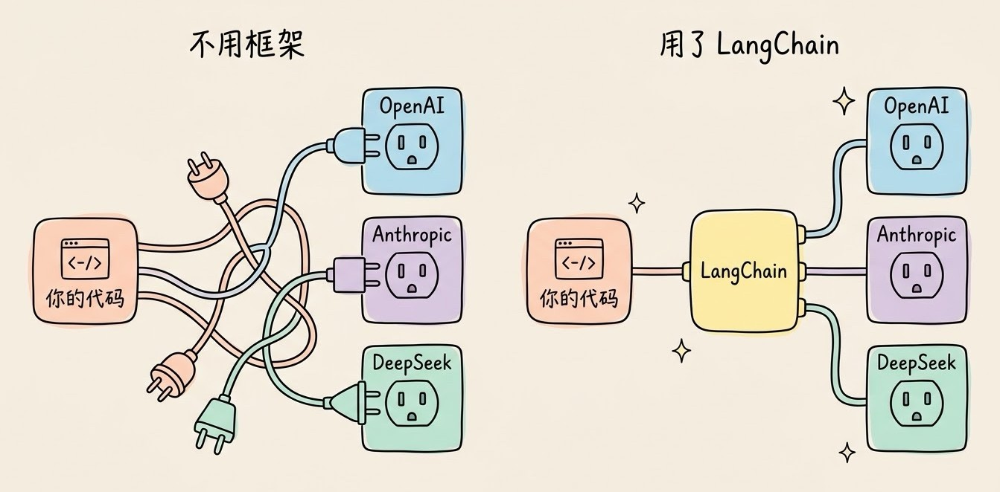
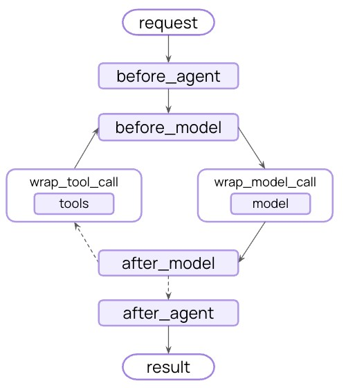
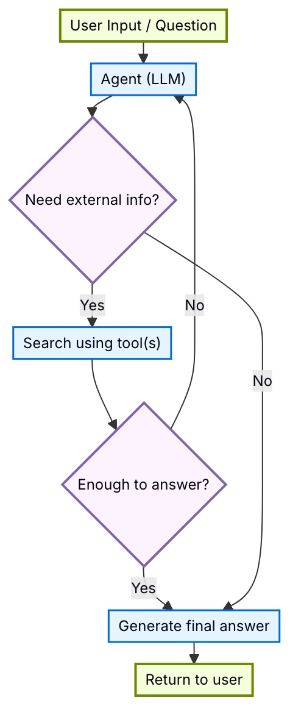
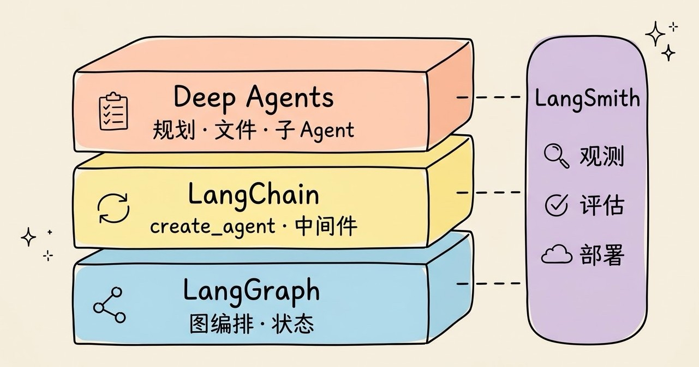
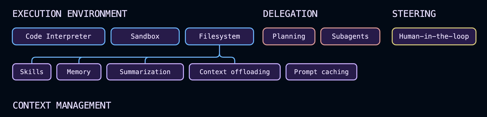

# 3分钟搞懂LangChain

> ⭐⭐⭐进阶 · 阅读时间 3分钟 · 更新于 2026-11-16
>
> LangChain 1.0 之后收敛成了专门做 Agent 的框架。本文用代码讲清 create_agent、记忆、中间件和两种 RAG 写法，三层框架怎么分工，以及它和其他框架怎么选。

## 一句话定义

**LangChain** = 一个开源的 Python / JavaScript 框架，它把各家大模型、工具、记忆和检索包装成统一的接口，再用一个 `create_agent` 把这些零件组装成能自己调用工具、多轮完成任务的 Agent，让你在换模型、加功能时不用重写代码。

它最早是 2022 年秋天 Harrison Chase 开源的一个小项目，只有几百行代码，后来成长为同名公司。2025 年 10 月发布 1.0 是一个分水岭：在这之前，它是一个“什么都能往里塞”的工具库；在这之后，它收敛成了一个专门做 Agent 的框架。所以如果你以前学过 LangChain，**现在的写法和你印象里的大概率已经不太一样了**。

## 它解决的是“每家接口都不一样”的问题

如果不用框架，直接调用大模型 API 做一个能查资料、能记住上下文的助手，你需要自己处理这些事：

- OpenAI、Anthropic、DeepSeek 的接口格式各不相同，换一家模型就要改一遍调用代码
- 模型要调用工具时，你要自己解析它返回的调用请求、执行工具、把结果塞回对话，再发起下一轮，直到任务完成
- 对话历史要自己存、自己取，服务重启后还要能接着聊
- 想在中途加一道人工审批、在上下文太长时自动压缩，都要改核心循环

LangChain 做的事情，很像前端开发里的 jQuery：当年各家浏览器的接口不统一，jQuery 把差异抹平，开发者只写一套代码。LangChain 也是把各家模型、向量库、文档加载器的差异抹平，再把“调模型 → 调工具 → 再调模型”这个循环做成现成的组件。



## 1.0 之后，主包只留下做 Agent 需要的几块

1.0 做的最大一件事是**做减法**。过去 LangChain 里有几十种 Chain（链），比如专门做问答的 `RetrievalQA`、专门做对话的 `ConversationChain`，功能重叠，新手很难分清该用哪个。1.0 把这些历史遗留的东西全部搬到了单独的 `langchain-classic` 包里，主包只保留几个核心部分：

- **模型**：用统一的入口调用任何一家模型
- **Agent**：`create_agent`，现在唯一推荐的 Agent 入口
- **工具**：用一个 `@tool` 装饰器把普通函数变成模型能调用的工具
- **中间件**：在 Agent 循环的各个节点上插入自定义逻辑，这是 1.0 新增的
- **消息和结构化输出**：统一各家模型返回的内容格式

各家模型和数据库的对接代码，也拆成了独立的包，比如 `langchain-anthropic`、`langchain-deepseek`、`langchain-chroma`，用到哪个装哪个，不会一次拖进几百个依赖。

网上大量教程还是 0.x 时代写的，照着写很容易报错。下面这张表是最常见的几个旧写法和现在的对应关系：

| 旧写法（0.x） | 现在的写法（1.x） |
|------|------|
| `LLMChain` | 用管道符组合：`prompt \| model` |
| `initialize_agent`、`AgentExecutor`、LangGraph 的 `create_react_agent` | `langchain.agents.create_agent` |
| `ConversationBufferMemory` 等 Memory 类 | checkpointer + `thread_id` |
| `RetrievalQA` | 把检索器包成工具交给 Agent，或者用管道符写固定流程 |
| `create_react_agent(prompt=...)` | `create_agent(system_prompt=...)` |
| `pre_model_hook` / `post_model_hook` | 中间件的 `before_model` / `after_model` |

如果老项目一时改不完，可以先装 `langchain-classic`，把 import 路径改过去，旧代码就能继续跑。另外要注意 Python 版本：1.0 要求 Python 3.10 及以上，2026 年 11 月发布的 1.5 又把最低版本提到了 3.11。

## 最小的 Agent：模型 + 工具 + 循环

先看模型。`init_chat_model` 是统一入口，换厂商只需要改一个字符串：

```python
from langchain.chat_models import init_chat_model

model = init_chat_model("anthropic:claude-sonnet-5-5")
model = init_chat_model("deepseek:deepseek-flash")  # 需要先 pip install langchain-deepseek
```

国内的千问、Kimi、智谱等模型大多兼容 OpenAI 的接口格式，用 `langchain-openai` 把接口地址（`base_url`）换成对应平台的地址就能接入；本地模型可以通过 Ollama、vLLM 接进来。

然后定义一个工具，交给 `create_agent`：

```python
from langchain.agents import create_agent
from langchain.tools import tool

@tool
def get_weather(city: str) -> str:
    """查询某个城市今天的天气。"""
    return f"{city}今天晴, 26度"  # 实际项目里这里调用天气接口

agent = create_agent(
    model="anthropic:claude-sonnet-5-5",
    tools=[get_weather],
    system_prompt="你是一个生活助手, 回答要简洁。",
)

result = agent.invoke(
    {"messages": [{"role": "user", "content": "北京今天适合跑步吗?"}]}
)
print(result["messages"][-1].content)
```

这段代码背后发生了这些事：模型看到问题和工具说明，判断需要先查天气，于是返回一个工具调用请求；框架执行 `get_weather("北京")`，把结果放回对话；模型再根据天气给出建议。这个“调模型 → 调工具 → 再调模型”的循环就是 **Agent Loop**，`create_agent` 帮你写好了。函数的类型注解和注释（docstring）会自动变成工具说明，**所以注释要写清楚工具是干什么的，模型就是靠它判断什么时候调用这个工具的**。

`create_agent` 底层跑在 LangGraph 上，所以你不用额外写代码，就能直接用上这几项能力：

- **流式输出**：用 `agent.stream(...)` 一步步拿到模型的思考和工具调用过程，适合做前端界面实时展示
- **结构化输出**：传入 `response_format=某个 Pydantic 类`，结果里的 `structured_response` 就是按这个格式填好的对象，适合需要把结果存进数据库或交给下游程序的场景
- **状态检查点**：每一步的状态都可以保存下来，下面讲的记忆和人工审批都建立在这个能力之上

## 记忆靠 checkpointer，不靠 Memory 类

大模型 API 本身是不记事的，每次调用都要把之前的对话再发一遍。以前 LangChain 用 `ConversationBufferMemory` 这类 Memory 类管理对话历史，现在统一换成了 **checkpointer**（检查点存储）：

```python
from langgraph.checkpoint.memory import InMemorySaver

agent = create_agent(
    model="anthropic:claude-sonnet-5-5",
    tools=[get_weather],
    checkpointer=InMemorySaver(),  # 生产环境换成 Postgres 等持久化版本
)

cfg = {"configurable": {"thread_id": "user-42"}}
agent.invoke({"messages": [{"role": "user", "content": "我叫小林"}]}, config=cfg)
agent.invoke({"messages": [{"role": "user", "content": "我叫什么?"}]}, config=cfg)
# 回答: 你叫小林
```

`thread_id` 就是会话编号，同一个编号下的对话会自动接上，不同编号之间互相隔离，**所以多用户、多会话的场景不用自己再写一套隔离逻辑**。把 `InMemorySaver` 换成数据库版本之后，对话状态存在数据库里，服务重启也不会丢。


需要注意的是，checkpointer 管的是“一个会话内”的记忆。如果你希望 Agent 跨会话记住用户的偏好，比如下次新开对话时还记得用户喜欢简洁的回答，就需要用 LangGraph 的长期记忆存储（Store），或者接入专门的记忆服务。

## 中间件：在循环的每个节点上插入自己的逻辑

真实项目里，Agent 光能跑起来还不够。你可能还需要：对话太长时自动压缩、调用失败时自动重试或换一个模型、删除文件之类的操作要人确认、限制模型最多调用多少次防止死循环。在 1.0 之前，这些需求往往要改 Agent 内部的代码；1.0 之后，统一用**中间件**来做。

中间件可以挂在循环的几个固定节点上：整个 Agent 开始运行前和结束后（`before_agent` / `after_agent`），每次调用模型前和调用模型后（`before_model` / `after_model`），以及包住每次模型调用和工具调用（`wrap_model_call` / `wrap_tool_call`）。前两组只在对应的时间点执行一次，比如在模型调用前检查一下上下文是不是太长了；“包住”的那一组可以决定这次调用要不要真的执行、失败了要不要重试、要不要换一个模型。


*图注：LangChain 官方文档里的中间件流程图。从上往下是一次请求的完整过程：`before_agent` 在开头只执行一次；中间的循环是 `before_model` → 调用模型（`wrap_model_call` 包着 model）→ `after_model`，如果模型要调用工具，就进入左边的 `wrap_tool_call`（包着 tools），执行完再回到 `before_model` 开始下一轮；模型不再调用工具时，走 `after_agent` 返回结果。虚线表示要看模型的决定，不一定会走。*

官方已经内置了一批常用的中间件，下面是比较实用的几个：

| 中间件 | 作用 |
|------|------|
| `SummarizationMiddleware` | 上下文快满时，把较早的对话压缩成摘要 |
| `HumanInTheLoopMiddleware` | 调用指定工具前暂停，等人批准、修改或拒绝 |
| `ModelRetryMiddleware` / `ToolRetryMiddleware` | 模型或工具调用失败时自动重试 |
| `ModelFallbackMiddleware` | 主模型出错时自动切换到备用模型 |
| `ModelCallLimitMiddleware` / `ToolCallLimitMiddleware` | 限制调用次数，防止 Agent 陷入死循环、烧掉太多 token |
| `PIIMiddleware` | 识别和处理手机号、邮箱这类个人敏感信息 |
| `TodoListMiddleware` | 给 Agent 一个写待办清单的工具，帮它规划长任务 |
| `ContextEditingMiddleware` | 上下文变长时，清理掉较早的工具返回结果 |

用法很简单，在 `create_agent` 里按顺序传进去就行：

```python
from langchain.agents.middleware import (
    HumanInTheLoopMiddleware,
    SummarizationMiddleware,
)

agent = create_agent(
    model="anthropic:claude-sonnet-5-5",
    tools=[search_orders, refund_order],
    checkpointer=InMemorySaver(),  # 人工审批需要暂停和恢复, 必须配 checkpointer
    middleware=[
        SummarizationMiddleware(
            model="deepseek:deepseek-flash",  # 压缩摘要用便宜的模型就够了
            trigger=("tokens", 50000),
            keep=("messages", 20),
        ),
        HumanInTheLoopMiddleware(
            interrupt_on={
                "refund_order": {"allowed_decisions": ["approve", "reject"]},
                "search_orders": False,
            }
        ),
    ],
)
```

这个客服 Agent 查订单时会直接执行，但要退款时会暂停下来，等人工批准之后才继续往下走，**这样就保证了涉及钱的操作不会被模型随便执行**。2026 年 11 月发布的 1.5 还新增了两个测试版中间件：`ModelRouterMiddleware` 会先用一个小模型判断任务难度，再决定这次用哪个模型；`AutoModeMiddleware` 会在执行工具调用之前，先拦下有风险的操作。

中间件写一次就可以复用到所有 Agent 上。如果内置的不够用，也可以自己写，用一个装饰器包一下函数就能变成中间件。

## RAG 有两种写法，按场景选

**RAG**（检索增强生成）是 LangChain 最常见的用法：先从你的文档里检索出相关内容，再交给模型回答。准备工作的写法和以前差不多，加载文档、切分、向量化、存进向量库：

```python
from langchain_community.document_loaders import PyPDFLoader
from langchain_text_splitters import RecursiveCharacterTextSplitter
from langchain_chroma import Chroma
from langchain_openai import OpenAIEmbeddings

docs = PyPDFLoader("员工手册.pdf").load()
chunks = RecursiveCharacterTextSplitter(chunk_size=800, chunk_overlap=100).split_documents(docs)
vectorstore = Chroma.from_documents(chunks, OpenAIEmbeddings())
retriever = vectorstore.as_retriever(search_kwargs={"k": 4})
```

接下来的“检索 + 回答”，官方文档给了两种写法。

**第一种是固定两步**：每个问题都先检索一次，再把检索结果和问题一起交给模型。用提示词模板加管道符就能写出来：

```python
from langchain_core.prompts import ChatPromptTemplate

prompt = ChatPromptTemplate.from_messages([
    ("system", "只根据下面的资料回答, 资料里没有就说不知道。\n\n{context}"),
    ("human", "{question}"),
])
chain = prompt | model  # 管道符把两个步骤串起来, 这就是"链"

question = "年假有几天?"
context = "\n\n".join(d.page_content for d in retriever.invoke(question))
answer = chain.invoke({"context": context, "question": question})
```

管道符两边只要是 LangChain 的标准组件（Runnable）就能接，串起来之后天然支持流式、批量和异步调用，这套写法叫 LCEL。

**第二种是把检索器包成工具，交给 Agent**：

```python
@tool
def search_handbook(query: str) -> str:
    """在员工手册中检索相关内容。"""
    return "\n\n".join(d.page_content for d in retriever.invoke(query))

agent = create_agent(
    model="anthropic:claude-sonnet-5-5",
    tools=[search_handbook],
    system_prompt="回答前先检索员工手册, 并引用原文。",
)
```

这时候由模型自己决定要不要检索、检索几次、要不要换个说法再查一遍。比如用户问“我入职三年了，年假和病假一共有多少天”，Agent 可能会先查年假规定、再查病假规定，最后把两部分合起来回答。


*图注：LangChain 官方文档里的 Agent 检索（Agentic RAG）流程图。Agent 收到问题后先判断需不需要外部信息（Need external info?），不需要就直接回答；需要就调用检索工具，再判断查到的内容够不够回答（Enough to answer?），不够就回到 Agent 重新决定怎么查，直到够了才生成最终答案。*

两种写法的区别在于控制权在谁手里：

| | 固定两步 | Agent 检索 |
|------|------|------|
| 流程 | 每次都先检索一次再回答 | 模型自己决定检不检索、检索几次 |
| 速度和成本 | 模型调用次数固定，延迟可预期 | 步数不固定，有时会多花几轮 |
| 灵活性 | 低，问题复杂时一次检索可能不够 | 高，能拆问题、换说法、查多个知识库 |
| 适合 | 常见问题解答、文档问答机器人 | 问题复杂、知识来源多的场景 |

如果你的问题大多是“年假几天”这种一查就能答的，用固定两步更快、更省钱；如果问题经常需要拆开查好几次，再用 Agent 的写法。

## LangChain、LangGraph、Deep Agents 是三层，不是三选一

LangChain 公司现在的开源框架有三个，名字容易混，其实它们是上下叠起来的三层：

- **LangGraph**（最底层）：把 Agent 的执行过程建模成一张图，每个节点是一个步骤，负责管状态、循环、分支、人工介入和断点续跑。当你的流程很复杂、需要精确控制每一步怎么走时，直接用它来画图
- **LangChain**（中间层）：`create_agent` 就是用 LangGraph 搭好的一个通用 Agent，再加上中间件机制。大部分 Agent 应用用这一层就够了
- **Deep Agents**（最上层）：在 `create_agent` 的基础上，预先装好了一整套做长任务需要的能力，包括任务规划（写待办清单）、虚拟文件系统（把中间结果存到文件里，不占上下文）、子 Agent（把子任务派出去单独做）、技能（Skills）和长期记忆。它的设计思路和 Claude Code 这类编程 Agent 很像，适合做研究、写代码这类要跑很多步的复杂任务

简单来说：普通的 Agent 用 LangChain；需要画复杂流程图时往下用 LangGraph；做长时间运行的复杂 Agent 时往上用 Deep Agents。三者可以混用，比如在 LangGraph 的图里，某个节点直接放一个 `create_agent` 创建的 Agent。



Deep Agents 目前还是 0.x 版本，更新很快。按官方 8 月的说法，0.7 版简化了基础框架，在效果差不多的情况下，基础输入 token 减少了 65%。


*图注：Deep Agents 官方文档里的能力分类图，把它预装的能力分成四类。执行环境（EXECUTION ENVIRONMENT）：代码解释器、沙箱、文件系统；任务委派（DELEGATION）：任务规划、子 Agent；人工干预（STEERING）：人工审批；第二行是上下文管理（CONTEXT MANAGEMENT，标签在图的最下方）：技能、记忆、对话摘要、把大段内容转存到文件、提示词缓存，其中前四项都是借助文件系统实现的。*

除了开源框架，LangChain 公司靠商业平台 **LangSmith** 赚钱，它主要做三件事：

- **可观测**：记录 Agent 每一步的输入、输出、耗时和花费，Agent 出问题时可以一步步回放，找到是哪一步出的错。不用 LangChain 写的应用也能接入
- **评估**：用测试集给 Agent 打分，改了提示词或换了模型之后，能看出效果是变好了还是变差了
- **部署**：把 Agent 部署成能长时间运行、带状态的服务（以前叫 LangGraph Platform）。2026 年还推出了托管版的 Deep Agents（Managed Deep Agents），写好 Agent 代码后一条命令就能部署，目前是公开测试阶段

LangSmith 的免费版每月包含 5000 条调用记录（trace），只能 1 个人用；Plus 版每个席位每月 39 美元（约 280 元人民币），每月包含 1 万条，超出部分按量计费。开源框架本身是完全免费的。

从数据上看，截至 2026 年 11 月，LangChain 主仓库在 GitHub 上有大约 14.9 万颗星，LangGraph 约 4.5 万，Deep Agents 约 3.1 万；`langchain` 这个包在 PyPI 上最近一个月的下载量约 1.7 亿次（包含自动化构建产生的下载）。公司方面，2025 年 10 月完成了 1.25 亿美元的融资，估值 12.5 亿美元，Cloudflare、LinkedIn、Uber、摩根大通等公司都是它的客户。

## 和其他框架怎么选？

2026 年的 Agent 框架和 2023 年已经完全不同了，几乎每家大厂都有自己的框架。下面按类别介绍几个主要的选择：

- **LlamaIndex**：最早和 LangChain 并列的框架，现在定位越来越偏向“文档处理平台”。它的 LlamaParse 擅长解析带表格、多栏排版的复杂 PDF，如果你的项目核心是处理大量复杂文档，它会更合适
- **Microsoft Agent Framework**：微软把 Semantic Kernel 和 AutoGen 合并而成，2026 年 4 月发布 1.0 正式版，原来的两个项目进入维护模式。同时支持 .NET 和 Python，和 Azure 集成最深，比较适合微软技术栈的团队
- **模型厂商的官方 SDK**：OpenAI Agents SDK、Claude Agent SDK、Google ADK 等，轻量、和自家模型的新能力贴合最紧。如果你确定只用一家的模型，用它们最省事，但换厂商时要改的代码比较多
- **CrewAI**：主打“给 Agent 分配角色、组成团队协作”，上手很快，适合快速做多 Agent 的原型验证
- **Pydantic AI**：由 Pydantic 团队开发，类型安全，写起来像 FastAPI，适合重视代码规范和类型检查的团队
- **Haystack**：德国 deepset 公司的框架，检索和搜索管道做得扎实，适合企业搜索类项目

国内也有几个值得关注的选择：

- **AgentScope**：阿里开源的 Agent 框架，2026 年 5 月发布 2.0，把消息、工具、权限、中间件等模块全部重写了一遍，对千问模型和钉钉的支持比较好
- **Eino**：字节跳动 CloudWeGo 团队开源的 Go 语言大模型应用框架，如果你的后端是用 Go 写的，它比在 Python 和 Go 之间来回调用要方便
- **Dify**：开源的智能体开发平台，在网页画布上拖拽就能搭 Agent、工作流和知识库，还可以部署在公司自己的服务器上，适合不想写代码、或者想先快速验证想法的团队
- **扣子编程（Coze）**：字节跳动的智能体开发平台，用一句话描述需求，由 AI 写代码生成智能体和工作流，并一键部署到云端。原来的拖拽式开发已经不再对新用户开放

| 框架 | 侧重 | 语言 | 适合 |
|------|------|------|------|
| LangChain / LangGraph | 通用 Agent、状态编排 | Python、JS | 要换模型、要上生产的通用 Agent 应用 |
| LlamaIndex | 复杂文档处理 | Python、TS | 以复杂 PDF 为核心的知识库 |
| Microsoft Agent Framework | 企业级、微软生态 | .NET、Python | Azure、.NET 团队 |
| 厂商官方 SDK | 单一厂商 | Python、TS 等 | 已经确定只用某家模型 |
| CrewAI | 角色化多 Agent | Python | 多 Agent 快速原型 |
| Pydantic AI | 类型安全 | Python | 强类型工程团队 |
| AgentScope | 多 Agent、阿里生态 | Python | 用千问、钉钉的团队 |
| Eino | Go 语言应用开发 | Go | Go 后端团队 |
| Dify | 可视化画布搭建、私有化部署 | 网页界面 | 不写代码、数据不能出内网 |
| 扣子编程 | 对话生成智能体和工作流 | 网页界面 | 不写代码，想快速做出能用的应用 |

LangChain 最大的优势还是生态：模型、向量库、文档加载器的集成数量在同类框架里最多，教程和社区问答也最多，再加上 LangSmith 补上了调试和评估这一环，从开发到上线基本都能在一套体系里完成。

## 什么时候不该用 LangChain

LangChain 也一直有人吐槽，主要集中在这几点：

- **抽象层多**：如果你只是调一次模型、做一个简单的问答，直接调用官方 API 反而更清爽，出了问题也更好排查
- **网上旧教程太多**：这是新手最容易踩的坑。搜到的很多教程还在用 `LLMChain`、`initialize_agent`，照着写会报错或者收到弃用警告，看教程之前先确认它写的是不是 1.x
- **要学的东西变多了**：想用好它，需要同时理解 LangChain 和 LangGraph 两层，做复杂 Agent 还要了解 Deep Agents
- **性能开销**：多了一层抽象，就会多一些性能损耗，高并发场景上线之前最好先实测一下

不过 1.0 之后有一个实质的改善：官方开始遵循语义化版本，公开接口的破坏性改动只会出现在 2.0 这样的大版本里，已经标记弃用的功能在整个 1.x 期间也都还能用，以前那种“升个小版本代码就跑不起来”的情况少了很多。

还有一个常见的误解：LangChain 是免费的，所以用它做 AI 应用不花钱。实际上框架本身确实免费，但调用的模型、托管的向量数据库、LangSmith 的付费版都要花钱，真正的大头通常是模型的调用费用。

## 时效性提醒

LangChain 的核心用法从 1.0 之后已经比较稳定了，下面这些内容变化比较快：

- **版本号**：从 1.0 到 1.5 用了一年多，基本每两三个月发一个小版本，1.5 刚刚发布
- **Deep Agents**：还在 0.x 阶段，接口仍在调整，托管版也还在公开测试
- **中间件**：官方和社区的中间件还在持续增加，1.5 新增的模型路由等中间件目前是测试版
- **LangSmith 价格和功能**：以官方定价页为准

**建议**：动手之前先看官方文档和 v1 迁移指南：

- 官方文档：https://docs.langchain.com
- v1 迁移指南：https://docs.langchain.com/oss/python/migrate/langchain-v1
- GitHub：https://github.com/langchain-ai/langchain

💬 **互动话题**：你用 LangChain 做过什么项目？从 0.x 升级到 1.x 的时候踩过哪些坑？

📖 **相关阅读**：

- [3分钟搞懂AI Agent](../../02-core-capabilities/05-ai-agent/README.md) - LangChain 主要用来做的东西
- [3分钟搞懂Agent Loop](../../09-agent-engineering/01-agent-loop/README.md) - create_agent 帮你写好的那个循环
- [3分钟搞懂工具调用](../../09-agent-engineering/02-function-calling/README.md) - @tool 背后模型是怎么调用工具的
- [3分钟搞懂Harness](../../09-agent-engineering/07-harness/README.md) - Deep Agents 就是一套现成的 Harness
- [3分钟搞懂RAG检索增强](../../02-core-capabilities/04-rag/README.md) - LangChain 最常见的应用
- [3分钟搞懂向量数据库](../../04-advanced/06-vector-database/README.md) - RAG 里存文档向量的地方
- [3分钟搞懂Dify和扣子](../12-dify-and-coze/README.md) - 不写代码搭 Agent 的另一条路

**资料来源**：

- LangChain 文档，What's new in LangChain v1：https://docs.langchain.com/oss/python/releases/langchain-v1
- LangChain 文档，LangChain v1 migration guide：https://docs.langchain.com/oss/python/migrate/langchain-v1
- LangChain 文档，Release policy：https://docs.langchain.com/oss/python/release-policy
- LangChain 文档，Prebuilt middleware：https://docs.langchain.com/oss/python/langchain/middleware/built-in
- LangChain 文档，Retrieval（Agent 检索流程图出处）：https://docs.langchain.com/oss/python/langchain/retrieval
- LangChain GitHub，langchain==1.5.0 Release：https://github.com/langchain-ai/langchain/releases/tag/langchain%3D%3D1.5.0
- LangChain 博客，Reflections on Three Years of Building LangChain（2025-10-20）：https://www.langchain.com/blog/three-years-langchain
- LangChain 博客，Managed Deep Agents（2026-05-13，2026-11-02 更新）：https://www.langchain.com/blog/introducing-managed-deep-agents
- LangChain 博客，August 2026 LangChain Newsletter：https://www.langchain.com/blog/august-2026-langchain-newsletter
- LangSmith 定价页：https://www.langchain.com/pricing
- PyPI，langchain / langgraph / deepagents 版本信息：https://pypi.org/project/langchain/
- pypistats，langchain 下载量：https://pypistats.org/packages/langchain
- Visual Studio Magazine，Microsoft Ships Production-Ready Agent Framework 1.0 for .NET and Python（2026-04-06）：https://visualstudiomagazine.com/articles/2026/04/06/microsoft-ships-production-ready-agent-framework-1-0-for-net-and-python.aspx
- AgentScope 发布记录：https://docs.agentscope.io/versions/2.0.7/zh/release-notes.md
- CloudWeGo Eino：https://github.com/cloudwego/eino
- LangChain 文档，Middleware overview（中间件流程图出处）：https://docs.langchain.com/oss/python/langchain/middleware/overview
- LangChain 文档，Deep Agents overview（能力分类图出处）：https://docs.langchain.com/oss/python/deepagents/overview
- 扣子官方文档，关于低代码项目（低代码开发平台不再向新注册用户开放）：https://docs.coze.cn/about-low-code-project
- 扣子官方文档，扣子编程概述：https://docs.coze.cn/guides_welcome

---

⬅️ 上一篇：[3分钟搞懂Dify和扣子](../12-dify-and-coze/README.md) ｜ [📚 返回目录](../README.md)
