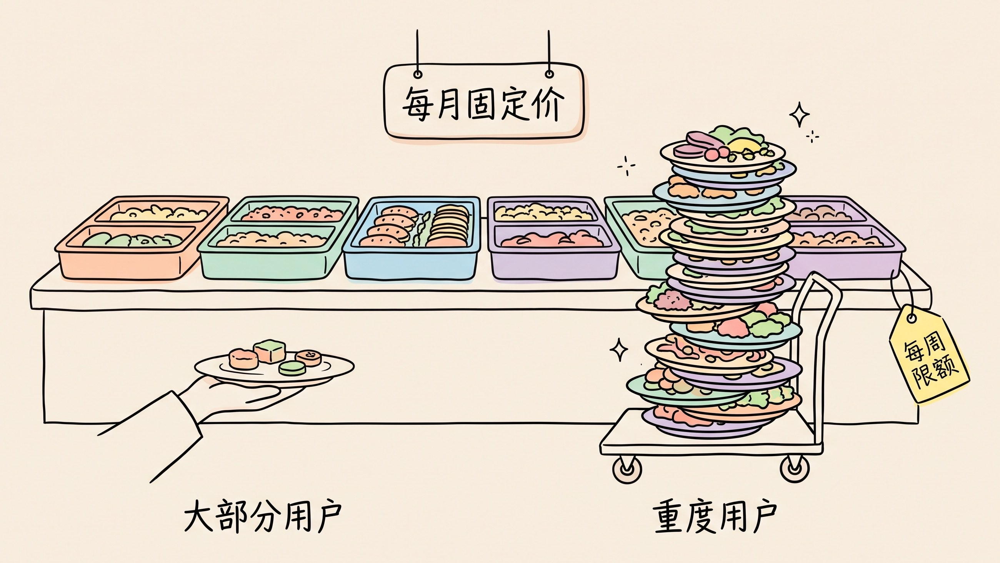
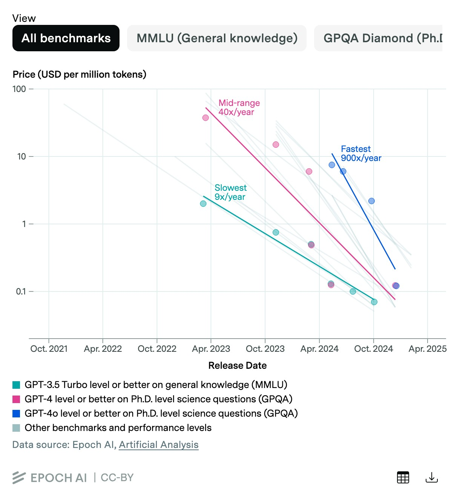
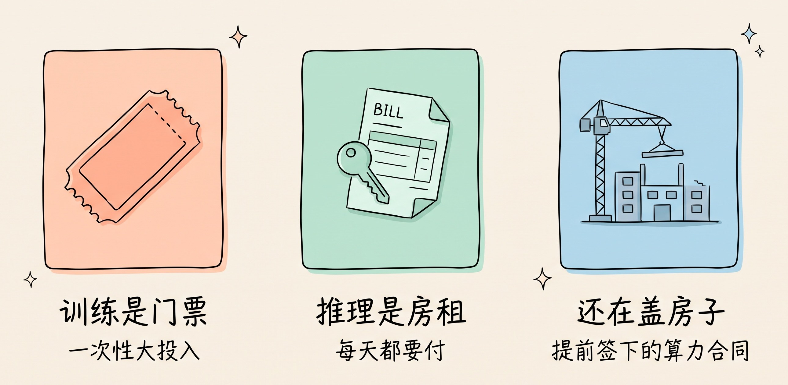
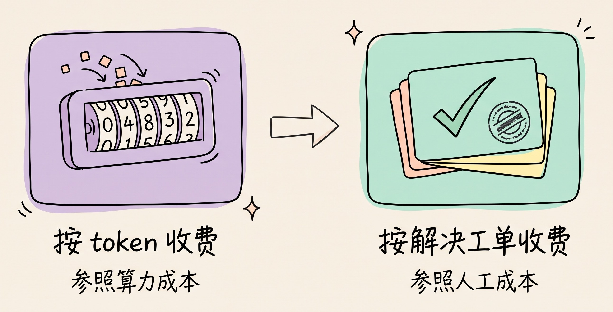

# 3分钟搞懂AI商业模式

> ⭐⭐中级 · 阅读时间 3分钟 · 更新于 2026-11-24
>
> AI 和传统软件最大的区别，是用户每多用一次，厂商就多付一份算力钱。本文讲清 AI 公司从哪几个口袋收钱、订阅为什么越来越多限额、推理变便宜后账单为什么反而变大，以及收入涨得很快的 AI 公司为什么还在亏钱。

## 一句话定义

**AI 商业模式** = AI 公司把训练和运行模型的算力成本，通过按量计费的 API、会员订阅、企业合同、广告和交易佣金等方式卖出去，并且让每一笔收入都能覆盖它背后实际消耗掉的算力。

后半句才是 AI 生意难做的地方。传统软件做好之后，多卖一份几乎不增加成本；而 AI 每回答一个问题、Agent 每跑一步，都要实实在在地占用一次 GPU。所以看懂 AI 商业模式，其实就是看懂一个问题：**这笔算力钱，最后是谁在买单。**

## 和传统软件最大的不同：每多用一次，就多一份成本

我们可以用自助餐来理解 AI 订阅。自助餐之所以能赚钱，是因为大部分客人吃得并不多，少数特别能吃的客人，成本会被其他人摊平。传统软件的订阅也是这个道理，用户用得再多，服务器成本也涨不了多少。

但 AI 订阅不一样，有的客人是开着货车来打包的。

2025 年 7 月 28 日，Anthropic 宣布给 Claude 的 Pro 和 Max 会员加上**每周用量上限**，8 月 28 日开始执行。原因是有一部分用户让 Claude Code 在后台 24 小时不停地跑任务，Anthropic 当时提到，有用户在每月 200 美元的套餐上，用掉了价值几万美元的模型调用。这次限额按 Anthropic 的估算只会影响不到 5% 的订阅用户，但这件事说明了一个问题：**AI 订阅的重度用户，是真的可能让厂商亏钱的。**

AI 编程工具 Cursor 也遇到了同样的问题。2025 年 6 月，它把 Pro 套餐从“每月固定多少次请求”改成了“每月包含 20 美元的前沿模型用量，按 API 价格扣费，用完可以再买”。重度用户突然发现额度不够用了，Cursor 的 CEO 随后公开道歉，并给受影响的用户退了款。

所以你会看到，现在几乎所有 AI 会员都带着限额：每 5 小时多少条消息、每周多少用量、高级模型单独计数、超出部分按量付费。**这些限额就是厂商在给订阅设一个成本上限**，对用户来说，选套餐时要看的不只是月费，还要看自己的用量会不会经常碰到上限。

## AI 公司从哪几个口袋收钱？

把 2026 年主流的收费方式放在一起看，大致是下面这几种，而且一家公司通常会同时用好几种：

| 收费方式 | 谁来付钱 | 怎么计费 | 典型例子 | 主要难题 |
|------|------|------|------|------|
| 按量 API | 开发者、企业 | 按输入输出的 token 数 | Anthropic、DeepSeek、各家云平台 | 价格战激烈，客户换模型的成本很低 |
| 会员订阅 | 个人用户、团队 | 每月固定费用 + 用量限额 | ChatGPT Go / Plus / Pro、Claude Pro / Max、豆包付费版 | 重度用户会把成本打穿 |
| 企业合同 | 大企业 | 年度合同、席位费、承诺用量 | 通过亚马逊、谷歌、微软云平台购买的模型服务 | 销售和交付的成本高，周期长 |
| 广告 | 广告主 | 按展示或点击 | ChatGPT 免费版里的广告 | 广告会不会影响回答，用户信不信任 |
| 交易佣金 | 商家 | 按成交抽成 | 豆包的酒店预订、千问接入淘宝的购物 | 要有足够多的商品和商家 |
| 按结果计费 | 企业 | 按完成的任务收费 | AI 客服按解决一个工单收费 | “任务算不算完成”很难界定 |

从这张表可以看出，同样是一个聊天窗口，背后买单的人可能完全不同：可能是你自己（订阅），可能是商家和广告主（佣金、广告），也可能是你所在的公司（API 和企业合同）。

### 两家头部公司，选了两条不同的路

**Anthropic** 的收入主要来自企业和开发者。按它 2026 年 10 月公开的招股书，2026 年上半年总收入约 163 亿美元，其中**按用量计费的收入约占 80%**，订阅收入只占 20% 左右；另外有大约 48% 的收入，是通过亚马逊、谷歌、微软的云平台卖出去的。这是因为很多大企业的业务本来就部署在这几家云上，直接在自己的云账号里开通 Claude，费用跟着云服务账单一起结算，比单独再签一份合同方便得多。

**OpenAI** 更偏向普通用户。2026 年 2 月，OpenAI 公布 ChatGPT 的周活跃用户达到 9 亿，付费订阅用户超过 5000 万，到 8 月周活跃用户已经超过 10 亿。在订阅之外，它在 2026 年开始在免费版里上线广告，8 月 31 日 OpenAI 公布，**ChatGPT 广告上线不到 200 天，年化收入就达到了 10 亿美元**，并承诺广告会明确标注、和回答分开显示，不会影响 ChatGPT 给出的回答，广告主也拿不到用户的私人对话。同时它还推出了比 Plus 更便宜的 Go 套餐，美国的价格是每月 8 美元，用更低的门槛把免费用户转化成付费用户。

### 国内：免费是起点，变现靠生态

国内的 C 端 AI 助手基本都是免费起步的，用户也比较少有为聊天付月费的习惯，所以各家走的路更偏向“流量变现”：

- **豆包**：基础功能一直免费，同时推出了每月 68 元、200 元、500 元三档付费套餐；2026 年 8 月起，豆包开始对通过它预订的酒店订单按平台费率抽佣，这也被看作是它第一次规模化的变现尝试。
- **千问**：和淘宝天猫打通，用户在对话里就能直接搜到淘宝天猫的商品；8 月也面向专业用户推出了付费方案，基础功能仍然免费。
- **DeepSeek**：主要靠 API 收费，价格一直压得很低，是国内价格战的主要推动者之一。

从上面可以看出，国内大厂的 AI 助手更像是电商、本地生活这些业务的新入口，**AI 本身不一定要直接赚钱，只要能把用户带到能赚钱的地方就行**。

## 推理越来越便宜，账单为什么反而越来越大？

先看降价这一面。Epoch AI 在 2025 年的一项统计发现，要达到同样的模型能力，推理价格每年下降的幅度在 9 倍到 900 倍之间，具体取决于看的是哪类任务。

*图注：Epoch AI 统计的推理价格变化，纵轴是每百万 token 的价格（美元，对数刻度），横轴是模型发布时间。每条线代表“达到某个能力水平的最便宜模型”的价格走势：绿色线是达到 GPT-3.5 Turbo 常识问答水平，每年降价约 9 倍；粉色线是达到 GPT-4 博士级科学题水平，每年约 40 倍；蓝色线是达到 GPT-4o 博士级科学题水平，每年约 900 倍。数据截至 2025 年初，来源 Epoch AI，CC-BY 许可。*

但企业的 AI 账单却普遍在变大，主要原因有三个：

1. **推理模型会先“想”再回答**。模型在给出答案之前，会先生成一大段思考过程，这部分思考也要按输出 token 计费，而输出 token 的单价通常比输入贵好几倍。
2. **Agent 一个任务要跑很多轮**。普通聊天是问一次答一次，Agent 完成一个任务往往要循环调用几十次模型，每一次都要把越来越长的上下文重新读一遍。
3. **便宜了，用的人和用的场景就更多了**。以前因为太贵不敢用 AI 的场景，现在都接上了 AI，总用量的增长速度远远超过了单价的下降速度。

所以**单价下降，并不等于成本下降**。对 AI 公司来说，用户越活跃、Agent 用得越多，推理成本就越高；对企业客户来说，AI 预算也会随着用量一起涨。

### 降本的办法，大多是在“少算一次”

推理成本和电费很像，算力用在什么时候、用在什么地方，价格都不一样。DeepSeek 的 API 价格就很直观地体现了这一点：

- **分时段计价**：北京时间工作日的 9:00–12:00、14:00–18:00 是高峰时段，其余时间价格减半。deepseek-flash 模型在高峰时段的输出价格是每百万 token 8 元，空闲时段是 4 元。这和峰谷电价是一个道理，GPU 在空闲时段本来就闲着，便宜卖出去也比空着强。
- **缓存命中更便宜**：同一段内容如果之前已经处理过，可以直接复用之前的计算结果。deepseek-flash 缓存命中时的输入价格是每百万 token 0.02 元，没命中是 1 元，相差 50 倍。

除了这两种，常见的降本办法还有：简单问题交给小模型处理、复杂问题才调用大模型（也就是**模型路由**）；把大模型的能力蒸馏到更小的模型里；自研芯片或者提前签下长期的算力合同。这些办法的目标都是一样的，就是**把每一个有用的 token 的成本降下来**，谁降得更多，谁就更有余地去打价格战，或者让利给企业客户。

## AI 公司收入涨得很快，为什么还在亏钱？

新闻里经常同时出现“收入暴涨”和“巨额亏损”，读起来很矛盾。这是因为不同的数字回答的是不同的问题：

| 数字 | 回答的问题 | 需要注意什么 |
|------|------|------|
| 年化收入（ARR / run rate） | 增长有多快 | 按最近一个月的收入乘以 12 推算，不是一年实际收到的钱 |
| 实际收入 | 真正收到了多少钱 | 按季度、按年统计，比年化收入更可靠 |
| 毛利率 | 卖出去的服务，扣掉直接成本后还剩多少 | 训练成本通常不算在里面 |
| 经营利润 | 算上研发、销售等全部开支后赚不赚钱 | 训练新模型的投入会体现在这里 |
| 自由现金流 | 公司账上的现金是在变多还是变少 | 买算力、建数据中心都会大量消耗现金 |

拿 Anthropic 来举例。它的招股书里没有直接给出毛利率，但有分析机构根据收入成本计算后发现，2026 年它的毛利率大约在 85% 左右。这个数字看起来很高，原因是收入成本里主要只算了服务客户的推理算力，训练模型的算力被算进了研发费用。如果把研发也算上，它 2026 年上半年的经营亏损约 6.9 亿美元，经营利润率大约是 -4%。

OpenAI 的压力则更大一些。据 Financial Times 报道，OpenAI 在 2026 年 9 月的一份内部预测里估计，2026 到 2030 年累计的自由现金流会是负的 2780 亿美元左右，主要原因就是在算力和数据中心上的巨额投入。

这也是我们常说的：**训练是门票，推理是房租，而头部公司还在花大钱盖房子**。Anthropic 的招股书显示，它未来十年要向亚马逊采购至少 1100 亿美元的算力，向谷歌采购至少 1145 亿美元，向微软采购至少 449 亿美元。收入涨得再快，也要先覆盖这些提前签下的长期合同。

所以当你看到“某 AI 公司单季扭亏”“毛利率创新高”这类新闻时，最好先看一下说的是哪一个数字。毛利率高说明卖服务本身是赚钱的，但公司整体赚不赚钱，还要看研发和算力投入能不能被收入追上。

## 按结果收费：Agent 带来的新算法

前面几种收费方式，本质上都是在卖算力：按 token 卖、按月打包卖、按席位卖。Agent 出现之后，开始有公司直接卖“干完的活”。

AI 客服是最早这样做的领域。AI 客服产品 Fin（来自 Intercom）按每解决一个客户问题收费 0.99 美元，没有解决的不收钱；Salesforce 推出的 Agentforce Help Agent 也采用了按解决次数收费的方式，每次 2 美元；Zendesk 等客服平台也推出了类似的方案。

这种收费方式的变化在于，**定价的参照对象从算力成本变成了人工成本**。企业在算这笔账时，不再拿它和每百万 token 多少钱比，而是和请一个客服处理一个工单要花多少钱比。只要 AI 比人工便宜，又能把问题解决掉，企业就愿意付钱，而厂商的利润空间也比单纯卖 token 大得多。

不过这种方式也有它明显的难题：

- **“解决”怎么算**：用户没有再追问，是问题解决了，还是用户放弃了？厂商和客户对这个标准很容易有分歧。
- **风险转移到了厂商身上**：如果一个难题让 Agent 跑了几十轮还没解决，算力成本就要由厂商自己承担。
- **只适合结果能清楚衡量的场景**：客服、销售线索这类场景比较好衡量，写代码、做研究这类任务就很难说清楚“完成”的标准。

所以截止目前，按结果计费还是少数企业在用，订阅加按量付费的混合模式仍然是主流，未来能推广到多少场景还需要再观察。

## 做 AI 产品之前，要先算清哪几笔账？

如果你正在做 AI 相关的产品，下面这三个问题最好在定价之前就想清楚：

1. **谁来买单**：是用户自己付月费，还是企业按用量付费，或者是商家、广告主来付钱？买单的人不同，产品的设计和获客方式也完全不同。
2. **重度用户的成本上限在哪里**：如果你的产品是固定月费，要算一下用量最大的那 5% 用户会花掉你多少算力，并且提前设好限额，或者给超出的部分单独定价，不要等到亏钱了才临时调整，Cursor 的例子就说明了临时改价对用户口碑的影响有多大。
3. **模型降价时，你的产品还剩下什么**：如果你的产品只是在大模型外面加了一层界面，那么模型厂商一降价、一更新，你的优势很可能就没了。能留住客户的，通常是你对某个行业工作流程的理解、积累下来的数据，以及和客户系统的深度集成。

对普通用户来说，也有一点需要知道：**AI 产品长期来看很难真正免费**，只是付钱的方式不一样。免费版的成本，可能是由广告、购物佣金来补贴的，也可能是用更严格的用量限额来控制的。选择哪种产品、哪个套餐，其实也是在选择用哪种方式来付这笔钱。

## 时效性提醒

AI 的商业模式变化得非常快，下面这些信息尤其容易过时：

- 各家 API 的价格、订阅套餐和用量限额，通常在发布新模型时会调整
- AI 公司的收入、利润数据，尤其是年化收入，几乎每个月都在变化；未上市公司的数字大多来自媒体报道，只能参考量级
- 广告、电商佣金、按结果计费这些新模式，规则还在频繁调整

**建议**：做商业决策时，以官方定价页和正式合同为准。本文不构成任何投资建议。

💬 **互动话题**：如果一个 AI 助手完全免费，但会在回答旁边显示广告、推荐商品，你会接受吗？还是更愿意每月付几十块钱换一个没有广告的版本？

📖 **相关阅读**：

- [3分钟搞懂训练和推理](../../01-basics/05-training-and-inference/README.md) - AI 公司两大块算力成本分别花在哪里
- [3分钟搞懂提示词缓存](../../09-agent-engineering/05-prompt-caching/README.md) - 缓存命中为什么能便宜几十倍
- 3分钟搞懂Anthropic - 收入以企业和开发者按量付费为主的代表
- 3分钟搞懂OpenAI - 订阅、广告和 API 一起做的代表
- 3分钟搞懂Midjourney - 不融资、靠订阅盈利的小团队
- 3分钟搞懂开源大模型 - 开源模型如何把 API 价格打下来
- [3分钟搞懂FDE](../02-fde/README.md) - AI 公司把模型卖进大企业时依靠的岗位

**资料来源**：

- TechCrunch，Anthropic unveils new rate limits to curb Claude Code power users（2025-07-28）：https://techcrunch.com/2025/07/28/anthropic-unveils-new-rate-limits-to-curb-claude-code-power-users/
- Simon Willison，Cursor: Clarifying our pricing（2025-07-05）：https://simonwillison.net/2025/Jul/5/cursor-clarifying-our-pricing
- Hackernoon，Anthropic 招股书收入结构解读：https://hackernoon.com/anthropics-s-1-shows-$163b-in-half-year-revenue-a-900percent-nrr-and-an-$807b-loss-that-mostly-isnt
- FourWeekMBA，Anthropic S-1 毛利率测算：https://fourweekmba.com/ai-anthropic-s-1-85-5-gross-margin-up-from-29-4-a-year-ago/
- Reuters（经 Khaleej Times 转载），Anthropic IPO prospectus lays bare deep dependence on Big Tech partners：https://www.khaleejtimes.com/business/anthropic-ipo-prospectus-lays-bare-deep-dependence-on-big-tech-partners
- TechCrunch，ChatGPT reaches 900M weekly active users（2026-02-27）：https://techcrunch.com/2026/02/27/chatgpt-reaches-900m-weekly-active-users
- OpenAI，A milestone in expanding access to AI（2026-08-31）：https://openai.com/index/expanding-access-to-ai-with-chatgpt-ads/
- OpenAI，Introducing ChatGPT Go：https://openai.com/index/introducing-chatgpt-go/
- 第一财经，豆包抽佣，千问招商：AI流量商业化按下快进键：https://www.yicai.com/news/103314921.html
- 36氪，强如豆包，为钱弯腰：https://www.36kr.com/p/4042603545023621
- DeepSeek，模型与价格：https://api-docs.deepseek.com/zh-cn/quick_start/pricing/
- Epoch AI，LLM inference price trends（文中价格趋势图出处，CC-BY 许可）：https://epoch.ai/data-insights/llm-inference-price-trends
- Fortune，Why is AI spending increasing as tokens get cheaper（2026-06-17）：https://fortune.com/2026/06/17/why-is-ai-spending-increasing-as-tokens-get-cheaper-jevons-paradox/
- TechRepublic，OpenAI's Compute Costs Could Burn Through $280 Billion by 2030：https://www.techrepublic.com/article/news-openai-compute-costs-280-billion-cash-burn/
- Intercom Fin，定价页：https://fin.ai/pricing
- Futurum，Salesforce's Agentforce Help Agent Bets on Pay-Per-Resolution：https://futurumgroup.com/insights/salesforces-agentforce-help-agent-bets-on-pay-per-resolution-will-enterprises-trust-the-model/
- TechRadar，Zendesk links AI pricing to verified resolution outcomes：https://www.techradar.com/pro/zendesk-links-ai-pricing-to-verified-resolution-outcomes
- TechTarget，Outcome based AI pricing hits a measurement problem：https://www.techtarget.com/news/Outcome-based-AI-pricing-hits-a-measurement-problem

---

[📚 返回目录](../README.md) ｜ 下一篇：[3分钟搞懂FDE(前向部署工程师)](../02-fde/README.md) ➡️
