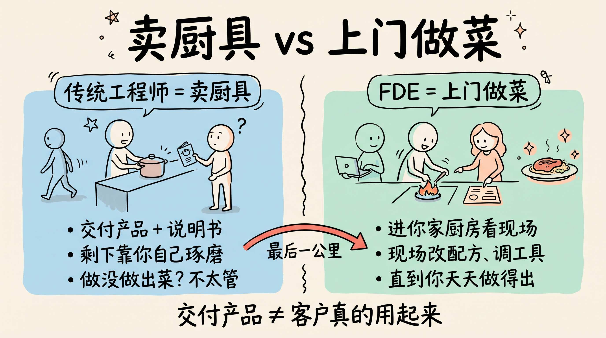
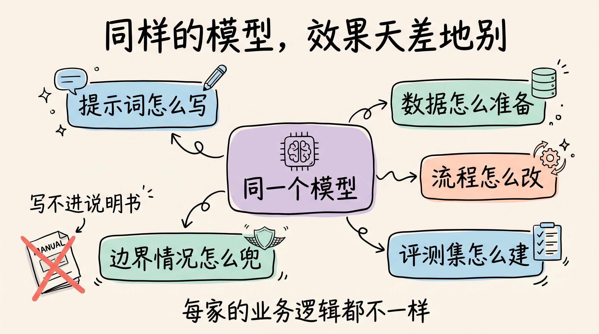
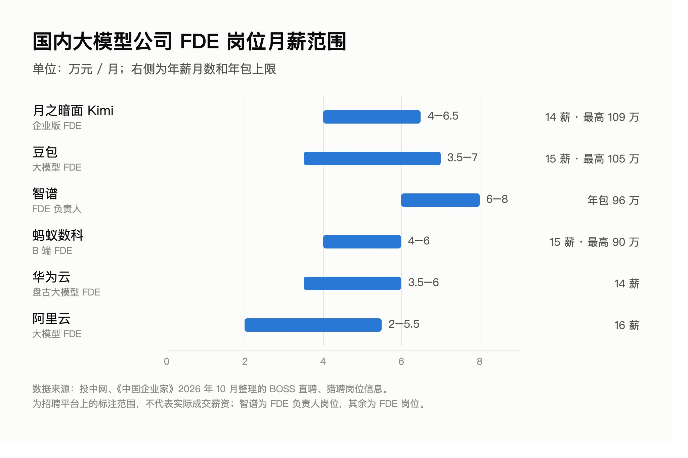
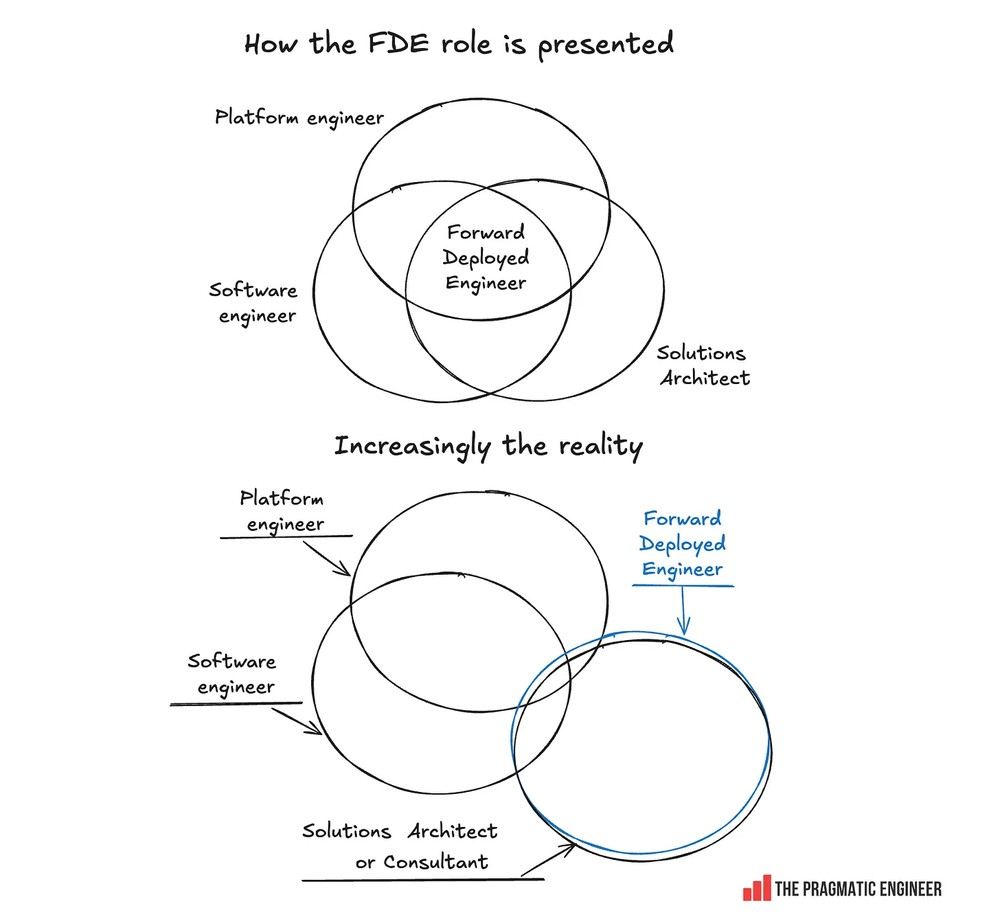
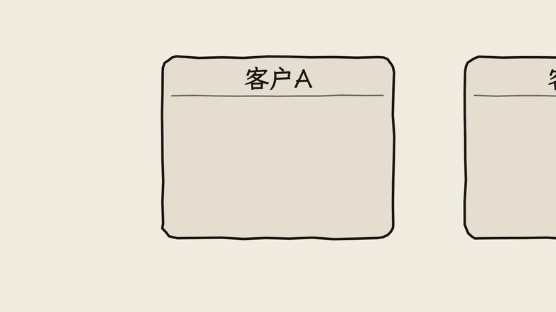

# 3分钟搞懂FDE(前向部署工程师)

> ⭐入门 · 阅读时间 3分钟 · 更新于 2026-11-25
>
> FDE 是被派到客户现场、在客户系统上直接写代码、对业务效果负责的工程师。本文讲清它从 Palantir 起源的来历、AI 落地为什么需要它、2026 年 OpenAI 和 Anthropic 怎么做，以及它和外包的界线、想做这行该看什么。

## 一句话定义

**FDE**（Forward Deployed Engineer，前向部署工程师）= 由 AI 公司或软件公司派到客户那边的工程师，直接在客户的系统和数据上写代码，把模型接进具体的业务流程，并且要对上线之后业务指标有没有变好负责。

国内对它的译法还没有统一，前向部署、前线部署、前沿部署工程师说的都是同一个岗位。Anthropic 在 2026 年的培训计划里又把它叫作 Frontier Deployed Engineer，缩写同样是 FDE。

这个岗位在 2025 年突然火了起来。Financial Times 和 Indeed 的分析显示，2025 年 1 月到 9 月，标题里带 FDE 的招聘信息每月数量涨了 8 倍多；而在 2025 年初，Indeed 上几乎还搜不到这个职位名。国内也一样，猎聘大数据研究院 2026 年 9 月的报告给出的 FDE 平均年薪是 40.8 万元，人才供需比只有 0.28，相当于大约 3.5 个岗位在抢 1 个人。

## 这个岗位是 Palantir 先做起来的

传统软件公司的交付方式，像是卖厨具：把锅和说明书交给你，剩下的靠你自己琢磨，你最后有没有做出一桌菜，卖家不太清楚，也不太负责。FDE 更像是上门做菜的厨师：他会进你家厨房，看你平时怎么做饭、家里有什么食材、火力有多大，然后现场调整配方和工具，直到你自己也能天天做出这桌菜为止。

最早大规模这么做的是 **Palantir**。这家公司的客户主要是政府、军队和大企业，数据分散在各种老系统里，需求也很难事先写清楚。2010 年代初，Palantir 设立了一个内部代号叫 **Delta** 的岗位，就是现在说的 FDE。Palantir 对普通产品工程师和 Delta 的区分很好记：产品工程师是“一个功能，服务很多客户”，Delta 是“一个客户，用上很多功能”。

直到 2016 年左右，Palantir 的 FDE 人数一直比普通软件工程师还多。也正是在这一年，Palantir 推出了 Foundry 平台，之后不少 FDE 转回去做了产品研发。一个比较常见的解读是：很多原本要靠 FDE 在每个客户那里重复搭建的东西，被做成了平台里的现成功能，所以不再需要那么多人驻场。

这段历史说明了 FDE 真正的价值：**它不只是帮一个客户把项目做完，而是把在现场发现的共性问题带回去，变成产品的一部分。**后面讲 FDE 和外包的区别时，这一点很关键。

## AI 落地，为什么特别需要有人在现场？

AI 产品有一个传统软件没有的特点：**同样的模型，不同的企业用出来，效果可能差别很大。**

差别主要出在五个地方：提示词怎么写、数据怎么准备、业务流程怎么改、用什么样的测试题（也就是评测集）来判断效果好不好、遇到边界情况怎么兜底。这些事情没办法提前写进说明书，因为每家公司的数据、流程和规矩都不一样。

另外，客户往往一开始也说不清自己要什么。比如客户说“我要一个客服 AI”，你做出来之后他说不对；聊了三轮才发现，他真正的痛点是工单分类的错误率太高，客服其实是被错派的工单拖累的。**这种需求挖掘必须有人在现场，跟着业务人员一起看真实的流程才能做出来。**

还有一点是 AI 特有的：模型的输出不是固定的，同一个问题问两次，答案也可能不一样。所以光演示几次效果好还不够，需要用客户自己的真实数据建一套评测，持续证明它在这家公司的场景里是稳定可用的。

阿里云副总裁霍嘉在 2026 年云栖大会期间谈到这类岗位时说过一句话：“我们能告诉客户‘什么做不到’，这本身也是一种巨大的价值。”在现场判断哪些环节现在适合交给 AI、哪些还不适合，也是 FDE 工作的重要部分。

## FDE 每天在做什么？

OpenAI 的 FDE 团队负责人 Colin Jarvis 讲过 FDE 和解决方案架构师的一个关键区别：解决方案架构师一般不会在客户的基础设施上写代码，用的多是脱敏或者离线的数据；而 FDE 要“在客户的基础设施上写代码，用客户自己的工具”。

一个典型的 FDE 项目大致是这样推进的：

- 先在客户的业务现场待一段时间，搞清楚流程到底卡在哪里，挑出最值得用 AI 改造的一两个环节
- 现场写代码：接入客户的数据和内部系统、写提示词、搭 Agent 工作流、处理权限和安全审查
- 用客户自己的数据建评测集，证明效果到底有没有变好
- 上线之后继续跟进，直到业务指标真正发生变化，再把系统交接给客户的团队维护
- 把在现场遇到的共性问题和客户反馈带回公司，推动产品迭代

它和国内读者熟悉的几个岗位，区别如下：

| 岗位 | 主要做什么 | 和 FDE 的差别 |
|------|-----------|--------------|
| **售前 / 解决方案架构师** | 出方案、做演示，帮销售签单 | 一般不在客户环境里写生产代码 |
| **实施交付工程师** | 按合同把产品部署上线、做配置 | 交付的是现成产品，不负责重新设计业务流程 |
| **外包开发** | 按需求文档交付代码 | 做完就走，不对业务结果负责，也不反哺产品 |
| **FDE** | 挖需求、写代码、上线、建评测、陪跑 | 对业务结果负责，并把现场经验带回产品 |

## 2026 年，各家公司都在怎么做 FDE？

2025 年，OpenAI、Anthropic 还只是在公司内部组建 FDE 团队。OpenAI 的 FDE 团队是 2025 年初成立的，一开始只有 2 个人，到 2025 年 8 月也才刚超过 10 个人。到了 2026 年，两家公司的做法都出现了明显变化：**开始单独成立公司，或者联合外部机构来扩大 FDE 的规模。**

- **OpenAI**：2026 年 5 月 11 日宣布成立 OpenAI Deployment Company（简称 DeployCo），这是一家由 OpenAI 控股的独立公司，由 TPG 牵头，联合了 19 家投资机构、咨询公司和系统集成商，初始投资超过 40 亿美元。它同时宣布收购英国的 AI 咨询公司 Tomoro，交割后会带来大约 150 名 FDE 和部署专家。DeployCo 的项目通常分三步：先诊断 AI 在哪些地方价值最大，再和客户管理层一起选出少数几个优先改造的流程，最后由 FDE 进场设计、开发、测试和部署生产系统。
- **Anthropic**：2026 年 5 月 4 日，和黑石、Hellman & Friedman、高盛联合成立了一家企业 AI 服务公司，主要面向中型企业，由 Anthropic 应用 AI 团队的工程师和这家公司的工程师一起，帮客户把 Claude 接进核心业务。10 月 2 日，Anthropic 又宣布投入 1 亿美元成立 Claude Frontier Academy，计划到 2027 年底培养 1 万名 FDE。第一批学员来自埃森哲、德勤、麦肯锡、凯捷等咨询公司，以及摩根士丹利、诺和诺德等企业，培训包括线下集训、在自己公司带一个真实的 Claude 项目做 12 周驻场实践，再通过考核拿到认证。
- **国内**：豆包、蚂蚁数科、智谱、月之暗面 Kimi、华为云盘古、阿里云都在招聘 FDE。按投中网和《中国企业家》在 BOSS 直聘、猎聘上看到的岗位信息，月之暗面 Kimi 企业版 FDE 的年包最高 109 万元，豆包大模型 FDE 月薪 3.5 万到 7 万元，阿里云大模型 FDE 月薪 2 万到 5.5 万元、16 薪。

*图注：根据投中网、《中国企业家》2026 年 10 月整理的 BOSS 直聘、猎聘岗位信息绘制。这些是招聘平台上标注的范围，不代表实际成交薪资；智谱一栏是 FDE 负责人岗位。*

从上面可以看出，FDE 正在从“少数精英工程师组成的小团队”，变成一种可以批量培训、批量派出的交付能力。对企业客户来说，这意味着能找到的落地服务会越来越多；对想做这行的工程师来说，这也带来了一个需要认真想清楚的问题。

## FDE 和外包，界线在哪里？

岗位一火，质疑也就跟着来了。

The Pragmatic Engineer 的作者 Gergely Orosz 在 2026 年 3 月写过一篇文章，标题就是《FDE 这个岗位是不是变得没那么吸引人了？》。他接触了两位去做 FDE 的工程师，结果两人都很失望：实际工作更像销售工程师，主要是帮公司签单、把产品部署给客户，除了集成产品团队已经做好的软件，几乎写不了什么代码，也很少有机会把东西贡献回平台。其中一位工程师入职 4 周就离职了。到了 5 月，OpenAI 和 Anthropic 先后把 FDE 放进独立公司之后，他又判断，这些新公司里的 FDE 很可能不会被当作母公司的“核心员工”，岗位会越来越接近解决方案架构师或者咨询顾问。

*图注：出自 The Pragmatic Engineer《The Pulse: Forward deployed engineering heats up again》（2026-05-24）。上半部分是 FDE 通常被宣传的样子：软件工程师、平台工程师（Platform engineer）、解决方案架构师（Solutions Architect）三种角色的交集；下半部分是作者认为越来越常见的现实：FDE 和软件工程、平台工程几乎没有交集，基本和解决方案架构师或咨询顾问重合。*

国内投资人的看法也类似。鼎晖投资的刘羽轩说：“如果仅仅驻场做一次性的项目交付，就和外包没有区别。”他还提到：“海外更多是标准化的 SaaS 产品，中国总是需要项目式交付。”

背后的原因是一笔经济账。FDE 本质上是按人力投入的服务，一个工程师同一时间只能服务很少几个客户，毛利天然比卖标准化软件低。投资机构 a16z 在 2025 年 6 月的文章里，把这种做法概括为“**用毛利换护城河**”：创业公司在早期愿意接受更低的毛利，派工程师深入客户现场，换来的是对客户数据和工作流程的深度绑定。

但这笔账能不能算过来，取决于一个前提：**现场的经验最后有没有变成产品。**如果像 Palantir 当年那样，FDE 在不同客户那里反复解决的问题最后都做进了平台，那么每多做一个客户，产品就更强一点，后面的交付成本也会越来越低。如果每个项目做完就结束，经验只留在 FDE 个人的脑子里，那它其实就是换了个名字的高级外包。

所以当你在看一个 FDE 岗位时，可以重点问清楚这几件事：

- **写不写生产代码**：是在客户环境里真正开发和上线系统，还是主要做演示、培训和配置
- **对什么结果负责**：考核的是项目按时交付、签单金额，还是客户的业务指标有没有变化
- **经验能不能回流**：现场发现的问题有没有固定的渠道反馈给产品团队，有没有被做成产品功能的先例
- **你属于哪家公司**：是模型公司或产品公司的正式员工，还是合资公司、合作伙伴的员工，这会影响你的职业路径和股权

## 什么样的人适合做 FDE？

先说能力要求。FDE 在现场通常没有后援，遇到问题要当场解决，所以对工程能力的**广度**要求比一般岗位更高，数据处理、后端开发、模型调用、系统集成都要能上手。2026 年的 FDE 岗位还普遍要求有用大模型搭过应用的经验，比如写过 Agent、做过评测、处理过提示词注入这类安全问题。

技术之外，还需要能听懂业务。客户说出来的需求只是一部分，FDE 要能从业务人员的抱怨里，听出真正值得改造的那个环节。很多时候，项目推不动也不是因为技术问题，而是因为流程要改、有人不愿意改，这就需要沟通和推动的能力。

所以这个岗位更适合“什么都干过、能跟人打交道”的工程师：做过全栈、做过技术顾问、在业务部门待过的技术人，往往比只专精某一个技术方向的人更容易上手。

当然也要清楚它的代价。FDE 经常要出差、驻场，客户那边的开发环境往往很糟糕，需求也一直在变。如果你更享受长期打磨一个产品、深入钻研某个技术方向，那么产品研发岗位可能会更适合你。

## 时效性提醒

FDE 还是一个正在快速变化的岗位，下面这些信息变化比较快：

- 不同公司对 FDE 的定义差别很大，同一个职位名下，有的是真正写代码的工程师，有的更接近售前或实施，一定要看岗位的具体职责
- OpenAI DeployCo、Anthropic 的企业 AI 服务公司都是 2026 年刚成立的，对 Tomoro 的收购在公告时也还在等待交割，具体的组织方式和招聘规模还会继续调整
- 招聘平台上的薪资是岗位标注的范围，不代表实际成交价，各家媒体统计的岗位增长数字口径也不一样，只适合用来判断大致的趋势

**建议**：看一个 FDE 岗位时，先问清楚写不写生产代码、对什么结果负责、经验能不能回流到产品，再决定要不要投递。

💬 **互动话题**：如果让你去客户那边驻场三个月，把 AI 接进他们的业务流程，你觉得自己最先会卡在技术、业务理解，还是推动别人改流程上？

📖 **相关阅读**：

- [3分钟搞懂AI就业影响](../04-ai-and-jobs/README.md) - AI 在替代哪些工作，又在创造哪些新岗位
- [3分钟搞懂AI商业模式](../01-ai-business-models/README.md) - AI 公司怎么赚钱，为什么愿意用毛利换落地
- [3分钟搞懂Evals](../../09-agent-engineering/09-evals/README.md) - FDE 证明效果时要用到的评测方法
- [3分钟搞懂AI-Agent](../../02-core-capabilities/05-ai-agent/README.md) - FDE 在客户那里搭建的主要系统形态
- [3分钟搞懂OPC](../05-opc/README.md) - 另一种 AI 时代的新就业形态：一个人开公司

**资料来源**：

- The Pragmatic Engineer，What are Forward Deployed Engineers, and why are they so in demand?（2025-08-12）：https://newsletter.pragmaticengineer.com/p/forward-deployed-engineers
- The Pragmatic Engineer，Is the FDE role becoming less desirable?（2026-03-27）：https://blog.pragmaticengineer.com/is-the-fde-role-becoming-less-desirable/
- The Pragmatic Engineer，The Pulse: Forward deployed engineering heats up again（2026-05-24）：https://blog.pragmaticengineer.com/the-pulse-forward-deployed-engineering-heats-up-again/
- a16z，Trading Margin for Moat: Why the Forward Deployed Engineer Is the Hottest Job in Startups（2025-06-04）：https://a16z.com/services-led-growth/
- Fast Company，Postings for this AI job are up 800%（转引 Financial Times 与 Indeed 的分析）：https://www.fastcompany.com/91435680/postings-for-this-ai-job-are-up-800
- OpenAI，OpenAI launches the OpenAI Deployment Company to help businesses build around intelligence（2026-05-11）：https://openai.com/index/openai-launches-the-deployment-company/
- Anthropic，企业 AI 服务公司公告（2026-05-04）：https://www.anthropic.com/news/enterprise-ai-services-company
- Anthropic，Anthropic invests $100 million to train 10,000 engineers and tackle the enterprise AI talent gap（2026-10-02）：https://anthropic.com/news/claude-frontier-academy
- 投中网（虎嗅转载），《月薪7万，招不到人？》（2026-10-12），含 LinkedIn、猎聘大数据研究院数据：https://m.huxiu.com/article/4896800.html
- 中国企业家（投资界转载），《一天一万元疯抢FDE，藏着AI落地的残酷真相》（2026-10）：https://news.pedaily.cn/202610/570622.shtml
- 每日经济新闻，阿里云副总裁霍嘉谈 FDE（2026-09-29）：https://www.sohu.com/a/1082429059_115362

---

⬅️ 上一篇：[3分钟搞懂AI商业模式](../01-ai-business-models/README.md) ｜ [📚 返回目录](../README.md) ｜ 下一篇：[3分钟搞懂GEO](../03-geo/README.md) ➡️
