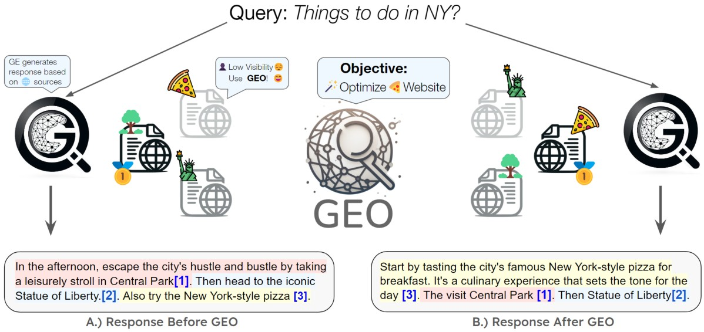
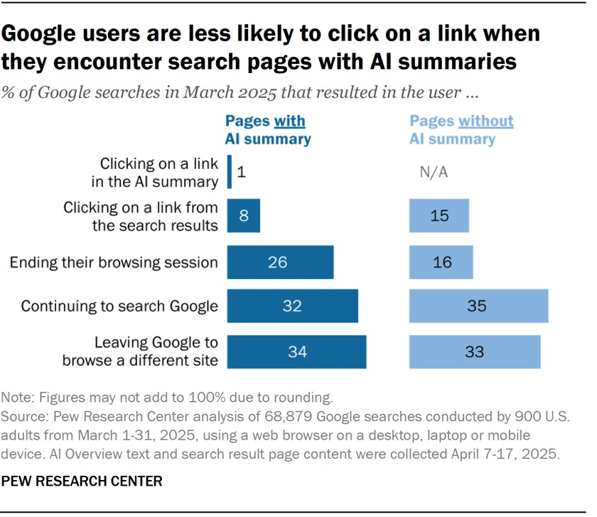
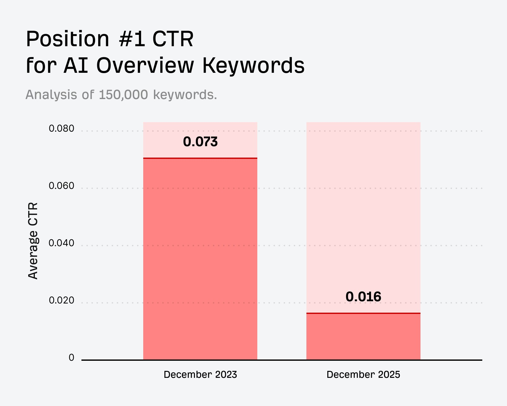
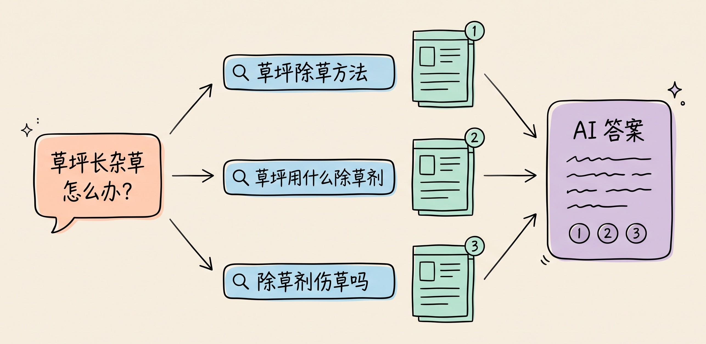

# 3分钟搞懂GEO

> ⭐入门 · 阅读时间 3分钟 · 更新于 2026-11-25
>
> GEO 是让内容被 AI 搜索选进答案的优化方法。本文讲清 AI 怎么挑引用来源、论文里“提升 40%”是怎么测出来的、哪些做法有用哪些可以忽略，以及同一套手法为什么会被拿来给 AI 投毒。

## 一句话定义

**GEO**（Generative Engine Optimization，生成式引擎优化）= 针对 AI 搜索调整网站和内容，让 AI 在回答问题时能检索到你的页面、引用你的说法、在答案里提到你的品牌或产品。

传统 SEO 争的是搜索结果里的排名，用户看到链接再点进来。而在 AI 搜索里，用户问完问题，看到的是 AI 读完一批网页后写好的一段答案，旁边附几个来源。GEO 争的就是这段答案里的位置：有没有被引用，引用了多少，说的对不对。

*图注：GEO 原始论文里的示意图。用户问“纽约有什么好玩的”，左边是优化前的答案，披萨店网站排在第三条、只被一笔带过；右边是这家网站按 GEO 方法改写内容之后，AI 的答案开头就先推荐了纽约披萨，并引用了它。图片来自 Aggarwal 等《GEO: Generative Engine Optimization》，CC BY 4.0 许可。*

## 用户不点链接了，内容还有什么用？

GEO 这个词会火起来，是因为搜索流量的分配方式变了。

Pew 研究中心在 2025 年 3 月追踪了 900 名美国成年人的真实浏览记录，一共 6.8 万多次 Google 搜索。结果是：当搜索结果顶部出现 AI 摘要时，用户点击下面普通链接的比例是 8%；没有 AI 摘要时是 15%，差不多少了一半。而 AI 摘要里附带的来源链接，只在 1% 的访问里被点过。Google 对这项研究提出了异议，认为它的方法和样本不能代表真实的搜索流量。

*图注：Pew 研究中心统计的 2025 年 3 月 Google 搜索中用户的后续行为。左列是出现 AI 摘要的页面，右列是没有 AI 摘要的页面，从上到下依次是：点击 AI 摘要里的链接、点击普通搜索结果、直接结束浏览、继续在 Google 搜索、离开 Google 去别的网站，单位是百分比。出现 AI 摘要时，直接结束浏览的比例也从 16% 升到了 26%。*

Ahrefs 用 Search Console 数据做的对比也指向同一个方向。它挑了 15 万个现在会出现 AI 摘要的关键词，在 AI 摘要上线之前的 2023 年 12 月，排第一的页面平均点击率是 7.3%，到 2025 年 12 月只剩下 1.6%。不过同一时期，没有 AI 摘要的信息类关键词点击率也从 7.6% 降到了 3.9%，搜索整体都在变得“不用点击”。扣掉这部分整体下滑之后，Ahrefs 估算 AI 摘要让排第一的页面点击率降低了大约 58%。这家机构 2025 年第一次测的时候，这个数字还是 34.5%。

*图注：Ahrefs 统计的 15 万个出现 AI 摘要的关键词上，排第一的页面的平均点击率（Average CTR），2023 年 12 月是 0.073（7.3%），2025 年 12 月是 0.016（1.6%）。数据基于 Google Search Console 的桌面端点击数据。*

另一边，直接去问 AI 的人越来越多。OpenAI 在 2026 年 2 月公布，ChatGPT 的周活跃用户已经达到 9 亿。国内的豆包、元宝、千问、DeepSeek、Kimi 也都有联网搜索，回答时同样会列出参考的网页。

这两组数字放在一起看，能得出两个结论：

- **被引用不等于有流量**。就算 AI 引用了你，大部分用户也不会点进来。所以 GEO 的价值更多在于“被提到”：用户问“有哪些好用的 XX 工具”，答案里有没有你的名字，介绍得对不对。
- **衡量方式要跟着变**。只看网站访问量，会低估 AI 搜索对你的影响；更该看的是你在 AI 答案里出现的次数和被描述的方式。

## AI 搜索是怎么挑引用来源的？

大部分 AI 搜索的底层做法都是 **RAG**（检索增强生成）：先去搜索引擎的索引里找相关网页，把找到的内容放进上下文，再让模型基于这些内容写答案，并标出来源。

Google 在官方指南里还提到一个细节，叫**查询扩展**（query fan-out）：模型不会只按用户的原话搜一次，而是同时拆出好几个相关的问题一起搜。比如用户问“草坪长杂草怎么办”，它可能还会去搜“草坪用什么除草剂好”，再把这些结果合在一起回答。所以你的页面不一定要正好命中用户的原话，命中其中一个拆出来的问题也可能被选中。

这个流程决定了 GEO 的第一道门槛：**AI 只能引用它检索得到的页面**。页面没被收录、不让爬虫抓、加载不出来，后面的优化都无从谈起。

这也是 Google 对 GEO 的官方态度。它在 2026 年发布的 AI 搜索优化指南里专门回答了“AEO 和 GEO 是什么”，结论是：为生成式 AI 搜索做优化，本质上就是为搜索体验做优化，**所以仍然是 SEO**。页面要能出现在 AI 摘要和 AI Mode 里，前提是已经被 Google 收录，并且有资格显示摘要片段。

不过 Google 的说法只覆盖它自己的产品。ChatGPT、Copilot、Perplexity 和国内各家用的是各自的索引和排序方式，引用的来源不一定和 Google 搜索的结果一样。所以比较稳妥的理解是：SEO 是基础，但每个 AI 搜索平台还需要单独确认自己的内容能被它抓到。

## 论文里的“提升 40%”，是怎么测出来的？

很多 GEO 服务的宣传都会引用一个数字：GEO 能让内容在 AI 答案里的可见度提升 40%。这个数字出自 GEO 这个概念的原始论文，作者来自普林斯顿大学和印度理工学院德里分校等机构，论文发表在 2024 年的 KDD 会议上。

研究人员做了一个包含 1 万个问题的测试集，然后把同一批网页分别用 9 种方法改写，看改写后的网页在 AI 答案里占的分量有没有变多。结果是：

| 改写方法 | 做了什么 | 效果 |
|---|---|---|
| 添加引语 | 在文中加入相关人物或机构的原话 | 最好，提升约 40% |
| 添加统计数据 | 把定性描述换成具体数字 | 提升约 30% |
| 引用来源 | 给说法标上可信的出处 | 提升约 30% |
| 关键词堆砌 | 反复塞入问题里的关键词 | 基本没用，部分指标还下降了 |

有三个细节比 40% 这个数字更值得注意：

- **排名靠后的网站受益更大**。在“引用来源”这个方法上，原本排在第 5 位的网站可见度提升了 115%，而排第 1 的网站反而下降了 30%。这是因为传统搜索很看重外链和域名权重，AI 写答案时更看重内容本身能不能直接拿来用，小网站有了更多被选中的机会。
- **不同领域，有效的方法也不一样**。引用来源对事实类问题和法律政务类问题最有效，添加引语对人物、历史类问题最有效。没有一种改法对所有内容都好用。
- **40% 是实验条件下的最好结果**。它是在特定测试集、特定指标上测出来的相对提升，在真实的 Perplexity 上测，最好的方法提升在 22% 到 37% 之间。2026 年有综述论文专门指出，把“GEO 能提升 40%”当成普遍结论是不准确的。

所以这篇论文真正说明的是：**AI 更愿意引用有具体数字、有原话、有出处的内容**，而不是靠堆关键词来骗排名。

## 哪些做法真的有用，哪些可以忽略？

### 先确认 AI 的爬虫能进来

很多网站为了不让自己的内容被拿去训练模型，在 robots.txt 里把 AI 爬虫一刀切全屏蔽了，结果连 AI 搜索也找不到自己。其实各家已经把爬虫按用途分开了，以 OpenAI 为例：

| 爬虫 | 用途 | 屏蔽之后 |
|---|---|---|
| OAI-SearchBot | ChatGPT 搜索 | 不会出现在 ChatGPT 的搜索答案里 |
| GPTBot | 训练模型 | 内容不会被用来训练，不影响搜索 |
| ChatGPT-User | 用户在对话里让 ChatGPT 打开某个网页 | 这是用户主动发起的访问，robots.txt 不一定生效 |

所以如果你**只是不想被拿去训练，又希望出现在 AI 搜索里**，可以屏蔽 GPTBot，放行 OAI-SearchBot。Google 也是类似的思路：屏蔽 Google-Extended 只影响 Gemini 等模型的训练使用，不影响网站在 Google 搜索里的收录。改完 robots.txt 后，OpenAI 说大约需要 24 小时才会生效。

### 写别人写不出来的内容

Google 的指南里把这一条放在了最重要的位置：**非同质化内容**对你在 AI 搜索里的表现，长期来看比其他所有建议的影响都大。它举的反面例子是“首次买房的 7 个小贴士”这类到处都能搜到的内容，AI 随便从哪一篇里都能总结出来，没有理由非引用你不可。

能被优先引用的，是只有你能提供的东西：自己测出来的数据、亲手踩过的坑、一手的产品信息。对开发者来说，一篇写清楚“接口延迟降了多少、具体改了哪几处、为什么这么改”的实战复盘，比一篇泛泛的“性能优化十大技巧”更容易被 AI 当成依据。再配合论文里验证过的做法，把关键说法写成具体数字、标上出处，内容就更容易被直接摘进答案。

### 确认 AI 对你的描述是对的

GEO 不只是“被引用”，还包括“被说对”。如果你在做产品，可以定期去几个主流 AI 搜索里问一问和你相关的问题，看看答案里有没有你，价格、功能、适用人群写得对不对。如果 AI 说错了，往往是因为网上能搜到的信息本身就旧了或互相矛盾，这时要做的是把官网、文档、各平台的介绍更新一致。

衡量效果也有了官方工具。Google Search Console 提供了生成式 AI 效果报告，可以看到用户通过 AI 功能找到你内容的情况；微软在 2026 年 2 月给 Bing 站长工具推出了 AI Performance 报告的公开预览，能看到内容在 Copilot 和 Bing AI 摘要里被引用了多少次、是因为哪些问题被引用的，不过目前还看不到这些引用带来了多少点击。

### 这些可以先不做

Google 在同一份指南里列出了几条可以忽略的说法，基本对应了市面上 GEO 教程最常推荐的做法：

- **llms.txt**：一种专门写给 AI 读的网站说明文件。Google 明确说搜索不会使用它，写了既不加分也不减分。不过它对 AI 编程工具读开发文档还是有点用的，有需要的话可以保留。
- **把内容切成小块**：Google 能理解一个页面里讲了好几个主题，没有必要为了 AI 把文章拆碎，也没有理想的页面长度。
- **专门为 AI 改写内容**：AI 能理解同义词和整体意思，不需要为每一种问法单独写一个页面。批量生成这类页面还会被算作违反垃圾内容政策。
- **刷“品牌提及”**：花钱找人在各处提你的品牌，效果没有想象中那么大，因为排序系统本来就会过滤垃圾内容。
- **专门为 AI 加结构化数据**：没有哪种特殊的标记是 AI 搜索必需的，原有的结构化数据照常保留就行。

需要注意的是，这份指南只针对 Google 搜索，在其他 AI 搜索平台上效果如何，还需要你自己测试。

## 同样的手法，也能用来给 AI 投毒

GEO 有一个绕不开的问题：既然 AI 的答案是从检索到的网页里拼出来的，那只要往网上放足够多的内容，就有可能左右它的回答。

2026 年的央视 3·15 晚会曝光了这样一条产业链。测试中，业内人士用一款“GEO 优化系统”虚构了一款并不存在的智能手环，让软件自动生成十几篇评测软文，批量发到各个自媒体平台。两个小时后，这款虚假产品就出现在了 AI 搜索的推荐答案里。这种做法不需要改动模型本身，攻击的是 RAG 检索网页的这一步，所以见效非常快。

监管随后跟进了。2026 年 4 月 30 日，中央网信办部署了为期 4 个月的“清朗·整治 AI 应用乱象”专项行动，第一阶段把 **AI 数据投毒**单列为整治重点，明确点名了“使用 GEO 技术恶意营销”，也包括在电商平台兜售投毒教程和工具；同时还指出，模型在生成回答时对引用的信源缺乏交叉验证和风险提示，同样是需要整改的问题。

这件事对不同的人意味着不同的事情：

- **如果你是普通用户**，AI 推荐的产品、给出的评测结论，不能直接当成定论。尤其是涉及到花钱、健康的决定时，一定要点开它引用的来源看一看，确认是不是可靠的网站，而不是一批内容雷同的自媒体软文。
- **如果你在做产品或营销**，要分清正常的 GEO 和投毒。把自己产品的真实信息写清楚、让 AI 能抓到，是正常的优化；批量编造评测、虚构数据去影响 AI 的回答，属于虚假宣传，面临的就是法律风险了。遇到承诺“保证让 AI 推荐你”的服务商，最好先问清楚他们具体是怎么做的。

## 时效性提醒

GEO 还是一个很新的领域，变化快的主要是这几类信息：

- AI 搜索对点击率的影响，各家研究的数字差别很大，而且还在持续变化
- 各平台爬虫的名字、用途划分，以及 Google 优化指南的具体条目
- Search Console 和 Bing 站长工具里的 AI 报告，目前都还在陆续增加功能
- 国内针对 GEO 和 AI 数据投毒的监管规则，专项行动还在推进中

**建议**：动手调整网站之前，以各平台的官方文档为准。

💬 **互动话题**：你去 AI 搜索里问过和自己的产品或博客相关的问题吗？它提到你了吗，介绍得对不对？

📖 **相关阅读**：

- [3分钟搞懂AI搜索引擎](../../06-applications/01-ai-search/README.md) - AI 搜索是怎么找资料、写答案的
- [3分钟搞懂RAG检索增强](../../02-core-capabilities/04-rag/README.md) - AI 引用网页背后的检索机制
- [3分钟搞懂AI幻觉](../../04-advanced/04-hallucination/README.md) - 有引用的答案为什么也会出错
- [3分钟搞懂Prompt注入攻击](../../04-advanced/13-prompt-injection/README.md) - 另一种通过网页内容影响 AI 的攻击方式
- [3分钟搞懂AI商业模式](../01-ai-business-models/README.md) - AI 搜索对内容行业的商业影响

**资料来源**：

- Aggarwal 等，GEO: Generative Engine Optimization（KDD 2024，CC BY 4.0，文中示意图出自此文）：https://arxiv.org/abs/2311.09735
- Optimizing Visibility in Generative Engines: A Critical Survey of Generative Engine Optimization (2023-2026)：https://arxiv.org/abs/2607.14035
- Pew Research Center，Google users are less likely to click on links when an AI summary appears in the results（2025-07-22）：https://www.pewresearch.org/short-reads/2025/07/22/google-users-are-less-likely-to-click-on-links-when-an-ai-summary-appears-in-the-results/（文中点击行为图出自此文）
- Ahrefs，Update: AI Overviews Reduce Clicks by 58%（2026-02-04，文中点击率图出自此文）：https://ahrefs.com/blog/ai-overviews-reduce-clicks-update/
- TechCrunch，ChatGPT reaches 900M weekly active users（2026-02-27）：https://techcrunch.com/2026/02/27/chatgpt-reaches-900m-weekly-active-users
- Google Search Central，Optimizing your website for generative AI features on Google Search：https://developers.google.com/search/docs/fundamentals/ai-optimization-guide
- Google Search Central，Google 常见爬虫说明（含 Google-Extended）：https://developers.google.com/search/docs/crawling-indexing/google-common-crawlers
- OpenAI，Overview of OpenAI Crawlers：https://developers.openai.com/api/docs/bots
- Bing Webmaster Blog，Introducing AI Performance in Bing Webmaster Tools Public Preview（2026-02）：https://blogs.bing.com/webmaster/February-2026/Introducing-AI-Performance-in-Bing-Webmaster-Tools-Public-Preview
- 新浪财经，央视3·15晚会曝光AI大模型“投毒”黑产（2026-03-16）：https://finance.sina.com.cn/stock/t/2026-03-16/doc-inhrcxwy9819362.shtml
- 中央网信办，中央网信办部署开展“清朗·整治AI应用乱象”专项行动（2026-04-30）：https://www.cac.gov.cn/2026-04/30/c_1779289298718765.htm
- 新华网，中央网信办深入开展“清朗·整治AI应用乱象”专项行动第一阶段工作（2026-07-06）：https://www.news.cn/politics/20260706/4ce1356eb1b34e878c3fa1e2d9e5da1f/c.html

---

⬅️ 上一篇：[3分钟搞懂FDE(前向部署工程师)](../02-fde/README.md) ｜ [📚 返回目录](../README.md) ｜ 下一篇：[3分钟搞懂AI就业影响](../04-ai-and-jobs/README.md) ➡️
