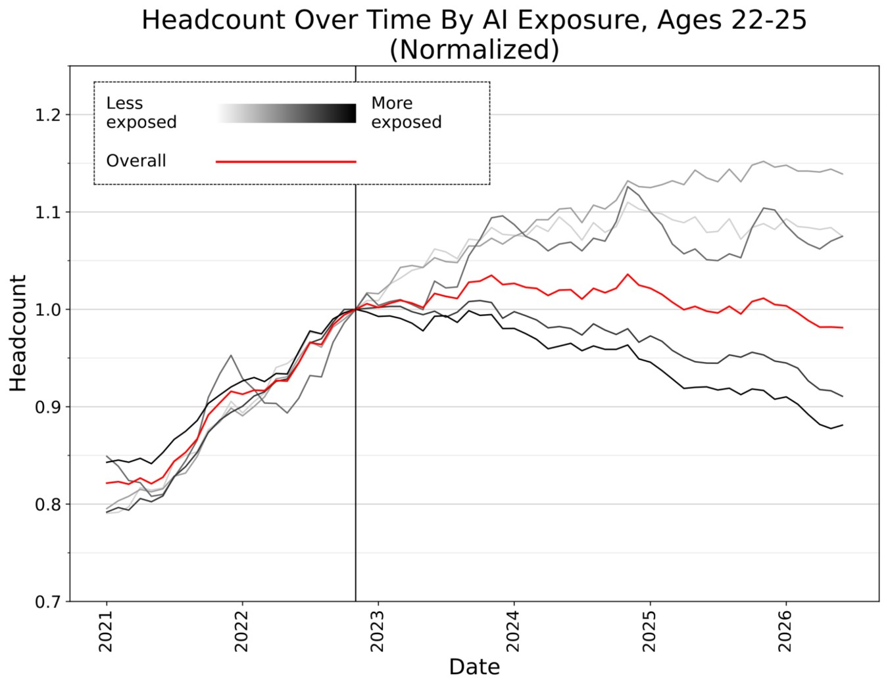
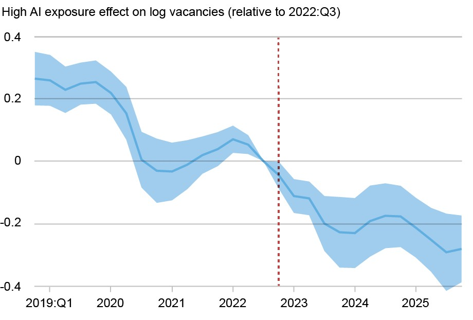
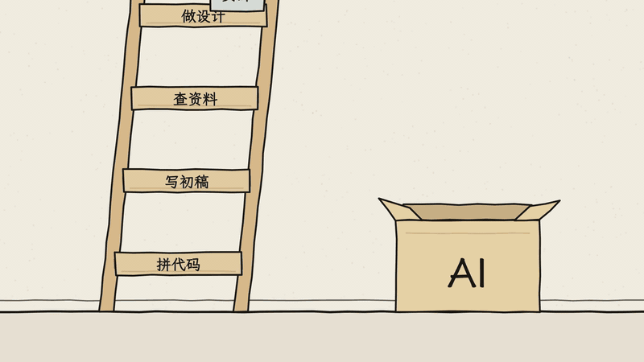
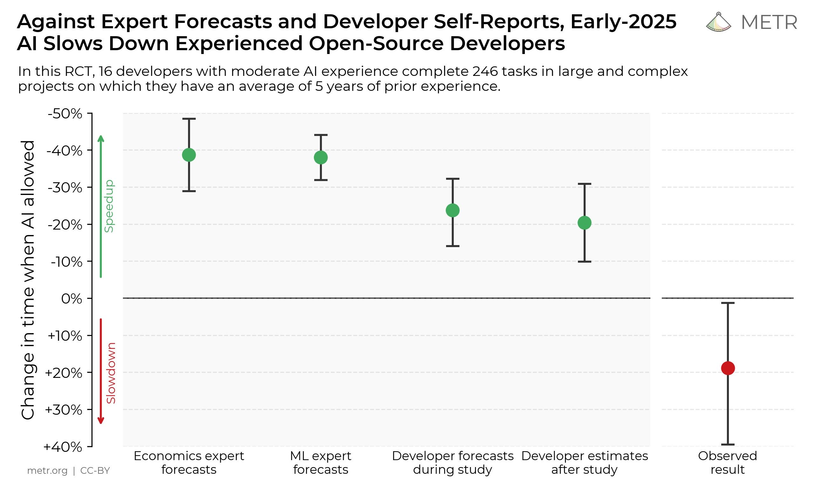

# 3分钟搞懂AI就业影响

> ⭐⭐中级 · 阅读时间 3分钟 · 更新于 2026-11-25
>
> 到 2026 年，AI 对就业的影响已经能在数据里看到：整体就业没有大面积被替代，但年轻人进入 AI 高暴露岗位的门在变窄，冲击主要体现在少招人而不是裁员。本文讲清各方数据怎么看、哪类工作先变、国内政策动向，以及个人怎么判断自己的工作。

## 一句话定义

**AI 对就业的影响** = AI 接手工作里能写成规则、能快速验收的那部分任务之后，企业重新决定招多少人、招什么样的人、让现有员工做什么，由此带来的岗位数量、岗位内容和入行门槛的变化。

这个定义里最关键的是「任务」两个字。AI 替代的通常不是一整个岗位，而是岗位里的一部分事情。一个客服每天要做的事情里，查订单、回答退换货规则这类问题，AI 已经能处理得不错；但碰到情绪激动的客户、需要破例处理的投诉，还是要人来接手。所以讨论 AI 就业影响时，与其问「我的岗位会不会消失」，不如问「我的工作里，有多少件事已经能交给 AI 做出合格的结果」。

## 到 2026 年，数据里看到了什么？

ChatGPT 发布快四年了，关于 AI 抢工作的说法一直很多。不过几份重要的研究，结论并不完全一致，我们需要把它们放在一起看。

**第一份是斯坦福数字经济实验室的研究。**Erik Brynjolfsson 团队用美国最大的薪资服务商 ADP 的工资单数据，跟踪了数百万名员工。2026 年 8 月更新的版本显示：在 AI 高暴露的职业里，22 到 25 岁年轻人的就业人数比按正常趋势应有的水平低了大约 19%，一年前这个差距还是 15%。具体来看，从 2022 年 11 月到 2026 年 6 月，最容易受 AI 影响的那批职业里，这个年龄段的就业人数下降了大约 11%，而受影响最小的那批职业里反而增长了大约 10%。

同样是这些职业，有经验的员工并没有出现类似的下降。而且这个差距主要来自企业**少招了年轻人**，而不是辞退了更多的人。


*图注：斯坦福数字经济实验室 2026 年 8 月更新的图表，基于 ADP 工资单数据，统计范围是 22 到 25 岁的员工。纵轴是就业人数，以 2022 年底 ChatGPT 发布时（竖线处）为 1.0；颜色越深的线代表 AI 暴露度越高的职业，红线是整体水平。可以看到，ChatGPT 发布之后，暴露度最高的两组（最深的两条线）一路往下走，暴露度低的几组则继续增长。*

**第二份是纽约联储 2026 年 5 月的分析**，它看的是招聘广告数据，得出的结论要谨慎得多：美国整体招聘确实放缓了，但从招聘广告里看不出有一个明显由 AI 造成的需求下降。AI 高暴露职业的招聘广告确实减少得更多，但这个趋势在 ChatGPT 发布之前就已经开始了；高暴露职业里初级岗和高级岗的招聘广告基本是同步变化的，并没有集中在初级岗。另外，美国约 40% 的劳动者所在的岗位，按他们的测算方法，AI 暴露度为零。


*图注：纽约联储 Liberty Street Economics 2026 年 5 月文章中的图表，数据来自 Lightcast 招聘广告。蓝线表示 AI 高暴露职业的招聘广告数量相对其他职业的差距（以 2022 年第三季度为 0，数值越低说明相对减少得越多），浅蓝色区域是 95% 置信区间，红色虚线是 ChatGPT 发布的时间。可以看到，下滑从 2020 年就开始了，ChatGPT 发布之后并没有出现明显的额外转折。*

两份研究的分歧，其实斯坦福团队自己也承认了一部分：他们强调这些是描述性的数据，不能证明就是 AI 造成的；考虑学历因素之后差距会缩小；有些分化的趋势在生成式 AI 普及之前就能看到。所以比较合理的推测是：**AI 已经在影响年轻人进入某些职业，但影响有多大、有多少要算在 AI 头上，目前还没有定论。**

**第三类数据是企业自己说的裁员原因。**美国咨询公司 Challenger, Gray & Christmas 每月统计企业公开宣布的裁员计划。截至 2026 年 10 月，今年美国企业宣布裁减的岗位里，有 121,401 个把 AI 列为原因，约占全部裁员的 20%，而 2025 年全年这个数字是 54,836。AI 曾经连续几个月是排名第一的裁员原因，但到了 10 月，单月只有 1,265 个岗位把 AI 列为原因，是今年最低的一个月，全年累计也被「市场和经济状况」超过了。

看这组数字时要注意两点：它统计的是**宣布的计划**，不是实际已经裁掉的人数；原因也是**企业自己对外说的**。在当下的舆论环境里，把裁员说成「拥抱 AI、提升效率」比说成「业务不好」更好听，所以这里面有多少是真正被 AI 替代的，外人很难判断。

## 冲击先落在招聘入口，而不是裁员

把上面几份数据放在一起，能看到一个比较一致的方向：**目前 AI 对就业的影响，主要不是让在岗的人失业，而是让企业少招新人。**

这背后的逻辑并不复杂。当一个团队发现 AI 能把初级员工的一部分工作做掉时，最省事的做法不是辞退谁，而是有人离职后不再补招，或者今年的校招名额少招几个。对公司来说，这样做没有裁员的成本和舆论压力；但对刚毕业的年轻人来说，结果就是投出去的简历石沉大海。

斯坦福团队在最新版本里给出了一个解释，用来说明为什么偏偏是年轻人受影响。他们把工作需要的知识分成两类：

- **可编码的知识**：能写进教科书、文档和操作手册里的知识，比如语法规则、财务报表的标准做法、常见代码的写法。年轻人刚走出校园，手里主要就是这类知识，而这恰好也是 AI 从海量文本里学得最好的部分。
- **隐性知识**：靠多年经验积累、很难写下来的东西，比如判断一个客户是不是真的要走、一个需求背后真正要解决的是什么问题、一段代码改了之后会在哪里出事。

他们的数据显示，在依赖可编码知识的职业里，年轻人的就业下降了；而在依赖隐性知识的职业里，有经验员工的就业反而在增长。

这件事还有一个更长远的影响。初级岗位一直是行业培养人的地方，今天的资深工程师、资深律师，都是从做简单、重复的活开始，一点点积累出隐性知识的。如果企业都只想要「来了就能独当一面」的人，不再给新人练手的机会，那么五到十年后，能验收 AI 输出、能处理复杂问题的资深员工从哪里来，会是每个行业都要面对的问题。



## AI 替代的是任务，不是整个岗位

「某职业将被 AI 替代 80%」这类说法很常见，但它往往是把「这个岗位里有 80% 的任务 AI 理论上能参与」偷换成了「80% 的人会失业」。

国际劳工组织（ILO）在 2025 年 5 月发布的全球指数里估算，全球大约四分之一的工作岗位在不同程度上会受到生成式 AI 的影响，但其中处于最高暴露等级的只占 3.3%。他们的判断是，大部分岗位会被**改变**，而不是被**取代**，因为岗位里总有一部分任务仍然需要人来完成。

同样是用 AI，用法不同，对岗位的影响也完全不同：

| 用法 | 是什么 | 对岗位的影响 |
|------|--------|-------------|
| **自动化** | AI 直接把一件事从头做到尾，人只看结果 | 这部分任务需要的人会变少 |
| **增强** | 人和 AI 来回协作，AI 出草稿、给选项，人来判断和修改 | 同样的人能做更多事，对人的要求会变高 |

斯坦福的数据也印证了这一点：就业下降主要集中在 AI 被用来「自动化」的职业里；在 AI 主要被用来「增强」的职业里，就业人数持平甚至在增长。Anthropic 在 2026 年 1 月发布的经济指数报告里也能看到这种区别：普通用户在 Claude.ai 网页端的对话里，增强式的用法略多于一半；而企业通过 API 接入时，自动化的用法占了大头。也就是说，**当企业把 AI 接进自己的业务系统时，更倾向于让它直接把事情做完。**

按照「任务能不能写成规则」「结果能不能快速验收」这两个标准，大致可以把常见的工作内容分成三类：

```
更容易被自动化的任务:
  按固定流程回答的客服问题、表单录入、标准化文案、
  日常文档的初稿翻译、照着需求拼接的简单代码

更容易被增强的任务:
  医生看片子时的辅助判断、律师的检索和合同初稿、
  程序员的系统设计和代码评审、老师的个性化辅导

短期内很难交给 AI 的任务:
  需要现场处理的、需要承担责任签字的、
  需要长期信任关系的、需要处理意外情况的
```

客服是最早被大规模自动化的领域之一，但它的经历也说明了自动化不是一步到位的。Salesforce CEO Marc Benioff 在 2025 年 9 月说，公司借助 AI Agent 把客服团队从约 9,000 人减到了约 5,000 人。而另一个经常被引用的例子 Klarna，在 2024 年宣布 AI 助手能顶替 700 名客服的工作量之后，到 2025 年又表示要重新招聘人工客服，确保客户随时能找到真人沟通。**简单的工单可以交给 AI，但复杂和带情绪的问题，最终还是会回到人手里。**

## 程序员：最早感受到变化的白领

在这一轮变化里，程序员可能是体感最强的一群人。从 Copilot 补全代码，到 Cursor、Claude Code 这类工具可以自己读项目、改多个文件、跑测试，「写出一段能跑的代码」的成本在快速下降。

但「AI 让程序员效率翻倍」这个说法也不能直接当真。研究机构 METR 在 2025 年 7 月做过一次随机对照实验：16 位经验丰富的开源项目开发者，在自己熟悉的大型项目里完成真实任务。结果允许使用 AI 工具时，他们完成任务的时间反而**多了 19%**；而这些开发者在实验结束后，自己的感觉却是 AI 让他们快了 20% 左右。


*图注：METR 2025 年 7 月发布的实验结果图（CC-BY 许可）。纵轴是允许使用 AI 时完成任务所需时间的变化，往上表示变快、往下表示变慢。左边四个绿点依次是经济学专家的预测、机器学习专家的预测、开发者在实验中的预估和实验结束后的自评，都认为 AI 能让速度提升 20% 到 40%；最右边的红点是实际观测结果，完成时间反而增加了约 19%。*

这个实验的样本不大，用的也是 2025 年初的工具，不能直接推广到现在，但它说明了一件事：**效率提升到底有多少，要看具体的任务和具体的人，不能靠感觉。**

对程序员来说，比较确定的变化是工作重心在往上移：需求拆解、系统设计、安全把关和代码评审变得更重要了，因为 AI 写出来的代码，最终还是需要有人能看懂、能判断对不对、出了问题能负责。不会用 AI 的程序员，通常不是被模型直接替代，而更容易输给同一个岗位上会用 AI 的同事。

## 国内的情况：毕业生更多，政策开始专门应对

放到国内来看，年轻人进入职场的压力本来就不小。2026 年 11 月 19 日，教育部等部门在 2027 届毕业生就业工作会议上公布，2027 届全国普通高校毕业生预计有 **1299 万人**，比 2026 届的 1270 万人又多了一些。当毕业生人数在增长、企业又在用 AI 减少初级岗位的招聘时，两股力量叠加在一起，入门岗位的竞争只会更激烈。

政策层面，AI 对就业的影响已经被单独拿出来处理了。2026 年 10 月，国务院办公厅印发了《关于适应人工智能技术发展助力构建就业友好型发展方式的意见》，从 6 个方面部署了 18 项任务。其中跟普通劳动者关系比较大的有这几项：

- **开发 AI 领域的新职业**，拓展新兴领域的就业空间
- **建立 AI 应用的就业风险评估机制**，减缓 AI 应用带来的就业替代影响
- **实施人工智能专项培训计划**，提升劳动者的数字素养和就业能力
- **加大转型转岗的就业支持力度**，完善灵活就业、新就业形态劳动者的社会保障制度
- **强化 AI 应用的就业风险监测预警**，健全风险应对机制

这份文件的思路，是在推进 AI 应用的同时，把它对就业的冲击当成一个需要提前评估、持续监测的风险来管理，而不是等问题出现之后再补救。具体到各地怎么落地、培训和保障能做到什么程度，还要看后续的配套细则。

## 新岗位确实有，但别只盯着岗位名

AI 也在创造新的工作，比如大模型应用开发、模型评测和红队测试、帮企业落地 AI 的前置部署工程师（FDE）、AI 产品运营、数据治理和合规等。世界经济论坛在《2025 年未来就业报告》里预测，到 2030 年，技术变化等因素会创造约 1.7 亿个新岗位，同时淘汰约 9200 万个，净增约 7800 万个。这类预测可以作为一个大致的参考，未来如何发展还需要继续观察。

不过有两点需要注意：

1. **「Prompt 工程师」很难长期作为一个独立的高薪岗位存在。**写提示词正在变成和用搜索引擎一样的基本功，会融进产品、运营、研发的日常工作里，而不是一个永远稀缺的职位。
2. **数据标注、简单质检这类工作门槛低，需求波动也大。**它们可以作为过渡，但很难当成稳定的职业方向。

还有一个常见的误解：「学会编程就安全了」。只会写样板代码其实并不安全，因为这恰好是 AI 最擅长的部分。真正更稳的，是能把业务需求变成可靠系统、能排查疑难问题、能为结果负责的能力。

## 怎么判断自己的工作受多大影响？

比起追新闻里的各种预测，更实用的做法是把自己的工作拆开来看。我们可以把一周里做的事情列成十件左右，然后对每一件问三个问题：

1. **这件事的做法能不能写成一份文档？**如果一个新人照着文档就能做出来，那 AI 大概率也能做。
2. **做出来的结果能不能被快速验收？**结果对不对一眼就能看出来的任务，最容易被自动化；需要很长时间才能看出好坏的，比如一个产品方向选得对不对，AI 很难替你负责。
3. **出了问题，谁来承担责任？**需要有人签字、对客户负责、面对监管的事情，短期内仍然需要人来做。

三个问题的答案都偏向「能写成文档、能快速验收、不用担责」的任务越多，你的工作受到的影响就越大。

根据所处的阶段不同，应对的重点也不太一样：

- **如果你是学生或刚入行**：初级岗位变少已经是事实，所以要尽量用作品而不是简历来证明自己，比如做过的项目、解决过的真实问题。同时有意识地去积累隐性知识，多参与真实的业务场景，多跟有经验的人一起做事，这部分是 AI 最难替代的。
- **如果你已经工作了几年**：把 AI 当成默认的工具，而不是对手。主动把工作里能自动化的部分交给 AI，把省出来的时间花在判断、沟通和处理复杂问题上，让自己成为团队里那个能验收 AI 输出的人。
- **如果你带团队**：只招「来了就能干」的人看起来最划算，但长期来看，团队的人才梯队会断档。比较合理的做法是调整新人的培养方式，让他们借助 AI 更快上手，而不是直接取消初级岗位。

最后，尤其是在考虑转行、辞职、花钱报培训班这类重大决定时，不要被「XX 岗位即将消失」这类标题推着走，一定要先看清楚自己所在行业的真实招聘数据，再做判断。

## 时效性提醒

AI 对就业影响的研究还在快速更新，下面这些信息变化比较快：

- 斯坦福的研究团队会按月更新年轻人就业的追踪数据，Challenger 的裁员报告也是每月发布，具体数字会持续变化
- 国务院办公厅的意见是一个总体部署，各地的配套细则、培训计划和保障措施还会陆续出台
- AI 编程、AI 客服等工具的能力每隔几个月就会明显提升，哪些任务「能交给 AI」的边界也会随之变化

**建议**：每过半年左右，把自己的工作重新拆一遍，看看哪些任务已经能交给 AI，哪些仍然必须自己负责。

💬 **互动话题**：把你的工作拆成十件具体的事，有几件已经能让 AI 做出合格的初稿？你所在的团队，今年的新人招聘有变化吗？

📖 **相关阅读**：

- [3分钟搞懂AI代码助手](../../07-dev-tools/02-ai-code-assistant/README.md) - 受 AI 影响最直接的程序员工作
- [3分钟搞懂Vibe-Coding](../../07-dev-tools/01-vibe-coding/README.md) - 不看代码也能做软件，带来了哪些变化和问题
- [3分钟搞懂AI-Agent](../../02-core-capabilities/05-ai-agent/README.md) - 企业用来自动化工作的主要形态
- [3分钟搞懂FDE](../02-fde/README.md) - AI 时代走红的一种新岗位
- [3分钟搞懂OPC](../05-opc/README.md) - 借助 AI 一个人开公司的新就业形态
- [3分钟搞懂AI监管政策](../06-ai-regulation/README.md) - 各国怎么管 AI

**资料来源**：

- Stanford Digital Economy Lab，No Widespread Displacement, but the AI Employment Gap for Young Workers Has Widened to 19%（2026-08-12）：https://digitaleconomy.stanford.edu/news/canariesaug26/
- 纽约联储 Liberty Street Economics，Do Job Postings Show Early Labor Market Effects of AI?（2026-05-14）：https://libertystreeteconomics.newyorkfed.org/2026/05/do-job-postings-show-early-labor-market-effects-of-ai/
- Challenger, Gray & Christmas，Job Cut Announcement Report October 2026：https://www.challengergray.com/wp-content/uploads/2026/11/Challenger-Report-October-2026.pdf
- Anthropic，Anthropic Economic Index January 2026 Report（2026-01-15）：https://www.anthropic.com/research/anthropic-economic-index-january-2026-report
- Fortune，Salesforce CEO Marc Benioff 谈用 AI Agent 削减客服岗位（2025-09-02）：https://fortune.com/2025/09/02/salesforce-ceo-billionaire-marc-benioff-ai-agents-jobs-layoffs-customer-service-sales/
- Bloomberg，Klarna Turns From AI to Real Person Customer Service（2025-05-08）：https://www.bloomberg.com/news/articles/2025-05-08/klarna-turns-from-ai-to-real-person-customer-service
- METR，Measuring the Impact of Early-2025 AI on Experienced Open-Source Developer Productivity（2025-07-10，图表为 CC-BY 许可）：https://metr.org/blog/2025-07-10-early-2025-ai-experienced-os-dev-study/
- ILO，Generative AI and Jobs: A Refined Global Index of Occupational Exposure（2025-05）：https://www.ilo.org/publications/generative-ai-and-jobs-refined-global-index-occupational-exposure
- World Economic Forum，The Future of Jobs Report 2025（2025-01）：https://www.weforum.org/publications/the-future-of-jobs-report-2025/
- 新华社，国务院办公厅印发《关于适应人工智能技术发展助力构建就业友好型发展方式的意见》（2026-10-23）：https://www.stdaily.com/web/gdxw/2026-10/23/content_601719.html
- 教育部等部门召开 2027 届全国普通高校毕业生就业创业工作会议（2026-11-19）：https://m.gmw.cn/2026-11/19/content_1304587571.htm

---

⬅️ 上一篇：[3分钟搞懂GEO](../03-geo/README.md) ｜ [📚 返回目录](../README.md) ｜ 下一篇：[3分钟搞懂OPC](../05-opc/README.md) ➡️
