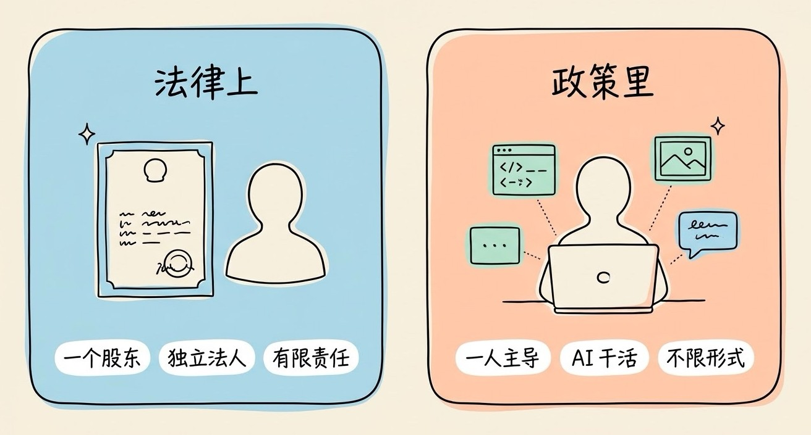
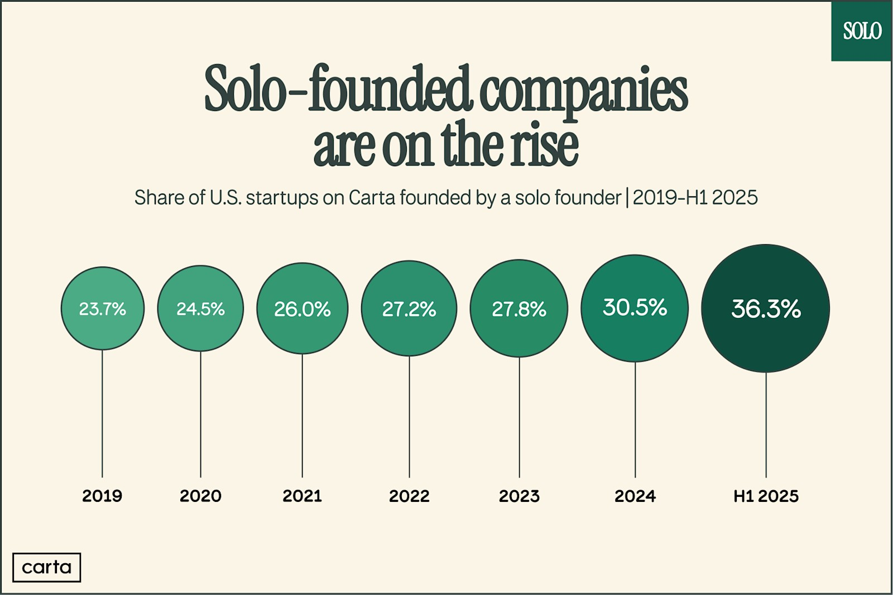
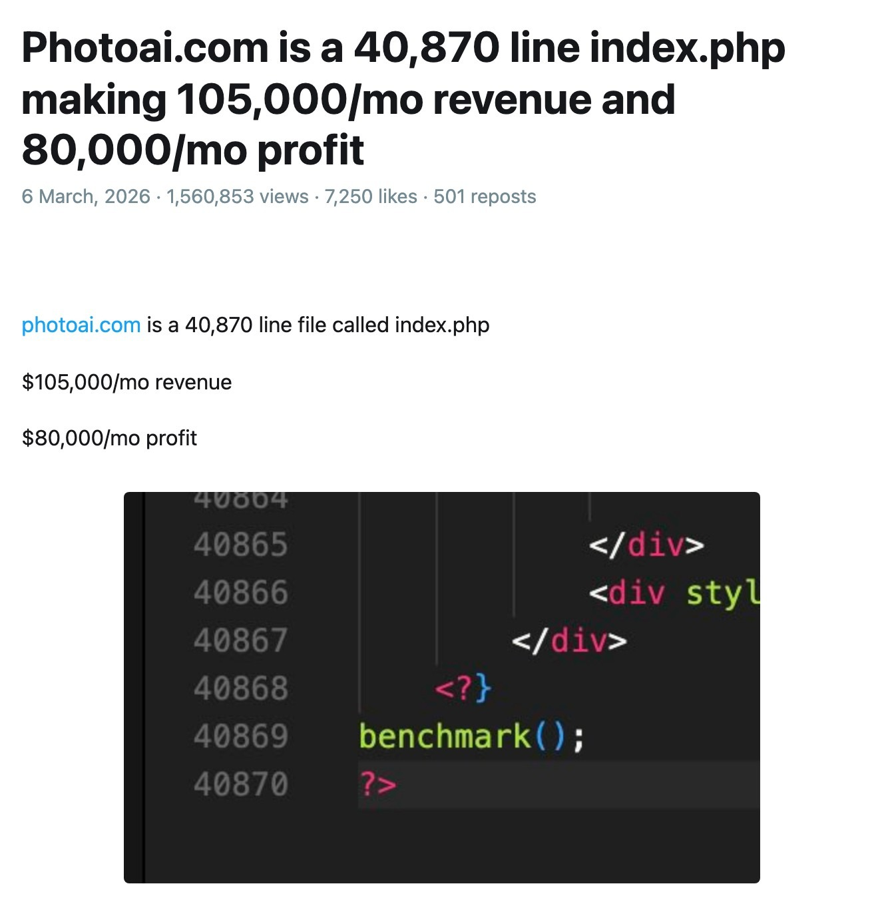
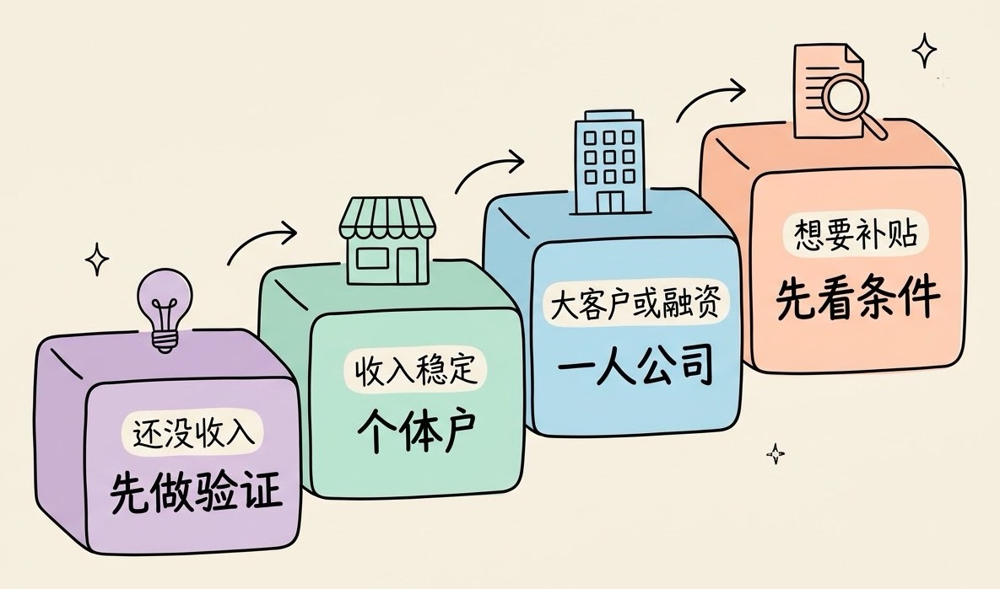

# 3分钟搞懂OPC

> ⭐入门 · 阅读时间 3分钟 · 更新于 2026-11-25
>
> OPC 现在有两层意思：法律上的一人有限公司，和政策里借助 AI 一个人跑完全流程的“AI 一人公司”。本文讲清 2026 年各地为什么抢着扶持它、AI 能替你做什么做不了什么，以及注册公司还是个体户怎么算账。

## 一句话定义

**OPC**（One Person Company，一人公司）现在有两层意思：

- **法律上**，它指只有一个股东的公司。和个体户不同，它是独立的法人，股东原则上只用自己认缴的出资对公司债务负责。
- **政策和创业圈里**，它指一种创业方式：由一个人主导，把 AI 当成“数字员工”，自己完成从做产品、做内容到卖出去、做售后的整条链路。

前一个意思是《公司法》里早就有的概念，后一个意思是 2025 年以后才流行起来的。现在大家在新闻里看到的“OPC 社区”“OPC 补贴”，说的基本都是第二个意思。

## “一人公司”不一定是一个人，也不一定是公司

这两层意思经常被混在一起，但它们的范围并不一样。

政策里的 OPC 看的是创业方式，不看注册形式。北京市经信局的说法是“一个人或几个人借助 AI 工具当数字员工，独立完成从研发到运营的全链路工作”，并没有要求必须注册成一人有限公司，也没有规定团队人数的上限。所以一个注册成普通有限公司、有两三个合伙人的小团队，也可能被算作 OPC；反过来，一个人注册了一人有限公司、但做的是传统代理记账，大概率不在这些政策的扶持范围里。

海外的情况也类似。2025 年 6 月，以色列开发者 Maor Shlomo 做的 AI 建站工具 Base44 被 Wix 以约 8000 万美元现金收购，当时它成立才半年，没拿过外部融资，被很多媒体称为“一人公司”的样板。但按 Wix 和以色列媒体的说法，Base44 被收购时其实已经有 6 到 8 名员工，“一人”指的是创始人一个人持股、主导，而不是只有他一个人在干活。

所以看到“OPC”这个词时，最好先分清它说的是哪一层：讲法律责任和税的时候，说的是一人有限公司；讲政策和创业趋势的时候，说的是**一人主导、AI 干活**的这种方式。



## AI 让一个人能做哪些事？

过去一个人很难单独开公司，主要是因为写代码、做设计、写文案、做客服这些事，每一样都要专门的人来做。现在这些环节都有了能直接上手的 AI 工具：

| 环节 | 海外常用 | 国内可用 |
|---|---|---|
| 写代码、做产品 | Claude Code、Codex、Cursor | TRAE、通义灵码、CodeBuddy |
| 设计和配图 | Midjourney、Gemini、GPT Image | 即梦、可灵、豆包 |
| 文案和内容 | ChatGPT、Claude | 豆包、千问、DeepSeek、Kimi |
| 客服和日常事务 | 各类 AI Agent | 腾讯云智能体开发平台、扣子 |

和两年前相比，最大的变化是 **AI Agent** 已经可以自己连续干完一整件事了，比如读完需求后自己写代码、跑测试、改 bug，而不是你问一句它答一句。一个人可以同时开好几个 Agent，分别处理不同的任务，自己负责做判断和验收。

这种变化在数据上已经能看出来了。美国股权管理平台 Carta 统计了在它平台上新成立的创业公司，2019 年只有一个创始人的公司占 23.7%，到 2025 年上半年已经升到 36.3%。


*图注：Carta《Solo Founders Report 2025》里的图，统计的是在 Carta 平台上新成立的美国创业公司中，只有一个创始人的公司所占的比例。从 2019 年的 23.7% 逐年上升，2024 年是 30.5%，2025 年上半年跳到了 36.3%。*

独立开发者 Pieter Levels 是经常被拿来举例的人。他一个人做了 Photo AI、Nomad List、Remote OK 等多个产品，按他自己在 X 上公布的数字，2026 年 3 月光是 Photo AI 一个产品，月收入就有 10.5 万美元左右。不过这些都是他本人公布的数字，没有经过审计，可以作为参考。


*图注：Pieter Levels 2026 年 3 月 6 日发在 X 上、并同步到个人网站的帖子。他写的是 photoai.com 整个网站是一个 40870 行的 index.php 文件，每月收入 10.5 万美元、利润 8 万美元，下面是这个文件最后几行代码的截图。*

但 AI 主要解决的是“做出来”的问题，有几件事它目前替代不了：

- **找到客户**：产品做出来之后谁来买、去哪里找到这些人，仍然要靠你自己的判断和积累。Pieter Levels 能成功，一个很重要的原因是他在 X 上有几十万关注者，产品一上线就有人看到。
- **对结果负责**：AI 写的代码、合同、宣传文案出了问题，责任在你，不在 AI。一个人做公司，验收这一步是省不掉的。
- **杂事和成本**：报税、开票、签合同、回复客户这些事情仍然要有人管，而且模型订阅和 API 调用的费用也不低。复旦大学姚建华团队在 2026 年的 OPC 调研报告里，就把“个体事务繁重”“需要具备多种能力”“大模型使用成本高”列为 OPC 面临的主要困难。

所以更准确的说法是：AI 让一个人能**做出**一家公司的产品，但能不能**养活**这家公司，主要还是看你能不能找到愿意付钱的客户。

## 2026 年，各地为什么都在扶持 OPC？

OPC 在国内真正成为热词，是在 2026 年。

国家层面，2026 年 6 月 18 日，工信部、中央网信办、国家发展改革委等七个部门联合发布了《促进平台经济大中小企业协同发展行动方案（2026—2028 年）》，里面提出要加快培育**人工智能一人公司**。这是国家级文件第一次直接写到这个说法。

地方的动作更早，也更具体。下面是几个有代表性的例子：

| 地区 | 主要措施 |
|---|---|
| 北京 | 市经信局出台《支持人工智能 OPC 创新发展行动方案（试行）》，计划年内培育不少于 10 家专业化 OPC 成长社区、服务 500 家以上 OPC，重点支持智能体开发、AIGC 产品、大模型微调等方向 |
| 杭州 | 2026 年 6 月发布三年行动计划，目标是到 2028 年建成 100 个以上 OPC 社区、培育 100 家以上营收超千万元的 OPC；采购算力和模型服务的 OPC 每年可申领的补贴最高 1000 万元 |
| 上海浦东 | 为新注册的 OPC 提供最高 30 万元的免费算力支持 |
| 东莞滨海湾新区 | 设立 3 亿元的人工智能创业基金 |
| 宁波 | 为首次创业的 OPC 项目提供创业保险 |

按复旦大学姚建华团队的统计，截至 2026 年 5 月，全国已有 20 个省级行政区发布了 106 项 OPC 专项政策和配套措施，OPC 社区有 426 个，覆盖 28 个省级行政区、65 个城市。

和以前的小微企业扶持相比，这一轮政策有个明显的不同：补贴的重点是**算力和模型服务**，而不只是房租和注册费。原因也不难理解，对一个靠 AI 干活的人来说，最大的固定开销往往就是模型和算力。

另一方面，政策热起来以后，问题也跟着出现了。有媒体报道，一些人注册公司只是为了申领补贴，拿到钱之后既没有产品也没有营收，公司就搁置了；各地的扶持政策也越来越像，基本都是资金、算力、场地这三样，互相比谁给得多。对普通人来说，补贴可以降低启动成本，但它不能替你找到客户。**如果一个项目只有拿到补贴才能活下去，那它本身就是有问题的。**

## 注册一人有限公司，要注意什么？

如果你决定按法律意义上的一人公司来注册，2024 年 7 月 1 日起施行的新《公司法》有几处变化需要知道：

- **数量限制取消了**。旧法规定，一个自然人只能设立一家一人有限公司，而且这家公司不能再投资设立新的一人有限公司。新法删掉了这条限制，新法还允许只有一个股东的股份有限公司。
- **认缴不等于不用缴**。新法要求有限公司股东认缴的出资，要在公司成立之日起五年内缴足。2024 年 7 月之前成立、认缴期限更长的公司，也要在过渡期内把期限调整到五年以内。所以注册资本不要为了好看随手填个几百万，你认缴了多少，将来就可能要真的拿出多少。
- **有限责任有一个前提**。新法第二十三条规定，只有一个股东的公司，如果股东**不能证明公司的财产独立于自己的财产**，就要对公司的债务承担连带责任。也就是说，一旦公司欠债被起诉，需要你来证明公司的钱和你自己的钱是分开的，证明不了，有限责任就会失效。

第三条最容易被忽视。很多人用个人微信、支付宝收公司的款，用公司的钱付自己的房租，平时觉得方便，真出了纠纷就说不清了。比较稳妥的做法是：

- 公司的收入和支出都走对公账户，不和个人账户混用
- 股东从公司拿钱，要么作为工资，要么作为分红，按规定交税并留下记录
- 每年做一份财务报告，最好请会计师事务所审计。新法已经不强制一人公司每年审计了，但发生诉讼时，一份经过审计的报告是证明财产独立最有力的材料


## 注册公司还是个体户？先算一笔账

很多文章会说一人公司比个体户“税收更优惠”，但实际情况要分开来看。先看三种身份的区别：

| | 一人有限公司 | 个体工商户 | 不注册（个人接活） |
|---|---|---|---|
| 是否独立法人 | 是 | 否 | 否 |
| 债务责任 | 以认缴出资为限，但要能证明财产独立 | 用个人或家庭财产承担 | 用个人财产承担 |
| 签合同、开发票 | 用公司名义 | 用个体户名义，也可以开发票 | 以个人名义，开票要去税务局代开 |
| 主要税种 | 企业所得税，分红时再交个人所得税 | 经营所得个人所得税 | 劳务报酬等个人所得税 |
| 适合 | 收入较高、要签大客户、要融资或风险较高的业务 | 收入不高、业务简单、风险较低 | 偶尔接单、还在验证想法 |

再看税。按财政部和税务总局 2023 年第 12 号公告，下面两项优惠都执行到 2027 年 12 月 31 日：

- **小型微利企业**：年应纳税所得额不超过 300 万元的部分，减按 25% 计入应纳税所得额，再按 20% 的税率缴纳企业所得税，算下来实际税率是 5%。
- **个体工商户**：年应纳税所得额不超过 200 万元的部分，个人所得税减半征收。

假设一年的利润是 100 万元，我们粗算一下两种方式各要交多少税（不考虑各类扣除和社保）：

```
一人有限公司:
  企业所得税: 100万 × 25% × 20% = 5万
  剩下95万全部分红给自己, 个人所得税: 95万 × 20% = 19万
  合计: 约24万

个体工商户 (查账征收):
  经营所得个税: 100万 × 35% - 速算扣除数6.55万 = 28.45万
  减半征收后: 约14.2万
```

可以看出，如果每年的利润最后都要拿到自己手里花，个体户交的税反而更少。一人公司的 5% 只是公司这一层的税，钱从公司转到个人手里时，还要再交 20% 的分红个税。

一人公司在税上的优势，主要出现在**钱留在公司里继续投入**的时候：利润不分红，用来买算力、做推广、招人，就只需要交公司这一层的税。所以判断要不要注册公司，不能只看税率，更要看你接下来是要把钱拿出来用，还是要继续投入做大。实际该怎么搭配工资和分红，建议找会计按你的具体情况来算。

把上面的内容合在一起，可以按这个顺序来考虑：

1. **还没有稳定收入时，先不急着注册**。先用 AI 把产品或服务做出来，确认有人愿意付钱。
2. **有了稳定收入、客户主要是个人或小商家时**，个体户通常就够用了，手续简单，税也不高。
3. **当需要和企业客户签合同、业务可能产生较大赔偿风险、或者打算融资和引入合伙人时**，再注册一人有限公司，并且从第一天起就把公司账和个人账分开。
4. **如果打算申请当地的 OPC 补贴**，先看清楚条件。不少政策对注册地、所属行业、社保缴纳、入驻指定社区都有要求，不要为了补贴去改变原本的业务方向。



## 时效性提醒

OPC 相关的信息变化很快，主要是这几类：

- **地方政策**：各地的 OPC 政策大多是 2026 年才出台的，补贴标准、申请条件和社区名单还在频繁调整
- **税收优惠**：小型微利企业和个体工商户的优惠目前执行到 2027 年 12 月 31 日，到期后是否延续要看新的公告
- **统计数字**：各家机构对 OPC 社区数量、OPC 企业数量的统计口径不同，数字差别很大
- **AI 工具**：AI 编程和 Agent 工具几个月就会更新一次，能力和价格都在变化

**建议**：注册和报税的具体问题，以当地市场监督管理局和税务局的答复为准；申请补贴前，以政策原文为准。

💬 **互动话题**：如果让你一个人加上几个 AI 开一家公司，你觉得最难搞定的会是做产品、找客户，还是那些报税开票的杂事？

📖 **相关阅读**：

- [3分钟搞懂AI-Agent](../../02-core-capabilities/05-ai-agent/README.md) - 一人公司里的“数字员工”是怎么干活的
- [3分钟搞懂Vibe-Coding](../../07-dev-tools/01-vibe-coding/README.md) - 不懂代码也能做产品，但要注意哪些问题
- [3分钟搞懂Claude-Code](../../07-dev-tools/06-claude-code/README.md) - 一个人做产品时常用的 AI 编程工具
- [3分钟搞懂AI商业模式](../01-ai-business-models/README.md) - AI 产品是怎么定价和赚钱的
- [3分钟搞懂AI就业影响](../04-ai-and-jobs/README.md) - AI 如何改变就业结构和创业机会

**资料来源**：

- 《中华人民共和国公司法》（2023 年修订，2024 年 7 月 1 日施行），第二十三条、第四十七条：https://policy.mofcom.gov.cn/claw/clawContent.shtml?id=98771
- 财政部 税务总局，关于进一步支持小微企业和个体工商户发展有关税费政策的公告（2023 年第 12 号）：https://www.gov.cn/zhengce/zhengceku/202308/content_6896379.htm
- 人民网，增量政策力挺人工智能一人公司（2026-07-02）：http://finance.people.com.cn/n1/2026/0702/c1004-40752181.html
- 杭州网，杭州发布“AI+OPC”三年行动计划（2026-06-30）：https://hznews.hangzhou.com.cn/jingji/content/2026-06/30/content_9247183.htm
- 新华网，杭州“AI+OPC”行动计划相关报道（2026-06-29）：https://www.news.cn/fortune/20260629/4a2c8a1a6dff4fcea2de19d398d17f2e/c.html
- 新京报，北京支持人工智能 OPC 创新发展相关报道：https://www.bjnews.com.cn/detail/1784585159189781.html
- 新华网，复旦大学姚建华团队《2026年中国一人公司（OPC）调研报告》相关报道（2026-07-23）：https://www.news.cn/digital/20260723/b239027e765f49bb8e584e02d684ea6e/c.html
- 上观新闻，姚建华等：2026年中国一人公司（OPC）调研报告：https://www.jfdaily.com/wx/detail.do?id=1148807
- OPC 热潮中的“套补贴”和政策同质化问题相关报道（2026-06-15）：https://paper.people.com.cn/zgjjzk/pc/content/202606/15/content_30170322.html
- Carta，Solo Founders Report 2025（文中单人创始公司占比图出自此文）：https://carta.com/data/solo-founders-report
- TechCrunch，6-month-old, solo-owned vibe coder Base44 sells to Wix for $80M cash（2025-06-18）：https://techcrunch.com/2025/06/18/6-month-old-solo-owned-vibe-coder-base44-sells-to-wix-for-80m-cash
- Wix 新闻稿，Wix 收购 Base44：https://www.wix.com/press-room/home/post/wix-further-expands-into-vibe-coding-with-acquisition-of-base44-a-hyper-growth-startup-that-simplif
- Pieter Levels，Photoai.com is a 40,870 line index.php making 105,000/mo revenue and 80,000/mo profit（2026-03-06，收入为本人公布，文中截图出自此文）：https://levels.io/photoai-40870-line-index-php-105k-mo-revenue

---

⬅️ 上一篇：[3分钟搞懂AI就业影响](../04-ai-and-jobs/README.md) ｜ [📚 返回目录](../README.md) ｜ 下一篇：[3分钟搞懂AI监管政策](../06-ai-regulation/README.md) ➡️
